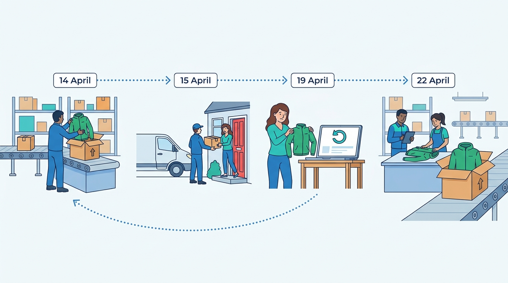
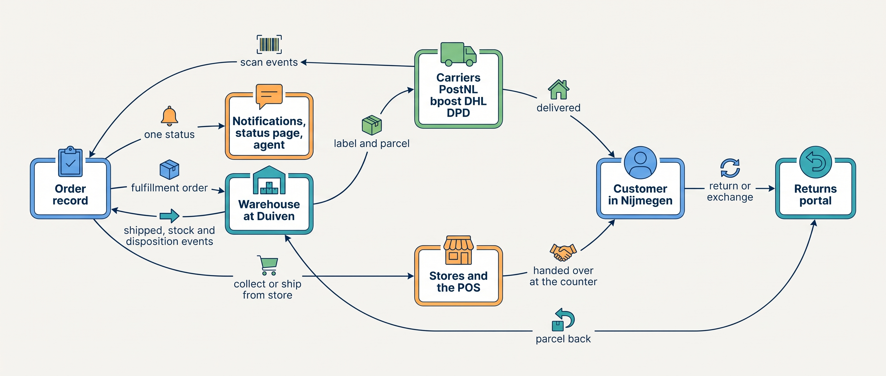
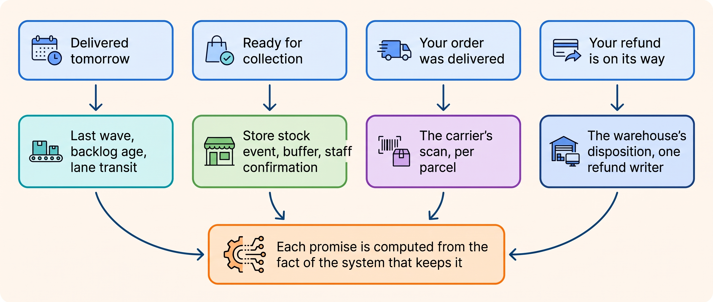

> **KEY POINTS:**
>
> * **The physical world has its own systems of record.** The warehouse counts shelves, the carrier's scan proves delivery and the returns bench knows what came back; nothing upstream may overwrite them.
> * **A promise about the physical world is a computation, not a sentence.** “Delivered tomorrow” needs the pick wave, the backlog and the carrier's transit time; every incident in this part is a promise made without its inputs.
> * **One writer per fact, one source per view.** One refund writer keyed by the return, stock that rises only on the warehouse's verdict, and every customer-facing screen reading the same order record.

 
Checkout can confirm an order in seconds, but someone still has to pick and pack the goods before the carrier's collection. A late instruction or an empty shelf can push delivery back a day. Returns and store services create similar dependencies on people, space and time. This part explains how the systems planning that physical work supply dates and statuses the customer can rely on.

Eva's jacket order illustrates the sequence. She buys on 13 April 2027; Duiven picks and packs on 14 April; PostNL delivers on 15 April, a day later than promised. She requests a larger size on 19 April. The warehouse receives and inspects the return and ships the replacement on 22 April. Store pickup and counter exchange provide alternative routes.

**Figure 1:** *Eva's jacket in Part IV: packed at Duiven on 14 April, delivered in Nijmegen on 15 April, size L requested on 19 April, and the exchange shipped on 22 April.*

**Kestrel & Pine is a fictional outdoor brand** shipping 336,000 parcels and 9,400 wholesale shipments annually. It operates one warehouse, uses four carriers, runs six stores on separate till software and receives 72,000 return parcels.

Its **Waypoint** improvement program assigns stock to the systems that count it, establishes one shared order record and calculates delivery promises from actual operations. Customer messages must reflect those records. The chapters below show why each decision matters.

**Figure 2:** *The systems of Part IV: the order record instructs the warehouse and the stores, the warehouse and the carriers move the parcel there and back, and every physical fact returns as an event to the one record that the notifications, the status page and the agent read.*

**Figure 3:** *The four promises of Part IV and the inputs each needs; the Queue That Waited, the Store Stock Mirage, the Three-Status Order and the Double Refund are the four made without them.*

## Chapters in this part

[[warehouse-and-fulfillment]] defines **the work instruction and response between order management and the warehouse**. A four-hour Black Friday order backlog shows why a warehouse can have spare picking capacity while customers wait for orders that never reached it.

[[shipping-and-delivery]] explains **carrier integration and credible delivery dates**. Eva is promised Wednesday and receives Thursday because a static storefront rule ignores warehouse timing. Collection schedules, backlog, location and carrier performance must inform the promise.

[[stores-and-omnichannel]] treats **the store till as another source of orders, stock and customer records**. Utrecht's pickup pilot promises 37 items already sold. The chapter examines the data needed before offering cross-channel services or replacing the till.

[[returns-and-exchanges]] separates **the return request, inspection, stock decision and money movement**. Eva's size exchange and January's 212 double refunds show why each action needs its own state and authorized owner.

[[customer-service-and-notifications]] aligns **messages, the status page and the support view**. Eleven tickets about one split order could have been reduced by the missing explanation: the order ships in two parcels. The chapter builds that explanation from shared facts.

Begin with [[warehouse-and-fulfillment]].

## Sources and Evidence

Every public claim in this part is sourced and dated in the chapter that makes it, under that chapter's Sources and Evidence. Kestrel & Pine is fictional; recommendations and labeled assumptions are the author's judgement.
