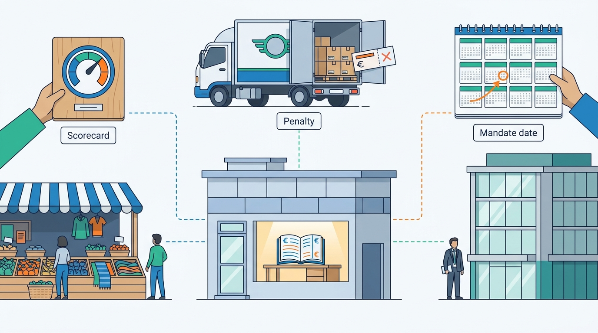
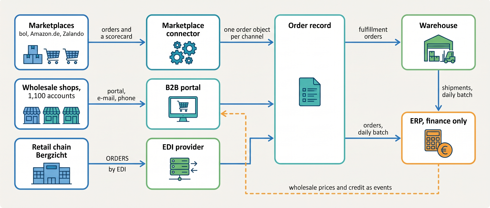
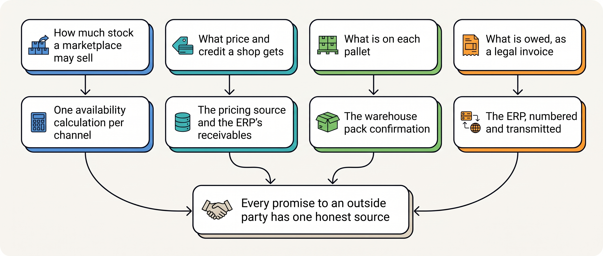

> **KEY POINTS:**
>
> * **Every outside channel is a way into the same order record.** Marketplace, portal, e-mail and EDI orders should all create one kind of order, flagged by channel.
> * **The intermediaries translate; they must not own.** Connectors and EDI providers carry facts between owners, and each fact keeps one honest source.
> * **Outside parties keep score and set the calendar.** Marketplaces grade, retail chains charge back and mandates arrive with legal dates, so availability must never wait on a batch ERP.

 
Most of this book follows an order that starts on the merchant's own web page. A growing merchant takes a large share of its revenue from orders that do not. A shopper buys on bol's or Amazon's page and never notices whose parcel arrives. An outdoor shop orders sixty jackets on thirty-day terms at a price agreed for the season. A retail chain's purchasing system sends a purchase order as a standard document and expects a pallet-by-pallet notice and a machine-readable invoice back. **Each of these channels comes with an outside party that sets the rules**: a scorecard, purchasing conditions with penalties, a legal mandate with a date. And every one of these orders ends in the ERP, where finance posts it.

**Figure 1:** *Each outside channel comes with an outside party that sets the rules: a marketplace keeps a scorecard, a retail chain charges penalties, and a mandate arrives with a legal date.*

Part V sits beside Eva's jacket rather than on it. Her order of 13 April 2027 never touches a marketplace, a wholesale account or an EDI message. Its siblings do: two Amazon.de orders for a Ridgewalker jacket placed the same day, one shipped from Duiven and one by the marketplace; De Kaap Buitensport's pre-season order of 25 February; Bergzicht Outdoor's spring reorder of 6 April, 240 units on three pallets. All of them meet Eva's order in the warehouse and in the ledger, which is where the part ends.

Kestrel & Pine, the fictional outdoor brand this book follows, earned €3.0 million on three marketplaces in 2026 through a connector rented since 2021, and €12.0 million from 1,100 wholesale accounts, 62% through the platform's B2B portal and 38% keyed into the ERP by hand, plus one retail chain, Bergzicht, that orders by EDI. The ERP has been connected to the platform since 2023 by a connector the ERP partner built and nobody else could read. **The claim of this part is that an outside channel is a way into the one order record, and that the systems between the merchant and the outside party must translate without owning anything.** Waypoint's decisions W2 (one order record), W6 (EDI compliance) and the finance-only rule for the ERP are that claim written down.

**Figure 2:** *The outside channels of Part V: three kinds of outside party, three intermediaries that translate, one order record that every channel's order is created in, and an ERP that receives daily batches and feeds no channel directly: its wholesale prices and credit limits leave it only as events.*

**Figure 3:** *The four promises Part V makes to outside parties and the one system allowed to make each; every chargeback, strike and keyed-in order in the part is a promise that came from the wrong system.*

## Chapters in this part

[[marketplaces-and-channel-integration]] decides **what it takes to list, sell and ship on a marketplace, and where a marketplace order belongs**: a marketplace is a channel with a scorecard (Amazon's cancellation rate under 2.5%, bol's strikes), the connector translates five flows and must own none of them, the stock number sent is a promise computed once per channel, and every marketplace API retires on a published date. The case is the three marketplaces behind the connector: the 160 marketplace orders and the bol strike inside the Black Friday Oversell, the Deprecated Endpoint's two days of stale stock, and the two Amazon.de orders of 13 April 2027.

[[b2b-commerce]] decides **what changes when the buyer is a company, and which system owns the account, the price and the credit limit**: the customer becomes an organization with locations, people and roles; a B2B price is a promise with a validity date that the invoice must match; payment terms and credit limits are finance facts in the ERP that the checkout must be able to read. The case is the 38% of wholesale orders keyed in by hand, and De Kaap Buitensport's pre-season order of 25 February 2027, €6,720 at list, held because it would push the shop past its €15,000 credit limit.

[[edi-and-e-invoicing]] decides **how large trading partners exchange orders, despatch advices and invoices without a web shop, and what the e-invoicing mandates require**: an EDI order creates the same order record as a web order, each document has its own system of truth, and structured e-invoicing is law with dates, Belgium since 1 January 2026, Germany from 2027, the Netherlands planned for 2030. The case is Bergzicht's ORDERS–DESADV–INVOIC cycle of 6 April 2027 and the €14,200 ASN Chargeback, answered by decision W6.

[[erp-and-back-office-integration]] decides **what the ERP should own in a commerce business, and whether it should be the hub**: four jobs (the ledger, purchasing, inventory valuation, master data), three honest answers to "who is the hub" and one accident, and the rule that finance can be batch but availability cannot. The case is the partner-built connector that took three weeks to reconstruct, the January 2027 month-end that took eleven working days, Eva's order in the books, and the finance-only rule that retires the connector in late 2027.

Begin with [[marketplaces-and-channel-integration]].

## Sources and Evidence

Every public claim in this part is sourced and dated in the chapter that makes it, under that chapter's Sources and Evidence. Kestrel & Pine is fictional; recommendations and labeled assumptions are the author's judgement.
