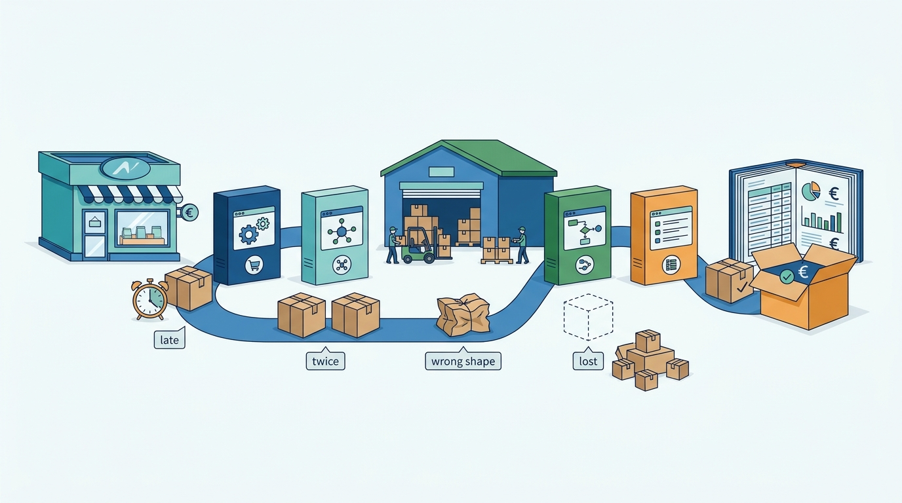
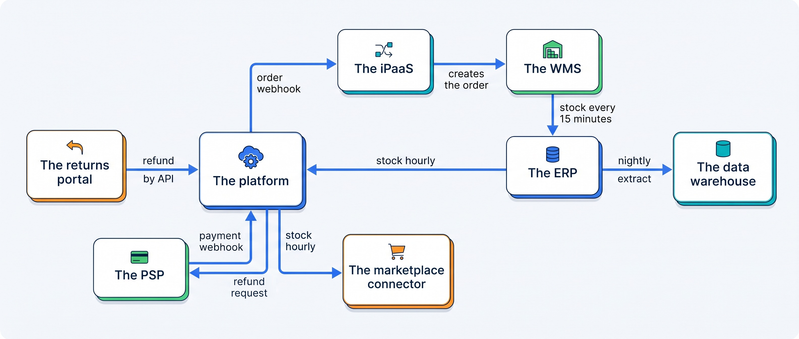
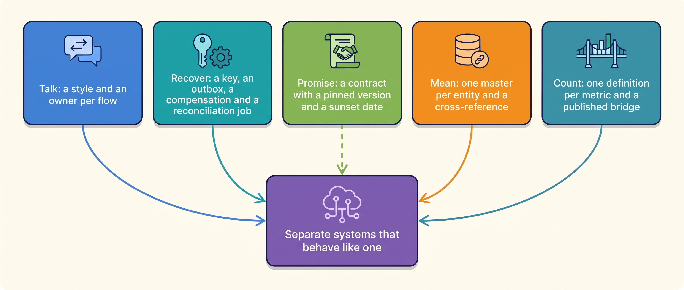

> **IN THIS PART, YOU WILL:** Follow the facts that cross between Kestrel & Pine's thirteen systems and learn the five questions every join must answer: how the systems talk, how they recover, what they promise, whom they mean and what they count.

> **KEY POINTS:**
>
> * **Integration is decided per flow, and every flow needs an owner.** Stock, orders and prices want events with a safety net, products want scheduled publication, finance wants a daily batch. Kestrel & Pine's inventory found 34 integrations, 13 with nobody to call in January 2027, and none that compared stock or orders between two systems.
> * **Separate systems are built to disagree; design them to recover and to prove it.** Every delivery arrives at least once and in any order, so a receiver needs an idempotency key, a sender an outbox, a partial failure a compensating action, and every flow a reconciliation job that compares the two ends. Every contract has a version and a sunset date, and the consumer's job is to write that date down.
> * **Moving the data is half the work; meaning the same thing by it is the other half.** One customer became four records and one month's orders became three counts because nobody had named the master record for a customer or the definition of an order. One owner per entity and per metric, with the links and the bridge published, is what makes joined systems behave like one.

> **[FAILURE PATTERNS THIS PART ADDRESSES](where-commerce-platforms-go-wrong.html):**
>
> * **The Spaghetti Junction** — 34 connectors built one need at a time, the mapping between systems living inside each connector, and 13 flows with no owner in January 2027.
> * **The Message in a Bottle** — a webhook or a scheduled sync sent once and trusted: the Double Refund, the Price Drift and 390 variants whose stock drifted while nothing compared the two ends.
> * **The Pulled Rug** — the marketplace connector retired an API version on a published date, and the only person who had read the notice had left the agency.
> * **The Familiar Stranger** — Eva Janssen is an account, a loyalty entry, a subscriber and a returns contact in four systems with no shared identifier.

 
A growing merchant does not run one system. It runs a dozen or more, each bought because it was good at one thing: the platform sells, the warehouse system picks, the ERP keeps the books, the connector talks to the marketplaces. **The trouble is that an order, a stock level, a price or a customer has to pass between them, and every handoff is a place where it can arrive late, twice, in the wrong shape or not at all.** This part is about the joins that carry the facts between them, where most of the incidents this book opened with happened.

**Figure 1:** *Every handoff between systems is a place where an order, a stock level or a price can arrive late, twice, in the wrong shape or not at all.*

Part VI sits underneath every step of Eva's jacket. Her order of 13 April 2027 is created in the platform at 21:14 and crosses to the integration platform (the iPaaS, a hosted tool that runs flows between systems) and on to the warehouse; her payment confirmation crosses from the PSP (payment service provider) to the platform; the jacket's stock reduction travels back through the ERP to the storefronts and the marketplaces; her exchange crosses from the returns portal to the platform and the PSP. At the end of the month she and her order are counted, and whether she is one customer and her order one order is decided in this part too.

Kestrel & Pine, the fictional outdoor brand this book follows, runs thirteen systems joined by 34 integrations in four styles. **The claim of this part is that making separate systems behave like one is not a tool you buy but five decisions you make, flow by flow: how it moves, how it recovers, what it promises, whom it means and what it counts.** Waypoint's decisions W5 (integration standards) and W7 (one definition of an order) and the June 2027 customer-identity rule are those decisions written down.

**Figure 2:** *The joins Eva's order crosses in April 2027: eight systems, four styles, and a stock figure that takes up to two hours to travel from the warehouse to the marketplaces.*

**Figure 3:** *The five questions of Part VI and the answer each chapter gives; every incident in the part is a flow that had no answer to one of them.*

## Chapters in this part

[[integration-styles]] decides **how commerce systems should exchange data, and how to choose per flow**: four styles (file, shared database, direct call, message) and five triggers, a direct call only where the next step needs the answer, a webhook as a notification and polling as the truth, a hub only with ownership rules. The case is the integration inventory Noor Visser built in February 2027: 34 flows, 13 with no owner as of January, 3 with a reconciliation job and none on stock or orders, and the rule that no flow goes live without a row and no row without an owner.

[[events-consistency-and-reconciliation]] decides **how systems that can only be eventually consistent are kept from drifting apart for good**: the receiver builds exactly-once with an idempotency key that names the business action, the outbox makes "saved" and "announced" one act, a cancellation after shipment is a compensation rather than a rollback, and reconciliation is a component with a card, a key, a tolerance and a named recipient. The cases are the Double Refund (212 returns, €19,400, two writers and no shared key) and the first stock reconciliation of May 2027, which found 2.3% of active variants, about 390, with the wrong figure.

[[api-contracts-and-versioning]] decides **how a system that other systems depend on can change without breaking them**: a contract is a promise with a shape, a meaning, a timing and a lifetime; change by adding; a deprecation is a date pair plus monitoring; a webhook is a signed hint to verify, answer fast, deduplicate and sweep. The case is the Deprecated Endpoint: a 2021 agency script calling a version the marketplace connector retired on Monday 8 February 2027, two days of stale stock on bol, and a fix of two inventory columns: the pinned version and its sunset date.

[[identity-and-master-data]] decides **how a merchant knows that two records in two systems are the same customer or product, and who owns the answer**: name a master per entity, keep a cross-reference of every other system's key, match exact keys automatically and send the uncertain band to a person, keep every merge reversible, and let consent travel with the record. The case is the four Evas: 410,000 platform records, 38,000 loyalty entries, 165,000 subscribers and 61,000 returns contacts with no shared field, and the June 2027 identity rule whose first run linked about 21,000 loyalty entries and 96,000 subscribers to platform customers.

[[commerce-data-and-analytics]] decides **why three reports show three order counts, and how to build analytics the business trusts**: keep operational and analytical data apart, copy every system into one warehouse, define each metric once in a metrics layer with an owner, and publish the bridge between the counts next to the number. The case is February 2027: 21,050 orders in the platform, 22,710 in the ERP and 24,140 in the warehouse report, each right about what it counted; under decision W7 they became 23,150 orders with a bridge, and the first unexplained difference, in August 2027, was 23 marketplace orders a connector had dropped.

Begin with [[integration-styles]].

## Sources and Evidence

Every public claim in this part is sourced and dated in the chapter that makes it, under that chapter's Sources and Evidence. Kestrel & Pine is fictional; recommendations and labeled assumptions are the author's judgement.
