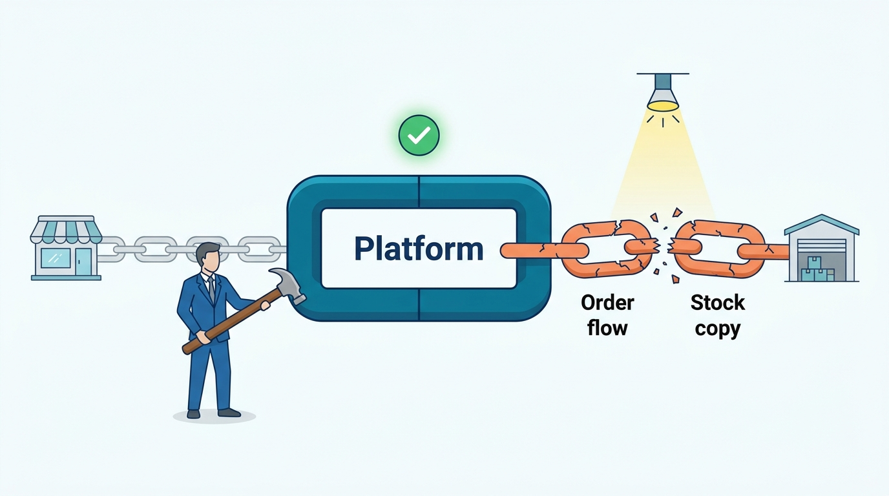
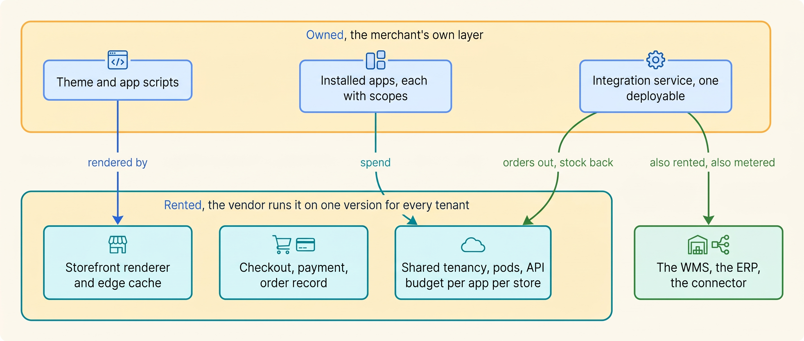
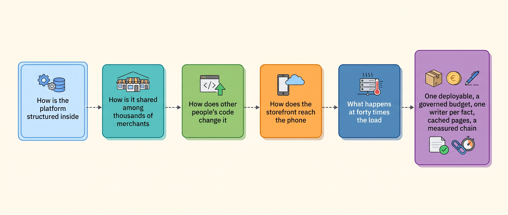

> **KEY POINTS:**
>
> * **The platform's internals are the vendor's; the code around it is yours.** The giants' architectures describe thousands of engineers, and most merchants need one deployment unit.
> * **Renting a shared system means governing your share of it.** Know which API limits each app uses, give it an owner and restrict which facts it can change.
> * **The storefront renders facts it does not own, and the peak shows it.** Cache the page, fetch price and stock live, and measure the whole chain in orders per minute.

 
A hosted commerce platform can keep accepting orders while the merchant's warehouse connector falls behind. Renting the core application transfers some operating work to the vendor, but extensions, storefront customizations and integrations can still interrupt sales or fulfillment. This part separates those responsibilities so the merchant can invest in the component actually limiting the order flow.

This part follows the machinery behind a jacket purchase: application structure, shared infrastructure, extensions, page delivery and peak capacity. It distinguishes vendor decisions from the operating choices a merchant's team can make.

**Kestrel & Pine, the fictional outdoor brand**, faces two rebuild proposals in early 2027: about €3.2 million for separate commerce services and €240,000 for a separate storefront. Yet the platform handled 2,300 orders in the Black Friday peak hour. Order export managed about seven per minute, and stock updates lagged up to two hours.

Head of Engineering Noor Visser directs attention to those measured failures. The five chapters explain how to evaluate the alternatives without taking on more systems than the team can operate.

**Figure 1:** *On 27 November 2026 the rented platform held at 2,300 orders in the peak hour; the merchant's own joins, an order flow of about seven orders a minute and stock up to two hours old, were the weak links the rebuild proposals left for phase two.*

**Figure 2:** *A merchant on a hosted platform rents the renderer, the checkout and a share of a multi-tenant system, and owns the theme, the apps and the integration code around them; the owned layer and the budget it spends are where the peak day is won or lost.*

**Figure 3:** *The five questions of Part VII in reading order, from the inside of the platform outward to the day it is tested; each answer narrows what a merchant should treat as its own.*

## Chapters in this part

[[commerce-architecture-styles]] compares **how software is divided into separately deployed programs**. Dated company accounts show why release independence can justify a split, and why each additional service also adds operating work.

[[multi-tenancy-and-isolation]] explains **how vendors share infrastructure while separating customers**. API call budgets can constrain order export even when the storefront is healthy. Kestrel & Pine's peak logs show why both ends of an integration need capacity checks.

[[extensibility-and-app-ecosystems]] establishes **an owner and permission boundary for each extension**. An inventory of 41 apps finds six unused and three writing stock. The chapter follows the permissions and maintenance decisions that reduce the conflicts.

[[storefront-architecture]] compares **platform-rendered pages with a separate, headless application**. Measurements trace slow interaction to eleven app scripts. Removing that cause improves the existing theme and weakens the case for a rebuild.

[[peak-load-and-reliability]] prepares **the entire order path for concentrated demand**. The 2027 plan forecasts 60 orders per minute and tests every link at 80. It includes monitored queues, optional work to pause, named responders and reconciliation after the peak.

Begin with [[commerce-architecture-styles]].

## Sources and Evidence

Every public claim in this part is sourced and dated in the chapter that makes it, under that chapter's Sources and Evidence. Kestrel & Pine is fictional; recommendations and labeled assumptions are the author's judgement.
