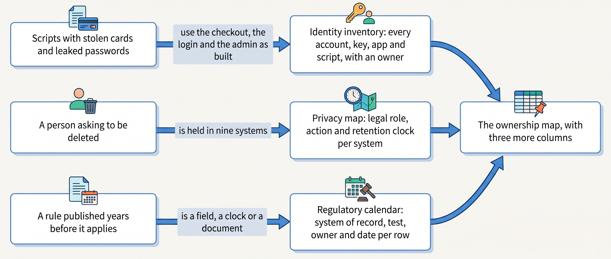
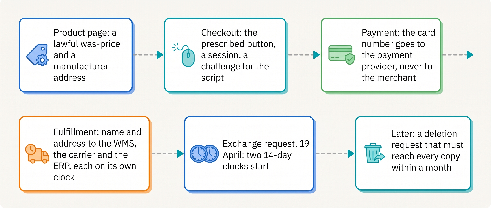

> **KEY POINTS:**
>
> * **Attackers use the shop as built.** Card testing, credential stuffing and skimming are the checkout and login at machine speed; the merchant secures every identity, key, app and script it adds.
> * **The order and the person are different things in law.** The order stays for years under contract and tax law; the profile goes when the person asks, so the transaction must outlive the person.
> * **Most rules are data requirements with a date.** Each belongs in a system of record, with a test and a calendar row that names an owner.

 
The checkout that accepts a real purchase can also receive automated payment attacks. The address used for delivery can remain in a forgotten export, and a pricing rule can require data the shop has never collected. Security, privacy and regulatory work each follow information across several systems. This part explains how to identify the responsible owners and controls before the gap harms a customer or interrupts trading.

**Figure 1:** *A shop is three public forms, a payment form, a login and an admin, and none of them has to be broken to be abused.*

**Where we are in the order's journey.** Eva buys a jacket from Kestrel & Pine, the fictional outdoor brand. Her purchase passes through checkout, payment, warehouse, carrier and finance. Each needs appropriate access and data handling. Product information, pricing, invoicing and the later return process must also meet the rules applicable to that transaction.

Three examples show the work: **48,000 abusive checkout attempts** in August 2026; a customer's May 2027 deletion request; and regulatory changes reaching engineering through unrelated channels. The response begins with a map of systems, integrations and owners. Add credentials, data purposes and retention, then applicable requirements and deadlines. The map makes responsibilities actionable; each topic still needs its own controls.

**Figure 2:** *Three things reach a shop from outside, a script, a person with rights and a rule with a date, and each is answered by a list with owners; the three lists are columns of the same ownership map, not a separate discipline.*

**Figure 3:** *Where Part VIII meets Eva's jacket: security at the checkout and the payment, regulation at the price, the button, the product page and the clocks, privacy in every system her name reaches and in the request that one day asks for it back.*

## Chapters in this part

[[commerce-security]] examines **card testing, account takeover, checkout scripts and integration credentials**. The attack costs €2,900 in declined-payment fees and interrupts sales. The chapter assigns controls to the merchant and provider and establishes incident recovery.

[[privacy-and-customer-data]] maps **customer records, their purposes and the actions required by a request**. A customer in Ghent appears in nine systems. Identity links and a coordinated workflow make later requests easier to complete and verify.

[[commerce-regulation]] turns **an applicable rule into owned implementation work**. Identify scope, required data or behavior, authoritative system, verification and deadline. The worked calendar covers product information, accessibility, electronic invoicing and unsold goods, with dates and evidence in the chapter.

Begin with [[commerce-security]].

## Sources and Evidence

Every public claim in this part is sourced and dated in the chapter that makes it, under that chapter's Sources and Evidence. Kestrel & Pine is fictional; recommendations and labeled assumptions are the author's judgement.
