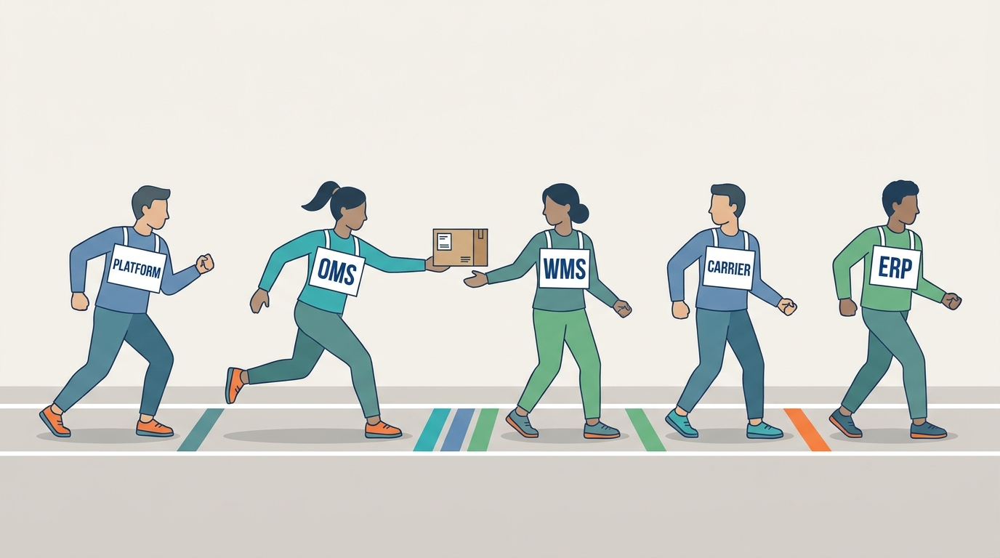
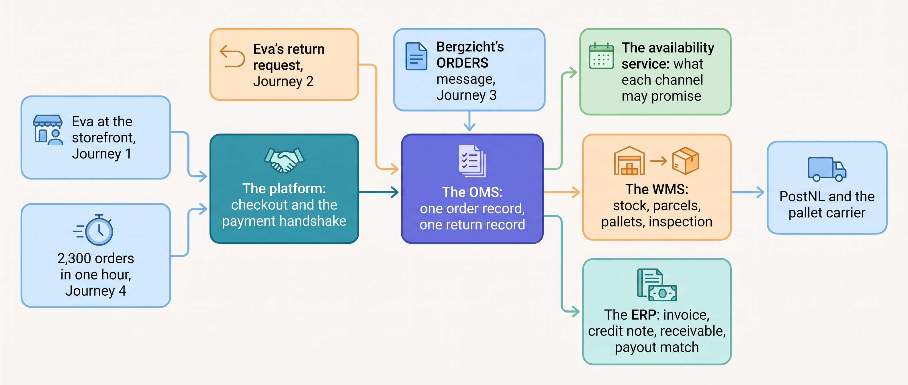
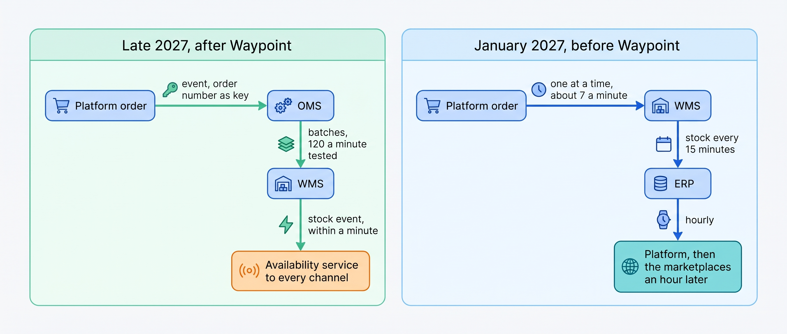

> **KEY POINTS:**
>
> * **An order is a chain of promises, each with one owner.** Many systems holding a piece of one order is normal; a fact with two writers is not.
> * **The same four stories run on two architectures.** The dates and amounts stay fixed; what changes between the January 2027 landscape and Waypoint is whether the promises hold.
> * **Operations by event, finance by batch, and every join with a key and a net.** Each message carries an idempotency key, and a daily reconciliation catches what the webhooks miss.

 
A warehouse can report a parcel shipped while the storefront still shows it being prepared. Knowing how each component works does not explain whether their combined answers keep the customer's promise. These four walkthroughs follow a purchase, an exchange, a wholesale shipment and a peak day across the handoffs, showing where information or responsibility can be lost. All use **Kestrel & Pine, a fictional outdoor brand**; its people, amounts and events are teaching examples.

**Figure 1:** *An order is a chain of promises: each system carries the order for one leg, hands it on in a marked zone, and owns only its own leg.*

Eva's jacket travels from search to the books, then back for a larger size. Retail chain Bergzicht orders from the same stock under a different document contract. Black Friday puts the shared order path under 2,300 orders an hour. Each chapter repeats the facts needed to follow its example.

**How to read the journeys.** The first three assign an authoritative system to each fact, then trace the steps, messages and failure recovery. Tables and illustrations show what each handoff needs. The peak chapter first reconstructs the 2026 incident, then presents the 2027 plan.

**The first three journeys replay April orders through the late-2027 design.** Waypoint, the company's improvement program, adds an availability service for sellable stock, an **order management system (OMS)** for shared orders and a **product information management system (PIM)** for catalog content. Warehouse packing records supply wholesale shipment notices.

The dates and amounts stay in April, but the design is deliberately later. Each walkthrough also compares the earlier landscape, where scheduled stock copies and separate order records caused failures.

**Figure 2:** *Four journeys, one chain: a consumer, a return, a retail chain and a peak evening enter the same systems through different doors, and every arrow is a handoff with one sender and one owner.*

**Figure 3:** *What the "before Waypoint" comparison in each journey shows: in January 2027 orders crawled to the warehouse one at a time and stock came back through three scheduled copies up to two hours late; in late 2027 orders move as keyed events in batches and stock returns as events within a minute.*

## Chapters in this part

[[journey-consumer-order]] follows **order #1072455 from search to accounting**. Eva buys a €199 jacket and two €18 pairs of socks at 21:14 on 13 April 2027, pays through the iDEAL bank-transfer method and receives the parcel on 15 April. Each step identifies who owns its facts and how the next system learns them.

[[journey-return-and-exchange]] follows **the M-to-L exchange requested on 19 April**. Inspection on 22 April determines what can be restocked and releases the replacement. A separate refund branch shows how one authorized request avoids January's duplicate-payment failure.

[[journey-wholesale-order]] follows **Bergzicht's 240-unit, €19,860 reorder** through structured order, pallet notice, invoice and payment. Three pallets arrive on 9 April; payment is due 9 May. An earlier €14,200 deduction explains why the notice must describe actual packing.

[[journey-peak-day]] reconstructs **Black Friday 2026 and the next year's preparation**. A four-hour order backlog and delayed stock updates produce 1,340 oversold units and about €96,000 in costs. The 2027 plan tests capacity, monitors queues and gives each protective action and recovery check an owner.

Begin with [[journey-consumer-order]].

## Sources and Evidence

Every public claim in this part is sourced and dated in the chapter that makes it, under that chapter's Sources and Evidence. Kestrel & Pine and Bergzicht Outdoor are fictional; recommendations and labeled assumptions are the author's judgement.
