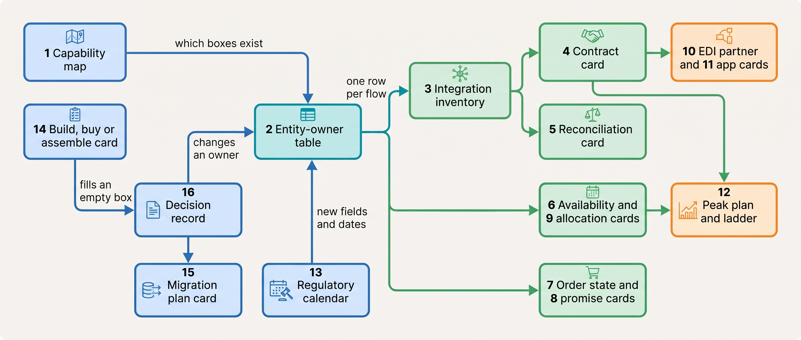

> **IN THIS SECTION, YOU WILL:** Find the card that fits the question on your desk, copy its fields, and see it filled in once for Kestrel & Pine, with the chapter that explains every field.

> **KEY POINTS:**
>
> * **Every card names an owner, a system of record and a date.** Those three fields are what turn a diagram into a decision: who is called when it breaks, which system wins when two disagree, and when the card must be looked at again.
> * **The cards point at each other.** The capability map says which boxes exist, the entity–owner table says who owns each fact, the integration inventory lists every flow that moves a fact, and each flow has a contract card and a reconciliation card. A decision record changes a row in one of them; nothing else should.
> * **Most fields were paid for by an incident.** The writer column came from the App That Wrote Stock, the sunset date from the Deprecated Endpoint, the SSCC source from the ASN Chargeback, the summary rule from the Three-Status Order. Write "unknown" rather than guess.

<br>
These are **working templates for a merchant whose order passes through more systems than one team can hold in its head**: the records the chapters ask you to keep, from the capability map of [[commerce-capability-map]] to the decision record of [[organizing-commerce-engineering]]. Each is the smallest form I have found that makes a design decision explicit, gives it an owner and leaves evidence that someone else can check. The chapters linked from each card give the reasoning and sources behind every field.

Each card is filled in once for **Kestrel & Pine, the fictional outdoor brand this book follows** ([[meet-kestrel-and-pine]]). Every Kestrel & Pine name, figure and date below is invented for teaching and agrees with the chapter that works the full case.

Three conventions run through all sixteen cards.

- **They are kept data, not documents.** A card lives where the people who change the system will see it, in one repository, not in a slide deck.
- **They cite each other by identifier.** A decision record names the entity–owner rows it changes; a contract card names its inventory row.
- **Blank is a finding.** An empty owner cell or a missing sunset date is where the next incident will come from.

## Find the Template for the Question on Your Desk

| The question in front of you | Tool | Chapter that teaches it |
| --- | --- | --- |
| What must the business be able to do, and which system does each job? | [Tool 1](#tool-1): Capability map | [[commerce-capability-map]] |
| Two systems disagree about a price, a stock level or an order. Which one is right? | [Tool 2](#tool-2): Entity–owner table | [[boundaries-and-systems-of-record]] |
| How many flows connect our systems, and who owns each one? | [Tool 3](#tool-3): Integration inventory | [[integration-styles]] |
| A flow is about to go live, or a vendor has announced a new API version | [Tool 4](#tool-4): Integration contract card | [[api-contracts-and-versioning]] |
| How do we know a flow actually worked? | [Tool 5](#tool-5): Reconciliation card | [[events-consistency-and-reconciliation]] |
| What may each channel sell, and where does that number come from? | [Tool 6](#tool-6): Availability (ATP) card | [[inventory-and-availability]] |
| Support sees three different statuses for one order | [Tool 7](#tool-7): Order state card | [[order-management]] |
| What delivery date may the checkout promise? | [Tool 8](#tool-8): Delivery promise card | [[shipping-and-delivery]] |
| How much stock should each marketplace be told about? | [Tool 9](#tool-9): Channel allocation card | [[marketplaces-and-channel-integration]] |
| A trading partner orders by EDI or deducts money for a bad despatch advice | [Tool 10](#tool-10): EDI partner card | [[edi-and-e-invoicing]] |
| Someone wants to install an app, or an app writes data it should not | [Tool 11](#tool-11): App governance card | [[extensibility-and-app-ecosystems]] |
| Black Friday is coming | [Tool 12](#tool-12): Peak plan and degradation ladder | [[peak-load-and-reliability]] |
| A law changes what a field, an invoice or a checkout must do | [Tool 13](#tool-13): Regulatory calendar | [[commerce-regulation]] |
| Should we build, buy or assemble a capability, or replatform? | [Tool 14](#tool-14): Build, buy or assemble decision card | [[build-buy-or-assemble]] |
| A system of record is moving from one system to another | [Tool 15](#tool-15): Migration plan card | [[replatforming-and-migration]] |
| A decision changes who owns a fact, which vendor we depend on or which app may write | [Tool 16](#tool-16): Architecture decision record | [[organizing-commerce-engineering]] |

Two related records are not repeated here because their chapters give them in full: the ownership map and vendor card of [[organizing-commerce-engineering]], and the W7 metric definitions of [[commerce-data-and-analytics]].

## How the Records Connect

Most changes touch several cards; they meet at the entity–owner table.


**Figure 1:** *The capability map says which boxes exist, decision records change who owns each fact, and every flow, partner, app, peak plan and migration is written against the entity–owner table, so a change to one row tells you which other cards to update.*

In plain words: start at the entity–owner table. A fact with no row, or a row with no owner, is the problem.

## <a id="tool-1"></a>Tool 1: Capability Map

**Purpose.** A capability map lists what the business must be able to do, such as "compute what each channel may sell", independent of which system does it today. Placing your systems on it shows the empty boxes (jobs no system owns) and the crowded ones, where incidents start.

**The template.** One row per capability, grouped in six layers: experience, offer, transaction, operations, partners and back office, foundations.

| Field | What to record |
| --- | --- |
| **Layer and capability** | A business ability as a verb phrase ("hold every order in one state model"), never a system, team or vendor |
| **The fact it is the natural home for** | The business fact this capability should own; mark computed facts such as availability and the delivery promise |
| **Systems today** | Every system that does any part of the job; two or more is an overlap, none is an empty box |
| **Writers** | Every system or person that changes the fact |
| **Status and evidence** | Covered, overlap or empty, with the incident or number behind it |
| **Owner** | One named person accountable for the capability |

**How to use it.** Draw it before reading any vendor's diagram; review it yearly and after any new channel or country.

**Kestrel & Pine example** (fictional; Noor Visser's first Waypoint working document, February 2027):

| Field | Inventory and availability |
| --- | --- |
| Fact it is the home for | Available-to-promise per channel, derived from physical stock |
| Systems today | Stock on hand in the WMS, the ERP, the platform and the POS; **nobody computes availability** |
| Writers | Six writers of Duiven stock: the WMS feed, manual ERP entry, manual platform entry and three apps; the POS writes store stock separately |
| Status and evidence | **Empty box** for availability, overlap for stock; the Black Friday Oversell, 1,340 units oversold on 27 November 2026 |
| Owner | Daniel Okafor for stock; Ruben Alves for the availability service once W1 delivers it |

The whole map had about two dozen capabilities with thirteen systems placed on them and four empty boxes: product information, order management, availability and customer identity.

**Used in:** [[commerce-capability-map]], [[build-buy-or-assemble]], [[commerce-scaling-stages]], [[domain-coverage]].

## <a id="tool-2"></a>Tool 2: Entity–Owner Table

**Purpose.** The entity–owner table names, for each business fact, the one **system of record** (the system whose value is the truth when copies disagree), who may write it there, where copies may live and how disagreement is found. It turns "which system is right?" into a lookup.

**The template.** One row per fact; stock and customers usually need more than one row.

| Field | What to record |
| --- | --- |
| **Fact** | A business fact with a lifecycle: product content, consumer price, physical stock per location, order, payment, return, invoice, customer |
| **System of record** | The one system whose value wins; per location where the fact is physical |
| **Who may write** | People, scans or processes allowed to change it in that system, and only there |
| **Copies live in** | Every system that holds a copy |
| **How copies learn** | Event on change, scheduled publication or daily batch, chosen by what a stale copy costs |
| **Disagreement found by** | The reconciliation that compares record and copy (Tool 5), with its cadence |

**How to use it.** Write it before buying any hub. Then run a **write audit** each quarter: list every credential, app scope and job that can change each fact, and compare it with the "who may write" cell.

**Kestrel & Pine example** (fictional; the review of early March 2027, adopted by W1–W3 and the April 2027 price decision):

| Fact | System of record | Who may write | How copies learn | Disagreement found by |
| --- | --- | --- | --- | --- |
| Physical stock, Duiven | The WMS | Scans, counts and receipts in the WMS only | Stock events (from Q4 2027) | WMS-to-platform reconciliation, weekly; daily in November |
| Consumer price | The platform's market price lists (NL, BE, DE) | Pricing owner, with effective dates | Price events | Daily price reconciliation across all copies, from May 2027 |
| Order | The OMS (W2, Q4 2027) | Order creation from channels; state changes from events | Order events | Nightly order reconciliation | Store stock has its own row with the POS as record, and the marketplace program's stock is a tracked external location; the review behind the table had found six systems each holding a stock number for the Ridgewalker jacket.

**Used in:** [[boundaries-and-systems-of-record]], [[inventory-and-availability]], [[pricing-architecture]], [[product-information]], [[identity-and-master-data]], [[erp-and-back-office-integration]].

## <a id="tool-3"></a>Tool 3: Integration Inventory

**Purpose.** The integration inventory is one list of every flow that moves data between two systems, with its owner, style and failure handling. It makes **integration debt** (flows whose owner, contract version, failure alert or reconciliation are unknown) visible as a list of rows rather than a feeling.

**The template.** One row per flow.

| Column | What goes in it |
| --- | --- |
| **Source → target, and what moves** | "WMS → ERP: stock on hand per SKU" (a SKU is one sellable variant) |
| **Style and trigger** | File, shared database, direct API call or message; scheduled, on event, on request |
| **System of record** | Which side wins, from Tool 2 |
| **Owner** | A named person, not a team or a vendor |
| **Contract version and sunset date** | The API version or file format pinned, and when the vendor retires it |
| **Volume and expected rate** | Per day, and per minute at peak |
| **Failure handling** | Retries, dead-letter queue (a holding queue for messages that failed every retry), alert |
| **Reconciliation** | Card reference (Tool 5), or "none" |

**How to use it.** The rule I would adopt anywhere: **no flow goes live without a row, and no row without an owner.** Review it quarterly; a flow whose owner has left is an incident, not a note.

**Kestrel & Pine example** (fictional; Noor's inventory of February 2027): 34 integrations, only 3 with a reconciliation job. One row:

| Column | Value |
| --- | --- |
| Source → target | WMS → ERP: stock on hand per SKU |
| Style and trigger | Scheduled, every 15 minutes, through the iPaaS |
| System of record | The WMS (W1) |
| Owner | Ruben Alves |
| Failure handling | No dead-letter queue |
| Reconciliation | None; the first stock reconciliation ran in May 2027 |

**Used in:** [[integration-styles]], [[organizing-commerce-engineering]], [[replatforming-and-migration]], [[erp-and-back-office-integration]].

## <a id="tool-4"></a>Tool 4: Integration Contract Card

**Purpose.** A contract card is a short written agreement for one flow: what moves, in which direction, how often, which system wins, what happens on a repeat or a failure, and which version of the other side's interface it depends on. It gives every inventory row (Tool 3) a person, a version, a date, an alarm and a check.

**The template.**

| Field | What to record |
| --- | --- |
| **Flow and owners** | Inventory row; source, target, what moves; business and technical owner |
| **Style** | Webhook, scheduled push, event, batch, synchronous call |
| **Contract** | The interface pinned (API version, message type, file format) and where its changelog is read |
| **Sunset of the pinned version** | The vendor's retirement date, and a calendar entry three months ahead |
| **System of record** | From Tool 2 |
| **Idempotency** | The key that makes a repeated message harmless (order number, return id, event id) |
| **Failure handling** | Alert time, paging rule, dead-letter queue and its owner; "never exits silently" |
| **Reconciliation** | Reference to the reconciliation card (Tool 5) |
| **Expected rate** | Volume per run or per minute, and the vendor's rate limit it must fit |

**How to use it.** Write the card before the flow goes live. **Idempotent** handling means a message received twice has the same effect as once; if the card cannot name the key, the first retry will create a duplicate.

**Kestrel & Pine example** (fictional; the stock push to bol, rewritten by Ruben Alves after the Deprecated Endpoint, in use from March 2027):

| Field | Value |
| --- | --- |
| Flow | Stock levels, platform to marketplace connector, bol listings |
| Owner | Milan Petrov (business), Ruben Alves (technical) |
| Style | Scheduled API push, hourly, until the availability service's events replace it in Q4 2027 (W1) |
| Contract | The connector's stock API, pinned to its current release; changelog read monthly from the integrations role mailbox |
| Sunset | Recorded in the inventory; calendar entry three months ahead, assigned to the owner |
| Idempotency | Last write wins per SKU and location; each push carries its snapshot time so an older push cannot overwrite a newer one |
| Failure handling | Alert within fifteen minutes; two failed runs in a row page the owner |
| Reconciliation | Daily comparison of the connector's stock per SKU with the platform's |
| Expected rate | About 17,000 variants per run, in batches within the connector's limit |

It replaced a 2021 agency script whose API version was retired on 8 February 2027, leaving bol with stale stock for two days.

**Used in:** [[api-contracts-and-versioning]], [[integration-styles]], [[organizing-commerce-engineering]], [[commerce-promotions]], [[returns-and-exchanges]].

## <a id="tool-5"></a>Tool 5: Reconciliation Card

**Purpose.** Reconciliation is a job that compares two systems' records on a schedule and reports or repairs the differences. Retries, keys and events reduce disagreement; only reconciliation proves there is none, so **no flow that creates, moves or pays should go live without a card**.

**The template.**

| Field | What to record |
| --- | --- |
| **What two sets are compared** | The record and the copy, and the scope ("all active variants") |
| **Matching key** | SKU and location, order number, order number and amount, payout line id |
| **Tolerance** | Zero, or a stated threshold, and why |
| **Cadence** | How often, and how it changes in peak months |
| **Who gets the exceptions** | A named person or team |
| **The fix** | Which side is corrected (always the copy, from the system of record) and how the cause is hunted |

**How to use it.** Let the system of record decide the direction of the fix: the copy is overwritten, then the writer that caused the difference is found and removed. A zero tolerance is a choice; for stock it is zero because one wrong variant at peak is one oversell.

**Kestrel & Pine example** (fictional; the stock reconciliation from May 2027):

| Field | Value |
| --- | --- |
| Compared | WMS on hand minus reservations vs platform available, per active variant |
| Matching key | SKU and location |
| Tolerance | Zero per variant |
| Cadence | Weekly, Sunday 03:00; daily in November |
| Exceptions to | Ruben Alves's team and Milan Petrov |
| The fix | Overwrite the platform from the WMS (W1); find and remove the writer |
| First result | **2.3%** of active variants, about 390 of 17,000: about 240 from the three apps that wrote stock, about 90 in-flight returns, about 40 manual edits in the platform admin, about 20 unexplained |

**Used in:** [[events-consistency-and-reconciliation]], [[commerce-payments]], [[tax-invoicing-and-ledger]], [[peak-load-and-reliability]], [[replatforming-and-migration]].

## <a id="tool-6"></a>Tool 6: Availability (ATP) Card

**Purpose.** **Available-to-promise** (ATP) is the number a channel may still sell: on hand, minus units committed to placed orders, minus reservations, minus a deliberate buffer. The card records, per channel, who supplies each term of that sum and what happens when the computation is down.

**The template.** One card per channel, or one table with a column per channel.

| Field | What to record |
| --- | --- |
| **Channel** | Storefront NL, BE, DE; each marketplace; B2B portal; click-and-collect per store |
| **Locations it may sell from** | Warehouse, stores, external locations |
| **On hand from** | The counting system per location (WMS, POS, marketplace report) |
| **Committed from** | The order-taking system (platform, connector, later the OMS) |
| **Buffer** | Units held back per SKU for this channel, and who sets it |
| **Publication** | Event within seconds, or a schedule, and the measured lag |
| **Checkout rule** | Synchronous check and atomic commit at order creation, or not |
| **If the computation is down** | The degraded answer: cached value, wider buffer, "call the store" |
| **Reconciliation** | Tool 5 reference |

**How to use it.** The warehouse owns on hand; the order-taking system owns committed; **nobody owns "available" by hand**, because it is a computation. If a person or an app can type a number into it, the card has a second writer.

**Kestrel & Pine example** (fictional; Ridgewalker shell jacket, women's M, moss, NL storefront, 6 April 2027, before W1 is live):

| Field | Value |
| --- | --- |
| Location | Duiven |
| On hand | 36, from the WMS |
| Committed | 12 to Bergzicht Outdoor's EDI reorder |
| Buffer | 1 unit for the storefronts (3 for marketplaces) |
| Available for NL | **23** |
| Publication today | The hourly chain (WMS → ERP every 15 minutes → platform hourly → connector hourly); events to the availability service from Q4 2027 |

The same 23 is what Eva Janssen's storefront showed on 13 April 2027.

**Used in:** [[inventory-and-availability]], [[cart-and-checkout]], [[stores-and-omnichannel]], [[journey-consumer-order]], [[journey-wholesale-order]].

## <a id="tool-7"></a>Tool 7: Order State Card

**Purpose.** An order is not one state machine but several: the order's lifecycle, the money, the goods on each shipment, and each return. The card writes down which machines exist, where each lives, which system moves it, and how the one status a customer sees is computed from them, so that three systems cannot each publish a different truth.

**The template.**

| Field | What to record |
| --- | --- |
| **Order number family** | One sequence across channels; the channel's own id kept as a reference |
| **Machines** | Lifecycle, money, goods (per fulfillment order), return; their states |
| **Who moves each machine** | The order system, the PSP's events, the warehouse and carrier, the returns portal and warehouse |
| **Customer-facing summary rule** | How "Shipped" or "Delivered" is computed; for a split order, the least-advanced shipment |
| **Split rule** | When to split a shipment and when to wait; the message the customer gets |
| **Invoice trigger** | Per shipment or per order; one finance decision, recorded once |

**How to use it.** "Fulfilled" is not "delivered" unless the carrier's events are fed back, and a two-parcel order is delivered only when both parcels are.

**Kestrel & Pine example** (fictional; order #1052877, December 2026, as the OMS handles it under W2):

| Field | Value |
| --- | --- |
| Order | Trailhead fleece €119 and merino socks €18, €137, paid in full |
| What went wrong | The fleece shipped 7 December and was delivered 8 December; the socks shipped 14 December. Platform *Delivered*, WMS *In picking*, ERP *Not invoiced*; 11 tickets |
| Machines under W2 | Separate money, goods (per fulfillment order) and return machines in the OMS |
| Summary rule | Least-advanced shipment: "Partially delivered: 1 of 2 parcels" |
| Split rule | Two-line D2C order under €150: wait up to one working day for replenishment, then split and emit "ships in two parcels" |
| Invoice trigger | A "shipment to invoice" event per shipment, idempotent on the shipment id, or one invoice at completion if Finance prefers |

**Used in:** [[order-management]], [[customer-service-and-notifications]], [[tax-invoicing-and-ledger]], [[returns-and-exchanges]], [[journey-return-and-exchange]].

## <a id="tool-8"></a>Tool 8: Delivery Promise Card

**Purpose.** The delivery promise is the date the checkout shows. A static sentence ("ordered before 22:00, delivered tomorrow") is a rule with no data behind it; a computed promise is an estimate from the cut-off, the backlog, the stock location and the carrier's measured transit. The card records the inputs and how the promise is checked against what actually happened.

**The template.** One row per lane (warehouse, carrier service, destination area).

| Field | What to record |
| --- | --- |
| **Lane** | Ship-from location, carrier and service, destination area |
| **Cut-off** | The last pick wave or carrier collection that still ships today |
| **Backlog input** | The age of the oldest order not yet in the warehouse, and the threshold that moves the ship date |
| **Transit** | Working days for the lane |
| **Margin** | Extra time for the lane's late tail, from measured performance |
| **Measured** | Promised versus delivered per lane, and how often it is reviewed |
| **Owner** | The person who owns the warehouse's plan, not the theme |

**How to use it.** Start with a transit table and the warehouse's real cut-off, and measure promised against delivered weekly before adding any model.

**Kestrel & Pine example** (fictional; Eva's order #1072455, Tuesday 13 April 2027, 21:14):

| Field | Value |
| --- | --- |
| Lane | Duiven → Nijmegen, PostNL standard home delivery |
| Cut-off | Last pick wave 21:00; the theme's "before 22:00" dated from the Tiel 3PL era |
| Backlog | None that evening |
| Transit | One working day; reliable lane, small margin |
| Static promise | Wednesday 14 April, a day early |
| Computed promise | **Thursday 15 April**, the day the parcel arrived |
| Plan | First promise service May 2027, measured weekly per lane; promise API under W8 in 2028 |
| Owner | Daniel Okafor |

**Used in:** [[shipping-and-delivery]], [[warehouse-and-fulfillment]], [[journey-consumer-order]], [[journey-peak-day]], [[ai-and-agentic-commerce]].

## <a id="tool-9"></a>Tool 9: Channel Allocation Card

**Purpose.** The stock figure sent to a marketplace is the quantity that marketplace may sell without asking again. **Channel allocation** is the decision of how much of your available stock each channel may promise. The card records that policy per channel, with the channel's scorecard and API calendar.

**The template.** One card per marketplace or sales channel.

| Field | What to record |
| --- | --- |
| **Channel and seller account** | Marketplace, countries, account owner |
| **Fulfillment model** | Seller-fulfilled, marketplace-fulfilled, or both |
| **External locations** | Stock held by the marketplace's program, tracked as its own location |
| **Allocation policy** | Shared pool, fixed quantity, buffer, percentage split, or computed ATP per channel |
| **Buffer or share** | Units or percentage, and when it changes (peak, hero SKUs) |
| **Scorecard thresholds** | The channel's published cancellation, late-shipment and tracking limits |
| **Interface and sunset** | API version used and its retirement date (Tool 4) |

**How to use it.** A buffer is an honest interim while stock moves on a schedule; computed ATP per channel is the target once stock moves by events.

**Kestrel & Pine example** (fictional; marketplaces through the connector, 2027):

| Field | Value |
| --- | --- |
| Channels | bol (NL/BE), Amazon.de, Zalando (DE, NL); €3.0M in 2026, owner Milan Petrov |
| External location | About 40% of marketplace units for Germany ship from the marketplace's fulfillment program |
| Policy from December 2026 | The platform's figure minus a **ten-unit buffer** per variant; zero below ten |
| Policy from Q4 2027 (W1) | Computed ATP per channel from the availability service, buffer 3 units per SKU |
| Peak rule 2027 | Buffer raised to 25 units for hero SKUs when stock events lag (Tool 12, rung 4) |
| Order path | Every marketplace order created in the OMS from 15 September 2027 |

**Used in:** [[marketplaces-and-channel-integration]], [[inventory-and-availability]], [[journey-peak-day]], [[pricing-architecture]].

## <a id="tool-10"></a>Tool 10: EDI Partner Card

**Purpose.** EDI (electronic data interchange) is the exchange of orders, despatch advices and invoices between companies' systems as structured documents. Every trading partner publishes its own guideline and enforces it with deductions, so the card holds, per partner, everything needed to keep the messages right, in the merchant's own repository rather than in one consultant's head.

**The template.**

| Field | What to record |
| --- | --- |
| **Partner and owners** | Name, locations, annual value; business owner; internal technical owner who receives partner notices |
| **GLNs** | Global Location Numbers for the partner's legal entity and each delivery point |
| **Transport** | VAN (a value-added network run by an EDI provider), AS2, web portal, Peppol |
| **Messages and versions** | ORDERS, ORDRSP, DESADV (the despatch advice, also called ASN), INVOIC, RECADV; standard and version |
| **Guideline version** | The partner's implementation guideline in force, and its next change |
| **Mapping version** | Where the mapping lives, who maintains it, an export in your repository |
| **Source of each document** | Which system produces the order, the SSCC pallet labels and the DESADV |
| **Compliance rules** | Deduction terms, on-time-in-full rules |
| **Open disputes** | Amount, deliveries, evidence |

**How to use it.** The one rule the card must enforce: **each document comes from the system that knows its truth.** An SSCC (Serial Shipping Container Code, the number on a pallet label) must come from the system that builds the pallet, so the DESADV must come from the pack confirmation.

**Kestrel & Pine example** (fictional; Bergzicht Outdoor under W6):

| Field | Value |
| --- | --- |
| Partner | Bergzicht Outdoor: 38 shops, distribution centre in Zwolle; €2.1M a year; business owner Lea Moreau |
| GLNs | Recorded per entity and the Zwolle DC; the DESADV is addressed to the GLN the order came from |
| Transport and messages | The EDI provider's VAN; EDIFACT ORDERS, DESADV, INVOIC; Bergzicht sends no RECADV |
| Source of each document | Order into the ERP (the OMS from 8 December 2027); SSCC labels from the WMS at pack time; DESADV from the WMS pack confirmation |
| Terms | Credit limit €450,000 held in the ERP; 30-day payment |
| Open disputes | €14,200 deducted in October 2026 for nine Q3 2026 deliveries whose SSCC labels did not match the DESADV |
| Mapping | Built in 2025 by one external consultant; export now in Kestrel & Pine's repository |

**Used in:** [[edi-and-e-invoicing]], [[b2b-commerce]], [[journey-wholesale-order]], [[warehouse-and-fulfillment]].

## <a id="tool-11"></a>Tool 11: App Governance Card

**Purpose.** An app installed in a hosted platform can read and often write the merchant's data through the scopes (permissions) it was granted. The card names an owner per app, records what it may touch and on which API version, and enforces **one writer per fact**, the rule whose absence produced the App That Wrote Stock.

**The template.** One card per installed app.

| Field | What to record |
| --- | --- |
| **App, vendor, owner** | Public or custom; installed when and by whom; a named business owner |
| **Purpose** | One sentence a new colleague would understand |
| **Scopes granted** | Each read and write scope |
| **Scopes revoked and why** | With date and the decision record (Tool 16) |
| **Facts it writes** | Checked against Tool 2's writer column |
| **API version and support end** | Pinned version and the vendor's end date |
| **Review date** | The next quarterly uninstall review |
| **Exit plan** | What replaces it, and when |

**How to use it.** Put custom behavior on the lowest rung that works: configuration, then the platform's own functions and workflows, then a public app, then a custom app with an owner. In the quarterly review, remove any app with no owner, no use in the quarter, or a twin.

**Kestrel & Pine example** (fictional; the pre-order app, from the April 2027 governance rule):

| Field | Value |
| --- | --- |
| App, owner | Pre-order app, public, installed 2025; owner Milan Petrov |
| Purpose | Take pre-orders for next season's Ridgewalker colors |
| Scopes granted | read_products, read_inventory, write_orders (pre-order tags) |
| Scopes revoked | write_inventory, June 2027: the WMS feed is the only writer of stock (W1) |
| API version | 2027-01; supported at least to January 2028 *(illustrative)* |
| Review date | October 2027 |
| Exit plan | Pre-orders handled by the availability service and the OMS from Q4 2027; app removed after the spring 2028 season |

**Used in:** [[extensibility-and-app-ecosystems]], [[storefront-architecture]], [[commerce-security]], [[ai-and-agentic-commerce]].

## <a id="tool-12"></a>Tool 12: Peak Plan and Degradation Ladder

**Purpose.** A peak plan measures every link in the order chain in orders per minute, proves each link with a load test, and decides in a calm month what to switch off in a busy hour. The **degradation ladder** is that switch-off order: features turned off one rung at a time, each by a named owner on a stated trigger, so that checkout, payment and the order path keep working.

**The template.**

| Plan field | What to record |
| --- | --- |
| **Peak dates and owner** | The peak week, the peak day, the incident commander |
| **Forecast** | Orders per minute in the peak hour, from last year's peak and this year's promotions; owned by whoever owns the promotion calendar |
| **Capacity per link** | Tested orders per minute for checkout, order export, warehouse intake, stock loop, PSP authorizations |
| **Load tests and game day** | Dates, rates, marked test orders, failures rehearsed |
| **Freeze** | From and to; what it covers |
| **Gauges and alarms** | Queue age, dead-letter depth, event lag, decline rate against normal |
| **Morning-after reconciliation** | Time, what is compared, who produces it |

The ladder is a table with one row per rung: the switch, its one owner (who may flip it without a meeting), the measured trigger and the date it was last flipped in a test, ending with a line for what is **never** switched off.

**How to use it.** A switch never flipped in a test is a hope; the order is set in a calm month by the people who own the revenue.

**Kestrel & Pine example** (fictional; the 2027 plan approved with Waypoint in March 2027, Noor Visser as incident commander):

| Plan field | Value |
| --- | --- |
| Peak | Week of 22–28 November 2027; Black Friday 26 November |
| Forecast and tests | 60 orders a minute (about 1.5 times 2026's 38); every link tested at 80; the OMS-to-WMS link at 120 with marked orders the WMS skips |
| Go/no-go | Availability service, 15 October 2027; fallback the old chain with the ten-unit marketplace buffer |
| Freeze | 15 November–5 December 2027 |
| Situation room | Friday 16:00–24:00 |
| Reconciliation | 08:00 Saturday 27 November, by Hanna Berg's team |

Three of the eight rungs:

| # | Switch | Owner | Trigger |
| --- | --- | --- | --- |
| 3 | Stock badges from the buffered copy | Ruben Alves | Availability event lag over 2 minutes |
| 5 | Delivery promise widened to "within three working days" | Daniel Okafor | Oldest unsent order over 10 minutes, or the Friday pick plan over 80% consumed |
| 8 | New-account creation and the newsletter pop-up off | Milan Petrov | Only on Noor's call |
| — | **Never**: checkout, payment authorization, order creation in the OMS, the order path to the WMS | — | — |

**Used in:** [[peak-load-and-reliability]], [[journey-peak-day]], [[multi-tenancy-and-isolation]], [[commerce-security]].

## <a id="tool-13"></a>Tool 13: Regulatory Calendar

**Purpose.** Most rules that reach a shop are data requirements with a date: a 30-day price history, a refund clock, a manufacturer field on every listing, a structured invoice sent over a network. The calendar reads each rule as a field, a system of record, a test and an owner, so that a deadline is not discovered when it is a few months away (the Long Fuse).

**The template.** One row per rule, sorted by date.

| Column | What to record |
| --- | --- |
| **Date** | Application date from the official source; several dates where the rule phases in |
| **Rule** | Official name and number, with a link |
| **Scope check** | Why it applies to you, or why it does not (size, country, role) |
| **What it requires** | In data terms: which field, clock or document |
| **System of record** | Where that field or clock lives (Tool 2) |
| **Test** | How you know you comply, and how often it runs |
| **Owner** | The person who owns the fact, often not an engineer |
| **Status** | *Maintain* (in force), *prepare* (date ahead), *watch* (pending) |

**How to use it.** Plan to the scope and schedule to the date. Review the *watch* rows quarterly; this is not legal advice.

**Kestrel & Pine example** (fictional rows and owners; the rules and dates are documented in [[commerce-regulation]]):

| Date | Rule | What it requires | Owner | 2027 status |
| --- | --- | --- | --- | --- |
| 13 Dec 2024 | GPSR, Regulation (EU) 2023/988, Art. 19 | Manufacturer, responsible person, identification and warnings on every offer | Teun Baas | *Maintain*: the PIM blocks publication without the fields from Q3 2027; about 850 third-party variants to clean up |
| 1 Jan 2026 | Belgian e-invoicing | Structured invoices over Peppol to Belgian business customers | Sanne de Wit | *Maintain*: delivered-status report; 210 accounts |

**Used in:** [[commerce-regulation]], [[edi-and-e-invoicing]], [[privacy-and-customer-data]], [[product-information]].

## <a id="tool-14"></a>Tool 14: Build, Buy or Assemble Decision Card

**Purpose.** A merchant covers the capability map with four kinds of parts: a suite, a hosted platform plus apps, assembled specialist services, and custom code. The card compares the realistic options for one capability or one platform decision on five criteria and on three-year total cost, including the lines a vendor's quote leaves out.

**The template.** Page one is the criteria.

| Criterion | What to record per option |
| --- | --- |
| **Business model** | Which channels and stock locations the option must serve |
| **Scale stage** | Starting, Growing, Omnichannel or Group, and the signals of the next stage |
| **Team** | Engineers needed to own it, and whether you have them |
| **Differentiation** | What a customer would notice if you did it better than anyone; build only that |
| **Time and risk** | The next peak; the cost of a failed cutover; whether each step is reversible |

Page two prices each option over three years: subscriptions and any share of gross merchandise value (GMV); build, implementation and migration; the agency after go-live; people added; revenue at risk during cutover; and the exit cost at the next review.

**How to use it.** Price every option as incremental cost over today's run rate and label every figure that is not a quote as an assumption.

**Kestrel & Pine example** (fictional; the February 2027 platform review, incremental cost 2027–2029, illustrative):

| | Composable rebuild | Enterprise suite | Stay and surround (W4) |
| --- | --- | --- | --- |
| Three-year incremental total | about €3.2M, 18 months | about €3.19M, 12 months | about €1.33M |
| Revenue at risk | €540k *(assumption)* | €540k *(assumption)* | about €50k |
| Exit at the 2029 review | High | High | Moderate |
| Decision | — | — | **Chosen**: OMS with availability module (€4,500/month, €320k to implement), PIM (€1,800/month, €110k), integration standards €150k; recorded as KP-004 |

**Used in:** [[build-buy-or-assemble]], [[commerce-platform-landscape]], [[case-composable-movement]], [[commerce-scaling-stages]].

## <a id="tool-15"></a>Tool 15: Migration Plan Card

**Purpose.** When a system of record moves, two systems hold the same fact for a while and only one may be right. The card plans the move one seam at a time (a channel, a capability or a slice of traffic), with a reconciliation that proves old and new agree and a rehearsed way back, instead of one cutover date with no return (the Burned Bridge).

**The template.** One card per seam; the data rows once per migration.

| Field | What to record |
| --- | --- |
| **Seam** | By channel, by capability or by traffic slice |
| **Phases and dates** | Shadow, parallel run, divert this seam, divert all, decommission |
| **Owner of the fact per phase** | Old or new |
| **Reconciliation** | Tool 5 card; what agrees for how long before going forward |
| **Go/no-go criteria** | Written before the date |
| **Rollback** | How the seam is routed back, how long it takes, when it was rehearsed |
| **Identifier continuity** | Order number family, SKU, GTIN unchanged; last old and first new number recorded |
| **Freeze and peak** | Change freeze around the peak; the old path kept operable through one peak |
| **Data migrations** | Each data kind with its own check: order history read-only, gift-card balances to the cent |

**How to use it.** Prefer one writer and a copied flow over dual writes (one actor writing both systems).

**Kestrel & Pine example** (fictional; the OMS introduction under W2, 2027):

| Phase | Dates | Reversible by |
| --- | --- | --- |
| Shadow copy of all orders | August | Switching the copy off |
| Parallel run | 1–14 September; differences on about 1.4% of orders in week one, mostly status mapping and timing | Nothing to reverse |
| Marketplace seam | 15 September | A rehearsed one-hour route back |
| D2C seam | 13 October | Routing back within the day |
| Change freeze | 15 November–5 December, around Black Friday (26 November) | The freeze itself |
| Wholesale seam (EDI and manual) | 8 December | Routing back to the ERP's order entry |
| Decommission old order paths | January 2028; 2026 orders imported as read-only history | Not needed |

About 14 of the 34 integrations were re-pointed.

**Used in:** [[replatforming-and-migration]], [[order-management]], [[product-information]], [[case-zalando]].

## <a id="tool-16"></a>Tool 16: Architecture Decision Record

**Purpose.** An architecture decision record (ADR) is a one-page note of a decision, the facts that forced it, the options considered and what it changes, kept in the repository so a newcomer can understand a decision instead of blindly accepting or reversing it. Michael Nygard defined the form in 2011; this version adds ownership, vendors and a review date.

**The template.**

```
# KP-NNN: <Decision in a few words>

Status:       proposed | accepted | deprecated | superseded by KP-NNN
Date:         YYYY-MM-DD
Deciders:     <names>; business owner: <name>

## Context       The incident or finding, as neutral facts with dates and numbers.
## Drivers       What a good answer must achieve; the failure pattern it prevents.
## Options       At least two real options, plus "do nothing".
## Decision      "We will ...", with scope, owner and dates.
## Ownership     Rows of the entity-owner table (Tool 2) whose owner or writer changes.
## Consequences  Better / worse / new work, and who carries it.
## Vendors       Contracts, API versions and exit terms this decision depends on.
## Confirmation  How conformance is checked: reconciliation cards, write audits, gauges.
## Review        A date, or the trigger that reopens it.
```

**How to use it.** Write one for every decision that changes who owns a fact, which vendor you depend on, or which app may write. Keep it to a page, and supersede rather than edit an accepted record.

**Kestrel & Pine example** (fictional; Waypoint decision W4, numbered KP-004):

```
# KP-004: Stay on the SaaS platform and surround it

Status:       accepted
Date:         March 2027
Deciders:     Mara Lindqvist, Noor Visser; business owner: Mara Lindqvist

## Context       Two February 2027 replatforming pitches cited the Black Friday
                 Oversell (about €96,000). The platform held; the chain behind it
                 failed. Four empty boxes on the capability map.
## Options       Composable rebuild (about €3.2M); enterprise suite (about €3.19M);
                 stay and surround (about €1.33M); do nothing.
## Decision      We will stay on the SaaS platform. OMS, PIM and availability are added
                 beside it (W1-W3); the platform's own POS is evaluated in 2028.
## Ownership     Order -> OMS (Q4 2027); product content -> PIM (Q3 2027);
                 availability per channel -> availability service (Q4 2027).
## Consequences  Better: no cutover; each step reversible. Worse: more systems to
                 integrate. New work: integration standards (W5), two engineers.
## Confirmation  Order, stock and price reconciliation cards; the 2027 peak plan.
## Review        The 2029 review.
```

KP-001 to KP-008 are Waypoint decisions W1 to W8.

**Used in:** [[organizing-commerce-engineering]], [[build-buy-or-assemble]], [[commerce-architecture-styles]], [[storefront-architecture]].

## Keeping the Cards True

Cards decay unless three habits keep them current.

- **Review on a calendar.** The capability map yearly; the entity–owner table with every decision record; the integration inventory and app cards quarterly; contract cards at every vendor version; partner cards at every guideline change; the peak plan from March; the regulatory calendar's *watch* rows each quarter.
- **Let incidents add fields.** When a review asks a question no card answers, add a field.
- **Keep the set small.** A field filled by habit and read by nobody should go.

The terms these cards use, from ATP and SSCC to idempotency and system of record, are defined in plain language in [[glossary]], and [[bibliography]] lists the sources behind them.

## Sources and Evidence

The templates are the author's, derived from the chapters linked in each tool, which cite their sources in full. The external forms and texts they build on:

*Company, product and investor sources*

- [Payout reconciliation report](https://docs.stripe.com/reports/payout-reconciliation), Stripe, n.d., accessed 2026-11 — a vendor's itemized reconciliation, the finance-side model for Tool 5.
- [Webhooks](https://shopify.dev/docs/apps/build/webhooks), Shopify developer documentation, n.d., accessed 2026-11 — delivery not guaranteed and reconciliation jobs recommended, the reason Tool 4 always points to Tool 5.

*Standards, regulation and official documentation*

- [GS1 General Specifications, Release 26.0](https://ref.gs1.org/standards/genspecs/), GS1, 2026 — GTIN, GLN and SSCC as used in Tool 10.
- [Regulation (EU) 2023/988 (General Product Safety)](https://publications.europa.eu/resource/celex/32023R0988), European Union, 2023 — the Art. 19 row of Tool 13.
- [Service Level Objectives](https://sre.google/sre-book/service-level-objectives/) and [Monitoring Distributed Systems](https://sre.google/sre-book/monitoring-distributed-systems/), Google, *Site Reliability Engineering*, 2017 — measured objectives and the gauges of Tool 12.

*Research and practitioner sources*

- [Documenting Architecture Decisions](https://cognitect.com/blog/2011/11/15/documenting-architecture-decisions), Michael Nygard, 2011 — the record anatomy (title, context, decision, status, consequences) that Tool 16 extends; older than three years and still the standard reference.
- [Feature Toggles (aka Feature Flags)](https://martinfowler.com/articles/feature-toggles.html), Pete Hodgson, martinfowler.com, 2017 — ops toggles and kill switches as the mechanism of the degradation ladder in Tool 12.
- [Strangler Fig Application](https://martinfowler.com/bliki/StranglerFigApplication.html), Martin Fowler, 2024 (restating a 2004 note), and [Patterns of Legacy Displacement](https://martinfowler.com/articles/patterns-legacy-displacement/), Ian Cartwright, Rob Horn and James Lewis, 2021, revised 2024 — seams, parallel runs and transitional architecture in Tool 15.

Kestrel & Pine is fictional; architectural recommendations, labeled inferences and labeled assumptions are the author's judgement.
