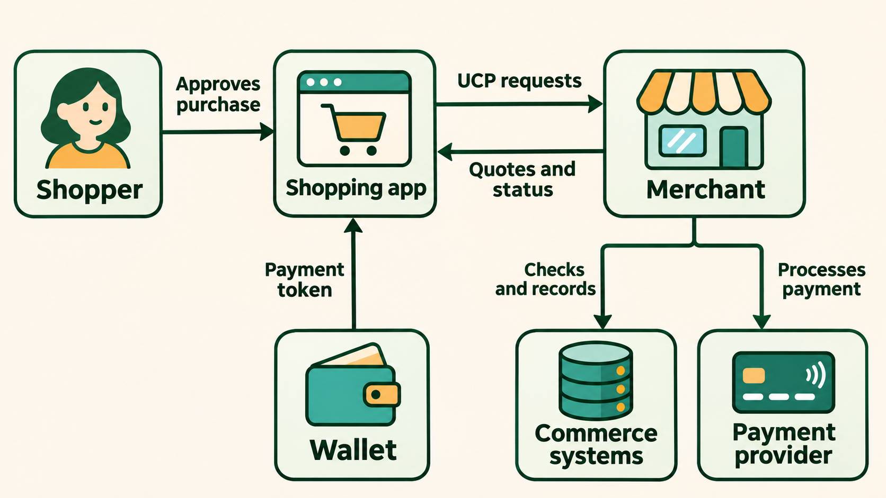
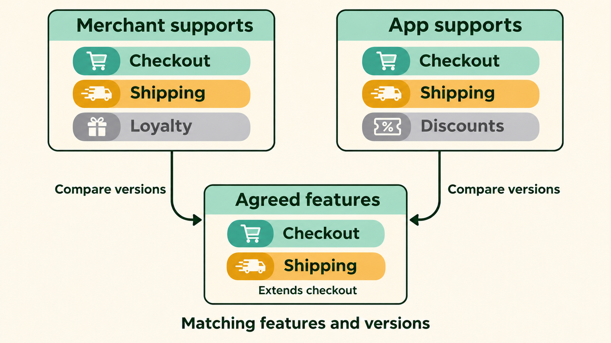
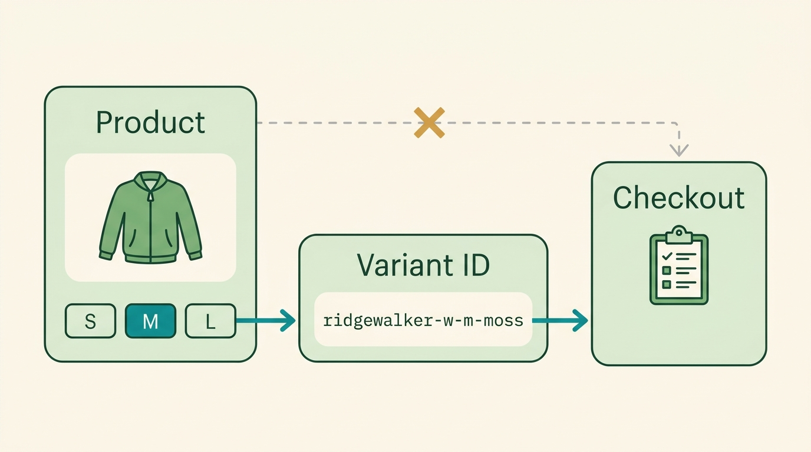
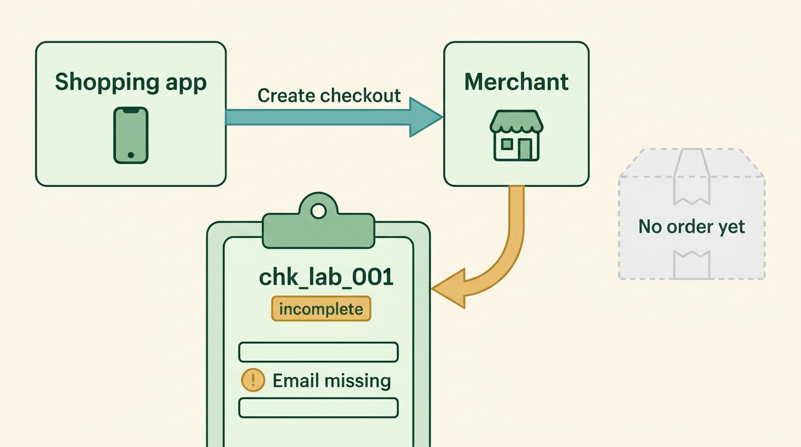
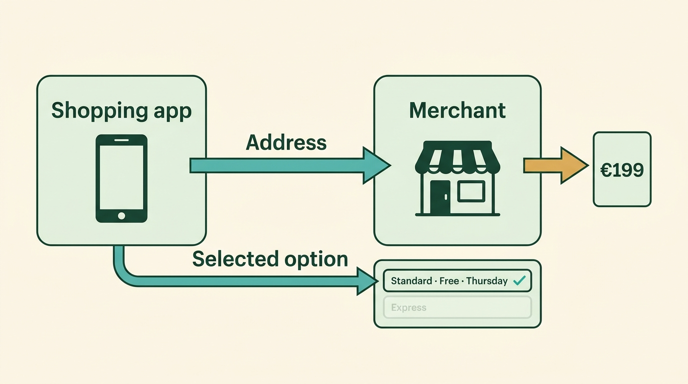
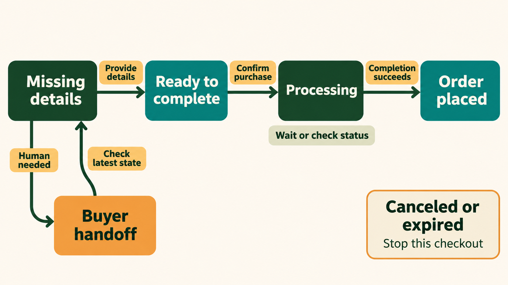
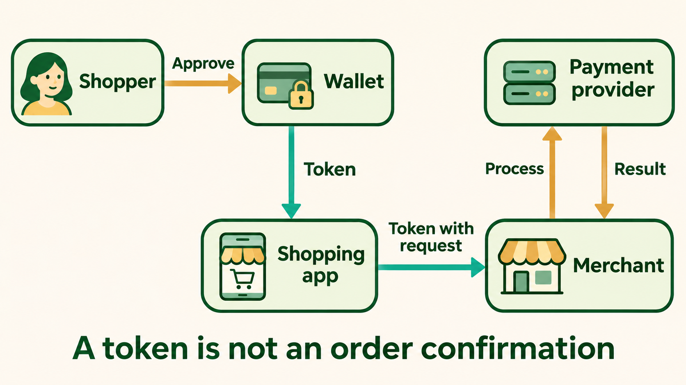
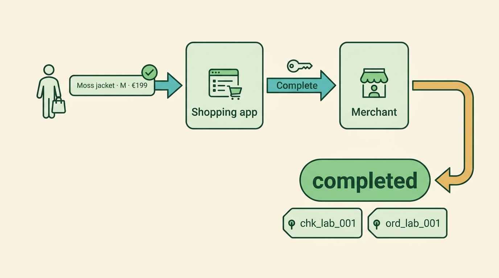
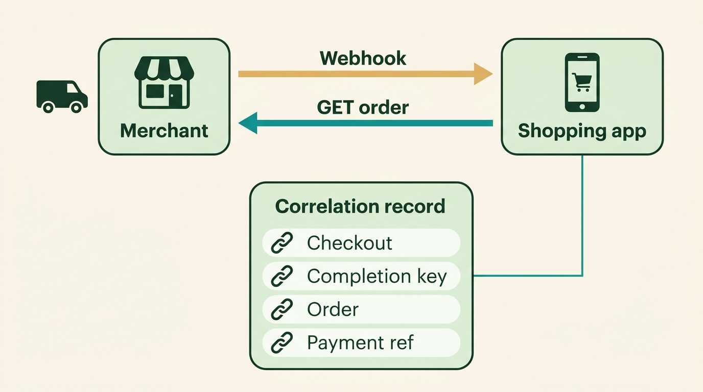
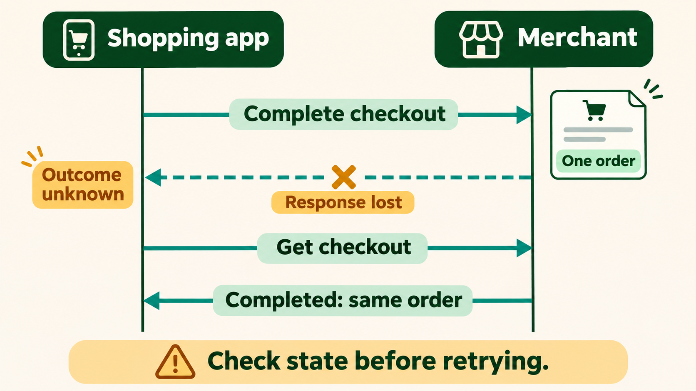

> **IN THIS CHAPTER, YOU WILL:** Follow a purchase through Universal Commerce Protocol, read its main messages, and understand the responsibilities behind a reliable integration.

> **KEY POINTS:**
>
> * **The merchant still makes the promise.** Universal Commerce Protocol gives shopping applications a shared way to request products, prices and purchases; the merchant's systems decide what they can sell.
> * **Agree on capabilities before using them.** Each participant describes the features and versions it supports, so the application can choose a flow both sides understand.
> * **A request is not a confirmed purchase.** Shopper approval, payment processing and order confirmation are separate steps. The application must report the state the merchant actually returned.

> **[FAILURE PATTERNS THIS CHAPTER ADDRESSES](where-commerce-platforms-go-wrong.html):**
>
> * **The Secret Agent** — a shopping assistant needs explicit authority before it can commit the customer to a purchase.
> * **The Message in a Bottle** — a lost response must lead to a status check, not another charge.
> * **The Phantom Stock** — a common protocol cannot make an old stock count safe to promise.

<br>
A shopper asks an assistant to find a waterproof jacket for less than €200. Finding one is only the beginning. To buy it, the assistant must identify the right size, obtain a current delivered price, present the terms, arrange payment and learn whether an order actually exists. Each merchant may expose these steps differently.

**Universal Commerce Protocol (UCP)** defines shared messages and rules for these exchanges. A shopping application can learn what a merchant supports and use that functionality through a common interface. The merchant keeps responsibility for its products, prices and orders. UCP gives another application a way to work with those records.

I would learn UCP by tracing one purchase, including a lost response. A successful demonstration shows that two systems can exchange messages. Following the uncertain outcome shows whether the team understands what the customer has bought and what it may safely retry.

**Where we are in the order's journey.** This appendix follows discovery, checkout and the first order update. You need only a basic understanding of an **API**, an interface one program calls to request data or work from another. The broader business choices appear in [[ai-and-agentic-commerce]].

## The Purchase We Will Follow

Kestrel & Pine is the fictional outdoor brand used throughout this book. Imagine a separate learning environment offering its Ridgewalker shell jacket: women's size M, moss, priced at €199 including tax. The brand's normal free-shipping threshold is €75, so this single-jacket order qualifies.

For the exercise, assume the jacket is available, the test delivery address is supported and the merchant can offer Thursday delivery. Those are **illustrative lab conditions**, not evidence that a real shopping service supports this purchase. This is also separate from the book's recurring €235 order and from Kestrel & Pine's decision not to launch a shopper-facing agent in 2027.

The test shopper says, “Find this jacket, show me the delivered total, and ask before buying.” That last instruction matters. Permission to search has not authorized the application to place an order.

**Technical reference.** The walkthrough uses UCP's published **2026-08-25** documentation, checked on 9 November 2026, with an [inspected source revision](https://github.com/Universal-Commerce-Protocol/ucp/tree/7dd79ea2ff0bc8bc394ac5b17ababa91284fa581). Message fragments use invented identifiers and reserved `.example` addresses. They explain the exchange; they omit fields and authentication material and are not requests to paste into a live payment service. Use the matching full schemas when implementing.

## Who Talks to Whom?

The shopper sees an application, but several participants perform the purchase. In UCP, **Platform** means the application consuming commerce capabilities. It could be an AI assistant, a mobile application or a procurement tool. **Business** means the participant exposing those capabilities: the merchant in our example. These protocol roles do not depend on whether either participant runs an AI model. The [UCP core concepts](https://ucp.dev/documentation/core-concepts/) define the roles.

| Participant | Job in this purchase | What to ask about it |
| --- | --- | --- |
| Shopper | Chooses the jacket and approves the purchase | What exactly did the person authorize? |
| Platform | Presents choices and calls the merchant on the shopper's behalf | Can it distinguish a quote from a confirmed order? |
| Business | Quotes terms, checks availability and creates the order | Does this channel use the same business rules as the storefront? |
| Credential provider | Supplies a protected payment credential, often through a wallet | Which merchant and payment flow can use that credential? |
| Payment service provider | Processes the merchant's payment request | How will its result be linked to the checkout and order? |

A **credential** is information that lets a system prove identity or exercise an authority. Here, a payment credential lets the payment system attempt a payment. A **payment service provider (PSP)** is the company processing that attempt. One company can fill several roles, but you should still be able to explain each role separately.


**Figure 1:** *UCP connects the application to the merchant; the merchant still checks its records and processes the purchase.*

For Kestrel & Pine, I would put the UCP interface in front of existing commerce operations. The website and the assistant should ask the same price service and consume the same availability rules. If the new interface calculates its own discount or invents a delivery date, the merchant has created another source of contradictory promises.

## The Vocabulary, Before the Messages

A merchant might support checkout but not loyalty points. It might accept a particular wallet but require the shopper to finish unusual orders on its website. UCP needs a way to describe these differences before an application attempts a purchase.

| Term | Plain meaning | In our example |
| --- | --- | --- |
| **Profile** | A document describing a participant's supported protocol features and where to reach them | The merchant publishes its UCP profile at `/.well-known/ucp` |
| **Service** | A group of related operations exposed through an interface | The shopping service includes checkout operations |
| **Capability** | A named piece of functionality both parties can support | Creating and completing a checkout |
| **Extension** | Additional functionality attached to a capability | Shipping choices added to checkout |
| **Transport** | The mechanism carrying the messages | HTTP requests using the REST interface |
| **Schema** | A machine-readable description of a message's fields and allowed values | The checkout schema describes its status, items and totals |

**REST** is the familiar API style using HTTP methods such as `GET` to read a resource and `POST` to create one or request an action. We use it throughout this tutorial because you can follow the exchange without also learning an agent framework.

The [UCP overview](https://ucp.dev/2026-08-25/specification/overview/) explains how profiles declare services, capabilities and extensions. Their names are precise identifiers. For example, `dev.ucp.shopping.checkout` names the standard checkout capability. The reversed domain at the beginning identifies the namespace; you do not send a request to that string as though it were a URL.

### How UCP Differs from ACP, MCP and AP2

These names appear together because a purchase needs both commerce rules and a way to carry out authorized actions. They do not all solve the same part of that problem.

| Protocol | What it contributes | Relationship to UCP |
| --- | --- | --- |
| **Agentic Commerce Protocol (ACP)** | A commerce interface maintained by OpenAI and Stripe, covering checkout, delegated payment and other shopping operations | Overlaps with UCP; supporting one does not automatically support the other |
| **Model Context Protocol (MCP)** | A way for applications using AI models to discover and invoke tools | UCP can expose its commerce operations through MCP |
| **Agent Payments Protocol (AP2)** | Signed records of a user's payment-related authority and intent, called mandates | UCP can use the AP2 mandates extension when that flow needs it |

ACP's [April 2026 specification](https://github.com/agentic-commerce-protocol/agentic-commerce-protocol) includes cart, order and product-feed work as well as checkout and payment. It would be misleading to teach ACP as “payments” and UCP as “everything else.” Both cover commerce workflows; their contracts and integration ecosystems differ.

UCP makes discoverable capabilities and agreement between participants central to its design. Its [MCP binding](https://ucp.dev/2026-08-25/specification/shopping/checkout/mcp/) carries UCP operations as tools. Its [AP2 explanation](https://ucp.dev/documentation/ucp-and-ap2/) describes an optional authorization mechanism; AP2 is not the payment processor and is not required for every UCP flow.

If you need both ACP and UCP, I would map their interfaces onto shared checkout and order logic. Two adapters are manageable. Two competing definitions of what a customer owes are much harder to operate.

## Step 1: Discover What the Merchant Supports

Before creating anything, the application reads the merchant's profile. Think of it as the entrance sign for the API: it tells the caller which services exist and where their doors are.

```http
GET /.well-known/ucp HTTP/1.1
Host: kestrel-pine.example
```

This **profile excerpt** shows only the REST service and checkout capability. The physical-goods flow also needs fulfillment support, discussed next; payment configuration and keys are omitted here.

```json
{
  "ucp": {
    "version": "2026-08-25",
    "services": {
      "dev.ucp.shopping": [{
        "version": "2026-08-25",
        "transport": "rest",
        "endpoint": "https://kestrel-pine.example/ucp",
        "spec": "https://ucp.dev/2026-08-25/specification/overview/",
        "schema": "https://ucp.dev/2026-08-25/services/shopping/rest.openapi.json"
      }]
    },
    "capabilities": {
      "dev.ucp.shopping.checkout": [{
        "version": "2026-08-25",
        "spec": "https://ucp.dev/2026-08-25/specification/shopping/checkout/",
        "schema": "https://ucp.dev/2026-08-25/schemas/shopping/checkout.json"
      }]
    }
  }
}
```

Read it from the outside in. The version identifies the protocol contract. The service entry says how to reach the API. The capability entry says which shopping behavior is offered and where its message definition lives. A service endpoint is a base address: the checkout path is appended to it, giving `/ucp/checkout-sessions` in this example.

The application also has a profile. With each API request it identifies that profile, allowing the merchant to determine which capabilities both sides support. Under UCP's [negotiation rules](https://ucp.dev/2026-08-25/specification/overview/#negotiation-protocol), matching names alone are insufficient: versions and extension dependencies must also match. Publishing a profile does not grant the caller permission to purchase.


**Figure 2:** *A feature is usable only when both participants support a compatible version and its required parent capability. Shipping here is provided by the fulfillment extension.*

For our lab, both profiles support checkout and its fulfillment extension. If the application only understood checkout without shipping, it should not invent a shipping field and hope the merchant accepts it. The integration needs a supported alternative, such as sending the shopper to the merchant's checkout.

## Step 2: Choose an Exact Item

A shopper asks for “the moss jacket in medium.” A purchase needs a merchant identifier for that exact sellable version. This is a **variant**: a product with a particular combination of options, such as size and color. Using the parent product's identifier can leave the merchant unable to know which jacket to ship.

UCP's [catalog capabilities](https://ucp.dev/2026-08-25/specification/shopping/catalog/) distinguish searching for candidates from looking up identified products. A platform can also arrive with an item obtained through another agreed discovery channel. Checkout does not require every merchant to implement every catalog capability.

For the exercise, assume lookup returned the merchant's identifier `ridgewalker-w-m-moss`. Record the identifier exactly; the application should not construct one from a product title. The listing price is useful for comparison, but the checkout response must establish the terms of this particular purchase.

A **cart** collects intended items while the shopper is still deciding. A **checkout session** gathers the information and terms needed to place an order. UCP has a separate [cart capability](https://ucp.dev/2026-08-25/specification/shopping/cart/); when supported, a cart can become the source of a checkout. We will create checkout directly with one item, which keeps the first walkthrough small.


**Figure 3:** *Checkout needs the merchant's identifier for the exact variant. A parent product does not say which jacket to ship.*

## Step 3: Create a Checkout Session

Creating a session asks the merchant to work out a purchase. It has not yet placed the order. This separation gives the merchant somewhere to collect the address, calculate delivery and report missing information before money is committed.

The [checkout REST binding](https://ucp.dev/2026-08-25/specification/shopping/checkout/rest/) defines the endpoint. This illustrative request omits authentication headers; their presence and validation depend on the agreed authentication mechanism.

```http
POST /ucp/checkout-sessions HTTP/1.1
Host: kestrel-pine.example
Content-Type: application/json
UCP-Agent: profile="https://shopping-app.example/.well-known/ucp"
Idempotency-Key: b0f9b9af-d0bd-4b21-996e-cc5b26d5d240
Request-Id: lab-request-001

{
  "line_items": [{
    "item": {"id": "ridgewalker-w-m-moss"},
    "quantity": 1
  }]
}
```

Three headers deserve attention. `UCP-Agent` points to the application's profile; it is not a password. `Request-Id` helps operators trace this attempt through their systems. `Idempotency-Key` identifies the logical operation so a retry can be recognized. **Idempotency** means repeating the same operation does not create another purchase or another session simply because a response was lost.

The merchant could return this **response excerpt**:

```json
{
  "id": "chk_lab_001",
  "status": "incomplete",
  "currency": "EUR",
  "messages": [{
    "type": "error",
    "code": "missing",
    "path": "$.buyer.email",
    "content": "An email address is needed for this purchase.",
    "severity": "recoverable"
  }]
}
```

The application now has a checkout identifier and something useful to do: obtain the missing information. The merchant has communicated a business state, not just an HTTP success code. An API request can succeed while the purchase remains incomplete.


**Figure 4:** *Creating a session starts a purchase but does not place it. The merchant reports what is still missing.*

Full responses also carry the `ucp` metadata, items, totals and other required fields. The [checkout schema](https://ucp.dev/2026-08-25/schemas/shopping/checkout.json) is the implementation contract; the excerpt above isolates the fields a beginner needs to read first.

## Step 4: Supply the Address and Choose Delivery

A jacket cannot be quoted for delivery without knowing where it will go. The application asks the shopper for the necessary details, submits them and lets the merchant return the available choices. It must not infer Thursday delivery from a general sentence on a product page.

The [fulfillment extension](https://ucp.dev/2026-08-25/specification/shopping/extensions/fulfillment/) adds the vocabulary for getting physical goods to the customer. It describes methods such as shipping or pickup, destinations, groups of items, and options within those groups. The merchant creates the groups and options; the application selects from those returned identifiers.

| Part of the response | Meaning in the jacket example |
| --- | --- |
| Method | Ship the jacket to the customer |
| Destination | The address supplied for this purchase |
| Group | The items covered by a particular delivery choice; here, one jacket |
| Option | Standard shipping, free, with the merchant's stated delivery expectation |
| Selection | The destination and option identifiers the shopper chose |


**Figure 5:** *The merchant creates the delivery options and recalculates the total. The application only selects from what was returned.*

An update uses `PUT /checkout-sessions/{id}`. In this release, **Update Checkout is a replacement operation**. Build the request from the latest checkout state and include previously supplied writable information you intend to retain. Sending only a changed email address can discard other information. Follow the update schema rather than blindly copying response-only fields back to the server.

In our lab, the application submits the buyer details, retains the jacket line and selects the returned destination and shipping option. The merchant recalculates the purchase. We assume it returns a €199 total with free shipping and Thursday delivery, and no remaining issue prevents completion.

UCP expresses money in minor units. For euros, `19900` means €199.00, not €19,900. A quote fragment might contain:

```json
{
  "id": "chk_lab_001",
  "status": "ready_for_complete",
  "currency": "EUR",
  "totals": [{"type": "total", "amount": 19900}]
}
```

This fragment omits the tax breakdown and fulfillment fields. For a consumer price that already includes tax, do not add the displayed tax component again. The app presents the merchant's returned total and the chosen delivery terms, then asks the shopper to approve those terms.

## Read the Checkout State Before Taking the Next Step

The checkout's status tells the application what kind of work remains. It does not tell you whether the shopper is happy, whether a parcel has shipped or whether money has settled into the merchant's bank account.

The [checkout lifecycle](https://ucp.dev/2026-08-25/specification/shopping/checkout/#checkout-status-lifecycle) defines six states:

| Status | What the application should understand |
| --- | --- |
| `incomplete` | More information or resolution is needed; inspect the messages |
| `requires_escalation` | The buyer must continue through the provided handoff after recoverable issues are addressed |
| `ready_for_complete` | The checkout has the information needed to attempt order placement |
| `complete_in_progress` | Completion was accepted and is still being processed; no confirmed order is returned yet |
| `completed` | The order was placed and its reference is present |
| `canceled` | This checkout is invalid or expired; do not keep trying to complete it |


**Figure 6:** *Readiness permits an attempt; processing means wait; only a completed checkout confirms the order. This diagram simplifies the full lifecycle.*

The practical mistake to avoid is displaying “Purchased” after receiving `ready_for_complete`. That state is closer to a checkout form being ready for its final button. The shopper still needs to authorize the attempt, and the merchant still needs to accept it.

A handoff is also a normal outcome. The merchant can supply a `continue_url` so the buyer can finish required work in a supported interface. I would preserve that route in an initial integration: forcing every exception through a chat conversation usually makes the exceptions harder for the customer.

## Step 5: Arrange Payment Without Giving the Model Card Details

Before asking a payment provider to charge, the participants need to agree how payment credentials will be obtained and passed. A **payment instrument** describes what pays, such as a card. A **payment handler** defines the procedure the participants use to work with that instrument. The [handler guide](https://ucp.dev/2026-08-25/specification/payment/guide/) separates these responsibilities.

Imagine the lab uses a supported wallet. The application opens the wallet's approved interaction, the shopper confirms, and the credential provider returns a **token**: a protected reference or payload used in the agreed payment flow. Its restrictions and lifetime come from that handler and provider; “token” alone does not promise single use or a particular spending limit.

The application passes the credential to the merchant as the handler specifies. The merchant uses its payment integration to process it. **The token is not a receipt.** Obtaining it has not proved that the merchant accepted an order or that payment processing succeeded.


**Figure 7:** *The application carries the agreed credential; the merchant's payment integration determines the payment result.*

The [tokenization guide](https://ucp.dev/2026-08-25/specification/payment/tokenization/) explains the distinction between obtaining a token and processing it. Keep raw card details out of prompts, model context and ordinary application logs. A payment form or wallet component should handle the sensitive interaction through the provider's supported integration.

Payment can require additional buyer interaction. UCP's [payment authentication extension](https://ucp.dev/2026-08-25/specification/payment/extensions/authentication/) describes actions such as collecting device data or conducting a cardholder challenge. The application must handle the negotiated action or use the supported handoff. It cannot treat the shopper's earlier chat message as proof that every payment requirement has been satisfied.

### Three Permissions That Are Easy to Confuse

Trusting the application, accessing the buyer's account and authorizing a purchase are different decisions. Conflating them can give a useful shopping assistant far more authority than the customer intended.

| Question | What answers it | What it does not establish |
| --- | --- | --- |
| Who is calling the merchant? | Agreed API authentication, such as verified request signatures | That the shopper approved this purchase |
| May this app use my merchant account? | Account authorization, potentially through UCP identity linking | Unlimited access to orders or payment methods |
| May this purchase proceed on these terms? | The shopper's approval and the payment flow's required authorization | Approval of a more expensive replacement cart |

[Identity linking](https://ucp.dev/2026-08-25/specification/common/identity-linking/) lets a shopper authorize account access through OAuth 2.0, a protocol for granting limited access without giving the application the account password. Such access has **scopes**, named permissions limiting what can be done. A guest checkout need not link an existing account just because the application uses UCP.

For a more autonomous flow, an [AP2 mandate](https://ucp.dev/2026-08-25/specification/payment/extensions/ap2-mandates/) can provide a signed record of authority. That is additional machinery to integrate and verify. Our first exercise uses a person reviewing the final purchase; it does not assume a mandate or unattended buying.

## Step 6: Complete the Checkout and Keep the Order Reference

The shopper now approves one moss jacket in size M, delivered as quoted for €199. The application has the agreed payment credential. It can request completion using `POST /checkout-sessions/chk_lab_001/complete` and a new idempotency key for this logical operation, such as `d717c14e-f107-46ae-a18f-c36ce5c7d930`.

The completion body carries the payment data required by the selected handler. Do not invent a generic token format or reuse an example handler's fields with a different provider. The merchant has to recognize the selected handler and credential.

Completion is an instruction to place the agreed purchase. It is not the place to change its price, address or quantity. If the shopper changes the jacket to size L, update and recheck the checkout first, then obtain any approval the revised terms require.

After successful synchronous completion, the application could receive this **response excerpt**:

```json
{
  "id": "chk_lab_001",
  "status": "completed",
  "order": {
    "id": "ord_lab_001",
    "permalink_url": "https://kestrel-pine.example/orders/ord_lab_001"
  }
}
```

Now “Your order has been placed” is supported by the merchant's response. Keep both identifiers: the checkout identifier explains the negotiation, while the order identifier follows the accepted purchase.


**Figure 8:** *Tell the shopper the order is placed only when the response is completed and has an order reference. Keep the checkout and order identifiers.*

If the response instead says `complete_in_progress`, the application must say the purchase is still processing. Follow the status and any required actions; do not repeatedly call completion to make it hurry. A **payment authorization** reserves or approves funds, **capture** collects them, and **fulfillment** prepares and delivers goods. An order confirmation does not collapse those later activities into a single completed event. [[commerce-payments]] explains their operational consequences.

## Step 7: Follow the Order After Checkout

The customer's next question is often “When will it arrive?” The answer belongs to the order and its fulfillment records, not to the last sentence the assistant generated.

The [UCP order capability](https://ucp.dev/2026-08-25/specification/shopping/order/) represents purchased lines, fulfillment expectations, actual fulfillment events and adjustments. A promise to deliver Thursday and a carrier event saying “delivered” are different kinds of information. The application should preserve that distinction when it summarizes the purchase.

Order updates can arrive through a **webhook**, an HTTP notification sent by the merchant to the platform. The platform can also retrieve current state through `GET /orders/{id}` when authorized. The [order REST binding](https://ucp.dev/2026-08-25/specification/shopping/order/rest/) defines that retrieval interface.

For our lab, retain a small correlation record:

| Reference | Example | Why retain it? |
| --- | --- | --- |
| Checkout | `chk_lab_001` | Investigate the quote and completion attempt |
| Completion operation | `d717c14e-f107-46ae-a18f-c36ce5c7d930` | Recognize an identical retry |
| Order | `ord_lab_001` | Retrieve the accepted purchase and later updates |
| Provider payment reference | Returned by the test provider | Compare payment processing with the order record |


**Figure 9:** *Order updates arrive by webhook or retrieval. A small correlation record links what the assistant said to an actual order and payment.*

This is an implementation recommendation, not an extra UCP message format. Choose storage and retention appropriate to the merchant's obligations. The goal is that support can connect “the assistant says I bought it” to a concrete order and payment result.

An order API also needs access checks. Knowing `ord_lab_001` must not be enough to read its address. Likewise, an order adjustment describing a refund does not by itself mean the application has an API permission to initiate arbitrary refunds. Verify the supported operation and authority separately.

## When the Completion Response Disappears

Suppose the merchant creates the order, but the network connection drops before the application receives the response. The application cannot safely conclude either “failed” or “purchased.” It knows only that the outcome is uncertain.

**Reconciliation** means comparing records to establish what actually happened. Here, begin by reading the existing checkout. If it is completed, recover its order reference. If completion is in progress, wait and check again with a bounded delay. Stop automatic attempts when the checkout expires; an unresolved case needs investigation. Do not create a fresh checkout simply to escape uncertainty.


**Figure 10:** *Losing the response does not undo the purchase. Retrieve the existing checkout before deciding whether a retry is necessary.*

The [completion contract](https://ucp.dev/2026-08-25/specification/shopping/checkout/#complete-checkout) directs the caller to retrieve state after an unanswered completion request. Only if that still fails to establish the outcome may it retry the identical original completion with the same idempotency key. A genuinely new completion operation uses a new key; a retry does not.

UCP's [signature and replay rules](https://ucp.dev/2026-08-25/specification/signatures/) also matter here. The logical operation identity is different from the authentication material for an individual network attempt. An implementation must handle both correctly. Generate a sufficiently random, unique operation key as the specification requires, and persist its result; merely putting an identifier in a header does not prevent a second charge.

I would make this the first failure exercise in a team demonstration. Disconnect after the merchant accepts completion, then recover the order. It forces the interface, storage, payment integration and customer message to agree about the same event.

| Situation | What to do | What the customer needs to hear |
| --- | --- | --- |
| Stock disappears before acceptance | Refresh the checkout and resolve the merchant's response | The selected item can no longer be purchased on those terms |
| Delivered total changes | Present the revised terms and obtain fresh approval where required | The total changed; here is the new amount |
| Buyer interaction is required | Handle the supported action or follow the handoff | There is another step for you to complete |
| Completion outcome is unknown | Retrieve state and reconcile before retrying | We are checking whether the order was placed |
| An order update is missed | Retrieve authorized current order state | Report the latest confirmed status |

These responses are design recommendations for the application. The exact errors and recovery actions depend on the negotiated capabilities, merchant and payment handler.

## Try It: A Small Learning Exercise

You can learn the message flow without a language model. A regular API client makes it easier to inspect which state changed after each request. Add conversational interaction after you understand the purchase contract.

The official [UCP samples repository](https://github.com/Universal-Commerce-Protocol/samples) provides REST server and client examples. Its [Python server instructions](https://github.com/Universal-Commerce-Protocol/samples/tree/main/rest/python/server) explain local setup, and the client directory contains a happy-path walkthrough. Check the sample's pinned dependencies and advertised version before comparing it with this appendix; examples on a moving branch may use a different release.

Use a local sample or provider test environment with fake customers and test payment credentials. Then perform these exercises in order:

1. **Read both profiles.** Write down the shared protocol version, checkout capability, fulfillment extension and payment handler. Explain why each is needed for your chosen product.
2. **Create a session with missing information.** Find the returned identifier, status and message. Ask what the application should request from the shopper next.
3. **Supply the missing fields and choose delivery.** Keep prior writable information in the update. Verify that the returned total matches what the user sees.
4. **Approve and complete.** Record the completion key, returned status and, when available, the order identifier. Do not mark an in-progress checkout as purchased.
5. **Lose the response deliberately.** Retrieve the existing checkout and recover the result. If your harness retries, demonstrate that it does not produce another order or payment.
6. **Exercise a boundary.** Try a mismatched capability version, an unavailable item or a buyer handoff. Explain the fallback without inventing a successful purchase.

Your output should be a short trace of request, response, customer message and recorded identifiers. That trace is more useful in a first design review than a polished chat demo that hides all four.

## What a Merchant Should Implement First

A merchant with dependable checkout and order APIs can often begin by adapting them. A merchant whose website already shows stale stock needs to address that problem too: giving the same stale answer in UCP format does not improve the promise.

For a first integration, I would choose one product type, one market, one supported payment route and explicit shopper approval. Establish the recovery path before adding loyalty, split shipments or unattended purchases. This recommendation fits a team learning the protocol; a merchant with those requirements from day one must include them in its first scope.

| Responsibility | A useful first proof |
| --- | --- |
| Profile and contract | The intended partner negotiates the expected versions and features |
| Product and availability | A selected variant resolves to current merchant data |
| Checkout | The final price and delivery terms come from authoritative merchant operations |
| Payment | Test success, decline and required buyer interaction remain distinguishable |
| Recovery | An uncertain completion can be resolved without another purchase |
| Operations | Support can connect a shopper's report to the checkout, order and payment |

A hosted commerce vendor may provide much of this. The merchant still needs to verify how that implementation behaves for its catalog, payments and exceptions. A custom implementation gives more control but also makes version changes, credential handling and operational recovery the team's responsibility.

There is no need to adopt every capability to learn UCP. There is a need to be honest about the capabilities a particular purchase depends on. A digital download and a physical jacket have different fulfillment requirements even when their checkout messages share a base structure.

## What to Take Away

**Established.**

- UCP defines participant profiles, commerce capabilities and message contracts. Implementations must agree on compatible versions and supported behavior.
- Checkout state and order state are different. A ready or processing checkout is not a confirmed order.
- Payment credentials, application authentication and buyer authorization serve different purposes; one does not replace the others.

**Depends on context.**

- REST is a convenient first learning path. An application already built around MCP may use that binding instead while keeping the same commerce responsibilities.
- A merchant may adapt existing APIs or rely on its platform vendor's implementation. The choice depends on its current interfaces and who can operate the exceptions.
- Account linking, AP2 mandates and additional extensions belong where the required customer flow needs them; their availability does not make every one mandatory.

**The author's synthesis.**

- I would judge the first integration by whether it can explain and recover one uncertain purchase. That is where a protocol demonstration becomes an operable commerce channel.
- Keep the merchant's existing price, stock and order rules authoritative. A new purchasing interface is easier to trust when it does not create another business truth.

## Questions for Your First Review

- Which exact participant acts as Platform, and which as Business?
- Which version and capabilities does this purchase require on both sides?
- Where does the final delivered price come from, and what happens if it changes?
- How does the application obtain approval for the actual terms being submitted?
- Which payment handler is used, and who implements its buyer interaction?
- Can an operator distinguish incomplete, processing and completed purchases?
- What happens when the completion response is lost after the merchant creates an order?
- Can support retrieve a current, authorized order view without reading the model's conversation history?

For the wider decision about introducing shopping agents, return to [[ai-and-agentic-commerce]]. For the mechanics that make any such integration dependable, continue with [[events-consistency-and-reconciliation]] and [[api-contracts-and-versioning]].

## Sources and Evidence

### Standards and official documentation

- [UCP core concepts](https://ucp.dev/documentation/core-concepts/), UCP Authors, n.d., accessed 2026-11-09 — participant roles and shared vocabulary.
- [UCP overview, release 2026-08-25](https://ucp.dev/2026-08-25/specification/overview/), UCP Authors, 2026 — discovery, profiles, capabilities, negotiation and versioning; [UCP specification source snapshot](https://github.com/Universal-Commerce-Protocol/ucp/tree/7dd79ea2ff0bc8bc394ac5b17ababa91284fa581).
- [UCP Checkout](https://ucp.dev/2026-08-25/specification/shopping/checkout/), [UCP Checkout REST binding](https://ucp.dev/2026-08-25/specification/shopping/checkout/rest/) and [UCP checkout schema](https://ucp.dev/2026-08-25/schemas/shopping/checkout.json), UCP Authors, 2026 — operations, states, replacement updates, completion and message structure.
- [UCP Catalog](https://ucp.dev/2026-08-25/specification/shopping/catalog/), [UCP Cart](https://ucp.dev/2026-08-25/specification/shopping/cart/) and [UCP Fulfillment](https://ucp.dev/2026-08-25/specification/shopping/extensions/fulfillment/), UCP Authors, 2026 — choosing items and delivery options.
- [Payment handler guide](https://ucp.dev/2026-08-25/specification/payment/guide/), [Tokenization](https://ucp.dev/2026-08-25/specification/payment/tokenization/) and [Payment authentication](https://ucp.dev/2026-08-25/specification/payment/extensions/authentication/), UCP Authors, 2026 — payment responsibilities and required interactions.
- [Identity linking](https://ucp.dev/2026-08-25/specification/common/identity-linking/), [AP2 mandates](https://ucp.dev/2026-08-25/specification/payment/extensions/ap2-mandates/) and [Message signatures](https://ucp.dev/2026-08-25/specification/signatures/), UCP Authors, 2026 — account authorization, payment authority and replay protection.
- [UCP Order](https://ucp.dev/2026-08-25/specification/shopping/order/) and its [UCP Order REST binding](https://ucp.dev/2026-08-25/specification/shopping/order/rest/), UCP Authors, 2026 — order records, updates and authorized retrieval.
- [UCP MCP binding](https://ucp.dev/2026-08-25/specification/shopping/checkout/mcp/) and [UCP and AP2](https://ucp.dev/documentation/ucp-and-ap2/), UCP Authors, 2026 — how the protocols fit together.
- [Agentic Commerce Protocol repository](https://github.com/agentic-commerce-protocol/agentic-commerce-protocol), ACP maintainers, 2026, accessed 2026-11-09 — scope of the April 2026 specification and its overlap with UCP.

### Learning material

- [UCP samples](https://github.com/Universal-Commerce-Protocol/samples), UCP contributors, n.d., accessed 2026-11-09 — reference servers and client walkthroughs; follow the instructions and version constraints of the chosen sample.

Kestrel & Pine is fictional; architectural recommendations, labeled inferences and labeled assumptions are the author's judgement.
