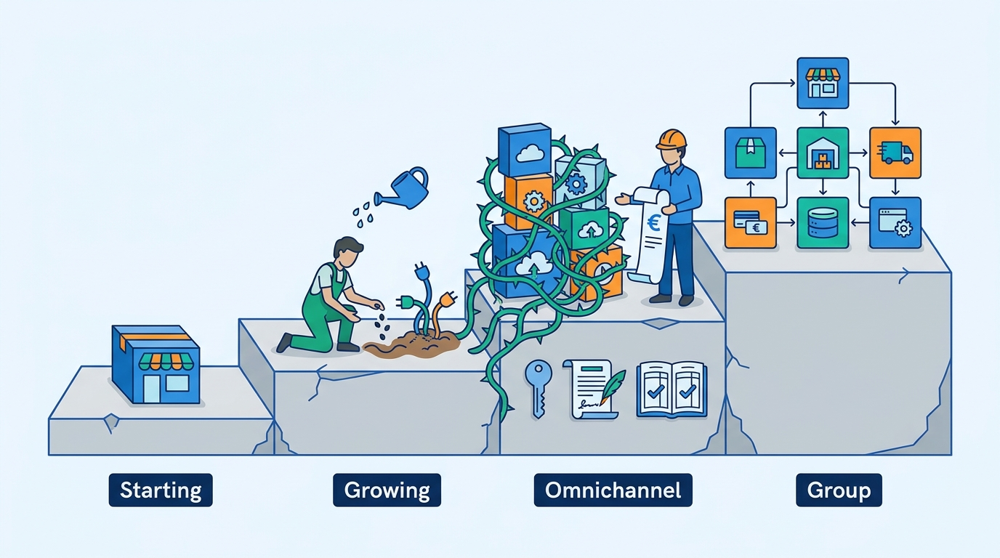
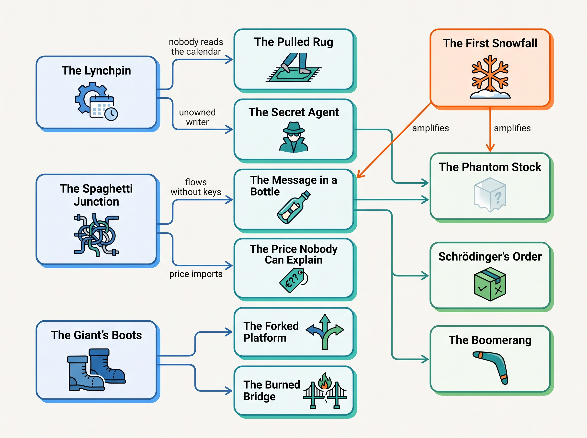

> **IN THIS SECTION, YOU WILL:** Learn sixteen named ways commerce platforms break promises, recognize each by its warning sign, see what it costs in public cases and at the book's fictional merchant, and find the chapters that prevent or repair it.

> **KEY POINTS:**
>
> * **Nearly every pattern is a promise one system made and another could not keep.** A storefront promises a unit the warehouse no longer has, a portal promises a refund the payment provider already sent, a page promises a delivery the warehouse's cut-off cannot meet. The sixteen patterns are the recurring ways the promise and its keeper come apart.
> * **The patterns fall into four families, and the family tells you where to look.** Truth patterns are a fact with two writers; integration patterns are a message with no key, no contract or no owner; platform-and-change patterns are a decision copied from a bigger company or made on one date; governance patterns are a dependency, a deadline or an actor nobody owns.
> * **The patterns travel in chains, and the chains start at the joins.** A Spaghetti Junction breeds Messages in a Bottle, which breed Phantom Stock, Schrödinger's Orders and Boomerangs; a Lynchpin sets up a Pulled Rug; a Giant's Boots ends as a Forked Platform or a Burned Bridge. Fixing the downstream symptom rarely holds; naming the origin usually does.

 
The [[introduction]] describes a commerce platform as a **promise-keeping machine**: it shows a product, promises a price, a delivery and a return, takes the money, and then has to keep every promise across a dozen systems owned by different teams and vendors. This page names the ways those promises break, so the rest of the book can point back to them.

None of the patterns implies incompetence. **Most are the residue of reasonable decisions**, taken one at a time by people accountable for one step: the manager who installed an app, the agency that wrote a script. The failure is the accumulation, and only someone accountable for the whole landscape sees it.

Each pattern gets a quote (fictional and unattributed), its mechanism and cost, an illustration from **Kestrel & Pine, the fictional outdoor brand this book follows** (see [[meet-kestrel-and-pine]]; its incidents are invented), a dated public example where the record supports it, the remedy direction and the chapters that address it. Mapping a public case to a pattern is the author's reading.

## Sixteen Patterns to Recognize

The patterns fall into four families: **truth** (five facts with no agreed owner: stock, order status, customer, return, price), **integration** (three), **platform and change** (five decisions about load, shape, upgrade, migration and tenancy) and **governance** (three).

| Pattern | Warning sign | Family |
| --- | --- | --- |
| **The Phantom Stock** | Two channels sell the same last unit; "out of stock" cancellations rise in busy weeks. | Truth |
| **Schrödinger's Order** | Support checks three systems to say where an order is, and they disagree. | Truth |
| **The Familiar Stranger** | Nobody can say whether the store customer and the online customer are the same person, because each system counts customers its own way. | Truth |
| **The Boomerang** | Refunds, restocking and credit notes are reconciled by hand after the return arrives, and sometimes twice. | Truth |
| **The Price Nobody Can Explain** | The same product carries different prices in different channels, and nobody can say which system set which price or why. | Truth |
| **The Spaghetti Junction** | Every pair of systems, sometimes every customer, has its own hand-built connector with its own owner, or none. | Integration |
| **The Message in a Bottle** | Messages between systems are sent once and trusted; customers find the duplicates and the gaps. | Integration |
| **The Pulled Rug** | A vendor's API or a partner's document format changes and an integration breaks before anyone is told. | Integration |
| **The First Snowfall** | The busiest day of the year is the first time the system, and its integrations, meet real load. | Platform and change |
| **The Giant's Boots** | An architecture is copied from a company a hundred times larger, or from a trend, without its reasons. | Platform and change |
| **The Burned Bridge** | Everything moves to a new platform on one date, with no way back. | Platform and change |
| **The Forked Platform** | The platform's core or theme has been customized so deeply that it can no longer be upgraded, and every vendor release is a project. | Platform and change |
| **One Size Fits None** | Several brands or business units are forced onto one stack before anyone has measured the benefit, or kept apart when they should share. | Platform and change |
| **The Lynchpin** | A capability customers depend on runs through one vendor, one connector, one agency or one person, with no exit plan. | Governance |
| **The Long Fuse** | A legal deadline (e-invoicing, accessibility, consumer rules) is discovered when it is months away. | Governance |
| **The Secret Agent** | A script, app, bot or AI agent changes orders, stock, prices or money without a named owner, its own identity or a person's approval. | Governance |

A warning sign is a prompt to look, not a verdict: **ask for the number that would confirm it**.

### The Phantom Stock

*"The site said we had twelve. The warehouse had none since seven o'clock."*

**What it looks like.** The storefront's stock number is a copy of unknown age; click-and-collect promises what the store sold that afternoon.

**Why it happens.** The system that knows stock is rarely the one that sells it, so every channel gets a copy through syncs nobody designed as a whole, and the copy grows writers (an app, an import). **A fact with two writers has no owner**.

**What it costs.** Canceled orders, vouchers, marketplace penalties and seller ratings. Stock records are less accurate than assumed: the classic field study found 65% of about 370,000 inventory records inaccurate at one US retailer's stores (DeHoratius and Raman, *Management Science*, 2008; dated, still the field's reference). Even commercetools documents that its available quantity is eventually consistent "with a delay of up to 10 seconds" (n.d., accessed 2026-11).

**At Kestrel & Pine (fictional).** On Friday 27 November 2026 the Ridgewalker jacket sold out at the Duiven warehouse at 19:40; the storefronts and the marketplaces kept selling it for up to two hours, because stock traveled WMS → ERP every 15 minutes, ERP → platform hourly, platform → marketplace connector hourly. **1,340 units** oversold, **1,120 orders** canceled or delayed, about **€96,000** including goodwill vouchers and marketplace penalties. In December the Utrecht click-and-collect pilot promised **37** items the store had already sold, because store stock reached the ERP only nightly.

**In public.** Shopify's August 2026 developer changelog moved draft-order and transfer holds from its `reserved` to its `committed` inventory state (5 August 2026): the stock vocabulary changes under the apps that read it.

**Remedy direction.** One writer per location's stock, changes published as events, available-to-promise computed in one place, copies reconciled so drift is measured (Kestrel & Pine's W1).

**Where this book helps:** [[inventory-and-availability]] owns available-to-promise, reservations and buffers; [[boundaries-and-systems-of-record]] names the owner per fact; [[events-consistency-and-reconciliation]] measures the drift.

### Schrödinger's Order

*"The customer sees Delivered. The warehouse says In picking. Finance says it was never invoiced."*

**What it looks like.** The platform's status is set by the first message it received; the ERP waits for one that never came; a split shipment has no status at all.

**Why it happens.** The money, each shipment and each return have their own state. Without one record that keeps them apart, every system's status is honest and wrong.

**What it costs.** Service load first: "where is my order" (WISMO) is the largest single category of e-commerce support contacts, at 18% of incoming requests in one helpdesk vendor's data (Gorgias, updated 13 November 2023). Then money: invoices that never post and duplicate shipments.

**At Kestrel & Pine (fictional).** Order **#1052877** in December 2026, a fleece and a pair of socks: the fleece shipped on 7 December and the socks on 14 December after replenishment. The platform showed *Delivered* (the agency's flow had marked the whole order fulfilled on the first warehouse confirmation), the WMS showed *In picking* and the ERP *Not invoiced*, for six days, while one customer opened **11 support tickets**.

**In public.** Shopify's help documentation keeps separate order, payment and fulfillment status families on one order, and states that without a tracking number "no shipping updates are received" (n.d., accessed 2026-11).

**Remedy direction.** One order record for every channel, with separate states for money, each shipment and returns, and a summary computed from the least-advanced shipment (Kestrel & Pine's W2).

**Where this book helps:** [[order-management]] owns the order record and its state model; [[customer-service-and-notifications]] builds the service view; [[erp-and-back-office-integration]] stops the ERP from being a second order system.

### The Familiar Stranger

*"Is the Eva who bought a jacket online the Eva on the store loyalty list? Probably."*

**What it looks like.** A store cannot see an online order; a data-subject request becomes a search across nine systems.

**Why it happens.** Each channel's system has its own customer table, keyed on what it collects. Matching them is a project nobody owns, because every system works without it.

**What it costs.** Duplicate marketing, blind service, and loyalty built on a wrong count. Under the GDPR a data-subject request must be answered within one month, extendable by two (Regulation (EU) 2016/679, Article 12(3), 2016); a merchant that cannot find the person in all its systems cannot meet it.

**At Kestrel & Pine (fictional).** Eva Janssen, the recurring order's customer, exists as an online account, a store customer in the POS loyalty list, a newsletter subscriber and a returns-portal contact, with no shared identifier. When she returns her jacket to the Nijmegen store, the store cannot see that she is the online Eva. In 2027 the ecommerce manager and the head of engineering agreed not to launch an online loyalty program until the customer record is unified.

**In public.** Shopify's developer documentation marks its legacy customer accounts deprecated as of 26 February 2026 (accessed 2026-11): identity is a model to rebuild, not a table to keep.

**Remedy direction.** A customer master with one identifier per person, written matching rules, channel records linked to it, privacy requests served from it. Loyalty comes after the match.

**Where this book helps:** [[identity-and-master-data]] owns the customer master and matching; [[privacy-and-customer-data]] serves data-subject requests across systems; [[commerce-promotions]] explains why loyalty waits for it.

### The Boomerang

*"We refunded it. Then the portal refunded it. The customer kept both, and who can blame her."*

**What it looks like.** Two systems can issue a refund; stock rises at the dock scan; credit notes come from a spreadsheet.

**Why it happens.** A return touches goods, money and books, with three owners. The way back was assembled from parts, and nothing says which event releases the refund.

**What it costs.** The NRF put the 2025 US online return rate at 19.3% of online sales, with 9% of all returns fraudulent (October 2025). Stripe notes a "risk of double refund" for bank-debit methods, and Mollie "blocks duplicate refunds made in a short time frame" (both n.d., accessed 2026-11).

**At Kestrel & Pine (fictional).** Over three weeks in January 2027, **212 returns** were refunded twice: once by the returns portal through the platform's API and once by hand by support in the payment provider's console; **€19,400** went out twice, most of it recovered by asking customers to transfer it back. In the Black Friday week before, **190** returned jackets were refunded at €159.20 instead of the €143.28 actually paid, about €3,000, because the order-level discount had never been allocated to lines in the order export.

**In public.** Shopify's returns documentation separates the *return* (the buyer's intent and the money) from the *reverse fulfillment order* (the warehouse's work) and names four dispositions, restocked, processing required, not restocked and missing (n.d., accessed 2026-11): money and stock are two records.

**Remedy direction.** One return record; the warehouse's disposition as the single trigger for restock, refund and credit note; one system that refunds, keyed on the return id; a daily refund match. Kestrel & Pine's February 2027 fix.

**Where this book helps:** [[returns-and-exchanges]] owns the return record, dispositions and refund reconciliation; [[commerce-payments]] owns refunds and keys; [[tax-invoicing-and-ledger]] books credit notes.

### The Price Nobody Can Explain

*"Germany is at 179. Everyone else is at 199. Which one did we mean?"*

**What it looks like.** Prices live in five systems with five campaign calendars; discounts stack unconfigured; a refund uses a price nobody paid.

**Why it happens.** Several roles set prices under several rules, each selling system keeps its own number, imports fail silently, and promotion settings outlive their campaign.

**What it costs.** Margin, parity penalties and regulatory exposure: since 28 May 2022 the EU's Omnibus rules require any price-reduction announcement to show the "prior price", the lowest price in at least the 30 days before the reduction (Directive (EU) 2019/2161, 2019), and the Dutch regulator ACM announced supervision of those rules from 1 January 2023 (6 December 2022).

**At Kestrel & Pine (fictional).** In October 2026 the German storefront sold the Ridgewalker jacket at **€179** for **nine days** while the marketplace listing and the stores charged €199: the restore row of a campaign import had failed in an agency script that logged the error and reported success. **410 orders**, about **€8,200** of margin lost, a price-parity warning from a marketplace. In Black Friday week a 20% outerwear discount stacked with a 10% welcome code on **2,860** orders because a combination setting from an October campaign had never been reverted: about **€52,000**.

**In public.** The Omnibus rule (2022) and ACM's supervision (2023) make a 30-day price history per SKU and channel a legal requirement.

**Remedy direction.** One owner per price kind, price events with effective dates, campaigns as data, a 30-day price history, promotions with an evaluation order and stop rule, daily reconciliation, prices frozen on the order.

**Where this book helps:** [[pricing-architecture]] owns price ownership, price lists and the price history; [[commerce-promotions]] owns stacking rules and line-level allocation; [[marketplaces-and-channel-integration]] handles parity and channel price rules.

### The Spaghetti Junction

*"Thirty-four integrations. Thirteen have no owner. Six of them write stock."*

**What it looks like.** Flows on the integration platform, agency scripts and vendor plugins move the same fact along several paths. Nobody can produce the list.

**Why it happens.** Each connector was the fastest way to meet one need. Point-to-point is cheap the first ten times.

**What it costs.** Undiagnosable incidents, unplannable upgrades, and money: the MACH Alliance's own February 2026 survey of 600 enterprise technology decision-makers found 37% citing integration complexity as a primary concern (18 February 2026).

**At Kestrel & Pine (fictional).** The February 2027 integration inventory counted **34 integrations**: 14 on the iPaaS, 9 agency scripts, 11 vendor-built connectors or plugins; **13 had no named owner**; only 3 had a reconciliation job, none for stock or orders; **four flows wrote stock** into the platform, and the head of engineering's capability map found **six writers** of Duiven stock in all. The pre-order app that wrote inventory beside the WMS feed (March 2026) is the pattern at its smallest.

**In public.** Zalando's engineering blog described how its developer platform, built on Backstage, replaced "more than 100 disconnected interfaces" with one portal holding over 40,000 registered entities (3 August 2023).

**Remedy direction.** An integration inventory with an owner and a contract per flow, shared facts moving as events through one place, a reconciliation for every copy (Kestrel & Pine's W5).

**Where this book helps:** [[integration-styles]] owns the styles and the inventory; [[erp-and-back-office-integration]] untangles the ERP's flows; [[organizing-commerce-engineering]] assigns the owners.

### The Message in a Bottle

*"We sent the order to the warehouse. If it didn't arrive, that's on them."*

**What it looks like.** A retry creates a second order or refund; a dropped message leaves an order paid and never picked.

**Why it happens.** Delivery is at least once, sometimes twice, late or never, and vendors say so. Shopify's webhook documentation says an app "might receive the same webhook more than once", and retries an unanswered webhook 8 times over 4 hours before deleting the subscription; Stripe retries for up to three days; Mollie calls a webhook ten times over 26 hours and then stops (all n.d., accessed 2026-11). Integrations assume exactly once, because on a quiet day it holds.

**What it costs.** Duplicates, lost orders, drifting copies and peak backlogs. Zalando's engineering blog reported that its event-driven price and stock pipeline, reprocessing payloads of which "over 90%" were unchanged, delayed events "by up to 30 minutes" during Cyber Week and left consumers with "divergent versions of product data", before it was replaced by a synchronous read API for the critical path (7 March 2025).

**At Kestrel & Pine (fictional).** On Black Friday 2026 the iPaaS flow that created orders in the WMS one at a time was throttled by the WMS vendor's rate limit; the queue backed up for **four hours**, and roughly **8,000 orders** missed the next-day delivery the storefront had promised.

**In public.** Stripe's fulfillment guide: "You can't rely on triggering fulfillment only from your checkout landing page, because it's not guaranteed customers visit that page" (n.d., accessed 2026-11).

**Remedy direction.** An idempotency key from the business event on every message, a record of handled events, state fetched from its owner, a dead-letter queue, a daily reconciliation.

**Where this book helps:** [[events-consistency-and-reconciliation]] owns idempotency, outbox, dead letters and reconciliation; [[integration-styles]] chooses the style; [[commerce-payments]] applies the rules to money.

### The Pulled Rug

*"They announced it in November. The e-mail went to someone who left in 2025."*

**What it looks like.** A script keeps calling a retired version; chargebacks arrive before the new mapping; changelogs reach a mailbox nobody reads.

**Why it happens.** Vendors announce changes, but the merchant has no record of the dependency, no reader and no test. The contract exists on one side only.

**What it costs.** Stale stock, seller-account strikes, chargebacks, emergency rewrites. The calendars are public: Amazon's Marketplace Web Service was "no longer available" from 1 April 2024, with all private developers told to migrate to the Selling Partner API by 31 March 2024 (SP-API changelog, 2023–2024); bol's partner platform announced on 3 November 2026 that version 10 of its Offers API would be switched off on 1 February 2027.

**At Kestrel & Pine (fictional).** On 8 February 2027 the marketplace connector retired the API version a 2021 agency script used to push stock for the bol listings, announced in November 2026 to a contact who had left the agency in 2025. The script logged errors and kept running; stock to bol was stale for **two days**. In Q3 2026 Bergzicht Outdoor, the wholesale chain, deducted **€14,200** for despatch advices whose pallet labels did not match what arrived.

**In public.** Shopify's API versioning policy, quarterly releases with each version supported for at least 12 months and a nine-month overlap (n.d., accessed 2026-11), is one calendar among many.

**Remedy direction.** Pinned versions and sunset dates per integration, a role mailbox for changelogs, partner cards with owners, contract tests, despatch advices generated from what was packed.

**Where this book helps:** [[api-contracts-and-versioning]] owns versions, sunsets and contract tests; [[edi-and-e-invoicing]] owns the partner card and the despatch advice.

### The First Snowfall

*"It worked fine all year. Then Friday happened."*

**What it looks like.** The storefront holds; the stock sync and the order queue do not.

**Why it happens.** Peak is 20 to 40 times an ordinary hour, and every design decision was made against the ordinary hour. Load tests, when they exist, test the storefront and not the joins.

**What it costs.** Oversells and missed promises on the day the brand is measured. Target's new site, launched in 2011 after it left Amazon's platform, crashed on 13 September 2011 under the Missoni launch and was "down most of the day", with a second 2.5-hour outage on 25 October (MPR News, 2011). Shopify's 2025 readiness post describes tests at 150% of the previous year's peak, reaching 200 million requests a minute (20 November 2025).

**At Kestrel & Pine (fictional).** Black Friday week 2026, 23–29 November: **31,000** online orders, **10.6%** of the year's; a peak hour on Friday of **2,300 orders**, 38 a minute, with storefront traffic about **41×** an ordinary hour. The platform held. The stock sync chain and the WMS connector queue did not: the oversell above, a four-hour backlog, 8,000 late orders, a stacking bug worth about €52,000. Kestrel & Pine had no kill switch to disable guest card payments without a deploy.

**In public.** Shopify's 2025 Black Friday weekend peaked at $5.1 million a minute (2 December 2025); the merchant's own connectors are the merchant's to size.

**Remedy direction.** Test the joins at a multiple of last year's peak; switches to degrade without a deploy; a dated change freeze; a named runbook.

**Where this book helps:** [[peak-load-and-reliability]] owns the peak plan, degradation and switches; [[journey-peak-day]] walks the 2026 Friday hour by hour and the 2027 plan; [[warehouse-and-fulfillment]] sizes the order queue.

### The Giant's Boots

*"Amazon does it with microservices. Zalando does it with 4,000 applications. So should we."*

**What it looks like.** A 14-person team runs a dozen composable vendors; a €48 million merchant builds a headless storefront. The giant's reasons are absent; the costs are not.

**Why it happens.** The giants publish good work, and vendors sell the shape that produces the most work. "Do we have that problem" is easy to skip.

**What it costs.** Cost and slower change without the benefit. The reversals are public: Segment described in 2018 growing to over 140 services, three engineers spending most of their time keeping them running, and consolidating back into one (10 July 2018); an Amazon Prime Video team reported in 2023 that a serverless monitoring design supported about 5% of expected load and that one process cut cost by 90% (InfoQ, 3 May 2023; the original post has been removed).

**At Kestrel & Pine (fictional).** In February 2027 the head of engineering received two pitches citing the Black Friday Oversell: an outside consultancy's composable rebuild replacing the platform (about **€3.2 million** over three years) and the agency's headless rebuild of the three storefronts on the current platform (about **€240,000** and nine months, plus a second runtime to operate). She declined both after measuring. Waypoint's W4, stay on the SaaS platform and surround it, is the decision not to wear the boots.

**In public.** Zalando's 2025 replacement of an event stream with a synchronous read API on its critical path (7 March 2025) is a giant narrowing a choice others copied from it.

**Remedy direction.** Count channels, warehouses, countries, teams and facts with two writers; add a capability when a measured problem demands it.

**Where this book helps:** [[commerce-architecture-styles]] compares the styles with their reasons; [[build-buy-or-assemble]] works the stay-and-surround decision; [[commerce-scaling-stages]] gives the stage test.

### The Burned Bridge

*"Go-live is 19 November. The old platform is switched off the same day."*

**What it looks like.** Everything moves at once; the old platform is switched off to save a month's subscription; a contract sets the date, weeks before peak.

**Why it happens.** A big bang looks cheaper than running two systems, and each risk was fine in the demo.

**What it costs.** Lost sales, sometimes a reversal. Finish Line switched to new e-commerce site technology on 19 November 2012 and reverted to the former platform, "which it had kept operable", 17 days later, at a cost of about $3 million in quarterly sales (Retail Dive, 8 January 2013; dated).

**At Kestrel & Pine (fictional).** Waypoint replaced nothing on one date. The OMS came in seam by seam in 2027: a shadow copy of all orders in August, a parallel run on 1–14 September, marketplace orders on 15 September, D2C orders on 13 October, a change freeze around Black Friday, wholesale orders on 8 December, the old paths retired in January 2028. The PIM went live one storefront at a time.

**In public.** Target's 2011 launch weeks before its holiday season, and its two outages (MPR News, 2011), is a date chosen against the calendar.

**Remedy direction.** Migrate by seams, keep the old path operable until the new one has run a peak, run in parallel, rehearse rollback, design exit in at purchase.

**Where this book helps:** [[replatforming-and-migration]] owns seams, parallel runs and rollback; [[commerce-architecture-styles]] explains the strangler pattern; [[case-composable-movement]] reads the public replatforming record.

### The Forked Platform

*"We can't take the upgrade. The theme and the checkout changes would all have to be redone."*

**What it looks like.** Agency edits to files the vendor has since replaced; scripts inside the checkout; apps nobody uses.

**Why it happens.** Each customization was the fastest route, and nobody owns upgradeability.

**What it costs.** Lost features, security exposure, a forced migration on the vendor's date. Adobe Commerce gives each release line three years of standard support, and from 1 June 2027 cloud environments on unsupported versions "may be taken offline" (lifecycle policy, accessed 2026-11). Shopify's `checkout.liquid` customizations stopped working on 13 August 2024 (announced 13 February 2023), and Shopify Scripts stopped executing on 30 June 2026 (changelog, 9 April 2026).

**At Kestrel & Pine (fictional).** The storefront theme has been customized by the agency since 2017; the checkout has not, which is one reason the decision to stay on the platform (W4) is possible. The **41 installed apps**, of which 22 were installed by the agency, 6 are unused and 3 wrote inventory, are the smaller fork: the April 2027 app governance rule gives every app a named owner and takes away the right to write stock.

**In public.** The sunset calendars above.

**Remedy direction.** Upgradeability with an owner; supported extension points only; a register of customizations and apps; upgrades budgeted as routine.

**Where this book helps:** [[extensibility-and-app-ecosystems]] owns extension points, app governance and the register; [[storefront-architecture]] separates theme from core; [[cart-and-checkout]] keeps the checkout unforked.

### One Size Fits None

*"All three brands go on the group platform next year. The business case is 'synergies'."*

**What it looks like.** One tenant serves brands with different catalogs, rules and peaks, and every change is a negotiation; or two brands run two of everything because nobody measured what sharing would save.

**Why it happens.** The decision is made on cost, and the operational differences are invisible in the business case.

**What it costs.** Sharing: slower change, one brand's peak degrading another. Separation: duplicated contracts and integrations.

**At Kestrel & Pine (fictional, illustrative scene).** Kestrel & Pine runs its three storefronts in **one tenant** of its platform, which works because they share a catalog, a warehouse, a season and a price (€199 for the jacket in all three countries). The April 2027 stage map names the signals that would change the answer, a second brand, a fourth country or revenue past about €200 million, none planned for 2027–2028; what a second brand would share is deferred to the 2029 review on purpose, to be answered with measurements.

**In public.** Zalando completed its acquisition of ABOUT YOU on 11 July 2025 as a dual-brand consumer business "with shared logistics and payment infrastructure", with group synergies targeted at around €100 million a year (corporate.zalando.com, 11 July 2025).

**Remedy direction.** Decide sharing per capability: share what has scale economics and the same rules (payments, logistics), keep apart what differs by brand, and write the benefit as a number first.

**Where this book helps:** [[multi-tenancy-and-isolation]] owns tenancy and isolation; [[commerce-scaling-stages]] names the Group-stage signals; [[case-zalando]] reads a group's sharing decisions.

### The Lynchpin

*"Only the EDI consultant understands the mappings. He's on holiday."*

**What it looks like.** A connector documented nowhere; mappings in one consultant's head.

**Why it happens.** Specialists are efficient, and an exit plan has no visible return until the day it is needed.

**What it costs.** Outages as long as one person's absence, and programs that end on the vendor's date: Shopify sold its logistics business to Flexport in a deal that closed on 6 June 2023, and Zalando's Connected Retail program, through which physical shops sold branch stock on its platform, ends by the end of June 2027 (TextilWirtschaft, 24 April 2026).

**At Kestrel & Pine (fictional).** The EDI mappings for Bergzicht Outdoor, worth €2.1 million a year, were built in 2025 by one external consultant; when despatch advices and pallet labels disagreed, the fix waited on him. The ERP partner's platform-to-ERP connector was undocumented and could be retired only after the lead integration engineer wrote its contract in Q3 2027. The February 2027 ownership map found **5 integrations with no named owner**, among them the scripts behind the Deprecated Endpoint and the Price Drift.

**In public.** Connected Retail's end (announced April 2026, effective June 2027) is a channel retired by the platform that owned it.

**Remedy direction.** An ownership map for every system, integration and app; contracts in the merchant's hands; a second person per mapping; exit cost assessed at purchase.

**Where this book helps:** [[organizing-commerce-engineering]] owns the ownership map; [[build-buy-or-assemble]] prices exit at purchase; [[edi-and-e-invoicing]] puts the partner knowledge on a card.

### The Long Fuse

*"Belgium wants structured invoices from January. It's October."*

**What it looks like.** Finance learns of a mandate from a newsletter; the storefront has never had an accessibility audit.

**Why it happens.** Rules land per topic and per country, nobody in a 14-person team reads the Official Journal, and each rule arrives without an owner.

**What it costs.** Fines, blocked invoices, emergency prices. The dates are public: Belgium's structured B2B e-invoicing obligation applied from 1 January 2026, announced 18 September 2024, with fines of €1,500, €3,000 and €5,000 for lacking the technical means (einvoice.belgium.be); the European Accessibility Act applied to e-commerce services from 28 June 2025 (Directive (EU) 2019/882); PCI DSS requirements 6.4.3 and 11.6.1 on payment-page scripts became mandatory on 31 March 2025; Germany has required businesses to receive e-invoices since 1 January 2025.

**At Kestrel & Pine (fictional).** The fuse was caught once: Peppol e-invoices have gone to Belgian business customers since January 2026, issued and numbered in the ERP through the EDI provider as access point. The 2027 regulatory calendar, kept by the head of engineering with the finance director, turns each remaining rule (accessibility of the three storefronts and the checkout widgets, the Dutch e-invoicing plan for 2030, packaging rules, the product passport) into a dated requirement with an owner.

**In public.** The Belgian mandate, announced September 2024 for January 2026: fifteen months of notice, then fines.

**Remedy direction.** A regulatory calendar with a named owner, listing each rule's countries, date and systems; vendor conformance as a procurement item.

**Where this book helps:** [[commerce-regulation]] owns the calendar; [[edi-and-e-invoicing]] and [[tax-invoicing-and-ledger]] implement e-invoicing; [[commerce-security]] covers the PCI requirements.

### The Secret Agent

*"Something changed 600 stock levels on Tuesday night. We think it was the pre-order app."*

**What it looks like.** Scripts and apps share one admin's API key and write beside the official feeds.

**Why it happens.** Apps are easy to add, hard to see and broadly permitted by default; AI agents arrive through the same door with more autonomy.

**What it costs.** Phantom stock, price drift and, at worst, a compromised checkout: Sansec reported on 25 June 2024 that the `cdn.polyfill.io` script, embedded by more than 100,000 sites, had been sold in February 2024 and was injecting malware (Sansec, 2024). Visa reported 31 issuers and 4 merchants live with agent-initiated transactions in Europe (2 July 2026), and the agent protocols (Agentic Commerce Protocol releases through April 2026; Universal Commerce Protocol, launched 11 January 2026) carry an identity and a mandate for the agent.

**At Kestrel & Pine (fictional).** In March 2026 a pre-order app adjusted inventory in the platform while the WMS feed also wrote it: two weeks of phantom reservations on **600 variants**. In October 2026 the agency's price-import script failed on the row that restored the German price, logged the error and reported success. Waypoint's answer is W5 (every writer named) and W8 (agent readiness, not agents: accurate product data, availability and order status by API first, no shopper-facing AI agent in 2027).

**In public.** Polyfill.io (June 2024) is checkout code changing hands unseen.

**Remedy direction.** Every writing actor with an owner, its own credentials and stated rights; least privilege; human approval over a threshold; a person at the gate for AI agents.

**Where this book helps:** [[extensibility-and-app-ecosystems]] owns app governance and permissions; [[commerce-security]] covers API keys and script monitoring; [[ai-and-agentic-commerce]] covers agents, mandates and W8.

## Where the Patterns Strike

Across the four scale stages of [[commerce-scaling-stages]], most patterns are born at Growing and paid for at Omnichannel (the author's judgement, not a survey).

| Pattern | Starting | Growing | Omnichannel | Group |
| --- | --- | --- | --- | --- |
| The Phantom Stock | Rare: one channel, one stock | **Born**: second channel, first sync | **Hurts**: stores, marketplaces, own warehouse | Per brand and shared pool |
| Schrödinger's Order | Rare: the platform is the record | **Born**: the first 3PL or ERP copy | **Hurts**: orders in four systems | Group reporting disagrees by brand |
| The Familiar Stranger | Rare: one customer table | **Born**: the first store or marketplace | **Hurts**: service and loyalty blocked | Cross-brand identity |
| The Boomerang | Rare: a refund button | **Born**: the first returns portal or 3PL | **Hurts**: returns from portal, stores, marketplaces | Shared reverse logistics |
| The Price Nobody Can Explain | Rare | **Born**: wholesale price list, first campaign import | **Hurts**: five price copies, parity rules | Group price governance |
| The Spaghetti Junction | Absent | **Born**: connectors one at a time | **Hurts**: 30-plus flows, unknown writers | Platform team or chaos |
| The Message in a Bottle | Hidden by the platform | **Born**: the first custom integration | **Hurts**: at peak and in refunds | Event platform discipline |
| The Pulled Rug | Vendor handles it | **Born**: first marketplace or partner API | **Hurts**: many calendars, one mailbox | Contract management function |
| The First Snowfall | Platform absorbs it | **Born**: first big campaign with integrations | **Hurts**: joins fail at 40× load | Shared peak across brands |
| The Giant's Boots | **Born**: the wrong platform category | Agency-driven over-architecture | **Hurts**: composable estate for a small team | Appropriate at last, with reasons |
| The Burned Bridge | Low cost to migrate | **Born**: first replatforming | **Hurts**: migration touches a dozen systems | Brand-by-brand migrations |
| The Forked Platform | Rare | **Born**: theme and checkout edits, apps | **Hurts**: upgrades become projects | Per-brand forks |
| One Size Fits None | Absent | Rare | **Born**: second country or line in one tenant | **Hurts**: brands forced together or apart |
| The Lynchpin | The founder | **Born**: the agency, the one consultant | **Hurts**: EDI, ERP connector, unowned flows | Vendor concentration |
| The Long Fuse | Platform defaults, per country | **Born**: second country, first B2B mandate | **Hurts**: many rules, many countries | Compliance function |
| The Secret Agent | Apps with wide permissions | **Born**: scripts and apps that write | **Hurts**: six writers of stock | Agents at scale |

Kestrel & Pine's April 2027 stage map attributes eight of its ten incidents to Growing-stage designs still running in 2026. The remedy is rarely a new platform; it is ownership, contracts and reconciliation.

**Figure 1:** *Most failure patterns are born at the Growing stage and paid for at the Omnichannel stage, and the remedy is rarely a new platform; it is ownership, contracts and reconciliation.*

## How the Patterns Reinforce Each Other

**The integration chain.** A Spaghetti Junction produces Messages in a Bottle, and those produce the Phantom Stock, Schrödinger's Order, the Boomerang and, through a price import, the Price Nobody Can Explain. The First Snowfall makes all of them visible in one evening.

**The governance chain.** A Lynchpin sets up the Pulled Rug: nobody reads the calendar for a flow nobody owns. The Secret Agent is a Lynchpin with write access; the Long Fuse is a deadline with no owner.

**The platform chain.** The Giant's Boots lead to the Forked Platform or the Burned Bridge. **The identity thread**, the Familiar Stranger, runs under all of them.

**Figure 2:** *The patterns travel in chains: the integration chain runs from the Spaghetti Junction through the Message in a Bottle to phantom stock, undecidable orders and double refunds; the governance chain runs from the Lynchpin to the Pulled Rug and the Secret Agent; the platform chain runs from the Giant's Boots to the fork or the burned bridge; the First Snowfall amplifies whatever is already there.*

Of Kestrel & Pine's ten incidents, eight are a fact with two writers; two are what the outside world does to a landscape nobody watches. So Waypoint decides ownership first, then adds the hubs, then makes the copies trustworthy, and keeps the platform.

## Using the Patterns

**In design reviews.** Walk one order through the design with the step table of [[journey-consumer-order]] and ask at every handoff which pattern could occur and what prevents it.

**In vendor demos.** Ask to see the pattern, not the feature: a split shipment's status, a refund sent twice, what an app may write.

**In due diligence.** Ask for the integration inventory, the writers of stock, prices and money, the version register, the regulatory calendar and the last reconciliation reports. Each missing document is a pattern with no owner.

The next page introduces the merchant this book follows: its business lines, systems, people, and the ten incidents above as they were lived. Continue with [[meet-kestrel-and-pine]].

## Sources and Evidence

*Company, product and investor sources*

- [Draft order and transfer shipment inventory is moving from reserved to committed](https://shopify.dev/changelog/draft-order-and-transfer-shipment-inventory-is-moving-from-reserved-to-committed) — Shopify developer changelog, 2026-08-05; a stock state's meaning changing under its readers.
- [Order status](https://help.shopify.com/en/manual/fulfillment/managing-orders/order-status) and [Customer notifications](https://help.shopify.com/en/manual/fulfillment/setup/notifications/customer-notifications) — Shopify Help Center, n.d., accessed 2026-11; separate status families; no tracking number, no updates.
- [Customer accounts](https://shopify.dev/docs/apps/build/customer-accounts) — Shopify developer documentation, n.d., accessed 2026-11; legacy customer accounts deprecated as of 2026-02-26.
- [Returns apps](https://shopify.dev/docs/apps/build/orders-fulfillment/returns-apps) — Shopify developer documentation, n.d., accessed 2026-11; return versus reverse fulfillment order; dispositions.
- [Webhooks](https://shopify.dev/docs/apps/build/webhooks) and [HTTPS delivery](https://shopify.dev/docs/apps/build/webhooks/subscribe/https) — Shopify developer documentation, n.d., accessed 2026-11; duplicate and unordered deliveries; 8 retries over 4 hours.
- [API versioning](https://shopify.dev/docs/api/usage/versioning) — Shopify developer documentation, n.d., accessed 2026-11; quarterly versions, 12 months of support, nine months of overlap.
- [The checkout.liquid theme file is being deprecated](https://changelog.shopify.com/posts/the-checkout-liquid-theme-file-is-being-deprecated) — Shopify changelog, 2023-02-13; the 2024-08-13 sunset.
- [Shopify Scripts deprecation](https://changelog.shopify.com/posts/shopify-scripts-deprecation) — Shopify developer changelog, 2026-04-09; script editing ends 2026-04-15, execution 2026-06-30.
- [BFCM readiness 2025](https://shopify.engineering/bfcm-readiness-2025) — Shopify Engineering, 2025-11-20; load tests at 150% of the previous peak, 200 million requests per minute, 80,000+ checkouts per minute.
- [Black Friday Cyber Monday 2025 data](https://www.shopify.com/news/bfcm-data-2025) — Shopify, 2025-12-02; $14.6 billion and $5.1 million per minute.
- [Shopify completes sale of Shopify Logistics to Flexport](https://www.shopify.com/news/shopify-completes-sale-of-shopify-logistics-to-flexport) — Shopify, 2023-06-06; a vendor exiting a capability.
- [Inventory](https://docs.commercetools.com/api/projects/inventory) — commercetools API documentation, n.d., accessed 2026-11; the 10-second availability consistency window.
- [Refunds](https://docs.stripe.com/refunds), [Webhooks](https://docs.stripe.com/webhooks) and [Fulfill orders with Checkout](https://docs.stripe.com/checkout/fulfillment.md?ui=full-page) — Stripe documentation, n.d., accessed 2026-11; double-refund risk, three-day retries, fulfillment from webhooks.
- [Refunds](https://docs.mollie.com/docs/refunds.md) and [Webhooks](https://docs.mollie.com/docs/webhooks) — Mollie documentation, n.d., accessed 2026-11; duplicate blocking, "do not retry automatically", ten retries over 26 hours.
- [Important Amazon MWS removal dates](https://developer-docs.amazon.com/sp-api/changelog/important-amazon-marketplace-web-service-mws-removal-dates) — Amazon SP-API changelog, 2023–2024; MWS unavailable from 2024-04-01.
- [bol partner platform](https://partnerplatform.bol.com/en/) — bol, 2026-11-03; Offers API v10 switched off 2027-02-01.
- [From event-driven to API: Zalando's price and stock pipeline](https://engineering.zalando.com/posts/2025/03/event-driven-to-api.html) — Zalando Engineering, 2025-03-07; 30-minute event delays at Cyber Week, divergent copies, the synchronous read API.
- [Sunrise: Zalando's developer platform based on Backstage](https://engineering.zalando.com/posts/2023/08/sunrise-zalandos-developer-platform-based-on-backstage.html) — Zalando Engineering, 2023-08-03; "more than 100 disconnected interfaces" replaced.
- [Zalando and ABOUT YOU successfully complete transaction](https://corporate.zalando.com/en/investor-relations/zalando-and-about-you-successfully-complete-transaction) — Zalando, 2025-07-11; shared logistics and payment infrastructure, about €100 million of synergies.
- [Zalando stellt Connected Retail ein](https://www.textilwirtschaft.de/tech/zalando-stellt-connected-retail-ein-158921) — TextilWirtschaft, 2026-04-24; the program ends by the end of June 2027.
- [Goodbye Microservices: from 100s of problem children to 1 superstar](https://segment.com/blog/goodbye-microservices/) — Twilio Segment, 2018-07-10; 140+ services consolidated into one (dated).
- [Prime Video switched from serverless to EC2 and ECS to save costs](https://www.infoq.com/news/2023/05/prime-ec2-ecs-saves-costs/) — InfoQ, 2023-05-03; 90% cost reduction; the original post has been removed.
- [MACH Alliance research: 6x more organizations achieve AI ROI with a composable foundation](https://machalliance.org/insights-hub/mach-alliance-research-6x-more-organizations-achieve-ai-roi-with-a-composable-foundation) — MACH Alliance, 2026-02-18; 37% cite integration complexity as a primary concern (600 respondents).
- [Adobe Commerce lifecycle policy](https://experienceleague.adobe.com/en/docs/commerce-operations/release/planning/lifecycle-policy) — Adobe, accessed 2026-11; three years of standard support; cloud enforcement from 2027-06-01.
- [Target's website crashes again](https://www.mprnews.org/story/2011/10/25/targets-website-crashes-again) — MPR News (AP), 2011-10-25; the Missoni crash of 2011-09-13 and the second outage (dated).
- [Finish Line pulls a U-turn online after losing $3 million](https://www.retaildive.com/news/finish-line-pulls-a-u-turn-online-after-losing-3-million/87757) — Retail Dive, 2013-01-08; the 17-day reversal (dated).
- [Visa press release on agentic transactions in Europe](https://www.visa.co.uk/about-visa/newsroom/press-releases.3457328.html) — Visa UK, 2026-07-02; 31 issuers and 4 merchants live.
- [Universal Commerce Protocol announcement](https://blog.google/products/ads-commerce/agentic-commerce-ai-tools-protocol-retailers-platforms/) — Google, 2026-01-11; launch of the agent checkout protocol.
- [Agentic Commerce Protocol](https://github.com/agentic-commerce-protocol/agentic-commerce-protocol) — OpenAI and Stripe, specification releases through 2026-04-17.
- [Polyfill supply chain attack hits 100K+ sites](https://sansec.io/research/polyfill-supply-chain-attack) — Sansec, 2024-06-25; the script domain sold in February 2024.
- [How to automate WISMO requests](https://www.gorgias.com/blog/automate-wismo-requests) — Gorgias, updated 2023-11-13; WISMO as 18% of requests.

*Standards, regulation and official documentation*

- [Directive (EU) 2019/2161 (Omnibus)](http://publications.europa.eu/resource/celex/32019L2161) — Official Journal, 2019-12-18; the 30-day prior-price rule, applied from 2022-05-28.
- [ACM wil einde aan nepkortingen na komst strengere regels](https://www.acm.nl/nl/publicaties/acm-wil-einde-aan-nepkortingen-na-komst-strengere-regels) — Authority for Consumers and Markets, 2022-12-06; supervision from 2023-01-01.
- [Regulation (EU) 2016/679 (GDPR)](http://publications.europa.eu/resource/celex/32016R0679) — Official Journal, 2016-05-04; Article 12(3), one month to answer a data-subject request.
- [Directive (EU) 2019/882 (European Accessibility Act)](http://publications.europa.eu/resource/celex/32019L0882) — Official Journal, 2019-06-07; application from 2025-06-28.
- [Structured electronic invoices between companies are compulsory from 2026](https://einvoice.belgium.be/en/article/structured-electronic-invoices-between-companies-are-compulsory-2026) and [FAQ](https://einvoice.belgium.be/en/FAQ/general-questions-b2b) — FPS Finance Belgium, 2024-09-18 and n.d., accessed 2026-11; the mandate and the fines.
- [E-Rechnung FAQ](https://www.bundesfinanzministerium.de/Content/DE/FAQ/e-rechnung.html) — German Federal Ministry of Finance, accessed 2026-11; receiving since 2025-01-01, issuing transition to end 2027.
- [Guidance for PCI DSS e-commerce requirements effective after 31 March 2025](https://blog.pcisecuritystandards.org/coffee-with-the-council-podcast-guidance-for-pci-dss-e-commerce-requirements-effective-after-31-march-2025) — PCI Security Standards Council, 2025; mandatory from 2025-03-31.

*Research and practitioner sources*

- [Are inventory records inaccurate? Evidence from retail](https://econpapers.repec.org/RePEc:inm:ormnsc:v:54:y:2008:i:4:p:627-641) — DeHoratius and Raman, *Management Science* 54(4), 2008; 65% of records inaccurate (dated).
- [2025 Retail Returns Landscape](https://nrf.com/research/2025-retail-returns-landscape) — NRF with Happy Returns, 2025-10-15; 19.3% online return rate, 9% fraudulent.

Kestrel & Pine is fictional; architectural recommendations, labeled inferences and labeled assumptions are the author's judgement.
