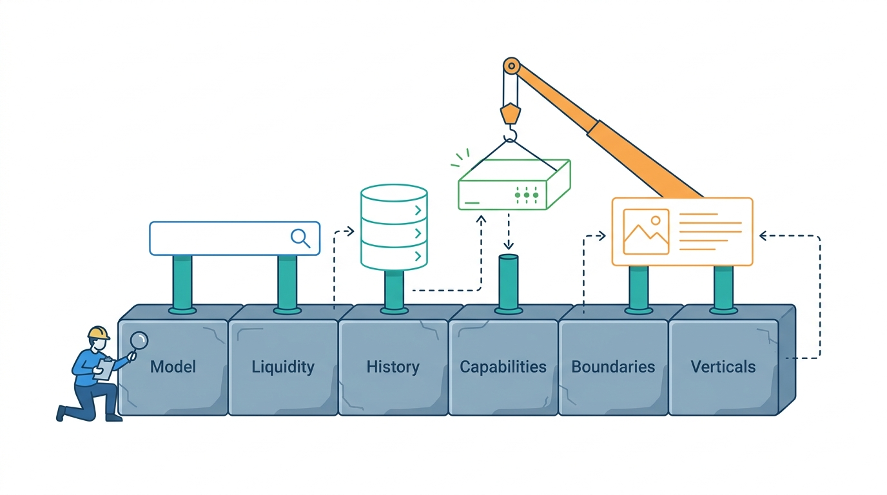

> **IN THIS PART, YOU WILL:** Describe a listing marketplace as a business before describing it as software: its model, liquidity, history, capabilities, bounded contexts and what differs between its verticals.

> **WHY THE BUSINESS CARES:** The model decides what the marketplace can charge for, which risks it carries and which regulators take an interest. Liquidity, the chance that a listing finds a buyer fast enough, decides whether professional sellers renew and buyers come back. Both are business facts that the systems either serve or work against.

> **WHY ARCHITECTS SHOULD CARE:** Every boundary, shared platform and non-functional requirement later in this book is justified by something in this part. Without it, platform debates become contests between system owners.

> **KEY POINTS:**
>
> * **The model is an architecture decision, made per country and category.** Where the marketplace's job ends (contact, lead, payment or delivery) decides how deeply users are verified and which payment, trust and data systems it needs. One brand usually holds several models, so the model belongs in configuration, not in code: one marketplace profile per brand, country and category group.
> * **Liquidity is the product, and its metrics are the requirements.** Buyers and sellers attract each other locally, so liquidity is measured per cell: one place, one category. Its metrics, such as time to first contact, set how fast listings are published, buyers alerted and sold items removed.
> * **Map what the marketplace does before deciding what to share.** A capability map, a bounded-context map and a requirement profile per vertical (what differs, in numbers) make "should this be one platform?" reviewable: the last chapter's share test places each capability in one of four layers, from built once for all brands to built by each.

> **[FAILURE PATTERNS THIS PART ADDRESSES](where-listing-systems-go-wrong.html):**
>
> * **Vanity Liquidity** — The part counts success as matches (contacts and sales) per cell, not listings and visits.
> * **The Forced Fit** — The part shows why a platform built around one model or vertical fails the others.
> * **Deal-Shaped Architecture** — The part gives a group the capability vocabulary to see what it pays for several times.

 
This book starts with the business, not the systems, because **in a listing marketplace the business model decides the architecture** more directly than in most industries. A classifieds site whose job ends at the contact, a portal that sells qualified leads and a marketplace that holds buyers' money need different identity, trust, payment and data systems, even when their search pages look alike.

Deciding what a group like Veldmark, with four of almost everything, should share takes three pieces of business knowledge, supplied in order. First, know what kind of marketplace you run and what it sells: **liquidity**, the likelihood that a listing finds a buyer in a given place and category fast enough that both come back. Second, know how the industry got here: buyers go where sellers already are, so each country and category ended up with one leader; groups bought such leaders, and each brand still runs the systems of the industry wave it was built in, one of five from print columns to private-equity break-ups. Third, describe what the marketplace does, where its boundaries go and how its verticals differ, in terms that outlive systems and reorganizations.

**Figure 1:** *Part I lays the foundation first: the marketplace model, liquidity, history, capabilities, boundaries and vertical differences that every later system decision rests on.*

Six chapters ask these as six questions, each answer giving the next its vocabulary: two on what kind of marketplace you run (the model, then liquidity), one on history and three on what it does (capabilities, boundaries, verticals). The table says when to open each; then come the part's place in the book and Veldmark's decisions.

## Chapters in this part

Each row gives a chapter's question and when to open it.

| Chapter | The question it answers | Read it when… |
| --- | --- | --- |
| [[marketplace-taxonomy]] | What kind of marketplace is this, and why does the answer decide the architecture? | A brand plans to add payments, leads or guarantees. |
| [[liquidity-and-network-effects]] | What does a marketplace sell, and how do we know whether it works? | Dashboards count listings and visits, or nobody can say why a latency target exists. |
| [[industry-evolution]] | How did today's marketplace groups form, and what did each of the five waves, from print columns to private-equity break-ups, leave in their systems? | You inherit a portfolio of local stacks, or the owner may sell a brand. |
| [[business-capabilities]] | How do we describe what the marketplace does independently of its systems? | You must find what the group pays for several times. |
| [[bounded-contexts]] | Where do the domain boundaries go, and who owns the listing's master record? | Every change to the listing table needs a cross-team meeting. |
| [[vertical-requirements]] | What genuinely differs between verticals, and what can be shared? | A program proposes one platform for goods, cars, homes and jobs. |

## How this part connects

This part supplies the vocabulary the rest of the book uses: marketplace profile, liquidity cell, capability, bounded context and vertical requirement profile, defined in that order by every chapter but the history one. It builds on the Preface's failure patterns ([[where-listing-systems-go-wrong]]) and running example ([[meet-veldmark]]). [[part-2]] designs the listing domain model inside these boundaries. Later parts justify freshness, latency and sharing decisions by pointing back to this part's liquidity metrics and share test.

## The Veldmark thread

Veldmark, the fictional marketplace group this book follows, approved its €140 million Common Ground program in January 2027. Ingrid Halvorsen, Group Chief Architect since February 2027, spent her first months testing it against the business. Using the part's vocabulary, chapter by chapter (not date order), her team:

- Classifies the group into **20 marketplace profiles** (brand × country × category group) and resolves the Poland overlap, where Tradeyard's cars section and Motorvane compete for the same dealers.
- Measures liquidity per cell (region × leaf category): **38%** of Tradeyard Netherlands' cells are liquid (at least 25 listings, 50 weekly searches and median first contact under 24 hours), against **11%** in Portugal. Every new latency or freshness objective must name the liquidity metric it protects.
- Reads the group's history (Tradeyard launched in 2004, Motorvane in 2008, a Polish purchase in 2012, three acquisitions in 2023–2025) as sediment left by each wave, and records in March 2027 that any brand may be sold within five years, so every shared platform needs a documented exit path.
- Presents a capability map on 31 March 2027 with **five overlaps** where brands build the same capability. Two more cases sit outside the five. The Poland overlap is a portfolio question. One duplicate is kept on purpose: Keybridge's software that sends agencies' listings to many property portals stays separate from Hearthly's intake of listings, so agencies can trust that Keybridge stays neutral towards Hearthly's competitors.
- Gets a context map of **19 bounded contexts** approved by the architecture advice forum Ingrid chairs, in May 2027.
- Applies the share test per vertical: a shared-versus-specific table, ratified in April 2027, a month before the context map.

Together, the six chapters say what every later design must respect before choosing a technology, which is why the book starts with the business. Begin with [[marketplace-taxonomy]], which asks where the marketplace's job ends.
