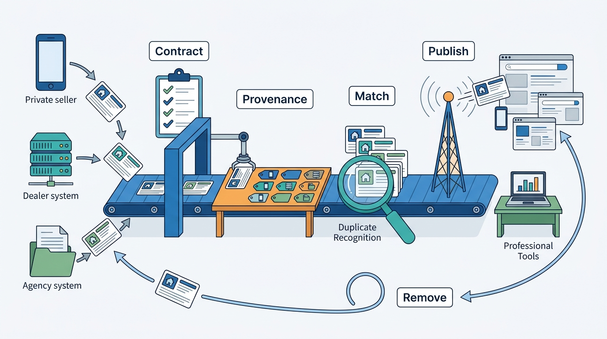

> **IN THIS PART, YOU WILL:** Follow supply from the moment it reaches the marketplace until it is visible everywhere, and later removed everywhere: ingestion and feed contracts, normalization and enrichment, entity resolution, publication and professional tooling.

> **WHY THE BUSINESS CARES:** In vertical marketplaces most inventory comes from professionals through machine feeds, and they pay for the leads it produces. A lost feed, a ghost listing or a lead count that does not match the dealer's CRM costs renewals, not just data quality.

> **WHY ARCHITECTS SHOULD CARE:** Supply is where outside systems write into yours. Every weakness here (an unstated contract, an unrecorded source, an unregistered copy) becomes a search, trust or billing problem downstream.

> **KEY POINTS:**
>
> * **Many doors, one write path, one contract per door.** Forms, APIs and feeds end in one idempotent listing command. Each channel needs a contract that says what it means when a listing is missing from a feed, who owns each field and how both sides reconcile, because partner and platform state will drift.
> * **Keep what was said, record where every value came from.** Normalize to canonical values next to the original, attach provenance to every value, and run enrichment as a versioned, replayable pipeline. Resolve duplicates to entities (the one flat or car behind several listings) with stable IDs other systems can rely on.
> * **Publishing is a decision followed by a propagation, and removal matters more.** A short synchronous path decides whether a listing may go live. Events carry it everywhere within a time budget per stage, and the same mechanism, checked for every copy, takes it down again. Last, the professionals check the result, down to lead counts, against their own systems.

> **[FAILURE PATTERNS THIS PART ADDRESSES](where-listing-systems-go-wrong.html):**
>
> * **Feed Roulette** — Gives every channel a contract, validation, error feedback and reconciliation.
> * **Seeing Double** — Blocks abusive reposts and clusters legitimate multi-listing.
> * **Ghost Inventory** — Makes removal reach every copy, with evidence for each.

 
[[part-2]] modeled the listing: a small aggregate referencing governed categories, attributes, media, places and accounts. This part puts that model under load. **Supply arrives through many doors, at different rhythms, from systems the marketplace does not control**, and each door tends to grow its own idea of what a listing is.

The argument is that supply is **one chain, not five features**. A record enters through a channel under a contract, is normalized and enriched with recorded provenance, is recognized when it describes something already known, and is published and, above all, unpublished within a freshness target. The last link is the professionals' check of its output against their own systems. The five chapters take these links in order; a table of when to open each chapter, the part's place in the book and the Veldmark thread follow.

**Figure 1:** *Supply is one chain, not five features: every door feeds the same contracted path, and the same path takes listings down again.*

## Chapters in this part

In chain order, each row gives a chapter's question and the symptom that sends you there.

| Chapter | The question it answers | Read it when… |
| --- | --- | --- |
| [[listing-ingestion]] | How should a marketplace accept supply from private sellers, professionals and partners at scale? | A partner's bad file can unpublish thousands of listings overnight. |
| [[normalization-and-enrichment]] | How do you turn heterogeneous input into consistent, enriched listings? | Nobody can tell which values a seller typed and which a model inferred. |
| [[entity-resolution]] | How do you recognize that several listings describe the same thing, and what do you do about it? | One flat appears three times, or reposts crowd out new supply. |
| [[publication-pipeline]] | What happens between "publish" and searchable, and how fast must it be? | Publication takes minutes, or sold items still appear in alerts. |
| [[professional-seller-tooling]] | What do professional sellers need, and how should that tooling be built? | Dealers dispute your lead counts, or you sell software to professionals. |

## How this part connects

This part consumes Part II's contracts. Ingestion validates against the [[attribute-schemas]], writes commands to the [[listing-aggregate]] and attaches records to [[sellers-and-accounts]]. The liquidity metrics of [[part-1]] set this part's targets: time to first contact sets the publication budget, and ghost rates set the removal guarantee. Trust and safety ([[part-5]]) owns the moderation gate inside the publication pipeline.

## The Veldmark thread

At Veldmark, the fictional group this book follows (see [[meet-veldmark]]), supply problems arrive as incidents before designs. In this part Ingrid Halvorsen's team:

- Responds to the **8 March 2027** incident at Motorvane, the group's car marketplace, in which truncated snapshot files unpublished **38,400** listings, by adopting **Supply Contract v1** in September 2027: one envelope, one error catalog, mandatory mass-change guards and brand-local adapters.
- Traces the **Essen Volkswagen Golf**'s 31 decoded attributes, giving every value a recorded source.
- Clusters the **Lyon apartment**'s three agency listings into one canonical property, using only what each listing carries as published to Hearthly, never data from Keybridge, the group's agency software that also feeds rival portals: agencies fear Veldmark would use their data to favor Hearthly.
- Writes the **90-second** p95 publication target of Tradeyard, the group's classifieds site, as an SLA card with a time budget per stage, after finding that the 6-minute baseline ignored the 6% of listings held for human review.
- Reconciles the Golf's **23** Dealer Hub leads (Motorvane's dealer portal) against the **14** in the dealer's CRM, and keeps Keybridge's cross-portal report out of Hearthly's reach.

## Where to begin

Together, the chapters turn many doors into one chain: a contract per door, a source for every value, a removal that reaches every copy. The search, alerts and recommendations of [[part-4]] are only as fresh, deduplicated and trustworthy as that chain. Begin with [[listing-ingestion]].
