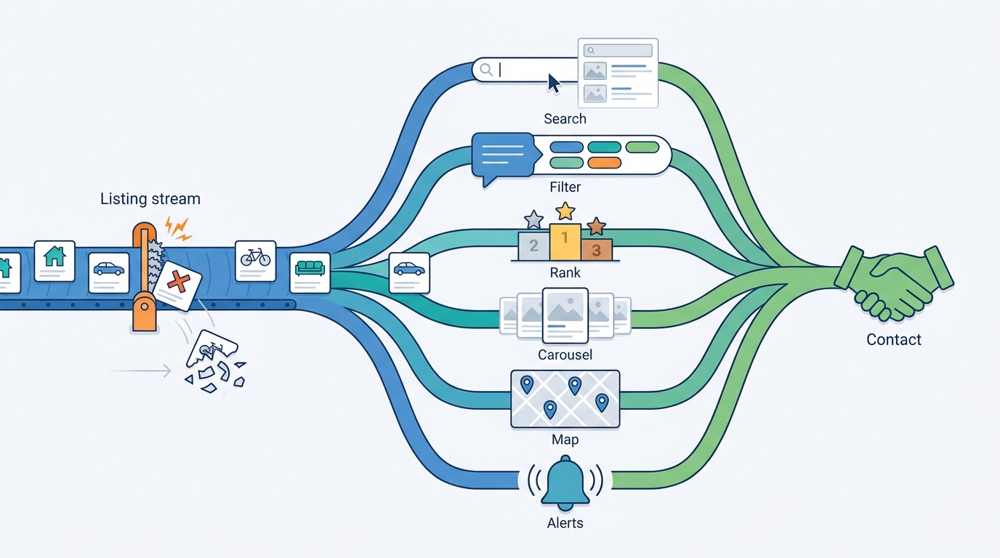

> **IN THIS PART, YOU WILL:** Build the discovery layer: the search index and its contract, query understanding, two-sided ranking, recommendations for short-lived inventory, map and commute search, and saved searches with alerts.

> **WHY THE BUSINESS CARES:** Nearly every contact starts on a results page, a carousel, a map or an alert. Discovery decides which listings get seen and whether paid visibility is worth buying.

> **WHY ARCHITECTS SHOULD CARE:** Discovery runs the busiest read paths in the company, the ones most tempted to become a database, and couples taxonomy, events, ML models and monetization on every query.

> **KEY POINTS:**
>
> * **Every discovery surface is a read model of the listing stream.** Search and recommendation indices, map tiles and alert matchers must be rebuildable from it, and must honor removals faster than insertions.
> * **Structure beats cleverness in listing discovery.** Most queries are filters in disguise. The largest gains come from compiling words, places and saved searches into the marketplace's own categories and attributes; embeddings and language models are layers over that core.
> * **Order is a policy with owners.** Ranking, recommendations and alerts decide which sellers get exposure. Separate the relevance model from a versioned ranking policy that bounds paid visibility, and judge changes on contacts, not clicks.

> **[FAILURE PATTERNS THIS PART ADDRESSES](where-listing-systems-go-wrong.html):**
>
> * **Index-as-Database** — Treats every index as a read model that regular drills prove can be rebuilt.
> * **Paid-Rank Drift** — Moves boosts out of engine configuration into a governed policy with a relevance floor.
> * **Ghost Inventory** — Re-checks availability at serving and send time on carousels, map tiles and digests.

 
Part III ended with supply that is clean, deduplicated and searchable within a freshness target. Part IV turns to **the other side of the market**: the buyer who types three words, draws a shape on a map or saves a search and waits. Listing discovery looks like web search but behaves like a high-write operational system: documents live for days, most queries contain no text, and it is judged by how fast a new listing appears and a sold one disappears.

The argument of this part is that discovery is **one pipeline with six surfaces**, not six products. Each reads the same stream and taxonomy, and each must answer three questions. Is this listing still available? Who decided its position? Did it lead to a contact?

**Figure 1:** *Discovery is one pipeline with six surfaces: each reads the same listing stream, must forget a sold listing quickly, and is judged by the contacts it produces.*

## Chapters in this part

| Chapter | The question it answers | Read it when… |
| --- | --- | --- |
| [[search-architecture]] | How do you build search for millions of short-lived listings with rich filters? | You are choosing an engine, planning a reindex or sizing for the evening peak. |
| [[query-understanding]] | How do you turn short, ambiguous queries into the right structured search? | Zero-result rates are high, or synonyms live in scattered config files. |
| [[ranking]] | How should results be ordered so buyers find the right listing and sellers get fair exposure? | Paid listings crowd the first page, or nobody can explain position 3. |
| [[recommendations]] | How do you recommend items that may be sold tomorrow? | Carousels show sold items, or new listings never appear in them. |
| [[map-search]] | How do you build discovery where place is the main filter? | Map traffic dominates, or polygon queries break the latency budget. |
| [[saved-searches-and-alerts]] | How do you notify millions of users within minutes when a match appears? | Alerts run on a cron job, or digests advertise listings already gone. |

## How this part connects

Discovery reads the categories, attributes and location model from [[part-2]], and the publication pipeline and entity clusters from [[part-3]]. Three later parts constrain or supply it. [[part-5]] puts its risk gate in front of search and alerts. [[part-6]] sells the paid placements that ranking must blend and account for. [[part-7]] supplies the event backbone, experimentation and ML platform these chapters assume.

## The Veldmark thread

Veldmark, the fictional marketplace group this book follows (see [[meet-veldmark]]), runs three search engines. On Sunday 17 January 2027 Tradeyard NL search browned out at the evening peak, and about 9% of searches failed for 48 minutes. Over 2027, Ingrid Halvorsen, Tomasz Wiśniewski's search platform team and the brands decide on:

- **Ranking policy v1** (June 2027), which allows at most four paid listings in the first 20 positions, admits top listings only above a relevance floor and goes live for Tradeyard NL and BE on 1 December 2027;
- a **rebuilt Motorvane similar-vehicles carousel**, which cuts new listings with no carousel impression from 41% to 8%;
- a **shared search platform on OpenSearch** (14 September 2027), with every application moving to Listing Search API v1 first and Motorvane staying on Elasticsearch until a 2029 review;
- a **geo query compiler** for Hearthly's draw-your-area search;
- a **group saved-search service** targeting five minutes p95 from searchable to alert for 46 million saved searches.

By the end of Part IV you should be able to say, for each surface, how fast it forgets a sold listing and who owns the order it shows. Begin with [[search-architecture]].
