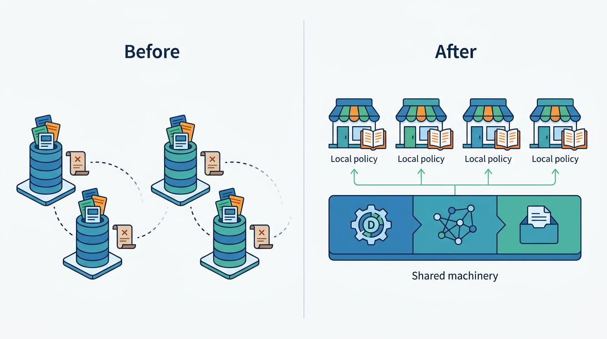

> **IN THIS PART, YOU WILL:** Architect trust and safety as a platform, stop fraud from fake listings to payment-link scams, decide how much to know about users and how to verify it, and turn the Digital Services Act and related rules into system requirements.

> **WHY THE BUSINESS CARES:** A scammed buyer rarely comes back, and a wrongly blocked seller tells other sellers. Since 2024 every EU moderation decision is also a record a regulator can ask about, and fines under the [Digital Services Act](https://eur-lex.europa.eu/eli/reg/2022/2065/oj) can reach 6% of worldwide turnover.

> **WHY ARCHITECTS SHOULD CARE:** Trust touches insertion, search, messaging, alerts, payments and ads. Without one decision record, one propagation path and one identity model, a group cannot say what it removed, why, or whether the removal took effect.

> **KEY POINTS:**
>
> * **Trust and safety is a platform of separate functions joined by one decision record.** Policy, detection, decision, enforcement and review change at different speeds. Share the machinery, keep policy local, and count an enforcement action as done only when every consumer has applied it.
> * **Fraud is caught at the setup (before money moves), by scoring actors and adding friction in proportion to risk.** In classifieds the money usually leaves by bank transfer and is rarely recovered. Link listings, accounts, devices, payment accounts and photos, and ask for identity at the moment of risk, not at the door.
> * **Regulation asks for a few artifacts, built once.** A decision record, a trader record, disclosure surfaces and reproducible reports serve most obligations, and every regulated number should be computable again from the event log.

> **[FAILURE PATTERNS THIS PART ADDRESSES](where-listing-systems-go-wrong.html):**
>
> * **Moderation as an Afterthought** — Replaces a queue bolted onto insertion with a platform that produces evidence by design.
> * **Fast Mail for Fraudsters** — Puts link, pattern and identity controls into the channel where scams close.
> * **Deal-Shaped Architecture** — Replaces four ban lists and four logins with shared signals and one group identity.

 
Part IV built surfaces that put listings in front of buyers within seconds. Fraudsters exploit that speed: a fake rental that reaches saved searches in minutes reaches the most motivated victims first. Part V turns to **the trust that makes contact between strangers possible**.

This part argues that trust is **a platform capability, not a team with a queue**. Most marketplaces build it in the order incidents arrive, and a decade later the group has four moderation stacks that cannot share a signal. These chapters replace that history with one design. The brands share signals, evidence and a decision service that records every decision. Each brand keeps its own policy, thresholds and legal grounds.

**Figure 1:** *Part V replaces four moderation stacks that cannot share a signal with one shared decision service, signals and evidence, while each brand keeps its own policy, thresholds and legal grounds.*

Each chapter plugs into the one before. Trust-and-safety architecture comes first: it builds the decision record, enforcement that reaches every system, and appeals, and leaves detection as an open slot, a place where detectors plug in. Fraud prevention fills that slot, scoring linked accounts and listings, and ends on the strongest friction, an identity check. Identity and verification designs those checks and the trader record the law requires. Marketplace regulation comes last: it turns the law into requirements that the decision record and the trader record serve. Then come a table, the part's place in the book and the Veldmark thread.

## Chapters in this part

Each row gives a chapter's question and when to open it.

| Chapter | The question it answers | Read it when… |
| --- | --- | --- |
| [[trust-and-safety-architecture]] | How should trust and safety be architected across listings, users, messages and transactions? | Each brand runs its own moderation stack, or removals never reach alerts and caches. |
| [[fraud-prevention]] | How do marketplaces detect and stop fraud, from fake listings to payment scams? | Scams close in your messaging, or fraud signals land in separate queues. |
| [[identity-and-verification]] | How much should a marketplace know about its users, and how does it verify it? | You are designing a group login, verified badges or business checks. |
| [[marketplace-regulation]] | Which regulations shape the architecture, and how do they become requirements? | A transparency report cannot be reproduced, or a payments feature will move your legal perimeter (which laws apply). |

## How this part connects

Trust reads the lifecycle and enforcement overlay from [[part-2]], the publication gate from [[part-3]] and the discovery surfaces from [[part-4]], all of which must obey its decisions. It hands three threads to [[part-6]], which turns contact into revenue: messaging, where scams close; in-platform payments, which bring DAC7 seller reporting (EU tax reporting of sellers' income) into scope; and trader records, which feed billing as well as compliance.

## The Veldmark thread

Veldmark, the fictional marketplace group this book follows (see [[meet-veldmark]]), starts 2027 with four trust-and-safety stacks, four identity systems and five sources of statements of reasons (the DSA's required explanation of each restriction; Hearthly exports France's and Spain's separately). Its first DSA transparency report, due in February 2027, drew on all five, and their counts disagreed. Two 2027 incidents show what else that split costs. On 7 March 2027 a fake Safe Deal payment link reached Femke, a Rotterdam seller, sixteen minutes after her first buyer contact; the scammer's phone number had a Motorvane account Tradeyard could not see. In July a Barcelona ring of 26 accounts posted 180 fake rentals, and 63 people lost about €71,000 while photo and price signals sat in separate queues.

Ingrid Halvorsen's team, with Aisha Rahman (trust and safety) and Lucía Ortega (data protection), answers the split, not each incident, with four decisions, each joining what the brands kept apart:

- an **obligation register** that maps the DSA and related rules to controls and evidence queries, grown from the gaps the February report exposed;
- **Veldmark ID** (June 2027): one login across brands with brand profiles, designed so that a sold brand can be cut out;
- a **shared trust-and-safety platform**, live for Tradeyard NL and BE in November 2027, with a cross-brand block list of hashed identifiers, so signals like the Barcelona ring's meet in one record;
- **first-contact friction** on Tradeyard (December 2027) against scams like Femke's.

## Where to begin

The chapters build and read the same records: decisions, risk scores, identity claims, trader records and reports. Trust is one platform because its records are shared: a fake rental's photo and price signals meet in one record, and one decision stops every alert before it reaches a victim. By the end of Part V you should be able to say, for any enforcement decision, who made it, under which policy version, where it propagated and how you would prove all three a year later. Begin with [[trust-and-safety-architecture]].
