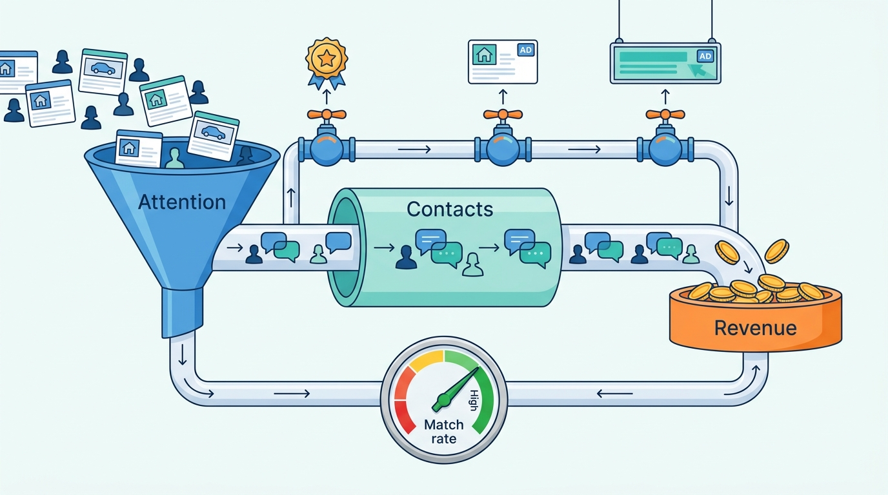

> **IN THIS PART, YOU WILL:** Design the systems that turn attention into contacts and contacts into revenue: messaging and lead routing, payments and buyer protection, monetization models, the product catalog and entitlement ledger, and the advertising stack.

> **WHY THE BUSINESS CARES:** Almost all revenue is decided here. Professionals renew on the leads they can count, and a paid product billed but not delivered becomes a credit note and a lost customer.

> **WHY ARCHITECTS SHOULD CARE:** Every paid product claims a place in ranking, every message passes a safety gate, and every invoice must reconcile with what the platform actually did.

> **KEY POINTS:**
>
> * **Contact is the marketplace's output, and it needs two objects.** A conversation is a private exchange held under privacy and safety rules; a lead is a commercial record delivered, counted and billed. Safety checks sit on the delivery path, because that is where scams close.
> * **The unit of charge chooses the architecture, and every model spends liquidity.** Charging per listing, position, account, lead, transaction or audience needs a different system of record, and each needs a guardrail metric owned by someone other than the team that books the revenue.
> * **Prove that what was sold was delivered.** Keep catalog, price, entitlement and bill apart, and record entitlements as an append-only ledger of grants (a grant is what one purchase entitles a seller to). Insertion puts a paid listing live; ranking, rendering, lead routing and ad serving deliver its other paid effects. Each emits delivery events, and those events are reconciled against the grants and the invoices.

> **[FAILURE PATTERNS THIS PART ADDRESSES](where-listing-systems-go-wrong.html):**
>
> * **Fast Mail for Fraudsters** — Puts a synchronous safety gate between the sender and the recipient of every message.
> * **Multiplier Creep** — Turns boosts, top slots and sponsored listings into explicit, capped effects under one relevance floor.
> * **Billing by Guesswork** — Replaces package checks scattered across services with one entitlement ledger and its delivery evidence.

 
Part V made contact between strangers safe enough to happen. Part VI turns to **what the marketplace earns from it**. A classifieds site usually steps aside before the sale, so it charges for access to attention: the right to list, a better position, a package of slots, a lead, an advertisement.

The argument of this part is that **conversion and monetization are one pipeline with a conflict built in**. The marketplace earns its core revenue when buyers find the right listing quickly. Many of its revenue lines, from paid positions to display ads, earn more when buyers see more pages or when paid listings displace relevant ones. These chapters design each revenue line to sell attention while measuring, and capping, what it costs the match rate: how often buyers and sellers find each other, the measure of the liquidity the marketplace lives on.

**Figure 1:** *Part VI treats conversion and monetization as one pipeline: every paid product sells attention, so each one is capped and measured against what it costs the match rate.*

Five chapters follow the money in the order it arises: first the contact, whose lead later chapters price and bill; then the payment, for the deals where the marketplace takes part in the sale; then the revenue models; then the record of what sellers bought; and advertising last, because it earns from page views rather than matches. A table says when to open each chapter, a section shows what the part takes from Parts V and IV and what it needs from Part VII, and the Veldmark thread shows the decisions these chapters design.

## Chapters in this part

Each row gives a chapter's question and when to open it.

| Chapter | The question it answers | Read it when… |
| --- | --- | --- |
| [[messaging-and-leads]] | How should buyers and sellers be connected so contacts become deals, without creating a scam channel? | Scams close in your chat, or dealers' lead counts never match yours. |
| [[transactions-and-payments]] | When should a classifieds marketplace take part in the transaction, and which systems does it then have to own? | You are adding in-platform payment, shipping or buyer protection, or finance cannot match refunds and payouts to orders at month-end. |
| [[monetization-models]] | Which revenue models fit which marketplace, and what does each require from the systems? | A new revenue model is proposed, or price rises meet professional pushback. |
| [[products-and-entitlements]] | How do you architect what a seller can buy, holds and is billed for? | A price change needs a release, or a dealer disputes an invoice you cannot explain. |
| [[advertising-platforms]] | How do you run advertising alongside listings without degrading the experience or breaking privacy law? | Ad load, header bidding or consent changes are made without a contacts guardrail. |

## How this part connects

[[part-5]] handed this part three threads: the message safety gate from the trust-and-safety platform, DAC7 seller reporting for in-platform payments, and trader records that feed billing. Paid effects flow into the ranking built in [[part-4]], under its relevance floor. [[part-7]] supplies the plumbing: paid effects and leads travel as events, "contact" becomes a governed metric, and pricing tests get guardrails. This book leaves payment and ledger depth to its sibling finance book, RECONCILED: its [[payments-fundamentals]] covers what lies behind Tradeyard Safe Deal, the in-platform payment Tradeyard offers private sellers (see the Veldmark thread below).

## The Veldmark thread

Veldmark, the fictional marketplace group this book follows (see [[meet-veldmark]]), earned €1.31 billion in 2026, sold through four separate product catalogs and a group ad unit. Femke's Rotterdam city bike, sold for €225 through Tradeyard Safe Deal, and a Volkswagen Golf in Essen with 23 raw leads (19 once repeat contacts are merged) are the examples the chapters work through. Ingrid Halvorsen's team and Olivier Petit (VP Monetization) decide, per chapter:

- **one group conversation service** with a message safety gate, decided in May 2027 and live for Tradeyard NL and BE in November 2027, and a lead event contract with a stable lead ID in Q1 2028;
- a **transaction platform** funded before any Safe Deal expansion (September 2027): Safe Deal Portugal approved for Q3 2028 on that platform, a Motorvane private-car "secure handover" left at design study, and protected rental deposits in Spain declined;
- three **monetization proposals** at the advice forum in May 2027: a Top listing price rise approved, a Motorvane per-lead "lead ledger" counted but not yet billed, and a Hearthly commission pilot for 2028;
- **Tally**, the group entitlement service, designed in October 2027 after an audit found 1,140 Motorvane dealers overbilled for cars that were never published;
- **Veldmark Ads** rules (July 2027): contacts per session as the guardrail for ad changes, and at most three paid positions in the first ten rows on Tradeyard Poland from Q1 2028.

## Where to begin

The chapters give every revenue line a record both sides can count, proof of delivery and a guardrail on the match rate, so attention is sold without selling out liquidity. By the end of Part VI you should be able to say, for any paid product, which unit it charges for, what liquidity it spends and how you would prove it was delivered. Begin with [[messaging-and-leads]].
