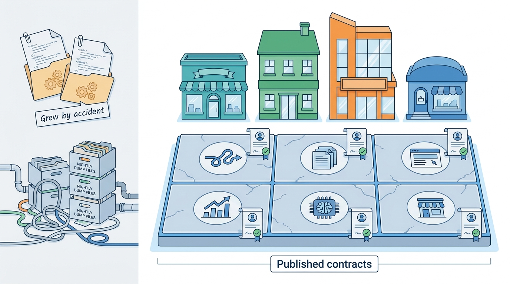

> **IN THIS PART, YOU WILL:** Design the shared platform underneath the listing marketplace: listing events, data management and read models, web and SEO architecture, the data platform, experimentation, machine learning, multi-country tenancy, and reliability, performance and cost.

> **WHY THE BUSINESS CARES:** A sold car that still gets alerts, dead pages in Google's index, a price test with the wrong sign and a search outage at the peak all cost contacts. Users see each as a product failure.

> **WHY ARCHITECTS SHOULD CARE:** One listing write has ten or twenty readers, and every brand and country wants its own variant. The platform decides whether those readers agree, whether a market can change without a fork, and whether a number or a model can be trusted.

> **KEY POINTS:**
>
> * **The platform is a set of published contracts, not a set of products.** One owned listing event stream, a register of every copy with its staleness budget and rebuild path, and governed metrics let many teams build on shared data without coupling to each other's internals.
> * **Two-sided markets break the defaults.** Buyers and sellers affect each other, so experiments need interference-aware designs and guardrails for the side not being tested, and models need governance by the decision they make, not by their algorithm.
> * **Share beneath the product, and measure by journey.** Make the tenant first-class and market differences configuration, with forks only on an expiry date. Measure reliability as journey objectives with error budgets, and cost per search, per live listing and per contact.

> **[FAILURE PATTERNS THIS PART ADDRESSES](where-listing-systems-go-wrong.html):**
>
> * **Search as System of Record** — Makes the search index one registered read model that can be rebuilt from the event stream.
> * **The Copy-Paste Country** — Replaces copied codebases with a tenancy model, configuration over code and owned extension points.
> * **Set-and-Forget AI** — Gives every production model an owner, a decision tier, a prediction log and monitoring.

 
Parts II to VI designed what a marketplace does: model listings, take supply in, match it to demand, keep it safe and make money from it. Part VII turns to **the distributed system that all of those capabilities stand on**. Most groups never designed this layer; it grew from polling jobs, nightly dumps and copied country codebases.

The argument of this part is that **a shared platform earns trust through contracts, not mandates**. Events, copies, URLs, metrics, experiments, models, tenants and service levels each need a written promise, an owner and a way to check the promise is kept. Then the brands above can move at their own pace without breaking each other.

**Figure 1:** *Part VII rebuilds the layer that grew from polling jobs, nightly dumps and copied codebases as a set of published contracts, each with an owner and a check, so the brands above can move at their own pace.*

## Chapters in this part

| Chapter | The question it answers | Read it when… |
| --- | --- | --- |
| [[event-driven-listings]] | How should listing changes reach every downstream system? | Removals arrive late, or a new consumer takes a quarter to build. |
| [[listing-data-management]] | Where does listing data live, and how do the copies stay consistent? | Nobody can list every copy of a listing, or an erasure request takes weeks. |
| [[web-and-seo-architecture]] | How should web and app layers serve both users and crawlers? | Sold listings stay indexed, or a redesign cost you organic traffic. |
| [[data-platform]] | How should a marketplace group collect, govern and use its data? | Each brand counts "contact" differently, or impressions lack their ranking context. |
| [[experimentation]] | How do you run trustworthy experiments when buyers and sellers affect each other? | A winning price or ranking test disappoints once it ships to everyone. |
| [[ml-platform]] | Which models matter, and what platform runs them responsibly? | Nobody can list your production models, or an estimate is about to drive offers. |
| [[multi-country-platforms]] | How do you share a platform across countries and brands without one product? | Every rule is built once per country, or teams route around the platform. |
| [[reliability-and-scale]] | How do you keep a listing platform fast, available and affordable at scale? | Search fails at the weekly peak, or nobody knows the cost of a search. |

## How this part connects

Every earlier part rests on this layer. [[part-6]] assumed it for paid effects, leads, contact counts and pricing tests. The lifecycle from [[part-2]] becomes the event contract, discovery in [[part-4]] reads the stream, and trust decisions in [[part-5]] must propagate to every copy. [[part-8]] takes the platform to the Chief Architect's agenda: consolidating acquired stacks onto it, organizing teams around it and retiring the monolith while it runs.

## The Veldmark thread

Veldmark, the fictional marketplace group this book follows (see [[meet-veldmark]]), starts 2027 with four messaging technologies, three warehouses, 146 production models on four training stacks and a PHP monolith full of country branches. On Sunday 17 January 2027 a TV campaign and a scheduled reindex browned out Tradeyard NL search for 48 minutes. Ingrid Halvorsen's team, with Sven Lindqvist, Priya Raman and Yara Mendes, decides:

- **journey service level objectives** with error budgets and a search degradation ladder (April 2027);
- **server-rendered pages and event-driven sitemaps** for Tradeyard's 40 million indexed URLs (May 2027), and **Tenancy model v1**: ten brand × country tenants (9 June 2027);
- **Experimentation standard v1** (30 June 2027), after a bump-price test that looked like a win, and **Listing event contract v1** on Kafka (Confluent Cloud), live on 1 July 2027;
- an **Iceberg-based data platform** with tracking plan v1 (September 2027), a **group retention schedule** and the consumer registry extended to every listing copy (October 2027), and a **group model registry** mandatory for every production model (9 November 2027).

By the end of Part VII you should be able to say, for any listing fact, where it is true, which copies hold it and how you would rebuild or erase them. Begin with [[event-driven-listings]].
