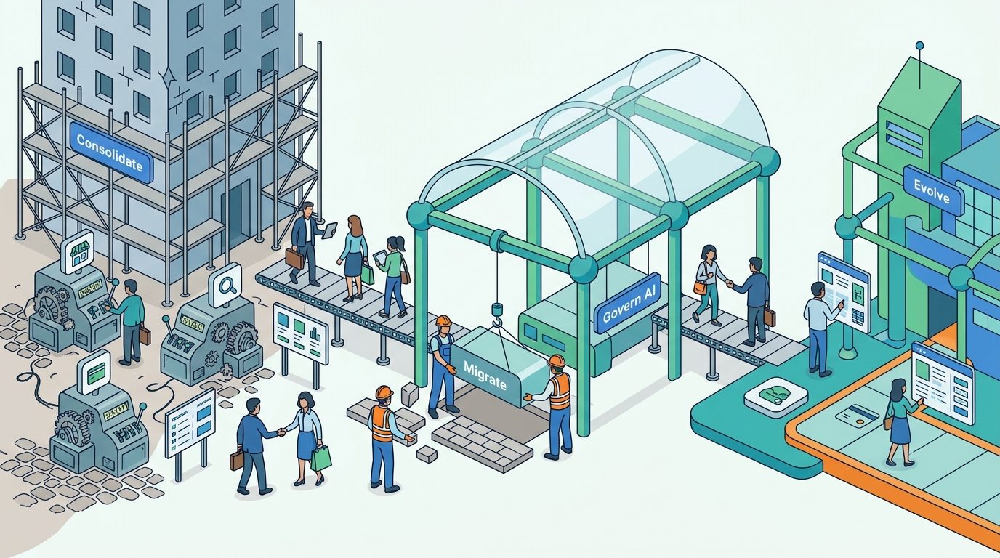

> **IN THIS PART, YOU WILL:** Set the Chief Architect's agenda for a marketplace group: consolidate platforms after acquisitions, organize engineering around journeys and shared capabilities, modernize a live marketplace slice by slice, put AI across the listing lifecycle under control, and evolve the platform over ten years.

> **WHY THE BUSINESS CARES:** Acquisitions are priced on synergies and platform programs on run-cost savings; both are paid for in liquidity when they go wrong. Sequencing, ownership and gates decide whether the group keeps the traffic, sellers and partners it bought.

> **WHY ARCHITECTS SHOULD CARE:** Parts I to VII describe the systems; this part describes the decisions, teams and migrations that move a real group toward them. A design with no owning team, no stage gates and no measure of success stays half-built.

> **KEY POINTS:**
>
> * **Sequence change by risk to liquidity, not by the size of the saving.** Consolidate what users never see first and the core listing and search experience last, strangle the monolith slice by slice behind a seam, and gate every step on measured outcomes with a rollback answer.
> * **Ownership and decision rights are part of the architecture.** Every journey, bounded context and shared capability needs exactly one owning team, platform teams earn their tenants, and cross-brand decisions go through an open, recorded advice process rather than a review board that owns nothing.
> * **Design for a future you cannot predict, and measure whether the design still works.** Let AI propose while the structured systems decide, invest in the few contracts and identifiers that survive many stressors, and steer by marketplace fitness functions instead of program milestones.

> **[FAILURE PATTERNS THIS PART ADDRESSES](where-listing-systems-go-wrong.html):**
>
> * **Deal-Shaped Architecture** — Gives every acquired marketplace an integration option and a consolidation sequence, so the group stops paying for each capability several times.
> * **The Forced Fit** — Makes shared platforms internal products with owners, contracts and migration help, so marketplaces adopt them instead of routing around them.
> * **Set-and-Forget AI** — Registers every AI use with an owner, an evaluation set, a cost per outcome and a kill switch.

 
Part VII built the distributed system underneath the marketplaces. Part VIII turns to **the Chief Architect's agenda**: the work that decides whether that system ever exists outside a diagram. It asks in what order the earlier chapters' decisions are carried out, who owns them, how a live business moves onto them, and how a group knows, years later, that they still serve their purpose.

The argument of this part is that **the hard problems of a marketplace group are problems of change, not of design**. The group was assembled by acquisition, so its platforms come in several copies; its teams follow old org charts, its monolith still bills the bumps, and its future owners and regulators are unknown. The architect changes all of this while buyers keep finding things and sellers keep getting contacts.

**Figure 1:** *Part VIII treats the group's hard problems as problems of change: consolidating, assigning owners, migrating, governing AI and evolving the platform while buyers keep finding things and sellers keep getting contacts.*

## Chapters in this part

| Chapter | The question it answers | Read it when… |
| --- | --- | --- |
| [[platform-consolidation]] | When a group acquires marketplaces, what should it consolidate, when, and how? | The board asks where the synergies are, or a rebrand is planned alongside a replatform. |
| [[organizing-marketplace-engineering]] | Which organizational design makes a multi-marketplace architecture work? | A fix reaches one country and not the next, or a shared platform has no team that owns it. |
| [[modernization-and-migration]] | How do you move a live marketplace off legacy systems without losing traffic, sellers or revenue? | Your monolith deploys twice a week, or a rewrite is being proposed. |
| [[ai-in-listing-systems]] | Where do generative AI and agents create value, and what architecture keeps them controlled? | Several AI proposals arrive at once, or external assistants start querying your search. |
| [[long-term-evolution]] | How do you keep a marketplace platform coherent over ten years of change? | An investor asks what a sale would cost, or the program reports milestones instead of matches. |

## How this part connects

Each chapter builds on a design from an earlier part. The tenancy model and release rings of [[multi-country-platforms]] make consolidation possible. The [[event-driven-listings]] contract and the [[search-architecture]] platform are the seams a migration routes through. The context map from [[bounded-contexts]] becomes the list of owning teams. [[ai-in-listing-systems]] extends [[ml-platform]] and depends on the taxonomy and attribute schemas of Part II. [[long-term-evolution]] closes the book's argument. [[part-9]] then tests that argument against publicly documented marketplace groups, several of which lived through the reversals this part warns about.

## The Veldmark thread

Veldmark, the fictional marketplace group this book follows (see [[meet-veldmark]]), has approved Common Ground: €140 million over 2027–2030 to share platforms and retire Yardstick by the end of 2029. By October 2027 the Casavista deal has delivered €9.6 million of the €18 million in promised synergies. Ingrid Halvorsen, the Group Chief Architect, shapes the decisions that follow, though the CTO, the board and the advice forum take them:

- **Common Ground organization v1** (22 June 2027, effective 1 September), with a group platform organization under Yara Mendes, journey-aligned brand teams and the weekly architecture advice forum;
- the **Yardstick Exit plan** (October 2027): six waves that end in decommissioning by 31 December 2029, when the Amsterdam colocation contract expires;
- the **consolidation review** (9 November 2027): a synergy ledger in place of spreadsheets, the Keybridge cross-selling line withdrawn, and Keybridge federated under group controls permanently;
- the **photo-to-listing assistant pilot** (15 November 2027), in which the model proposes and the taxonomy, attribute schema and trust rules decide;
- a **stressor workshop** (18–19 November 2027) and the **marketplace fitness scorecard v1** of twelve measures (8 December 2027), ahead of the board's question about selling Hearthly.

By the end of Part VIII you should be able to say what to change first, who owns it, how you will know it worked, and what must stay true when the group's owners, laws and channels change. Begin with [[platform-consolidation]].
