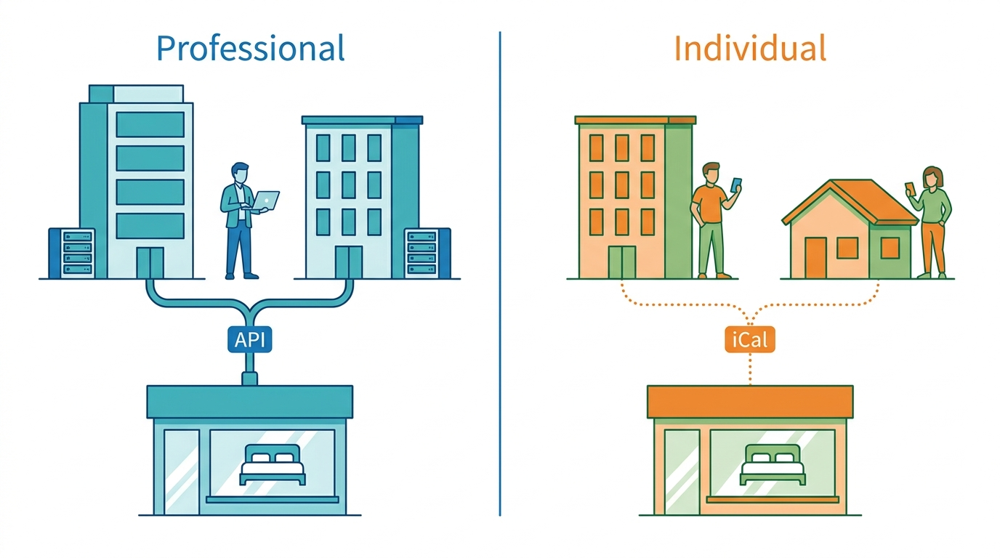
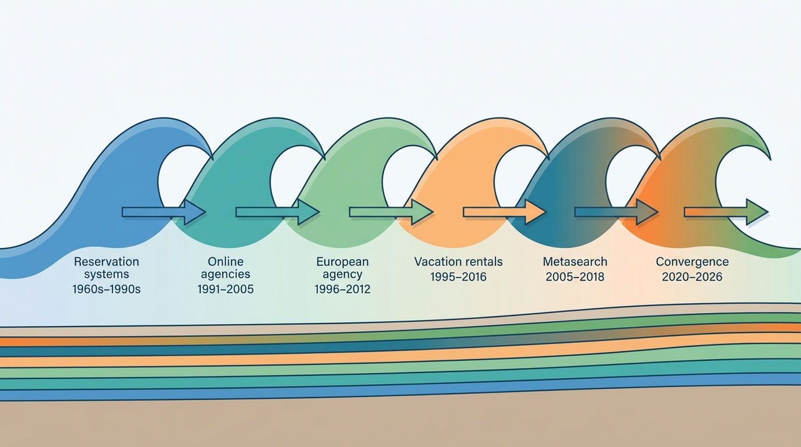
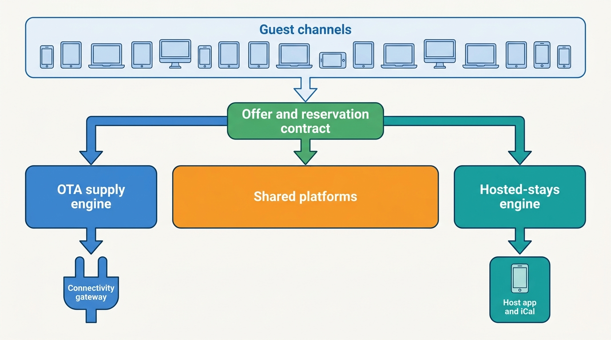
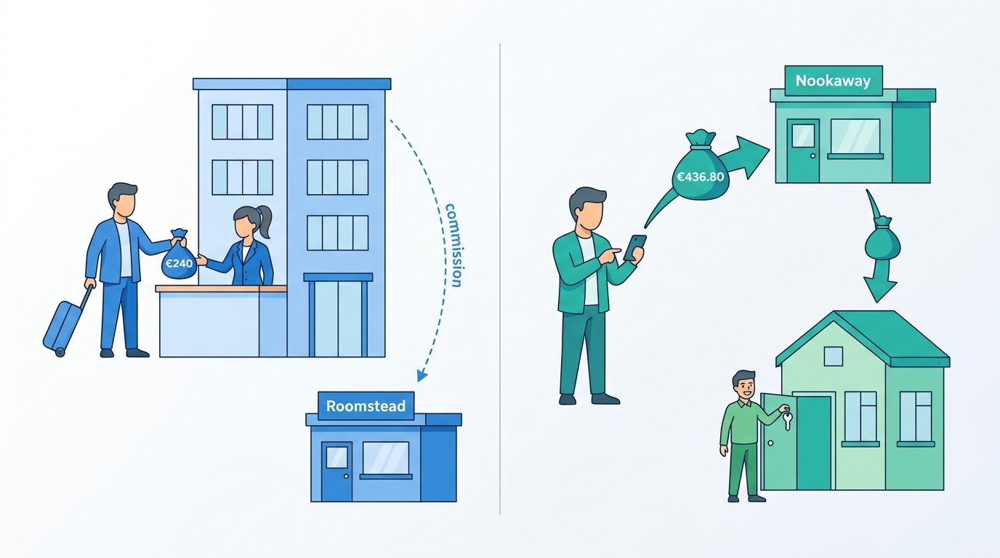

> **IN THIS CHAPTER, YOU WILL:** Learn to tell the kinds of accommodation business apart (OTA, hosted-stays marketplace, vacation-rental marketplace, metasearch, bedbank, direct booking) by who holds the supply, the guest, the money and the truth about availability. You will trace the dated history from airline reservation systems to today's convergence, and see what each wave left in the systems architects maintain now.

> **WHY THE BUSINESS CARES:** The type of marketplace decides where the money and the risk sit: who pays the guest's refund when a night is sold twice, who carries chargebacks, who answers to a city about a home without a permit. A general manager who treats "hotels" and "homes" as two categories of one product will be surprised by costs that come from the business model, not from the category.

> **WHY ARCHITECTS SHOULD CARE:** Most expensive mistakes in stays platforms start with an unstated assumption about the type: that the hotel's systems are the source of truth, or that the platform's calendar is; that the platform holds the guest's money, or that it never does. Naming the type for each supply segment tells you which components are core, which can be shared, and which failure patterns you are exposed to.

> **KEY POINTS:**
>
> * **The type is decided by where the truth lives, not by what the building looks like.** An OTA-style marketplace sells counted rooms whose availability and price are asserted by the property's systems and copied in; a hosted-stays marketplace sells one specific home whose calendar, money and trust it holds itself. A professionally managed apartment on an OTA behaves like a hotel; an individual's spare room on any platform behaves like a home.
> * **Every wave of history left a layer that is still running.** Airline-era reservation systems left rate codes and the look-to-book problem; the US merchant model left net rates and virtual cards; the European agency model left extranets and commission invoices; vacation-rental classifieds left listing-centric content; Airbnb left platform custody of money and two-sided trust. A modern platform carries several of these layers at once.
> * **Convergence is real at the guest's end and shallow at the supply end.** OTAs now sell millions of homes and hosted-stays platforms sell hotels, but the documented record shows them keeping separate supply rules for each. A group running both should share identity, payments, ledger, trust, messaging and data, and a common offer and reservation contract, and keep the room-type inventory engine and the single-unit calendar apart.

> **[FAILURE PATTERNS THIS CHAPTER ADDRESSES](where-stay-platforms-go-wrong.html):**
>
> * **The Hotel-Shaped Home** — the most common response to convergence is to force one marketplace type's supply model onto the other, and this chapter shows why the two models exist.
> * **The Same Hotel Twice** — metasearch, bedbanks, GDS content and direct channels mean one hotel reaches the guest through several intermediaries, and a platform that does not know which kind of intermediary it is will duplicate it.
> * **Ledgerless Money** — agency, merchant and facilitated payments put the marketplace in three different places in the money flow, and a group that runs all three without naming them cannot say who owes whom.

 
A night in a hotel room and a night in someone's apartment look like the same product on a results page: a photo, a price, a map pin, a "Reserve" button. Behind the button they are different businesses. **An accommodation marketplace sells a perishable promise — a specific night, in a specific place, at a specific price — that someone else fulfills**, and the two kinds of marketplace keep that promise with different machinery.

The OTA-style marketplace keeps it by copying the truth from the hotel's systems fast enough and accurately enough, through channel managers and property-management systems that push availability and rates. The hosted-stays marketplace keeps it by holding the truth itself: one calendar per home, the guest's money in custody until check-in, and a system of verification, reviews and protection that lets strangers sleep in each other's homes. **The first is a supply-integration problem; the second is a trust and one-unit-integrity problem.** Both have to solve the other's problem a little, and that is where most of the architecture in this book lives.

This chapter opens Part I ([[part-1]]) and sets up the rest of the book. It owns the terms **accommodation marketplace**, **hosted-stays marketplace**, **OTA**, **metasearch**, **bedbank** and **direct booking**, and introduces the merchant, agency and facilitator money roles that [[merchant-and-agency-models]] treats in depth. It then tells the industry's history as a series of dated waves, because the systems you inherit are fossils of the business model that built them.

## Setting the Scene at Corvane: "If They Are the Same Business, Make Them One"

Corvane, the fictional travel group this book follows (see [[meet-corvane]]), runs two marketplaces of different types. **Roomstead**, founded in Dublin in 2001, is an OTA-style accommodation marketplace. **Nookaway**, founded in Lisbon in 2012 and acquired in 2021, is a hosted-stays marketplace. Around them sit **Corvane Connect**, a channel-manager business acquired in 2024, and **Corvane Payments**, an electronic money institution licensed in 2024. Everything about Corvane is invented for teaching.

On **8 February 2027**, five weeks after Mariana Costa joined as Group Chief Architect, the CEO, Daniel Okonkwo, sent her a two-line request for the April board pre-read: *"Explain why we run two marketplaces on two platforms. If they are the same business, tell me how to make them one."*

Two answers were already on her desk. A Roomstead supply team had written a short proposal pointing out that **435,000** of Roomstead's **640,000** bookable properties were already apartments and homes, so Roomstead "already sells homes". It suggested loading Nookaway's 1.15 million listings into Tally, Roomstead's inventory store, as room types with a quantity of one, and retiring Almanac, Nookaway's calendar service. Rafael Mendes, VP Engineering at Nookaway, replied in one sentence: *"Roomstead's homes are mostly run by companies with software; ours are mostly run by people with a phone."*

Mariana began with the numbers.

| 2026 | Roomstead | Nookaway |
| --- | --- | --- |
| Type | Accommodation marketplace (OTA-style) | Hosted-stays marketplace |
| Supply | 640,000 properties: 205,000 hotels and similar; 435,000 apartments and homes, about 70% of them from professional property managers | 1.15 million listings from 610,000 hosts; 82% of hosts have one listing; managers with five or more listings hold 44% of listings |
| How supply arrives | 82% of hotel room nights through 140 certified connectivity partners; 18% managed by hand in the Partner Hub extranet | Mostly typed into the host app; of the 61% of listings also sold elsewhere, 47% sync by iCal only, 53% by PMS or channel-manager API |
| What is stored per night | Rooms to sell, prices and restrictions per room type and rate plan (Tally) | One row per listing per night (Almanac) |
| Volume | 109 million room nights booked gross, 34% canceled, 72 million stayed; 2.4 nights per reservation | 21 million nights stayed; 6.0 million stayed reservations; 13% of reservations canceled; 3.5 nights per reservation |
| Price per night | Average daily rate (ADR) €128 | €142 including cleaning fee |
| Gross booking value (stayed) | about €9.2 billion | about €2.98 billion |
| Money | 70% agency (guest pays the property; Roomstead invoices commission), 30% merchant (Corvane Payments charges the guest and pays the property, mostly by virtual card) | Facilitated: guest pays Nookaway at booking or with Pay Later; host paid 48 hours after scheduled check-in |
| Revenue | €1.200 billion; take rate about 13% | €430 million; about 14% of GBV against a headline 12% guest fee plus 4% host fee |

The table settled half the argument. Roomstead does sell homes, but **its homes are professional supply arriving through the same machinery as its hotels**. Nookaway's supply is mostly individuals, and nearly a third of its multichannel listings keep their calendars consistent with other platforms by iCal polling, a mechanism with no transactions and no prices ([[calendar-sync]]). The two marketplaces also stand in different places in the money flow: Roomstead mostly never touches the guest's money, and Nookaway always does.

The other half was harder, and it is this chapter's question: **what kind of marketplace is each, and does the type decide the architecture?** The board's April 2027 answer, the One Stay program, shares contracts and platforms for the guest's commitment and keeps separate supply engines; [[converging-two-marketplaces]] argues it in full.

## Six Ways to Sell a Night

Travel people use "OTA", "marketplace", "booking site" and "channel" almost interchangeably. For architecture the words need to mean different things, because each type puts different systems at the center. Four questions separate them:

1. **Who holds the supply relationship?** Who signed with the hotel or host, and who can change the terms?
2. **Who holds the guest?** Whose account, whose checkout, whose customer service?
3. **Who holds the money?** Does the guest pay the intermediary, the property, or someone in between?
4. **Where does the truth about availability and price live?** In the property's systems, or in the platform's?

### The definitions this book uses

- **Accommodation marketplace (OTA-style marketplace).** A platform that lets guests search, compare and book stays from many independently operated, mostly professional properties, and passes the reservation to the property to fulfill. Supply is described as **property → room type → rate plan**, and the property's own systems usually assert availability and price, which the marketplace copies in. Booking.com, Expedia and Hotels.com, Agoda and Trip.com are the documented examples; Corvane's Roomstead is the fictional one. **OTA** stands for online travel agency, the industry's historical name for this type; it says "agency" even when the OTA acts as merchant, which is one reason the money roles below need their own names.
- **Hosted-stays marketplace.** A platform on which individuals and professional managers offer homes, apartments and private rooms, each listing usually one unit with one calendar, and on which the platform holds the calendar, collects the guest's payment, and runs the verification, reviews and protection that make a stay with a stranger acceptable. Airbnb is the documented example; Corvane's Nookaway is the fictional one.
- **Vacation-rental marketplace.** The older, narrower relative of hosted stays: a platform for whole holiday homes, historically run like classifieds (the owner paid to advertise; the guest paid the owner directly). VRBO and HomeAway began this way and moved toward transactional booking from 2013. Today the term mostly describes a supply segment (whole homes, weekly stays, changeover days, damage deposits), not a distinct business model.
- **Metasearch.** A price-comparison engine that queries OTAs, hotel websites and other sellers for the same stay, shows the prices side by side, and sends the guest elsewhere to book. It holds the guest's attention but not the booking; it earns mainly per click or per referral. trivago, majority-owned by Expedia Group, is described in Expedia's fiscal-2025 annual report as a hotel metasearch business earning advertising revenue from referrals ([Expedia Group 10-K, 2026](https://www.sec.gov/Archives/edgar/data/1324424/000132442426000008/expe-20251231.htm)).
- **Bedbank (wholesaler).** A business-to-business intermediary that contracts hotel rates, usually net rates that the reseller marks up, and resells them through APIs to travel agents, tour operators, OTAs and other distributors. It never meets the guest. HBX Group, the parent of Hotelbeds, described itself at its 2025 listing as connecting "more than 250,000 hotels" to about 60,000 distributors ([PhocusWire, 2025](https://www.phocuswire.com/hbx-group-ipo-spanish-stock-exchanges)). Bedbank APIs separate a cached search price from a re-checked bookable price: Hotelbeds' documented flow is availability → rate key → CheckRate when the rate is marked `RECHECK` → booking ([Hotelbeds developer documentation, n.d.](https://developer.hotelbeds.com/documentation/hotels/booking-api/workflow/)).
- **Direct booking.** A guest booking with the property or host itself, without a marketplace: the hotel's website and booking engine ("brand.com" for chains), its call center, its front desk, or a host's own site. Direct booking is the marketplace's competitor and, for many hotels, its benchmark: the marketplace's commission is what the hotel pays to reach guests it could not reach directly.

Two pieces of infrastructure sit underneath these types and appear throughout the book:

- A **global distribution system (GDS)** is the network that connects travel agents to airlines, hotels and car rental companies: Sabre, Amadeus and Travelport's systems. A GDS holds no hotel inventory of its own; it routes requests to the hotel's reservation system.
- A **central reservation system (CRS)** holds a hotel or chain's sellable inventory and rates above the individual property's **property-management system (PMS)**, the system that runs the front desk. A **channel manager** distributes availability, rates and inventory (**ARI**) from the PMS or CRS to many channels and brings their reservations back. [[connectivity-and-channel-managers]] owns this stack.

### The six types side by side

| Type | Holds the supply relationship | Holds the guest | Holds the money | Truth about availability and price |
| --- | --- | --- | --- | --- |
| **Accommodation marketplace (OTA)** | Yes, by contract with each property | Yes | Agency: no (property charges). Merchant: yes, until it pays the property | **Property's systems**, copied in by push |
| **Hosted-stays marketplace** | Yes, by terms with each host | Yes | Yes, always (facilitated payments) | **Platform's own calendar**, edited by the host or synced from a PMS or iCal |
| **Vacation-rental marketplace (classic)** | Yes, by listing subscription | Partly (the inquiry) | Historically no; now mostly yes | Historically the owner's head; now as hosted stays |
| **Metasearch** | No (advertisers, not suppliers) | Yes, until the click | No | **Other sellers' systems**, queried or fed |
| **Bedbank / wholesaler** | Yes, by net-rate contract | No (B2B) | Yes, from the reseller | Contracted or connected inventory, re-checked at booking |
| **Direct booking** | Is the supplier | Yes | Yes | **The property's own systems** |

The last column is the one that decides the architecture. **When the truth lives outside, the platform is a cache with a contract; when it lives inside, the platform is a system of record with a duty of care.** Caches go stale and need price-accuracy measurement, re-checks and reconciliation ([[availability-engine]]). Systems of record need concurrency control, audit and protection for the people who rely on them ([[inventory-integrity]]).

## Professional and Individual Supply: The Axis That Matters More Than "Hotel or Home"

The obvious way to classify supply is by building: hotels, hostels, B&Bs, serviced apartments, holiday homes, private rooms. For architecture the more useful axis is **who operates the supply and with what systems**.

| Supply segment | Typical units per operator | Systems the operator runs | How it reaches a marketplace | Who sets the price | Who operates the stay |
| --- | --- | --- | --- | --- | --- |
| **Chain hotels** | Hundreds to thousands of rooms across many properties | PMS per property, chain CRS, revenue-management system (RMS), loyalty | CRS → switch or direct connection → GDS and OTAs | Chain revenue management | Hotel staff |
| **Independent hotels** | Tens to a few hundred rooms | Cloud PMS, channel manager, sometimes an RMS | Channel manager → OTAs; extranet for the smallest | Revenue manager or owner | Hotel staff |
| **Hostels, B&Bs, guesthouses** | A few to tens of beds or rooms | Light PMS or none | Channel manager or extranet | Owner | Owner and staff |
| **Professional managers of apartments and homes** | Tens to thousands of units | Vacation-rental PMS that bundles channel manager, messaging and pricing | PMS API to three or four marketplaces | Manager, often with a pricing tool | Manager's operations team, cleaners, lockboxes |
| **Individual hosts** | One home or one room | A phone; sometimes a calendar on another platform | Typed into the host app; iCal to other platforms | The host, often with platform suggestions | The host |

Three consequences cut across the two types.

1. **Connectivity follows the operator, not the building.** A professional manager's 38 apartments arrive by API with prices and restrictions, like a hotel's rooms. A single owner's apartment arrives by hand or by iCal, which carries only busy dates ([RFC 5545, 2009](https://www.rfc-editor.org/rfc/rfc5545)). SiteMinder, a hotel channel manager, reported **56,000** hotel properties in its fiscal-2026 results ([SiteMinder FY26 results, 2026](https://www.siteminder.com/wp-content/uploads/2026/08/Earnings-Release-SiteMinder-FY26.pdf)); vacation-rental PMS vendors connect to a handful of marketplaces and often fall back on iCal for the rest.
2. **Trust burden follows the operator too.** A hotel has a legal entity, staff, insurance and a front desk. An individual host has none of those, so the platform supplies identity verification, reviews in both directions, damage protection and a guest guarantee ([[stays-trust-and-safety]], [[protection-and-incidents]]).
3. **Regulation lands on individuals first.** Short-term-rental rules — registration numbers, night caps, permits per unit — were written for homes, and the EU Short-Term Rental Regulation, (EU) 2024/1028, applies from 20 May 2026 to hosts and platforms regardless of which type of marketplace lists the home ([Regulation (EU) 2024/1028, 2024](http://publications.europa.eu/resource/celex/32024R1028); [[stays-regulation]]).

This is why Rafael Mendes's objection mattered more than the property count. **Roomstead's 435,000 homes are mostly professional supply; Nookaway's 1.15 million listings are mostly individual supply.** Roomstead's home business is an OTA business that happens to sell apartments.

**Figure 1:** *Connectivity, trust and regulation follow who operates the supply, not the building: Roomstead's 435,000 homes are mostly professional supply, while Nookaway's 1.15 million listings are mostly individual supply.*

The axis also explains the most common category error in the industry. Booking.com's fiscal-2025 annual report counts about **4.4 million** properties at the end of 2025, of which about **3.9 million** are "homes, apartments and other unique places to stay" and about **500,000** "hotels, motels and resorts"; alternative accommodations were about **36%** of its room nights ([Booking Holdings 10-K, 2026](https://www.sec.gov/Archives/edgar/data/1075531/000107553126000009/bkng-20251231.htm)). Expedia Group counted about **3.6 million** lodging properties, about **2.4 million** of them alternative accommodations through Vrbo ([Expedia Group 10-K, 2026](https://www.sec.gov/Archives/edgar/data/1324424/000132442426000008/expe-20251231.htm)). Counts dominated by homes sit beside revenue dominated by hotels: Expedia's filing attributes its lodging revenue growth primarily to its hotel business. **Property counts tell you the shape of the catalog, not the shape of the business**, and neither tells you which supply segments need which machinery.

## Three Places to Stand in the Money Flow

The second separator is the marketplace's position in the money flow ([[merchant-and-agency-models]] owns the details).

- **Agency model.** The marketplace passes the reservation to the property and does not take the guest's money for the stay. The property charges the guest, often at the stay, and the marketplace invoices a **commission** afterwards. The guest's card may be forwarded as a guarantee. Booking Holdings' 2025 filing describes agency revenues as "almost entirely" commissions on Booking.com accommodation reservations.
- **Merchant model.** The marketplace or its payment entity charges the guest, usually at booking, and pays the property later, often by **virtual credit card (VCC)**, a single-use card number loaded with the amount owed. Expedia's fiscal-2025 annual report says that under the merchant model it "is the merchant of record" but has "no control over the rooms" and does not "bear inventory risk".
- **Facilitated payments.** The hosted-stays form: the platform collects the guest's payment as the host's limited payment collection agent, holds it until a trigger, deducts its fees and pays out the rest. Airbnb's fiscal-2025 annual report says it holds "the total amount the guest has paid until check-in" and initiates the remittance to the host, which "generally occurs on the business day after the scheduled check-in" ([Airbnb 10-K, 2026](https://www.sec.gov/Archives/edgar/data/1559720/000155972026000004/abnb-20251231.htm)).

The OTA side has been moving from agency to merchant for years. Booking Holdings' merchant share of gross bookings rose to **70%** in 2025 from **63%** in 2024, and Expedia Group's 2025 revenue was **70% merchant, 22% agency, 8% advertising and other**. Trip.com Group goes the other way: its fiscal-2025 annual report says it acts "as an agent in substantially all of our hotel-related transactions" ([Trip.com Group 20-F, 2026](https://www.sec.gov/Archives/edgar/data/1269238/000119312526183379/d27369d20f.htm)). Hosted stays have no agency option to move from, because **an individual renting one flat cannot take a card**; the platform must collect. My reading, labeled as inference, is that part of the OTA shift to merchant is the price of growing in homes: once a large share of supply cannot charge the guest, the platform needs payment rails anyway.

| Money role | Typical for | Who carries fraud and chargebacks | What the marketplace must build |
| --- | --- | --- | --- |
| Agency | Classic European OTAs; Trip.com for hotels | Mostly the property | Commission invoicing and collection; card-guarantee forwarding; no-show handling |
| Merchant | US OTAs historically; growing everywhere | The marketplace | Payment orchestration, VCC issuing, supplier payables, refunds, a ledger |
| Facilitated | Hosted stays from the start | The platform | Custody of guest funds, payouts to individuals in many currencies, fee splits, licenses, a ledger |

## How They Grew: Six Waves and What Each Left Behind

A rate code, an extranet, a nightly commission run, a listing description written by the host: each is a fossil of a particular era. Founding dates and acquisition prices below come mostly from secondary sources (see **Sources and Evidence**); I give them as widely reported.

**Figure 2:** *Six overlapping waves built the stays industry; each added a layer of systems that today's platforms still run, rather than replacing the layer before it.*

### Wave 1 (1960s–1990s): reservation systems, the GDS and the hotel switch

Computerized travel reservation began with airlines: SABRE, built by IBM and American Airlines, went live in 1964, and travel agents got direct access in 1976. Hotel chains built central reservation systems, and because each spoke a different protocol, the industry built **switches** to translate between hotel systems and the GDSs. THISCO, the Hotel Industry Switch Company, was founded in 1989 by a consortium of hotel companies for this purpose and later became Pegasus.

**What it left behind.** The vocabulary of the OTA side: room-type codes, **rate codes** that combine price with conditions (the ancestor of the rate plan), the idea that inventory lives in the supplier's system and the distributor only asks for it, and the **look-to-book problem** — distributors ask about availability far more often than anyone books, so the supplier's system is loaded in proportion to shopping, not selling. A 2016 industry opinion piece reported distributor look-to-book ratios rising from about 500:1 to "the order of 20,000:1" ([Hospitality Net, 2016](https://www.hospitalitynet.org/opinion/4074433.html)), a figure I treat as an order of magnitude rather than a measurement. The GDS is still a hotel channel: Amadeus markets access to more than a million properties, including resold aggregator content ([Amadeus, n.d.](https://amadeus.com/documents/en/hospitality/sales-sheet/amadeus-hotels-aggregator-content.pdf)). That resale is one of the roots of **The Same Hotel Twice**.

### Wave 2 (1991–2005): US online agencies and the merchant model

The consumer internet moved booking from travel agents to travelers. Hotel Reservations Network was founded in Dallas in 1991 and renamed Hotels.com in 2002; Expedia was founded as a division of Microsoft in October 1996 and spun off in 1999. USA Networks (later IAC) acquired Hotels.com and control of Expedia in 2001, and spun the combined travel business off as Expedia, Inc. in 2005. The US online agencies made the **merchant model** their signature in hotels: the agency took the traveler's payment at booking and paid the hotel a negotiated rate later.

**What it left behind.** Merchant-of-record payment flows; **net rates** with a marketplace margin on top; contracted rates loaded into the agency's own systems rather than read live; supplier payables and the virtual card as a way to pay hotels without a bank transfer per booking. It also left the packaging advantage: Expedia's 2025 filing says packages are sold mainly under the merchant model because it allows bundled prices lower than the components sold separately.

### Wave 3 (1996–2012): the European agency model at scale

In Europe a different model won. Bookings.nl was founded in Enschede in 1996, merged into Booking.com in 2000, and was acquired by Priceline in July 2005 for a reported $133 million; Priceline acquired Agoda in 2007. Booking.com ran the **agency model**: its "How we work" page still says the provider "just pays us a commission" after the stay ([Booking.com, 2025](https://www.booking.com/content/how_we_work.html)). My interpretation, not a documented company statement, is that agency suited Europe's fragmented independent hotels: a small hotel only had to keep its rooms up to date and pay an invoice, so supply could be signed up at very large scale.

**What it left behind.** The **extranet** — a web tool where a small hotel types its availability and prices directly into the marketplace — and, as hotels grew tired of updating several extranets, the **channel manager** market; commission invoicing and collection, with the collection risk that comes with it; card-guarantee forwarding and its PCI (Payment Card Industry security standard) burden at the property; and self-serve onboarding for hundreds of thousands of small partners ([[partner-onboarding]], [[extranets-and-host-tools]]). It also left the expectation, still central to OTA ranking disputes, that commission level can influence visibility ([[stays-ranking]]).

### Wave 4 (1995–2016): vacation rentals and the hosted-stays marketplace

Homes came online on a separate track. Vacation Rentals by Owner (VRBO) was created in 1995 by David Clouse, a programmer in Colorado, to rent out his own condominium; owners paid an annual subscription to advertise. HomeAway, founded in Austin in 2005, rolled up listing sites across Europe and the US, including VRBO in 2006, and went public in 2011. It introduced an optional pay-per-booking model in 2013 and a traveler service fee in 2016, moving from classifieds toward transactions. Expedia announced the acquisition of HomeAway for **$3.9 billion** in November 2015; in 2019 the business was rebranded Vrbo and made Expedia's main vacation-rental brand.

AirBed & Breakfast launched in San Francisco on 11 August 2008 and became Airbnb in 2009. It was transactional from the start (the guest paid on the platform, which held the money, and both sides reviewed each other) and included private rooms, not just holiday houses.

**What it left behind.** Two different legacies. The vacation-rental classifieds left **listing-centric content** written by owners, weekly stays and changeover days, damage deposits, and rental agreements — features still visible in Vrbo's distribution rules, discussed below. Airbnb left **platform custody of guest money**, payouts to individuals, two-sided reviews, host and guest identity verification, and host-facing product design for people who are not hospitality professionals. Both left the **single-unit calendar**: availability is a yes or no per night for one home, and a second sale of the same night is a double booking, not an overbooking ([[inventory-integrity]]).

### Wave 5 (2005–2018): metasearch and consolidation

As OTAs multiplied, comparing them became a business. trivago was founded in Düsseldorf in January 2005 and earns mainly cost-per-click advertising. Consolidation followed: Priceline announced the acquisition of KAYAK for a reported $1.8 billion in November 2012, Expedia took a stake in trivago the following month and bought Travelocity and Orbitz in 2015, and the Priceline Group renamed itself Booking Holdings in February 2018. Booking Holdings and Expedia Group ended the decade owning most of the large Western OTA, metasearch and vacation-rental brands, with Trip.com Group the large Asian counterpart.

**What it left behind.** **Price accuracy** as an external requirement: metasearch engines compare the advertised price with the checkout price, so a stale cache becomes visible to a third party ([[availability-engine]], [[demand-channels]]), and their price queries add to the look-to-book load. Marketing on search engines and metasearch became one of an OTA's largest costs ([[stays-marketplace-economics]]). Consolidation also left **multi-brand estates**: several consumer brands, supply stacks and loyalty programs inside each group.

### Wave 6 (2020–2026): pandemic, platform programs and convergence

COVID-19 stopped travel in spring 2020 and tested every system built for normal days at once: mass cancellations, refunds, and models trained on pre-pandemic demand ([[changes-and-cancellations]], [[stays-ml-platform]]). On 5 May 2020 Airbnb announced it would lay off nearly 1,900 of its 7,500 employees and reduce investment in hotels ([Airbnb, 2020](https://news.airbnb.com/a-message-from-co-founder-and-ceo-brian-chesky/)); it went public on 10 December 2020. In the same year Expedia Group "shifted to a platform operating model"; it migrated the Hotels.com front end onto the Brand Expedia stack in 2022 and Vrbo in 2023, and in May 2024 its chief executive said Vrbo's recovery after the re-platforming had been "slower than anticipated" ([Expedia Group 10-K FY2022, 2023](https://www.sec.gov/Archives/edgar/data/1324424/000132442423000007/expe-20221231.htm); [Expedia Group Q1 2024 results, 2024](https://www.sec.gov/Archives/edgar/data/1324424/000132442424000024/earningsrelease-q12024.htm)).

Then the two types started to overlap in public. Booking.com's homes grew to about 36% of its room nights by 2025. Booking.com's connectivity API added **Request to Book**, a hosted-stays mechanism: the partner has 24 hours to respond, and guests must request at least three days before check-in ([Booking.com developer documentation, n.d.](https://developers.booking.com/connectivity/docs/request-to-book/overview)). Airbnb acquired HotelTonight in 2019 and in its second-quarter 2026 letter said it had added "thousands of boutique and independent hotels"; hotels were still "a single-digit percentage of nights booked", growing about three times as fast as homes ([Airbnb Q2 2026 letter, 2026](https://s26.q4cdn.com/656283129/files/doc_financials/2026/q2/Airbnb-Q2-2026-Shareholder-Letter-FINAL.pdf)). From October 2025 Airbnb began moving hosts from a split fee (about 3% host, 14.1–16.5% guest) to a single host-only fee of 15.5% ([Airbnb Help Center, n.d.](https://www.airbnb.com/help/article/1857)), which makes its commercial model look more like an OTA commission.

**What it left behind.** Resilience requirements few took seriously before 2020 (mass-disruption flows, policy exceptions across millions of bookings, models that survive a regime change) and this book's question: **if both types sell both kinds of supply, what should they share?**

### What each wave left in today's systems

| Wave | New idea | Still visible as | Chapter that owns it |
| --- | --- | --- | --- |
| Reservation systems and GDS | Inventory lives with the supplier; distributors ask | Rate codes and rate plans, OpenTravel-style messages, look-to-book load, GDS and switch connections | [[connectivity-and-channel-managers]], [[rates-and-availability-model]] |
| US online agencies | Merchant of record with net rates | VCCs, supplier payables, packaging, margin on net rates | [[merchant-and-agency-models]], [[payouts-and-settlement]] |
| European agency at scale | Pay at the property, commission later | Extranets, channel managers, commission invoices, card forwarding | [[extranets-and-host-tools]], [[partner-onboarding]] |
| Vacation rentals and Airbnb | One home, one calendar; the platform holds money and trust | Single-unit calendars, iCal, payouts to individuals, two-sided reviews, protection programs | [[calendar-sync]], [[stay-payments]], [[reviews-and-reputation]] |
| Metasearch and consolidation | Compare everyone; own many brands | Price-accuracy targets, price feeds, multi-brand estates | [[availability-engine]], [[demand-channels]] |
| Pandemic and convergence | Platforms that must absorb shocks; each type sells the other's supply | Disruption tooling, platform programs, cross-type supply models | [[changes-and-cancellations]], [[converging-two-marketplaces]] |

Corvane's own history follows the same layers in miniature: Roomstead started in 2001 as an agency hotel site, rewrote Keystone in Java in 2004, added apartments in 2014, built Tally in 2016 and launched merchant payments in 2024; Nookaway started in 2012 as a hosted-stays marketplace with custody of guest funds, and added its partner API for PMS and channel managers in 2020. **Each brand's systems carry its own founding model**, which is why Keystone still reads an agency-era payment type ([[merchant-and-agency-models]]) and why Almanac still thinks in one unit per listing.

## Why the Type Decides the Architecture

Six design forces differ between the two marketplace types, and each moves a different component to the center.

| Design force | Accommodation marketplace (OTA) | Hosted-stays marketplace | Component it makes central |
| --- | --- | --- | --- |
| **Unit of sale** | A pool of interchangeable rooms per room type, sold under several rate plans | One specific home or room | OTA: rate-plan and offer composition. Hosted: single-unit calendar |
| **Source of truth** | The property's PMS or CRS, via a channel manager | The platform's own calendar | OTA: connectivity gateway and ARI store. Hosted: calendar service with concurrency control |
| **How price arrives** | Pushed by the hotel's revenue management, many times a day | Set by the host, often with platform suggestions; nightly price, cleaning fee, length-of-stay discounts | OTA: price cache and price-accuracy measurement. Hosted: quote computed at query time |
| **Integrity failure** | Overbooking a room type, absorbed by walking a guest to another hotel | Double booking one home, with no room to walk the guest to | OTA: reconciliation and relocation. Hosted: holds, sync, guest guarantee |
| **Money role** | Agency, merchant, or both per booking | Facilitated; platform custody until check-in | OTA: commission invoicing and VCCs. Hosted: custody, payouts, fee splits |
| **Trust and regulation** | Partner account security, payment fraud, ranking transparency | Identity of both sides, reservation screening, damage protection, unit-level registration | OTA: fraud and partner security. Hosted: trust platform and compliance registry |

On the request path, the OTA reads a copy of someone else's truth; the hosted-stays marketplace reads and writes its own.

**Figure 3:** *The OTA sells from a copy of the property's truth and must keep the copy fresh; the hosted-stays marketplace owns the calendar it sells from, but its iCal-synced homes depend on copies that arrive hours late.*

Two corollaries are worth stating separately, because they are where teams go wrong.

**First, both types are hybrids in practice.** An OTA that sells homes from individual owners inherits a hosted-stays problem, which is why Booking.com added Request to Book. A hosted-stays marketplace with professional managers inherits an OTA problem: its calendar is no longer the only writer, and PMS updates arrive as a stream that can conflict with edits made on the platform. Airbnb's help pages warn that "changes made directly on Airbnb might override the rates or availability sent via your software" ([Airbnb Help Center, n.d.](https://www.airbnb.com/help/article/2965)). **The type is a property of each supply segment, not of the brand.**

**Second, the guest's side is mostly the same.** Guests search, compare, pay, message, cancel and ask for help in both types, so identity, payments and the ledger, messaging, customer service and data behave alike. The differences are at the supply edge and in the trust posture, which is the basis for the One Stay split.

## Architecture: Sharing the Commitment, Not the Supply

A group that runs both types needs a reference architecture that keeps the supply engines separate and shares what the guest experiences. The layering below is my recommendation; [[stays-bounded-contexts]] draws the context boundaries in detail and [[converging-two-marketplaces]] argues the sequencing.

**Figure 4:** *A two-type group shares the guest-facing commitment — offer, reservation and the platforms under them — and keeps one supply engine and one connectivity edge per marketplace type.*

- **Guest channels** present offers and take bookings, without knowing which engine produced an offer except where the guest must see a difference (house rules, a rental agreement, request-to-book).
- **The offer and reservation contract** is the shared language: an **offer** is a priced, conditioned promise for specific dates and party; a **reservation** is the accepted offer with its parties, payment arrangement and state ([[stays-bounded-contexts]], [[reservation-lifecycle]]).
- **Shared platforms** behave the same for both types: one guest identity, one payments institution and ledger for agency, merchant and facilitated flows, one trust platform with policies per type, one messaging service, one data platform.
- **Supply engines and connectivity edges** are type-specific: counts per room type, rate plan and date behind a PMS, CRS and channel-manager gateway on one side; one calendar per unit behind a host app, a PMS API and iCal on the other ([[rates-and-availability-model]]).

The rule I use to place a capability is short. **If its correctness depends on how supply is counted, it belongs to a supply engine. If it depends on who the guest is, what they were promised or who owes whom, it belongs to the shared layer.** Cancellation policy text is a supply attribute; the policy engine that decides a refund is shared. Ranking features differ by type; the ranking-transparency obligations are shared.

## In Practice: The Documented Record and One Night at Corvane

### What the public record shows

Three documented cases show the type deciding the architecture.

**Expedia Group sells Vrbo homes through a different contract.** Expedia's B2B API, Rapid, distributes both hotels and Vrbo homes, and its own documentation lists the differences. Vrbo inventory is "whole property only", "single-unit only" and has "a single rate plan"; it does not use bed groups; "All bookings are pre-paid", with payment schedules and damage deposits as opt-in options; a rental agreement "must be displayed on any check-out page"; "Same day bookings are not supported" and windows under 72 hours are not allowed; and a separate availability calendar returns per-day availability, minimum and maximum stay and check-in and check-out validity, for which "Caching is not supported at this time" ([Expedia Rapid Vrbo integration guide, n.d.](https://developers.expediagroup.com/rapid/lodging/vacation-rentals/vrbo-integration-guide)). The group unified its consumer front ends in 2022–2023, and its filings list shared servicing, search, payment processing and fraud operations; they do not say the supply models were merged, and the API documentation suggests they were not.

**Booking.com runs two payout rails for two supply types.** Under Payments by Booking.com, partners can be paid by bank transfer, by a virtual card per booking holding "the exact amount the guest paid", or by Stripe, which is "only available for Home properties in the US and Canada" and releases funds "per reservation on the reservation check-in day" ([Booking.com developer documentation, n.d.](https://developers.booking.com/connectivity/docs/payments-by-booking-onboarding-api/understanding-payouts)). Hotels get a card that fits their front-desk processes; homes get a payout around check-in, the hosted-stays norm.

**Airbnb's custody model is a different system, not a different setting.** Airbnb holds the guest's total payment until check-in, recognizes its fee then, and pays the host after. Its fiscal-2025 report shows **$6.96 billion** of funds held for customers at the end of 2025, and its second-quarter 2026 letter **$12.2 billion** at 30 June 2026, before summer check-ins. A marketplace that holds that much of other people's money is a regulated payments business: Airbnb's filing lists a money-services business in the US, a payment institution in Luxembourg and an electronic money institution in the UK. An agency-model OTA needs none of this.

> **INFERENCE, NOT DOCUMENTED:** None of these companies has published why it kept separate supply contracts for hotels and homes. My reading is that the unit-of-sale and source-of-truth differences in the table above make a single contract either too weak for homes (no deposits, no rental agreement, no changeover rules) or too complex for hotels.

### One night, two promises at Corvane

Mariana made the comparison concrete for the board with two stays on the same May weekend.

**Hotel Miradouro, Lisbon, on Roomstead.** An independent 84-room four-star hotel run by its revenue manager, Duarte Silva. It sells six room types on Roomstead — 34 Standard Doubles, 20 Superior Doubles, 12 Deluxe River View, 10 Twins, 6 Junior Suites and 2 Family Rooms — under 37 active rate plans, which make **168 products**. Duarte's revenue-management system sets the Flexible rate daily through the hotel's cloud PMS; Corvane Connect pushes it to Roomstead's connectivity gateway, Switchyard, and on to Tally and Pricegrid. A guest booking "Standard Double – Flexible" for 14–16 May 2027 at **€120** a night pays **€240** at the hotel under the agency model; Roomstead invoices Miradouro its **15%** commission, **€36**, after the stay. Those same dates were the ones hit by the €12 rate incident on 9 March 2027, when a decimal-mapping error in Corvane Connect sent €12.00 instead of €120.00 for a newly mapped rate plan and Roomstead took 41 reservations in 38 minutes. The truth was wrong at the source, and Roomstead faithfully copied it.

**Carmen Ruiz's apartment, Seville, on Nookaway.** A two-bedroom apartment in Triana with one owner, one calendar of 730 nights in Almanac, and an iCal link to a competing platform. Carmen sets **€110** a night (€260 during the Feria de Abril) and a **€60** cleaning fee; her minimum stay is two nights and she does not accept Sunday arrivals. A guest booking Thursday 13 May to Sunday 16 May 2027 pays a subtotal of 3 × €110 + €60 = **€390** plus the **12%** guest service fee of **€46.80**, a total of **€436.80** before any local taxes, all to Nookaway at booking. Nookaway keeps **€46.80 + €15.60** (the 4% host fee) = **€62.40**, and pays Carmen **€374.40** 48 hours after check-in. Three months earlier the same calendar had failed in the way only a single-unit calendar can: on 2 February 2027 the Bauer family booked Feria week on Nookaway at 10:12, the competing platform sold 21–24 April at 10:40 from an iCal export it had last read at 10:00, and Nookaway funded **€420** to rehouse the Bauers ([[calendar-sync]]).

| | Miradouro on Roomstead | Carmen's apartment on Nookaway |
| --- | --- | --- |
| Sellable thing | One of 34 interchangeable Standard Doubles, under one of several rate plans | The apartment |
| Who asserts availability | Hotel PMS, via Corvane Connect | Carmen in the app; the competitor's bookings via iCal every 3 hours |
| Price for the example stay | €240 for 2 nights | €390 subtotal + €46.80 guest fee |
| Who holds the guest's money | The hotel (agency) | Nookaway, via Corvane Payments, until after check-in |
| Marketplace's revenue | €36 commission, invoiced after the stay | €62.40 in fees, deducted before payout |
| What failure looks like | Wrong rate copied faithfully (€12 incident); an oversold room the hotel walks | The same night sold twice; no other apartment to walk the guest to |
| Who pays when it fails | Contract decides: Corvane Connect compensated €6,804 for the €12 rate | Nookaway's guest guarantee: €420, with a €130 host cancellation fee |
| Trust question | Is this partner account really the hotel's? | Is this guest safe to host, and is this home what the photos show? |

**The two marketplaces fail differently, pay for failure differently and earn differently, even when the guest's screen looks identical.** Loading Carmen's apartment into Tally as a one-unit room type would have kept the screen and lost the rest: the claim-based calendar the Seville incident forced, the custody of the guest's €436.80, the fee split, the host-cancellation rules.

**Figure 5:** *One weekend, two promises: Miradouro's guest pays €240 to the hotel and Roomstead invoices its commission after the stay, while Carmen's guest pays €436.80 to Nookaway at booking and Carmen is paid after check-in.*

## Trade-offs: Six Ways to Position a Stays Business

A group, or a single brand, chooses a position by deciding which supply segments to serve and with which machinery. The options below are the ones the documented record shows; the "when it is right" column is my judgement.

| Position | Example in the record | What it gets | What it costs | When it is right |
| --- | --- | --- | --- | --- |
| **OTA, hotels only** | Classic OTA before homes | One supply engine, mature connectivity | Misses the homes market; exposed to direct booking and metasearch | Business-travel or regional hotel specialists |
| **Hosted stays, homes only** | Airbnb before hotels | One calendar model; strong host relationship | Misses hotel demand; regulation concentrated on homes | Markets where homes are the product (leisure, groups, long stays) |
| **OTA adding homes on the OTA engine** | Booking.com's homes; Roomstead since 2014 | Huge catalog through one engine; professional managers fit well | Individual hosts fit badly; needs request-to-book, deposits, custody as add-ons | When most added homes come from professional managers |
| **Hosted stays adding hotels** | Airbnb with boutique and independent hotels (2026) | More demand coverage; hotels used to commissions | Hotels need channel-manager connectivity, rate plans and room types the calendar model lacks | When the hotels are small and few, or arrive via channel managers into a pool model |
| **Two brands, two platforms** | Corvane in 2026 | Each engine fits its supply | Two of every shared capability; no cross-sell; double cost | Only as a starting point after an acquisition |
| **Two brands, shared commitment layer** | Expedia's shared front end and services (2022–2025); Corvane's One Stay plan | Shared identity, payments, trust, data; separate supply engines | A contract to design and govern; migration risk (Expedia reported Vrbo's slower recovery after re-platforming) | Groups with large volumes in both types |

Two positions are absent on purpose. **"One supply engine for both types"** shows up in proposals but not in the documented record of any large group ([[converging-two-marketplaces]]). **"Metasearch only"** and **"bedbank only"** are real businesses outside this book's scope: neither holds the guest's reservation through to check-out.

## Failure Modes

- **Classifying by building instead of by operator.** A team designs "the homes product" for the individual host and then onboards a manager with 1,200 apartments through the same app, without an API, bulk editing or roles. Or it designs "the hotel product" and forces a single owner to maintain rate plans. The symptom is a supply segment that churns or never connects.
- **The Hotel-Shaped Home in either direction.** Homes become one-unit room types, losing deposits, rental agreements and changeover rules; or a 60-room hotel becomes 60 one-unit calendars for interchangeable rooms ([[property-and-listing-model]]).
- **Treating the copy as the truth.** An OTA team builds features that assume Tally or its equivalent is authoritative, and the €12 rate travels straight to guests. Inside the platform, the copy must carry provenance and plausibility checks ([[connectivity-and-channel-managers]]).
- **Treating the truth as a copy.** A hosted-stays team relaxes calendar consistency "because hotels tolerate some overbooking". A one-unit home cannot be overbooked by one; every collision is a canceled family holiday.
- **Leaving the money role implicit.** A booking record has no field that says whether the platform is agent, merchant or facilitator for this reservation, so commission invoicing, refunds and revenue recognition each guess. Corvane's April 2027 audit found about 3,400 Roomstead reservations commission-invoiced after a payment-type change ([[merchant-and-agency-models]]).
- **Mistaking intermediaries for supply.** Bedbank and GDS content is loaded as new properties instead of new routes to existing ones, and the same hotel appears twice with different rooms and prices ([[content-and-media]]).

## The Chief Architect's View

At group level, the marketplace type is a decision input that recurs in every investment. The decisions I would make explicit:

1. **Name the type per supply segment, not per brand.** For each brand, record which segments it serves (chain hotels, independent hotels, professional managers, individual hosts) and which engine serves each. *Owner:* Group Chief Architect with each brand's supply leadership. *Watch:* each brand's supply share per segment, quarterly; when the shares move, the engines' fit moves with them.
2. **Fix the money role per booking, not per brand.** Agency, merchant and facilitated flows coexist in one group and sometimes in one property. The role belongs on the reservation as a versioned record. *Owner:* the payments and finance engineering lead with the Group CFO.
3. **Share the commitment layer, not the supply layer.** Make the offer and reservation contract, identity, payments and ledger, trust, messaging and data shared platforms; keep the inventory engines and connectivity edges per type. *Owner:* Group CTO and Group Chief Architect, approved by the board as a multi-year program. At Corvane this is One Stay (April 2027, **€145 million** over three years).
4. **Budget for legacy layers you cannot retire.** The GDS connection, the extranet, the iCal importer and the agency invoice each still serve a segment with no better option, and will outlive this program. Give each an owner and a service level instead of a sunset date nobody believes.
5. **Plan for convergence at the guest's end.** Nookaway's 2028 pilot of boutique hotels and Roomstead's homes are both cross-type supply. Decide in advance which engine serves cross-type supply, and under what conditions a segment moves.

What to watch: the merchant share of OTA bookings, the professional share of hosted-stays supply, the regulation of homes on OTAs, and any sign that the shared contract is being bent to fit one type's engine.

## Questions to Ask

1. For each supply segment we serve, where does the truth about availability and price live, and which system copies it?
2. Which of our properties or listings come from professional operators with software, and which from individuals? Does our connectivity and tooling match each group?
3. On every reservation, can we say whether we acted as agent, merchant or facilitator, and who carries fraud, chargebacks and refunds?
4. What do we do when the same night is sold twice: walk the guest, rehouse them, or cancel? Who pays, and is that rule the same for hotels and homes?
5. Which intermediaries sit between us and each supplier (channel managers, bedbanks, GDS, switches)? Could any of them make the same property appear twice?
6. Which of our components exist because of a past business model (agency invoicing, extranet, iCal, merchant net rates), and which segment still depends on each?
7. If we added the other type's supply tomorrow, which engine would serve it, and what would it be unable to express?
8. Which regulation applies to a home listed on our OTA brand, and does our model have the unit to attach it to?

## From Types to Economics

Knowing which kind of marketplace you run tells you where the truth and the money sit. It does not yet tell you why the business is worth running, or which numbers the architecture has to protect: the take rate that pays for search, the look-to-book ratio that makes caching unavoidable, the local liquidity of a destination on a date, and the booking window that turns every booking into a liability for weeks. [[stays-marketplace-economics]] turns those numbers into requirements for latency, cache freshness and price accuracy.

## Sources and Evidence

### Company engineering and investor sources

- [Booking Holdings Form 10-K for fiscal 2025](https://www.sec.gov/Archives/edgar/data/1075531/000107553126000009/bkng-20251231.htm) — Booking Holdings, 2026. Property counts (about 4.4 million, 3.9 million homes, 500,000 hotels), alternative-accommodation share of room nights, agency and merchant definitions, merchant share of gross bookings.
- [How we work](https://www.booking.com/content/how_we_work.html) — Booking.com, 2025 (updated 31 May 2025). The agency description ("just pays us a commission").
- [Request to Book overview](https://developers.booking.com/connectivity/docs/request-to-book/overview) and [Understanding payouts](https://developers.booking.com/connectivity/docs/payments-by-booking-onboarding-api/understanding-payouts) — Booking.com developer documentation, n.d. (live October 2026). Request-to-book rules for homes; VCC, bank and Stripe payout rails.
- [Expedia Group Form 10-K for fiscal 2025](https://www.sec.gov/Archives/edgar/data/1324424/000132442426000008/expe-20251231.htm) — Expedia Group, 2026. Merchant and agency definitions, revenue mix, property counts, trivago as metasearch, shared platform services.
- [Expedia Group Form 10-K for fiscal 2022](https://www.sec.gov/Archives/edgar/data/1324424/000132442423000007/expe-20221231.htm) and [fiscal 2023](https://www.sec.gov/Archives/edgar/data/1324424/000132442424000007/expe-20231231.htm) — Expedia Group, 2023 and 2024. Platform operating model from 2020; Hotels.com and Vrbo front-end migrations.
- [Expedia Group first-quarter 2024 results](https://www.sec.gov/Archives/edgar/data/1324424/000132442424000024/earningsrelease-q12024.htm) — Expedia Group, 2024. Vrbo's slower recovery after re-platforming.
- [Rapid Vrbo integration guide](https://developers.expediagroup.com/rapid/lodging/vacation-rentals/vrbo-integration-guide) — Expedia Group developer documentation, n.d. (live October 2026). The hotel-versus-Vrbo contract differences.
- [Airbnb Form 10-K for fiscal 2025](https://www.sec.gov/Archives/edgar/data/1559720/000155972026000004/abnb-20251231.htm) — Airbnb, 2026. Custody until check-in, payout timing, funds held, payment licenses.
- [Airbnb second-quarter 2026 shareholder letter](https://s26.q4cdn.com/656283129/files/doc_financials/2026/q2/Airbnb-Q2-2026-Shareholder-Letter-FINAL.pdf) — Airbnb, 2026. Hotels as a single-digit share of nights; funds held at 30 June 2026.
- [A message from co-founder and CEO Brian Chesky](https://news.airbnb.com/a-message-from-co-founder-and-ceo-brian-chesky/) — Airbnb, 2020 (5 May 2020). Pandemic layoffs, revenue expectation, reduced hotel investment.
- [Airbnb service fees (article 1857)](https://www.airbnb.com/help/article/1857) and [API-connected software and overrides (article 2965)](https://www.airbnb.com/help/article/2965) — Airbnb Help Center, n.d. (live October 2026). Split and host-only fees; two writers on one calendar.
- [Trip.com Group Form 20-F for fiscal 2025](https://www.sec.gov/Archives/edgar/data/1269238/000119312526183379/d27369d20f.htm) — Trip.com Group, 2026. Agency model for substantially all hotel transactions.
- [SiteMinder FY26 earnings release](https://www.siteminder.com/wp-content/uploads/2026/08/Earnings-Release-SiteMinder-FY26.pdf) — SiteMinder, 2026. Channel-manager scale (56,000 properties).
- [Hotelbeds booking workflow](https://developer.hotelbeds.com/documentation/hotels/booking-api/workflow/) — Hotelbeds developer documentation, n.d. Bedbank search, re-check and book flow.
- [Amadeus hotels aggregator content](https://amadeus.com/documents/en/hospitality/sales-sheet/amadeus-hotels-aggregator-content.pdf) — Amadeus, n.d. GDS hotel reach including resold aggregator content.

### Standards, regulation and documentation

- [RFC 5545: Internet Calendaring and Scheduling Core Object Specification (iCalendar)](https://www.rfc-editor.org/rfc/rfc5545) — IETF, 2009. The format behind iCal calendar sync.
- [Regulation (EU) 2024/1028 on data collection and sharing relating to short-term accommodation rental services](http://publications.europa.eu/resource/celex/32024R1028) — European Union, 2024 (CELEX 32024R1028; applies from 20 May 2026). Unit-level registration that applies to homes on any marketplace type.

### Research and practitioner sources

- [Look-to-book ratios](https://www.hospitalitynet.org/opinion/4074433.html) — Hospitality Net opinion, 2016. Distributor look-to-book ratios of the order of 20,000:1 (an order of magnitude, ten years old).
- [HBX Group IPO coverage](https://www.phocuswire.com/hbx-group-ipo-spanish-stock-exchanges) — PhocusWire, 2025. Bedbank scale (more than 250,000 hotels, about 60,000 distributors).
- [Pegasus Solutions, Inc.](https://encyclopedia.com/books/politics-and-business-magazines/pegasus-solutions-inc) — Encyclopedia.com company history, c. 2004. THISCO, the hotel industry switch founded in 1989.
- Wikipedia company histories, used only for widely reported founding and acquisition dates and prices, accessed 21 October 2026: [Sabre](https://en.wikipedia.org/wiki/Sabre_(travel_reservation_system)) (1964 launch; travel-agent access 1976), [Hotels.com](https://en.wikipedia.org/wiki/Hotels.com) (1991 founding; 2001 acquisition; 2002 rename), [Expedia Group](https://en.wikipedia.org/wiki/Expedia_Group) (October 1996 founding; 1999 spin-off; 2005 IAC spin-off; 2015 acquisitions), [Booking.com](https://en.wikipedia.org/wiki/Booking.com) (1996 founding; 2000 merger; July 2005 Priceline acquisition), [Booking Holdings](https://en.wikipedia.org/wiki/Booking_Holdings) (Agoda 2007; KAYAK 2012–2013; February 2018 rename), [Vrbo](https://en.wikipedia.org/wiki/Vrbo) (1995 founding; 2006 acquisition; 2019 rebrand), [HomeAway](https://en.wikipedia.org/wiki/HomeAway) (2005 founding; roll-up; 2011 listing; 2013 and 2016 model changes; 2015 Expedia acquisition), [Airbnb](https://en.wikipedia.org/wiki/Airbnb) (11 August 2008 launch; 2009 rename; 2019 HotelTonight; 10 December 2020 IPO), [trivago](https://en.wikipedia.org/wiki/Trivago) (January 2005 founding; December 2012 Expedia stake; cost-per-click model).

Corvane is fictional; architectural recommendations and labeled inferences are the author's judgement.
