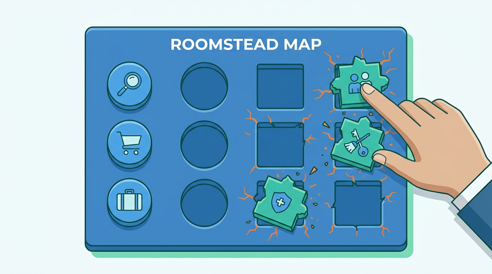
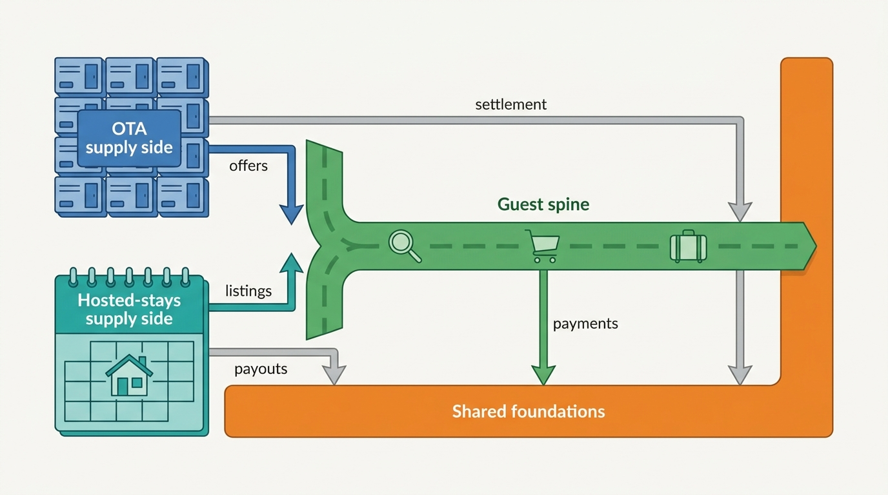
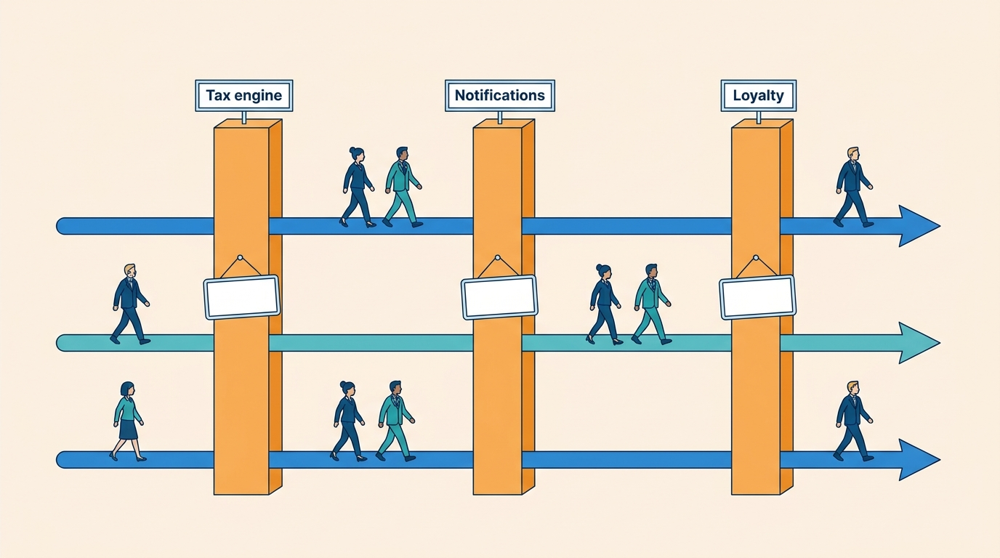
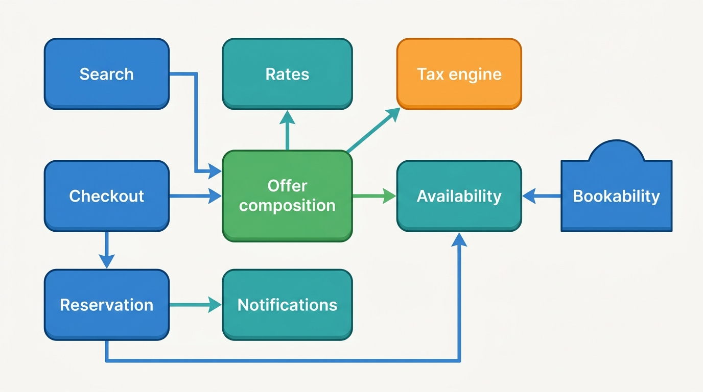
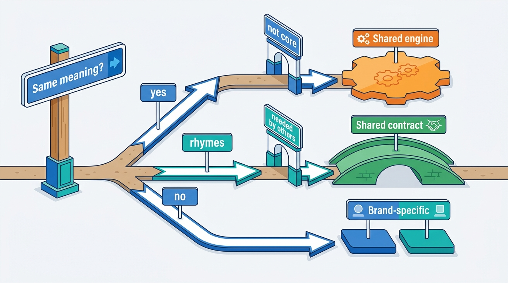
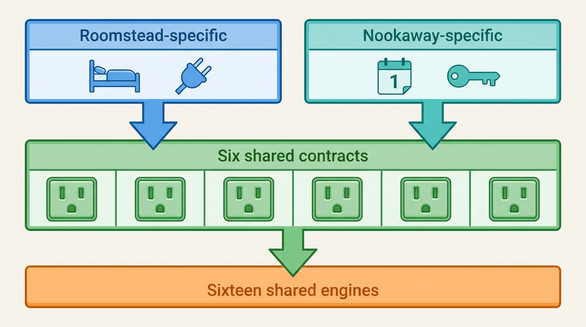

> **IN THIS CHAPTER, YOU WILL:** Walk two generic reference capability models, one for an OTA-style accommodation marketplace and one for a hosted-stays marketplace, and match them capability by capability. You will see where they overlap, where they genuinely differ, which seven capabilities neither model contains and why this book adds them, and how Corvane turns the result into a sharing decision for every capability on its map.

> **WHY THE BUSINESS CARES:** A group that owns two marketplaces pays for many things twice. Some of that duplication is waste, and some protects the part of each business that earns money. A capability map is the only artifact that lets a CFO, a CPO and a Chief Architect argue about which is which in business language, before anyone defends a system.

> **WHY ARCHITECTS SHOULD CARE:** Every later boundary in this book sits on the map: bounded contexts, shared platforms, team ownership and the sequence of consolidation. If the map squeezes homes into a hotel model, or misses the capabilities that cut across journeys, the platform built from it inherits the mistake for a decade.

> **KEY POINTS:**
>
> * **One guest spine, two supply sides.** Matched by meaning, the two reference models share almost everything a guest touches and most of the foundations (payments, trust, data), but their supply sides are different in kind: counted room-type inventory, rate plans and inbound connectivity on one side; one-unit calendars, co-hosts, turnover work and local compliance on the other.
> * **The capabilities that matter most are often the ones nobody drew.** Models built from journeys miss the capabilities that cut across them. This book adds seven: content mapping, channel management for hosts, loyalty, a notifications platform, a tax engine, a customer data platform and distribution to affiliates. Each has no single journey that owns it, which is exactly why each needs an explicit owner.
> * **Decide sharing per capability, in three grades.** Share an engine where the meaning is the same for hotels and homes (identity, payments, ledger, tax, notifications, verification). Share a contract and keep separate engines where the meanings rhyme but the supply truth differs (offer, reservation, cancellation). Keep the rest separate, on purpose, and write down why.

> **[FAILURE PATTERNS THIS CHAPTER ADDRESSES](where-stay-platforms-go-wrong.html):**
>
> * **The Hotel-Shaped Home** — a capability map drawn from the OTA's list leaves co-hosts, turnover work, protection and local compliance in an "other" box, and the platform built from it inherits the squeeze.
> * **Price Drift** — fees, taxes and currency belong to no capability in either reference model, so every surface computes its own total and the four prices a guest sees disagree.
> * **City-by-City Firefighting** — the OTA reference model has no compliance capability at all, so every short-term-rental rule that reaches its homes arrives as an unplanned project.

 
A capability map looks like a harmless diagram of boxes in rows. In practice it is **the first place a group decides what is the same and what is different**, and those decisions are expensive to reverse. If "calendar" means one thing on the map, the group will build one calendar service, and the hotel with 34 Standard Doubles and the host with one apartment in Triana will both live with the result.

Stays marketplaces make this harder than most domains, because the two common types look alike from the guest's side and unlike each other from the supplier's side. An accommodation marketplace, the online travel agency (OTA) model, receives inventory counts and **rate plans** (the price conditions attached to a room type) from thousands of hotel systems, while a hosted-stays marketplace keeps one calendar per home, edited by a person, sometimes delegated to a co-host, and subject to rules that can change street by street. **A capability map that hides this difference produces the wrong platform. A map that exaggerates it produces two of everything.**

This chapter owns three terms: **capability map**, **overlap matrix** and **shared versus specific capability**. It uses two generic reference models as raw material and leaves the supply model to [[property-and-listing-model]] and the one-platform-or-two decision to [[converging-two-marketplaces]].

## Setting the Scene at Corvane: "What Do We Have Two Of?"

Corvane, the fictional travel group this book follows (see [[meet-corvane]]), owns two marketplaces of different types. Roomstead is an OTA-style accommodation marketplace with 640,000 bookable properties, 82% of whose hotel room nights arrive through 140 certified connectivity partners (channel managers, property-management systems or PMSs, and central reservation systems). Nookaway is a hosted-stays marketplace with 1.15 million listings run by 610,000 hosts. Corvane Payments, the group's electronic money institution, already processes every Nookaway payment and every Roomstead merchant booking.

Mariana Costa joined as Group Chief Architect in January 2027. In her second week, Group CFO Marco Bellini sent her the list every acquisition leaves behind: two identity systems, two trust stacks, two search engines, two experimentation platforms (Trialroom and Flipside), two warehouses, two customer-service tools and three clouds. Group CTO Tobias Lindqvist wanted a board proposal in April ([[two-stay-marketplaces]]), and his question was short: **"What do we have two of, and which of those should we have one of?"**

The systems inventory could say that Roomstead had Tally and Nookaway had Almanac. It could not say whether they did the same job. That needed a capability map.

The first attempt, in January 2027, failed in an instructive way. Roomstead's enterprise architecture team mapped Nookaway onto Roomstead's 2023 capability map. Guest-facing capabilities fitted; the supply side did not. Co-host delegation went under "Partner user management", turnover under "Reservation operations", Nookaway Cover (host damage protection and guest guarantee) under "Customer support", and the market policy registry that decides whether a Spanish apartment may be sold at all into "Other". Rafael Mendes, VP Engineering at Nookaway, put the result in one sentence: "You have drawn our business as a small hotel." Aisha Rahman, VP Supply and Connectivity at Roomstead, agreed from the other side: a Nookaway-first map had no place for room types, rate plans or the 650 million ARI (availability, rates and inventory) messages Roomstead receives every day.

**Figure 1:** *The first attempt mapped Nookaway onto Roomstead's map: guest-facing capabilities fitted, but co-hosts, turnover and protection were jammed into slots that meant something else.*

The question therefore changed from "which Nookaway capabilities duplicate Roomstead's?" to **"what are the capabilities of each marketplace, matched by meaning, and what should the group do with each one?"**

## Capability, Map, Reference Model

A **business capability** is something the business is able to do, named without saying how, where or by whom. The Open Group's TOGAF standard treats it, in paraphrase, as a particular ability that a business may possess or exchange to achieve a specific purpose ([TOGAF Series Guide: Business Capabilities, Version 2](https://publications.opengroup.org/g211), 2022). *Room and rate selection* is a capability; "Tally" (a system), "the Dublin supply team" and "the Partner Hub app" (a product) are not.

A **capability map** is the structured set of an organization's capabilities, usually in two or three levels. It is useful when stable, free of implementation names and comparable across business units. Lewis and Fowler's 2014 description of microservices "organized around business capability" made it the business-side list services should line up with ([Lewis and Fowler, "Microservices"](https://martinfowler.com/articles/microservices.html), 2014).

A **reference model** is a generic capability map for a type of business: a starting hypothesis to compare against, not a description of anyone.

An **overlap matrix** lists the capabilities of two maps side by side and classifies each pair as the same, a partial overlap, or one side only.

A **shared capability** is implemented once and used by both marketplaces; a **specific capability** is implemented by each marketplace for itself, because only one needs it or because one implementation would serve both badly. Between them sits the grade that matters most for a stays group: a **shared contract**, where both marketplaces agree on the meaning and shape of a thing (an offer, a reservation, a cancellation outcome) but keep separate engines that produce it.

| Term | Answers | Changes when | Stays example |
| --- | --- | --- | --- |
| Capability | *What* must the business be able to do? | The business model changes | Unit calendar management |
| Value stream | *How* does value reach a guest or supplier, stage by stage? | The journey changes | Launch a new host: verify, author, make bookable |
| Product | *What* do we offer? | Every planning cycle | Partner Hub mobile app |
| System | *What software* runs it? | Every replatforming | Almanac on PostgreSQL |
| Team | *Who* builds and runs it? | Every reorganization | Nookaway calendar team |

## Two Reference Models

The book starts from two generic capability models built with the Productscape modeling toolkit in the author's working repository: one for a **travel accommodations marketplace** (TAM below) and one for a **hosted-stays marketplace** (HSM). Their authors used public operators as inspiration, but they are **generic models** of a fictional operator of each type, not descriptions of Booking.com, Airbnb or any other company. Their disagreements teach as much as their content. The brick-by-brick mapping to this book's chapters is in [[domain-coverage]].

Both describe capabilities as **bricks**: a named capability with an identifier (such as `invt` or `lista`), a status of `invest` or `sustaining`, modules, dependencies and owned data. Both arrange them in three roots: a demand-side experience, a supply side and shared foundations. That is where the resemblance ends.

### The accommodation marketplace model

TAM has **34 capabilities** in three roots and six groups, with hand-written dependencies and named external systems.

| Root | Group | Capabilities |
| --- | --- | --- |
| Traveler Experience | Discovery and consideration (8) | Home and destination landing (`home`), destination discovery (`dest`), search, ranking and filters (`srch`), map browse (`mapb`), personalization (`pers`), deals and member merchandising (`deal`), saved searches and price alerts (`ssav`), property detail and reviews (`prop`) |
| | Booking and trip management (7) | Room and rate selection (`room`), checkout and booking orchestration (`book`), traveler account and wallet (`acct`), trip management and messaging (`trip`), guest–property messaging (`msgc`), self-service changes and recovery (`self`), review collection (`reve`) |
| Partner Operations | Supply onboarding and content (4) | Partner extranet (`extr`), partner onboarding and verification (`onbo`), content and policy studio (`cont`), property media pipeline (`medi`) |
| | Inventory and commercial performance (7) | Inventory, rates and reservations (`invt`), calendar and availability controls (`cald`), reservation inbox and operations (`rsrv`), partner merchandising and programs (`prom`), rate recommendation (`rate`), partner performance analytics (`perf`), reputation and quality operations (`rept`) |
| Marketplace Foundations | Payments and recovery (3) | Payments and payouts (`paym`), partner settlement and ledger (`sett`), customer support and recovery (`supp`) |
| | Trust, connectivity and intelligence (5) | Trust, verification and risk (`trst`), connectivity and partner APIs (`conn`), marketplace intelligence (`mkli`), geo and localization (`geoa`), identity and access management (`idam`) |

Three things stand out. **Room and rate selection is a capability of its own**, resolving "bookable room, rate, and occupancy combinations". **Inventory, rates and reservations** is the backbone six other capabilities depend on, with a reservation state machine inside it. And **connectivity is the only integration capability**. TAM also has a host persona listing an apartment, who wants to succeed "without turning the product into hotel software".

### The hosted-stays model

HSM has **21 capabilities**, also in three roots and six groups; it is thinner, and its dependencies are incomplete.

| Root | Group | Capabilities |
| --- | --- | --- |
| Guest Experience | Discovery and consideration (4) | Inspiration and category discovery (`insp`), search, ranking and map browse (`srch`), listing detail and review trust (`list`), wishlists and sharing (`wish`) |
| | Booking and stay management (3) | Booking and checkout (`book`), trip messaging and itinerary (`trip`), guest reviews and re-engagement (`grev`) |
| Host Success | Host activation and optimization (4) | Host onboarding and verification (`hono`), listing authoring and content (`lista`), calendar and availability (`cala`), pricing and discounts (`pric`) |
| | Host operations and economics (3) | Turnover and operations coordination (`opco`), co-host network and permissions (`coho`), host performance and earnings (`host`) |
| Marketplace Foundations | Trust, payments and policy (5) | Identity and verification (`idvr`), trust, safety and protection (`trst`), payments, taxes and payouts (`paym`), resolutions and support (`reso`), local compliance and policy controls (`comp`) |
| | Intelligence and connectivity (2) | Marketplace intelligence and experimentation (`data`), partner APIs and channel connectivity (`apix`) |

The investment pattern differs as much as the content. TAM marks four capabilities `invest`, all monetization levers (checkout, partner merchandising, payments, intelligence). HSM marks eight, mostly about **creating supply and operating it** (host activation, listing authoring, pricing, turnover, co-hosts, resolutions, listing trust, checkout).

Two cautions apply. The models' metric values are placeholders, so this book uses the metric names and never the numbers. And the HSM text in places borrows a real operator's program names; this book replaces them with neutral terms such as "top-host status".

## Matching by Meaning: The Overlap Matrix

Only five identifiers appear in both models: `srch`, `book`, `trip`, `trst` and `paym`. Reading that as "five shared capabilities", or as "everything with a similar name is shared", are both wrong. **Matching has to be by meaning**: some capabilities with the same identifier mean different things, and some with different names do the same job. The table below is the condensed overlap matrix; the full version, with one row per brick, is in [[domain-coverage]].

| Match | TAM (accommodation marketplace) | HSM (hosted stays) | What the match hides |
| --- | --- | --- | --- |
| **Same (12)** | Search and ranking; property detail; checkout; trip management; review collection; partner onboarding; content and policy studio; calendar controls; partner analytics; payments; customer support; marketplace intelligence | Search and map browse; listing detail; checkout; trip and itinerary; guest reviews; host onboarding; listing authoring; calendar and availability; host performance; payments, taxes and payouts; resolutions; intelligence and experimentation | Same purpose, different inputs. OTA ranking consumes live rates and offer treatments; hosted-stays ranking consumes listing and review quality. OTA payments normalize several payment models; hosted-stays payments always collect and add taxes |
| **Partial (15)** | Home and destination landing, destination discovery; map browse; personalization; saved searches; self-service changes; guest–property messaging; inventory backbone; reservation operations; merchandising programs; rate recommendation; reputation operations; settlement ledger; trust and risk; connectivity | Inspiration and categories; map layer inside search; recommendation layer inside intelligence; wishlists; resolutions; messaging inside trip; calendar only; turnover tasks; host discounts; pricing guidance; reviews plus moderation; payout ledger inside payments; trust plus identity; partner APIs | Granularity differs (a brick in one model is a module in the other) or scope differs (see the next table) |
| **TAM only (7)** | Room and rate selection; deals and member merchandising; traveler account and wallet; partner extranet; media pipeline; geo and localization; identity and access management | — | Room and rate selection is the defining OTA capability. The others are capabilities HSM needs but did not draw |
| **HSM only (3)** | — | Turnover and operations coordination; co-host network and permissions; local compliance and policy controls | Each is a real difference in kind, not a gap in the OTA model, with one exception: compliance |

The counts cover all 34 TAM and 21 HSM capabilities. The interesting rows are those where the table looks reassuring and is not.

| Capability | In the accommodation marketplace | In the hosted-stays marketplace | Why "same name" misleads |
| --- | --- | --- | --- |
| **Trust** (`trst` in both) | Partner and host verification, fraud and abuse controls across bookings, payments and messages | Reservation screening before confirmation, host protection, guest safety interventions; identity split into its own capability | One protects the marketplace from fraudsters. The other protects a host from a guest in their home and a guest from a home that is not as described |
| **Connectivity** (`conn` / `apix`) | **Inbound**: PMS and channel managers push rates and availability and receive reservations | Mostly **outbound**: sync and export for professional operators' tooling | They point in opposite directions. The OTA's availability truth lives outside the platform; the hosted-stays platform's lives inside it |
| **Calendar** (`cald` / `cala`) | Restrictions and closures on top of counted room-type inventory | Binary bookable dates per unit, with host-set stay rules | A hotel oversells by miscounting; a home double-books by failing to sync |
| **Pricing** (`rate` + `prom` / `pric`) | Recommendations to revenue managers with comp sets and margin guardrails; partner programs that influence visibility | Host-defined nightly price, length-of-stay discounts, guidance inside the same capability | The OTA advises a professional; the hosted-stays platform often sets the price for an amateur |
| **Payments** (`paym` in both) | Pay now, pay later, pay at property, platform-managed; settlement with commission deductions | Platform always collects, holds until after check-in, pays out net of split fees, carries tax flows | One model must represent agency and merchant; the other must represent custody and payouts to individuals |

The structure is simple to draw.

**Figure 2:** *Matched by meaning, the two reference models share a guest spine and most foundations, while their supply sides differ in kind. The sharing debate is mostly about the two boxes on the left.*

### What the differences mean

The matrix tells you *where* the models differ; *why* decides whether the difference should survive in the group's platform.

| Dimension | Accommodation marketplace | Hosted-stays marketplace | Architectural consequence |
| --- | --- | --- | --- |
| What is sold | A room offer: property, room type, rate plan, occupancy, dates | A listing: one home or room with one calendar and one set of prices | The OTA needs an offer-composition layer and a rate model; hosted stays needs a unit calendar and pricing rules ([[property-and-listing-model]]) |
| Where availability truth lives | Outside the platform, in the hotel's PMS or channel manager | Inside the platform, edited by a person, except for multichannel homes | OTA integrity is a sync and counting problem; hosted-stays integrity is a calendar problem ([[connectivity-and-channel-managers]], [[calendar-sync]]) |
| Who the supplier is | A business with a revenue manager and a front desk | Often an individual, increasingly a professional manager with co-hosts | B2B workspace versus a guided consumer app plus a professional layer ([[extranets-and-host-tools]]) |
| Roles | Partner users with permissions | Owner, listing controller, licensed operator, co-host, payout beneficiary and tax party as separate roles | Hosted stays needs a relationship model on each listing, not just user roles |
| Money | Agency or merchant per booking; commission invoices; settlement per partner | Collect, hold, release after check-in, split fees, pay individuals | Same ledger structure, different accounts and timing ([[merchant-and-agency-models]], [[payouts-and-settlement]]) |
| Protection | Fraud and payment risk | Damage, liability and guest guarantee as a program with claims | Hosted stays needs a claims domain ([[protection-and-incidents]]) |
| Local regulation | Not a capability in the model | A market policy registry and listing eligibility | Both need effective-dated bookability once an OTA sells homes ([[stays-regulation]]) |

Most of these are differences in kind and should survive. Two are **gaps in one model that look like differences**. The OTA model has no compliance capability because it was drawn from hotel distribution, yet an OTA selling 435,000 homes, as Roomstead does, needs registration checks as much as Nookaway. The hosted-stays model lacks a media pipeline, localization and identity and access because it was drawn thinly. **A difference you can explain by the business is a design input. A difference you can explain only by who drew the model is a gap to fill.**

## What Neither Model Has

The most useful output of comparing two reference models is what neither contains. The digest found more than twenty such gaps: entities every capability assumes and nobody owns (a property and unit catalog, a reservation system of record), cross-cutting services (fees and total price, currency) and whole business lines (business travel, connected trips). Most are covered in the chapter that owns the nearest capability. Seven are large enough that this book adds them as capabilities in their own right, marked **[ADDED]**.

| Added capability | Traces in the two models | Why the book adds it | Chapter |
| --- | --- | --- | --- |
| **Content and property mapping** | Hinted at only in stress-test residues: "duplicate units", "inventory mappings" | An OTA receives the same hotel from its own contracts, channel managers, bedbanks and wholesalers. Without a capability that matches properties and rooms across sources, **The Same Hotel Twice** is the default outcome | [[content-and-media]] |
| **Channel management for hosts** | A professional-host ambition ("channel and partner sync becomes easier where appropriate"); `apix` offers only exports | Most professional hosts and many individuals sell the same home on several platforms. The capability that keeps those calendars aligned, by iCal or API, is where double bookings are made or prevented | [[calendar-sync]] |
| **Loyalty** | "Loyalty-adjacent preferences" in the traveler account; "member programs" in deals; "member rates" in partner merchandising | Tiers, eligibility, member prices, earned credit and its liability need rules and a ledger. Spread across merchandising treatments, loyalty becomes a stacking and accounting problem | [[promotions-and-loyalty]] |
| **Notifications platform** | Routing is a module inside TAM trip management; saved-search alerts borrow it; e-mail and push providers appear as external systems | Confirmations, alerts, check-in instructions, disruption notices and supplier messages all need one preference-aware, auditable delivery service. When each capability sends its own, guests get duplicates or nothing | [[trip-and-messaging]] |
| **Tax engine** | "Transparent prices, taxes" as a guest wish; "tax flows" inside HSM payments; "payouts, fees, taxes" as a host job | VAT, tourist and occupancy taxes and platform reporting vary by jurisdiction, stay length, property type and party. That is a rules engine with effective dates and evidence, not a payment module | [[taxes-on-stays]] |
| **Customer data platform** | A consent-record data asset with no owning capability in either model; profile data owned by three capabilities at once | Consent, profile unification across brands and audience building need one owner, or each brand and channel keeps its own version of the guest | [[marketplace-intelligence]] |
| **Distribution and affiliates** | A sentence about demand APIs "for ecosystem partners"; metasearch named only as a discovery channel | Selling inventory through metasearch, affiliates, travel agents and corporate-travel tools is a product with its own APIs, price-accuracy duties and commission rules. For an OTA it is a large share of traffic | [[demand-channels]] |

**Figure 3:** *Models built from journeys miss the capabilities that cut across them; the book adds seven, from content mapping to a tax engine, and each needs an explicit owner precisely because no journey owns it.*

### Why journey-based models miss them

The seven additions have one thing in common: **no single customer journey owns them**. Both models were built outward from personas and their jobs. Capabilities that serve every journey (notifications, tax, consent, the customer profile) appear only as fragments inside whichever capability needed them first; capabilities that serve a party who is not a persona (a metasearch engine, a bedbank, a multichannel host's channel manager) do not appear at all. That happens to any map built from journeys alone. The correction is a second pass with three questions:

1. **What does every journey call?** Anything four or more capabilities call (price composition, tax, notifications, identity, consent) is a candidate shared capability.
2. **Who outside our personas sends us supply or demand?** Channel managers, bedbanks, metasearch engines, affiliates and other platforms' calendars all need a capability on our side.
3. **What does the business owe someone over time?** Loyalty credit, guest funds held until check-in, tax collected for a city and payouts owed to hosts need a ledger-backed capability, not a feature.

### Testing the map with its own dependencies

A capability map is a hypothesis, and the cheapest test is to trace its dependencies. For the two reference models this exposes defects that also appear in real organizations' maps.

- In the hosted-stays model, **checkout depends on neither the calendar nor pricing**, and search does not depend on the calendar. As drawn, a guest could book a night that is not available at a price nobody computed.
- In the same model, **local compliance is used only by host onboarding**: rules gate whether a host may join, never whether a night may be booked.
- In the accommodation model, the reservation state machine sits inside the inventory backbone while **checkout owns the booking record**. The model never names the reservation system of record; [[stays-bounded-contexts]] and [[reservation-lifecycle]] name one owner.
- In the same model, **notification routing lives inside trip management**, and saved-search alerts borrow it, so notifications have no owner of their own.

Repairing the spine gives a small set of edges every stays map should contain.

**Figure 4:** *The repaired dependency spine. Search and checkout both call one offer composition, which reads availability, prices and tax; bookability gates availability per night; the reservation record changes availability and drives notifications. Both reference models miss at least one of these edges.*

The figure is deliberately type-neutral: on Roomstead "availability" is counted room-type inventory, on Nookaway one calendar row per listing per night, but the edges are the same. This is the first hint of where a shared contract belongs: **the offer and the reservation are shaped the same way for both types, even where the engines behind them are not.**

### Stress-testing the map

Both reference models also contain a residuality stress test, after Barry O'Reilly's *Residues* (2024): each model is exposed to severe events and the structural changes that let it survive are recorded. The results converge from opposite starting points.

| Stressor in the model | What the capability map had to separate | Book chapter |
| --- | --- | --- |
| A city caps short-term rentals and invalidates thousands of licenses (both models) | Property, unit, listing, license, operator and stay date; **bookability evaluated per unit, operator, jurisdiction and stay date**, not an active flag | [[stays-regulation]] |
| A connectivity distributor becomes insolvent with reservations and prepaid funds in flight (TAM) | The availability claim from the reservation, the reservation from the distributor, the money owed from the distributor's balance | [[connectivity-and-channel-managers]], [[payouts-and-settlement]] |
| A wildfire closes a destination during active stays (both models) | The guest's commitment from the property that fulfills it; a destination operating state separate from every listing | [[changes-and-cancellations]], [[protection-and-incidents]] |
| A city requires every remote owner to appoint a licensed local operator (HSM) | Owner, controller, operator, co-host, payout beneficiary and tax party as separate, revocable roles | [[extranets-and-host-tools]] |

Starting from hotel distribution, the OTA model ends by separating property, unit, operator, license and reservation; starting from one host with one home, the hosted-stays model ends by separating property, listing, owner, operator and permit. **A capability map that survives these stressors has the same foundations for both types**, which is the strongest argument in this chapter for sharing the identity of places and parties even when the commercial models stay apart.

## Heat-Mapping: From a Map to Decisions

A map decides nothing until each capability is scored and a rule applied. For a group with two marketplace types, I score three things and record a fourth.

1. **Differentiation.** Does this capability make one of the brands win? I use domain-driven design's three grades, scored separately from complexity as DDD Crew's [Core Domain Charts](https://github.com/ddd-crew/core-domain-charts) (n.d.) recommend: *core* (why guests or suppliers choose us), *supporting* (necessary and specific, but not a reason to choose us) and *generic* (can be bought). Score it per brand: protection is core for a hosted-stays marketplace and nearly absent for an OTA.
2. **Divergence.** Does the capability mean the same thing for hotels and homes? *Same* (identity, tax calculation, notification delivery), *rhymes* (an offer, a reservation, a cancellation outcome, which have the same shape with different contents) or *different* (counted inventory versus a unit calendar).
3. **Duplication.** How many implementations run today, and what do they cost in run cost, change cost and inconsistency?
4. **Maturity**, recorded but not used in the rule. A weak implementation is a reason to invest, not a reason to share.

The scores feed a decision procedure.

**Figure 5:** *A sharing rule per capability. Same meaning and not differentiating leads to one engine; shapes that rhyme and are needed by others lead to a shared contract; real differences stay separate on purpose.*

Two points about the rule. First, **duplication is not in the decision tree**: it tells you which decisions to make first, but a capability that is duplicated and different should stay duplicated. Second, the **shared contract** grade is where most of a stays group's value lies: guests, finance, service and regulators need one answer to "what was offered?" and "what was booked?", even when two engines compute it.

## Corvane Worked Example: The One Stay Capability Map

Mariana ran the second attempt over five weeks in February and March 2027, with Aisha Rahman and Rafael Mendes as co-owners and Marco Bellini's team supplying run costs. The team built the map top-down from the two reference models, added the seven missing capabilities, and had every capability scored by the people who would not run it: Roomstead staff scored Nookaway's differentiation and the reverse. The result went to the architecture forum on **23 March 2027** and became the backbone of the One Stay proposal the board approved in April.

This first version, **capability map v1**, has nine level-1 groups and **48 level-2 capabilities**, each with a decision.

| Group | Capability | Roomstead | Nookaway | Divergence | Decision |
| --- | --- | --- | --- | --- | --- |
| Guest discovery | Destination and inspiration entry | Destination landings, campaign pages | Categories and themes | Different | Brand-specific |
| | Search and filters | Elasticsearch plus Pricegrid | OpenSearch, prices at query time | Rhymes | Shared contract |
| | Ranking | Core | Core | Different signals | Brand-specific |
| | Personalization and recommendations | Supporting | Supporting | Rhymes | Brand-specific |
| | Saved intent (saved searches, wishlists) | Price-watch alerts | Shared wishlists for groups | Different | Brand-specific |
| Offer and booking | Property or listing page | Rooms and rate conditions | One home, host reputation | Different | Brand-specific |
| | Room and rate selection | Core | — | Roomstead only | Brand-specific |
| | Offer and price composition (fees, taxes, currency, member price) | Pricegrid, Keystone checkout | Burrow pricing at query time | Rhymes | Shared contract |
| | Checkout | Keystone | Burrow | Rhymes | Brand-specific |
| | Reservation record | Keystone | Burrow | Rhymes | Shared contract |
| | Changes and cancellations | Keystone, partner rules | Burrow, host policy tiers | Rhymes | Shared contract |
| Accounts, trip and service | Guest accounts and identity | Roomstead accounts | Nookaway accounts | Same | Shared engine |
| | Trip timeline | Supporting | Supporting | Rhymes | Brand-specific |
| | Guest–property and guest–host messaging | Partner messaging | Host messaging | Same | Shared engine |
| | Notifications **[ADDED]** | Several senders | Several senders | Same | Shared engine |
| | Customer service and recovery | SaaS tool, two vendors | In-house tool on Burrow | Same | Shared engine |
| Supply onboarding and content | Party onboarding and verification | Keystone flows | Burrow flows | Same | Shared engine |
| | Property and unit catalog | Keystone | Burrow | Rhymes | Shared contract |
| | Content and policy authoring | Partner Hub, connectivity content | Listing editor | Different | Brand-specific |
| | Media pipeline | AWS service | Inside Burrow | Same | Shared engine |
| | Content and property mapping **[ADDED]** | Needed for bedbank and duplicate supply | — | Roomstead only | Brand-specific |
| | Translation and localization | 41 languages | Fewer languages | Same | Shared engine |
| Inventory and pricing | Room-type inventory and rate plans | Tally | — | Roomstead only | Brand-specific |
| | Unit calendar | — | Almanac | Nookaway only | Brand-specific |
| | Restrictions and stay rules | Tally restrictions | Almanac rules | Different | Brand-specific |
| | Pricing guidance | Advice to revenue managers | Automatic host pricing | Different | Brand-specific |
| | Promotions and partner programs | Core | Host discounts | Different | Brand-specific |
| | Loyalty **[ADDED]** | Roomstead Circle, 26 million members | — | Roomstead only | Brand-specific |
| Supply connectivity and operations | Connectivity (inbound rates and availability) | Switchyard, 140 partners | — | Roomstead only | Brand-specific |
| | Channel management for hosts **[ADDED]** | Simple iCal for homes | iCal and partner API | Nookaway-shaped | Brand-specific |
| | Extranet and host tools | Partner Hub | Host app | Different | Brand-specific |
| | Reservation operations and exceptions | Hotel work queue | Host inbox | Rhymes | Brand-specific |
| | Co-hosts and delegation | — | Core | Nookaway only | Brand-specific |
| | Turnover and property access | — | Supporting | Nookaway only | Brand-specific |
| Money | Payment orchestration | Corvane Payments (merchant) | Corvane Payments | Same | Shared engine |
| | Payment arrangement (agency, merchant, facilitated) | Agency and merchant | Facilitated | Rhymes | Shared contract |
| | Settlement ledger and payouts | Keystone invoicing, Fathom | Burrow balances, Fathom | Same | Shared engine |
| | Tax engine **[ADDED]** | Keystone tables | Burrow tables | Same | Shared engine |
| | Refunds and reconciliation | Corvane Payments, Keystone | Corvane Payments, Burrow | Same | Shared engine |
| Trust and compliance | Identity verification | Partner checks | Guest and host checks | Same | Shared engine |
| | Fraud and risk screening | Payment-fraud team | Reservation screening | Same mechanics | Shared engine |
| | Reviews and reputation | One-sided, verified | Two-sided | Different | Brand-specific |
| | Protection and claims | — | Nookaway Cover | Nookaway only | Brand-specific |
| | Local compliance and bookability | Missing | Market policy registry | Same | Shared engine |
| Intelligence and distribution | Data platform and governed metrics | Snowflake | BigQuery | Same | Shared engine |
| | Customer data platform and consent **[ADDED]** | Scattered | Scattered | Same | Shared engine |
| | Experimentation and ML | Trialroom | Flipside | Same | Brand-specific until 2028 review |
| | Distribution and affiliates **[ADDED]** | Metasearch, affiliates, APIs | — | Roomstead only | Brand-specific |

The v1 totals are **16 shared engines, 6 shared contracts and 26 brand-specific capabilities**. More than half of the map stays specific, which is the right answer for two marketplace types. The 16 shared engines hold almost all of Marco's "two of everything" list; the 26 specific capabilities are where each brand earns its money or carries a supply model the other lacks.

The map did not stay at v1. At the One Stay annual review on **14 December 2027**, **capability map v2** had **49 capabilities: 23 shared engines, 6 shared contracts and 20 brand-specific**. Experimentation and ML, saved intent, the trip timeline, reviews and content and property mapping became shared engines; changes and cancellations moved from a shared contract to one engine, Clause; restrictions and stay rules became a shared contract; and places and destinations (Waypoint) was added as a new shared engine. Every move went from specific toward shared. [[converging-two-marketplaces]] tells that story and treats v2 as the decision of record; the table above is v1, the March 2027 starting point.

**Figure 6:** *The One Stay capability map v1 (March 2027) in three bands. Each brand keeps its supply model and its differentiating capabilities, both speak the same offer and reservation contract, and the generic foundations are built once.*

The arguments over several cells are the useful part.

- **Local compliance was the surprise.** Roomstead had no compliance capability, because its map had been drawn from hotels, yet it sells 435,000 apartments and homes, many in cities that require registration numbers; in 2026 Nookaway had removed 6,900 Spanish listings without one. The cell became a *shared engine*: Nookaway's market policy registry became a group capability, sparing Roomstead's homes **City-by-City Firefighting**.
- **Offer and price composition was the most expensive gap.** Neither reference model has a capability for fees, taxes, currency and member prices, so each of Corvane's surfaces computed its own, and Roomstead's metasearch price accuracy stood at 91% against a 97% target. The map recorded a *shared contract*: one definition of an offer and its total, with separate engines behind it ([[availability-engine]] shows the later shared offer kernel).
- **Fraud and risk screening was scored "same mechanics".** Roomstead's risk is mostly payment fraud; Nookaway's includes screening a guest before they enter someone's home. Models and policies differ; case tooling, feature pipelines, rules engine and identity graph do not. The cell became a shared engine with per-brand policies; Nookaway Cover, the protection program, stayed specific.
- **Experimentation was left specific on purpose.** Trialroom and Flipside do the same job, but both sit deep in each brand's release process, and replacing either during the Keystone reservation migration would have put the migration's own experiments at risk. The cell said "brand-specific until the 2028 review", with a date, which is what distinguishes a deliberate duplicate from a forgotten one. The date came sooner than planned: the group Experimentation Standard v1 of September 2027 made the cell a shared engine in map v2 ([[stays-experimentation]]).
- **The property and unit catalog was the most contested cell.** Rafael wanted it brand-specific, because Nookaway's listing model is its product; Aisha wanted it shared, because Roomstead could not report units to regulators. The forum recorded a *shared contract* (shared identifiers for properties and units, separate commercial catalogs), which became the group place registry in May 2027 ([[property-and-listing-model]]).

Two of the seven added capabilities were **specific to one brand** in v1. Content and property mapping exists because Roomstead receives the same hotel from several sources (v2 later made its matching engine a group engine). Channel management for hosts is Nookaway-shaped: 61% of Nookaway listings are also sold elsewhere. Adding a capability to the map says it must have an owner, not that both marketplaces must build it.

## In Practice: What the Public Record Shows

No company publishes its capability map, but some publish enough about what they consolidated to test the "one guest spine, two supply sides" pattern.

**Expedia Group** is the clearest case of a group that runs both types. It "shifted to a platform operating model" in 2020 ([Expedia Group FY2022 10-K](https://www.sec.gov/Archives/edgar/data/1324424/000132442423000007/expe-20221231.htm), 2023). The FY2023 10-K reports that Hotels.com moved onto the Brand Expedia front end in 2022 and Vrbo in 2023, creating "one unified front-end stack in 2023" ([Expedia Group FY2023 10-K](https://www.sec.gov/Archives/edgar/data/1324424/000132442424000007/expe-20231231.htm), 2024). The cost was visible: in May 2024 the company said that "Vrbo's recovery following the recent re-platforming has been slower than anticipated" and lowered its guidance ([Expedia Group Q1 2024 earnings release](https://www.sec.gov/Archives/edgar/data/1324424/000132442424000024/earningsrelease-q12024.htm), 2024). Its FY2025 10-K lists shared "customer servicing and support, data centers, search capabilities, payment processing, and fraud operations" ([Expedia Group FY2025 10-K](https://www.sec.gov/Archives/edgar/data/1324424/000132442426000008/expe-20251231.htm), 2026): a shared guest spine and foundations. The filings do not say Vrbo's supply, inventory or pricing systems were merged with the hotel side.

> **INFERENCE, NOT DOCUMENTED:** Expedia has not explained why Vrbo's re-platforming hurt bookings when Hotels.com's apparently did not. A plausible reading is that a hotel brand moving onto a hotel front end changes little, while a hosted-stays brand must re-express capabilities that rhyme rather than match (whole-home search, group sizes, flexible dates, listing content), which a capability map would flag as *rhymes*, not *same*.

**Booking.com** runs both types on one platform, with about 3.9 million homes among 4.4 million properties at the end of 2025 ([Booking Holdings FY2025 10-K](https://www.sec.gov/Archives/edgar/data/1075531/000107553126000009/bkng-20251231.htm), 2026). Its public connectivity documentation lists the capabilities it exposes to suppliers, among them rates and availability, reservations, payments, promotions, room type and rate plan management, **licenses** and **request to book** ([Booking.com Connectivity APIs](https://developers.booking.com/connectivity/docs), n.d., read October 2026). Licenses and request to book are hosted-stays capabilities in this chapter's matrix: public evidence that a hotel-shaped platform selling homes ends up adding the hosted-stays column. How Booking.com structures them internally is not public.

**Airbnb** shows the convergence from the other side. Its 2026 description of its payments platform says a multi-year replatforming moved payments to "a capability-oriented services system structured by domains", with subdomains including pay-in, payout, processing, ledger, and settlement and reconciliation ([Airbnb Engineering, "Pay as a Local"](https://airbnb.tech/payments/pay-as-a-local/), 2026). Its data-warehouse team, writing in 2026 about adding services and experiences to a homes platform, stated the rule it followed: "A domain's data model had to be either completely separate by product type or completely monolithic" ([Airbnb Engineering, "Scaling beyond one"](https://airbnb.tech/uncategorized/scaling-beyond-one-how-airbnb-evolved-its-data-architecture-for-a-multi-product-world/), 2026). That post covers the offline warehouse only, but the rule mirrors the decision tree above. Airbnb's Q2 2026 letter reports "thousands of boutique and independent hotels" added, still a single-digit share of nights ([Airbnb Q2 2026 shareholder letter](https://s26.q4cdn.com/656283129/files/doc_financials/2026/q2/Airbnb-Q2-2026-Shareholder-Letter-FINAL.pdf), 2026); a hosted-stays platform that sells hotels will meet the OTA column of the matrix, just as Booking.com met the hosted-stays one.

The pattern is consistent: **guest-facing surfaces, payments, servicing and fraud operations are where public consolidation is documented; supply and inventory are where it is not.**

## Trade-offs: How to Build and Use the Map

Two choices shape the result: where the map comes from, and how sharing is expressed.

| Source of the map | How it works | Strength | Weakness | When it is right |
| --- | --- | --- | --- | --- |
| **One brand's existing map** | Map the second business onto the first | Fast; reuses a known vocabulary | Produces **The Hotel-Shaped Home** or its mirror; the second brand's differences land in "other" | Never for two marketplace types; acceptable for two brands of the same type |
| **Bottom-up from systems** | Inventory applications and group them | Grounded in what exists | Inherits accidental boundaries; misses capabilities nobody built yet, such as compliance on the OTA side | As a check on a map, not as its source |
| **Top-down from reference models** | Start from generic models of each type, match by meaning, add gaps | Separates real differences from drawing accidents; brings in capabilities neither brand has | Reference models have their own gaps and defects; needs a dependency and stressor test | The default for a group with two types |
| **From the org chart** | One box per team | Easy to own | It is an org chart; changes with every reorganization | Never |

| How a capability is shared | What is common | What stays separate | Example at Corvane | Risk |
| --- | --- | --- | --- | --- |
| **Separate** | Nothing, except a written reason | Everything | Room and rate selection; co-hosts | Duplication that nobody revisits |
| **Shared contract, separate engines** | Meaning, schema and events | Implementation, storage, release cadence | Offer and price composition; reservation record | A contract too thin to help or too thick to evolve |
| **Shared engine, per-brand configuration** | Code, data store, operations | Policies, rules, presentation | Fraud and risk screening; tax engine | Brand-specific rules leak into the engine as special cases |
| **One capability, one model** | Everything | Nothing | Guest identity; notifications | Forcing one model on different meanings: **The Hotel-Shaped Home** |

The judgement I would defend: for a group that runs both types, the map should come from reference models of both, tested against the real systems, and the shared-contract grade should be used more than either team expects. It costs less than a shared engine, protects each supply model, and gives guests, finance, service and regulators one view. It does not hold where one brand is so small that a contract becomes overhead: a few thousand homes inside a large OTA are better served by the OTA's engines with a home-shaped configuration, reviewed every year.

## Where the Two Maps Differ in Practice

The maps change in different places: the OTA's at its commercial levers (programs, member prices, payment models, distribution partners), the hosted-stays marketplace's at supply operations and regulation (delegation, turnover, protection, permits). Convergence is the reason to keep the map alive. Roomstead already sells apartments; Nookaway plans to pilot boutique hotels in 2028. Each move adds a column the brand's own map did not have, and the map is where the group decides, before building, whether that column uses the other brand's capability, a shared contract or something new.

## Failure Modes

- **Matching by name.** `trst` means different things in the two models; maps merged by label produce a "trust platform" that is really a fraud stack, with protection added later as an exception.
- **Treating duplication as waste.** Two capabilities that do different jobs under one name are not duplicates; the tell is a business case that counts systems but names no requirement both sides share.
- **Missing the cross-cutting capabilities.** Fees and total price, tax, notifications and consent have no journey of their own, so they end up computed in four places; **Price Drift** is the guest-visible symptom.
- **A map nobody tests.** An untraced map will contain a checkout that never reads availability. Trace the spine and run two or three stressors before investing from it.
- **Scoring by owners.** If each capability's owner scores its differentiation, every capability is core. Scoring across brands, as Corvane did, keeps the scores honest.
- **A map frozen after the decision.** A map built for a board paper and never updated is wrong within a year, at exactly the cells where convergence happens; Corvane's moved seven cells between March and December 2027.

## The Chief Architect's View

- **Ownership.** The Group Chief Architect owns the map's structure and the sharing rule; each capability has a named business owner; brand CTOs own their side's scores and the CFO's team the run costs. The architecture forum approves changes to decisions.
- **Decisions the map must record.** For each capability: the grade, the reason, the owner and, for every deliberate duplicate, a review date.
- **Sequence.** Order sharing by the size of the duplication and the risk of inconsistency, not by ease: Corvane started with payments and ledger, identity, tax and the offer contract, because their inconsistency reached guests and regulators directly.
- **Cadence.** Review the map yearly and whenever a brand adds a supply type, a payment model or a market with new rules, and version it: Corvane's v1 (March 2027) and v2 (December 2027) are both kept, so a reader can see what moved and why.
- **What to watch.** Shared engines whose rules contain brand-specific branches; deliberate duplicates past their review date; capabilities that more than four others call and that have no owner.
- **Links to teams.** The map is the business-side half of Conway's law: organizations "are constrained to produce designs which are copies of the communication structures of these organizations" ([Conway, "How Do Committees Invent?"](https://www.melconway.com/Home/Committees_Paper.html), 1968). [[organizing-stays-engineering]] uses this map to draw teams; [[stays-bounded-contexts]] uses it to draw services.

## Questions to Ask

1. Which reference model did our capability map start from, and did it describe both of our marketplace types or only one?
2. For each capability with the same name in both businesses, have we checked that it means the same thing for a hotel and a home?
3. Which capabilities on our map does no journey own, and who is accountable for each of them?
4. Where do fees, taxes, currency and member prices get composed, and is it the same place for search, the property page, checkout and metasearch feeds?
5. Does our accommodation marketplace have a compliance and bookability capability for the homes it sells?
6. For every capability we chose to keep duplicated, what is the written reason and the review date?
7. Which capabilities are marked "shared engine" but carry brand-specific branches in their rules?

The map tells Corvane what to share. It does not say where the lines between services and teams go, which aggregates the shared contracts are built around, or how contexts talk to channel managers and property systems. [[stays-bounded-contexts]] takes the v1 map and turns it into those boundaries.

## Sources and Evidence

### Company engineering and investor sources

- [Form 10-K for fiscal year 2022](https://www.sec.gov/Archives/edgar/data/1324424/000132442423000007/expe-20221231.htm), Expedia Group, 2023 — platform operating model and the start of the front-end migration of Hotels.com and Vrbo.
- [Form 10-K for fiscal year 2023](https://www.sec.gov/Archives/edgar/data/1324424/000132442424000007/expe-20231231.htm), Expedia Group, 2024 — one unified front-end stack in 2023.
- [Q1 2024 earnings release](https://www.sec.gov/Archives/edgar/data/1324424/000132442424000024/earningsrelease-q12024.htm), Expedia Group, 2024 — Vrbo's slower-than-anticipated recovery after re-platforming.
- [Form 10-K for fiscal year 2025](https://www.sec.gov/Archives/edgar/data/1324424/000132442426000008/expe-20251231.htm), Expedia Group, 2026 — the list of shared platform infrastructure.
- [Form 10-K for fiscal year 2025](https://www.sec.gov/Archives/edgar/data/1075531/000107553126000009/bkng-20251231.htm), Booking Holdings, 2026 — hotel and home property counts and the alternative-accommodation share of room nights.
- [Connectivity APIs documentation](https://developers.booking.com/connectivity/docs), Booking.com, n.d. (read October 2026) — supplier-facing capabilities including licenses and request to book.
- ["Pay as a Local"](https://airbnb.tech/payments/pay-as-a-local/), Airbnb Engineering, 2026 — the capability-oriented structure of the payments domain.
- ["Scaling beyond one: how Airbnb evolved its data architecture for a multi-product world"](https://airbnb.tech/uncategorized/scaling-beyond-one-how-airbnb-evolved-its-data-architecture-for-a-multi-product-world/), Airbnb Engineering, 2026 — the "completely separate or completely monolithic" rule for warehouse data models.
- [Q2 2026 shareholder letter](https://s26.q4cdn.com/656283129/files/doc_financials/2026/q2/Airbnb-Q2-2026-Shareholder-Letter-FINAL.pdf), Airbnb, 2026 — boutique and independent hotels added to a hosted-stays platform.

### Standards, regulation and documentation

- [TOGAF Series Guide: Business Capabilities, Version 2](https://publications.opengroup.org/g211), The Open Group, 2022 — the business capability concept (paraphrased; the guide sits behind a free login).
- [Core Domain Charts](https://github.com/ddd-crew/core-domain-charts), DDD Crew, n.d. — scoring differentiation separately from complexity.

### Research and practitioner sources

- ["How Do Committees Invent?"](https://www.melconway.com/Home/Committees_Paper.html), Melvin E. Conway, *Datamation*, 1968 — Conway's law.
- ["Microservices"](https://martinfowler.com/articles/microservices.html), James Lewis and Martin Fowler, 2014 — services organized around business capabilities.
- *Residues: Time, Change, and Uncertainty in Software Architecture*, Barry M. O'Reilly, Leanpub, 2024 — the residuality method used in the reference models' stress tests.
- Productscape reference models for a travel accommodations marketplace and a hosted-stays marketplace, the author's working models, 2026 — the two capability inventories, their dependencies and their stress tests; generic models, not descriptions of any company.

Corvane is fictional; architectural recommendations and labeled inferences are the author's judgement.
