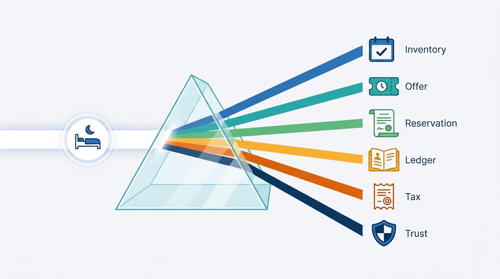
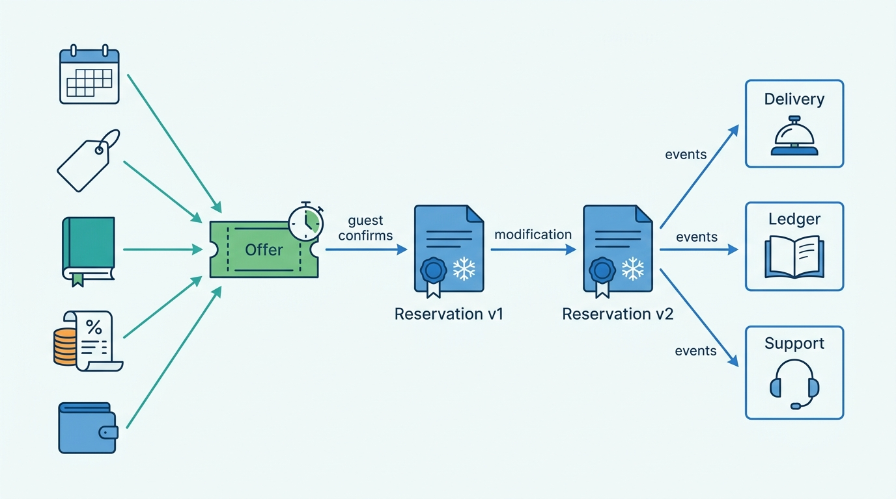
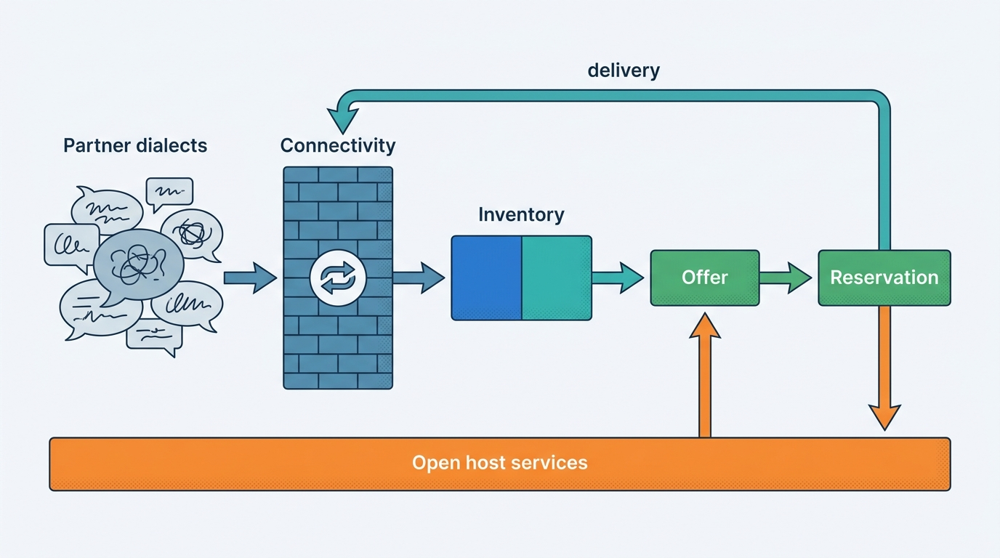
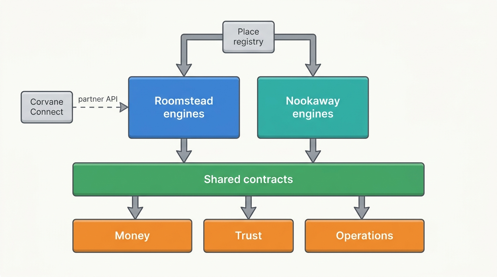

> **IN THIS CHAPTER, YOU WILL:** Apply domain-driven design to a stays platform: classify subdomains as core, supporting or generic for each marketplace type, find the bounded contexts where the meaning of a night changes, and identify the offer and the reservation as the two aggregates that hold the guest's promise together. You will draw a context map with anti-corruption layers toward channel managers, property-management systems and iCal, and follow Corvane as it draws one map for a hotel marketplace and a homes marketplace.

> **WHY THE BUSINESS CARES:** Boundaries decide how expensive every later change is. A group whose reservation table is also its commission ledger and its cancellation rulebook cannot move bookings to a new payment model, add a market or launch homes on its hotel brand without a cross-team project, and every such project leaks money in credit notes and refunds. Clear boundaries let a marketplace change its pricing or its supply model without asking the finance systems for permission.

> **WHY ARCHITECTS SHOULD CARE:** Context boundaries are the hardest architecture decision to reverse, and in a group with two marketplace types they also decide what can be shared. Draw them along brands or along the old monolith's modules, and you either duplicate payments, trust and identity, or force homes and hotels into one supply model. Draw them where meanings change, and services, topics, databases and teams follow from them.

> **KEY POINTS:**
>
> * **Draw a boundary where the meaning of a night changes.** A night is a unit and a date in supply, a count or a free/booked flag in inventory, a line in a time-limited promise in the offer, an agreed obligation in the reservation, a payable in the ledger and a taxable event in tax. Each meaning needs its own model and one owning team. A single "booking" model that holds all of them becomes the table every incident runs through.
> * **The offer and the reservation carry the promise; give each one owner and make everyone else read them.** The offer composes price, conditions, tax and payment arrangement once, for a limited time. The reservation freezes that offer and versions every change. Price Drift and Policy Spaghetti start when other contexts recompute what these two should have fixed.
> * **Across hotels and homes, share contracts and foundations, not supply models.** Identity, payments, the ledger, tax, trust, messaging and the place registry can be shared services, and the offer and reservation can be shared contracts. Room-type inventory and single-unit calendars should stay separate engines behind those contracts, with anti-corruption layers toward channel managers, property-management systems, iCal feeds and the old monoliths.

> **[FAILURE PATTERNS THIS CHAPTER ADDRESSES](where-stay-platforms-go-wrong.html):**
>
> * **The Hotel-Shaped Home** — a shared kernel for the supply model, co-owned by both marketplaces, forces homes into room types or hotels into one-unit calendars, and every change needs both teams' consent.
> * **Policy Spaghetti** — when no context owns change and cancellation policy, checkout, support, payments and the partner channel each encode their own copy and give different answers.
> * **Price Drift** — when no context owns the offer, search, the property page, checkout and the metasearch feed each compute the price, and they disagree.

 
[[stays-capability-map]] described what the two marketplaces do. It did not say how many models of a booking there should be, which team owns the truth about a night, or how a hotel reservation and a home reservation can share a payments platform without sharing a supply model. Those are decomposition questions, and **domain-driven design's bounded context** is the most useful tool for them: a boundary inside which one model and one vocabulary hold, owned by one team.

Stays platforms need it more than most, for two reasons that apply to both the accommodation marketplace, or online travel agency (OTA), and the hosted-stays marketplace. First, the same night is described by a hotel's property-management system (PMS), a channel manager, an inventory store, a quote, a reservation, a virtual card, a ledger entry and a tax report, each correct for its purpose and impossible to hold in one data structure. Second, **a group that runs both types** must decide which boundaries the two can share, or end with two of everything or one supply model that fits neither.

This chapter owns the terms **offer**, **context map** and, briefly, the **reservation aggregate** ([[reservation-lifecycle]] designs it in depth). The worked example is Corvane, the fictional travel group this book follows ([[meet-corvane]]), drawing the One Stay context map across Roomstead, its hotel marketplace, and Nookaway, its homes marketplace.

## Setting the Scene at Corvane: One Night, Nine Owners

In April 2027 Corvane's board approved the One Stay program: share identity, payments and the ledger, trust, messaging, data, customer service and tax, and give both marketplaces a **common offer and reservation contract** while each keeps its own inventory engine. It said *what* to share, not where one context ends and the next begins.

The same month, an audit found about **3,400** 2026 Roomstead reservations switched from pay-at-property to "Pay now" in a modification. Corvane Payments had charged them as merchant bookings, but Keystone, Roomstead's Java and Oracle monolith, also commission-invoiced them, because the invoicing job read the original `PAYMENT_TYPE` column. The credit notes came to about **€129,000** ([[merchant-and-agency-models]]). Nobody had written a bug: two contexts had shared a column, and one had changed its meaning.

On **28–29 April 2027** Mariana Costa, the Group Chief Architect, ran a two-day tracing exercise with Aisha Rahman (VP Supply and Connectivity, Roomstead), Rafael Mendes (VP Engineering, Nookaway) and Leila Haddad (Head of Payments and Finance Engineering). For two real reservations they asked, of every question a guest, partner or auditor might ask about one night, **which system decides the answer**. The first was one of the 41 Roomstead reservations made at **€12** a night at Hotel Miradouro on 9 March, after a decimal-mapping error in Corvane Connect, the group's channel manager ([[connectivity-and-channel-managers]]). The second was the Bauer family's Nookaway reservation for **20–25 April** at Carmen Ruiz's apartment in Seville, which Carmen canceled after a competing platform sold overlapping nights ([[calendar-sync]]).

| Question about the night | Roomstead: a €12 reservation at Hotel Miradouro, 14–16 May 2027 | Nookaway: the Bauers at Carmen's apartment, 20–25 April 2027 |
| --- | --- | --- |
| Is it available? | The hotel's PMS, relayed by Corvane Connect and Switchyard into **Tally**; a cached copy in **Pricegrid**; a re-check in Keystone's checkout | **Almanac**, plus the competing platform's calendar as seen through a three-hourly iCal import |
| What did it cost? | Three code paths: Pricegrid for search, Keystone checkout code for the booking, and the metasearch feed exporter | Burrow at query time, from Almanac and the host's pricing rules; guest fee added in Burrow's checkout |
| What are the cancellation terms? | The rate plan in Tally, the text rendered by Keystone, macros in the commercial support tool, and the message Switchyard sent the hotel | The policy tier on the listing in Burrow; Nookaway's in-house case tool reads it |
| Who collects the money? | Keystone's `PAYMENT_TYPE` column, read separately by Corvane Payments and by commission invoicing | Corvane Payments, always, using amounts held in Burrow |
| What is owed to the supply side? | Keystone's commission run (15% of the room price); the **€6,804** compensation to the hotel lived only in Corvane Connect's books | Burrow's mutable payout and "pending deductions" tables, which held Carmen's **€130** cancellation fee |
| Does the property or host know? | Switchyard's delivery log and the PMS acknowledgement | Carmen's app reads Burrow directly; the competing platform knew nothing |
| Which physical unit was sold? | Nowhere | The listing is the unit, but its Spanish registration number was free text until Carmen re-verified on 3 February |

The Roomstead trace touched **nine** systems with their own version of at least one answer; the Nookaway trace touched six. **Price, policy and payment model were each decided in several places**, none wrong for its own consumer and none the owner; **money lived inside the reservation** (Carmen's statement needed a support agent to explain, [[payouts-and-settlement]]); and **partner dialects reached deep into the core**, from OpenTravel status codes in Keystone columns to iCal events treated as reservations in Burrow.

**Figure 1:** *The Roomstead trace found nine systems each holding its own version of at least one answer about one night: price, policy and payment model were each decided in several places, and none was the owner.*

The question for the architecture forum on 5 May was therefore not "how many services?" but **"where are the lines across which a night changes meaning, who owns each side, and which of those lines can a hotel marketplace and a homes marketplace share?"**

## Concepts: Subdomains, Contexts and the Map Between Them

Domain-driven design (DDD) comes from Eric Evans's *Domain-Driven Design* (2003); its strategic half deals with large models and many teams.

- A **subdomain** is a part of the business domain with its own concerns, such as inventory, payments or trust. Evans separated the **core domain**, where the business competes, from **generic subdomains** that nobody wins with; Vaughn Vernon's *Implementing Domain-Driven Design* (2013) popularized **supporting subdomains**, specific and necessary but not where the business wins.
- A **bounded context** is the boundary inside which one model and its vocabulary apply consistently. Martin Fowler's short definition is the useful one: DDD "deals with large models by dividing them into different Bounded Contexts and being explicit about their interrelationships" ([Fowler, 2014](https://martinfowler.com/bliki/BoundedContext.html)).
- The **ubiquitous language** is the vocabulary used consistently inside one context, not across the company.
- A **context map** shows the contexts and the relationships between them: who is upstream, who adapts to whom, and where translation happens.
- An **aggregate** is, in Fowler's words, "a cluster of domain objects that can be treated as a single unit" ([Fowler, 2013](https://martinfowler.com/bliki/DDD_Aggregate.html)). It is the boundary of a transaction: invariants inside one aggregate hold immediately; invariants across aggregates hold eventually, through events and compensation.
- A **domain event**, such as `ReservationConfirmed`, is published so other contexts can react.

The relationship patterns follow the DDD Crew's open reference ([DDD Crew, n.d.](https://github.com/ddd-crew/context-mapping)), with their typical stays use.

| Relationship | What it means | Typical stays use |
| --- | --- | --- |
| **Customer–supplier** | The upstream team plans for the downstream team's needs | Reservation (supplier) and settlement ledger (customer) |
| **Conformist** | Downstream adopts the upstream model as it is | A small reporting job conforming to the tax engine's output |
| **Anti-corruption layer (ACL)** | Downstream translates the upstream model so it does not leak in | The connectivity gateway in front of channel managers; the iCal import; a translator in front of a monolith |
| **Open host service** | Upstream offers one well-defined protocol to many consumers | Identity, the place registry, the tax engine, the partner connectivity API |
| **Published language** | A documented shared language for exchange | OpenTravel messages toward partners; the group's offer and reservation contracts internally |
| **Shared kernel** | A small part of the model co-owned by two teams | Identifier formats and a currency type; dangerous if it grows |
| **Partnership** | Two teams plan and change the integration together | Offer and checkout during a price-composition rebuild |
| **Separate ways** | No integration; each side solves its problem alone | A neutral channel-manager business inside the group |

The healthy shape: **one team owns one or more contexts, one context has exactly one owning team, and a context contains one or more services.** Conway's law ([Conway, 1968](https://www.melconway.com/Home/Committees_Paper.html)) cuts both ways: a context split across two teams is a coordination problem that looks like an architecture problem. [[organizing-stays-engineering]] turns this map into teams.

### What a night means in each context

Fowler's example is a utility in which "meter" meant different things to different departments. In a stays platform the overloaded word is **night**, closely followed by **booking**.

| Context | What "a night" is there | Identity |
| --- | --- | --- |
| Supply catalog | A sellable unit-night: a room type or a listing on a date | Property or listing, room type, date |
| Inventory | A count of rooms left for a room type, or a free/booked flag on one unit's calendar | Room type × date, or unit × date |
| Pricing | A nightly rate under a rate plan, or a host's nightly price with discounts | Rate plan × date, or listing × date |
| Offer | One line in a priced, time-limited promise for a whole stay | Quote ID |
| Reservation | An agreed night under frozen terms, in a versioned record | Reservation ID and version |
| Settlement ledger | A posting that moves an amount between accounts | Ledger entry |
| Tax | A taxable night per person, in a jurisdiction, under a rule version | Tax determination ID |
| Trust | A risk window, such as a Saturday night in a four-bedroom villa | Reservation and party |

This is the chapter's first argument. **Every row is a different model of the same night**, with its own identity, rate of change and correctness rule; force two into one schema and one is wrong for its consumer, as the April audit showed.

**Figure 2:** *One night, many meanings: each context holds a different model of the same night, with its own identity and correctness rule, and a boundary belongs wherever the meaning changes.*

## Subdomains: Where Each Marketplace Competes

In a two-marketplace group, classifying subdomains gives **different answers for the same subdomain**, which is why a group cannot simply merge its platforms.

| Subdomain | Accommodation marketplace (OTA-style) | Hosted-stays marketplace | Why the classification differs |
| --- | --- | --- | --- |
| Supply connectivity | **Core**: most hotel nights arrive through channel managers and PMSs | Supporting: professional managers connect, individual hosts edit in the app | Where the truth about availability lives |
| Inventory and availability | **Core**: room-type counts at very high look-to-book ratios ([[stays-marketplace-economics]]) | **Core**: one calendar per unit that must never sell a night twice | Both core, for different reasons, with different models |
| Pricing | Supporting: hotels set prices with their own revenue-management systems; the marketplace advises | **Core**: many hosts price with the platform's tools or rules | Who sets the price |
| Search and ranking | **Core** | **Core** | The guest's choice is where both compete |
| Offer composition | **Core**: rate plans × occupancy × conditions × member and payment options | Supporting: nightly price, fees and discounts from host rules | Combinatorics of the product |
| Reservation | Supporting, with delivery to the property | Supporting, with host decisions (request to book) | Nobody books a marketplace for its state machine |
| Payments | Supporting under agency; becoming core as merchant share grows | **Core**: the platform always collects, holds and pays out | Who stands in the money flow ([[merchant-and-agency-models]]) |
| Settlement ledger and tax | Supporting, regulated | Supporting, regulated | The same in both ([[taxes-on-stays]]) |
| Trust and safety | Supporting: fraud and partner-account security | **Core**: guests sleep in strangers' homes | What trust protects ([[stays-trust-and-safety]]) |
| Reviews | Supporting | Close to core: two-sided reputation drives conversion and host standing | Whether reputation is one-sided or two-sided |
| Host and partner operations | Supporting: an extranet for revenue managers | Supporting, heavy: turnover, co-hosts, check-in | Who runs the stay |
| Identity, notifications, experimentation | Generic | Generic | Buy or share |

Three rules follow.

1. **Put the best engineers on each marketplace's core rows.** Roomstead's are connectivity and offer composition; Nookaway's the calendar, pricing tools and trust.
2. **Supporting and generic subdomains are where a group can share.** Payments is the instructive exception: supporting for an agency OTA, core for hosted stays, so share the platform but let each marketplace decide *when* to collect.
3. **A subdomain that is core for one marketplace and supporting for the other needs a shared contract, not a shared engine.** Offer composition is the clearest case; inventory, core for both but with different models, gets separate engines.

## Candidate Contexts for a Stays Platform

The contexts I would start from for a group that runs both types are below. It is a starting map, not a template: a small marketplace may run several as modules of one service. What matters is one owner and one model per row.

| Context | Owns (the truth it decides) | Must not | Deep chapter |
| --- | --- | --- | --- |
| **Place registry** | Property and unit identities, addresses, jurisdictions, registration numbers | Hold prices, calendars or marketing content | [[property-and-listing-model]] |
| **Supply party** | Partners, hosts, owners and operators as legal parties; verification evidence; readiness | Hold balances | [[partner-onboarding]] |
| **Supply catalog** (per marketplace) | Room types, rate plans and products, or listings; policies attached to them | Hold availability or nightly prices | [[property-and-listing-model]] |
| **Content and media** | Descriptions, photos, translations, mapping across suppliers | Decide sellability | [[content-and-media]] |
| **Connectivity** | Partner sessions, dialect translation, sequencing of availability, rates and inventory (ARI) updates, reservation delivery and acknowledgement | Own reservations or ARI state | [[connectivity-and-channel-managers]], [[calendar-sync]] |
| **Inventory** (per marketplace) | Room-type counts and restrictions per date, or a unit's calendar | Compose guest prices | [[rates-and-availability-model]], [[inventory-integrity]] |
| **Pricing** (per marketplace) | Rates, host prices, recommendations and their guardrails | Decide fees, taxes or payment model | [[dynamic-pricing]] |
| **Promotions and loyalty** | Eligibility, funding and benefit balances | Change base rates | [[promotions-and-loyalty]] |
| **Offer** | Priced, conditioned, time-limited quotes for a stay and a party | Hold state after expiry, except for audit | [[availability-engine]], [[property-page-and-room-selection]] |
| **Search and ranking** | Candidate retrieval, ranking policy, its log | Become the source of truth for any field | [[stays-search-architecture]], [[stays-ranking]] |
| **Destinations** | The destination graph and place resolution | Hold supply | [[destinations-and-maps]] |
| **Reservation** | The agreement: parties, frozen terms, versions, state, unit assignment | Compute money it has not frozen | [[reservation-lifecycle]] |
| **Change and cancellation policy** | Policy definitions, versions and evaluation for a given reservation version and moment | Execute refunds | [[changes-and-cancellations]] |
| **Payments** | Collection plans, charges, refunds, virtual cards, the payment arrangement | Decide who is owed what over time | [[stay-payments]], [[merchant-and-agency-models]] |
| **Settlement ledger** | Payables, receivables, balances, payouts and commission entries | Compute fees from bookings by itself | [[payouts-and-settlement]] |
| **Tax** | Tax determinations, liability, reporting | Price the stay | [[taxes-on-stays]] |
| **Eligibility and compliance** | Market rules and per-unit, per-date sellability decisions | Delete listings | [[stays-regulation]] |
| **Trust and safety** | Trust decisions, enforcement actions, cases | Hold payment or reservation state | [[stays-trust-and-safety]], [[travel-fraud]] |
| **Identity** | Accounts, credentials, sessions, roles and delegations | Hold traveler preferences beyond the profile | [[identity-accounts-and-access]] |
| **Reviews** | Verified reviews, moderation and scores | Decide ranking | [[reviews-and-reputation]] |
| **Trip and messaging** | Trip timelines, conversations, notification routing | Change reservation state | [[trip-and-messaging]] |
| **Customer service** | Cases, contact history and recovery decisions | Edit reservations or balances directly | [[customer-service]] |
| **Partner and host workspace** | Extranet and host-app workflows, exception queues, operations tasks | Hold its own copy of any truth | [[extranets-and-host-tools]] |

Three choices deserve a defense.

**Offer is a context, not a step in search or checkout.** Price, conditions, tax, promotions and the payment arrangement meet in the offer; if search and checkout each compose it, the result is Price Drift. Search should *request* offers, often from a cache the offer context owns, and checkout should *re-validate* an offer by its ID ([[property-page-and-room-selection]]).

**Change and cancellation policy is separate from both the reservation and payments.** It answers "what happens if this guest cancels now?" for a reservation version and a moment; the reservation stores the policy version it agreed to, and payments executes the refund. The cure for Policy Spaghetti is one evaluator that every surface calls.

**Platforms are not contexts.** The event backbone, experimentation, the machine-learning (ML) platform and the warehouse serve many contexts; making one a domain context puts a tool team in charge of business meaning ([[event-driven-stays]], [[stays-experimentation]], [[stays-ml-platform]]).

## The Two Aggregates That Carry the Promise: Offer and Reservation

Two less obvious aggregates decide whether the map holds.

### The offer

An **offer** is a priced, conditioned promise to sell a specific stay to a specific party, valid for a limited time. It has five parts.

1. **What is sold**: property and room type and rate plan, or listing; dates; party (adults, children's ages).
2. **Price lines**: accommodation, discounts with their funders, fees, taxes, deposits, each with payee and when it is payable.
3. **Conditions**: cancellation policy ID and version, meal plan, payment schedule.
4. **Payment arrangement**: the model, the merchant of record, the collection plan and the settlement route, resolved by payments ([[merchant-and-agency-models]]).
5. **Provenance and validity**: the inventory version, pricing and tax rule versions it was computed from, when it was computed, and until when it is honored.

The offer is an unusual aggregate: **computed, immutable and short-lived**. A changed input produces a new offer. It is persisted when shown at a point of commitment, so that checkout can re-validate it by ID and an auditor can see what was promised. Its invariants: the total equals the mandatory lines, the conditions match the versions they name, and it is not honored after expiry.

Roomstead's hotel offer comes from a room type, one of dozens of rate plans, an occupancy rule, member eligibility and a payment option ([[rates-and-availability-model]]); Nookaway's home offer from a nightly calendar, length-of-stay discounts, a cleaning fee and the guest fee. **The engines differ; the shape of the promise does not**, which is why the offer is the thing to standardize across the two.

### The reservation

A **reservation** is the agreement that results from accepting an offer: who, which stay, under which frozen terms, in which state, and how it has changed. [[reservation-lifecycle]] designs its state machine; this chapter fixes its boundary. It should contain:

- **identity**: one reservation ID for the life of the stay, plus external identifiers (property confirmation numbers, channel references) stored as facts, not as keys;
- **versions**: each modification creates a new version with a reason;
- **frozen terms per version**: the offer snapshot, the policy version, the payment arrangement version and the tax determination reference;
- **state**: from pending to confirmed, canceled, no-show, stayed or completed, with the sub-states each marketplace needs;
- **parties**: guest, booker, property or host, and the operator responsible on the night;
- **unit assignment**: the physical unit, known at booking for a home and often learned later for a hotel room type.

It should **not** contain the inventory decrement, the payment capture, the payout or the commission invoice; each belongs to another context's aggregate and reacts to reservation events. The no-double-sale guarantee for a home belongs to the unit's calendar, enforced as a no-overlap constraint in its own store ([[inventory-integrity]]). Making a booking is therefore a **saga across aggregates**: hold or claim inventory, authorize payment, confirm with the supplier or host, then confirm the reservation, with compensation for each step that fails ([[checkout-orchestration]]).

**Figure 3:** *The offer composes the promise once; the reservation freezes it and versions every change. Delivery, the ledger, messaging and support read the frozen terms from reservation events instead of recomputing price, policy or payment model from their own tables.*

### Why these two carry the map

| Question a party asks | Answered by | Failure if any other context answers it |
| --- | --- | --- |
| "What will this stay cost me?" | Offer | Price Drift: search, page, checkout and feed disagree |
| "Can I still cancel for free?" | Policy evaluation of the reservation version | Policy Spaghetti: support and checkout give different answers |
| "Who charged me, and why?" | Payment arrangement on the reservation version | The April audit: invoicing and payments disagree |
| "Do you have my booking?" | Reservation, with delivery state from connectivity | Lost at the Front Desk: the property never acknowledged it |
| "What am I owed?" | Settlement ledger, from reservation and payment events | Ledgerless Money: balances recomputed from mutable rows |

This is the chapter's second argument. **Nearly every cross-context bug in a stays platform is one context recomputing what the offer or the reservation should have fixed.** The cure is not more synchronization; it is to compute once, freeze, version, and make everyone else read. If the audit chain from reservation to ledger needs a lookup of "the listing's policy today", the reservation has not frozen enough.

## Architecture: The Stays Context Map

A context map is only useful if it shows **relationships**, not just boxes. The shape I recommend for a group with both types puts partner systems behind anti-corruption layers, the offer and reservation contracts in the middle as published language, and money, trust and identity as open host services.

**Figure 4:** *A context map for a stays group. Partner dialects stop at the connectivity layer; the offer and reservation contracts are the internal published language; payments, the ledger, tax, trust, identity and the place registry are open host services both marketplaces consume. The supply catalog, inventory and pricing stay per marketplace.*

### The relationships, one by one

| Upstream → downstream | Relationship | Why this one |
| --- | --- | --- |
| Channel managers, PMSs → connectivity | **Anti-corruption layer** over a **published language** (OpenTravel, proprietary APIs) | Hundreds of partners, several dialects, no control over their release cycles; the core must never see a partner code |
| iCal feeds → connectivity (homes) | **Anti-corruption layer** | iCal carries blocked dates, not reservations, prices or atomicity; it must enter as a *claim* from another system ([[calendar-sync]]) |
| Connectivity → inventory | **Customer–supplier** | Connectivity sends normalized, sequenced commands; inventory sets the contract |
| Place registry → catalogs, tax, eligibility, reporting | **Open host service** | One identity of a unit for every consumer |
| Inventory, pricing, tax, payments → offer | **Customer–supplier**, with the offer context as customer | The offer context needs versioned inputs and sets the latency budget |
| Offer → search, property page, checkout, metasearch feeds | **Published language** (the offer contract) | Every surface renders the same quote |
| Reservation → payments, ledger, tax, trust, messaging, support, reviews, connectivity | **Published language** (reservation events) with **customer–supplier** for money | Many consumers; the money consumers have the strictest needs and get a say in the contract |
| Legacy monolith → new contexts | **Anti-corruption layer** in both directions during migration | The monolith's tables must not become the new contract ([[modernizing-a-live-marketplace]]) |

### Anti-corruption layers toward partners

The connectivity context is an OTA's largest anti-corruption layer, with two jobs. **Translation** turns each partner dialect into one internal command with a source and a sequence number. **Protection** judges it against what the marketplace knows: a rate that drops 90% on a newly mapped plan is held, not applied. Hotel Miradouro's €12 rate passed through two layers that translated and did not protect ([[connectivity-and-channel-managers]]).

In the reverse direction, the partner's acknowledgement and confirmation number come back as **facts on the reservation**, not fields the partner can overwrite. Booking.com's connectivity documentation shows such a boundary: reservations wait in a per-provider queue until acknowledged, and Booking.com e-mails the property if one is not acknowledged within 30 minutes ([Booking.com, n.d.](https://developers.booking.com/connectivity/docs/reservations-api/reservations-overview)).

For homes the layer is smaller but harder: an iCal feed says "these dates are blocked" without why, at what price or since when. Nookaway's March 2027 design stores imported events as **claims with provenance**, not reservations ([[calendar-sync]]).

### Anti-corruption layers toward the monoliths

Every long-lived stays platform has a monolith that owns too much: Keystone and Burrow at Corvane, and in the public record Airbnb's Monorail and Agoda's core monolith. On the map it is a **big ball of mud**. My rule is that **nothing new reads the monolith's tables**: new contexts get its data through a translator that publishes events in the new contract, because change data capture straight from the monolith's schema makes that schema the de facto contract.

### Shared kernels to avoid

A shared kernel is legitimate when small, stable and co-owned by teams who talk every week. In a stays group only the first of these candidates is safe.

| Candidate shared kernel | Verdict | Why |
| --- | --- | --- |
| Identifier formats, money and currency types, date-range semantics (check-in inclusive, check-out exclusive) | **Share** | Small, stable, painful to get wrong twice |
| One supply model for rooms and homes ("a home is a room type with quantity one", or "a room is a listing") | **Avoid** | It is the definition of The Hotel-Shaped Home: every change needs both marketplaces' consent, and one side always pays for the other's needs |
| One reservation table for both brands, co-owned by both marketplace teams | **Avoid** | Joint ownership of the most-read record means every change needs two teams. Share the *contract*; if one reservation service follows, give it one owning team |
| One cancellation-policy table read directly by checkout, support and payments | **Avoid** | It turns policy into a kernel nobody owns; put it behind an evaluator instead |

The rule underneath the table: **share a language, not a database.** When two contexts need the same meaning, publish it as a versioned contract owned by one team, and let the other conform or translate.

## In Practice: What the Public Record Shows

No stays company has published its context map. Several have published enough to show where they drew boundaries.

**Airbnb: the most-shared entity first, money apart from the reservation.** In a 2018 QCon talk, Jessica Tai described Airbnb's migration from Monorail, its Ruby on Rails monolith: the first extraction was the homes data model, "accessed by almost every feature", and a middle tier held shared write validation, with **reservation validation** as the named example ([Tai, InfoQ, 2018](https://www.infoq.com/presentations/airbnb-soa-migration/)). The talk is eight years old and describes a system that has since changed; the order is the lesson. A 2022 post on rebuilding payment orchestration built the data model "around the concept of a bill" and modeled an alteration such as "adding another night to a stay" "as a new version in a sequence of plans for that product" ([Ross et al., Airbnb Engineering, 2022](https://medium.com/airbnb-engineering/rebuilding-payment-orchestration-at-airbnb-341d194a781b)), and a 2026 post describes payments as "a capability-oriented services system structured by domains" ([Haile et al., Airbnb Tech, 2026](https://airbnb.tech/payments/pay-as-a-local/)). Both support this chapter's boundary: the money side keys on its own versioned aggregate rather than reading reservation rows. A 2026 data-warehouse post adds the sharing rule (models "either completely separate by product type or completely monolithic", with customer support kept as one model) for the offline warehouse only ([Airbnb Tech, 2026](https://airbnb.tech/uncategorized/scaling-beyond-one-how-airbnb-evolved-its-data-architecture-for-a-multi-product-world/); see [[stays-capability-map]]).

**Agoda: booking creation and post-booking as different contexts.** In a 2026 post, Agoda described splitting its core monolith in 2019 into booking creation and post-booking (cancellations, amendments, refunds, communications). Post-booking grew until merge requests "more than quadrupled between 2022 and 2025", and Agoda introduced a modular monolith with domain components such as `rebook`, `cancellation` and `payment`, enforced by architecture tests in continuous integration ([Agoda Engineering, 2026](https://medium.com/agoda-engineering/how-we-cut-the-coupling-tax-in-a-post-booking-api-2156a3175538)). A split along the booking timeline is not enough if one side becomes its own ball of mud, and boundaries enforced in the build are a legitimate step before services. A 2025 Agoda post describes booking as a graph of single-purpose steps run by an orchestrator ([Agoda Engineering, 2025](https://medium.com/agoda-engineering/how-agodas-multi-product-booking-engine-powers-seamless-travel-bookings-61fc6e746821)): checkout orchestrates other contexts' aggregates and owns none of them.

**Expedia Group and Booking.com: where supply models meet.** Expedia unified its technology teams in 2020 and created "one unified front-end stack in 2023" ([Expedia Group 10-K for 2023](https://www.sec.gov/Archives/edgar/data/1324424/000132442424000007/expe-20231231.htm), February 2024), yet its distribution API still exposes Vrbo homes through a different supply model from hotels: single-unit, one rate plan, rental agreements and damage deposits ([Expedia Group Rapid, n.d.](https://developers.expediagroup.com/rapid/lodging/vacation-rentals/vrbo-integration-guide)). Booking.com's connectivity documentation, by contrast, models a home as a room type whose quantity is the number of identical units ([Booking.com, n.d.](https://developers.booking.com/connectivity/docs/room-type-and-rate-plan-management/managing-room-types.md)), one supply model at least at the partner interface ([[property-and-listing-model]]). On its demand side, a 2026 post says "each major page has its own Node rendering service, owned by the team responsible for that page" ([Booking.com Engineering, 2026](https://medium.com/booking-com-development/node-js-at-scale-rebalanced-how-we-cut-cost-by-38-62ce247a3002)): Conway's law applied deliberately.

> **INFERENCE, NOT DOCUMENTED:** The two Expedia sources are consistent with a shared platform whose published contract carries both a hotel offer and a single-unit home offer, with differing supply rules behind it: the "shared contract, separate engines" pattern. They do not describe Expedia's internal contexts, and how either company stores homes internally is not public.

No company has described its reservation aggregate, its offer contract or how it divides cancellation policy between services. The design in this chapter is my recommendation, not a reconstruction of anyone's systems.

## Corvane Worked Example: The One Stay Context Map

The architecture forum adopted **Context Map v1** on **5 May 2027**. It started from capability map v1 of March 2027 (48 capabilities: 16 shared engines, 6 shared contracts; [[stays-capability-map]]) and turned capabilities into models with owners. It names **23 bounded contexts** of three kinds: twelve shared group contexts with one engine and one owner, four shared contracts with engines that may differ per marketplace, and seven marketplace-specific contexts. The sorting rule: share what follows the person, the money or the law; standardize the contract where both make the same promise in different ways; keep separate what is core to one and shaped differently in the other.

| Context | Kind | Owner (2027) | Target |
| --- | --- | --- | --- |
| Place registry | Shared | Group supply domain, Lisbon | Registry live May 2027 ([[property-and-listing-model]]) |
| Supply party | Shared | Group supply domain | One party layer, 2028 ([[partner-onboarding]]) |
| Eligibility and compliance | Shared | Noor van Dijk (rules), supply domain (service) | Market policy registry ([[stays-regulation]]) |
| Identity | Shared | Group platform, Kraków | Corvane ID ([[identity-accounts-and-access]]) |
| Payments | Shared | Leila Haddad | Arrangement resolver, June 2027 |
| Settlement ledger | Shared | Leila Haddad | Fathom as ledger of record ([[payouts-and-settlement]]) |
| Tax | Shared | Leila Haddad (engine), group indirect-tax team (rules) | Levy, Q4 2027 ([[taxes-on-stays]]) |
| Trust and safety | Shared | Sofia Marín | One group trust platform ([[stays-trust-and-safety]]) |
| Trip, messaging and notifications | Shared | Rafael Mendes (conversations); group platform engineering (notifications) | One conversation service and one notification platform ([[trip-and-messaging]]) |
| Customer service | Shared | Elena Petrova | One service platform ([[customer-service]]) |
| Destinations | Shared | Jonas Weber | Waypoint, 2028 ([[destinations-and-maps]]) |
| Data and metrics | Shared | Kenji Arai | Gauge metric layer, July 2027 ([[marketplace-intelligence]]) |
| Offer | Shared contract | Contract: Group Chief Architect's office; one price composition per engine | Offer contract and offer kernel ([[availability-engine]]) |
| Reservation | Shared contract | Contract: Group Chief Architect's office; engines in Keystone and Burrow in May 2027 | One group reservation service from 2028 ([[reservation-lifecycle]]) |
| Change and cancellation policy | Shared contract | Policy vocabulary in the reservation contract; evaluators per engine | Superseded in July 2027 by Clause, one group engine ([[changes-and-cancellations]]) |
| Search and ranking | Shared contract | Jonas Weber, one group team, two engines | One query and result contract; separate indexes and rankers ([[stays-search-architecture]]) |
| Supply catalog | Per marketplace | Aisha Rahman; Rafael Mendes | Separate, both on registry IDs |
| Content and media | Per marketplace, shared pipeline | Each marketplace; pipeline shared | Shared media pipeline and translation ([[content-and-media]]) |
| Connectivity | Per marketplace | Aisha Rahman; Rafael Mendes | Separate ([[connectivity-and-channel-managers]], [[calendar-sync]]) |
| Inventory | Per marketplace | Aisha Rahman; Rafael Mendes | Tally and Almanac stay separate ([[rates-and-availability-model]]) |
| Pricing | Per marketplace | Each marketplace | Separate ([[dynamic-pricing]]) |
| Promotions and loyalty | Roomstead only | Roomstead | Roomstead-only ([[promotions-and-loyalty]]) |
| Partner and host workspace | Per marketplace, shared spine | Aisha Rahman; Rafael Mendes | Separate products on a shared spine ([[extranets-and-host-tools]]) |

Two systems sit deliberately **off** the core. Corvane Connect, which also distributes to Roomstead's and Nookaway's competitors, is **separate ways** for data and an ordinary partner for integration: it uses Switchyard's public API like the other 139 certified partners, gets no privileged access to Tally, and its customers' data is excluded from group pricing features. Experimentation and the ML platform are platforms, not contexts.

**Figure 5:** *Context Map v1 in three layers. Each marketplace keeps its own supply and inventory engines; both emit the same offer and reservation contracts; shared services consume the contracts rather than either marketplace's tables. Corvane Connect stays outside, as one partner among many.*

### What the map changed in the following months

Later decisions could each be framed as **one boundary on the map made concrete**. Two March decisions already fitted it: Calendar Sync v2, which made iCal imports claims, and one price composition per engine behind the shared offer contract.

| Date (2027) | Decision | Boundary it drew |
| --- | --- | --- |
| 12 May | Group place registry for property and unit identities | Place registry vs supply catalogs |
| May | Fathom becomes the settlement ledger of record for both brands; Keystone and Burrow emit events only | Reservation vs settlement ledger |
| June | Versioned payment arrangement record on the offer and reservation contracts, resolved by Corvane Payments | Offer and reservation vs payments |
| June | Shared offer kernel for fees, taxes, currency and audience, used by Pricegrid, the feed exporter and checkout | Offer vs search and checkout |
| June | One stay query and result contract and Waypoint for both brands; separate indexes and rankers | Search contract vs search engines |
| July | Clause, one group cancellation policy engine, replaces one evaluator per engine | Policy contract becomes one engine |
| August | Stayline, one group reservation service, first as an event-fed tracker for both brands | Reservation contract becomes one owner and one engine |
| Q4 | Levy replaces Burrow's tourist-tax dictionary | Tax vs pricing |

The December 2027 annual review checked Context Map v1 against **capability map v2** (49 capabilities: 23 shared engines, 6 shared contracts, 20 brand-specific), recorded in [[converging-two-marketplaces]]. Two changes reached this map. Change and cancellation policy is now one shared engine, Clause, not a contract with an evaluator per engine. Reviews, which v1 did not list as a context, became a shared engine, Vouch, inside the trust platform. The place registry and Waypoint (destinations) stay two contexts, with Waypoint writing enrichment to registry records and never the reverse. Experimentation and ML became shared engines on the capability map but remain platforms, not contexts, here.

The April audit is the clearest before-and-after. Under v1, commission invoicing reads the **payment arrangement version effective at the stay date**, which the reservation carries as a frozen value and publishes with its events ([[merchant-and-agency-models]]). The same modification that produced a €129,000 credit-note run in 2026 now produces an `ArrangementChanged v1 → v2` event that the ledger, card issuing and invoicing each act on. The fix was a boundary, not a better query.

On the hosted-stays side, the Bauers' cancellation becomes a new reservation version with a host-cancellation reason; the policy engine decides the guest's remedy and Carmen's €130 fee under the frozen policy version; the fee posts to her account in Fathom; and the guarantee rebooking is a new linked reservation. Her statement then shows the deduction as a referenced ledger entry, not an amount a support agent reconstructs from Burrow's tables.

### Mapping 240 services onto 23 contexts

Teams then assigned services to contexts. Of Roomstead's **180** services on AWS and Nookaway's **60** Go services, **196** mapped to exactly one context and **44** straddled two or more, 17 of them in the booking path, most often checkout services that composed offers and also wrote reservation fields. Keystone held parts of **nine** contexts and Burrow parts of **seven**. The counts became the decomposition backlog: contracts first, because straddling services cannot be split until there is a contract to split toward.

The offer and reservation contracts got an owner neither marketplace would have chosen: a **contracts stewardship group** of four engineers in the Group Chief Architect's office, owning the offer, reservation and payment-arrangement schemas, their compatibility tests and versioning, and no engine. Leila Haddad's team keeps the arrangement *resolver*; the stewardship group keeps its *schema*. The team that runs an engine should not be the only voice on the contract every other team depends on.

## Trade-offs: How to Decompose Two Marketplaces

| Option | What it means | Gains | Costs | Right when |
| --- | --- | --- | --- | --- |
| **Two independent stacks** | Each marketplace keeps every context, including payments, trust and identity | Speed inside each brand; no coordination | Two of everything; Price Drift and Policy Spaghetti across brands; duplicated regulated work | The group may sell one brand soon, or the brands share no customers or markets |
| **One booking platform** | One catalog and one inventory engine for hotels and homes | One codebase; simple reporting | The Hotel-Shaped Home; the larger marketplace's model wins and the other pays | Supply is genuinely one type, such as an OTA whose homes are all professionally managed pools |
| **Shared contracts, separate engines, shared foundations** | Offer and reservation contracts shared; inventory, catalog, connectivity and pricing per marketplace; money, trust and identity shared | Consistency where guests and finance see it; freedom where supply differs | Contract governance; translation code in each engine; a period of dual running | A group runs both types at scale and expects convergence at the edges |

Within the recommended option, teams argue most about who owns the payment arrangement. My default is payments, as a resolver whose output the reservation freezes: the people who carry the consequences of a wrong model are finance and the license holder.

## Where the Two Maps Differ

The two maps have nearly the same boxes but differ in **which boxes are heavy, which direction the truth flows, and which sub-machines the reservation needs**.

| Dimension | Accommodation marketplace | Hosted-stays marketplace |
| --- | --- | --- |
| Where inventory truth lives | Outside: the hotel's PMS or channel manager; the marketplace holds asserted copies | Inside: the platform calendar, unless the host syncs other channels |
| Heaviest anti-corruption layer | Connectivity: many dialects, high message volume, ordering and validation | iCal and vacation-rental PMS import: few dialects, weak semantics, claims rather than facts |
| Offer composition | Combinatorial: room types × rate plans × occupancy × conditions × audience | Arithmetic: nightly prices, length-of-stay discounts, cleaning fee, guest fee |
| Reservation sub-machines | Supplier delivery and acknowledgement; unit assignment learned later | Host decision (request to book); identity and screening; unit known at booking |
| Operations and compliance | The hotel runs the stay; licensing and tax per property | Turnover and check-in in the platform; registration, night caps and reporting per unit and date |

Convergence makes the table less tidy: about **61,000** Roomstead properties are multi-unit room-type pools, Nookaway will pilot boutique hotels in 2028, and a Málaga manager's 38 apartments appear on Roomstead as five room types and on Nookaway as 38 listings ([[property-and-listing-model]]). The map handles this without a shared supply model: both catalogs reference the same registry units and emit the same contracts ([[converging-two-marketplaces]]).

## Failure Modes

**The god reservation table.** One table holds the reservation, its price, policy, payment type, commission status and delivery state, and dozens of jobs read it directly, so every meaning that drifts produces a silent error elsewhere, like Keystone's commission run. Count the readers of the reservation store outside the reservation context; the target is zero.

**A shared kernel that grows.** It starts as shared identifiers and becomes a shared supply schema "so the brands stay consistent". Within two years neither marketplace can add a field without the other's review: The Hotel-Shaped Home, arrived at through good intentions.

**Policy in every context.** Checkout, support macros, payments and the partner channel each hold a policy; in a mass-disruption weekend they answer the same guest four ways. Policy Spaghetti is a boundary failure, and Corvane's answer, Clause, is one engine ([[changes-and-cancellations]]).

**Price composed in several contexts.** Search, the property page, checkout and the metasearch feed each add fees, taxes and currency, and disagree. Corvane's audit of a metasearch downgrade in May 2027 attributed 1.4 points of mismatch to fee and tax composition and 0.6 to member-price leakage, both symptoms of composition outside the offer context ([[availability-engine]]).

**Partner semantics past the boundary.** OpenTravel status codes in reservation columns, channel-manager rate-plan codes as product keys, iCal events stored as reservations: Connectivity Roulette is often a layer that translated syntax but let meaning through.

**Boundaries by brand or by monolith module.** "Roomstead booking" encodes the org chart; contexts named after Keystone's packages encode a 2004 design.

**Money inside the reservation.** Balances derived nightly from mutable rows cannot say why a balance changed. Nookaway's €3.4 million of host debit balances at the end of 2026 was an accounting outcome of that design ([[payouts-and-settlement]]). Ledgerless Money is what a reservation that also plays ledger produces.

## The Chief Architect's View

**Decide the map before the services.** A decomposition that starts by naming microservices reproduces the monolith's boundaries in smaller boxes. Trace two or three real reservations, list every place each question is answered, and draw contexts where answers should have one owner. Corvane's two-day trace cost less than one of the incidents it explained.

**Classify subdomains per marketplace, in writing.** It decides where the best engineers work and what the group shares, and keeps the larger brand's priorities from silently becoming the group's.

**Treat shared contracts as products with owners.** Give the offer and reservation contracts a steward with no engine to protect, a versioning policy (additive changes freely, breaking changes with a migration window), consumer-driven compatibility tests, and a forum decision for anything that changes meaning.

**Govern money boundaries with finance.** The Group CFO should co-sign changes to the payment arrangement and to the reservation events the ledger consumes.

**Make boundary violations measurable.** I track per quarter: direct reads of another context's store (target zero); the share of changes that needed more than one team; contract failures caught in CI versus production; and how often surfaces disagree about a price or a policy answer. The last are the guest-visible cost of bad boundaries ([[evolving-the-platform]]).

**Expect the map to move, and version it.** Within seven months Clause and Vouch had changed Context Map v1; a deemed-supplier value-added tax (VAT) rule will move tax decisions into the center of the offer ([[taxes-on-stays]]). Review the map when a new product or regulation arrives.

## Questions to Ask

1. For one real reservation, how many systems hold their own answer to "what did it cost?", "can it be canceled for free?" and "who collects the money?
2. Which subdomains are core for each marketplace, and where do they differ?
3. Who owns the offer? Do search, the property page, checkout and our metasearch feeds render one composed quote, or compose their own?
4. What does our reservation freeze at booking: offer lines, policy version, payment arrangement, tax determination? What does it look up "as of now" instead?
5. Which jobs read the reservation store directly?
6. Can we find an OpenTravel code, a channel-manager product key or an iCal UID in a core context's model?
7. Which shared kernels do we have, and is any of them a supply model?
8. For each shared contract, who owns the schema, how are breaking changes handled, and does every context have exactly one owning team?

## From Boundaries to Supply

The map now has its lines: a place registry and supply catalogs at the source, inventory and pricing engines per marketplace, the offer and reservation as the contracts that carry the guest's promise, and shared services for money, trust and identity. The next part fills in the supply side, starting with the thing a guest actually books. [[part-2]] introduces it, and [[property-and-listing-model]] shows how a hotel marketplace and a homes marketplace can share the identity of a unit without sharing a supply model.

## Sources and Evidence

### Company engineering and investor sources

- ["The Great Migration: from Monolith to Service-Oriented"](https://www.infoq.com/presentations/airbnb-soa-migration/), Jessica Tai, QCon San Francisco via InfoQ, 2018 — Monorail migration; homes data model extracted first; four service types; reservation validation as a shared middle tier. Describes a system that has since changed.
- ["Rebuilding Payment Orchestration at Airbnb"](https://medium.com/airbnb-engineering/rebuilding-payment-orchestration-at-airbnb-341d194a781b), Bryon Ross et al., Airbnb Engineering, 2022 — data model built around the bill, workflows as DAGs of idempotent steps, alterations as new plan versions.
- ["Pay as a Local"](https://airbnb.tech/payments/pay-as-a-local/), Gerum Haile et al., Airbnb Tech, 2026 — payments as capability-oriented services structured by domains, with named payment subdomains.
- ["Scaling beyond one: How Airbnb evolved its data architecture for a multi-product world"](https://airbnb.tech/uncategorized/scaling-beyond-one-how-airbnb-evolved-its-data-architecture-for-a-multi-product-world/), Airbnb Tech, 2026 — separate or monolithic models per domain; payments, messaging and support product-agnostic (warehouse only).
- ["How We Cut the Coupling Tax in a Post-Booking API"](https://medium.com/agoda-engineering/how-we-cut-the-coupling-tax-in-a-post-booking-api-2156a3175538), Agoda Engineering, 2026 — 2019 split of booking creation and post-booking; modular monolith with enforced domain components; review-time results.
- ["How Agoda's Multi-Product Booking Engine Powers Seamless Travel Bookings"](https://medium.com/agoda-engineering/how-agodas-multi-product-booking-engine-powers-seamless-travel-bookings-61fc6e746821), Agoda Engineering, 2025 — booking as an orchestrated graph of single-purpose steps.
- [Expedia Group Form 10-K for 2023](https://www.sec.gov/Archives/edgar/data/1324424/000132442424000007/expe-20231231.htm), Expedia Group, 2024 — technology teams unified in 2020 and one unified front-end stack for Brand Expedia, Hotels.com and Vrbo in 2023.
- ["Node.js at scale, rebalanced: how we cut cost by 38%"](https://medium.com/booking-com-development/node-js-at-scale-rebalanced-how-we-cut-cost-by-38-62ce247a3002), Booking.com Engineering, 2026 — a Node rendering service per major page, owned by the page's team.

### Standards, regulation and documentation

- [Reservations API overview](https://developers.booking.com/connectivity/docs/reservations-api/reservations-overview), Booking.com Connectivity, n.d. (read October 2026) — per-provider reservation queue, acknowledgement and 30-minute e-mail fallback.
- [Managing room types](https://developers.booking.com/connectivity/docs/room-type-and-rate-plan-management/managing-room-types.md), Booking.com Connectivity, n.d. — homes represented as room types with a quantity of identical units.
- [Vrbo integration guide](https://developers.expediagroup.com/rapid/lodging/vacation-rentals/vrbo-integration-guide), Expedia Group Rapid, n.d. — single-unit, single-rate-plan supply model for distributed homes.
- [OpenTravel Alliance](https://opentravel.org/), n.d. — the message specifications used as a published language between hotels, channel managers and OTAs.
- [Context Mapping](https://github.com/ddd-crew/context-mapping), DDD Crew, n.d. — names and definitions of context-map relationship patterns.

### Research and practitioner sources

- Eric Evans, *Domain-Driven Design: Tackling Complexity in the Heart of Software*, Addison-Wesley, 2003 — bounded context, context map, core domain and generic subdomains.
- Vaughn Vernon, *Implementing Domain-Driven Design*, Addison-Wesley, 2013 — supporting subdomains and practical context mapping.
- ["BoundedContext"](https://martinfowler.com/bliki/BoundedContext.html), Martin Fowler, 2014 — the pattern and the "meter" example.
- ["DDD_Aggregate"](https://martinfowler.com/bliki/DDD_Aggregate.html), Martin Fowler, 2013 — aggregates as units of consistency.
- ["How Do Committees Invent?"](https://www.melconway.com/Home/Committees_Paper.html), Melvin E. Conway, *Datamation*, 1968 — systems copy the communication structures of the organizations that build them.
- Barry M. O'Reilly, *Residues: Time, Change, and Uncertainty in Software Architecture*, Leanpub, 2024 — the stressor method behind the reference models' residual architectures.
- Productscape reference models for a travel-accommodations marketplace and a hosted-stays marketplace, author's working models, 2026 — capability bricks, overlap and residual separations; generic models, not descriptions of any company.

Corvane is fictional; architectural recommendations and labeled inferences are the author's judgement.
