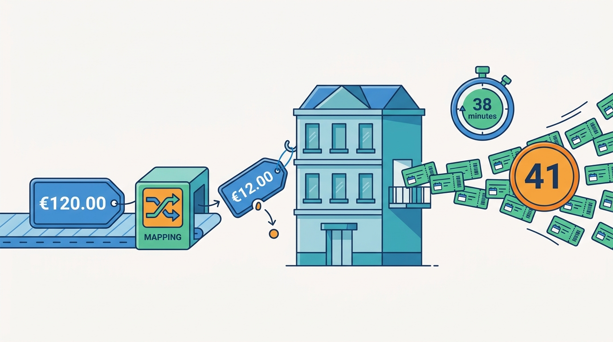
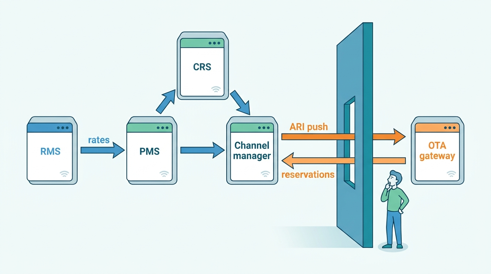
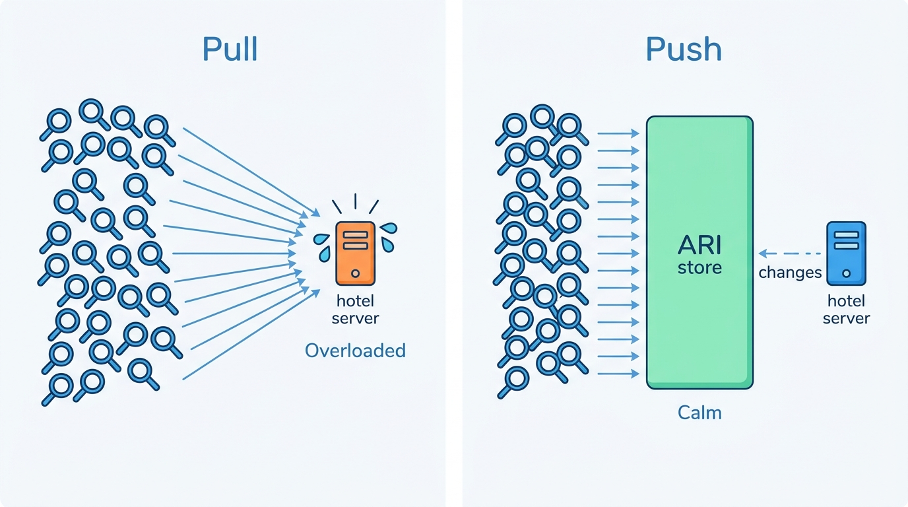
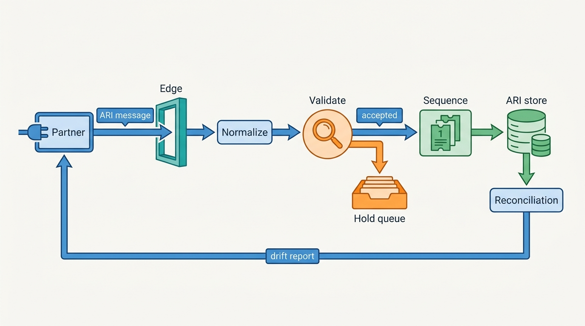
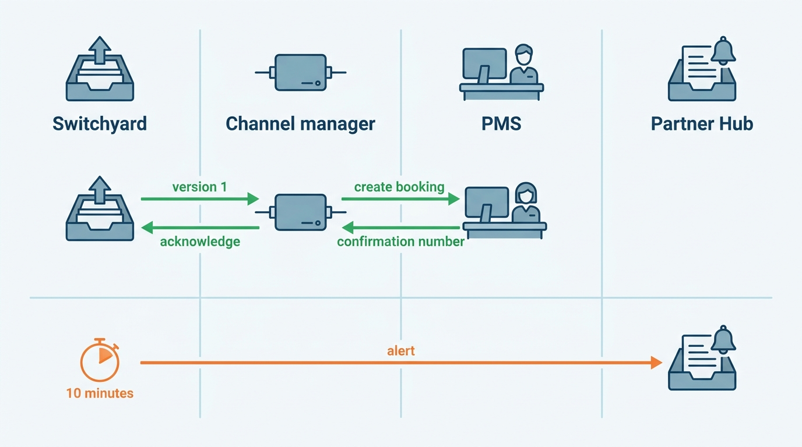
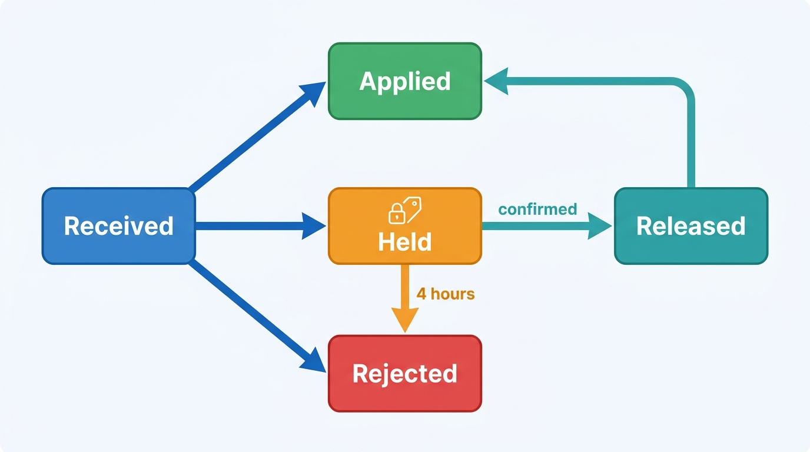

> **IN THIS CHAPTER, YOU WILL:** Walk the hotel technology stack (PMS, CRS, channel manager, RMS, booking engine, GDS) from the OTA's side of the wire. You will see how ARI messages and reservations move through OpenTravel and proprietary APIs, and how to design a connectivity gateway that validates, orders, reconciles, delivers and scores those flows.

> **WHY THE BUSINESS CARES:** At an OTA most hotel room nights arrive through software the marketplace does not own. Each wrong price, missing stop-sell or reservation that never reaches the hotel is paid for twice: once in compensation or relocation, and again in partner and guest trust. A head of supply who cannot rank connectivity partners by reliability cannot manage the channel that brings in most of the revenue.

> **WHY ARCHITECTS SHOULD CARE:** The connectivity layer is where the marketplace's inventory truth enters, and that truth lives in someone else's system. Treat it as a thin XML adapter and every upstream mistake reaches search and checkout within seconds. Treat it as a product with contracts, semantic validation, ordering, reconciliation and delivery guarantees, and upstream mistakes become contained, measured incidents.

> **KEY POINTS:**
>
> * **Availability is an assertion from someone else's system.** An OTA sells against a local copy of the ARI that a PMS, CRS or channel manager pushes to it. The connectivity layer's job is to keep that copy faithful, and to know for each property which source asserted each value, when it did so, and how far the copy may have drifted.
> * **The contract is the channel's profile plus certification, not the standard.** OpenTravel supplies the element names. Each channel's code lists, pricing models, limits and guard rails are the real contract, and certification tests partners against it. Validation that checks a price against the property's own sibling rates catches errors that schemas and fixed bounds miss, such as a €12 rate.
> * **Delta streams drift, so design reconciliation and delivery proof as first-class flows.** Apply updates in order per property, accept absolute values rather than increments, compare the copy with the source on a schedule, and track every reservation until the hotel's system acknowledges it. Score partners on these signals and enforce the score: that is what turns connectivity into a product.

> **[FAILURE PATTERNS THIS CHAPTER ADDRESSES](where-stay-platforms-go-wrong.html):**
>
> * **Connectivity Roulette** — a gateway that accepts any well-formed message, has no per-partner health score and no reconciliation turns every rate update into a gamble on someone else's mapping table.
> * **Phantom Availability** — a lost stop-sell or an out-of-order inventory update leaves the marketplace selling rooms the hotel no longer has, and nothing notices until a guest is walked.
> * **Lost at the Front Desk** — a reservation that was "sent" but never acknowledged by the hotel's PMS looks the same as a delivered one, unless delivery state is tracked per reservation version.

 
A hotel's rooms, rates and restrictions do not live at the OTA. They live in the hotel's **property management system (PMS)**, a chain's **central reservation system (CRS)** or a **channel manager**, and a revenue manager or a pricing algorithm changes them many times a day. The OTA holds a copy. Every search result, property page and checkout reads that copy, so **the copy's accuracy is the OTA's accuracy**. The connectivity layer is what keeps it accurate.

This is unusual for a marketplace. An accommodation marketplace (OTA-style, after "online travel agency") has outsourced the most important write path in its system to thousands of properties and the hundred or so software vendors they use. It cannot fix their bugs or see their logs. It can define the contract precisely, check everything that arrives against it, detect drift, prove delivery in the other direction, and make reliability something partners compete on.

Part II follows supply from the property model ([[property-and-listing-model]]) through onboarding ([[partner-onboarding]]) and content ([[content-and-media]]) to the machinery that keeps it current. This chapter owns the **ARI message**, the **channel manager**, the **PMS** (as an integration counterparty), the **connectivity partner** and the **full sync**. The data model belongs to [[rates-and-availability-model]], the cache that search reads to [[availability-engine]], and two channels selling the last room to [[inventory-integrity]].

## Setting the Scene at Corvane: Thirty-Eight Minutes at €12

Corvane, the fictional travel group this book follows (see [[meet-corvane]]), owns both ends of the wire that failed on Tuesday **9 March 2027**. Roomstead, its accommodation marketplace, receives **82%** of its hotel room nights through **140 certified connectivity partners**. Its connectivity gateway, **Switchyard**, ingests about **650 million** ARI update messages a day, with peaks of **38,000** per second. Corvane Connect, the channel manager the group bought in 2024 (formerly ChannelPier), serves **14,500 hotels**, distributes to more than 60 channels including Roomstead's competitors, and serves **21%** of Roomstead's connected hotels.

One of them is **Hotel Miradouro**, an independent 84-room four-star hotel in Lisbon. Its revenue manager, Duarte Silva, runs a cloud PMS that sends rates to Corvane Connect, which maps them to each channel's codes. The previous Friday a Corvane Connect specialist had mapped a new rate plan for Miradouro, "Standard Double – Flexible", to Roomstead and two other channels.

| Time (WET) | Event |
| --- | --- |
| 07:14 | Duarte's bulk update for **14–16 May 2027** leaves the PMS with €120.00 for the new plan. In Corvane Connect, the new plan's mapping applies the wrong decimal setting and sends **€12.00** to Roomstead and two other channels. |
| 07:14 | Switchyard validates the message against the schema and Roomstead's profile: known property, mapped product, valid dates, a price above the absolute floor. Roomstead's price-anomaly check compares each rate with **the same rate plan's previous value**; the plan is new, so there is none. The message is applied. |
| 07:15 | Pricegrid, Roomstead's availability cache, refreshes from the change events. Metasearch price feeds pick up the €12 rate within minutes. |
| 07:14–07:52 | **41** Roomstead reservations for **63** room nights are made in **38** minutes. Each one is delivered through Corvane Connect to the PMS. |
| 07:52 | Duarte sees the run of €12 bookings in his PMS and corrects the price. |

**Figure 1:** *One wrong decimal setting turned €120.00 into €12.00, and 41 reservations arrived in 38 minutes before the hotel noticed.*

Roomstead honored all 41 reservations. Corvane Connect compensated the hotel for the difference: 63 room nights × €108 = **€6,804**. The money was small; the questions were not. Mariana Costa, Group Chief Architect since January, put them to Aisha Rahman (VP Supply and Connectivity, Roomstead) and Priyanka Shah (Head of Product, Corvane Connect):

1. Hotel Miradouro had **36 other rate plans** on its six room types; for the same dates its other Standard Double prices ranged from €104 to €189. Why did a gateway that held all of them accept a price nine-tenths below every one?
2. Corvane Connect's mapping was new and untested in production. Why could a newly mapped product sell at full speed from its first message?
3. Corvane owns a channel manager that serves Roomstead's competitors. Whatever Switchyard learns must apply equally to all 140 partners, and whatever Corvane Connect fixes must protect the other two channels as much as Roomstead. Who makes sure of that?

## The Hotel Stack: Who Holds the Truth

Each system on the other side of the wire asserts a different part of the truth and fails differently.

| System | What it owns | Who runs it | Examples (public) |
| --- | --- | --- | --- |
| **Property management system (PMS)** | The hotel's operational record: physical rooms, in-house guests, reservations, folios, housekeeping. For an independent hotel, usually the system of record for inventory. | Each property | Oracle OPERA Cloud, Mews, apaleo, Cloudbeds |
| **Central reservation system (CRS)** | One "single image of inventory" and rates across a chain's properties; distributes to the chain's website, call centers, GDSs and OTAs | Chains and some groups | SynXis (Sabre Hospitality Solutions, sold to TPG in July 2025) |
| **Channel manager** | Fan-out of ARI from one source to many channels, and fan-in of reservations from many channels back to one PMS; holds the code mappings per channel | Mostly independent and small-chain hotels, as SaaS | SiteMinder, D-EDGE, RateGain, STAAH; Corvane Connect in this book |
| **Revenue management system (RMS)** | Demand forecasts and pricing decisions: best available rate, length-of-stay restrictions, overbooking levels | Hotels with a revenue function | IDeaS and others |
| **Booking engine** | The hotel's own direct-booking checkout on its website | Each property, often bundled with the CRS or channel manager | Many |
| **Global distribution system (GDS) and switch** | Distribution to travel agents through Amadeus, Sabre and Travelport; the "switch" translates between hotel CRSs and the GDSs | Chains and their CRS vendors | Pegasus began in 1989 as a hotel-industry switch |

A few definitions this chapter owns:

- An **ARI message** is a single update to availability, rates or inventory (ARI) for one property, sent from a supply system to a channel. It addresses products by code, covers a date range, and sets values such as rooms to sell, a price per occupancy, or a restriction such as minimum length of stay (MinLOS) or closed to arrival (CTA). The data model behind these terms is defined in [[rates-and-availability-model]].
- A **channel manager** is software that keeps one property's ARI consistent across many sales channels and brings their reservations back to the PMS. Its core asset is the **mapping table** from the hotel's own room and rate codes to each channel's identifiers.
- A **connectivity partner** is any third party certified to write ARI and content to a marketplace on a property's behalf, or to receive its reservations: a channel manager, a PMS with a direct connection, or a CRS. The property authorizes the partner; the marketplace certifies it.
- A **full sync** is a complete re-send of a property's ARI over a date horizon, as opposed to the **delta** updates that carry only changes. Full syncs repair drift, but they rewrite every value downstream, so they need to be designed, not just allowed.

**Figure 2:** *The OTA sees only its connectivity partner. Behind it, an RMS, a PMS and often a CRS each assert part of the truth, so a wrong price can originate three systems away from the gateway that accepts it.*

Two facts about this stack drive most of the architecture.

**First, the source of truth is outside the marketplace.** Expedia states it plainly in its supply documentation (copyright 2025, read in an archived copy from December 2025): guests "book against the most recent information received from you ... and stored locally in Expedia Group's systems", reservations sent to the hotel "have already been confirmed with the traveler", and the partner "cannot reject these reservation notifications", because "inventory issues are not an acceptable reason to reject a booking" ([Expedia Group, Booking Notification API](https://developers.expediagroup.com/supply/lodging/docs/booking_apis/booking_notification/getting_started/introduction), 2025). The OTA pushes the consequences of a stale copy onto the supplier by contract, which only works if the copy is fresh.

**Second, push wins because of look-to-book.** Asking the hotel's system for a price on every search would load it in proportion to shopping. A 2016 industry analysis reported distributor look-to-book ratios of about 20,000:1, mostly because several wholesalers sent the same request to the same supply source and because of automated price scraping ([Boffey, Hospitality Net](https://www.hospitalitynet.org/opinion/4074433.html), 2016; GDS-era figures, not a current measurement). A push channel loads the supplier in proportion to change, which is bounded by how often the hotel reprices. That is why OTAs with large direct hotel supply standardize on ARI push into a local store, and why [[availability-engine]] can cache at all.

**Figure 3:** *Pulling a price per search loads the hotel in proportion to shopping; pushing changes into a local store loads it only in proportion to how often it reprices.*

## Standards and Dialects: OpenTravel, HTNG and the Proprietary APIs

### The OpenTravel message set

The **OpenTravel Alliance** (OTA, a name that collides with "online travel agency"; this chapter says "OpenTravel" for the standard) publishes the XML message set that most hotel connectivity is built on. The messages an architect meets most often are:

| Message | Typical direction | Carries |
| --- | --- | --- |
| `OTA_HotelAvailNotifRQ` | Supplier → channel | Open/close status and restrictions (MinLOS, MaxLOS, CTA, closed to departure) per product and date range; at some channels also rooms to sell |
| `OTA_HotelInvCountNotifRQ` | Supplier → channel | Inventory counts per room type and date |
| `OTA_HotelRateAmountNotifRQ` | Supplier → channel | Prices per product, date range and occupancy |
| `OTA_HotelResNotifRQ` / `RS` | Channel → supplier, or pulled by the supplier | New, modified and canceled reservations; the response acknowledges |
| `OTA_HotelDescriptiveContentNotifRQ`, `OTA_HotelInvNotifRQ` | Supplier → channel | Property content and room-type definitions |

The directions are common practice, not a rule of the standard. The lesson is that **"OpenTravel-compliant" means "uses OpenTravel element names", not "interoperable without mapping"**. Implementers pin different schema versions and add their own extensions:

- Booking.com's connectivity APIs "use OTA version 2003B", supplemented by its own B.XML because "OTA cannot support all the functionality we want to offer", and by JSON APIs for newer functions ([Booking.com Connectivity APIs](https://developers.booking.com/connectivity/docs), n.d., live October 2026).
- AlpineBits, a regional profile used by Alpine and German-speaking hotels, is based on OpenTravel 2015A and certifies implementations against a new release every two years ([AlpineBits Alliance](https://www.alpinebits.org/hotel-data/), n.d., current release 2024-10).
- Even date ranges differ: Booking.com's B.XML end date is exclusive, Agoda's OpenTravel `End` inclusive (per their current API documentation), so one wrong setting produces off-by-one stop-sells.

**HTNG** (Hospitality Technology Next Generation, founded 2002, now part of the American Hotel & Lodging Association) builds most distribution specifications on OpenTravel messages ([AltexSoft](https://www.altexsoft.com/blog/hotel-tech-specifications-htng-opentravel/), 2020; evidence more than three years old). OpenTravel itself now promotes "OpenTravel 2.0", a model-driven route from XML to JSON ([OpenTravel Alliance](https://opentravel.org/), n.d.).

### Proprietary channel APIs

| Channel | Format | What the public documentation shows |
| --- | --- | --- |
| Booking.com | OpenTravel 2003B, B.XML, JSON, CSV for length-of-stay pricing | Delta updates only ("Send only changes, not full refreshes"); one hotel and one month per request; ARI from one day in the past to five years ahead, at least 12 months loaded; prices below €5 or above €50,000 rejected; per-minute rate limits by endpoint; four pricing models (standard, derived, occupancy-based, length-of-stay), each requiring certification (n.d., live October 2026) |
| Expedia Group | XML Availability and Rates (AR) API; GraphQL for newer property, reservation and compliance functions | Updates by Expedia IDs only; inventory per room type, not per rate plan; up to two years ahead; rates as sell (gross) or net; AR "cannot be implemented alone" and must be paired with a reservation API (2025, archived copy). The supply hub states: "At this time we're not accepting direct connections from individual properties" (n.d., live October 2026) |

Two details matter. Both channels take updates in their own IDs, so **the mapping lives at the partner**, and a mapping error like Miradouro's is invisible to the channel's schema validation by construction. And Expedia's refusal of direct property connections is a **partner-architecture decision**: it deals with certified software vendors, not each hotel's IT.

### Four delivery models

Google's documentation describes four ways for prices to reach a channel, and between them they cover the industry ([Google Hotel Ads, pricing delivery modes](https://developers.google.com/hotels/hotel-ads/dev-guide/delivery-mode), 2025). Google also states that "each `<OTA_HotelAvailNotifRQ>` message is treated as a delta update" ([Google Hotel Prices](https://developers.google.com/hotels/hotel-prices/xml-reference/ari-avail), last updated 2025-04-14).

| Model | Who opens the connection | Freshness | Load on the supplier | Where it fits |
| --- | --- | --- | --- | --- |
| **ARI push (delta)** | Supplier → channel | Seconds to minutes after a change | Proportional to change rate | OTAs with direct hotel supply |
| **Pull (cache refresh)** | Channel → supplier on a schedule | Bounded by the poll interval | Catalog size × frequency | Suppliers that do not know when their prices change |
| **Changed-pricing pull** | Channel → supplier for a subset | Better than full pull | Smaller | Large catalogs with a "what changed" feed |
| **Live query** | Channel → supplier per shopper request | Real time | Proportional to shopping | Bedbanks, GDSs and metasearch auctions; always behind a cache |

Reservations travel the other way, also by push or pull (see the delivery section below). PMS vendors offer the same spectrum: Oracle added a GraphQL-subscription streaming API to its OPERA integration platform in November 2021 and keeps unconsumed streamed events for seven days and polled events for 48 hours ([Oracle OHIP FAQ](https://docs.oracle.com/en/industries/hospitality/integration-platform/ohipu/c_faqs.htm), n.d.); Mews calls polling "not very efficient" and warns that webhooks can lag "up to several minutes" ([Mews](https://docs.mews.com/connector-api/events/communicate), n.d.).

## Architecture: The Connectivity Gateway

The connectivity gateway terminates every partner connection, turns partner dialects into changes to the ARI store, and turns reservations into partner deliveries. At Corvane it is Switchyard. A gateway that only parses XML and writes rows is how Connectivity Roulette starts; the version I recommend has seven responsibilities, each with a boundary.

**Figure 4:** *The inbound half of a connectivity gateway. Messages are normalized to internal products, judged against what the marketplace already knows about the property, applied in order per property, and continuously compared with the partner's own view.*

| Component | Responsibility | Owns | Must not |
| --- | --- | --- | --- |
| **Edge** | Authenticate the partner, check that the partner is authorized for this property and message type, enforce quotas | Partner credentials, property–partner authorizations, quotas | Parse business content; one partner's backlog must never block another's |
| **Normalize and resolve** | Convert every dialect (OpenTravel version, proprietary JSON) into one internal ARI command; resolve codes to internal products; normalize dates (inclusive vs exclusive), currency and decimals | The canonical internal ARI command, dialect adapters | Guess at unknown codes; an unmapped code is an error, not a skip |
| **Validate** | Schema and profile checks, then **semantic guards** against the property's own state | Guard rules, thresholds, hold policy | Silently "fix" values |
| **Sequence** | Apply updates for one property in a single, defined order; drop duplicates | Per-property ordering, idempotency records | Reorder across properties for throughput at the cost of per-property order |
| **ARI store** | Hold the current asserted state per product and date, with the source, partner sequence and time of each value | ARI state and its provenance | Compute guest-facing prices; that is [[availability-engine]] |
| **Reconciliation** | Detect drift between the store and the partner's view; drive targeted resends and full syncs | Digests, read-back APIs, drift metrics | Overwrite state on suspicion; repair goes through the same validated path |
| **Reservation delivery** | Deliver each reservation version to the partner, track acknowledgement, escalate to fallback channels | Delivery outbox and delivery state per reservation version | Own the reservation itself; that is [[reservation-lifecycle]] |

Behind all seven sits a **partner registry**: which partner is authorized for which property and functions (ARI, content, reservations), its certifications and its health score; the record of who is responsible for a property's data.

### Normalize first, then validate against the property

My rule: **every dialect is translated at the edge into one internal ARI command, and nothing downstream knows which dialect a value came from, except through its provenance fields.** An internal command at Switchyard looks like this:

| Field | Example |
| --- | --- |
| Property, product | Roomstead property 4471923; product "Standard Double – Flexible" (internal ID) |
| Date range, convention | 2027-05-14 to 2027-05-16, check-in dates, end inclusive |
| Operation | Set price; occupancy 2; amount 12.00 EUR |
| Source | Partner Corvane Connect, connection 8812, partner message ID, partner sequence 1,204,551 |
| Received, accepted, applied | Three timestamps |

The command carries **absolute values, never increments**. "Set rooms to sell to 4" is idempotent; "decrease rooms to sell by 1" is not, because a retried message corrupts the count. The decrement on a sale belongs in the store, as a separate fact with its own reservation reference ([[inventory-integrity]]).

Validation then runs in layers that catch different errors:

| Guard | Catches | Misses | Typical action |
| --- | --- | --- | --- |
| **Schema and profile** | Malformed XML, unknown codes, dates outside the horizon, unsupported pricing model | Any well-formed wrong value | Reject with a coded error |
| **Absolute bounds** | Prices that are absurd anywhere: Booking.com documents a €5 floor and a €50,000 ceiling | €12 for a Lisbon four-star; €900 for a hostel bed | Reject |
| **Same-product history** | A sudden drop or jump against the product's previous value for the same date | Any value on a **new** product; slow drift | Hold or warn |
| **Sibling band** | A price far outside the property's independently priced products on the same room type and date (derived products follow their parent and prove nothing) | Errors that hit all products at once (a currency mix-up) | Hold |
| **Derivation consistency** | A child rate that breaks its parent relationship (Booking.com rejects updates to fields a derived rate follows) | Errors in the parent itself | Reject |
| **Property and market envelope** | Values outside the property's own 12-month range or average daily rate (ADR) band, or far from the comp-set median for similar hotels on those dates ([[dynamic-pricing]]) | Thin markets; genuine flash sales | Hold |
| **Burst and volume** | A partner suddenly sending far more changes for one property than usual; mass closures | Single wrong values | Throttle and alert |

In March 2027 Switchyard ran the first three rows. The €12 message passed the first two, and the third had nothing to compare on a new product, so the only guards that could have seen it did not exist.

The second design choice is **what "hold" means**. Rejecting a suspicious price makes the partner's software retry or give up, and most channel managers surface rejections poorly. Accepting it with a warning sells at the wrong price. A hold has two options:

- For a product **with** a previous price for the date, keep selling at the **last good value** and hold the new one. The risk is a price minutes stale.
- For a product **without** one, keep the product **closed** for the affected dates. The risk is lost sales on a product nobody has sold yet.

Either way the hold must reach the hotel quickly, through a coded API warning and the extranet ([[extranets-and-host-tools]]); a hold it never sees is a silent stop-sell.

### Ordering and idempotency

ARI messages overlap. "€120 for 1–31 May" followed by "€150 for 14–16 May" is correct only in that order; reversed, the event price is lost. Three rules make ordering tractable:

1. **Order per property, not globally.** All updates for one property go through one ordered lane, for example one Kafka partition keyed by property ID with a single writer. Booking.com's one-hotel-per-request rule makes this natural, and throughput scales with the number of properties.
2. **Use the partner's sequence, not its clock.** Timestamps reflect whichever node built the message. If the partner supplies a monotonic sequence number per connection, the gateway can detect gaps and late arrivals. If it does not, arrival order within the property's lane is the order, and certification should test that the partner never sends concurrently for one property.
3. **Deduplicate by message ID.** Partners retry after timeouts. The gateway records partner message IDs per property for a window long enough to cover retries (hours, not seconds) and acknowledges duplicates without applying them twice.

Ordering problems also arrive from outages. On **26 April 2027**, Hotel Prinsenkade's channel manager queued updates for **47 minutes** during an outage, and the hotel ended King's Day oversold by 9 rooms across channels ([[inventory-integrity]] tells that story). Queued updates are stale when flushed: a "4 rooms left" built before a sale elsewhere is wrong on arrival. A gateway cannot fix stale truth, but it can notice that a partner has gone silent for a property during a busy period, and mark that property's availability as **low-confidence** for the availability engine and for checkout's price-and-availability recheck ([[checkout-orchestration]]).

### Accepted is not applied

Most channel APIs return success synchronously. Booking.com's ARI responses can carry `Success` together with warnings, for example warning 367 when "Rooms to Sell were set below the Minimum Contracted rooms" for some dates (n.d., live October 2026). Whether success means "parsed", "durably queued" or "visible to guests" is a contract question public documentation rarely answers; at high volume it is usually "durably queued".

The gateway should make the three states explicit: **accepted** (durably recorded and will be applied in order), **applied** (in the ARI store), and **visible** (the availability cache has refreshed). The partner gets "accepted" synchronously and can query the others. Accepted-to-visible is the gateway's most important latency, because it bounds how long a corrected price stays wrong. At Roomstead the gateway was not the bottleneck: Switchyard applied most updates within seconds, while Pricegrid's refresh from change events was the main cause of the **91%** metasearch price accuracy against a **97%** target ([[availability-engine]] owns that problem).

### Reconciliation and full sync

A delta stream drifts. Messages are lost in outages, a remapping stops updates for an old product, a deploy drops a message type for an hour, or a hotel edits values in the extranet that the channel manager does not know about. A mature gateway offers three ways to compare the copy with the source.

| Mechanism | How it works | Cost | When to use |
| --- | --- | --- | --- |
| **Read-back API** | The partner reads the channel's current values and compares them with its own. Booking.com's `roomrateavailability` endpoint returns rooms to sell, booked and canceled rooms, closures and minimum contracted rooms per product and date, up to 31 days per call (n.d., live October 2026), and Booking.com's update guidance tells partners to use it "to retrieve current values before sending updates" | Read load on the channel; partner effort | Routine partner-side verification; after outages |
| **Digest comparison** | The gateway publishes a hash per property, product and month of the values it holds; the partner compares hashes with its own and resends only mismatched months | Cheap; needs the same canonical form on both sides | Daily drift detection at scale |
| **Full sync** | The partner re-sends the whole horizon for a property | Rewrites every value for the property | After mapping changes, onboarding, a long outage, or a digest mismatch the partner cannot localize |

The trap in full sync is downstream. Written straight through, every product-date becomes a "change" event for the availability cache, search indexing and partner analytics, though nearly all values are identical. At Hotel Miradouro a 365-day full sync touches about **61,000 product-days** (168 active products × 365 dates), and Pricegrid would recompute all of them. **The gateway should diff a full sync against the stored state and emit only real changes**, while recording that the sync happened so drift metrics can count what it corrected. Booking.com's instruction to "send only changes, not full refreshes" protects the channel from exactly this load. A full sync also has a semantic risk: it asserts the partner's whole view, including values the hotel has since changed elsewhere. In September 2027 Corvane Connect's nightly 02:00 full sync reopened a room type Miradouro's staff had closed in Roomstead's extranet; [[extranets-and-host-tools]] describes the override rules that followed.

Drift is the best single measure of partner quality: digests mismatching on 3% of property-months mean Phantom Availability, whatever the uptime figure says.

### Reservation delivery and acknowledgement

The outbound half makes "the hotel has this reservation" a fact the marketplace can check, not an assumption.

**Figure 5:** *Reservation delivery as a tracked state, not a fire-and-forget call. Each reservation version is pushed in order, acknowledged with the PMS confirmation number, and escalated to a human channel when acknowledgement is late.*

Five rules follow from the public designs and from how delivery fails:

1. **Write the reservation and its delivery intent in one transaction** (an outbox), so a crash between "booked" and "sent" cannot lose the delivery. [[event-driven-stays]] covers the outbox pattern.
2. **Deliver per reservation in version order.** A modification must not overtake its creation, and a cancellation must not arrive before the modification it cancels. Expedia's documented rule, waiting for the previous notification for the same booking to succeed before sending the next, is the minimum.
3. **Acknowledgement means the PMS has it, not that the channel manager received it.** Ask for the PMS confirmation number in the acknowledgement and store it; the front desk will search by it ([[reservation-lifecycle]]).
4. **Escalate on a clock, and make the fallback sticky.** Booking.com has providers poll a per-provider queue "once per twenty seconds", returns reservations repeatedly "until they are acknowledged", and emails a reservation to the property if it is not acknowledged within 30 minutes, a window that can be extended to 24 hours at the cost of larger queues and more overbookings ([Booking.com, Reservations API overview](https://developers.booking.com/connectivity/docs/reservations-api/reservations-overview) and [Retrieving new reservations](https://developers.booking.com/connectivity/docs/reservations-api/retrieving-new-reservations-ota), n.d., live October 2026). Expedia's Booking Notification API pushes, retries, then falls back to email and keeps all later changes to that booking on email; as of the December 2025 copy it was closed to new adoption. Sticky fallback avoids split-brain: version 1 on paper, version 2 by XML into a PMS that has never seen the booking.
5. **Make duplicates harmless.** At-least-once delivery plus a human fallback can deliver a reservation twice; the partner must deduplicate on the marketplace's reservation ID, and certification should test it.

Delivery state per reservation version (**booked → sent → acknowledged → confirmed with PMS number**, plus **fallback**) is the data that prevents Lost at the Front Desk. A dashboard of unacknowledged reservations by age, partner and arrival date should page someone when an arrival within 24 hours is still unacknowledged.

### Rate limits and capacity

The shape of a channel's limits says what it considers hot. Booking.com documents an overall limit of 10,000 calls per minute, with structural endpoints such as `OTA_HotelInvNotif` and `OTA_HotelProductNotif` limited to 75 calls per minute each, and reserves the right to change limits "at any time, without prior notice" (n.d., live October 2026). Structure is treated as slow-changing configuration; ARI is the hot stream.

ARI volume is bursty because pricing is automated. Agoda reported in 2024 that "a single supplier can provide 1.5M price updates and offer details in just one minute", and that uneven message costs and heterogeneous hardware broke naive Kafka partitioning in its supply pipeline ([Agoda Engineering](https://medium.com/agoda-engineering/how-we-solve-load-balancing-challenges-in-apache-kafka-8cd88fdad02b), 2024). Roomstead's 38,000 messages per second at peak are about five times its average of roughly 7,500, driven by early-morning RMS batch runs in each time zone, not by guests.

Three design rules keep capacity fair:

- **Quota by work, not by call.** One product for one date and 400 products for a month are not the same load; Switchyard measures quota in product-date cells per minute.
- **Isolate partners.** Per-partner queues in front of the per-property lanes, so one partner's RMS storm delays only its own properties.
- **Prefer backpressure to silent queueing.** An HTTP 429 with a retry hint tells the partner its updates are late; a hidden internal queue lets the marketplace sell on stale data while reporting success.

## Supply In From Bedbanks and GDSs

OTAs also buy inventory from **bedbanks** (wholesalers that contract hotel rooms and resell them to distributors) and from GDS hotel content, and those suppliers are queried, not pushed. Hotelbeds' booking flow is availability, then a `CheckRate` call that "re-evaluates the pricing and availability" of a rate marked `RECHECK`, then booking ([Hotelbeds](https://developer.hotelbeds.com/documentation/hotels/booking-api/workflow/), n.d.). Agoda described in 2020 how each non-direct supplier "only allows Agoda to fetch for the hotel price with a limited amount of Queries Per Second", which "is never enough to cover all user searches", and how a system it called PriceAggregator decides "when, how and what to send to the suppliers" ([Agoda, arXiv](https://arxiv.org/abs/2008.02087), 2020; the current state is not public).

Pull supply changes the design in three ways: the gateway spends a **query budget** per supplier on the searches most likely to convert; the cache carries a **time-to-live per value** instead of event-driven refresh; and "price changed at booking" becomes an **expected outcome** with a designed guest flow. The same hotel often arrives both by push from its channel manager and by pull from two bedbanks, which is how The Same Hotel Twice starts; mapping and deduplication belong to [[content-and-media]], building on the entity-resolution techniques in [[entity-resolution]].

## Certification and Partner Health: Connectivity as a Product

A marketplace cannot own its partners' uptime, mapping quality or release discipline. It can test them before they go live, measure them afterwards, and attach consequences to the measurement.

| Program | What is publicly documented |
| --- | --- |
| Booking.com Connectivity Partner | Partners "must meet specific onboarding requirements" and keep up with API changes; going live requires certification by test requests for business-critical APIs or a self-assessment for basic ones; Booking.com advises offering a new API "to a small beta group for the first few weeks" (n.d., live October 2026). Partner press releases report tiers (Standard, Advanced, Premier) scored on business value, implementation, connection quality and engagement; official weights are not public |
| Expedia Group | Connections only from PMS, channel-manager and CRS vendors, not from individual properties (n.d., live October 2026) |
| Oracle OHIP | Production access requires a Marketplace listing, Oracle Partner Network membership and customer approval of an integration user; usage is paid per event or call (n.d.) |
| Vrbo (hosted stays) | "Elite or Preferred" designations; providers "rated on several technical and performance criteria", including connection reliability (n.d.) |

Certification proves a partner can implement the profile on test properties, not how it behaves in production a year later. That needs a **partner health score**, computed from data the gateway already has.

| Signal | Definition | What it predicts |
| --- | --- | --- |
| **ARI freshness** | Share of the partner's active properties with an update in the last 24 hours, and the longest silence during business hours | Stale availability, Phantom Availability |
| **Rejection and hold rate** | Rejected or held messages per 10,000 | Mapping and validation quality |
| **Drift rate** | Share of property-months whose digest mismatches, and time to repair | Silent divergence |
| **Mapping coverage** | Share of the property's sellable products mapped and receiving updates | Products that sell on old values |
| **Acknowledgement latency** | 95th-percentile time from reservation push to acknowledgement with a PMS number | Lost at the Front Desk |
| **Fallback rate** | Reservations escalated to the fallback channel per 1,000 | Delivery reliability |
| **Attributed incidents** | Overbookings and wrong-price incidents traced to the partner, per 10,000 reservations | Guest harm |

The score needs consequences. Three levers work: **visibility** (hotels see their partner's score in the extranet), **access** (new message types, pricing models and API versions open first to partners in good standing), and **remediation** (a partner below threshold enters a time-boxed plan; persistent failure ends certification for new properties). Ranking hotels lower for a poor channel manager punishes the wrong party and, for a dominant platform, invites regulatory questions ([[stays-regulation]]).

Treating connectivity as a product also means **deprecation as a discipline**. Booking.com has announced that several OpenTravel content endpoints will be sunset for Home providers on **31 December 2026**, two years after deprecating `OTA_HotelDescriptiveInfo` for them in December 2024 (n.d., live October 2026). Partners need that kind of horizon, because every change waits for their release train and each hotel's migration.

## In Practice: Corvane Redesigns Switchyard After Miradouro

The architecture forum took the Miradouro case in April 2027, with Aisha Rahman presenting Switchyard's changes and Priyanka Shah presenting Corvane Connect's. Every figure below is fictional.

### Switchyard: guards that know the property

Switchyard's team replayed 30 days of price messages through the guards. First, a sibling band of **±60%** around the median of the property's independently priced products on the same room type and date would have held the **first** €12 message at 07:14:03 (€12 against a median of €141), so none of the 41 reservations would have been made. Second, the same band would have held about 1 in 9,000 price messages: tens of thousands a day at Switchyard's volume, far too many for a human queue.

The design that went live in June 2027 therefore splits holds by product state and automates release:

**Figure 6:** *Switchyard's hold states after March 2027. A suspicious price never sells at full speed: an existing product keeps its last good price, a new product stays closed, and the hold is released by confirmation rather than by a human queue.*

Three details made it workable:

- **Confirmation by resend.** A partner that resends the same value with a confirmation flag releases the hold, so a deliberate flash-sale discount goes through in one round trip.
- **Hotel confirmation in Partner Hub.** Holds appear in the extranet with the sibling comparison ("€12 against €104–€189 for the same dates"), and the hotel can confirm or correct.
- **New-product first-price check.** For the first seven days after a product is mapped, any price is compared with the property envelope as well as the siblings, because most mapping errors show up in the first message.

### Corvane Connect: mappings as code

Corvane Connect made three changes. New mappings send the PMS's current values through a **dry-run channel profile** and show the revenue manager the result before activation, which would have shown Duarte "€12.00" next to his €120.00. Mappings are versioned, so a bad one is found by version in minutes, not reconstructed from logs. And Corvane Connect now runs **digest comparison** with every channel that offers a read-back API, not only with Roomstead.

### The neutrality rule

The third question, Corvane owning both a channel and a channel manager, was settled as a governance rule, not a technical change. From May 2027:

- Corvane Connect connects to Switchyard through the **same public APIs, quotas, guards and certification** as the other 139 partners. It gets no private endpoints and no early access to Roomstead API versions beyond the partner-preview program open to all partners in good standing.
- Corvane Connect's data about rates it distributes to other channels is **not available to Roomstead**, and Roomstead's partner health scores for Corvane Connect are published to hotels in the same format as everyone else's.
- Disputes about either rule go to the group architecture board, not to either business unit.

The rule costs Corvane some synergy. It is also what keeps the other 60-plus channels willing to accept a channel manager owned by a competitor, and keeps Roomstead's partner scores credible.

## Trade-offs

| Choice | Option A | Option B | When A is right | When B is right |
| --- | --- | --- | --- | --- |
| **ARI delivery** | Push deltas into a local store | Pull or live query with a cache | Direct hotel supply at scale; look-to-book makes per-search queries unaffordable | Bedbanks and wholesalers; suppliers that cannot push; long-tail supply where freshness matters less than coverage |
| **Format** | OpenTravel XML profile | Proprietary JSON or GraphQL | Partner reach: every channel manager already speaks it | New capabilities OpenTravel cannot express; most marketplaces end up running both, and need a sunset policy for each |
| **Suspicious values** | Reject | Hold (last good value or closed) | Values impossible anywhere; schema and profile errors | Plausible-but-unusual values where the partner or hotel can confirm quickly |
| **Ordering** | Per-property lane with a single writer | Per-product-date last-writer-wins by timestamp | Range updates overlap; partners lack reliable sequence numbers | Very high volume with non-overlapping cell updates and trustworthy sequence numbers |
| **Drift repair** | Digest comparison plus targeted resend | Scheduled full sync | Large partner populations; downstream costs matter | Small partners that cannot implement digests; after mapping changes |
| **Reservation delivery** | Pull and acknowledge (partner polls a queue) | Push with per-booking sequencing | Partners behind firewalls; the marketplace wants the queue to absorb partner outages | Low latency matters and partners can host reliable endpoints |
| **Who connects** | Certified vendors only | Vendors and individual properties | Large populations; the marketplace needs control over software quality | Small markets, or chains with strong in-house IT; requires per-property support capacity |

## Hotels and Homes: Where the Two Marketplaces Differ

The two marketplace types differ most here, because their source of truth sits in different places.

| Dimension | Accommodation marketplace (Roomstead) | Hosted-stays marketplace (Nookaway) |
| --- | --- | --- |
| **Source of truth for availability** | Usually outside the marketplace: PMS, CRS or channel manager; the OTA holds an asserted copy | Usually inside: the marketplace calendar, unless a professional manager connects software |
| **Who connects** | 140 certified partners carry **82%** of hotel room nights; the rest is entered in the extranet | Most hosts edit in the app; **61%** of listings are multichannel, and of those **53%** sync through PMS or channel-manager APIs and **47%** by iCal only |
| **Standards** | OpenTravel profiles, HTNG, regional profiles like AlpineBits, plus proprietary APIs | No open commercial standard; proprietary partner APIs plus iCalendar (RFC 5545), which carries busy dates only |
| **Unit of update** | Product × date: rooms to sell, price per occupancy, restrictions | Listing × night: free or taken, a nightly price, minimum nights |
| **Intermediaries** | Deep: RMS → PMS → CRS → channel manager → OTA | Shallow: vacation-rental software that bundles PMS, channel manager, messaging and pricing |
| **Who owns content through the connection** | Content mostly pushed once from the property or a content hub | Software may own the whole listing: Airbnb lets connected hosts choose "Sync everything" or only pricing and availability (n.d.) |
| **Reservation delivery** | Push or pull to the PMS with acknowledgement and fallback | Usually none for single-unit hosts; webhooks to the PMS for professional managers |
| **Typical failure** | A wrong price or lost stop-sell at scale (Miradouro); stale queues after an outage (King's Day) | The same night sold on two platforms inside the sync window (the Seville double booking) |
| **Regulation through the connection** | License and registration fields reach hotel APIs too: Booking.com has a Licences API; Expedia a compliance API for regulatory information | Registration numbers under the EU Short-Term Rental Regulation, applicable from 20 May 2026, must flow from software to listing ([[stays-regulation]]) |

Nookaway's partner API (2020) mirrors Switchyard: for professional managers, the PMS is the system of record and Nookaway the copy. Corvane Connect is on both sides, with **8,200 vacation-rental managers and 96,000 units** connected to Nookaway as well as hotels connected to Roomstead.

My judgement for Corvane matches the One Stay program's decision not to share connectivity for now, with one refinement. **The gateways should stay separate**: they speak different protocols to different partner populations, update different data models, and fail differently. **The disciplines and a few components should be shared**: one partner registry (Corvane Connect and the large vacation-rental vendors are partners of both brands), one partner health model, one certification process, and one reservation-delivery outbox library with the same delivery states. There a partner benefits from dealing with one "Corvane", and the group gets one view of the software vendors its supply depends on. [[calendar-sync]] takes the hosted-stays side in depth, and [[converging-two-marketplaces]] makes the group-level argument.

## Failure Modes

- **Schema-valid, semantically wrong.** The gateway checks structure and absolute bounds only, so mapping, decimal and currency errors sell at full speed, and history checks are blind on a new product's first message.
- **Increments and parallel writes.** A retried "minus one room", or one property's messages processed in parallel, drifts inventory until a full sync, if anyone runs one.
- **Full sync storms.** A partner re-onboarding 3,000 properties pushes five years of ARI overnight; written through, it keeps the availability cache rebuilding for hours on stale prices.
- **Success that means nothing.** The API returns success on receipt, the update fails later, and the partner's software shows "synced".
- **Delivered to the channel manager, rejected by the PMS.** The PMS refused the reservation on a closed room type and nobody told the marketplace; the guest arrives to "we have no booking for you".
- **Silent fallback.** Reservations fall back to a mailbox nobody reads on Sundays, and later modifications arrive by XML for a booking the PMS has never seen.
- **One partner starves everyone.** A partner's RMS storm fills a shared queue, and every other partner's properties wait behind it.
- **Credentials as a fraud path.** Partner API credentials and extranet accounts can change prices and read guest data; their security belongs to [[travel-fraud]].

## The Chief Architect's View

Connectivity looks like an integration problem and is in fact a governance problem: the marketplace's most important write path runs through software it does not control. The group-level decisions are few and long-lived.

**Decide what "accepted" means, and publish it.** Put the difference between accepted, applied and visible, with targets for each, in the partner contract, and measure accepted-to-visible end to end: it is how long a corrected error stays on sale.

**Own the semantic guards centrally.** Guard thresholds have revenue consequences (false holds lose sales; missing holds sell at €12). They belong to the supply and connectivity owner, versioned and reviewed, with hold rate and caught-error rate reported side by side.

**Make partner health a governed metric.** Define the signals once, compute them from gateway data, show them to hotels, and attach consequences.

**Keep a deprecation calendar.** Every format and API version the gateway accepts has an owner and a sunset date. OpenTravel versions living for decades is fine if each is a deliberate choice.

**Separate the channel from the channel manager if you own both.** Few groups own both, but the principle is general: the partner contract must be the same for the marketplace's own subsidiaries as for their competitors, or the scores and the contract lose their authority.

What I watch every week: ARI accepted-to-visible latency at the 99th percentile; holds and rejections by partner; digest drift by partner; unacknowledged reservations by age and arrival date; fallback rate; and incidents attributed to connectivity per 10,000 reservations.

## Questions to Ask

1. For each property, which system asserts availability, rates and restrictions, and can we show the source and time of every value we sold against?
2. What does a synchronous success from our ARI API mean: parsed, durably queued, or applied? Do partners know?
3. Which semantic guards run on price and inventory messages, and what would they have done with a new rate plan priced at one tenth of its siblings?
4. Are partner updates applied in a defined order per property, and how do we handle retries, duplicates and gaps in sequence?
5. How do we detect drift between our copy and the partner's view, and what does a full sync cost downstream?
6. For each reservation version, can we say whether the PMS has acknowledged it, with which confirmation number, and what happens if it has not within ten minutes of booking? Within 24 hours of arrival?
7. How is each connectivity partner scored after certification, who sees the score, and what happens when it falls?
8. What is our deprecation policy for message formats and API versions, and how long does a partner get?
9. If we own a channel manager, or a channel manager owns us, what keeps the partner contract the same for everyone?

Connectivity keeps a hotel's copy honest when the hotel's systems are the truth. A home sold on several platforms often has no system of record at all, only calendars that copy each other on a timer, and the conflict window between them becomes the design problem. [[calendar-sync]] takes up Carmen Ruiz's apartment in Seville and the iCal feeds that let it be sold twice.

## Sources and Evidence

### Company engineering and investor sources

- [Connectivity APIs overview](https://developers.booking.com/connectivity/docs), Booking.com, n.d. (live October 2026). OpenTravel 2003B, B.XML and JSON formats; rate limits; partner onboarding requirements.
- [OTA_HotelRateAmountNotif](https://developers.booking.com/connectivity/docs/ota-rateamountnotif) and [OTA_HotelAvailNotif](https://developers.booking.com/connectivity/docs/ota-hotelavailnotif), Booking.com, n.d. (live October 2026). Delta-only updates, one hotel and one month per request, horizon, success-with-warnings responses, warning 367.
- [Rates & Availability FAQ](https://developers.booking.com/connectivity/docs/con-faq-rates-availability), Booking.com, n.d. (live October 2026). The €5 and €50,000 price bounds.
- [roomrateavailability](https://developers.booking.com/connectivity/docs/b_xml-roomrateavailability), Booking.com, n.d. (live October 2026). Read-back of current inventory per product and date, 31 days per call.
- [Rates & Availability API](https://developers.booking.com/connectivity/docs/ari) and [Pricing models](https://developers.booking.com/connectivity/docs/pricing-models), Booking.com, n.d. (live October 2026). Pricing models and their certification requirement.
- [Understanding the Reservations API](https://developers.booking.com/connectivity/docs/reservations-api/reservations-overview) and [Retrieving new reservations](https://developers.booking.com/connectivity/docs/reservations-api/retrieving-new-reservations-ota), Booking.com, n.d. (live October 2026). Per-provider queue, 20-second polling, acknowledgement, 30-minute email fallback.
- [Going live](https://developers.booking.com/connectivity/docs/going_live), Booking.com, n.d. (live October 2026). Certification, self-assessment and beta rollout.
- [Managing room amenities](https://developers.booking.com/connectivity/docs/tsk-modify-room-amenities.md), Booking.com, n.d. (live October 2026). Sunset of OpenTravel content endpoints for Home providers on 31 December 2026.
- [Availability and Rates API: introduction](https://developers.expediagroup.com/supply/lodging/docs/avail_and_rate_apis/avail_rates/getting_started/introduction), Expedia Group, 2025 (archived copy, December 2025). AR scope, Expedia IDs only, pairing with a reservation API.
- [Booking Notification API: introduction](https://developers.expediagroup.com/supply/lodging/docs/booking_apis/booking_notification/getting_started/introduction), Expedia Group, 2025 (archived copy, December 2025). Booking against the local copy; no rejection for inventory; per-booking sequencing; email fallback; closed to new adoption.
- [Lodging supply connectivity](https://developers.expediagroup.com/supply/lodging), Expedia Group, n.d. (live October 2026). No direct connections from individual properties; GraphQL supply APIs including compliance.
- [Pricing delivery modes](https://developers.google.com/hotels/hotel-ads/dev-guide/delivery-mode), Google Hotel Ads, 2025. ARI push, pull, changed pricing and live queries.
- [OTA_HotelAvailNotifRQ](https://developers.google.com/hotels/hotel-prices/xml-reference/ari-avail), Google Hotel Prices, 2025. Each message treated as a delta; independent LOS restrictions.
- [OHIP FAQs](https://docs.oracle.com/en/industries/hospitality/integration-platform/ohipu/c_faqs.htm), Oracle, n.d.; [Release 21.4](https://docs.oracle.com/en/industries/hospitality/integration-platform/axern/c_release_21_4.htm), Oracle, 2021. Streaming and polling retention, commercial access gate.
- [Ways to communicate](https://docs.mews.com/connector-api/events/communicate), Mews, n.d. Polling, webhooks and their lag.
- [SiteMinder FY26 earnings release](https://www.siteminder.com/wp-content/uploads/2026/08/Earnings-Release-SiteMinder-FY26.pdf), SiteMinder, 2026; [SiteConnect](https://developer.siteminder.com/siteminder-apis/channels/introduction/siteconnect/api-reference/availability-and-restrictions), SiteMinder, n.d. Channel-manager scale and an OpenTravel-based channel API.
- [How we solve load balancing challenges in Apache Kafka](https://medium.com/agoda-engineering/how-we-solve-load-balancing-challenges-in-apache-kafka-8cd88fdad02b), Agoda Engineering, 2024. 1.5 million price updates per minute from one supplier.
- [PriceAggregator: an intelligent system for hotel price fetching](https://arxiv.org/abs/2008.02087), Agoda, 2020. QPS-capped pull from non-direct suppliers.
- [Booking API workflow](https://developer.hotelbeds.com/documentation/hotels/booking-api/workflow/), Hotelbeds, n.d. Check-rate before booking on pull supply.
- [Ways to sync listings through API-connected software](https://www.airbnb.com/help/article/2348/what-are-the-ways-i-can-sync-listings-through-my-api-connected-software), Airbnb Help Center, n.d. "Sync everything" vs pricing and availability only.
- [Vrbo connectivity solutions](https://partner.expediagroup.com/en-au/industries/vacation-rentals/vrbo-connectivity-solutions), Expedia Group, n.d. Vrbo partner designations and criteria.
- [Sabre closes hospitality business sale](https://www.phocuswire.com/sabre-closes-hospitality-business-sale), PhocusWire, 2025. SynXis sale to TPG.

### Standards, regulation and documentation

- [OpenTravel Alliance](https://opentravel.org/), OpenTravel Alliance, n.d. OpenTravel 2.0 and the move from XML to JSON.
- [AlpineBits HotelData](https://www.alpinebits.org/hotel-data/), AlpineBits Alliance, n.d. (release 2024-10). A regional OpenTravel profile with release-based certification.
- [Hotel technology specifications: HTNG and OpenTravel](https://www.altexsoft.com/blog/hotel-tech-specifications-htng-opentravel/), AltexSoft, 2020. HTNG's distribution specifications and their OpenTravel basis.
- [Hotel Technology Next Generation](https://en.wikipedia.org/wiki/Hotel_Technology_Next_Generation), Wikipedia, n.d. HTNG's founding and renaming.
- [RFC 5545: iCalendar](https://www.rfc-editor.org/rfc/rfc5545), IETF, 2009. The calendar format behind hosted-stays sync.
- [Regulation (EU) 2024/1028 on short-term rental data](http://publications.europa.eu/resource/celex/32024R1028), European Union, 2024. Registration numbers that now travel through connectivity.

### Research and practitioner sources

- [Is metasearch to blame for hospitality's 5-digit look-to-book?](https://www.hospitalitynet.org/opinion/4074433.html), J. Boffey, Hospitality Net, 2016. Distributor look-to-book ratios and their causes.
- [HFTP Board of Directors rejects AHLA unsolicited merger offer](https://www.hospitalitynet.org/news/4110267.html), Hospitality Net, 2022. HTNG's move into AHLA.

Corvane is fictional; architectural recommendations and labeled inferences are the author's judgement.
