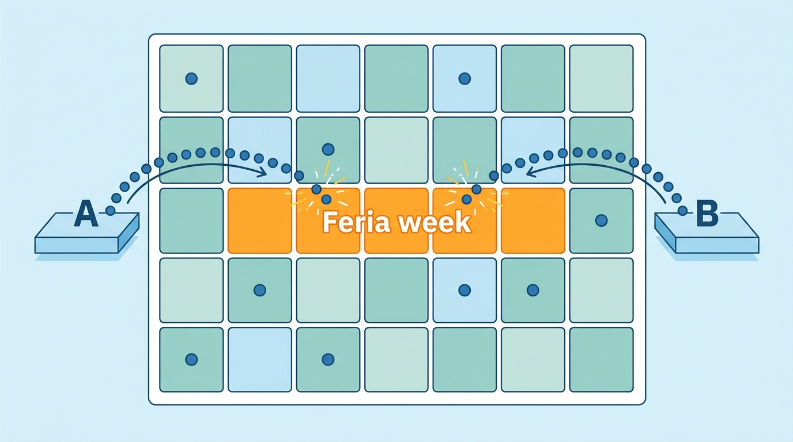
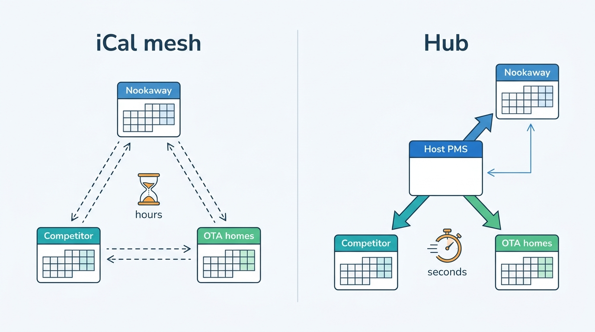
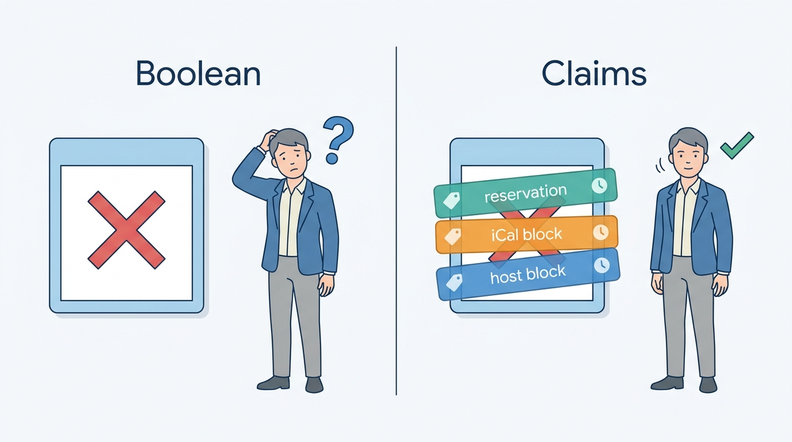
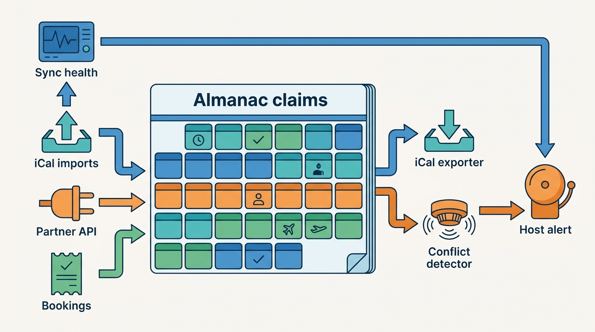
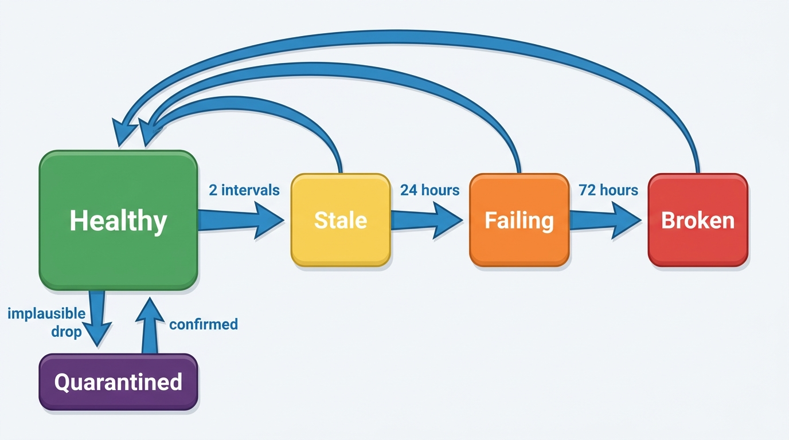
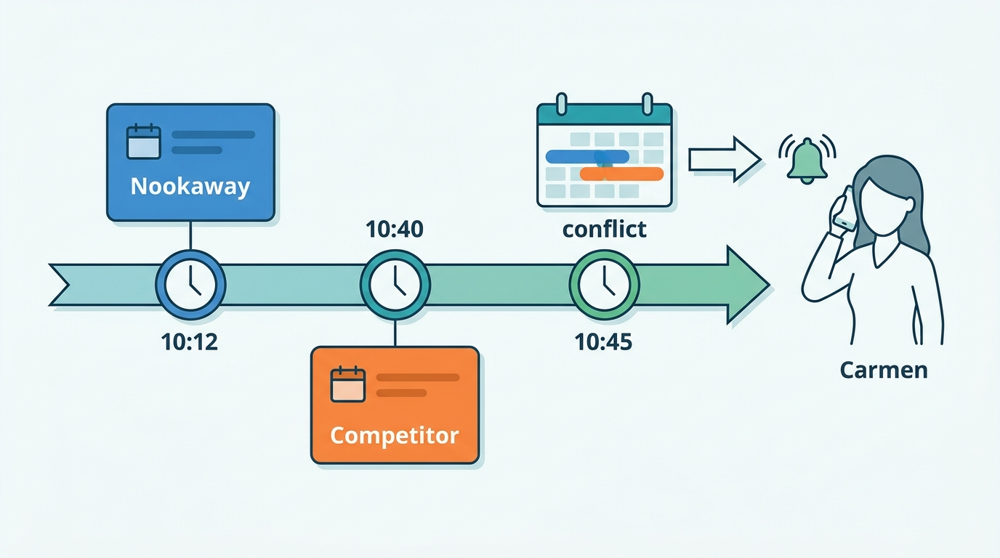

> **IN THIS CHAPTER, YOU WILL:** Learn why a home sold on several platforms gets double-booked, what iCalendar feeds can and cannot carry, how API-connected property-management software changes the picture, and how to design import, export, conflict detection and sync monitoring around a quantity you can measure: the conflict window.

> **WHY THE BUSINESS CARES:** Every cross-channel double booking ends in a host cancellation, a family rehoused at the marketplace's cost, and a host and a guest who both trust the platform less. The cost lands on the dates that matter most: festivals, holidays and peak summer weeks, when replacement homes are scarce and expensive.

> **WHY ARCHITECTS SHOULD CARE:** A large share of hosted-stays supply is synchronized by a file format from 2009 that the marketplace polls on its own schedule and that other platforms poll on theirs. The marketplace owns only half of every conflict window, so the architecture has to combine faster import, provenance, detection, recovery and migration to APIs. No single fix closes the window.

> **KEY POINTS:**
>
> * **iCal sync is eventually consistent by design, and the marketplace controls only half of the window.** A conflict window is the time between a booking on one platform and the moment every other platform has absorbed it. Your import interval sets the inbound half; the other platforms' polling sets the outbound half, and no amount of engineering on your side changes it.
> * **Conflict risk scales with demand on both channels, so it concentrates on the nights that matter.** Expected conflicts grow roughly with the window times the product of the two channels' booking rates. That is why double bookings cluster on festival weeks and popular homes, where rebooking is hardest, and why adaptive polling beats uniform polling.
> * **Treat a calendar as a set of claims with provenance, not a grid of booleans.** When every blocked night records who claimed it, through which channel and when, the platform can release only what a source withdrew, refuse to read a failed fetch as "all clear", detect conflicts on import, explain a block to a host, and move a host from iCal to an API connection without losing history.

> **[FAILURE PATTERNS THIS CHAPTER ADDRESSES](where-stay-platforms-go-wrong.html):**
>
> * **The Double-Booked Night** — a home listed on several platforms and linked by polled iCal feeds will be sold twice whenever two guests book overlapping nights inside the window between polls.
> * **Connectivity Roulette** — iCal links have no contract, no acknowledgement and no health signal, so a broken or stale feed is discovered only when a guest arrives at an occupied home.
> * **The Hotel-Shaped Home** — a platform that treats a one-unit home like a hotel room type (tolerating oversell, reopening canceled nights automatically, relying on relocation) imports hotel habits into a world with no second room.

 
A hotel sells rooms. A host sells **one home**, and increasingly sells it in several places at once: on two or three hosted-stays marketplaces, on the homes section of an online travel agency (OTA), and on a direct-booking website. Each of those places keeps its own calendar. Every night the guest can see has to be true on all of them, and the only thing connecting many of those calendars is a URL that each platform polls every hour or every few hours.

The hotel world solved the equivalent problem with a system of record (the property-management system, PMS, or central reservation system, CRS) that pushes availability, rates and inventory (ARI) to every channel in near real time, through channel managers and certified connectivity partners ([[connectivity-and-channel-managers]]). Much of the hosted-stays world still has **no system of record outside the marketplaces themselves**. An individual host's "master calendar" is whichever platform they happen to update, and the feeds between platforms carry only busy dates, hours late.

This chapter owns **iCal sync**, the **conflict window** and the **multichannel host**. It sits between the listing model of [[property-and-listing-model]] and the host tools of [[extranets-and-host-tools]]. It shows what Nookaway's calendar service must do when the truth about a night lives partly on someone else's platform. The internal mechanics of preventing two concurrent bookings inside one platform belong to [[inventory-integrity]], and the nightly calendar data model to [[rates-and-availability-model]].

## Setting the Scene at Corvane: The Seville Double Booking

Corvane, the fictional travel group this book follows (see [[meet-corvane]]), runs Nookaway, a hosted-stays marketplace with **1.15 million** active listings. **61%** of them are also sold on other platforms. Of those multichannel listings, **47%** keep their calendars aligned by **iCal only** and **53%** through property-management or channel-manager API connections. Nookaway imports each external iCal calendar every **3 hours** by default.

Carmen Ruiz is one of the iCal-only hosts. She has rented her two-bedroom apartment in Triana, Seville, on Nookaway since 2019 and on a competing platform for the last few years. She exported Nookaway's calendar link into the competitor and imported the competitor's link into Nookaway, which is all most guides tell a host to do. Her usual nightly price is **€110**, rising to **€260** during the Feria de Abril, plus a **€60** cleaning fee.

On **2 February 2027**, this is what happened to the Feria week:

| Time (CET) | Event | What each platform believed |
| --- | --- | --- |
| 09:00 | Nookaway imports the competitor's feed | Both: 20–25 April free |
| 10:00 | The competitor imports Nookaway's feed | Both: 20–25 April free |
| 10:12 | The Bauer family from Munich books **20–25 April** on Nookaway: 5 nights × €260 = €1,300 + €60 cleaning = **€1,360** before guest fees | Nookaway: booked. Nookaway's export now shows the block. Competitor: free (has not polled) |
| 10:40 | Another guest books **21–24 April** on the competitor | Both: booked, by different guests |
| 12:00 | Nookaway imports the competitor's feed and stores a block for 21–24 April over an existing reservation | Nookaway: writes a warning on the listing calendar and e-mails Carmen; nobody at Nookaway sees it |
| 13:05 | Carmen cancels the Nookaway reservation | — |

Nookaway's guest guarantee rebooked the Bauers in a comparable apartment for **€1,780**, and Nookaway funded the **€420** difference. Carmen was charged a host cancellation fee of **€130** (10% of the nightly subtotal) from her next payout, and the canceled dates were blocked on her Nookaway calendar.

Rafael Mendes, Nookaway's VP Engineering, brought the case to Corvane's architecture forum two weeks later, with a 2026 baseline his team had assembled (the figures are illustrative, like everything about Corvane). Nookaway had recorded about **3,100** host cancellations caused by calendar conflicts in 2026, about 5 per 10,000 stayed reservations ([[inventory-integrity]] sets out the full oversell baseline). **78%**, about 2,420, came from iCal-only multichannel listings, which make up about 28% of active listings, so per listing an iCal-only home double-booked roughly nine times as often as the rest of the catalog. The guest guarantee had spent about **€1.3 million** rehousing guests.

Mariana Costa, the Group Chief Architect, pushed back on the first instinct in the room, which was "poll every five minutes". Nookaway's import had worked exactly as designed in the Seville case. Nookaway's export had shown the block within seconds. The competitor simply had not looked yet. **Polling faster would have changed nothing for the Bauers.** Her question was the one this chapter answers: **which part of the window can Nookaway shrink, which part must it survive, and what should it do in the minutes between knowing and acting?**

## Concepts: Calendars, Feeds and Windows

### The multichannel host and the system of record

A **multichannel host** sells the same home on more than one platform. The term covers a retired couple listing a cottage on two marketplaces and a property manager distributing 400 apartments to six channels, and the architecture for the two is different.

The question that sorts them is: **where is the system of record for this home's availability?**

| Host set-up | System of record | How other channels learn | Typical host |
| --- | --- | --- | --- |
| **Single-channel** | The marketplace's calendar | Nobody else needs to | Many individual hosts |
| **iCal mesh** | None: each platform is authoritative for its own bookings | Each platform polls every other platform's export feed | Individual hosts on two or three platforms |
| **Hub (PMS or channel manager)** | The host's vacation-rental PMS or channel manager | The hub pushes changes to each channel through its API and receives each channel's reservations | Professional managers, and individual hosts who pay for a tool |
| **Mixed** | The hub for API channels; iCal for the rest | Push to some channels, polling between the hub and others | Hosts with one platform that the tool does not support by API |

A vacation-rental PMS in this chapter means software that holds the property managers' own reservations, calendars, rates and guest communications, and usually bundles a channel manager. In the hotel world those are often separate companies; in vacation rentals they are usually one product ([[connectivity-and-channel-managers]] covers the hotel stack).

### What an iCalendar feed is

**iCalendar** is the calendar data format defined by [RFC 5545](https://www.rfc-editor.org/rfc/rfc5545) (IETF, September 2009), which obsoleted RFC 2445. A hosted-stays feed is a file of `VEVENT` components served over HTTPS at a long, unguessable URL. Five details of the standard matter to architects:

- **Dates are all-day and the end is exclusive.** All-day events use a `DATE` value for `DTSTART`, and `DTEND` "specifies the non-inclusive end of the event". A stay from 20 to 25 April is `DTSTART;VALUE=DATE:20270420` and `DTEND;VALUE=DATE:20270425` and blocks the nights of the 20th to the 24th. That matches the hotel convention that the departure date is not a night. Treat `DTEND` as inclusive and every booking blocks one night too many; treat it as exclusive when a producer meant inclusive and every booking leaves its last night open.
- **`UID` is the only stable key.** The standard defines it as "the persistent, globally unique identifier for the calendar component". Between two polls, the only way to know that a block was moved rather than deleted and recreated is a stable `UID`. Producers that regenerate UIDs on every export force the consumer to diff by date range.
- **`DTSTAMP` and `UID` are required in every event**, and real feeds still omit them. An Airbnb community thread from about 2020 (anecdotal, and possibly superseded) reports a Booking.com feed failing validation for a missing `DTSTAMP` ([Airbnb Community, c. 2020](https://community.withairbnb.com/t5/Help-with-your-business/iCAL-Calendar-Import-Issue-from-Booking-com/m-p/360608)). An importer needs a tolerant parser and a strict validator, and needs to know which one it is running.
- **The standard has no polling interval, no push and no acknowledgement.** RFC 5545 is a file format. Freshness is whatever schedule each consumer chooses.
- **It carries no commercial data.** No price, no minimum stay, no occupancy, no cancellation policy, no guest identity. A feed says only that some nights are busy.

The last point has a privacy history. From 1 December 2019, new Airbnb reservations exported over iCal stopped carrying the guest's name, phone number or other personal data, according to a channel-manager vendor's notice at the time ([Cloudbeds myallocator, 2019](https://myallocator.cloudbeds.com/hc/en-us/articles/360038298514-Airbnb-iCal-Announcement-and-Next-Steps-December-2019)). In 2026 the Beds24 wiki describes Airbnb's export as "blocked dates and the last four digits of the guests phone number", with no name, e-mail or price ([Beds24, n.d., live 2026](https://wiki.beds24.com/index.php/Airbnb_iCal)).

### Import and export

Every iCal link has two ends, and they have different owners.

- **Export** is the marketplace serving its own calendar as a feed for other platforms to poll. The marketplace decides what is in it and how fresh it is, but not when anyone reads it.
- **Import** is the marketplace polling a feed URL the host pasted in from another platform. The marketplace decides when to read, but not what the feed contains or whether it is correct.

Airbnb's help center, as of October 2026, states the behavior of one large importer: "Your Airbnb calendar automatically updates every 3 hours", a host can press Refresh, but "we're only able to request updates from the other website so many times", imports cover "up to 2 years of data", and "nights that you block on another calendar may or may not be blocked on Airbnb" ([Airbnb Help Center, article 99, n.d., live October 2026](https://www.airbnb.com/help/article/99)). An earlier search snippet of the same article reportedly showed "every 2 hours" (not verified), so the interval may have changed before. For Vrbo, third-party PMS vendors report an import roughly every hour and up to one to two hours in practice ([Hostaway support, 2024](https://support.hostaway.com/hc/en-us/articles/360002562114-Vrbo-Connect-via-iCal); [Smoobu support, 2024](https://support.smoobu.com/hc/en-us/articles/360007320340-Why-is-my-Vrbo-calendar-not-up-to-date)); Vrbo's own documentation of the interval was not found. A 2026 vacation-rental vendor guide puts the range across platforms at "anywhere from 15 minutes to 24 hours" ([Hostfully, 2026](https://www.hostfully.com/blog/sync-airbnb-vrbo-calendars/)).

### Conflict window and double booking

The **conflict window** for a direction A → B is the time from a booking being confirmed on platform A until platform B can no longer sell any of the booked nights:

> **window(A→B) = export lag on A + wait for B's next successful poll + B's processing time**

The window has two directions, and the marketplace owns different terms in each. For Nookaway's own bookings (Nookaway → competitor), Nookaway owns only the export lag. For bookings made elsewhere (competitor → Nookaway), Nookaway owns the poll interval and processing, and the competitor owns its export lag. With a poll interval *T*, the wait for the next poll averages *T/2* and reaches *T* in the worst case, assuming bookings arrive at random times.

A **double booking** in this book is two confirmed reservations for the same one-unit home on overlapping nights. It is a different thing from **hotel overbooking**, which is a deliberate revenue practice in which a hotel sells a few more rooms than it has, expecting no-shows ([[inventory-integrity]] owns both). A hotel that oversells by one walks a guest to a nearby hotel. A host has no second home down the corridor, so one of the two guests loses the stay and the marketplace pays to rehouse them.

### Why conflicts cluster on the best nights

A simple model, and my own rather than any company's, explains where double bookings concentrate. Let λ_A and λ_B be the rates at which guests on platforms A and B book stays that overlap a given set of nights. A conflict occurs when a booking on one platform is followed, inside the window, by an overlapping booking on the other. For small windows, the expected number of conflicts for those nights is approximately:

> **conflicts ≈ λ_A × λ_B × (window(A→B) + window(B→A))**

Two consequences follow, and both shape the design.

1. **Risk is linear in the window but quadratic in demand.** Doubling demand on both channels quadruples the conflict rate. The Feria week, a long weekend in August or a home that books within hours of opening dates carries far more risk than the average night, and those are exactly the nights for which the guest guarantee struggles to find a replacement.
2. **Halving your own poll interval halves only your half of the window.** If Nookaway polls every 3 hours (average wait 90 minutes) and the competitor every hour (average 30 minutes), the combined average window is about 120 minutes. Moving Nookaway to 15 minutes cuts it to about 37.5 minutes, a **69%** reduction. Making Nookaway's import instant would leave 30 minutes that only the competitor can remove.

**Figure 1:** *Conflict risk is linear in the window but quadratic in demand, so double bookings cluster on the best nights, such as the Feria week, when a replacement is hardest to find.*

## Architecture: The Calendar as a Set of Claims

### Topologies: mesh and hub

The first architectural fact about iCal sync is its topology. Every platform must import every other platform's feed. With *n* platforms a host needs *n × (n − 1)* links: two for two platforms, six for three, twelve for four, as Hostfully's 2026 guide counts them ([Hostfully, 2026](https://www.hostfully.com/blog/sync-airbnb-vrbo-calendars/)). Each link is polled on its importer's schedule, and each can break silently when a platform regenerates the URL.

A hub replaces the mesh with one system of record that pushes to each channel through its API, and receives each channel's bookings by webhook or polling.

**Figure 2:** *Two ways to keep one home's calendar aligned. In the iCal mesh, three platforms need six polled links and nobody holds the truth. In the hub, one system of record pushes changes and receives reservations, so the conflict window shrinks from hours to seconds.*

The hub does not make conflicts impossible. It moves them from hours to the latency of a push and a webhook, and gives the hub's vendor the job of ordering, retrying and reconciling. The hub vendors' public documentation shows those jobs are real. Hostaway's public API, for example, sends webhooks retried up to three times with exponential backoff and then an e-mail alert, and warns that "webhook events may arrive out of order", so receivers must tolerate events about entities they have not yet seen ([Hostaway API documentation, changelog to October 2026](https://api.hostaway.com/documentation)). The same API lists iCal channels (`vrboical`, `homeawayical`, `customIcal`) next to API channels for the same marketplaces, which shows that inside one widely used PMS, iCal and API connections coexist as separate, lower- and higher-fidelity channels.

### Claims, not booleans

Almanac, Nookaway's calendar service, stored one row per listing per night on PostgreSQL in 2027. A night was available or not. When the 12:00 import found a block for 21–24 April, it set those nights to unavailable, over the top of the Bauers' reservation, and appended a warning to the calendar and an e-mail to Carmen. The data model had no place to say "two different sources claim this night", so the conflict was a notification to one person, not a case anyone at Nookaway owned.

The design I recommend models a calendar as a set of **claims**. A claim is a statement that a source holds a range of nights, with provenance:

| Claim field | Example | Why it is there |
| --- | --- | --- |
| `listing_id` | Carmen's Triana apartment | The unit; for homes, the unit is the listing ([[property-and-listing-model]]) |
| `nights` | [2027-04-21, 2027-04-24) | Half-open date range, the same convention as RFC 5545 |
| `kind` | `reservation`, `host_block`, `external_block`, `rule_block`, `hold` | Reservations and holds are commercial; blocks are not |
| `source` | `nookaway`, `ical:feed-7f3a`, `partner_api:pms-118` | Who asserted it |
| `source_ref` | iCal `UID`, PMS reservation ID, Nookaway reservation ID | To update or withdraw exactly this claim later |
| `first_seen`, `last_confirmed` | 12:00, 12:00 | When the source first and last asserted it |
| `confidence` | `authoritative` or `polled` | A Nookaway reservation is authoritative; an iCal block is a polled observation |

A night is bookable when no claim covers it. Everything else follows from having provenance:

**Figure 3:** *A boolean says a night is closed; claims say who closed it and when, so a failed feed withdraws nothing and the host can be told why.*

- **Withdrawal is scoped.** When the next fetch of a feed no longer contains a `UID`, the importer withdraws only that source's claim. A host block or a Nookaway reservation on the same nights stays.
- **A failed fetch withdraws nothing.** A timeout, an HTTP 500, an HTML login page instead of a calendar, or an empty feed where the last one had 30 events is a fetch problem, not a cancellation. The claims keep their `last_confirmed` time and age.
- **Conflict detection is a query.** Two claims of kind `reservation` or `external_block` from different sources overlapping a confirmed Nookaway reservation is a conflict, detected at the moment the import writes it.
- **A host can be told why a night is closed.** "Blocked by your calendar from Competitor A, last checked 11 minutes ago" is a support conversation that does not happen.
- **Migration keeps history.** When a host moves from iCal to an API connection, the iCal claims are retired source by source rather than deleted in bulk.

Search and checkout do not read claims. They read the derived per-night availability that Almanac already serves, rebuilt from the claims whenever a claim changes; [[availability-engine]] owns that read path. The claims model sits behind the existing interface, which is what makes it a migration Nookaway can do without touching search.

### The components

**Figure 4:** *The calendar-sync components around Almanac. Imports, partner API writes and Nookaway's own bookings all become claims with provenance; the exporter, the conflict detector and the health monitor all react to the claims store, so a conflict raises a case the moment it is written.*

Each component has a narrow contract.

| Component | Responsibility | Must | Must not |
| --- | --- | --- | --- |
| **Feed scheduler** | Decide when each imported feed is next due | Prioritize by demand and recent change; respect each producer's rate limits | Poll every feed at the same fixed interval regardless of risk |
| **Fetcher** | Retrieve feeds over HTTPS | Use conditional requests (`ETag`, `If-Modified-Since`) where producers honor them; time out; block private address ranges | Follow redirects to internal hosts (an import URL is attacker-controlled input) |
| **Parser and validator** | Turn bytes into events | Accept common deviations; reject feeds that are not iCalendar; normalize all-day ranges | Expand unbounded recurrence rules |
| **Differ** | Compare this fetch with the last good one | Key by `UID`, fall back to date ranges; quarantine implausible drops | Read an empty or failed fetch as "all blocks removed" |
| **Almanac claims store** | Hold claims and derive per-night availability | Write in one transaction per listing; emit a change event | Let a polled claim overwrite an authoritative one silently |
| **iCal exporter** | Serve Nookaway's calendar as a feed | Serve from a cache invalidated by change events, within seconds; keep UIDs stable; minimize data | Expose guest identity or prices |
| **Conflict detector** | Find overlaps between sources | Open a case with both parties' details; alert the host immediately | Cancel anything automatically |
| **Sync health monitor** | Track the state of every link | Show freshness to hosts; escalate failing links; feed the metrics | Hide stale links behind "synced" |

Two rules in that table deserve emphasis because they are security rules. An import URL is typed by a host and fetched by Nookaway's servers, so the fetcher is a **server-side request forgery** surface: it must refuse private and link-local addresses, limit redirects and response sizes, and run in a network segment that cannot reach internal services. And an export URL is a **capability URL**: anyone who has it can see when the home is empty. Exports should carry no personal data, and hosts should be able to rotate the token, which breaks the link on the other side and must be explained in the host tool.

### Feed health as a state machine

An imported link is not "connected" or "disconnected". It moves through states that the host, support and the scheduler all need to see.

**Figure 5:** *The life of an imported calendar link. Stale and failing links keep their last claims rather than releasing nights; a quarantined fetch that suddenly drops most of its events changes nothing until a second fetch or the host confirms it; a broken link triggers protective measures on the listing.*

The thresholds are judgement and should be tuned on data. What matters is that **every state has a defined effect on the listing**: Healthy changes nothing, Stale is visible to the host, Failing sends a message, and Broken applies protection. In Nookaway's 2027 design (described below) that protection switches near-term dates to request-to-book, so the host confirms each booking against their other calendars.

## In Practice: What Platforms Document, and What Corvane Built

### What the large platforms say publicly

No hosted-stays marketplace has published how its calendar service stores availability, merges iCal with API updates or prevents double bookings internally. The public record is the host-facing contract, and it is instructive.

- **Airbnb** documents the importer behavior quoted above: a 3-hour automatic refresh, a rate-limited manual refresh and two years of imported data ([Airbnb Help Center, article 99](https://www.airbnb.com/help/article/99)). The same page links to a separate help article on "linking calendars for multiple Airbnb listings", for example an entire home and a room inside it, "to prevent double-bookings". The same physical space can sit under two listings on one platform, so cross-listing sync exists inside a single marketplace too.
- **Airbnb's API-connected hosts** choose between "Sync everything", where listing details come from the software, and "Sync pricing and availability", where content stays on Airbnb ([Airbnb Help Center, article 2348, n.d., live 2026](https://www.airbnb.com/help/article/2348/what-are-the-ways-i-can-sync-listings-through-my-api-connected-software)). Airbnb also warns that "changes made directly on Airbnb might override the rates or availability sent via your software" ([Airbnb Help Center, article 2965, n.d., live 2026](https://www.airbnb.com/help/article/2965)). Both systems are writable, so neither is a strict master. Access to the API runs through Airbnb's software-partner program: Airbnb named **34** Preferred Software Partners for 2024 (the current list may differ) on "integration, technical, foundational, and performance requirements" plus a data-security and API-quality review ([Airbnb Newsroom, 2024](https://news.airbnb.com/announcing-our-2024-preferred-software-partners/)).
- **Booking.com**, when a channel manager is connected, "does not allow imported iCal calendar connections to remain active", according to a February 2026 help article from the channel manager Hospitable ([Hospitable, 2026](https://help.hospitable.com/en/articles/8709568-check-for-and-disconnect-an-imported-ical-from-booking-com)). A channel-manager vendor reported in 2024 that an Airbnb listing could use iCal or the API but not both ([Beds24 wiki, 2024](https://wiki.beds24.com/index.php/AirBnB.com)); that policy has not been checked against Airbnb's current terms. Both rules express the same design choice: **one listing, one sync mechanism**, so two writers cannot fight over a night.
- **Vrbo** runs a Connectivity Partner program that rates software providers on "integration quality, connection reliability and client performance" and lists more than a hundred solutions ([Expedia Group, n.d., live 2026](https://partner.expediagroup.com/en-au/industries/vacation-rentals/vrbo-connectivity-solutions)). For integrated property managers, booking requests are accepted in the PMS, and the status can take up to 24 hours to show in the Vrbo dashboard ([Vrbo Help, n.d., live 2026](https://help.vrbo.com/articles/IPM-About-booking-requests-for-integrated-accounts)). Even an API connection has a window if one side batches.
- **Booking.com's hotel-side guidance** on overbookings lists causes such as "System outages preventing availability from being updated" and "Incorrect auto-replenishment of cancelled reservations or room nights", and explains that auto-replenishment "puts cancelled rooms back up for sale" by default ([Booking.com Connectivity, n.d., live 2026](https://developers.booking.com/connectivity/docs/con-faq-reservations-troubleshooting-overbookings)). For a hotel room type with ten rooms that is a sensible default. For a one-unit home whose host may already have resold the night elsewhere, reopening a canceled night automatically is a second writer racing the host.

> **INFERENCE, NOT DOCUMENTED:** The pattern across these sources is that large platforms treat iCal as a supported fallback with a fixed, modest refresh rate, gate API access behind certified partner programs, and prevent two sync mechanisms from writing to one listing. None of them documents conflict detection on import or adaptive polling; whether they do either internally is not public.

### Corvane's numbers: where the window comes from

Rafael's team decomposed the 2026 conflicts on iCal-only listings by direction, using host-reported booking times from the case notes where the fetch timestamps alone left the order ambiguous. About **58%** were "inbound" conflicts: the other platform booked first, and Nookaway sold the same nights before its next import. About **42%** were "outbound" conflicts like Seville: Nookaway booked first, and the other platform sold before it polled Nookaway's feed. The split mattered, because the two halves need different tools.

| Direction | Who owns the window | Nookaway tool | What it changes |
| --- | --- | --- | --- |
| **Inbound** (other platform first) | Mostly Nookaway: its poll interval | Faster, adaptive import; a re-check of imported feeds before an instant booking | Prevents many conflicts |
| **Outbound** (Nookaway first) | The other platform's poll interval | Instant export; nothing else on the import side | Prevents few; mainly detection and recovery |
| **Both** | — | Conflict detection on import; a recovery flow; moving the host to an API hub | Shortens harm; removes the window |

The cost side was concrete too. Nookaway had about **330,000** iCal-only listings (47% of the 61% of 1.15 million that are multichannel), with an average of about **1.4** imported feeds each: roughly **460,000** feeds. At a 3-hour interval that is about **3.7 million** fetches a day, around 43 per second. A uniform 15-minute interval would be about **44 million** a day, around 510 per second. That volume is not hard for Nookaway to generate. It is hard to justify to the platforms at the other end, which rate-limit refreshes, as Airbnb's own help page says it must.

### Calendar Sync v2: the 2027 design

In March 2027 the forum approved what the Nookaway team called Calendar Sync v2. It had six parts, each tied to a measured part of the window.

1. **Claims in Almanac.** The claims model above, behind Almanac's existing read interface. Existing per-night rows were back-filled as claims of unknown source, retired as each listing's sources re-asserted them.
2. **Adaptive import.** Feeds are scheduled in three tiers within a fixed daily budget. **Hot** feeds (about 10%) are polled every 15 minutes: listings with open nights in the next 60 days whose destination search demand is in the top decile, feeds that changed in the last 24 hours, and listings with a conflict in the last 90 days. **Warm** feeds (about 30%) are polled hourly. The rest stay at 3 hours. The budget is about **9.9 million** fetches a day (46,000 × 96 + 138,000 × 24 + 276,000 × 8), about **2.7 times** the old volume, against 12 times for uniform 15-minute polling.
3. **Pre-booking re-check for instant book.** When a guest instant-books an iCal-only listing whose imported feeds are older than 15 minutes, the booking service fetches those feeds before authorizing payment, with a **2-second** timeout. An overlap stops the booking with a "these dates were just taken" message. A timeout lets the booking proceed and flags it for the conflict detector. The re-check addresses the inbound half only.
4. **Conflict detection and a recovery flow.** An overlap found on import opens a case at once: the host gets a push notification and an e-mail naming both bookings, and the customer-service queue gets a case with a 60-minute target to contact the affected guest ([[customer-service]]). The flow shows the host the rule "the earlier confirmed reservation keeps the night" ([[inventory-integrity]]) and the fee for canceling it, but it cannot apply the rule mechanically. iCal does not reliably say when the other booking was made, since the optional `CREATED` property is usually absent, so Nookaway can only bound the order: the block appeared after the last fetch that did not contain it. In Seville that fetch was at 09:00, before the Bauers booked, so the order was ambiguous to Nookaway. The host confirms, under the host-cancellation rules of [[changes-and-cancellations]].
5. **Sync health for hosts.** Every imported link shows its state and last successful fetch in the host calendar ([[extranets-and-host-tools]]). A link that reaches Broken switches the listing's dates within the next 30 days to request-to-book until the host repairs it.
6. **A path to API connections.** Multichannel hosts with two or more iCal links are offered connections through certified PMS partners, including Corvane Connect. PMS-connected professional managers can already choose the host-only fee of 17%.

The team modeled the effect before building it. For the hot tier, the inbound half of the average window falls from 90 minutes to 7.5; the outbound half is unchanged. The pre-booking re-check removes most of the remaining inbound conflicts on instant-book listings, which are 68% of listings. The projection was that iCal conflicts would fall by roughly half within a year, from about 2,420 to about 1,200, and that the recovery flow would cut the average time from conflict to guest contact from hours to under an hour. Mariana insisted on publishing the projection with its weakest assumption stated: **outbound conflicts, 42% of the total, would barely move** until hosts moved to API connections or the other platforms polled faster.

### Replaying Seville under v2

Replaying 2 February under the new design is a useful honesty check.

**Figure 6:** *The Seville double booking replayed under Calendar Sync v2. The conflict still happens, because the competitor's polling decides the outbound window; what changes is that Nookaway detects it within minutes instead of hours and starts recovery before the host has noticed.*

The Feria listing would have been in the hot tier, so Nookaway would have imported the competitor's block at about 10:45, not 12:00. Nothing in v2 prevents the competitor from selling at 10:40. What changes is the next three hours. The conflict is detected **75 minutes** earlier, the case lands in a support queue with a contact target rather than in Carmen's inbox alone, and the Bauers can be offered an alternative on the same morning, when more Feria apartments are still free than at 13:05. The case did not justify v2 on prevention. It justified it on detection and recovery, and it showed that the only real fix for Carmen's Feria week was a hub.

## Trade-offs

### How a host is connected

| Option | Window | What syncs | Cost and effort | Failure mode | Right when |
| --- | --- | --- | --- | --- | --- |
| **iCal only** | Hours, set by the slowest importer | Busy dates | Free; minutes to set up | Silent staleness; echoes; double bookings on peak nights | Two platforms, low demand, a host who can tolerate occasional conflicts |
| **iCal plus protective rules** (buffers, request-to-book on near dates) | Hours, but fewer instant sales inside it | Busy dates | Free; conversion cost from request-to-book | Fewer bookings; host fatigue | iCal hosts with high-demand dates and no tool |
| **PMS or channel manager via API** | Seconds to minutes | Availability, prices, restrictions, reservations, often content and messages | Subscription; migration; mapping | Two writers if the host also edits on the marketplace; vendor outages | Three or more channels, five or more homes, or any dynamic pricing |
| **Single channel** | None | — | Lost demand from other channels | Lower occupancy | Hosts with enough demand from one platform |

### How the marketplace polls

| Polling strategy | Inbound window | Load on other platforms | Complexity | Verdict |
| --- | --- | --- | --- | --- |
| **Uniform, long** (3 h) | Average 90 min | Low | Low | Acceptable only if conflicts are rare and cheap |
| **Uniform, short** (15 min) | Average 7.5 min | 12× the baseline; likely throttled | Low | Wasteful; spends the budget on nights nobody books |
| **Adaptive by demand and change** | Short where it matters | 2–3× the baseline | Medium: needs demand signals | My default for a large marketplace |
| **Pre-booking re-check** | Near zero for instant book | Proportional to bookings | Medium: puts an external call on the booking path | Worth it for iCal-only instant-book listings, with a short timeout |

### Fail open or fail closed

The pre-booking re-check forces a choice that recurs throughout calendar sync: **when an external feed cannot be read, does the marketplace sell or not?** Failing closed means Nookaway's checkout depends on the uptime of a competitor's feed server, which no architect should accept for a core flow. Failing open means some bookings proceed on stale data. Nookaway fails open at booking time and protects at the listing level instead: a feed that stays broken for 72 hours switches near-term dates to request-to-book. **The decision belongs to the listing's state, not to one request.**

## Hotels and Homes: Where the Two Marketplaces Differ

Calendar sync is the hosted-stays counterpart of hotel connectivity, and the differences are larger than the similarities.

| Dimension | Accommodation marketplace (Roomstead) | Hosted-stays marketplace (Nookaway) |
| --- | --- | --- |
| **Unit of sync** | Inventory count per room type, rate plan and date | One bit per night per listing |
| **System of record** | The hotel's PMS or central reservation system, almost always | The host's PMS for professionals; often none for individual hosts |
| **Protocol** | Pushed ARI messages: OpenTravel XML or proprietary JSON, with certification | iCal polling for the long tail; PMS partner APIs for professionals |
| **What travels** | Availability, prices, restrictions, reservations, acknowledgements | iCal: busy dates only. API: availability, prices, reservations |
| **Typical latency** | Seconds to minutes | iCal: hours. API: seconds to minutes |
| **Who integrates** | Channel managers and PMS vendors, specialists in hotel distribution | Vacation-rental PMSs that bundle channel management, operations and messaging |
| **Consequence of a conflict** | One room oversold; the hotel walks a guest to a comparable hotel | One guest loses the home; the marketplace rehouses them, often at a premium |
| **Who pays** | Usually the hotel, under partner terms | Usually the marketplace's guarantee, partly recovered from the host |
| **Failure pattern** | Connectivity Roulette | The Double-Booked Night |
| **Regulatory angle** | Little specific to sync | Night caps and registration rules count nights across platforms that no single platform sees ([[stays-regulation]]) |

Convergence makes the table less tidy than it looks. Roomstead sells **435,000** apartments and homes, about 70% of them from professional property managers who connect through the same kind of software Nookaway's professionals use. Roomstead also offers a simple iCal import and export in Partner Hub for individual owners. Each of those homes is a room type with a quantity of one, and every hotel-world default applied to it, from automatic replenishment of canceled nights to the assumption that an oversold room can be walked, is a Hotel-Shaped Home waiting to happen. In the other direction, Nookaway's professional managers live in a hub world that looks like hotel connectivity in miniature.

**What each side can learn.** Hosted stays should take three things from hotel connectivity: a single system of record per unit, push with acknowledgement and ordering rather than polling, and certification that scores partners on reliability. The OTA side should take two things from hosted stays: treat any quantity-one product as a one-unit calendar with zero oversell tolerance, and measure the end-to-end conflict window per partner rather than per hop.

**What to share.** I would share the measurement and the operations, not the protocols. One definition of the conflict window and one set of sync-health metrics across Switchyard and Nookaway's partner API let the group compare partners and spot a channel manager that is slow for both brands. One conflict-case flow in customer service handles a walked hotel guest and a rehoused Nookaway guest with the same tooling. The adapters, the iCal machinery and the claims model stay with the brand whose supply needs them. Corvane's One Stay program already keeps connectivity unshared for now; calendar sync is a good example of why that decision is right ([[converging-two-marketplaces]] argues it in full).

## Failure Modes

These are the failures I would look for first in any calendar-sync implementation. Most are invisible until a guest stands at a door.

- **Reading a failed fetch as an empty calendar.** A timeout, a login page, a 404 after a URL change or a truncated response is parsed as "no events", and every externally blocked night reopens at once. This is the most dangerous single bug in the domain. Treat fetch failure and "zero events" as different outcomes, and quarantine large drops.
- **Off-by-one dates.** `DTEND` treated as inclusive blocks an extra night and costs the host revenue; the reverse leaves the departure night open. Date-time values with time zones instead of all-day dates add a second source of shifts around midnight. Normalize every imported range to the listing's local nights and test with feeds from every major producer.
- **Echo loops and ghost blocks.** Nookaway exports a booking; another platform imports it and re-exports it as its own block; Nookaway imports that block back. When the guest cancels, Nookaway releases its reservation but the echo returns on the next import and keeps the night closed. Hosts lose bookable nights nobody can explain. Detect echoes by matching ranges against Nookaway's own claims, and measure **blocked nights with no live source** as a metric.
- **Silent link rot.** A platform regenerates a feed URL when a listing is disconnected and reconnected, and the old link stops working. Hostfully's 2026 guide notes that hosts discover this only when a double booking occurs ([Hostfully, 2026](https://www.hostfully.com/blog/sync-airbnb-vrbo-calendars/)). The health state machine exists to make rot visible.
- **Two writers on one listing.** A host connects a PMS by API and leaves an iCal import running, or edits the marketplace calendar while the PMS also pushes. Airbnb's own help center warns that direct edits "might override the rates or availability sent via your software". Enforce one sync mechanism per listing, and show the host which system is in charge.
- **Automatic reopening of canceled nights.** A guest cancels on Nookaway, Almanac releases the nights, and the host had already blocked them elsewhere in the meantime. For one-unit homes, releasing nights should re-read the host's other claims, not assume the night is free.
- **Capability-URL leaks and request forgery.** An export link in a public spreadsheet tells anyone when a home is empty. An import field that accepts any URL lets an attacker make Nookaway's servers fetch internal addresses. Both belong in the threat model of [[travel-fraud]] and the platform security review.
- **Conflicts discovered by the guest.** Without detection on import, the first party to notice a conflict may be a family at the door. Every conflict that reaches check-in day is a protection case ([[protection-and-incidents]]) instead of a rebooking.

## The Chief Architect's View

Calendar sync looks like a small integration feature. At group level it is a decision about **where availability truth lives for one-unit supply**, and it touches revenue, cost, trust and the group's connectivity business. These are the decisions I would make explicit, with owners.

1. **Declare a calendar authority per listing.** Every Nookaway listing should carry an explicit flag: Nookaway is authoritative, a named PMS partner is authoritative, or the listing is in an iCal mesh with no authority. The flag decides which writes win, what the host can edit, and which protective rules apply. Rafael Mendes owns it for Nookaway; Aisha Rahman owns the equivalent for Roomstead's homes.
2. **Treat iCal as a supported fallback with a published service level, not as a strategy.** Set and publish the import freshness target per tier, monitor it, and fund the migration path to APIs. The group should not invest in making iCal clever beyond adaptive polling, detection and safe parsing; the window it cannot close is on other platforms' servers.
3. **Put the conflict rate on the executive dashboard.** Conflicts per 1,000 reservations by connection type, the p50 and p95 conflict window per partner and per competing platform, time from conflict to guest contact, guarantee spend on rehousing, and blocked nights with no live source. Mariana Costa owns the cross-brand definitions so that Roomstead's oversell metrics and Nookaway's conflict metrics are comparable.
4. **Keep Corvane Connect neutral.** Corvane Connect serves **8,200** vacation-rental managers with **96,000** units and distributes to Nookaway's competitors. The obvious temptation is to make it sync faster to Nookaway than to everyone else. Priyanka Shah's product would lose the trust of the managers who buy it, and the hub would stop being a credible system of record. The neutrality rule the group adopted in May 2027 for Corvane Connect and Roomstead's Switchyard ([[connectivity-and-channel-managers]]) should apply unchanged to Nookaway's partner API: the same APIs, quotas and certification as any other PMS, and Nookaway competing on the quality of that API instead.
5. **Decide who pays for conflicts, and make it visible to hosts.** The guarantee's rehousing spend, about €1.3 million in 2026, is a cost of iCal mesh supply. Host cancellation fees recover part of it. A clearer price signal, such as lower fees for API-connected multichannel hosts or protective defaults for iCal-only hosts on peak dates, is a commercial decision that the architecture should make measurable, not one it should make on its own.
6. **Watch the regulation.** Night caps and registration regimes count activity across platforms. A platform that knows only its own reservations, plus anonymous busy dates from iCal, cannot prove compliance on a host's behalf. Noor van Dijk's team should know exactly what Nookaway can and cannot attest from its calendar data ([[stays-regulation]]).

## Questions to Ask

1. For each listing, which system is the calendar authority, and is that recorded anywhere a machine can read?
2. What is our import interval today, per tier, and what is the measured p50 and p95 conflict window per competing platform and per PMS partner?
3. What happens to blocked nights when an imported feed times out, returns an error page or suddenly drops most of its events?
4. Can our calendar explain, for any closed night, which source closed it and when that source last confirmed it?
5. Do we detect an overlap between an imported block and a confirmed reservation at import time, and who is told within how many minutes?
6. How many nights are blocked with no live source behind them, and how much revenue does that represent for hosts?
7. Can a listing have two sync mechanisms writing to it at once, and what stops it?
8. Is the import fetcher protected against request forgery, and can a host rotate an exported link?
9. On instant-book listings with stale feeds, do we re-check before taking payment, and what do we do if the re-check fails?
10. What share of multichannel hosts are on API connections, what does it cost them to move, and who owns increasing it?

## From Calendars to Workspaces

The calendar tells a host what has been sold; it does not yet give them a place to run the home. Booking requests, co-hosts, turnover tasks, smart locks and the performance numbers that professional managers live by are the subject of [[extranets-and-host-tools]], the last chapter of Part II.

## Sources and Evidence

### Company engineering and investor sources

- [Sync your Airbnb calendar with other websites (article 99)](https://www.airbnb.com/help/article/99) — Airbnb Help Center, n.d., live October 2026. 3-hour automatic refresh, rate-limited manual refresh, two years imported, "may or may not be blocked", linked calendars for listings sharing a space.
- [What are my choices to sync listings through API-connected software? (article 2348)](https://www.airbnb.com/help/article/2348/what-are-the-ways-i-can-sync-listings-through-my-api-connected-software) — Airbnb Help Center, n.d., live 2026. "Sync everything" vs "Sync pricing and availability".
- [Why are rates and availability displaying incorrectly? (article 2965)](https://www.airbnb.com/help/article/2965) — Airbnb Help Center, n.d., live 2026. Direct edits can override software-sent values.
- [Announcing our 2024 Preferred Software Partners](https://news.airbnb.com/announcing-our-2024-preferred-software-partners/) — Airbnb Newsroom, 2024. 34 partners and the selection criteria.
- [Vrbo connectivity solutions](https://partner.expediagroup.com/en-au/industries/vacation-rentals/vrbo-connectivity-solutions) — Expedia Group, n.d., live 2026. Connectivity Partner program and its criteria.
- [About booking requests for integrated accounts](https://help.vrbo.com/articles/IPM-About-booking-requests-for-integrated-accounts) — Vrbo Help, n.d., live 2026. Requests decided in the PMS; status up to 24 hours to update.
- [Troubleshooting overbookings](https://developers.booking.com/connectivity/docs/con-faq-reservations-troubleshooting-overbookings) — Booking.com Connectivity, n.d., live 2026. Causes of overbooking and auto-replenishment.

### Standards, regulation and documentation

- [RFC 5545: Internet Calendaring and Scheduling Core Object Specification (iCalendar)](https://www.rfc-editor.org/rfc/rfc5545) — IETF, B. Desruisseaux (ed.), 2009. All-day dates, exclusive `DTEND`, `UID`, required properties, no transport semantics.
- [Hostaway public API documentation](https://api.hostaway.com/documentation) — Hostaway, changelog to October 2026. Webhook retries, out-of-order events, iCal and API channels side by side.

### Research and practitioner sources

- [How to sync Airbnb and Vrbo calendars](https://www.hostfully.com/blog/sync-airbnb-vrbo-calendars/) — Hostfully, 2026. 15-minute to 24-hour iCal lag, link counts for the mesh, silent link breakage.
- [Airbnb iCal](https://wiki.beds24.com/index.php/Airbnb_iCal) and [AirBnB.com](https://wiki.beds24.com/index.php/AirBnB.com) — Beds24 wiki, n.d. and 2024. Contents of Airbnb's export; iCal or API but not both (as reported in 2024).
- [Airbnb iCal announcement and next steps](https://myallocator.cloudbeds.com/hc/en-us/articles/360038298514-Airbnb-iCal-Announcement-and-Next-Steps-December-2019) — Cloudbeds myallocator, 2019. Removal of personal data from Airbnb iCal exports from 1 December 2019.
- [Check for and disconnect an imported iCal from Booking.com](https://help.hospitable.com/en/articles/8709568-check-for-and-disconnect-an-imported-ical-from-booking-com) — Hospitable, 2026. Booking.com does not allow iCal imports alongside a channel manager.
- [Vrbo: connect via iCal](https://support.hostaway.com/hc/en-us/articles/360002562114-Vrbo-Connect-via-iCal) — Hostaway support, 2024; [Why is my Vrbo calendar not up to date?](https://support.smoobu.com/hc/en-us/articles/360007320340-Why-is-my-Vrbo-calendar-not-up-to-date) — Smoobu support, 2024. Vrbo's import interval as reported by PMS vendors.
- [iCAL calendar import issue from Booking.com](https://community.withairbnb.com/t5/Help-with-your-business/iCAL-Calendar-Import-Issue-from-Booking-com/m-p/360608) — Airbnb Community, c. 2020. A producer feed failing validation for a missing `DTSTAMP` (anecdotal).

Corvane is fictional; architectural recommendations and labeled inferences are the author's judgement.
