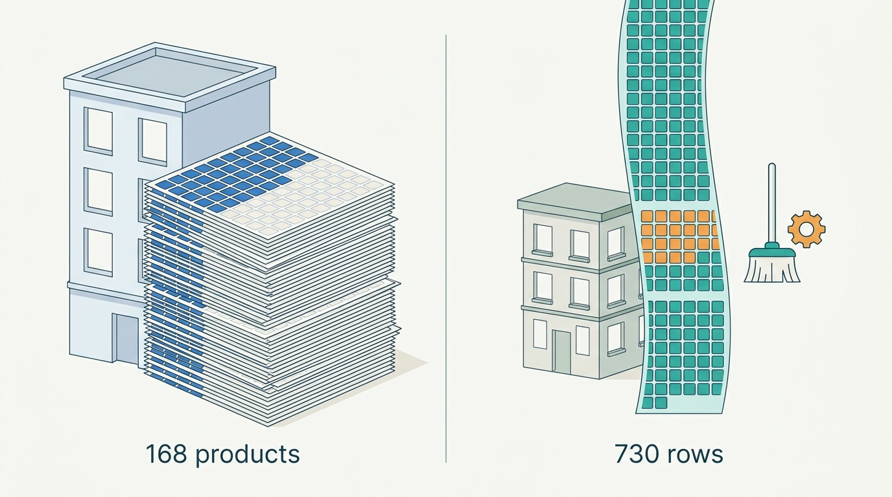
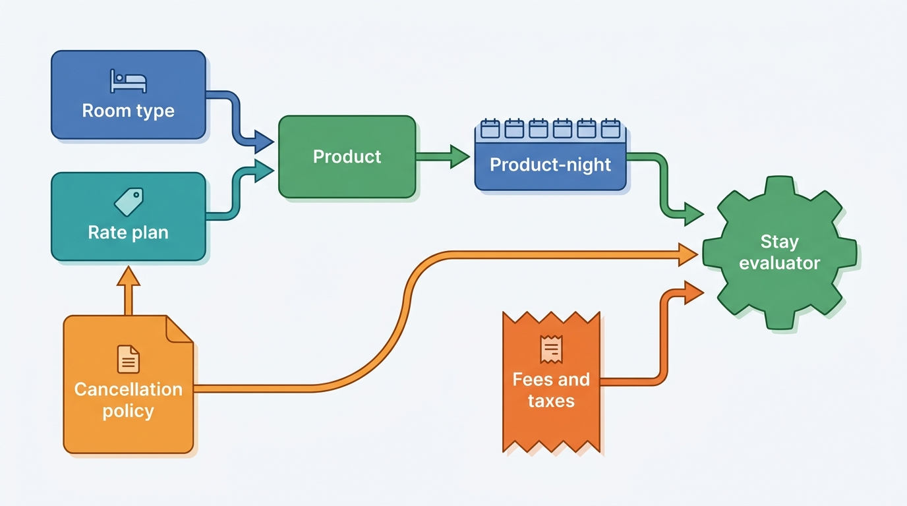
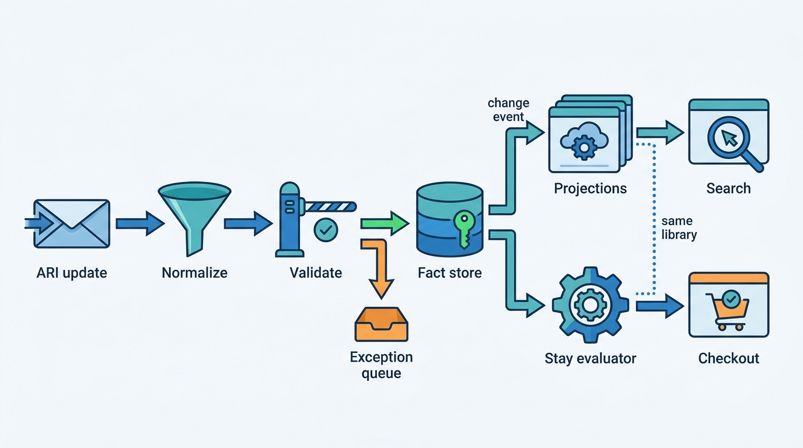
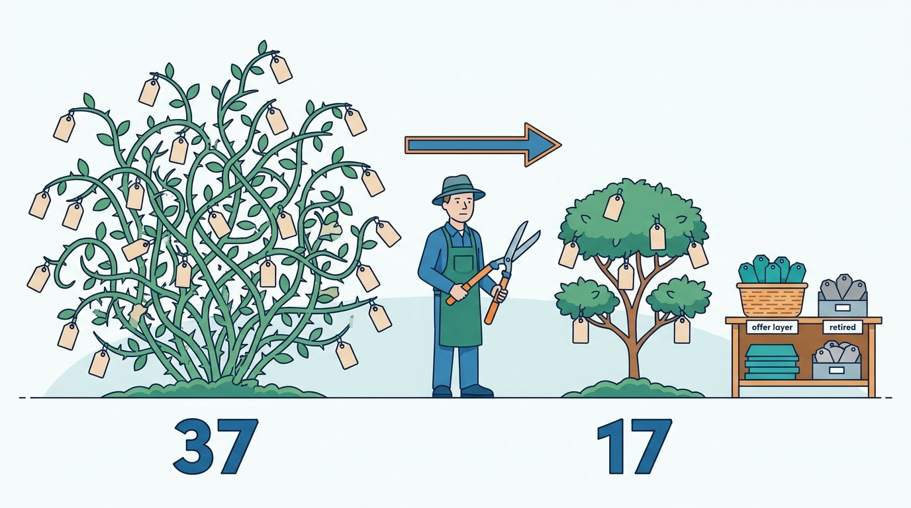

> **IN THIS CHAPTER, YOU WILL:** Take apart the ARI (availability, rates and inventory) data model of an accommodation marketplace: inventory counts, rate plans and derived rates, occupancy and length-of-stay pricing, restrictions, the cancellation policy and fees that travel with a rate, and the nightly calendar of a home. You will also compare the storage models that keep the combinations manageable.

> **WHY THE BUSINESS CARES:** Every price a guest sees, every "sold out" and every refund dispute is computed from this model. When a partner's 37 rate plans or a host's discount rules are stored ambiguously, the marketplace sells at the wrong price, hides rooms it could sell, and pays the difference in compensation, support contacts and lost metasearch traffic.

> **WHY ARCHITECTS SHOULD CARE:** ARI is the largest write-heavy dataset in a stays platform and the one every downstream system reads: search, the property page, checkout, connectivity, finance. Decisions about grain, derivation and restriction semantics made here are almost impossible to reverse later, and they decide whether one group can share an offer contract across a hotel marketplace and a homes marketplace.

> **KEY POINTS:**
>
> * **Store few facts and many rules, and know which is which.** A hotel's sellable products multiply room types by rate plans by nights by occupancies, but most of those prices are derived from a handful of independent series. Persist the independent facts and the derivation rules with defined order of operations and rounding. Audience prices (member, mobile, country) belong in the offer layer, not in more rate plans.
> * **A restriction is only as good as its semantics.** Minimum stay "on arrival" and "stay-through", closed to arrival and departure, inclusive and exclusive end dates, advance purchase: channels encode these differently, and one misread flag hides rooms or sells stays the partner never allowed. Normalize at the edge, then evaluate every stay with one shared function in search, on the property page and at checkout.
> * **Hotels and homes need different stores but one vocabulary.** A room-type product grid with inventory counts and a one-unit nightly calendar are different data shapes, and forcing either into the other fails. The restriction vocabulary, the cancellation-policy model, the fee and tax inclusion model and the stay-evaluation contract can and should be shared.

> **[FAILURE PATTERNS THIS CHAPTER ADDRESSES](where-stay-platforms-go-wrong.html):**
>
> * **Rate Plan Sprawl** — rate plans are the cheapest way to launch a commercial idea, so they accumulate until no one can say which of a hotel's 37 plans are real products and which are fences, experiments or leftovers.
> * **Price Drift** — derived rates, fees and tax inclusion evaluated in different orders by different services turn one stored price into several displayed ones.
> * **The Hotel-Shaped Home** — a room-type-and-rate-plan model forces apartments into fake rate plans and nightly cleaning surcharges, while a one-unit calendar cannot represent the hotels a homes marketplace starts to sell.

 
Before a marketplace can answer "what can I book, and for how much", it has to decide what a price *is*. For a hotel, a price belongs to a room type, a rate plan, a night, an occupancy and sometimes a length of stay; it carries a cancellation policy, a meal plan and a payment arrangement, and restrictions limit when it can be sold. For a home, a price belongs to one unit and one night, but becomes the price of a stay only after discounts, a cleaning fee, minimum nights and check-in rules are applied. **ARI** (availability, rates and inventory) is the industry's name for this whole body of supplier-controlled state.

The ARI model is the contract beneath Part III. [[availability-engine]] computes offers from it at search scale, [[inventory-integrity]] decrements it without overselling, [[dynamic-pricing]] decides the numbers that flow into it, and [[promotions-and-loyalty]] decides which discounts sit on top. This chapter owns the model itself: **ARI**, the **rate plan**, the **restriction**, **length-of-stay (LOS) pricing** and the **derived rate**. It takes the property, room type and listing entities from [[property-and-listing-model]] and the ARI messages that carry updates from [[connectivity-and-channel-managers]] and [[calendar-sync]] as given.

The central argument is that **most of what looks like ARI data is really ARI rules**. A hotel with 168 sellable products may have only a dozen prices that anyone actually chose; the rest are percentages, surcharges, fences and restrictions applied to those few facts. A model that forgets the rules cannot validate or explain the results, and one that lets each service interpret the rules its own way produces four prices for one stay.

## Setting the Scene at Corvane: Thirty-Seven Rate Plans and One Apartment

Corvane, the fictional travel group this book follows (see [[meet-corvane]]), approved its One Stay program in April 2027. One of its commitments is a common **offer contract** for both marketplaces, with separate engines underneath: Roomstead keeps Tally, its ARI store on Cassandra, and Pricegrid, its precomputed price and availability cache; Nookaway keeps Almanac, its calendar service on PostgreSQL. In May 2027 Mariana Costa, the Group Chief Architect, asked Aisha Rahman (VP Supply and Connectivity, Roomstead) and Rafael Mendes (VP Engineering, Nookaway) to bring one real property each to the architecture forum and show, field by field, what "a price for a stay" means in their systems.

Aisha brought **Hotel Miradouro**, the independent 84-room four-star hotel in Lisbon whose revenue manager, Duarte Silva, had been at the center of the €12 rate incident on 9 March ([[connectivity-and-channel-managers]] tells it): a newly mapped rate plan sent €12.00 instead of €120.00, and Roomstead's anomaly check compared each rate only with the same plan's previous value. The forum's question was broader than that bug: *why did Miradouro have a rate plan whose price Roomstead could not relate to anything else?*

Miradouro sells six room types on Roomstead: Standard Double (34 rooms), Superior Double (20), Deluxe River View (12), Twin (10), Junior Suite (6) and Family Room (2). Against them it had **37 active rate plans**, which together formed **168 active products** (a product is one room type sold under one rate plan; not every plan is open on every room type).

| Rate-plan family | Plans | How the price is set | Where the logic lives |
| --- | --- | --- | --- |
| Flexible, room only (the hotel's best available rate) | 1 | Independent: Duarte's revenue management system (RMS) sets a daily price per room type, sent through the property-management system (PMS) | RMS and PMS |
| Non-refundable | 1 | Flexible −12% | Corvane Connect (sent to Roomstead as plain prices) |
| Breakfast versions of Flexible and Non-refundable | 2 | + €16 per person per night | Corvane Connect |
| Advance purchase, 60+ days (room only and breakfast) | 2 | Flexible −18%, advance-purchase restriction | Roomstead rate relation |
| Last minute, 3 days or less | 2 | Flexible −10% | Roomstead rate relation |
| Long stay, 7+ nights | 2 | Flexible −15%, minimum stay 7 | Roomstead rate relation |
| Packages: parking, airport transfer, fado dinner, family breakfast | 4 | Independent amounts set in the PMS | PMS |
| Mobile rate | 2 | Flexible −10% | Roomstead rate relation |
| Country rates (Portugal, Spain, Brazil, United States, United Kingdom) | 5 | Flexible −5% to −8% | Roomstead rate relation |
| Roomstead Circle member rates (three tiers × Flexible and Non-refundable) | 6 | −10%, −12%, −15% | Roomstead rate relation |
| Corporate negotiated rates (three accounts) | 3 | Independent seasonal fixed prices | PMS |
| Legacy and event plans with no booking in 12 months | 7 | Four derived, three independent with prices last touched in 2025, including the flexible plan that the March remapping replaced | Mixed |

The Flexible plan was the one Corvane Connect had newly mapped before the incident; the older flexible plan it replaced was never closed and still sat among the legacy plans. Only **11** of the 37 plans carried a price that someone chose. The other **26** were arithmetic on the Flexible rate, and the arithmetic lived in three places: Corvane Connect computed three plans before sending them, Roomstead's rate relations computed nineteen, and four legacy plans had derivations nobody could find. Because Connect sent the Non-refundable and breakfast prices as ordinary numbers, Tally had no idea they were derived, and no validation could notice when one of them stopped tracking its parent.

Rafael brought **Carmen Ruiz's** two-bedroom apartment in Triana, Seville. Almanac stores one row per listing per night, so Carmen's calendar is 730 rows for a two-year horizon. Each row holds an availability flag, a nightly price (usually €110, €260 for the Feria de Abril nights), a minimum-nights value and two flags for whether check-in and check-out are allowed. A handful of listing-level settings complete the picture: a €60 cleaning fee, a 10% discount for stays of seven nights or more, a default minimum of two nights (three during the Feria), no check-ins on Sundays because her cleaner does not work that day, and the platform's moderate cancellation tier. The Bauers' Feria booking in February, 20–25 April 2027, priced at 5 × €260 + €60 = **€1,360** before guest fees, was computed from exactly these fields.

Miradouro's price for a stay lives in a grid of 168 products × 365 nights × occupancies, two-thirds of it derived; Carmen's lives in 730 rows and six settings. The One Stay offer contract had to describe both without forcing either into the other's shape. The rest of this chapter is the model the forum converged on.

**Figure 1:** *Two shapes of the same question: Miradouro's price for a stay lives in a grid of 168 products, most of it derived, while Carmen's lives in 730 calendar rows and six settings.*

## The Vocabulary of ARI

Most ARI defects are vocabulary defects: two systems use the same word for different things. The definitions below are the ones this book uses. Where a public API defines the term precisely, the definition follows it.

### Inventory, availability and the product

**Inventory** is the number of sellable units of a room type on a night. **Availability** is what a guest can actually book for given dates, occupancy and conditions after restrictions are applied. Booking.com's documentation draws the line: "Inventory is the total number of rooms a property offers for sale", while "Availability is the portion of inventory that guests can book based on their search criteria" ([Booking.com, Rates & Availability API](https://developers.booking.com/connectivity/docs/ari), n.d., fetched 2026).

A **rate plan** is a named commercial offer: a pricing logic plus conditions. Booking.com is unusually candid that the plan itself is little more than a label: "A rate plan is simply a name you use to organize prices." The cancellation policy, prepayment policy and meal plan are attached when the plan is combined with a room type into a **roomrate**, "a unique combination of room type, rate plan, and conditions" ([Booking.com, Managing rate plans](https://developers.booking.com/connectivity/docs/room-type-and-rate-plan-management/managing-rate-plans), n.d.; [Managing roomrates](https://developers.booking.com/connectivity/docs/room-type-and-rate-plan-management/managing-roomrates.md), n.d.). This book calls that combination the **product**: the thing ARI prices and restricts. As of 2026, Booking.com caps a property at 200 active rate plans and 400 active roomrates, which is itself evidence that the combinations need policing.

Where inventory is counted matters. In most hotel connectivity, **inventory is counted per room type, and every rate plan sells from the same pool**. Expedia Group's Availability and Rates API, for example, explicitly excludes "inventory count by rate plan" from its scope ([Expedia Group, Availability and Rates API introduction](https://developers.expediagroup.com/supply/lodging/docs/avail_and_rate_apis/avail_rates/getting_started/introduction), © 2025, read via an archived copy dated 2025-12-20). A rate plan is a way to *price and condition* a room, not a separate stock of rooms. The exceptions, allotments held for a specific channel or buyer, are owned by [[inventory-integrity]].

### Pricing types

A price cell means different things depending on the **pricing type**. Booking.com's API supports four, each gated behind certification ([Booking.com, Understanding pricing types](https://developers.booking.com/connectivity/docs/understanding-pricing-types), n.d.):

| Pricing type | What one stored price means | Architectural consequence |
| --- | --- | --- |
| **Standard** | The price for the room at maximum occupancy, valid for any booking with that many guests or fewer | One price per product per night; the cheapest to store and cache |
| **Derived occupancy** (Booking.com calls it rate-level occupancy) | A base price plus offsets for other occupancies | One price per night plus a small per-product offset table |
| **Occupancy-based** | A separate price for each number of guests | Price cells multiply by the number of occupancies |
| **Length of stay (LOS)** | A price per arrival date *and* stay length | The price of a stay is no longer the sum of its nights |

Expedia's Availability and Rates API lists a similar set, with rates sent as **sell** amounts or as **net** amounts after the marketplace's compensation (same Expedia source).

**LOS pricing** deserves its own warning. With per-night pricing, the price of a three-night stay is the sum of three nightly cells, so a cache can store nights and add them. With LOS pricing, the price of three nights arriving on Tuesday is an independent value, so the key must include arrival date *and* length. A product with a 365-day horizon and stays of up to 30 nights has 10,950 LOS prices instead of 365 nightly ones. Agoda's 2026 description of its price cache shows the same shape from the reading side: its Price API retrieves by "hotel, occupancy, check-in date, and check-out date", and its first migration stage held only "hot data, defined as itineraries with a length of stay between one and four days" ([Agoda Engineering, 2026](https://medium.com/agoda-engineering/how-agoda-scaled-its-price-cache-with-dragonflydb-0828e478e84f)). When the stay rather than the night is the key, the key space explodes and has to be tiered.

### Derived rates

A **derived rate** (also called a linked rate or child rate) is a rate plan whose price, and often whose restrictions and open or closed status, follows a parent plan through a rule. Booking.com models this as **rate relations**: a child can follow the parent's price (`FollowsPrice`), restrictions (`FollowsRestrictions`), policy (`FollowsPolicyGroup`) and closed status (`FollowsClosed`), with the price offset expressed as a percentage ("80 = 20% discount, 120 = 20% surplus", valid range 1–200) or a fixed amount that may be negative. An update that sets a field the child follows, such as a price on a child that follows its parent's price, is rejected ([Booking.com, Managing rate plans](https://developers.booking.com/connectivity/docs/room-type-and-rate-plan-management/managing-rate-plans), n.d.; [OTA_HotelRateAmountNotif](https://developers.booking.com/connectivity/docs/ota-rateamountnotif), n.d.).

Derived rates mirror hotel revenue management. IDeaS, a revenue management system (RMS) vendor, describes the **best available rate (BAR)** as "the base rate value that is sold to unqualified guests", generated from demand, forecast and occupancy and distributed to the PMS, the central reservation system (CRS) or a distribution system ([IDeaS, Decision controls: Pricing](https://developers.ideas.com/concepts/decisioncontrols/1pricing/), n.d.). Most other rates are fixed offsets from BAR. Duetto, a competing vendor, markets "Open Pricing" that prices segments, room types and channels independently rather than through a BAR ladder ([Duetto, Open Pricing](https://www.duettocloud.com/open-pricing), n.d.). For the marketplace's data model, the point is that **both styles arrive**, so the model must hold independently priced plans and derived plans side by side.

Derivation has an awkward property: **the order of operations changes the price**. Take Miradouro's Standard Double on a night in mid-May with a Flexible rate of €120 and two adults. The Non-refundable plan is Flexible −12%, and the breakfast supplement is €16 per person per night.

| Evaluation order | Arithmetic | Price |
| --- | --- | --- |
| Discount first, then add breakfast | €120 × 0.88 + 2 × €16 | **€137.60** |
| Add breakfast, then discount | (€120 + 2 × €16) × 0.88 | **€133.76** |

Both are defensible; the hotel must say which one it means, and the marketplace must apply it identically everywhere. If Pricegrid applies one order and the property page the other, the €3.84 difference becomes a price-accuracy mismatch. **Rounding** behaves the same way: a three-level chain rounded to the cent at each level can differ by a cent or two from the same chain rounded once, enough to fail an automated price comparison with no tolerance. Price-accuracy measurement is owned by [[availability-engine]]; the cause sits here.

### Restrictions

A **restriction** is a rule that removes availability for some stays without changing inventory. The set is well established. Booking.com's B.XML availability endpoint documents it field by field ([Booking.com, B.XML availability](https://developers.booking.com/connectivity/docs/b_xml-availability), n.d.):

| Restriction | Meaning | Evaluated against |
| --- | --- | --- |
| **Minimum stay, stay-through** (MinLOS) | Any stay that includes this night must be at least N nights | Every night of the stay |
| **Minimum stay, on arrival** | Stays arriving on this date must be at least N nights | The arrival date only |
| **Maximum stay** (MaxLOS), stay-through and on arrival | Upper bounds, same two flavors | Every night, or the arrival date |
| **Exact stay on arrival** | Arrivals on this date must stay exactly N nights | The arrival date |
| **Closed to arrival** (CTA) | No check-ins on this date | The arrival date |
| **Closed to departure** (CTD) | No check-outs on this date | The departure date (a date with no night sold) |
| **Closed** (stop-sell) | The product or room type cannot be sold on this night | Every night |
| **Advance purchase**, minimum and maximum | Booking must be made at least or at most N days before arrival | Booking date relative to arrival |

Three details on that page explain a large share of real defects. Its `to` dates are **exclusive**, while Agoda's OpenTravel implementation of `OTA_HotelAvailNotifRQ` treats `End` as **inclusive** ([Agoda Supply API](https://developer.agoda.com/supply/reference/ota_hotelavailnotifrq), n.d.). Google's Hotel Prices implementation of the same message notes that closed to arrival does not restrict the nights after check-in, and that "each type of length of stay restriction is set independently" ([Google, ARI availability](https://developers.google.com/hotels/hotel-prices/xml-reference/ari-avail), n.d.). And Booking.com warns that overlapping restrictions can make a room unbookable and that its API "neither validates them nor returns errors or warnings" for conflicts ([Booking.com, Understanding pricing types](https://developers.booking.com/connectivity/docs/understanding-pricing-types), n.d.). Channel managers add their own conventions, such as placeholder values for "no minimum" or "no maximum" instead of explicit removal.

The consequence is that a restriction on one date changes the answer for stays that merely touch it. Suppose Duarte, ahead of Lisbon's Santo António festivities in June, sets these restrictions on the Standard Double for 2027: minimum stay on arrival of 3 nights for arrivals on Saturday 12 June, minimum stay-through of 2 nights for the night of 12 June, and closed to arrival on 13 June.

| Candidate stay | Nights | Result | Why |
| --- | --- | --- | --- |
| 10 → 13 June | 3 | Bookable | Includes 12 June and is at least 2 nights; arrival on 10 June has no arrival rule |
| 11 → 13 June | 2 | Bookable | Stay-through minimum of 2 is met |
| 11 → 12 June | 1 | Bookable | Does not include the night of 12 June |
| 12 → 13 June | 1 | Not bookable | Fails both minimum-stay rules |
| 12 → 14 June | 2 | Not bookable | Arrival minimum of 3 is not met |
| 12 → 15 June | 3 | Bookable | Meets both rules |
| 13 → 15 June | 2 | Not bookable | Closed to arrival on 13 June |

A search index of "available nights" without these rules shows the 12 → 14 June stay as bookable and checkout rejects it: Phantom Availability. A system that confused stay-through with on-arrival would hide the sellable 10 → 13 June stay.

Restrictions also have different *producers* on the two sides. Hotels use them mainly as **revenue controls**, often set by an RMS that sends minimum-stay decisions alongside prices. Hosts use them as **operational controls**: Carmen's no-Sunday check-in exists because of her cleaner, not because of demand. Hosted-stays tooling adds **gap-night** logic: PriceLabs, a host pricing tool, discounts "orphan" gaps of one or two nights between bookings by default ([PriceLabs Help, Pricing customizations](https://help.pricelabs.co/portal/en/kb/articles/pricing-customizations), n.d.), and a minimum-nights rule that cannot be relaxed for such a gap leaves the nights unsellable.

### Conditions that travel with the rate

Three conditions decide what the guest is buying, and the model must carry them with the product, not in a description field.

- **Cancellation policy.** In EU law there is no statutory 14-day withdrawal right for accommodation booked for specific dates (Consumer Rights Directive, [Article 16(l)](http://publications.europa.eu/resource/celex/32011L0083), 2011), so cancellation terms are a commercial attribute of the rate, and a pricing lever: non-refundable rates are cheaper. Expedia's Rapid API represents them as data: up to three ordered time windows, each with a typed penalty (an amount, a number of nights or a percentage of the stay), plus overriding non-refundable date ranges ([Expedia Group, Constructing cancellation policies](https://developers.expediagroup.com/rapid/lodging/shopping/constructing-cancellation-policies), n.d.). The policy is frozen onto the reservation at booking; [[changes-and-cancellations]] owns what happens afterwards.
- **Meal plan** (board basis). Room only, breakfast, half board. A mismatch between the meal plan in a metasearch feed and the landing page's default is a classic price-accuracy failure.
- **Payment arrangement.** Pay at the property, prepay to the marketplace or deposit, which depends on the business model ([[merchant-and-agency-models]]). Booking.com notes that a business model cannot be assigned to a rate plan that has rate relations, a small sign of how payment terms and derivation interact.

### Fees, taxes and inclusion

The last element is the one regulators now care most about. A stored price must say **what it includes**: value-added tax (VAT) or not, city or tourist tax or not, mandatory fees (resort fees on the hotel side, cleaning fees on the homes side) or not. The US Federal Trade Commission's Rule on Unfair or Deceptive Fees, in effect since 12 May 2025, requires businesses offering short-term lodging, "including third-party platforms", to display a total price that includes all mandatory fees they can calculate upfront. Taxes may be shown separately but must be disclosed before payment ([FTC, Rule FAQ](https://www.ftc.gov/business-guidance/resources/rule-unfair-or-deceptive-fees-frequently-asked-questions), 2025). The UK's Digital Markets, Competition and Consumers Act banned drip pricing from April 2025 ([CMA, 2025](https://www.gov.uk/government/news/cma-to-boost-consumer-and-business-confidence-as-new-consumer-protection-regime-comes-into-force)), and EU guidance treats unavoidable charges added later in the purchase as potentially misleading ([Commission UCPD guidance, 2021](http://publications.europa.eu/resource/celex/52021XC1229(05))).

The ARI model's job is not to compute taxes (that is [[taxes-on-stays]]) but to store each amount with an **inclusion flag** and each fee with its **basis**: per stay, per night, per person per night, or a percentage. With those, the offer layer can build the same total everywhere. Without them, Price Drift is guaranteed, because each surface will guess.

## The Nightly Calendar: How Homes Are Priced and Restricted

A home has one unit, so the product grid collapses. The listing is the inventory; a night is either available or not. Expedia's Rapid documentation for Vrbo inventory states the contrast directly: Vrbo properties are "single-unit only" and return "a single rate plan", and its availability calendar returns, per day, an availability flag, check-in and check-out eligibility and `min_stay` and `max_stay` constraints, but no daily rates, "only an indication as to whether the property is bookable or not" ([Expedia Group, Vrbo availability calendar](https://developers.expediagroup.com/docs/products/rapid/lodging/vacation-rentals/vrbo-availability-calendar), n.d.).

The price of a stay in a home is assembled from parts that a hotel rate plan does not have:

| Element | Grain | Example from Carmen's calendar |
| --- | --- | --- |
| Nightly price | Listing × night | €110; €260 for the Feria nights |
| Length-of-stay discount | Listing, by stay length | 10% for 7+ nights; none below |
| Early-booking or last-minute discount | Listing, by lead time | None set |
| Cleaning fee | Listing, per stay | €60 |
| Minimum and maximum nights | Listing default, overridable per night | 2 by default, 3 for Feria arrivals |
| Check-in and check-out days | Listing × night | No check-in on Sundays |
| Advance notice and preparation time | Listing | One day's notice; no buffer night |
| Cancellation policy | Listing, one tier at a time | The platform's moderate tier |

Airbnb's public help pages show how these elements interact on a large platform. Smart Pricing uses "hundreds of factors about your listing and your area" within a host-set minimum and maximum; weekly, monthly and trip-length discounts "override Smart Pricing"; and price changes "will not affect pending or confirmed reservations" ([Airbnb Help Center, article 1168](https://www.airbnb.com/help/article/1168), n.d., fetched 2026). **Precedence between pricing sources is easy to get wrong**, so a homes platform needs an explicit, written precedence order: host manual override, automatic pricing, a third-party pricing tool writing through an API, then discounts and fees. It also needs the ability to tell a host which source set tonight's price.

Two things make the homes calendar harder than it looks. First, **the source of truth is often elsewhere**. A host on several platforms syncs blocked dates through iCalendar (RFC 5545) files that carry no price, rate plan or restriction, or through a vacation-rental PMS that writes prices and availability through an API. Nookaway's calendar therefore holds nights whose state came from different sources with different confidence, and each row needs a **source** field; [[calendar-sync]] owns the sync itself. Second, the price is a **stay-level computation**: the cleaning fee and length-of-stay discounts mean the price of a stay is not the sum of nightly cells, which is the homes-side equivalent of LOS pricing. An Expedia Group engineering post from 2021, describing its system as of the end of 2019, explained how a pricing team quoted stays per **unit** from a partitioned in-memory cache kept in sync with its pricing pipeline ([Expedia Group Technology, 2021](https://medium.com/expedia-group-tech/mongo-change-streams-in-production-97a07c7c0420)); the evidence is old and the current state is not public.

## Architecture: Definitions, Facts, Rules and One Evaluator

The model the Corvane forum converged on separates four kinds of thing that legacy ARI stores tend to mix: **definitions** (what products exist), **facts** (inventory counts, independent prices, restrictions per night), **rules** (derivations, discounts, fees) and **evaluation** (is this stay bookable, and at what price).

**Figure 2:** *The accommodation-side ARI model. Rate plans carry conditions and derivation rules, products combine them with room types, product-nights hold the facts, and a single stay evaluator turns facts, fees and policies into an answer for one stay.*

The components and their contracts:

| Component | Responsibility | Owns | Must not |
| --- | --- | --- | --- |
| **Product catalog** | Room types, rate plans, products, their lifecycle and external codes | Definitions, derivation graph, policy references | Hold prices |
| **ARI fact store** (Tally, Almanac) | Inventory counts, independent prices, restrictions per product or listing per night, each with source and version | The facts and their history of changes | Store derived prices as if they were facts |
| **Rule library** | Derivation, discounts, fees, inclusion, rounding, order of operations | Versioned, testable rules | Exist in more than one implementation |
| **Policy library** | Cancellation policies as typed windows; meal plans; payment arrangements | Policy definitions referenced by rate plans or listings | Be stored as free text only |
| **Stay evaluator** | Given product or listing, dates, occupancy, booking date and audience, return bookable or not, the price breakdown and the reasons | The one implementation of restriction and price semantics | Be reimplemented by search, the property page or checkout |
| **Projections** (Pricegrid, search indexes) | Precomputed answers for fast reading | Freshness against the change stream | Accept writes from anywhere but the change stream |

**Derived prices are rules, not facts.** Tally should store Miradouro's Flexible series and the rule "Non-refundable = Flexible × 0.88, rounded to the cent, applied before supplements". Pricegrid may materialize the result for speed, but the fact store must know that the Non-refundable price is derived. Then a validation can ask the question that would have caught the €12 rate: *is this new price plausible next to its siblings for the same room type and night?* The cost is at the edge: when a channel manager sends derived prices pre-computed, Roomstead must accept a declared derivation in the mapping, or flag the plan as "independent by declaration" and validate it more loosely.

**Every fact carries its source and version.** A channel manager's message, Duarte's edit in the Partner Hub extranet and a reservation decrement are three different events. Each row needs the source, its sequence number or timestamp, and the time Corvane received it; ordering rules belong to [[connectivity-and-channel-managers]]. The history belongs in an append-only change stream kept long enough to answer "what price was in effect when this guest searched", the question every price dispute and metasearch audit eventually asks.

**Evaluation is one function.** The stay evaluator is the most important boundary in this chapter. Search projections call it in bulk to precompute; the property page calls it to list room offers ([[property-page-and-room-selection]]); checkout calls it against the fact store to confirm ([[checkout-orchestration]]). If the restriction table above is implemented three times, it will be implemented three ways.

**Figure 3:** *The ARI write and read paths. Normalization and validation happen once at the edge; the fact store emits change events to projections; the same evaluator library computes precomputed and confirmed answers, so search and checkout disagree only by staleness, never by semantics.*

Every inbound convention (inclusive or exclusive end dates, placeholders for "no restriction", sell or net amounts, tax inclusion, currency) is converted **once**, at the gateway. After that point no service should know which channel manager a price came from. Roomstead's Switchyard gateway did this for dates but passed through tax inclusion as a per-partner flag that Pricegrid and Keystone each interpreted. That is a small example of how a "pass-through" field becomes two interpretations.

### Materialize or derive at read?

Derived rates force a choice for every projection.

| Approach | How it works | Strengths | Weaknesses |
| --- | --- | --- | --- |
| **Materialize at write** | Each parent change writes every child product-night | Fastest reads; simple caches | Write amplification; a rule change rewrites everything; stale children if a fan-out fails |
| **Derive at read** | Store parents and rules; compute children when asked | Cheap writes; rule changes are instant | More CPU on the read path; every reader needs the rule library |
| **Hybrid** | Fact store holds parents and rules; projections materialize the hot portion | Correct source, fast reads | Two places to keep consistent; needs the shared library |

At Miradouro, each morning Duarte's RMS reprices the Flexible rate for six room types across the next 120 days: 720 independent price changes. Each room type has, on average, 28 products (168 ÷ 6). If every derived product-night is materialized at write, those 720 changes become about **20,000** product-night writes for one 84-room hotel, before occupancy variants. Across a supply base that already sends Tally about **650 million** ARI messages a day, with peaks of **38,000** per second, that fan-out multiplies the write load and the lag of every projection.

My recommendation is the hybrid, with one firm rule: **the fact store never contains a derived price as a fact**. Projections may materialize whatever they need, but they compute it with the same rule library the evaluator uses, and they can be rebuilt from facts and rules at any time.

## Storage Models and the Combinatorial Explosion

The grain of ARI decides its size. The natural OTA grain is property × room type × rate plan × night, with occupancy and length of stay as further dimensions for some pricing types. Four storage models are in common use, and real systems mix them.

| Storage model | Shape | Fits | Fails when |
| --- | --- | --- | --- |
| **Per-date rows** | One row per product (or listing) per night | Homes; hotels with per-night pricing; simple point updates and locks | Horizons are long and products many: row counts explode |
| **Date ranges** | One row per product per run of identical values (start, end, value) | ARI messages, which arrive as ranges; compact storage of stable restrictions | Prices change daily; every update splits ranges, and range arithmetic is a defect source |
| **LOS matrix** | One price per product per arrival date per stay length | Suppliers that price stays, not nights; stay-level quotes | The matrix is 10–30 times larger than nightly storage and must be tiered |
| **Rules over base series** | Store independent series; compute everything else | Derived rates, member and audience prices, discounts | Readers do not share the rule library |

Roomstead's numbers show why the choice matters. If Roomstead's 205,000 hotels average 24 products and its 435,000 apartments and homes average 2, Tally holds about **5.8 million** active products, and a one-year horizon of nightly rows is about **2.1 billion** product-nights, before occupancy prices. Nookaway's Almanac, with **1.15 million** listings and a two-year horizon, holds about **840 million** listing-nights. Almanac's per-row model is right for homes: a night is the unit of locking, and a row per night makes the availability check and the double-booking guard simple. Tally's per-date rows on Cassandra are right for writes. But storing derived products as rows multiplies the hotel number by the derivation fan-out, which is the cost the hybrid avoids.

Two further points apply to every model. **Horizon is a product decision with a storage price**: as of 2026, Booking.com recommends partners load availability at least 12 months ahead and accepts dates up to five years out, and Expedia accepts room counts up to two years ahead. The sparse far horizon suits range storage; the next 120 days, where prices change daily and searches concentrate, suit per-date rows and materialized projections. And **short stays dominate**: as Agoda's tiering shows, a platform can store LOS prices only for the stay lengths that are actually searched and compute the rest, as long as the evaluator knows which it is serving.

## In Practice: What the Public Record Shows

The public record on ARI is good for the supply-facing side and thin for the internals. Partner APIs constrain what an internal model must represent, but they do not describe it, and nothing below should be read as a description of any company's internal storage.

**Booking.com's connectivity documentation** (undated developer pages, fetched in 2026) is the most complete public statement of the OTA model. Beyond the definitions, deactivating a room type deactivates every roomrate built on it, so ARI attaches to the product rather than the rate plan.

**Expedia Group's supply and Rapid APIs** show both sides of the model. The supply API counts inventory per room type and manages deposits, cancellation policies and fees elsewhere, so the full price of a stay is assembled from several stores. Its Vrbo inventory is single-unit with a per-day calendar. That is the clearest public evidence that one group serving both marketplace types keeps two shapes of availability.

**Agoda's 2026 price-cache post** shows ARI from the reading side: the cache took roughly 1.5 million writes per second against about 300,000 reads, keyed by hotel, occupancy, check-in and check-out ([Agoda Engineering, 2026](https://medium.com/agoda-engineering/how-agoda-scaled-its-price-cache-with-dragonflydb-0828e478e84f)). Supplier updates arrive whether or not anyone searches, so the load is write-dominated, and the key is the stay, not the night.

**Google's Hotel Center** price-accuracy policy requires that "taxes and fees must represent all mandatory charges" and "must not be manipulated to create an artificially low base rate" ([Google Hotel Center, Price Accuracy Policy](https://support.google.com/hotelprices/answer/6064419?hl=en), n.d.). Inclusion flags in the ARI model are what make that achievable.

**Airbnb** has not described its calendar storage or concurrency control publicly. What is public is host-facing behavior: iCal imports refresh every three hours, host rules (preparation time, advance notice, minimum stays) are calendar inputs, and Smart Pricing's precedence against discounts is documented ([Airbnb Help Center, articles 99 and 1168](https://www.airbnb.com/help/article/99), n.d.). Its 2018 KDD paper on dynamic pricing noted that "there are no 'identical' products on Airbnb", the property that makes a homes calendar a per-unit model rather than a product grid ([Ye et al., KDD 2018](https://www.kdd.org/kdd2018/accepted-papers/view/customized-regression-model-for-airbnb-dynamic-pricing)); that evidence is from 2018, and the current pricing system is not public.

> **INFERENCE, NOT DOCUMENTED:** A plausible reference architecture for a large OTA, consistent with these partner APIs but not a description of any company's systems, keeps an internal product catalog with derivation rules, a write-optimized per-night fact store fed by normalized ARI messages, and itinerary-keyed price caches for search. A homes platform keeps a per-listing-night calendar with a transactional guard at booking and computes stay quotes per unit.

## Worked Example: Pruning Hotel Miradouro

The forum's first output was a rule for what may be a rate plan at Roomstead, worked through on Miradouro before it was applied to anyone else. The migration itself is planned for the first quarter of 2028, after the Roomstead Circle overlay work described in [[promotions-and-loyalty]]; until then Miradouro keeps its 37 plans. A rate plan is justified only if it changes **what the guest buys**: the cancellation terms, the meal plan or package content, the payment arrangement, or the length-of-stay and booking-window conditions. A price that varies only by **who is asking** (member tier, device, country) is an audience condition and belongs in the offer layer owned by [[promotions-and-loyalty]], evaluated by the same stay evaluator with the guest's audience as an input.

Applied to Miradouro's 37 plans:

| Disposition | Plans | Which |
| --- | --- | --- |
| Keep as independent rate plans | 8 | Flexible; four packages; three corporate accounts (as closed plans visible only to those accounts) |
| Keep as derived rate plans, derivation declared in the catalog | 9 | Non-refundable; two breakfast versions; two advance purchase; two last minute; two long stay |
| Convert to audience conditions in the offer layer | 13 | Two mobile; five country; six Circle member |
| Retire | 7 | Legacy and event plans with no booking in 12 months |

Under the plan, Miradouro goes from **37 rate plans to 17**, and from 168 products to **74**. Nothing a guest can buy disappears: a Circle 3 member still sees 15% off the Flexible and Non-refundable rates, but as a condition evaluated at offer time on two products instead of as six extra products per room type that Tally must store, Corvane Connect must map and Pricegrid must cache. The three derivations that Corvane Connect used to compute before sending are now declared in the Roomstead catalog. Connect sends only the Flexible series for those plans, and Roomstead's validation can relate every price to its parent.

**Figure 4:** *Pruning by one rule: Miradouro keeps the plans that change what the guest buys, moves member, mobile and country prices to the offer layer and retires the rest, going from 37 rate plans to 17.*

The Non-refundable breakfast question was settled in the catalog, not in code: Miradouro's rule is "discount first, then supplements", so the €120 night is €137.60 for two, everywhere. That case, the Santo António restriction table and a dozen others are fixtures that search, the property page and checkout run in their build pipelines.

Across Roomstead, an illustrative sample of connected hotels showed about a third of active rate plans with no booking in twelve months and roughly another third that were audience fences. Aisha's team set a target of retiring unused plans automatically after notice to the partner, and of moving member, mobile and country prices to offer-layer conditions by the end of 2028.

## Trade-offs

| Decision | Option A | Option B | When A is right | When B is right |
| --- | --- | --- | --- | --- |
| Where audience prices live | As rate plans (one per tier, device, country) | As conditions evaluated in the offer layer | The channel or metasearch partner can only consume rate plans, and the variants are few | Variants multiply across room types, and the same discount must be applied consistently on every surface |
| Derived prices | Materialized at write | Stored as rules, derived at read or in projections | Read latency budgets are tight and rule changes are rare | Derivations are many, rule changes are frequent, or validation must relate children to parents |
| Price grain | Per night, summed | Per stay (LOS matrix or stay-level quote) | Suppliers price nights; stays are mostly short; no stay-level fees | Suppliers price stays; cleaning fees or LOS discounts make the stay price non-additive |
| Restriction storage | Per night | As ranges | Restrictions change often and are evaluated per night | Restrictions are long-lived and the horizon is far |
| Inclusion handling | Normalize all prices to one inclusion basis at the edge | Store as received with inclusion flags | Few markets, one tax regime | Many markets, several display regimes; the offer layer must build different totals by market |

On the last row, normalizing at the edge looks cleaner, but display rules differ by market, and a price stripped of its original inclusion basis cannot always be reconstructed. I would store the amount as received with explicit flags and normalize only the *representation* (currency precision, date convention), leaving composition to the evaluator.

## Hotels and Homes: Where the Two Marketplaces Differ

| Dimension | Accommodation marketplace (Roomstead) | Hosted-stays marketplace (Nookaway) |
| --- | --- | --- |
| **What is priced** | A product: room type × rate plan, per night and occupancy, sometimes per stay length | A listing-night, then a stay quote with discounts and fees |
| **Inventory** | A count per room type per night, shared by rate plans; hotels may deliberately oversell | Zero or one; any double sale is a failure |
| **Who sets the price** | The hotel, usually through an RMS, PMS or channel manager; the marketplace receives it | The host, automatic pricing or a third-party tool; the marketplace often suggests it ([[dynamic-pricing]]) |
| **Price variants** | Many rate plans: cancellation, board, packages, booking window, fences | One nightly price plus LOS and lead-time discounts and a cleaning fee |
| **Restrictions** | Revenue controls from an RMS: stay-through and arrival minimums, CTA and CTD, advance purchase | Operational controls from a person: minimum nights, check-in days, preparation time, gap nights |
| **Cancellation policy** | Per rate plan; several at once for the same room | Per listing; one tier at a time |
| **Mandatory fees** | Resort fees, city taxes collected at the property | Cleaning fee, platform service fee, tourist tax |
| **Source of truth** | Usually the hotel's PMS or CRS, pushed as ARI messages | Often the marketplace calendar; a PMS for professional managers; iCal for many multichannel hosts |
| **Natural storage** | Per-night facts plus derivation rules; itinerary-keyed caches | Per-listing-night rows; stay quotes computed on demand |
| **Typical failure** | Rate Plan Sprawl; derived prices that drift from their parents | Double bookings across channels; unsellable gap nights |
| **Regulatory exposure** | Total-price rules on resort fees and taxes; parity rules on cross-channel pricing | Total-price rules on cleaning and service fees; registration-based eligibility per night |

Corvane's two marketplaces already blur the line, as real ones do: Roomstead sells 435,000 apartments and homes, and Nookaway plans to pilot boutique hotels in 2028. Roomstead represents an apartment as a room type with a quantity of one, as public OTA APIs do, until a manager's €60 cleaning fee has no home in Tally and is folded into the nightly price, so long stays look overpriced: The Hotel-Shaped Home in its most common form. Almanac, in turn, has no concept of eight identical rooms, so a boutique hotel would become eight listings competing in search unless it runs on another engine.

The judgement I would defend at a design review is this. **Share the vocabulary and the evaluator contract; do not share the store.** One restriction vocabulary (with stay-through and on-arrival semantics, inclusive and exclusive dates resolved once), one cancellation-policy model as typed windows, one fee and tax model with bases and inclusion flags, and one stay-evaluator interface, with an implementation per engine and a shared conformance suite. Below that line, Tally stays a product grid and Almanac stays a calendar, because their write patterns, locking needs and sizes are different. That is the One Stay decision of "shared contracts, separate engines" applied to ARI, and [[converging-two-marketplaces]] argues it at group level.

## Failure Modes

- **Rate plans as the universal extension point.** Every commercial idea becomes a plan, each cheap to add and invisible to remove, until mapping errors grow with the count. The fix is a catalog-enforced definition of what may be a rate plan and automatic retirement of unused plans.
- **Derived prices sent as facts.** The marketplace loses the relation and cannot validate. The €12 rate is one outcome; a child that silently stops following its parent after a mapping change is the commoner one.
- **Two interpretations of one restriction.** Stay-through read as on-arrival, an inclusive end date read as exclusive, a "999" placeholder read as a real maximum stay. The cure is normalization once at the edge and one evaluator.
- **Restriction conflicts nobody sees.** A minimum stay of 3 on arrival combined with closed to departure on the third day makes a date unsellable. APIs often accept such conflicts silently. A validation that searches for dates where no valid stay exists, and reports them to the partner in the extranet ([[extranets-and-host-tools]]), recovers revenue the partner did not know it was losing.
- **Inclusion guessed downstream.** A price without a flag for VAT, city tax or mandatory fees is interpreted differently by search and checkout, producing Price Drift and regulatory exposure under total-price rules.
- **No history.** A fact store that keeps only current values cannot answer what price a guest saw an hour ago, so price disputes and metasearch audits become arguments rather than lookups.

## The Chief Architect's View

The ARI model is one of the few places where a group architect should **own a vocabulary directly** rather than delegate it to the brand teams. The decisions I would put on the record:

1. **One ARI vocabulary across the group**, maintained by group architecture with Roomstead supply and Nookaway engineering: the restriction set and its semantics, the internal date convention, the pricing types, the cancellation-policy model, fee bases and inclusion flags. Brand teams may support a subset (Almanac has no closed-to-departure today), but they may not redefine a term.
2. **A definition of what may be a rate plan**, owned by the Roomstead product lead for supply with Aisha Rahman as the approver, and enforced in the product catalog: conditions and content, yes; audience, no. Every new plan type goes through the same review as an API change.
3. **The stay evaluator as a governed contract**, with a conformance suite of fixtures that every engine and every projection runs. A failing fixture blocks a release in the same way a failing payment test does.
4. **Derivation and rounding as catalog data**, not code, versioned and visible to partners and hosts in the extranet so they can see why a child plan shows the price it does.
5. **Retention of ARI change history** long enough for disputes, metasearch audits and regulator questions; Corvane's forum set 13 months for the change stream.

The metrics I would watch: active rate plans per property and the share with no bookings (sprawl); the share of derived prices whose derivation is declared (catalog health); fixture failures per release (semantic drift); the share of Nookaway listing-nights from a low-confidence source (calendar risk); and dates where no valid stay exists (restrictions that cost partners money). The long-term risk to manage is that the shared vocabulary hardens into the lowest common denominator. When Nookaway needs a concept such as gap-night relaxation, it should enter the vocabulary, not live as a Nookaway-only flag that Roomstead's apartments cannot use.

## Questions to Ask

1. For one property, how many active rate plans and products do we hold, and how many of their prices did a person or a revenue system actually choose?
2. Which of our rate plans differ only by who is asking, and could they be audience conditions instead?
3. Where does derivation happen: in the PMS, in the channel manager, in our catalog, or in more than one place? Do we know which prices are derived?
4. Is the order of operations and rounding for derived prices, discounts and supplements written down, and do search, the property page and checkout use the same implementation?
5. Do we distinguish stay-through from on-arrival minimum stays, and inclusive from exclusive end dates, at the gateway? Show the test that proves it.
6. Can we list the dates on which no valid stay exists for a product because of conflicting restrictions, and do we tell the partner?
7. Does every stored price carry its inclusion basis for VAT, local taxes and mandatory fees, and can we build a compliant total for every market from it?
8. For homes, where do cleaning fees and length-of-stay discounts live, and is the stay quote computed by the same code in search and at checkout?
9. If the homes marketplace started selling a hotel tomorrow, or the hotel marketplace a home, which fields would we have to fake?

This chapter decided what a price for a stay *means*. [[availability-engine]] takes up the operational question: how to answer "what can I book, and for how much" tens of thousands of times a second from these facts and rules, and how stale the answer may be before Phantom Availability begins.

## Sources and Evidence

*Company engineering and investor sources*

- [How Agoda Scaled Its Price Cache with DragonflyDB](https://medium.com/agoda-engineering/how-agoda-scaled-its-price-cache-with-dragonflydb-0828e478e84f) — Agoda Engineering (Clarkson Chang), 2026. Itinerary-keyed price cache, write-dominated load, tiering on stays of one to four nights.
- [Mongo Change Streams in Production](https://medium.com/expedia-group-tech/mongo-change-streams-in-production-97a07c7c0420) — Expedia Group Technology, 2021 (describes the system at the end of 2019). Unit-level quoting cache kept in sync with a pricing pipeline.

*Standards, regulation and documentation*

- [Rates & Availability API overview](https://developers.booking.com/connectivity/docs/ari) — Booking.com Developers, n.d. (fetched 2026). Inventory versus availability; pricing types and certification.
- [Understanding pricing types](https://developers.booking.com/connectivity/docs/understanding-pricing-types) — Booking.com Developers, n.d. Standard, derived occupancy, occupancy-based and LOS pricing; unvalidated restriction conflicts.
- [Managing rate plans](https://developers.booking.com/connectivity/docs/room-type-and-rate-plan-management/managing-rate-plans) and [Managing roomrates](https://developers.booking.com/connectivity/docs/room-type-and-rate-plan-management/managing-roomrates.md) — Booking.com Developers, n.d. Rate plan versus roomrate; rate relations; product caps.
- [B.XML availability](https://developers.booking.com/connectivity/docs/b_xml-availability) and [OTA_HotelRateAmountNotif](https://developers.booking.com/connectivity/docs/ota-rateamountnotif) — Booking.com Developers, n.d. Restriction fields, exclusive end dates, horizon, update rules for derived plans.
- [OTA_HotelAvailNotifRQ](https://developer.agoda.com/supply/reference/ota_hotelavailnotifrq) — Agoda Supply API, n.d. OpenTravel restriction encoding with inclusive end dates.
- [ARI availability (OTA_HotelAvailNotifRQ)](https://developers.google.com/hotels/hotel-prices/xml-reference/ari-avail) — Google Hotel Prices, n.d. Delta semantics and closed-to-arrival behavior.
- [Price Accuracy Policy](https://support.google.com/hotelprices/answer/6064419?hl=en) — Google Hotel Center Help, n.d. Mandatory taxes and fees in advertised prices.
- [Availability and Rates API introduction](https://developers.expediagroup.com/supply/lodging/docs/avail_and_rate_apis/avail_rates/getting_started/introduction) — Expedia Group, © 2025 (archived copy 2025-12-20). Inventory per room type, pricing models, sell and net rates, scope exclusions.
- [Constructing cancellation policies](https://developers.expediagroup.com/rapid/lodging/shopping/constructing-cancellation-policies) — Expedia Group Rapid, n.d. Cancellation as typed windows.
- [Vrbo availability calendar](https://developers.expediagroup.com/docs/products/rapid/lodging/vacation-rentals/vrbo-availability-calendar) — Expedia Group Rapid, n.d. Single-unit calendar with check-in and check-out validity and stay constraints.
- [Sync your calendar (article 99)](https://www.airbnb.com/help/article/99) and [Smart Pricing (article 1168)](https://www.airbnb.com/help/article/1168) — Airbnb Help Center, n.d. (fetched 2026). iCal refresh, host calendar rules, pricing precedence.
- [Decision controls: Pricing](https://developers.ideas.com/concepts/decisioncontrols/1pricing/) — IDeaS, n.d. Best available rate as an RMS output.
- [Open Pricing](https://www.duettocloud.com/open-pricing) — Duetto, n.d. Independent pricing as an alternative to BAR ladders (vendor positioning).
- [Pricing customizations](https://help.pricelabs.co/portal/en/kb/articles/pricing-customizations) — PriceLabs Help, n.d. Orphan-night discount defaults.
- [RFC 5545: iCalendar](https://www.rfc-editor.org/rfc/rfc5545) — IETF, 2009. The calendar format that carries busy dates but no prices or restrictions.
- [Directive 2011/83/EU (Consumer Rights Directive)](http://publications.europa.eu/resource/celex/32011L0083) — EU, 2011 (CELEX 32011L0083). Article 16(l): no withdrawal right for dated accommodation.
- [Commission guidance on the Unfair Commercial Practices Directive](http://publications.europa.eu/resource/celex/52021XC1229(05)) — European Commission, 2021. Drip pricing in travel.
- [Rule on Unfair or Deceptive Fees: FAQ](https://www.ftc.gov/business-guidance/resources/rule-unfair-or-deceptive-fees-frequently-asked-questions) — US Federal Trade Commission, 2025. Total-price display for short-term lodging from 12 May 2025.
- [New consumer protection regime comes into force](https://www.gov.uk/government/news/cma-to-boost-consumer-and-business-confidence-as-new-consumer-protection-regime-comes-into-force) — UK Competition and Markets Authority, 2025. Drip-pricing ban under the DMCC Act.

*Research and practitioner sources*

- [Customized Regression Model for Airbnb Dynamic Pricing](https://www.kdd.org/kdd2018/accepted-papers/view/customized-regression-model-for-airbnb-dynamic-pricing) — Peng Ye et al. (Airbnb), KDD, 2018. "No identical products" on a homes marketplace; per-listing-night pricing.

Corvane is fictional; architectural recommendations and labeled inferences are the author's judgement.
