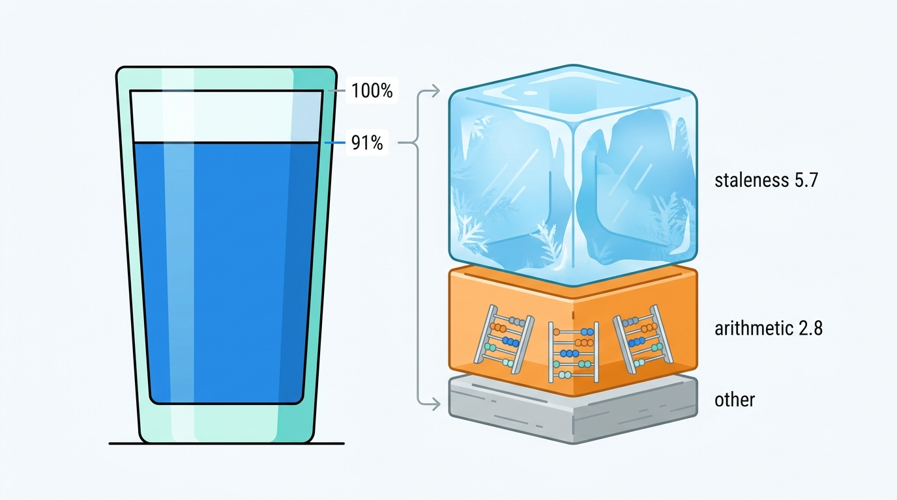
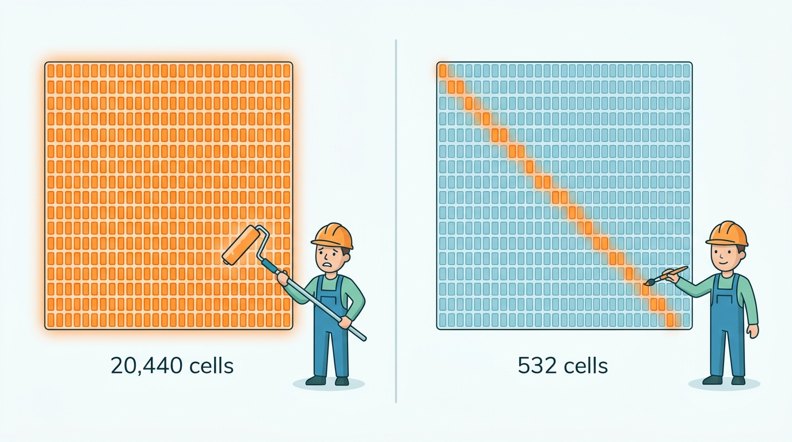
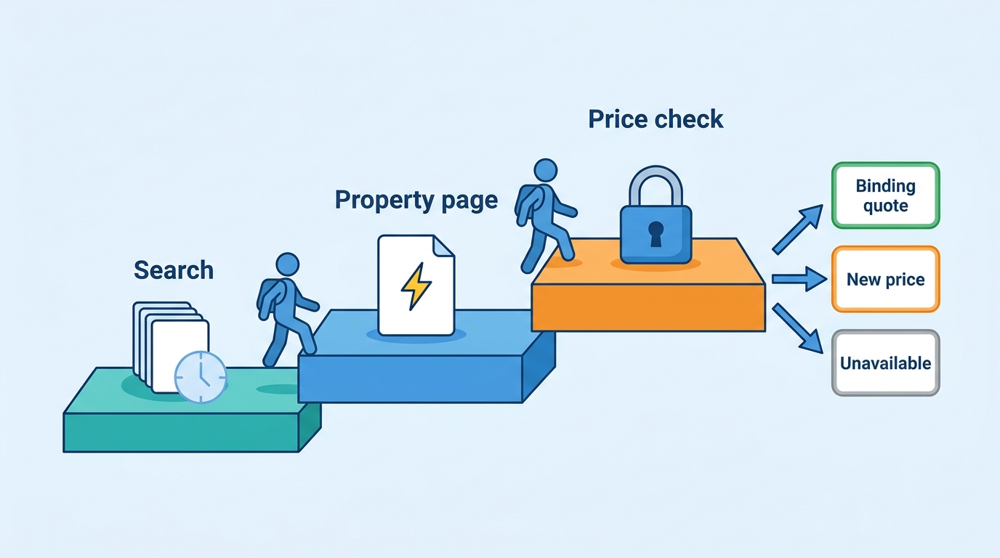
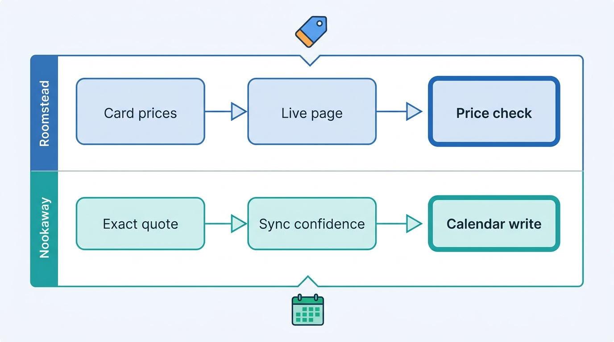

> **IN THIS CHAPTER, YOU WILL:** Take apart the availability engine: the query it answers, how an offer is computed from availability, rates and inventory, how precomputed grids, caches and live checks divide the work, and how price accuracy is defined, measured and defended from the search page to the payment.

> **WHY THE BUSINESS CARES:** Every sold-out or price-changed message at checkout is a lost booking and a small breach of trust, and metasearch engines switch off partners whose prices do not match. For an OTA that buys more than a third of its traffic through paid search and metasearch, price accuracy decides how much of that traffic it can buy at all.

> **WHY ARCHITECTS SHOULD CARE:** The availability engine carries the highest read load in a stays platform, and it carries it on data that someone else changes. Its staleness budget, its cache keys and its single offer computation decide whether search, the property page, checkout and the metasearch feed agree on a price.

> **KEY POINTS:**
>
> * **Availability search is a read model of supply, so design it for bounded staleness.** With more than a thousand shopping requests per reservation, nobody can afford to compute each offer from the system of record. The engine serves precomputed or cached offers, and the architecture decision is how stale each tier may be, how invalidation reaches the cells that matter first, and who measures it.
> * **Compute every price one way, in one kernel.** Most price mismatches are not stale data but different arithmetic. Fees, taxes, currency and member prices end up computed separately for the feed, the search page and checkout. One versioned offer-computation kernel, used by the grid builder, the live path and the price check, removes a whole class of errors that no cache tuning can fix.
> * **Measure accuracy yourself and re-check at commitment.** A sampler that re-quotes served prices against the system of record is the only honest staleness metric. A price check before booking that shows any change openly turns staleness into a designed outcome. For homes, the risk is a night that is no longer free, not a changed price, so the binding check is the calendar.

> **[FAILURE PATTERNS THIS CHAPTER ADDRESSES](where-stay-platforms-go-wrong.html):**
>
> * **Phantom Availability** — a precomputed grid that lags the ARI stream shows rooms and prices that are already gone, and "sold out" becomes a routine checkout outcome.
> * **Price Drift** — when the feed, the search page and checkout each compose fees, taxes and currency their own way, the same offer carries three prices.
> * **Built for Sunny Days** — a cache tuned for an average day loses its hit rate on peak days and event dates, when the live path behind it can least absorb the load.

 
A guest who types "Lisbon, 14–16 May, two adults" asks a question that sounds like a database lookup and is not one. To answer it, the platform must find every property and home in the area, check that **every night** of the stay is sellable for two people under each property's restrictions, compute a total price that includes fees, taxes, discounts and currency, rank the results, and do it in a few hundred milliseconds. Then again for the metasearch engine asking about one hotel, the affiliate asking about two hundred and the scraper asking about everything. Most of those questions never become a booking.

The data behind the answer belongs to someone else. On the OTA side, revenue management systems and channel managers rewrite rates and restrictions all day; Roomstead, in Corvane's example, receives about 650 million of these updates a day. On the hosted-stays side the calendar is the platform's own, but a large share of homes also sell on other platforms that the marketplace learns about hours later. **The availability engine is a read model of supply truth it does not control**, serving an audience that is mostly browsing.

This chapter owns the **availability engine**, **offer computation**, **price accuracy** and **cache staleness**. It builds on [[rates-and-availability-model]] and [[stays-marketplace-economics]], and hands the hold and the booking to [[inventory-integrity]] and [[checkout-orchestration]] and the retrieval pipeline to [[stays-search-architecture]].

## Setting the Scene at Corvane: Six Days Dark in Spain

Corvane, the fictional travel group this book follows (see [[meet-corvane]]), began 2027 with a known gap. Roomstead's metasearch price accuracy, the share of sampled prices that matched the final booking page, was **91%** in 2026 against a target of **97%**. Everyone agreed on the main cause: staleness in **Pricegrid**, Roomstead's precomputed price-and-availability cache. Pricegrid is Java with Redis and in-process caches, refreshed from change events emitted by **Tally**, the Cassandra ARI store built in 2016.

The gap stopped being abstract on **Wednesday 19 May 2027**. Roomstead's largest metasearch partner moved its Spain and Portugal points of sale (POS, the market whose users see the price) into its warning band, after its own sample found only 87% of Roomstead prices bookable as shown. For six days, until 24 May, the partner hid a share of Roomstead's itineraries for travelers in those two markets. The direct cost was modest, an estimated **€86,000** of lost commission. The exposure was not. Paid search and metasearch bring Roomstead **38%** of its sessions, and a partner that switches a channel off does not negotiate first.

Mariana Costa, Group Chief Architect since January, asked Jonas Weber (Head of Search and Ranking) and Kenji Arai (Head of Data and ML Platform) for a narrow answer: of the nine points between 91% and 100%, which came from what? Kenji's team re-quoted **2.1 million** sampled itineraries from April and May 2027 against Tally and the live checkout path, and classified every mismatch.

| Mismatch cause | Share of sampled prices | What actually happened |
| --- | --- | --- |
| **Stale price** | 3.6 points | Tally had a new rate; Pricegrid still served the old one |
| **Stale availability** | 2.1 points | The room-rate was closed or sold out in Tally; Pricegrid still showed it |
| **Fee and tax composition** | 1.4 points | Pricegrid's copy of the city-tax and fee rules disagreed with checkout's, mostly on per-person and per-night taxes |
| **Currency conversion** | 0.8 points | The feed and Pricegrid used a daily exchange-rate snapshot; the site used an hourly one, and rounded differently |
| **Member price leakage** | 0.6 points | A Roomstead Circle member price reached the public feed for some properties |
| **Other** | 0.5 points | Site errors, timeouts, and the partner's checker being blocked by Roomstead's bot defense |
| **Total** | **9.0 points** | |

Two findings reshaped the conversation. First, **only 5.7 of the 9 points were staleness**. Another 2.8 points were arithmetic: three components that each computed "the price" and did not agree. No cache tuning would fix them. Second, the staleness was not random. Lag was worst between 06:00 and 09:00 Central European Time, when hotel revenue management systems publish their overnight decisions. On **18 May**, the day before the downgrade, the 99th-percentile (P99) lag from a Tally write to an updated Pricegrid cell, normally about **90 seconds**, reached **52 minutes**.

**Figure 1:** *The 9 points between 91% and 100% had two different causes: 5.7 points of staleness that a faster grid could reduce, and 2.8 points of arithmetic that no cache tuning would fix.*

The mechanism was one design decision from 2016. When Tally emitted a change for one room-rate, Pricegrid recomputed the **whole property's grid**: every arrival date for a year, every length of stay up to 14 nights, every occupancy up to four adults, or 20,440 cells. On average a change event altered about 60 of them. On a normal day the waste was invisible. When the morning wave pushed ARI traffic toward its peak of 38,000 messages a second, recomputation fell behind and Pricegrid served yesterday's prices to the people who shop at breakfast.

Aisha Rahman (VP Supply and Connectivity, Roomstead) added a counterpoint: freshness is not correctness. On **9 March 2027** the €12 rate at Hotel Miradouro reached Pricegrid within a minute of the faulty update, and 41 reservations followed in 38 minutes ([[connectivity-and-channel-managers]] tells that story). A faster grid would have sold it faster.

So the question for the architecture forum was not "how do we make Pricegrid faster". It was **what should the availability engine promise about each price it serves, and how will we know when it breaks that promise?**

## What the Availability Engine Answers

### The availability query

An **availability query** names a set of candidates (a destination, a map viewport, a list of property or listing identifiers), a stay (arrival date and number of nights), and a party (adults, children with ages, sometimes a number of rooms). It asks, for each candidate, whether the stay is bookable for that party and at what total price. Two further inputs change the answer without appearing in the search box. The **audience** covers who is asking: logged-in member tier, country, device, the channel the request came through. The **display currency** is the guest's chosen or inferred currency.

The answer is not a fact about a room. It is an **offer**: a priced, conditioned promise to sell a specific product for a specific stay to a specific party, valid for a limited time. [[stays-bounded-contexts]] treats the offer as one of the two key aggregates of a stays platform; this chapter is about how offers are produced at scale.

### Offer computation

**Offer computation** is the function that turns ARI (availability, rates and inventory, the data model of [[rates-and-availability-model]]) into offers. For a hotel it runs roughly like this:

1. **Eligibility per night.** For each night of the stay and each room-rate (a room type combined with a rate plan), check inventory above zero and the room-rate open (no stop-sell).
2. **Stay-level restrictions.** Apply minimum and maximum length of stay (MinLOS and MaxLOS), closed to arrival (CTA) and closed to departure (CTD) on the arrival and departure dates, and advance-purchase windows. Restrictions come in "arrival" and "stay-through" variants and do not compose by simple intersection.
3. **Occupancy fit.** Check maximum occupancy and child policies, and choose the price for the party: the standard price, a derived occupancy offset, an occupancy-based price (OBP), or a length-of-stay (LOS) price where the supplier sets one value per arrival date and stay length.
4. **Nightly sum or LOS lookup.** Sum the nightly prices, or read the single LOS price.
5. **Discounts.** Apply eligible promotions, member prices and partner programs, with stacking rules ([[promotions-and-loyalty]]).
6. **Composition.** Add mandatory fees, taxes in the form the market requires, and convert to the display currency. [[taxes-on-stays]] owns tax determination; here it is one step of the arithmetic.
7. **Selection.** Keep every qualifying room-rate for the property page; keep the cheapest, or the best by some policy, as the property's **card price** for search.

For a home on a hosted-stays marketplace the same function is shorter: one unit, so availability is a yes or no per night; one nightly price per date with weekly or monthly discounts; check-in and check-out day rules, minimum nights and preparation time; a cleaning fee and platform service fees. There is no room-rate selection. The hard part shifts from combinatorics to **confidence**: whether the "free" night is really free.

Step 2 is why offers cannot be read from a per-night table. A three-night minimum "on arrival" on Friday removes two-night stays arriving Friday but not two-night stays arriving Thursday, which also cover Friday night; a "stay-through" minimum removes both. Restrictions must be evaluated per stay, not per night.

### Four prices that must be one

A guest meets an offer at least four times: in the **search card** or metasearch ad, on the **property page**, at **checkout**, and on the **card statement** or invoice. **Price accuracy** is the probability that the price shown at an earlier step equals the price charged at the final step, for the same stay, party and conditions, measured on a sample. Each pair of steps has its own accuracy; metasearch engines measure the first against the third.

Google's Hotel Center policy is the most explicit public definition. It requires that "Prices must be accurate and bookable online", compares the total on the partner's booking page with the total shown on Google in the user's currency, requires that "Taxes and fees must represent all mandatory charges", and sets no numeric tolerance above the advertised price. Scores are graded from Excellent to Failed; at Failed "Your ads and free booking links will be turned off", and individual itineraries can be hidden for inaccurate prices whatever the account score ([Google Hotel Center Help, n.d.](https://support.google.com/hotelprices/answer/6064419?hl=en)). The mismatch reasons Google reports in Hotel Center include *Room not available*, *Taxes + fees missing*, *Discount missing*, *Login missing* and *Blocked*, as reported in its help documentation (2026). Each one maps to an engineering cause that Corvane's audit found: staleness, composition, conditional-rate leakage and bot defense.

### Cache staleness, defined two ways

**Cache staleness** has two useful definitions, and a platform needs both.

- **Age-based staleness** is the time since a served value was computed from the system of record. It is cheap to measure (stamp every cell with its source version and timestamp) and useful for alerting. It says nothing about whether the value is wrong: a rate untouched for a month is old but correct.
- **Divergence-based staleness** is the probability that a served value differs from what the system of record would answer now. It is what guests and metasearch engines experience. It can only be measured by re-computing a sample from the source.

The rule I use is that **age is an engineering metric and divergence is a business metric**. Pricegrid had age dashboards for years; nobody owned divergence until a partner measured it.

### Why not compute everything live?

Because of **look-to-book**, the ratio of shopping requests to bookings ([[stays-marketplace-economics]] owns the term). Roomstead serves about **1,400 shopping requests per gross reservation**: search pages, metasearch price queries, affiliate API calls. Only about 300 of those come from its own web and apps. Each request fans out to about ten **Pricegrid reads**, which is how Roomstead reaches its average of **21,000** Pricegrid reads a second and its 2026 peak of **64,000**. If every read recomputed offers from Tally, Tally would serve a read load sized by browsing, not by booking, and every metasearch campaign would become a database capacity event.

A 2016 vendor opinion piece put hotel distributors' look-to-book at "the order of 20,000:1", mostly from automated scraping ([Hospitality Net, 2016](https://www.hospitalitynet.org/opinion/4074433.html)); the figure is old and unaudited, but the direction is not disputed. Expedia's Rapid API calculates each partner's shopping rate limits monthly, "taking into account a partner's traffic vs. revenue" ([Expedia Group, n.d.](https://developers.expediagroup.com/rapid/lodging/shopping/rate-limiting)), which is a look-to-book control in all but name.

**Look-to-book is the economic reason caches exist, and the reason they are stale.** The architecture question is never "cache or not". It is where the line between the cached answer and the binding answer falls, and how wide the gap may be.

## Architecture: A Read Model With a Staleness Budget

An availability engine has two halves that run at very different rates. The **write side** turns a stream of supply changes into precomputed offers. The **read side** answers queries from those offers, falls back to computation when they are missing, and re-checks them when a guest commits. Between the two sits the one component that must be shared, the offer-computation kernel.

**Figure 2:** *The availability engine as a read model. Change events mark only the affected cells dirty, and the grid builder recomputes them in order of demand. Queries read the grid and fall back to on-demand computation. The grid builder, the on-demand path and the price check all call the same versioned offer kernel, and a sampler measures how often the served offer differs from the system of record.*

### Components and their contracts

| Component | Responsibility | Owns | Must not |
| --- | --- | --- | --- |
| **ARI store** (Tally at Roomstead, Almanac at Nookaway) | Hold the current availability, rates and restrictions; emit ordered change events | The truth about supply, version numbers | Answer browsing traffic |
| **Change fan-out** | Translate "night *d* of room-rate *r* changed" into the set of offer cells whose answer may have changed | The dependency rules (which arrivals and lengths of stay cover a night) | Recompute anything; it only marks cells |
| **Grid builder** | Recompute dirty cells with the offer kernel, highest demand first; coalesce repeated changes | Recompute throughput, freshness lag per tier | Implement its own pricing rules |
| **Precomputed grid** | Serve card prices and availability for the hot window at low latency | Cell values with source version and compute timestamp | Pretend to be authoritative |
| **Offer API** | Answer batch queries; route misses; apply cheap read-time transforms (currency, audience) | Latency budget, degradation modes | Return an offer without its validity and version stamp |
| **On-demand computation** | Compute offers for cells outside the grid: long stays, large parties, far dates | Fallback correctness and cost | Write results back without the source version |
| **Offer kernel** | The single implementation of offer computation: restrictions, occupancy, discounts, fees, taxes, currency | The rule set and its version | Exist in more than one copy |
| **Price check** | Re-compute the selected offer from the system of record at checkout and classify the result | The binding quote and its validity window | Raise a price silently |
| **Accuracy sampler** | Re-quote a random sample of served offers and record divergence by cause | The divergence metric and its breakdown | Sample only the cache it is measuring |

**The offer kernel exists once.** Corvane's 2.8 points of arithmetic came from Pricegrid, Keystone's checkout and the feed exporter each implementing fees, taxes, currency or member eligibility. The fix is one library or service with one versioned rule set, called by every path that shows a price. Cells carry the kernel version, so a rule change (a new city tax from 1 January) marks cells dirty like any ARI change.

**The fan-out marks cells; it does not recompute.** Separating "what might have changed" from "recompute it" lets the builder prioritize. A change to night *d* affects stays that cover *d*: with stays of up to 14 nights, at most 105 combinations of arrival and length per occupancy, not a property's whole year.

**Every offer carries its provenance**: the ARI and kernel versions that produced it, when, and until when it is valid. Without that, the price check cannot tell a stale cache from a supplier change, and the sampler cannot attribute divergence.

### What to precompute: the cell and its key

The most consequential design choice in an availability engine is the **cell**: the unit the grid stores and the key it is stored under. Every dimension in the key multiplies the grid; every dimension left out must be computed at read time.

| Key dimension | Precompute it? | Reasoning |
| --- | --- | --- |
| Property or listing | Yes | The unit of retrieval and ranking |
| Arrival date | Yes, within a horizon | Demand concentrates in the next few months; far dates go on-demand |
| Length of stay | Yes, for short stays | Needed because restrictions and LOS pricing make stay totals non-additive; stays of one to seven nights dominate demand |
| Occupancy | Yes, for common parties | Occupancy-based and derived pricing change the price; one to four adults covers most searches |
| Room-rate | Usually no: keep the best offer per property, plus the room-rate that produced it | Full room-rate detail is needed only on the property page, for one property at a time |
| Audience (member tier, device, country) | No: apply at read time | Discounts are cheap transforms of a base offer; precomputing them multiplies the grid by every audience segment |
| Display currency | No: store supplier currency, convert at read time | One exchange-rate snapshot applied at read time keeps feed and site consistent |
| Kernel version | Stored as a stamp, not a key | Used to invalidate, not to look up |

Applied to Roomstead's 640,000 properties, a grid with arrivals one year ahead, stays of one to 14 nights and one to four adults holds about 13 billion card cells (640,000 × 365 × 14 × 4). Pricegrid keeps the hot window in Redis: arrivals within 180 days, stays of one to seven nights, about 3.2 billion cells. Everything else is computed on demand, which is why the ledger's normal cache hit rate is **94%** rather than 100%.

Agoda's public record shows the same tiering arrived at from the other direction. In an August 2026 engineering post, Agoda described the first deployment of its new price cache holding only "hot data, defined as itineraries with a length of stay between one and four days", before it outgrew a single node and moved to a sharded cluster with the full dataset ([Agoda Engineering, 2026](https://medium.com/agoda-engineering/how-agoda-scaled-its-price-cache-with-dragonflydb-0828e478e84f)). Its Price API retrieves by "hotel, occupancy, check-in date, and check-out date", the same itinerary-shaped key.

The decision I would defend hardest: **keep audience and currency out of the key.** A member price is a conditional rate, different depending on who asks. Precompute it and the grid multiplies by every audience while each surface must still pick the right cell; apply it at read time through the kernel and feed, search and checkout cannot disagree about eligibility. Corvane's 0.6 points of member-price leakage came from precomputing. Currency follows the same logic: one snapshot, applied at read time, stamped on the offer and frozen at booking.

### Freshness strategies

There are five ways to keep a read model close to its source, and a real engine uses several at once, per tier.

| Strategy | How it works | Freshness | Cost driver | Fits |
| --- | --- | --- | --- | --- |
| **Time to live (TTL)** | Cells expire after a fixed or estimated age; next read recomputes or refetches | Bounded by the TTL | Read traffic × miss rate | Pulled supplier rates where no change events exist |
| **Event-driven invalidation** | Change events mark cells dirty; next read recomputes | Near real time for read cells; unbounded for unread ones | Change rate | Cells read rarely |
| **Push-based recompute** | Change events trigger recompute of affected cells immediately | Seconds to minutes, if recompute keeps up | Change rate × fan-out | Hot cells with high read rates |
| **Read-through on miss** | Missing cells computed on demand and optionally stored | Exact at compute time | Miss rate × compute cost | Long tail: long stays, large parties, far dates |
| **Live check** | Bypass the grid for a single offer at a decision point | Exact | Number of decision points | Property page, price check, metasearch landing |

The Pricegrid failure was a push-based recompute whose cost driver was set wrong: change rate × **whole property**, instead of change rate × **affected cells**. The repair Corvane chose had three parts:

1. **Cell-level fan-out.** Tally change events now carry the room-rate and the night range; the fan-out marks only cells whose stays cover those nights.
2. **Demand-ordered rebuild.** Dirty cells enter a priority queue ordered by how often the cell was read in the past seven days, with a boost for arrivals in the next 30 days. A cell nobody has asked for can wait; a Saturday night in Lisbon in May cannot.
3. **Coalescing.** Several changes to the same property-night within a second produce one recompute. Revenue management systems often send a rate, then a restriction, then an inventory count for the same night in quick succession.

### Supplier pull models: when there is no change stream

Push-based freshness assumes the supplier announces changes. Bedbanks, wholesalers and some direct-connect chains do not; the channel asks them, per itinerary, under a query budget. Google documents both styles for hotel prices: ARI push of deltas, and Pull, where "Google queries your service on a regular basis to refresh its cache" ([Google for Developers, 2025](https://developers.google.com/hotels/hotel-ads/dev-guide/delivery-mode)).

For a pulled supplier, the engine's cache is a **cache of supplier answers**, and freshness becomes a budgeting problem. In a 2020 paper, Agoda wrote that each supplier allows "a limited amount of Queries Per Second (QPS)", which "is never enough to cover all user searches"; its PriceAggregator decides "when, how and what to send to the suppliers to fetch for price", and A/B tests showed it raised bookings significantly ([Agoda, 2020](https://arxiv.org/abs/2008.02087)). This is 2020 evidence, possibly superseded; the current design is not public.

Bedbanks build the uncertainty into their contract. Hotelbeds' documented flow marks each rate as `BOOKABLE` or `RECHECK`; a `RECHECK` rate must pass a CheckRate call that "re-evaluates the pricing and availability of this rate" before booking ([Hotelbeds, n.d.](https://developer.hotelbeds.com/documentation/hotels/booking-api/workflow/)). The bedbank supply Roomstead adds through its June 2027 Brightwell Beds agreement ([[content-and-media]]) behaves this way; I would give them a lower freshness promise and always re-check before booking.

## In Practice: What the Public Record Shows

No large OTA has published how its consumer availability search joins live ARI into ranking. Booking.com, Expedia and Trip.com describe their supplier APIs in detail and their ranking stacks in part. The layer in between is the least documented part of the industry. What is public comes from Agoda, from Expedia's partner APIs, from Airbnb's search papers, and from the metasearch engines that police the result.

### Agoda: a write-heavy price cache with hit-ratio failover

Agoda's August 2026 post is the most detailed recent primary source on a stays price cache ([Agoda Engineering, 2026](https://medium.com/agoda-engineering/how-agoda-scaled-its-price-cache-with-dragonflydb-0828e478e84f)). A hit "provides an immediate response"; a miss "triggers an on-demand workflow that fetches the latest rates". Before the migration the cache served about **300,000 reads a second** against about **1.5 million writes a second**, with a P99 latency requirement under 50 ms. The replacement for its 72 SQL Server shards, DragonflyDB in cluster mode, was chosen partly for built-in TTL expiry of stale supplier data.

Two details matter for any availability engine. **Writes outnumber reads five to one**: supplier churn, not guest traffic, sets the load. And **the hit ratio is a product metric**: a drained cluster took about **three hours** to re-warm, so each pod stops reading from a cluster whose hit ratio falls ten points behind the other's.

A 2023 Agoda post adds the read-side lesson: in its Price Delivery System, handling "over a million requests per second", broad **affiliate** searches drove evictions from local caches ([Agoda Engineering, 2023](https://medium.com/agoda-engineering/improving-performance-using-distributed-cache-with-couchbase-aa7ebf3a12c9)). Distribution partners' traffic breaks caches tuned for your own users.

### Expedia: shop, price check, book

Expedia's Rapid API for distribution partners documents the flow every OTA ends up running internally ([Expedia Group, n.d.](https://developers.expediagroup.com/rapid/lodging/shopping/about-shopping-api)). Shop returns cached rates and availability. Price check confirms the shopped price: "If the price is matched, the response returns a link to request a booking"; "If the price has changed, the response returns new price details and a booking link for the new price"; if the rate is gone, it returns a new Shop link. Links are tokenized and "expire after a short period". The documentation tolerates "a slight variation of approximately 0.1% (per room × person × night) in the billable amount". Its error documentation says Expedia receives "updated rates multiple times per second", caches rates and availability "at multiple levels", and that sold-out errors "may also occur if the connection to the supplier is degraded", when true availability is unknown ([Expedia Group, n.d.](https://developers.expediagroup.com/rapid/resources/error-responses-lodging)).

This is a three-level ladder (cached for browsing, re-computed at selection, binding at booking) and an honest contract: the partner is told the cached price can be wrong, how that is reported, and how much rounding is tolerated.

In 2021 an Expedia Group pricing team described a precomputed quote cache on Apache Ignite whose cold start fell "from 120–150 minutes to less than 10 minutes" after priming moved to MongoDB change streams ([Expedia Group Technology, 2021](https://medium.com/expedia-group-tech/mongo-change-streams-in-production-97a07c7c0420)). The evidence describes the system at the end of 2019 and may be superseded; the lesson stands: **cache rebuild time is a recovery-time objective**.

### Airbnb and Vrbo: the calendar is the risk

Airbnb's January 2026 retrieval paper is the clearest primary source on the hosted-stays side ([Abdool et al., 2026](https://arxiv.org/abs/2601.06873)). For Flexible Date Search, Airbnb uses a **precomputed availability and pricing structure** during retrieval, then a post-filter that refreshes "accurate pricing and availability checks" before results leave the leaf service. Real-time listing updates arrive "around the scale of 10,000 per second", which shaped its choice of a vector index that tolerates frequent updates and filtering. Airbnb has not described its calendar service, its storage or how it holds nights during booking, so the rest of its availability path is not public.

Vrbo's availability calendar, as exposed through Expedia's Rapid API, makes the hosted-stays trade-off explicit. It returns, per day, whether the property is available, whether check-in and check-out are valid, and minimum and maximum stay. It returns no daily rates, partners should call it "on page load when the UI calendar view is displayed", and "Caching is not supported at this time" ([Expedia Group, n.d.](https://developers.expediagroup.com/docs/products/rapid/lodging/vacation-rentals/vrbo-availability-calendar)). For a single unit the calendar is small and serving it live is cheap, while a stale "available" is expensive: there is no second unit. That is the opposite of a hotel price cache, where the dataset is enormous and an individual stale cell rarely sells a room that does not exist.

### Booking.com: latency has a price too

Booking.com has not published how it computes availability for search, but its KDD 2019 paper on 150 production models reported that about 30% more latency cost about 0.5% in conversion ([Bernardi et al., 2019](https://blog.acolyer.org/2019/10/07/150-successful-machine-learning-models/), as summarized by Adrian Colyer). The finding concerns model serving and is seven years old, possibly superseded, but it frames the budget: every millisecond spent being exact is taken from a page that converts less the slower it gets.

> **INFERENCE, NOT DOCUMENTED:** A plausible reference architecture for an OTA at Booking.com's or Expedia's scale, and not a description of either company's systems, is the one in Figure 2: a precomputed availability and card-price projection fed from the ARI stream for candidate retrieval and sorting, exact offers computed for the page of results, and a binding re-computation at checkout. Both companies' public partner APIs, with their delta ARI pushes, price checks and documented caching, are consistent with it.

### Corvane worked example: one rate update, end to end

Return to Hotel Miradouro in Lisbon, an independent 84-room four-star hotel connected through Corvane Connect. On Tuesday **18 May 2027** at 06:41 Lisbon time, Duarte Silva published a rate change from the hotel's cloud property-management system (PMS): "Standard Double – Flexible" rose from €140 to €165 for the nights of **4–6 June**, with a three-night minimum stay on arrival for Friday 4 June.

**The fan-out.** Three nights changed. Stays covering any of those nights arrive between 22 May and 6 June. With stays of up to 14 nights and occupancies of one to four adults, the affected cells number 532 for the property (133 combinations of arrival and length of stay, times four occupancies), a fraction of the 20,440 cells that the 2016 design recomputed. Because Pricegrid stores the best offer per property, each of those cells must be re-evaluated across Miradouro's 168 active products (six room types under 37 rate plans), many of them derived from the flexible rate ([[rates-and-availability-model]]). One rate change with a derived-rate tree is the reason a card price moves even when the cheapest rate plan was not the one edited.

**Figure 3:** *One rate change, two designs: the 2016 Pricegrid recomputed all 20,440 cells of Miradouro's grid, while cell-level fan-out marks only the 532 cells whose stays cover the changed nights.*

**The lag.** Under the old design, the change entered a queue behind every other property's whole-year recompute. On that morning the cells for Miradouro's 4–6 June stays were refreshed at 07:29, 48 minutes later. In between, the metasearch partner's checker sampled the two-night stay arriving Friday 4 June. Pricegrid still offered it at €140 a night, though the new three-night minimum made a two-night stay arriving that day unbookable. Checkout, which re-computed from Tally, refused it. That is one *Room not available* in a partner's sample, and one guest who saw a price that did not exist.

**The composition.** A guest from the United Kingdom who reached checkout for 5–6 June saw a further difference. Lisbon charges a municipal tourist tax per adult per night, collected by the hotel. Pricegrid's tax rule added it to the displayed total; Keystone's checkout listed it as payable at the property and excluded it from the total charged. The feed showed a third figure, converted to pounds with the previous day's exchange rate. Three components, three totals, no stale data involved.

**After the repair.** The pilot ran in Spain and Portugal from June 2027. The fan-out marked 532 cells; the demand-ordered queue put the 22 May–6 June arrivals near the front because Lisbon June weekends were in the top decile of reads. The 99th-percentile lag for hot cells fell to about **45 seconds** on mornings like 18 May. The pilot also moved fee, tax, currency and member logic into the shared offer kernel used by Pricegrid, the feed exporter and checkout. By the end of July 2027 the sampler showed **95.8%** accuracy for the two markets, against 91.4% in April. Mariana's forum set **mid-2028** for the 97% target across all markets, conditional on Keystone's checkout calling the kernel rather than its own rules.

The figures are illustrative; the shape is not: about two-thirds of the gain came from freshness and one-third from arithmetic, and the arithmetic was cheaper to fix.

## The Moment of Commitment: Price Checks and Their Limits

Whatever the grid serves, the platform needs one point where the offer becomes binding. That point is the **price check**: a re-computation of the selected offer from the system of record, with the offer kernel, when the guest moves to pay.

**Figure 4:** *The ladder from cached to binding. Search reads cached offers, the property page reads live for one property, and checkout re-computes the selected offer and returns one of three designed outcomes. Only the last step's answer is binding, and the guest sees any change before paying.*

A live read for one property is affordable because only a few percent of searches open a property page; a live read for every search result is not.

Consumer law limits what the check may do. The European Commission's 2021 guidance on the Unfair Commercial Practices Directive (UCPD) accepts dynamic pricing as long as consumers are told the total cost. It also says that a trader who "raises the price for a product during the booking process, in particular after the consumer has put it in his digital shopping cart or proceeds to payment, without giving the consumer reasonable time to complete the transaction" could be acting contrary to professional diligence or aggressively ([European Commission, 2021](http://publications.europa.eu/resource/celex/52021XC1229(05))). The same guidance names **drip pricing**, adding unavoidable charges along the purchase process, as a misleading practice that applies to travel booking platforms as well as hotels.

From that I draw four design rules, which I would put in the price-check contract.

1. **A price check reports changes; it never introduces them.** A supplier change that the check finds is shown openly with the previous price, with the option to go back. An increase that the platform itself applied in checkout, such as a fee not shown before, is a defect.
2. **Hold the binding quote for an explicit window.** Corvane uses 15 minutes from the price check, enough for payment and strong customer authentication. A supplier change inside the window is honored and absorbed; recovering it is a commercial question, not a reason to reprice the guest.
3. **Absorb rounding inside a stated tolerance**, applied in one place; Expedia documents about 0.1% per room, person and night.
4. **Log every price shown**, with its version stamps, as evidence for the sampler, support and any regulator asking about drip pricing.

Total-price rules raise the stakes. The US Federal Trade Commission's rule on unfair or deceptive fees, in force since 12 May 2025, covers short-term lodging including third-party platforms. It requires the total price, with all mandatory fees the business can calculate upfront, to be shown more prominently than other pricing information ([FTC, 2025](https://www.ftc.gov/business-guidance/resources/rule-unfair-or-deceptive-fees-frequently-asked-questions)). Airbnb made total price display its worldwide standard on 21 April 2025 ([Airbnb, 2025](https://news.airbnb.com/total-price-display-is-now-standard-globally)). Under such rules, search cannot cache a nightly "from" price and leave fees for later. **It must cache or compute a stay total**, one more reason the grid's cell is a stay, not a night. [[property-page-and-room-selection]] owns how the total is displayed.

## Measuring Staleness and Accuracy

An availability engine without a divergence metric is running on faith. Corvane's measurement stack after May 2027 had five metrics, each with an owner.

| Metric | Definition | Measured by | Owner | Corvane target |
| --- | --- | --- | --- | --- |
| **Freshness lag** | Time from an ARI store write to the updated grid cell, P99, by tier | Version stamps on cells | Search platform | Hot cells under 60 s; other cells under 10 min |
| **Served divergence** | Share of sampled served offers that differ from a re-computation now, by cause | Accuracy sampler (0.1% of served offers) | Search platform, reviewed by the architecture forum | Under 3% |
| **Price-changed at check** | Share of price checks that return a changed price | Price-check log | Checkout | Under 1.5% |
| **Unavailable at check** | Share of price checks that return sold out or restricted | Price-check log | Checkout and supply | Under 1% |
| **External accuracy** | Accuracy as reported by each metasearch partner, by point of sale | Partner reporting | Demand channels ([[demand-channels]]) | 97% |

The sampler must re-quote from the system of record, not from the cache it measures, with the served request's party, audience and currency. Verified price checkers belong on an allow-list: part of Corvane's 0.5 points of "Other" was Roomstead's own bot defense blocking a partner's checker.

### Warming for peaks and event dates

The grid's hit rate is lowest when demand is highest. Event dates such as King's Day or the Feria in Seville attract stays outside the hot window, and sales bring traffic shapes the cache has never seen. On **26 November 2027**, Roomstead's Pricegrid reads peaked at **96,000 a second**, 1.5 times the 2026 peak, Pricegrid's hit rate fell from **94% to 71%**, and Roomstead ran a planned degradation mode for 40 minutes ([[global-scale-and-reliability]] tells that story).

Two practices reduce the fall. **Calendar-driven warming** precomputes cells for known events weeks ahead, wider than the normal hot window: longer stays, larger parties, more arrival dates. **Designed degradation** decides in advance what to serve when on-demand computation saturates: grid prices only, misses shown as "check price", and on-demand capacity reserved for property pages and price checks. A degraded search that leads to accurate property pages beats a complete one that times out.

## Trade-offs: How Exact, Where, at What Cost

| Approach | Accuracy | Read cost | Write cost | Failure mode | When it is right |
| --- | --- | --- | --- | --- | --- |
| **Live computation on every query** | Exact at query time | Highest: scales with look-to-book | None | System of record overloaded by browsing | Small catalogs; one-unit calendars on a page view (Vrbo's calendar) |
| **Precomputed grid, push-based recompute** | High for hot cells if recompute keeps up | Lowest | High: change rate × fan-out | Recompute backlog during ARI peaks (Pricegrid, May 2027) | Large OTA catalogs with a reliable change stream |
| **TTL cache of supplier answers** | Bounded by TTL; unknown inside it | Low on hit, high on miss | Low | Mass expiry and cold-start storms | Pulled suppliers with QPS budgets (bedbanks) |
| **Index-time availability summary + exact page re-quote** | Exact for shown results; approximate for filtering and sorting | Moderate | Moderate: index updates | Results dropped after retrieval make pages thin | Hosted stays that own the calendar (Airbnb's 2026 description) |
| **Cache plus live price check at commitment** | Binding at checkout; best-effort before | Low until checkout | Depends on the cache | Price-changed and sold-out outcomes visible to guests | Every OTA, in combination with one of the above |

A second choice runs underneath the first: **what the grid stores**. Storing finished offers, composed with fees, taxes and currency, gives the fastest reads and the most copies of pricing logic. Storing **pre-composition** offers, with nightly sums, restrictions resolved and the supplier currency, and applying discounts, fees, taxes and currency at read time through the kernel, costs some CPU per read and removes the class of errors behind Corvane's 2.8 points of arithmetic. I would choose pre-composition storage unless profiling proves the read-time composition is the bottleneck. In my experience it rarely is: composition is arithmetic, and the expensive part was always evaluating restrictions over a stay.

## Hotels and Homes: Where the Two Marketplaces Differ

| Dimension | Accommodation marketplace (Roomstead) | Hosted-stays marketplace (Nookaway) |
| --- | --- | --- |
| **What can be wrong** | Mostly the **price**: rates change many times a day; a hotel rarely sells its last room | Mostly the **availability**: a night booked on another platform and not yet synced |
| **Source of truth** | Outside the platform: PMS, channel manager or revenue management system, pushed as ARI deltas | Inside the platform for most listings (Almanac); outside for the 61% that are multichannel |
| **Change rate per unit** | High: overnight RMS decisions, intraday repricing, derived-rate fan-out | Low per listing; bursts from smart-pricing jobs and PMS calendar rewrites |
| **Offer computation** | Room-rate selection across rate plans, occupancy and LOS pricing, restrictions | One unit; nightly price plus discounts, cleaning fee, check-in day and minimum-night rules |
| **Natural engine design** | Precomputed grid with event-driven recompute and a price check at commitment | Index-time availability bitmap, exact quote for the page of results, calendar check at booking |
| **Staleness that hurts** | Price staleness at metasearch scale | iCal staleness of up to three hours on imported calendars |
| **Binding check** | Price check against the ARI store; supplier confirmation for pulled rates | Conditional write on the listing-nights in the calendar ([[inventory-integrity]]) |
| **Regulatory exposure** | Metasearch accuracy policies, drip pricing, total price | Total price with cleaning and service fees; double-booking remedies |
| **What can be shared** | The offer contract, the offer kernel's composition steps (fees, taxes, currency, audience), the sampler, the price-check outcome model | Same |

Nookaway computes offers at query time from Almanac and its pricing rules. For 1.15 million listings with simple nightly pricing that works: OpenSearch holds an availability summary per listing, and the quote for the 20 to 50 listings on a results page is computed exactly. Its accuracy problem is the night sold elsewhere since the last sync, which Almanac cannot know about for the 47% of multichannel listings that sync by iCal only, every three hours ([[calendar-sync]]). For those, the right behavior is to **lower confidence, not cache harder**: prefer an API-connected listing when two are otherwise equal, and fetch the imported calendar again before confirming an instant booking for the next few days.

**Figure 5:** *Two engines for two risks. Roomstead joins precomputed card prices into search and saves the live work for the property page and the price check. Nookaway filters on a calendar summary, quotes the page exactly, discounts confidence for iCal-synced listings, and makes the calendar write the binding step.*

My judgement for Corvane is the One Stay one: **share the contract and the kernel's composition, not the engine**. The common offer contract fixes the provenance stamps, the validity window and the three price-check outcomes. The shared composition steps, from fees, taxes and currency to audience eligibility, remove Price Drift across both brands and make the tax engine ([[taxes-on-stays]]) one integration rather than five. The grid and the calendar engine stay separate because their cost drivers are opposite ([[converging-two-marketplaces]] argues the group-level case). When Nookaway pilots boutique hotels in 2028, it should reuse Roomstead's room-rate offer computation rather than flatten hotels into one-unit calendars in Almanac, which is The Hotel-Shaped Home.

## Failure Modes

**The whole-object recompute.** One change triggers recomputation of everything the object owns: a property's year, a listing's calendar, a chain's portfolio. It works until the change rate peaks, then lag grows by the hour. This was Pricegrid's failure. Measure fan-out per event; if most recomputed cells come out unchanged, the dependency model is too coarse.

**Several copies of the price.** The feed exporter, the grid, the property page and checkout each compose fees, taxes, currency or member prices, and each copy drifts on its own release schedule. Precomputed audiences are the sharpest form: member or country prices stored as separate cells, and one consumer picks the wrong one (Google's *Login missing*). The symptom is a mismatch reason that names a fee, tax or discount rather than availability.

**Cold start without a plan.** A cluster is drained, a region fails over or a deployment flushes in-process caches; on-demand computation saturates and the system of record takes browsing load it was never sized for. Agoda's three-hour re-warm is the public benchmark, and the hours it takes need a degradation mode.

**Treating freshness as correctness.** A faster grid propagates errors faster, as the €12 rate showed. Anomaly checks on incoming ARI, comparing against the property's other rate plans and history rather than only the same plan's last value, belong upstream of the engine ([[connectivity-and-channel-managers]]).

**Ignoring confidence on homes.** Treating every calendar as equally fresh turns iCal-only listings into post-booking cancellations: the Seville double booking of [[calendar-sync]], seen from search.

## The Chief Architect's View

The availability engine is where an OTA's economics, its supplier relationships and consumer law meet in one latency budget. Five decisions belong at group level rather than inside the search team.

1. **The staleness budget per tier.** Decide, in writing, how stale a search card, a property-page offer and a metasearch feed entry may be, and what the price check does when the budget is breached. The search platform owns the mechanism; the brand's commercial lead owns the budget, because tighter freshness costs compute and looser freshness costs metasearch standing. At Corvane the architecture forum set the budgets and reviews them quarterly against the sampler.
2. **One offer kernel and its version discipline.** Name a single owner for offer computation across every surface that shows a price, and make "a second implementation of fees or taxes" a design-review rejection. The kernel's release process should include a replay of sampled requests, so a rule change shows its price impact before it ships.
3. **The offer contract.** Every offer carries provenance (ARI version, kernel version, computed-at, valid-until), its conditions, and its composition. This is the contract One Stay shares between Roomstead and Nookaway, and it is what [[checkout-orchestration]] and [[reservation-lifecycle]] freeze onto a booking.
4. **Capacity is sized by look-to-book, and look-to-book is governed.** Metasearch and affiliate traffic make up most of Roomstead's shopping requests. Rate limits by traffic versus revenue, as Expedia publishes, are a legitimate architectural control. They are owned jointly by distribution ([[demand-channels]]) and the platform, not left to whichever team is paged.
5. **Accuracy is a reported number.** External accuracy by point of sale and internal divergence by cause belong on the same executive dashboard as conversion. Corvane's €86,000 week was cheap. The same failure on a larger market at the wrong time of year would not be.

What I would watch: the **write-to-read ratio**, which rises as revenue management systems reprice more often; the share of supply arriving by **pull**; and AI shopping agents, which may change look-to-book faster than metasearch did ([[ai-in-travel-stays]]).

## Questions to Ask

1. What is the cell of our availability grid, and which dimensions of a query (audience, currency, room-rate) are computed at read time rather than stored?
2. How many implementations of fee, tax, currency and member-price logic exist across search, the property page, checkout and the metasearch feed? Who owns reducing them to one?
3. When one night of one rate changes, how many cells do we recompute, and how many of them actually change?
4. What is our P99 freshness lag for hot cells during the morning revenue-management wave, not on average?
5. Do we measure divergence by re-quoting a sample against the system of record, broken down by cause, and is that metric ahead of our metasearch partners' scores?
6. What does the price check return when the price changed, and can it ever raise a price that the guest was not shown before?
7. How long is a binding quote held, and who absorbs a supplier change inside that window?
8. How long does a cold cache cluster take to warm, and what does search serve while it does?
9. Which events and dates do we warm ahead of time, and who maintains that calendar?
10. For homes, how does the engine's confidence differ between API-connected and iCal-only calendars, and does ranking or instant book use it?

The availability engine answers "is it still available?" well enough to browse. It does not answer it well enough to sell. At the moment a guest pays, the platform must hold the room or the night against every other channel selling it, decide what to do when two sales collide, and know what a hotel's deliberate overbooking means for a guest who arrives to a full house. [[inventory-integrity]] takes the question from the read model to the write: allotments, holds, concurrency and the night that was sold twice.

## Sources and Evidence

### Company engineering and investor sources

- [How Agoda Scaled Its Price Cache with DragonflyDB](https://medium.com/agoda-engineering/how-agoda-scaled-its-price-cache-with-dragonflydb-0828e478e84f), Agoda Engineering (Clarkson Chang), 2026 — price-cache read and write loads, hot-data tiering by length of stay, TTL, A/B cluster failover and three-hour re-warm.
- [Improving Performance Using Distributed Cache with Couchbase](https://medium.com/agoda-engineering/improving-performance-using-distributed-cache-with-couchbase-aa7ebf3a12c9), Agoda Engineering, 2023 — Price Delivery System scale and affiliate traffic driving cache evictions.
- [PriceAggregator: An Intelligent System for Hotel Price Fetching](https://arxiv.org/abs/2008.02087), Zhang et al. (Agoda, arXiv), 2020 — supplier QPS limits and deciding when and what to fetch for pulled supply.
- [Mongo Change Streams in Production](https://medium.com/expedia-group-tech/mongo-change-streams-in-production-97a07c7c0420), Expedia Group Technology, 2021 — a quoting cache on Apache Ignite and the cost of priming it.
- [Applying Embedding-Based Retrieval to Airbnb Search](https://arxiv.org/abs/2601.06873), Abdool et al. (Airbnb, arXiv), 2026 — precomputed availability and pricing structure with a post-filter; about 10,000 listing updates a second.
- [Total price display is now standard for guests worldwide](https://news.airbnb.com/total-price-display-is-now-standard-globally), Airbnb Newsroom, 2025 — total price in search results.
- [150 Successful Machine Learning Models: 6 Lessons Learned at Booking.com](https://blog.acolyer.org/2019/10/07/150-successful-machine-learning-models/), Bernardi et al. (KDD 2019), summarized by Adrian Colyer, 2019 — latency-to-conversion finding.

### Standards, regulation and documentation

- [Price Accuracy Policy](https://support.google.com/hotelprices/answer/6064419?hl=en), Google Hotel Center Help, n.d. — definition of accurate prices, graded scores and consequences.
- [Pricing delivery modes](https://developers.google.com/hotels/hotel-ads/dev-guide/delivery-mode), Google for Developers, 2025 — ARI push, Pull, Changed Pricing and Live Pricing Queries.
- [About the Shopping API](https://developers.expediagroup.com/rapid/lodging/shopping/about-shopping-api), Expedia Group Developer Hub (Rapid), n.d. — shop, price check, book; tokenized links; 0.1% tolerance.
- [Rate limiting](https://developers.expediagroup.com/rapid/lodging/shopping/rate-limiting), Expedia Group Developer Hub (Rapid), n.d. — shopping limits set by traffic versus revenue.
- [Common error responses (lodging)](https://developers.expediagroup.com/rapid/resources/error-responses-lodging), Expedia Group Developer Hub (Rapid), n.d. — multi-level caching and sold-out behavior.
- [Vrbo Availability Calendar](https://developers.expediagroup.com/docs/products/rapid/lodging/vacation-rentals/vrbo-availability-calendar), Expedia Group Developer Hub (Rapid), n.d. — per-day availability with no caching supported.
- [Understanding pricing types](https://developers.booking.com/connectivity/docs/understanding-pricing-types), Booking.com Developers, n.d. — pricing types and unvalidated overlapping restrictions.
- [Booking API workflow](https://developer.hotelbeds.com/documentation/hotels/booking-api/workflow/), Hotelbeds Developer Portal, n.d. — `BOOKABLE` and `RECHECK` rates and CheckRate.
- [Commission Notice on the interpretation of Directive 2005/29/EC (C/2021/526)](http://publications.europa.eu/resource/celex/52021XC1229(05)), European Commission, 2021 — price increases during booking and drip pricing.
- [Rule on Unfair or Deceptive Fees: FAQ](https://www.ftc.gov/business-guidance/resources/rule-unfair-or-deceptive-fees-frequently-asked-questions), US Federal Trade Commission, 2025 — total-price display for short-term lodging from 12 May 2025.

### Research and practitioner sources

- [Is Metasearch to Blame for Hospitality's 5-Digit Look-to-Book?](https://www.hospitalitynet.org/opinion/4074433.html), Hospitality Net (Jonathan Boffey, Triometric), 2016 — vendor opinion on look-to-book ratios of about 20,000:1.

Corvane is fictional; architectural recommendations and labeled inferences are the author's judgement.
