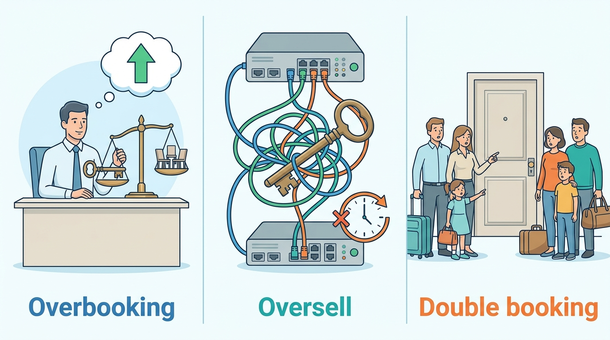
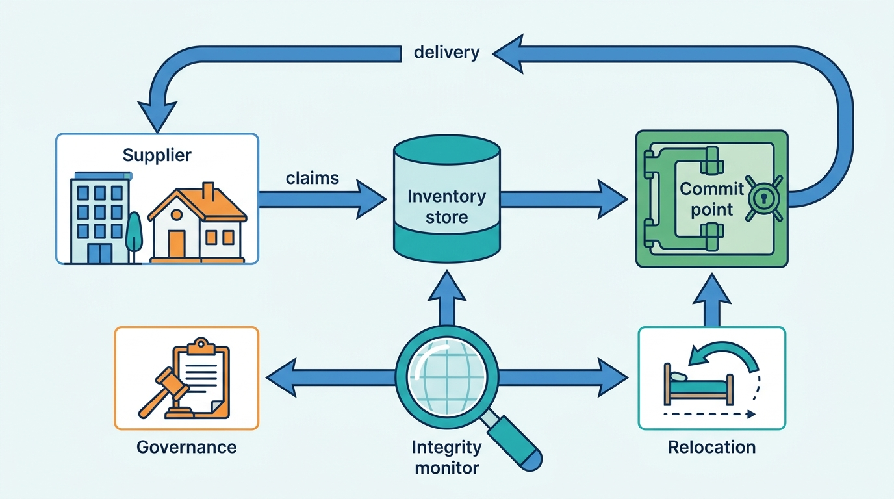
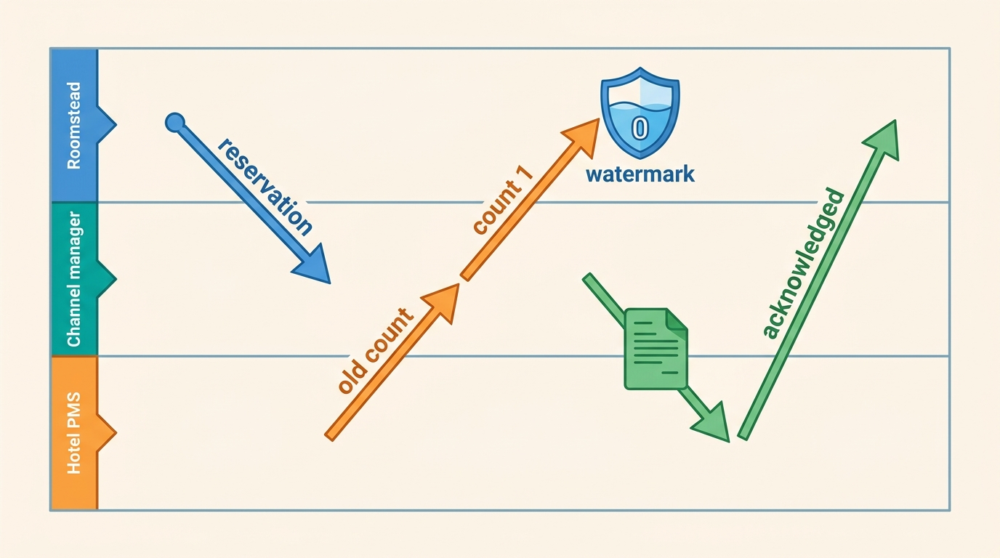
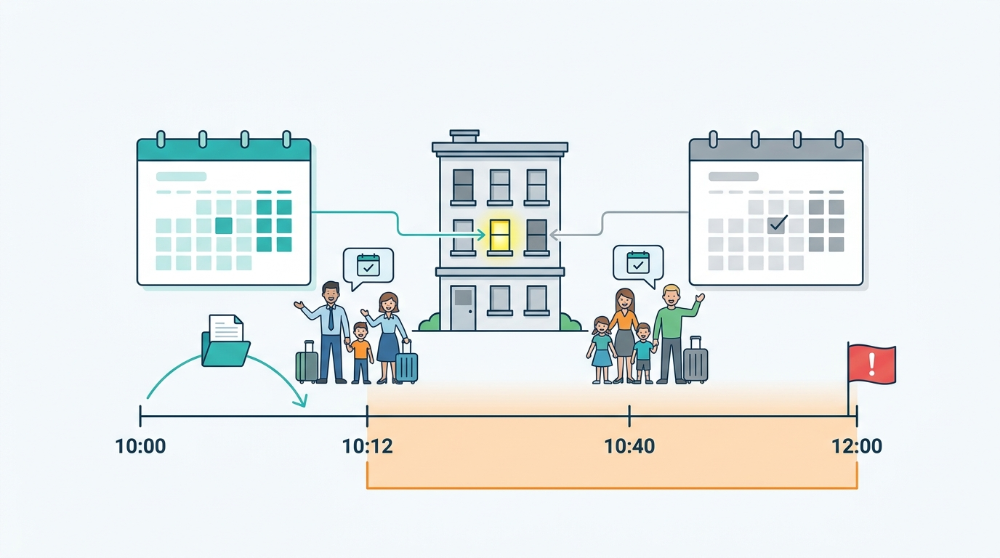
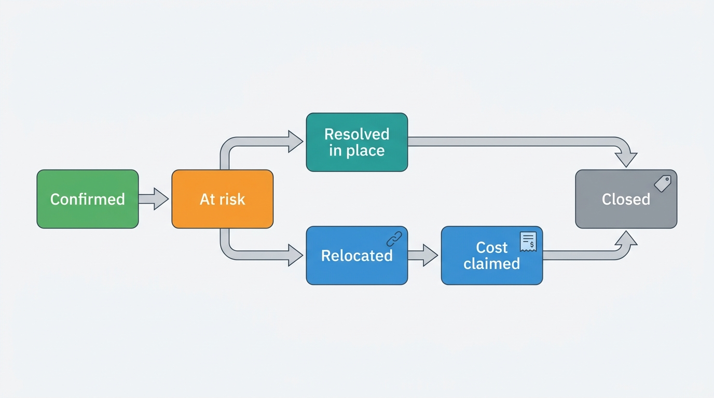

> **IN THIS CHAPTER, YOU WILL:** Separate a hotel's deliberate overbooking from an accidental oversell and from the double booking of a one-unit home, then design the controls for each: allotments and free sale, concurrency control at the commit point, inventory holds, cross-channel windows, reconciliation, walking and relocating guests, compensation and the metrics that keep partners and hosts honest.

> **WHY THE BUSINESS CARES:** An oversold night is the most expensive promise a stays marketplace can break. The guest arrives with nowhere to sleep, support pays for a replacement at the worst possible price, the partner or host relationship turns into a dispute about who pays, and the guest's next trip goes to a competitor.

> **WHY ARCHITECTS SHOULD CARE:** Inventory integrity is a distributed-systems problem with several writers and no global transaction: the property management system, the channel manager, other marketplaces and your own checkout all change the same count. Where you put the guarantee, which windows you accept, and how the failure path is modeled decide whether oversells are rare, cheap and attributable, or a steady background cost nobody can explain.

> **KEY POINTS:**
>
> * **Overbooking, oversell and double booking are three different problems.** A hotel's deliberate overbooking is a revenue control the marketplace must carry and measure; an accidental oversell is an integration defect; a double-booked home is a defect with no revenue logic at all. One "overbooking" metric and one policy for all three hide all three.
> * **Put the guarantee where the unit's truth lives; treat everything else as a cache or an efficiency device.** A hosted-stays marketplace that owns the calendar can make the database refuse an overlapping stay. An accommodation marketplace selling a hotel's count can only shorten the window and detect, because the count belongs to the property management system. Holds with a time limit and distributed locks reduce failed attempts; they are not the guarantee.
> * **Design the failure path as a product.** Walking and relocating a guest should create a linked reservation with a cause code, a liable party and a recovery claim, not a support ticket. Oversells measured per 10,000 room nights by connection, partner and host become the evidence that governs connectivity certification, partner terms and multichannel hosting.

> **[FAILURE PATTERNS THIS CHAPTER ADDRESSES](where-stay-platforms-go-wrong.html):**
>
> * **The Double-Booked Night** — a one-unit home has no second room down the corridor, so every cross-channel race ends with a cancellation, a rebooking and a guest who no longer trusts the calendar.
> * **Connectivity Roulette** — when a channel manager queues or reorders inventory updates, every channel keeps selling the last count it heard, and the hotel learns about the oversell from its front desk.
> * **Phantom Availability** — auto-replenishment, stale counts and expired holds put nights back on sale that no longer exist, and the guest pays the price at check-in rather than at checkout.

<br>
Every accommodation marketplace sells nights it does not physically control. The room belongs to a hotel whose property management system (PMS) holds the real count; the home belongs to a host who may also sell it elsewhere. The marketplace commits guests to a copy that someone else can change at any moment. **Selling a night that no longer exists is not an edge case; it is the expected outcome of a system with several writers and no shared transaction**, and the only design question is how rarely it happens, how early it is caught and who pays when it is not.

The industry uses one word, "overbooking", for three things. Hotels **overbook on purpose**, selling a few rooms more than they have to offset forecast no-shows. Marketplaces **oversell by accident**, when updates arrive late, out of order or not at all. And a hosted-stays marketplace suffers the **double-booked night**, when two calendars disagree for a few hours about one apartment. The first is a business decision, the second an integration defect, the third a defect with no upside.


**Figure 1:** *One word, three problems: hotels overbook on purpose, marketplaces oversell by accident, and a double-booked home is a defect with no upside.*

After the data model of [[rates-and-availability-model]] and the read path of [[availability-engine]], this chapter decides how the marketplace keeps from selling a night twice at the moment of commitment, and what it does when it fails. It owns **allotment**, **free sale**, the **inventory hold** and **walk and relocation**, and leaves iCal sync to [[calendar-sync]], idempotency to [[checkout-orchestration]] and reservation delivery to [[reservation-lifecycle]].

## Setting the Scene at Corvane: One Spring, Two Kinds of Oversell

Corvane, the fictional travel group this book follows (see [[meet-corvane]]), runs Roomstead, an OTA-style (online travel agency) accommodation marketplace that sells 640,000 properties by room type and rate plan, and Nookaway, a hosted-stays marketplace with 1.15 million listings, most of them a single home with a single calendar. In the spring of 2027 both had an oversell that reached the Group Chief Architect's desk in the same week.

**The Seville double booking** began on 2 February. At 10:12 Central European Time the Bauers, a family from Munich, booked Carmen Ruiz's two-bedroom apartment in Triana on Nookaway for 20–25 April, Feria de Abril week: 5 nights × €260 plus a €60 cleaning fee, **€1,360** before guest fees. Carmen also sells the apartment on a competing platform, connected only by iCal, the calendar-file format both platforms import on a schedule ([[calendar-sync]]). The competitor had last imported Nookaway's calendar at 10:00, and at 10:40 it sold 21–24 April to another guest. Nookaway's own import ran at 09:00 and 12:00; the 12:00 run found the overlap, wrote a warning to the listing's calendar and sent Carmen an e-mail. Nobody at Nookaway saw it. At 13:05 Carmen canceled the Nookaway reservation. Nookaway's guest guarantee rebooked the Bauers in a comparable apartment for **€1,780** and funded the **€420** difference; Carmen paid a host cancellation fee of **€130**, 10% of the €1,300 nightly subtotal, from her next payout, and the dates were blocked.

**King's Day** came at the end of April. On 26 April Hotel Prinsenkade, an independent 140-room hotel in Amsterdam connected to Roomstead through a third-party channel manager, lost its channel manager for **47 minutes**. Every channel kept selling the last count it had received for the night of 27 April, the busiest night of the Amsterdam year, and the replayed queue then published counts computed before the outage-era bookings. The hotel ended **9 rooms oversold** across channels and walked guests on 27 April. **Four** of them were Roomstead guests. Roomstead customer service relocated them to hotels in Haarlem and Amstelveen at a cost of **€2,150**, of which **€1,600** was recovered from the hotel under Roomstead's partner terms.

When Mariana Costa, Group Chief Architect, asked both brands for their oversell numbers, she got two answers that could not be compared. Roomstead counted relocation tickets opened by customer service; Nookaway counted "host cancellations" without separating calendar conflicts from hosts who changed their minds. Neither could say how many oversells were caught before arrival or which connections and hosts caused them. Rafael Mendes, VP Engineering at Nookaway, argued that the Seville case was a calendar-sync problem and should stay inside Nookaway. Aisha Rahman, VP Supply and Connectivity at Roomstead, argued the opposite for King's Day: the hotel's channel manager failed, the hotel paid, the system worked.

The question for the One Stay architecture forum, the group program that decides what Roomstead and Nookaway share, was therefore not "how do we stop oversells". It was **"where should each kind of oversell be prevented, how do we see the ones we cannot prevent, and should the failure path be one group capability or two?"**

## The Vocabulary of Oversell

Inventory integrity starts with words, because the industry's words are loose and contracts depend on them.

| Term | Definition used in this book | Who decides it |
| --- | --- | --- |
| **Physical inventory** | The rooms or units that exist on a night: 140 rooms at Prinsenkade, one apartment in Triana | Reality |
| **Sellable inventory** | The count a supplier offers to a channel for a room type and night, after closures and out-of-order rooms; can exceed physical inventory when the hotel overbooks on purpose | The hotel's PMS or revenue manager; the host |
| **Availability** | Sellable inventory that a specific search can book after restrictions such as minimum length of stay ([[rates-and-availability-model]]) | The marketplace's offer computation |
| **Free sale** | A channel may sell up to the shared count without asking the hotel before each booking, each booking decrementing the count. Some wholesale contracts use the term for "contracted rate, no committed rooms, check before booking" — read the contract | Contract |
| **Allotment** | A block of rooms a hotel commits to one channel for a period, with unsold rooms returned to the hotel on a **release date** before arrival | Contract |
| **Inventory hold** | A temporary claim on inventory while a guest completes checkout, released automatically after a time limit (TTL, time to live) unless committed | The marketplace |
| **Overbooking** | Deliberately selling more than physical inventory to offset expected no-shows and late cancellations | The hotel's revenue management system |
| **Oversell** | Accidentally selling more than sellable inventory because a copy of the count was wrong | Nobody — it is a defect |
| **Double booking** | An oversell of a one-unit listing: two guests hold the same night in the same home | Nobody — it is a defect |
| **Walk** | The property turns away a guest with a confirmed reservation and arranges accommodation elsewhere | The property |
| **Relocation** | The marketplace moves a guest to another property or home because the original cannot honor the reservation | The marketplace |

Terminology varies between tour operators, wholesalers and B2B portals ([Wikipedia, Allotment (travel industry)](https://en.wikipedia.org/wiki/Allotment_(travel_industry)), 2026), and the contract governs. The table's most important column is the last: **overbooking has an owner and a reason; oversell and double booking do not**. Everything in this chapter follows from keeping them apart.

One reframing helps more than any definition. In a marketplace, **availability is a claim made by a source at a point in time, not a fact**. Tally, Roomstead's store of availability, rates and inventory (ARI), holds the count Prinsenkade's channel manager last asserted; Almanac, Nookaway's calendar service, holds Carmen's nights plus blocks imported from another platform hours ago. Every integrity control in this chapter either makes a claim fresher, checks a claim at the moment of commitment, or detects when two claims disagree.

### Allotments and free sale in the data model

Modern OTA connectivity is overwhelmingly a shared pool: the PMS pushes one count, every channel sells from it, and the first booking to reach the hotel wins. **Allotments** survive in wholesale, tour operating and groups, and a marketplace that sources supply from bedbanks inherits them indirectly. In the data model they are different objects.

| Aspect | Free sale from a shared pool | Allotment |
| --- | --- | --- |
| What the channel holds | A copy of the hotel's count, overwritten by every update | Its own counter for a room type and date range, decremented by its own bookings only |
| Who else can sell it | Every channel, the hotel's website, the front desk | Nobody, until release |
| The time-critical event | Each update from the supplier | The **release date**, when unsold rooms return to the hotel |
| How it oversells | A late or lost update; a race between channels | A release job that fires late (the hotel resells rooms the channel still sells) or a channel that keeps selling after release |
| Who carries the risk of unsold rooms | The hotel | Depends on the contract: with a guaranteed allotment, the channel pays for unsold rooms |

**An allotment is a scheduled obligation, not just a number**: its release must fire on time in the hotel's time zone, be idempotent and be visible to both parties. Roomstead does not contract allotments directly; bedbank supply ([[content-and-media]]) may be backed by the bedbank's allotments, which Roomstead sees as free sale with a recheck. Hotelbeds documents that recheck: a rate marked `RECHECK` must pass CheckRate before booking ([Hotelbeds booking workflow](https://developer.hotelbeds.com/documentation/hotels/booking-api/workflow/), n.d., fetched 2026). For pull-model supply, the recheck is the commit-time integrity check. Hosted stays have no allotment concept.

### Overbooking is a revenue control

Hotel overbooking is deliberate, forecast-driven and old. Cornell's executive course on the subject, taught by Sheryl Kimes, frames it as protection against revenue lost to no-shows, built on no-show and cancellation forecasts and weighed against displacement costs and the customer impact of walking a guest ([eCornell](https://ecornell.cornell.edu/courses/hospitality-and-foodservice-management/overbooking-practices-in-hotel-revenue-management/), n.d.). Revenue management systems commonly send overbooking decisions by room type to the PMS alongside daily rates. A 2018 University of Delaware dissertation found the best results from overbooking **below 5% of capacity on roughly 6–10 days a month**, and lower performance above 10% of capacity or on more than 20 days a month ([Riasi, 2018](https://udspace.udel.edu/items/b2eefd99-8e27-4927-b6be-996c3b264b1e)); it rests on a survey with a 3.77% response rate and is eight years old, so treat the numbers as indicative.

The arithmetic explains why the marketplace must carry overbooking rather than forbid it: an illustrative 140-room hotel forecasting 3% no-shows on an ordinary Tuesday expects about 4 empty rooms; overbooking by 3 recovers about €450 on most nights and costs a few walks at €200–€300 on the rare night when everyone arrives. On King's Day, when nobody fails to show up, the same allowance would be reckless.

**The marketplace never sees this calculation.** It receives a count. Roomstead cannot tell a deliberate overbooking from a stale count. That is acceptable as long as the partner terms say who walks the guest and who pays, and the marketplace measures oversells per partner so that a hotel overbooking at 12% of capacity every weekend is visible.

### A home cannot overbook

A one-unit listing has none of this logic: a guest who does not show up usually still pays, and there is no corridor of identical rooms to walk anyone into. **Every double booking of a home is a defect**, and the marketplace, not the host, usually ends up finding and funding the replacement.

### Where oversells come from

Booking.com's connectivity documentation lists why overbookings happen, among them "System outages preventing availability from being updated", "Incorrect auto-replenishment of cancelled reservations or room nights" and "The rate not being correctly mapped for ARI updates" ([Booking.com, Troubleshooting overbookings](https://developers.booking.com/connectivity/docs/con-faq-reservations-troubleshooting-overbookings), n.d., fetched 2026). With the hosted-stays and platform-internal causes, the list has nine entries, each with a different owner.

| Cause | Example | Marketplace type | Who can prevent it |
| --- | --- | --- | --- |
| **Deliberate overbooking** | Revenue management pushes a count above physical rooms | Accommodation | The hotel (by design) |
| **Supplier outage or queue** | Prinsenkade's 47-minute channel-manager outage | Accommodation | Supplier and connectivity partner; marketplace can detect and stop-sell |
| **Out-of-order or stale update** | A replayed queue overwrites a newer count | Accommodation | Connectivity partner (sequencing); marketplace (rejecting stale updates) |
| **Late close** | The hotel closes the room seconds after a booking was made | Accommodation | Nobody fully; shorter delivery windows reduce it |
| **Auto-replenishment** | A cancellation puts a room back on sale that the hotel already resold | Accommodation | Marketplace (policy and defaults) |
| **Mapping error** | A rate or room type not mapped for updates keeps selling on its last value | Accommodation | Connectivity certification ([[connectivity-and-channel-managers]]) |
| **Internal race** | Two checkouts commit the last room or the same home at the same instant | Both | Marketplace (concurrency control) |
| **Cross-channel race** | The Seville double booking: two platforms sell overlapping nights between calendar imports | Hosted stays mostly | Host (API sync, buffers); marketplace (faster sync, request to book, detection) |
| **Duplicate or ghost reservation** | A retried checkout creates a second reservation that consumes a room; an allotment release fails | Both | Marketplace (idempotency, scheduled-job hygiene) |

The table makes the chapter's argument visible: **only two of the nine causes can be prevented inside the marketplace's own transaction**. The rest are windows between systems. The architecture has to guarantee what it can, shorten what it cannot, and detect the remainder early.

## Architecture: Guarantee, Shorten, Detect, Recover

I organize inventory integrity as four layers with separate owners: **guarantee** (a commit point that refuses a second sale where the marketplace owns the truth), **shorten** (fresher claims, faster delivery to the source), **detect** (find oversells before the guest arrives) and **recover** (walk, relocate, compensate and bill).


**Figure 2:** *Inventory integrity as four layers. The commit point guarantees what the marketplace owns; delivery and acknowledgement shorten the window to the source; the integrity monitor detects disagreements between claims; relocation and recovery turn an oversell into a linked reservation with a liable party, and the measured rate feeds back into partner and host governance.*

| Component | Responsibility | Owns | Must not |
| --- | --- | --- | --- |
| **Inventory store** (Tally, Almanac) | Hold the latest claim per unit or room type and night, with source, sequence and timestamp | Ingest ordering, stale-update rejection | Be the commit point for hotel counts if its storage cannot decrement several nights atomically |
| **Allocation ledger** | Record every hold and commitment against a unit-night or room-type-night, and refuse the one that would exceed the limit | The no-overlap or no-overdraw guarantee | Trust an upstream lock or hold as proof of availability |
| **Checkout** ([[checkout-orchestration]]) | Place holds, call the allocation ledger at commit, handle failure honestly | Hold placement and conversion | Retry a commit with a new idempotency key |
| **Delivery and acknowledgement** ([[reservation-lifecycle]]) | Get each reservation to the PMS, channel manager or host and record the acknowledgement | Delivery state per reservation | Treat "sent" as "acknowledged" |
| **Integrity monitor** | Compare claims, acknowledgements and arrivals; open oversell cases with a cause code | Detection rules, lead-time metrics | Resolve cases itself |
| **Relocation and recovery** | Find alternatives, create linked reservations, compensate, raise cost claims | Relocation policy, liability matrix | Close a case without a liable party |

### The commit point: concurrency control on inventory

The guarantee belongs in the store that owns the unit's truth, and the form of the guarantee depends on what is being counted.

**For a home, the guarantee is a uniqueness constraint.** One unit, one guest per night. Almanac stores one row per listing per night, so the simplest correct design is an allocation table with a unique constraint on listing and night for every active hold or booking. Committing a stay inserts one row per night in a single transaction; if any night is taken, the whole insert fails and nothing is held. PostgreSQL's documentation uses a room reservation as the canonical example of an exclusion constraint on ranges, `EXCLUDE USING GIST (room WITH =, during WITH &&)` ([PostgreSQL 18 documentation, Range Types](https://www.postgresql.org/docs/current/rangetypes.html), n.d., fetched 2026). Either form works; the per-night form matches Almanac's grain:

```sql
-- One active claim per listing per night (sketch, Almanac's grain)
CREATE UNIQUE INDEX one_claim_per_night
  ON night_allocation (listing_id, night)
  WHERE state IN ('held', 'booked');

-- Committing a held stay: every night must still belong to this hold
UPDATE night_allocation
   SET state = 'booked', reservation_id = $res
 WHERE hold_id = $hold AND state = 'held' AND expires_at > now();
-- Commit only if the row count equals the number of nights.
```

The database refuses the second sale, whatever happened upstream; no cache, lock or hold can weaken that, because none of them is consulted for the answer.

**For a hotel room type, the guarantee is a conditional decrement across all nights of the stay.** A three-night stay needs one room on each of three nights, atomically. A typical pattern is a counter row per property, room type and night, decremented with a condition that it stays within the limit, inside one transaction that touches all nights:

```sql
-- Sketch: reserve one room of a room type for nights [arrival, departure)
UPDATE room_type_night
   SET committed = committed + 1
 WHERE property_id = $p AND room_type_id = $rt
   AND night >= $arrival AND night < $departure
   AND committed + held < sellable_limit;
-- Commit only if the row count equals the number of nights; otherwise roll back.
```

This is optimistic in spirit: no lock is taken in advance, and the condition decides. It needs the nights of one property in one transactional scope, which is a sharding decision. Tally, built in 2016 on Cassandra, partitions ARI per room type, rate plan and date, which suits millions of incoming updates but not an atomic decrement across three nights, because Cassandra's conditional writes coordinate within a single partition. **Tally is a good place to receive claims and a poor place to commit against them.** The recommendation I made to Corvane is a separate allocation ledger, sharded by property on a relational store, that Tally feeds with the latest sellable limits; checkout commits against the ledger, not against Tally.

The limit itself is the subtle part: for a hotel, `sellable_limit` is the supplier's last claim. Booking.com's documentation shows the race: a reservation made at 09:20:00 is queued, the property closes the room at 09:20:25, the reservation is retrieved at 09:20:45, and the booking looks like an overbooking. Booking.com's conclusion is honest: "We cannot rule this kind of cases out with 100 percent certainty", and the most effective mitigation is to "increase the frequency of the periodic pull to 30 seconds or less" ([Booking.com, Troubleshooting overbookings](https://developers.booking.com/connectivity/docs/con-faq-reservations-troubleshooting-overbookings), n.d., fetched 2026).

The reverse race is just as common and is fully inside the marketplace's control: an update computed by the PMS **before** it received the marketplace's reservation arrives **after** the marketplace has already decremented its copy, and overwrites it.


**Figure 3:** *The overwrite race. A count computed before the hotel saw Roomstead's reservation arrives after Roomstead decremented its copy. Overwriting resells the room; an acknowledgement watermark keeps unacknowledged reservations subtracted until the source confirms it has them.*

The control is what I call an **acknowledgement watermark**. The allocation ledger computes the sellable limit as the supplier's last claim minus the marketplace's own reservations that the supplier had not yet acknowledged when that claim was produced, using the message timestamp or sequence number where the connection provides one and the arrival time minus a safety margin where it does not. Once the PMS acknowledges a reservation, later claims are assumed to include it. The rule costs little, removes a class of self-inflicted oversells and depends on the acknowledgement path of [[reservation-lifecycle]]. It is my recommendation, not a description of any company's system.

### Inventory holds: an efficiency device with a time limit

An **inventory hold** reserves a unit or a room for the few minutes a guest spends entering details and passing payment authentication. It improves conversion, because a guest who loses the last room on the payment page is worse off than one who never saw it, and it reduces failed commits. It is not the guarantee: the commit still runs against the allocation ledger and must fail cleanly if the hold expired and someone else took the night.

Expedia Group exposes holds to affiliates: Rapid's hold-and-resume supports "a 2-step booking model", and "If the booking is abandoned, it is automatically rolled back and the selected inventory is released" ([Expedia Group, Hold and Resume](https://developers.expediagroup.com/rapid/lodging/booking/hold-resume), n.d., fetched 2026). The hold is a compensable first step that rolls back on its own.

| Hold parameter | Too short | Too long | A defensible choice |
| --- | --- | --- | --- |
| **Duration** | Guests completing strong customer authentication (SCA, the EU's two-factor rule for card payments) lose the room mid-payment | Abandoned checkouts suppress the last rooms; bots can hold inventory to deny it to others | 10–15 minutes, extended once on an active authentication challenge |
| **Expiry** | A sweeper that runs every few minutes leaves expired holds blocking sales | — | Expire by condition at read and commit time (`expires_at`), sweep only for cleanup |
| **Abuse** | — | One client holds dozens of homes | Cap concurrent holds per account and device; rate-limit hold creation |

At Corvane, Nookaway holds a listing for 10 minutes from the start of payment, extended once to 20 minutes when the payment flow enters a 3-D Secure challenge; Roomstead holds a room type for 15 minutes. Both numbers are local choices; the rule that matters is that **expiry is a condition evaluated at commit, not a job that must run on time**.

### Distributed locks: useful, not sufficient

A distributed lock, a lease in Redis or ZooKeeper on one listing, reduces wasted work across services; it does not make a commit correct. Martin Kleppmann showed in 2016 that a client whose lease expires during a pause can still write after another client took the lock; his remedy is a **fencing token** checked by the storage layer ([Kleppmann, 2016](https://martin.kleppmann.com/2016/02/08/how-to-do-distributed-locking.html)). For inventory, the store that would check the token is the allocation ledger, whose constraint already does the job. **Use locks to reduce contention on popular homes; never as the reason a double booking cannot happen.**

### Cross-channel races: the windows you cannot close

The commit point protects the marketplace from itself, not from a sale in someone else's database. Between systems, the integrity problem becomes a **window**: the time from a sale on one channel until every other channel stops selling the same night. The window is the sum of the slowest path: delivery to the source, the source's update, the push or poll to the next channel, and that channel's cache refresh.

Documented intervals show how wide the windows are:

| Path | Documented interval | Source |
| --- | --- | --- |
| Booking.com reservation retrieval by a connectivity partner | Poll "once per twenty seconds"; 30 seconds or less recommended to reduce overbookings | [Booking.com Retrieving new reservations](https://developers.booking.com/connectivity/docs/reservations-api/retrieving-new-reservations-ota), [Troubleshooting overbookings](https://developers.booking.com/connectivity/docs/con-faq-reservations-troubleshooting-overbookings), n.d. |
| Booking.com fallback when a reservation is not acknowledged | E-mail to the property after 30 minutes, extendable to 24 hours | [Booking.com Reservations API overview](https://developers.booking.com/connectivity/docs/reservations-api/reservations-overview), n.d. |
| Airbnb import of an external iCal calendar | "automatically updates every 3 hours" (the interval has changed before) | [Airbnb Help Center, article 99](https://www.airbnb.com/help/article/99), n.d., fetched 2026 |
| Nookaway import of an external iCal calendar | Every 3 hours (Corvane, fictional) | Scenario |

A minutes-wide window oversells a 140-room hotel only when it is nearly full, as on King's Day; a three-hour window double-books a home whenever two platforms find guests for overlapping nights, which in Feria week is not rare. Four controls shorten or neutralize windows.

1. **Stop-sell on connection health.** When a supplier's updates stop for longer than its normal pattern, close its last few rooms for near-term nights. On 26 April Switchyard, Roomstead's connectivity gateway, treated Prinsenkade's silence as "no changes"; silence on a peak night is a signal.
2. **Close-out buffers on slow channels.** A hotel can keep its last one or two rooms off channels with long windows; a multichannel host can leave a buffer night or block peak dates on all but one platform. Buffers cost revenue, so they are the supplier's choice, informed by the measured window.
3. **Request to book for low-confidence calendars.** For an iCal-only listing, a host confirmation step converts a silent double booking into a declined request. Nookaway enables instant book on 68% of listings; iCal-only listings on peak dates are the case for the exception.
4. **Fresher sync for the riskiest listings.** Polling can follow risk (peak dates, demand, recent conflicts); [[calendar-sync]] describes Nookaway's tiered import.

**Auto-replenishment** is a marketplace default that creates oversells. Booking.com documents that it "puts cancelled rooms back up for sale" by default, "even if the property has closed sales for that date" unless the property has deactivated "Reopen closed rooms" ([Booking.com, Troubleshooting overbookings](https://developers.booking.com/connectivity/docs/con-faq-reservations-troubleshooting-overbookings), n.d., fetched 2026). My rule for Roomstead: replenish only for properties whose inventory is managed in the marketplace's own extranet; for PMS-connected properties, wait for the source to assert the new count, and never reopen a date the source has closed.

### Detection and reconciliation

The marketplace cannot see a hotel's other channels, so detection relies on signals.

| Signal | What it reveals | Typical lead time before arrival |
| --- | --- | --- |
| **Delivery rejected by the PMS** (no availability, closed room, unmapped rate) | The reservation never landed; possibly oversold | Seconds to minutes after booking |
| **Unacknowledged reservation past its window** | Delivery failed; the hotel may not know | 30 minutes or more |
| **Supplier claim lower than committed reservations** | The source's count is below what the marketplace already sold for that night | Minutes after the update |
| **Pre-arrival check** for the next 48 hours | Last chance to rehouse calmly | Hours to two days |
| **Imported block overlapping a confirmed reservation** (homes) | A cross-channel double booking | Up to one import interval |
| **Partner or host report**; **guest arrival** | Everything the system missed | Zero |

Two signals carry most of the value. The **negative-headroom signal**, a supplier claim below the marketplace's unacknowledged committed reservations for a night, detects oversells without access to other channels. And the **imported-block conflict** for homes is a certain detection: at 12:00 on 2 February, Almanac knew of the overlap. Nookaway turned that certainty into an e-mail; the integrity design turns it into an **oversell case** with a deadline.

Corvane has one detection asset with a governance problem. Corvane Connect, the group's channel manager, distributes 14,500 hotels to more than 60 channels, including Roomstead's competitors, and can detect a cross-channel oversell the moment it happens. It must alert **the hotel**, its customer; it must not hand Roomstead data about competitors' bookings. Roomstead's integrity monitor may consume Connect's alerts for Roomstead reservations only, under a data-use boundary approved by Noor van Dijk's regulatory team.

## In Practice: Documented Practice and Corvane's Worked Examples

No company has published its inventory-locking scheme; the public record is the external contract (partner APIs, help-center rules, terms).

**Booking.com and Expedia Group: documented outcomes.** Booking.com states that when a room is overbooked its "Customer Service team will notify both the guest and the property to arrange either an alternative room or a relocation" ([Booking.com, Troubleshooting overbookings](https://developers.booking.com/connectivity/docs/con-faq-reservations-troubleshooting-overbookings), n.d., fetched 2026); the page does not say who pays. Expedia's Rapid makes a vanished room an explicit outcome and admits that sold-out errors "may also occur if the connection to the supplier is degraded" ([Expedia Group, Common error responses](https://developers.expediagroup.com/rapid/resources/error-responses-lodging), n.d., fetched 2026).

**Relocation standards.** Hostelworld's guidance asks for the same or higher standard in the same area, with the property covering any price difference ([Hostelworld support](https://support.hostelworld.com/knowledge/how-to-handle-overbookings), undated, widely reported). A PMS vendor describes the usual walk package as one night's room and tax elsewhere, transport and a phone call ([Cloudbeds](https://myfrontdesk.cloudbeds.com/hc/en-us/articles/218512777-emergency-process-to-handle-last-minute-overbookings), undated).

**Hosted stays: penalties instead of relocation by the supplier.** As of 2026, Airbnb's help center sets host cancellation fees at 50% of the reservation amount for nights not stayed if the host cancels 48 hours or less before check-in, 25% between 48 hours and 30 days, and 10% more than 30 days out, with a minimum of $50; the calendar may be blocked for the affected dates "even when the fee is waived" ([Airbnb Help Center, article 990](https://www.airbnb.com/help/article/990), n.d., fetched 2026). Its guest protection covers host cancellations and first looks for comparable accommodation before refunding ([Airbnb Help Center, article 3218](https://www.airbnb.com/help/article/3218), n.d., fetched 2026). Vrbo states that "Declines after 24 hours are considered cancellations" ([Vrbo Help](https://help.vrbo.com/articles/IPM-About-booking-requests-for-integrated-accounts), n.d., fetched 2026). Because the host cannot walk a guest, the platform rehouses the guest and uses fees, calendar blocks and status consequences, enforced through the payout, to keep calendars honest. Nookaway's €130 fee to Carmen follows the same pattern.

> **INFERENCE, NOT DOCUMENTED:** A marketplace that owns a one-unit calendar can enforce no-overlap transactionally, and the documented penalty regimes suggest that the residual double bookings these platforms manage are mostly cross-channel and host-caused rather than internal races. None of these companies has described its internal locking design; this is a reading of their public contracts, not a description of their systems.

### King's Day, minute by minute

Mariana's team reconstructed the night from Switchyard's logs, the channel manager's incident report and Roomstead's records (Central European Summer Time, 26 April 2027).

| Time | What happened | What Roomstead's systems did |
| --- | --- | --- |
| 17:58 | Last update before the outage: 14 rooms sellable across room types for the night of 27 April | Tally stores 14; Pricegrid serves it to search |
| 18:02 | Channel manager stops sending updates and stops accepting reservations from OTAs | Switchyard sees no updates; treats silence as "no change" |
| 18:02–18:49 | Every channel sells against its last count; Roomstead sells 6 rooms, other OTAs sell 14 | Roomstead decrements its own copy to 8; it cannot see the others |
| 18:49 | Channel manager recovers and replays queued updates in enqueue order | The replayed counts were computed before the outage-era bookings; Roomstead's copy goes back up to 12 |
| 18:49–19:01 | Roomstead sells 3 more rooms on the stale copy before fresh counts arrive: 23 sold against 14 | No acknowledgement watermark: overwritten counts are trusted |
| 19:01 | Fresh counts arrive: negative availability for 27 April | Tally clamps the count to 0; no alert is raised |
| 27 April, afternoon | The hotel, 9 rooms oversold, walks guests; 4 are Roomstead's | Customer service opens 4 relocation tickets |

Three Roomstead controls would have changed the outcome. A **stop-sell on connection silence** for near-term nights at properties above 90% occupancy would have closed Prinsenkade on Roomstead at about 18:15. The **acknowledgement watermark** would have kept the replayed counts from overwriting Roomstead's decrements. And the **negative-headroom signal** at 19:01 would have flagged Roomstead's at-risk reservations about 20 hours before arrival, instead of four tickets opened from the front desk.

The money, using the ledger's numbers:

| Item | Amount |
| --- | --- |
| Relocation cost for 4 Roomstead guests (Haarlem and Amstelveen, King's Day rates, taxis) | €2,150 |
| Recovered from Prinsenkade under the partner terms (cap of €400 per relocated reservation) | €1,600 |
| Net cost to Roomstead | €550 |

The partner terms did their job: the hotel, whose system failed, carried most of the cost. They could not tell Roomstead whether this was an unlucky night or a pattern; that needs measurement.

### Seville, cause by cause

The Seville case looks like bad luck and is a design outcome. The window was structural: the competitor's import at 10:00 and Nookaway's booking at 10:12 left a gap of up to three hours on the competitor's side. The detection was certain at 12:00 and was wasted on an e-mail. The resolution was left to Carmen, who canceled the earlier, Nookaway, reservation.


**Figure 4:** *The Seville double booking was a window, not bad luck: the competitor imported Nookaway's calendar at 10:00, the Bauers booked at 10:12, the competitor sold the same nights at 10:40, and Nookaway's import found the overlap at 12:00.*

In the integrity design, the import that finds the overlap opens an oversell case in the operations queue and the host's app at once, with the rule "the earlier confirmed reservation keeps the night". Nookaway's Calendar Sync v2, approved in March 2027, adopts that flow with a 60-minute guest-contact target and a 15-minute import tier for high-demand feeds, which would have detected the conflict over an hour earlier ([[calendar-sync]]). Only request to book on peak dates, or an API connection, narrows the competitor's side of the window.

### Measuring oversells honestly

A metric that counts relocation tickets measures customer service, not integrity. Corvane's metric set separates the three problems, counts detected cases and normalizes by volume.

| Metric | Definition | Segment by | Why it matters |
| --- | --- | --- | --- |
| **Oversell rate** | Detected oversold reservations per 10,000 room nights (homes: per 10,000 nights) | Cause code, connection, partner or host, market, lead time | The headline integrity number; cause code keeps deliberate overbooking separate |
| **Walk and relocation rate** | Reservations actually relocated per 10,000 room nights | Same | What the guest experiences; the gap from oversell rate is what detection and resolution saved |
| **Detection lead time** | Time from oversell creation to case opened; share detected more than 24 hours before arrival | Signal | Early detection turns an emergency into a rebooking |
| **Window per connection** | 95th-percentile time from a reservation to the source's acknowledgement, and from a source change to Tally | Connectivity partner | The input to certification and stop-sell thresholds |
| **Relocation cost and recovery rate** | Cost per case; share recovered from the liable party | Cause, partner | Shows whether partner terms work |
| **Calendar-conflict cancellations** | Host cancellations caused by a cross-channel conflict per 10,000 reservations | Sync method (iCal, API, none) | Separates calendar integrity from host behavior |

The first full baseline, for 2026, was uncomfortable. Roomstead's customer service relocated about **5,400** guests for oversold reservations, about 1.8 per 10,000 stayed reservations, and more than half of the cases traced to fewer than 400 properties and three connectivity partners. Nookaway recorded about **3,100** host cancellations caused by calendar conflicts, about 5 per 10,000 stayed reservations; **78%** of them came from iCal-only multichannel listings, which make up about 28% of active listings (61% of listings are multichannel and 47% of those sync by iCal only). Per listing, an iCal-only listing double-booked roughly nine times as often as the rest of the catalog. The numbers are fictional; the shape, a few connections and listings causing most oversells, is what any marketplace finds once it measures.

## Trade-offs

| Concurrency approach | How it works | Right when | Wrong when |
| --- | --- | --- | --- |
| **Store-enforced constraint** (unique unit-night, exclusion constraint) | The database rejects the second overlapping write | One-unit listings; the marketplace owns the calendar | The unit's truth lives in another system |
| **Conditional decrement** (optimistic, compare-and-set on a counter) | Decrement all nights if within the limit, in one transaction | Hotel room types; counts with many identical units | Nights of one property are spread across partitions without multi-partition transactions |
| **Pessimistic lock** (`SELECT … FOR UPDATE` on unit-night rows) | Serialize writers per unit | Short critical sections with extra checks inside | Popular units with long checkouts; multi-night ranges locked in inconsistent order deadlock |
| **Distributed lock or lease** | Lock the unit in Redis or ZooKeeper | Reducing contention and wasted work across services | Used as the correctness guarantee without fencing |
| **Inventory hold with TTL** | Reserve for N minutes during checkout | Payment flows with authentication; affiliate two-step booking | Treated as proof of availability at commit |
| **Request to book** | The host confirms before the booking is final | Low-confidence calendars; peak dates on iCal-only listings | Used everywhere: conversion falls and guests wait |

Window policies are a revenue decision as much as an architecture one: a close-out buffer that costs a room night a week to prevent one oversell a year is bad advice, and on a connection that oversells monthly it is good advice. Without the measured window, both are opinions.

## Hotels and Homes: Where the Two Marketplaces Differ

| Dimension | Accommodation marketplace (Roomstead) | Hosted-stays marketplace (Nookaway) |
| --- | --- | --- |
| **What is counted** | Rooms per room type per night; counts of 1 to several hundred | One unit per night; a yes or no |
| **Where the truth lives** | The hotel's PMS or channel manager; the marketplace holds a claim | The marketplace calendar for most hosts; a vacation-rental PMS for connected professionals; another platform's calendar for part of each multichannel listing's nights |
| **Overselling posture** | Deliberate overbooking is legitimate and invisible; accidental oversell is a defect | Every double booking is a defect |
| **Dominant cause** | Connection outages, stale or reordered updates, mapping errors, auto-replenishment | Cross-channel races over iCal; host manual errors |
| **Commit guarantee** | Conditional decrement against a claimed limit, plus an acknowledgement watermark | Uniqueness constraint per unit-night |
| **Who detects** | Delivery rejections, negative headroom, the hotel's front desk | Imported-block conflicts, the host |
| **Remedy** | The hotel walks the guest nearby; the marketplace relocates when the hotel cannot | The platform rehouses the guest; no second unit exists |
| **Who pays** | The hotel, under partner terms, when its systems or deliberate overbooking caused it | The platform's guarantee first, then the host through fees and calendar blocks |
| **Supplier governance** | Connectivity certification, oversell rate per connection and property | Sync-method policy, request to book, host cancellation fees |
| **Contract and liability** | Walk obligations sit in the hotel's partner terms; the guest's contract is with the hotel (agency) or the marketplace (merchant) | The platform's published guest guarantee is a promise the guest holds against the platform, whatever the host does |

The two marketplaces meet in the middle, and that is where the most interesting failures are. About 374,000 of Roomstead's 435,000 alternative accommodations are single units sold as a room type with a count of 1; the other 61,000 are multi-unit pools ([[property-and-listing-model]]). Roomstead applies hotel rules to them, including auto-replenishment and relocation as a hotel-style walk the "property" is expected to arrange, though a property manager cannot walk a guest down a corridor that does not exist. This is **The Hotel-Shaped Home** in miniature, and the fix is to key integrity policy to **unit cardinality**, not to brand: any sellable unit with a physical count of 1 gets the hosted-stays posture, wherever it is sold. When Nookaway starts selling boutique hotels in its 2028 pilot, the rule applies in the other direction.

**What to share.** I would share the failure path and the measurement: one **oversell case model** with cause codes, one **relocation and rebooking service** that searches both marketplaces' supply (a guest walked from Prinsenkade can be rehoused in a Nookaway apartment), one **liability matrix**, one **oversell metric layer**, and the link between original and relocated reservations in the One Stay reservation contract. I would not share the commit mechanism: a conditional decrement against a claimed count and a uniqueness constraint on a calendar are different guarantees. That is One Stay's "shared contracts, separate engines" ([[converging-two-marketplaces]]).

## Failure Modes

- **The hold treated as the guarantee.** Checkout commits because a hold exists, without checking that the hold is still the active claim. A sweeper ran late, another guest took the night, and both reservations are confirmed. The commit must re-check the claim in the same transaction.
- **A failed fetch read as "all nights free".** An iCal import that times out or returns an invalid file is parsed as an empty calendar, and every imported block disappears. A failed fetch must keep the last good state and raise a sync-health alert.
- **The modification path that bypasses the commit point.** New bookings go through the allocation ledger; date changes, room-type changes and extensions are written directly to the reservation. A guest extends by one night into a night that is already sold. Every change that adds a night is a new claim and must go through the same commit.
- **Duplicates that consume inventory.** The 212 duplicate reservations of 14 January 2027 ([[checkout-orchestration]]) each consumed a room until canceled. Idempotency is an integrity control, not only a payments control.
- **Relocation as a support ticket.** The original reservation is canceled, a new one is created by an agent, and nothing links them. Analytics count a cancellation and a new booking, the liable party is never billed, the guest's loyalty status and review eligibility are lost, and the oversell rate reads zero.


**Figure 5:** *An oversold reservation as a state machine, not a ticket. The case opens at detection, ends either in place or as a linked relocation, and does not close until a liable party and a cause code are recorded, which is what makes the oversell rate measurable and the cost recoverable.*

## The Chief Architect's View

Mariana's recommendation to the One Stay forum in May 2027 had five decisions.

**1. Name the commit point per unit cardinality.** One-unit listings commit against a uniqueness constraint in the store that owns the calendar: Almanac for Nookaway, and a new allocation ledger for Roomstead's apartments with a count of 1. Multi-unit room types commit by conditional decrement in a property-sharded allocation ledger fed by Tally, with an acknowledgement watermark. The decision record states that holds and locks are efficiency devices. Owner: the inventory teams of each brand; reviewer: the group architecture forum.

**2. Make the window a measured, governed number.** Every connectivity partner and sync method has a measured window, published in partner tools; Switchyard certification covers sequencing and acknowledgement, and the oversell rate per connection enters the annual review of the 140 certified partners ([[connectivity-and-channel-managers]]). Owner: Aisha Rahman. Nookaway's sync-method policy (iCal-only listings move to request to book on peak dates unless the host connects by API) is owned by Rafael Mendes. Where oversell rates feed ranking, the cause code travels with them, so a hotel is not demoted for a marketplace defect ([[stays-ranking]]).

**3. Build one failure path for the group**, as described in the Hotels and Homes section. Owner: Elena Petrova's customer-service platform for the workflow ([[customer-service]]); the reservation domain for the contract.

**4. Write the liability matrix before the next peak.** Who pays is a contract question with an architecture consequence, because the cause code decides the bill.

| Cause | Liable party | Recovery mechanism |
| --- | --- | --- |
| Hotel's deliberate overbooking | Hotel | Hotel walks the guest; Roomstead recovers any relocation cost under partner terms |
| Hotel's PMS or channel-manager failure | Hotel, which may claim from its vendor | Partner terms, capped per relocated reservation |
| Marketplace defect (replenishment, internal race, duplicates, mapping on Roomstead's side) | Roomstead or Nookaway | None; the cost is an engineering signal |
| Host's cross-channel conflict or manual error | Host, after the platform's guarantee pays the guest | Host cancellation fee from the next payout; calendar block |
| Corvane Connect failure affecting Roomstead guests | Corvane Connect, under its customer contract with the hotel | Intra-group recharge; the hotel is made whole first |

The last row matters because when Connect fails, the hotel is its customer and must not be squeezed between two Corvane companies; the €6,804 compensation in the €12-rate incident at Hotel Miradouro ([[connectivity-and-channel-managers]]) set that precedent.

**5. Watch the right numbers**, from the metric table above. If the overall rate falls while front-desk detections do not, the marketplace has improved its averages, not its guests' nights.

Integrity is **bounded by the slowest partner**, and partners improve only when the marketplace can show them their own numbers. A group that measures windows per connection can negotiate, certify and stop selling; a group that counts relocation tickets can only apologize.

## Questions to Ask

1. For each kind of sellable unit, where is the commit point, and what exactly refuses the second sale of the same night: a database constraint, a conditional decrement, or a hope?
2. Does the system distinguish a hotel's deliberate overbooking, an accidental oversell and a double-booked home in its data, metrics and partner terms?
3. What happens when a supplier update computed before your reservation reached the source arrives after it? Is there an acknowledgement watermark or equivalent?
4. Are holds checked again at commit, and is hold expiry a condition evaluated at commit or a job that must run on time?
5. What is the measured end-to-end window per connectivity partner and per sync method, at the 95th percentile, and who sees it?
6. Does a silent connection or a failed calendar fetch ever reduce availability, or only ever leave it unchanged or increase it?
7. How many oversells are detected more than 24 hours before arrival, and from which signals?
8. Is a relocation a linked reservation with a cause code and a liable party, and does every case close with a recovered cost or an engineering ticket?
9. Are one-unit apartments sold through the OTA side governed by hotel rules or by hosted-stays rules?

Inventory integrity decides whether the night a guest bought exists; [[dynamic-pricing]] asks what that night should cost: who sets the price, with what data, and how far the marketplace should go in recommending or setting it.

## Sources and Evidence

### Company engineering and investor sources

- [Troubleshooting overbookings](https://developers.booking.com/connectivity/docs/con-faq-reservations-troubleshooting-overbookings) — Booking.com Connectivity documentation, n.d. (fetched 2026). Overbooking causes, the reservation timeline race, the 30-second pull recommendation, auto-replenishment and "Reopen closed rooms", customer-service relocation.
- [Understanding the Reservations API](https://developers.booking.com/connectivity/docs/reservations-api/reservations-overview) — Booking.com Connectivity documentation, n.d. (fetched 2026). Per-provider queue and the 30-minute e-mail fallback.
- [Retrieving new reservations (OTA)](https://developers.booking.com/connectivity/docs/reservations-api/retrieving-new-reservations-ota) — Booking.com Connectivity documentation, n.d. (fetched 2026). Polling once per twenty seconds.
- [Hold and Resume](https://developers.expediagroup.com/rapid/lodging/booking/hold-resume) — Expedia Group Developer Hub (Rapid), n.d. (fetched 2026). Two-step booking, automatic rollback and the holdable flag.
- [Common error responses (lodging)](https://developers.expediagroup.com/rapid/resources/error-responses-lodging) — Expedia Group Developer Hub (Rapid), n.d. (fetched 2026). Sold-out outcomes and degraded supplier connections.
- [Booking API workflow](https://developer.hotelbeds.com/documentation/hotels/booking-api/workflow/) — Hotelbeds developer documentation, n.d. (fetched 2026). CheckRate for `RECHECK` rates before booking.
- [Sync your calendar with other websites (article 99)](https://www.airbnb.com/help/article/99) — Airbnb Help Center, n.d. (fetched 2026). Three-hour iCal import interval.
- [Host cancellation fees (article 990)](https://www.airbnb.com/help/article/990) — Airbnb Help Center, n.d. (fetched 2026). Fee schedule and calendar blocks after host cancellations.
- [AirCover for guests (article 3218)](https://www.airbnb.com/help/article/3218) — Airbnb Help Center, n.d. (fetched 2026). Rebooking or refund when a host cancels.
- [About booking requests for integrated accounts](https://help.vrbo.com/articles/IPM-About-booking-requests-for-integrated-accounts) — Vrbo Help, n.d. (fetched 2026). Late declines treated as cancellations.

### Standards, regulation and documentation

- [Range Types: Constraints on Ranges](https://www.postgresql.org/docs/current/rangetypes.html) — PostgreSQL 18 documentation, n.d. (fetched 2026). Exclusion constraints rejecting overlapping room reservations.
- [Allotment (travel industry)](https://en.wikipedia.org/wiki/Allotment_(travel_industry)) — Wikipedia, 2026. Allotments and release dates (industry explainer).

### Research and practitioner sources

- [How to do distributed locking](https://martin.kleppmann.com/2016/02/08/how-to-do-distributed-locking.html) — Martin Kleppmann, 2016. Why leases need fencing tokens to be safe for correctness.
- [Overbooking practices in the hotel industry and their impact on hotels' financial performance](https://udspace.udel.edu/items/b2eefd99-8e27-4927-b6be-996c3b264b1e) — Arash Riasi, University of Delaware, 2018. Overbooking levels associated with better and worse performance.
- [Overbooking Practices in Hotel Revenue Management](https://ecornell.cornell.edu/courses/hospitality-and-foodservice-management/overbooking-practices-in-hotel-revenue-management/) — eCornell (Sheryl E. Kimes), n.d. Overbooking as no-show protection weighed against walk costs.
- [Emergency process to handle last-minute overbookings](https://myfrontdesk.cloudbeds.com/hc/en-us/articles/218512777-emergency-process-to-handle-last-minute-overbookings) — Cloudbeds, undated. Typical walk package (practitioner guidance).
- [How to handle overbookings](https://support.hostelworld.com/knowledge/how-to-handle-overbookings) — Hostelworld support, undated. Relocation standard and who covers the difference (practitioner guidance).

Corvane is fictional; architectural recommendations and labeled inferences are the author's judgement.
