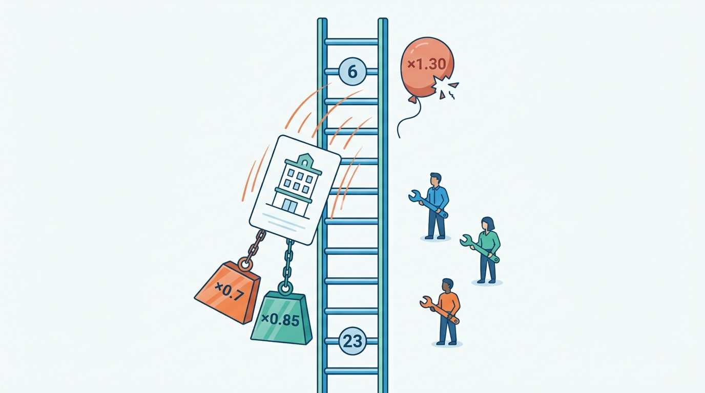
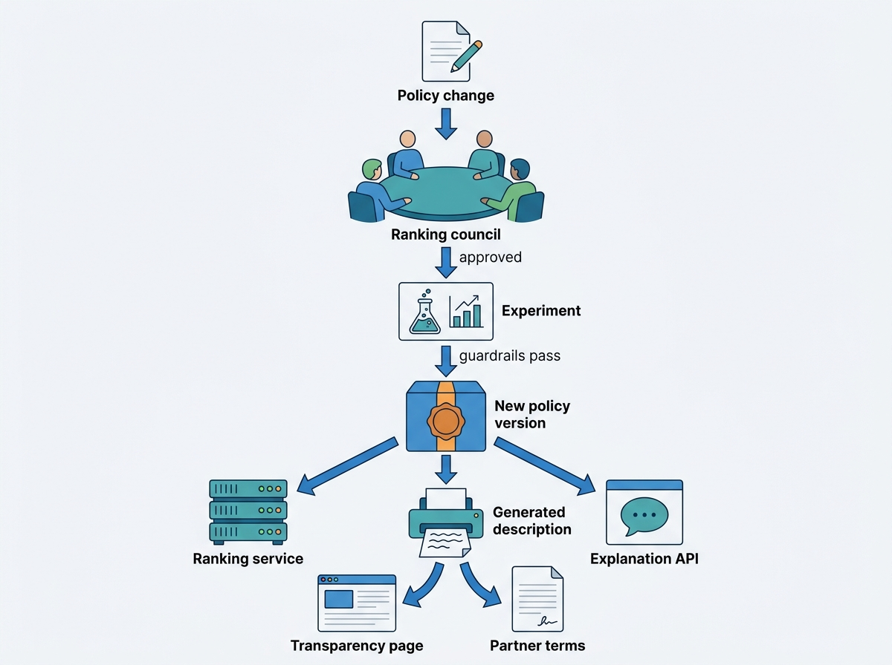
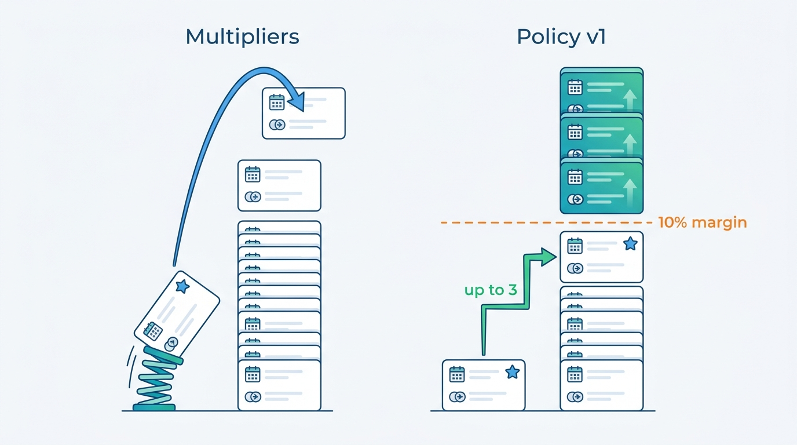

> **IN THIS CHAPTER, YOU WILL:** Take apart the order of a stays results page: what counts as a good result when a third of bookings are canceled, the signals and their owners, the documented learning-to-rank lineage at Airbnb, Expedia Group and Booking.com, and where commission, partner programs and trust demotions should enter the ranking. You will see why EU law makes the main ranking parameters, and the effect of payment on them, something a marketplace must be able to explain.

> **WHY THE BUSINESS CARES:** The first ten results decide most bookings, and every ranking change moves conversion, cancellations, partner-program revenue and partner trust at once. A marketplace GM who cannot say why a hotel sits at position 23 cannot defend the commission that depends on it, and since 2024 competition and consumer authorities have been asking exactly that question of the largest OTA.

> **WHY ARCHITECTS SHOULD CARE:** Ranking is where search, the offer computed from availability and price, the commercial model, trust signals and regulation meet, on every query. If program boosts and demotions live as multipliers in a scoring function, nobody can reason about the whole or answer a partner's complaint. If they live in a versioned policy layer with a ranking log, the order becomes testable, explainable and portable.

> **KEY POINTS:**
>
> * **Rank on the stay, not the click or the booking.** Train the relevance model on bookings that are not canceled and that the property or host honors. With 34% of room nights canceled on an OTA, a model trained on gross bookings learns to promote offers guests will abandon.
> * **Commission and programs belong in a bounded policy layer, not in the model.** A commercial adjustment that has a cap, a relevance floor and its own version history can be logged, explained per position and switched off per market. Folded into the model objective or stacked as multipliers, it becomes Pay-to-Rank Creep that nobody can measure.
> * **Write the transparency page from the configuration.** The P2B Regulation, the Omnibus Directive and the Digital Services Act require the main ranking parameters and the effect of payment to be described. Generate that description and the partner-facing explanation from the same policy configuration and ranking log that serve results, so the public text cannot drift from the code.

> **[FAILURE PATTERNS THIS CHAPTER ADDRESSES](where-stay-platforms-go-wrong.html):**
>
> * **Pay-to-Rank Creep** — commission tie-breaks, program multipliers, a value-weighted objective and a parity demotion accumulate one at a time until paid properties hold a third of the first page and nobody can explain a single position.
> * **The Unwatched Model** — a ranking model decides the exposure of every property and home, trained on a label nobody revisited and without an owner for its guardrails.
> * **Phantom Availability** — a ranker that scores stale prices and availability promotes offers that fail at the property page or checkout, and learns from the failures as if they were the guest's choice.

 
"Our top picks", "Recommended" and "Relevance" are not neutral sorts; each is a policy that decides which partners and hosts get the guests' attention. **There is no neutral order**, only orders whose effects have been measured and orders whose effects have not.

Ranking stays is harder than ranking products or classified ads. The thing ranked is an **offer**: a property or home for specific dates and a party, at a computed total that may be stale by the time the guest clicks. The outcome that matters, a stay that happens, arrives weeks later and is often reversed by a cancellation. And the marketplace serves **three parties at once**: the guest, the partner or host who wants exposure, and itself, earning different amounts from different properties and selling programs whose stated benefit is visibility.

[[stays-search-architecture]] retrieves the candidates and [[availability-engine]] prices them; this chapter turns them into an order. It owns **learning to rank for stays**, **program-driven visibility** and **ranking transparency**, and shows where personalization, promotions ([[promotions-and-loyalty]]), experiments ([[stays-experimentation]]) and the wider regulatory map ([[stays-regulation]]) enter the ranking function.

## Setting the Scene at Corvane: Why Did Hotel Prinsenkade Fall to Page Three?

Corvane, the fictional travel group this book follows (see [[meet-corvane]]), runs **Roomstead**, an accommodation marketplace with 640,000 bookable properties, and **Nookaway**, a hosted-stays marketplace with 1.15 million listings. Ranking had been group-wide under Jonas Weber, Head of Search and Ranking, since January 2027. In practice that meant two separate rankers, two experimentation platforms (Trialroom and Flipside) and one person who had to answer for both.

On **18 May 2027**, the general manager of **Hotel Prinsenkade**, the 140-room independent hotel in Amsterdam, wrote to Roomstead's partner support. Over the previous three weeks the hotel's average position in Amsterdam searches had fallen from **6** to **23**, and its Roomstead bookings for June were down by almost half. The hotel wanted to know why. Partner support could not tell them. The ranking service logged a final score per result, not the terms that produced it, and nobody could reconstruct the order for a past search.

Jonas's team needed four days to reconstruct it. Three things had happened at once:

1. After the **King's Day overbooking** on 27 April, when the hotel's channel manager had queued updates for 47 minutes and **4** Roomstead guests were walked (see [[inventory-integrity]]), an automatic **reliability demotion** multiplied the hotel's score by **0.7** for 60 days.
2. The hotel's month-by-month subscription to **Front Row**, Roomstead's paid visibility program (tiers add 2, 4 or 6 percentage points of commission), had lapsed on **1 May**, removing a **×1.30** multiplier.
3. A **rate-competitiveness** rule, fed by a rate-shopping service, found the hotel's own website **8%** cheaper than Roomstead for late May and multiplied its score by **0.85**.

Together these cut the hotel's score to **0.46** of its former value (0.7 × 0.85 ÷ 1.30). Each rule had been added by a different team, in a different year, and tested alone. The reconstruction turned into an archaeology of Roomstead's ranking:

**Figure 1:** *Three rules added by three teams in different years combined on Hotel Prinsenkade: a ×0.7 reliability demotion, a ×0.85 rate rule and a lapsed ×1.30 Front Row multiplier moved it from position 6 to 23, and nobody could explain why.*

| Year | Change | Where it lived | Who asked for it | Disclosed? |
| --- | --- | --- | --- | --- |
| 2015 | Gradient-boosted ranker replaces hand-tuned sort; label = **gross booking** | Keystone search module, later the ranking service | Search | Yes, "relevance to your search" |
| 2019 | **Commission tie-break**: within a 2% score band, higher commission first | Ranking service | Commercial | No |
| 2020 | **Front Row** launched: score multipliers ×1.15, ×1.30, ×1.45 for its three tiers | Ranking service configuration | Partner sales | Yes, "participation in partner programs" |
| 2022 | **Circle boost**: ×1.10 for properties offering Roomstead Circle member rates, for signed-in members | Ranking service configuration | Loyalty | No |
| 2023 | **Value objective**: candidates ordered by P(book) × expected commission | Model objective | Commercial analytics | No |
| 2024 | **Rate competitiveness**: ×0.85 if the property is cheaper on its own website | Ranking service configuration | Partner sales | No |
| 2025 | **Reliability demotion**: ×0.7 for 60 days after a walked guest or partner-caused cancellation | Ranking service configuration | Customer service | No |

The transparency page that Roomstead had published in **July 2020**, when the EU Platform-to-Business (P2B) Regulation began to apply, still described the order as "relevance to your search, reviews, price, and participation in partner programs". Four of the seven layers were not on it.

Jonas's sample of May 2027 searches in Roomstead's 20 largest European destinations showed what the layers did together (the figures, like everything about Corvane, are illustrative). Front Row properties made up about **6%** of bookable properties in those destinations and held **34%** of the top-ten positions. **28%** of the gross bookings made from those top-ten positions were later canceled, against 24% for the other bookings from the same pages, because the value objective and the gross-booking label both rewarded refundable, high-commission rates that guests booked as a hold.

Noor van Dijk, Head of Regulatory Affairs and Privacy, put the legal point in one sentence: the P2B Regulation requires the terms to describe "the main parameters determining ranking", and where payment can influence ranking, "the effects of such remuneration on ranking"; Roomstead's terms described neither accurately. Aisha Rahman, VP Supply and Connectivity, put the commercial counterpoint: Front Row earned about **€40 million** of incremental commission in 2026 from about 38,000 participating properties, partners bought it because it worked, and the reliability demotion existed because walked guests are Roomstead's problem as much as the hotel's.

Nookaway had the same question in another form. After the **Seville double booking** in February ([[calendar-sync]]), Rafael Mendes's team proposed demoting all **330,000** iCal-only listings, without knowing how many hosts that would hurt or whether they would be told.

Mariana Costa, Group Chief Architect, asked the architecture forum: **what should own the order of a results page, and how do we explain any position to a guest, a partner and a regulator from data instead of from archaeology?**

## What Ranking Means in a Stays Marketplace

The most useful definition comes from EU consumer law. The Omnibus Directive, (EU) 2019/2161, defines **ranking** as "the relative prominence given to products, as presented, organised or communicated by the trader, irrespective of the technological means used" ([Directive (EU) 2019/2161](http://publications.europa.eu/resource/celex/32019L2161), 2019, inserting point (m) into Article 2 of the Unfair Commercial Practices Directive). Three consequences follow for a stays marketplace:

1. **Prominence, not a sort.** Badges, larger cards, "Top pick" carousels, the first map pins and the property pinned to the top of an affiliate landing page are all ranking.
2. **Every surface that orders stays is in scope:** the results list, the map, destination landing pages, "similar properties" on a sold-out property page and the order of rooms and rates inside a property page ([[property-page-and-room-selection]]).
3. **"Irrespective of the technological means"**: a multiplier in a configuration file is as much ranking as a neural network.

The chapter uses five more terms.

- **Default sort** is the order a guest gets without choosing one ("Our top picks", "Recommended"); price or distance sorts are the guest's choice, the default is the marketplace's.
- **Relevance model** estimates, for one search and one candidate offer, how likely the guest is to complete a stay with it.
- **Ranking policy** is the set of explicit rules applied to the model's scores: **commercial adjustments** (anything that depends on what the marketplace earns from the candidate), reliability and trust demotions, diversity and exploration.
- **Program-driven visibility** is exposure a partner gets by joining a program, usually in exchange for a higher commission or a discount it funds.
- **Ranking transparency** is the ability to describe the main parameters, their relative importance and the effect of payment, in general and for one position.

### What a candidate is

On an accommodation marketplace (an **OTA**, online travel agency, selling hotel rooms by room type and **rate plan**, a priced package of conditions such as breakfast or free cancellation), a candidate is a **property** with many sellable combinations of room type, rate plan and occupancy. The result card shows one of them, usually the cheapest that fits the party, and ranking scores the property using that offer. On a hosted-stays marketplace a candidate is **one unit with one calendar**: the home is either free for every night of the stay or it is not, and its total includes host-set cleaning fees and the platform's guest fee. The OTA ranker chooses among properties that many guests can book on the same night; the hosted-stays ranker chooses among homes that only one guest can have.

### What counts as a good result: the label

The **label** a ranking model learns from is a business decision disguised as a technical one.

| Label | Volume | What it rewards | Problem in stays |
| --- | --- | --- | --- |
| Click | High | Attractive photos, low headline prices | Rewards "from" prices that the exact stay does not get |
| Gross booking | Medium | Converting offers | Rewards refundable rates booked as holds; Roomstead cancels 34% of room nights |
| **Net booking** (booking minus cancellation) | Medium, delayed | Bookings that survive | Label arrives weeks to months later, after the stay date |
| **Honored stay** | Lower, delayed | Bookings the property or host also keeps | Needs host-side cancellations, walked guests and declined requests joined in |
| Problem-free stay | Low, very delayed | Stays without support cases, damage or relocation | Needs customer-service and trust data as labels |

Published practice has moved down this table. Booking.com's ranking disclosure, updated on 31 May 2025, names **net bookings**, "how many bookings are made with that Accommodation minus how many are canceled", alongside click-through rate and gross bookings as the signals properties perform on ([Booking.com, "How we work"](https://www.booking.com/content/how_we_work.html), 2025). Airbnb's ranking papers report **uncancelled bookings** as the primary online metric throughout; its 2023 Journey Ranker paper adds host-side outcomes, because a reservation request can be "rejected or cancelled by the host prior to check-in" ([Tan et al., 2023](https://arxiv.org/abs/2305.18431)), and a 2025 paper feeds the predicted likelihood that a guest–host pairing will need customer support into ranking ([Kim et al., 2025](https://arxiv.org/abs/2503.17329)). Expedia Group's 2024 description of its lodging learning-to-rank model uses graded labels, "booking > click > impression" ([Expedia Group Tech, 2024](https://medium.com/expedia-group-tech/learning-to-rank-at-expedia-group-how-to-adapt-the-property-search-result-page-based-on-f4ebef78c94b)).

My recommendation is a **multi-task model with the honored stay as the target**: predict the booking, predict the cancellation and the host or property failure separately, and rank on their product. Separate heads let the booking head learn from labels a few days old while the cancellation head learns from older searches whose outcomes are complete; waiting months for every label makes the model too old to be useful.

### The signals

Signals fall into families with different owners, update rates and risks; I use this table when a team proposes "just adding a boost".

| Family | OTA examples | Hosted-stays examples | Owner and source | Update rate | Main risk |
| --- | --- | --- | --- | --- | --- |
| **Offer** | Total price for the stay and party, cheapest qualifying rate, free cancellation, meal plan | Total with cleaning and guest fees, minimum-stay fit, instant book | Availability engine ([[availability-engine]]) | Per query | Stale prices: Phantom Availability |
| **Price competitiveness** | Price against comparable properties for the same dates | Price against comparable homes nearby | Pricing analytics | Daily | Comparing against the same property elsewhere enforces parity |
| **Quality** | Review score and volume, photo quality, content completeness | Reviews, listing completeness, verified amenities | Reviews ([[reviews-and-reputation]]), content | Hours to days | Review manipulation; rewarding volume |
| **Engagement** | Click-through, gross and net booking rates | Saves, contact and booking rates | Behavioral events | Minutes to hours | Position bias; feedback loops |
| **Location** | Distance to the searched landmark or center, district | Distance, neighborhood, map viewport | Geo ([[destinations-and-maps]]) | Static per query | Approximate locations for homes |
| **Reliability** | Walked guests, partner-caused cancellations, connectivity health | Host cancellations, acceptance rate, calendar sync freshness | Reservations, connectivity, calendar | Hours | A demotion is a restriction that must be explained |
| **Commercial** | Commission level, program tier, sponsored bid | Usually none: fees are uniform | Partner contracts | On change | Pay-to-Rank Creep |
| **Personal** | Past searches, traveler type, loyalty tier | Past stays, viewed listings | Personalization ([[personalization-and-recommendations]]) | Per session | Consent; opt-out duties |

Two rules come from this table. **First, rank on the price the guest will see.** The offer price must be the same all-in total the property page and checkout will show; ranking on a pre-fee nightly rate promotes listings whose totals are higher, which is the start of Price Drift. At Nookaway this has a specific trap: a listing on the 12% guest fee and a listing on the 17% host-only fee have nightly prices that are not comparable, but their guest totals are. **Second, price competitiveness means comparison with alternatives, not with the same property elsewhere.** Airbnb tells hosts that "listings priced below other comparable listings" tend to rank higher ([Airbnb Help Center, article 39](https://www.airbnb.com/help/article/39), n.d., live 2026). Penalizing a hotel because its own website is cheaper is a different signal: it enforces price parity, which the EU Digital Markets Act prohibits for designated gatekeepers and the Court of Justice has refused to treat as a necessary restraint (see below).

## Architecture: Relevance, Policy, Log and Disclosure

Large stays platforms that describe their ranking converge on a **multi-stage pipeline**, each stage scoring fewer candidates with a more expensive method. Airbnb's 2026 retrieval paper describes narrowing "tens of thousands of homes" through embedding-based retrieval to a first-stage model and then a setwise re-ranker, inside a scatter-gather search stack ([Abdool et al., 2026](https://arxiv.org/abs/2601.06873)). Expedia Group described in 2024 a ranking stage that "arrives after the candidate generator selects a subset of properties to rank and before the final business adjustments are applied" ([Expedia Group Tech, 2024](https://medium.com/expedia-group-tech/learning-to-rank-at-expedia-group-how-to-adapt-the-property-search-result-page-based-on-f4ebef78c94b)). Expedia draws the business adjustments as a **separate stage**, and its 2023 "Juggler" post requires them to be "easy to interpret and explain to stakeholders", including property managers asking why a property has a given rank ([Expedia Group Tech, 2023](https://medium.com/expedia-group-tech/the-juggler-model-balancing-expectations-in-lodging-rankings-6d09b9b8e341)).

I draw the stays ranking function as five components. The first two are the familiar ones; the last three are the ones whose absence produced Roomstead's archaeology.

**Figure 2:** *The stays ranking function. The relevance model estimates the honored stay; a separate, versioned policy layer applies every commercial, program and reliability rule; the ranking log records what was shown and why, and feeds training, partner explanations and the public description of the parameters.*

Roomstead's failure was missing boundaries, not bad models, so each component needs a written contract.

| Component | Responsibility | Owns | Must not |
| --- | --- | --- | --- |
| **Candidate retrieval** | Return every property or home that fits the destination, dates, party and hard filters | Recall, filter correctness | Apply commercial preferences |
| **Offer pricing** | Attach the exact or near-exact all-in total and the offer's conditions to each candidate | Price accuracy, offer snapshot id | Return a price different from what the property page will show |
| **Relevance model** | Estimate the probability of an honored stay per candidate | Features, labels, training, offline metrics | Read commission, program tier or sponsored bids as features |
| **Ranking policy layer** | Turn scores into an order under explicit rules: commercial and program adjustments, reliability demotions, diversity, exploration, sponsored slots | Policy configuration, version history, reason codes | Hide rules inside model features or scoring scripts |
| **Ranking log and disclosure** | Record served features, offers, scores, positions, policy version and reasons; generate explanations | Impression data, retention, generated descriptions | Drop losing candidates' features, which training needs |

**The relevance model must not read commission.** As a feature, commission teaches the model that high-commission properties get more bookings (because they were shown higher) and turns payment into "relevance" nobody can separate again. Roomstead's 2023 value objective did something subtler and equally opaque: it multiplied the booking probability by expected commission inside the model's ranking step, so the commercial weight had no version, no cap and no line on the transparency page. Ordering by expected value is a legitimate commercial choice; Expedia names profitable inventory as one of the marketplace's own objectives in the Juggler post. The question is where it lives, not whether it exists.

### One ranked search, recorded

Every ranked page produces data that training, experiment analysis, partner support and regulatory affairs depend on. One Roomstead search in the target architecture:

**Figure 3:** *One ranked search. The policy version is read at ranking time, and every result leaves with reason codes and an offer snapshot id. Training, experiment analysis, partner explanations and audits all read the same log.*

Four interface decisions make this work.

1. **Program and contract effects arrive as data.** The partner-contract system publishes "Front Row tier 2 active until 31 July" or "commission 17% from 1 June" to a read model; the ranking service never queries contracts at request time.
2. **The policy is configuration with a version.** A change to a cap is a reviewed change to a versioned file with an experiment plan, not an edit to a scoring script. Every page records `policy_version`.
3. **Every result carries reason codes**, for example `organic`, `program_lift(+2)`, `reliability_demotion(-4)`, `exploration_new`, `sponsored_slot`. Presentation uses them for labels, support uses them to answer partners, the log uses them for audits.
4. **Every result carries the offer snapshot id.** When a guest reaches checkout and the price has changed, the gap can be traced to the offer that was ranked. A ranker that scored €447 and a checkout that charges €489 is the same incident whether the cause is a stale cache or a fee added late ([[availability-engine]] owns the cache).

### Features as served

Learning to rank needs the feature values **as the ranker saw them**, joined to later outcomes. Recomputing features offline introduces **training-serving skew**, worse in stays because the price changes with every rate update. The ranking service logs the feature vector and offer for every scored candidate, including a sample of those not shown, and training joins that log to bookings, cancellations and stays by an impression id ([[stays-ml-platform]] owns the feature platform).

### The description is generated, not written

The P2B Regulation, the Omnibus Directive and the Digital Services Act all ask for the same artifact in slightly different words: a plain description of the main parameters, their relative importance and the effect of payment. Roomstead's 2020 page drifted because it was a document written once by lawyers about a system that kept changing. The fix is to make the description a build product of the policy configuration.

**Figure 4:** *The description is a build product. A policy change cannot reach the ranking service without also producing the public description, the partner-facing text and the explanation interface, so the disclosure and the code change in the same release.*

A lawyer still writes the prose around the generated text, but each configured parameter carries a plain-language description and an importance class ("main", "secondary", "tie-break"), and a release fails if one is missing: **an undisclosed parameter becomes a build error instead of a regulatory finding.**

## Learning to Rank for Stays: What the Public Record Shows

**Learning to rank (LTR)** is the use of supervised machine learning to order candidates, trained on logged outcomes. It replaced hand-tuned scoring in stays because hand-tuned weights stop scaling beyond a handful of signals. The public record is uneven: Airbnb has published a dated series of papers since 2018, Expedia Group a handful of engineering posts, Booking.com one well-known 2019 paper and a disclosure page. Agoda, Trip.com and Vrbo have published nothing on ranking that this book's research could find, so nothing is attributed to them here.

### Airbnb, 2018–2026

Airbnb's papers describe at least four generations, so each must be read as history at its date.

| Year | Change | What it teaches |
| --- | --- | --- |
| 2018 | Listing and user embeddings for search ranking and similar listings, which together "drive 99% of conversions" ([Grbovic and Cheng, 2018](https://www.kdd.org/kdd2018/accepted-papers/view/real-time-personalization-using-embeddings-for-search-ranking-at-airbnb)) | Single-unit inventory changes the problem: a home can host one booking per date range |
| 2018 | Gradient-boosted trees plateau; neural networks take over ([Haldar et al., 2018](https://arxiv.org/abs/1810.09591)) | Move to neural ranking when tree gains stop, not before |
| 2020 | Position-bias handling gives "one of the largest gains"; cold-start changes for new listings ([Haldar et al., 2020](https://arxiv.org/abs/2002.05515)) | Train on positions, not only on clicks |
| 2022 | Booking probability of one listing is not independent of the others shown ([Haldar et al., 2022](https://arxiv.org/abs/2210.07774)) | Budget for a whole-page re-ranking stage |
| 2023 | Journey Ranker: multi-task model over intermediate guest actions and host rejections or cancellations ([Tan et al., 2023](https://arxiv.org/abs/2305.18431)) | Two-sided outcomes belong in the objective |
| 2024 | Separate ranking theory for map pins ([Haldar et al., 2024](https://arxiv.org/abs/2407.00091)) | Maps are not lists (below) |
| 2025 | Predicted customer-support need fed into ranking ([Kim et al., 2025](https://arxiv.org/abs/2503.17329)); interleaving raises experiment sensitivity "by a factor of up to 100" ([Zhang et al., 2025](https://arxiv.org/abs/2508.00751)) | Support data is ranking data; experimentation is the bottleneck |
| 2026 | A Transformer over up to 80 long-term and 200 short-term guest events, with a setwise ranker; +0.28% uncancelled bookings from the setwise stage ([Airbnb Tech, 2026](https://airbnb.tech/ai-ml/personalizing-airbnb-search-by-learning-from-the-guest-journey/)) | Heavy sequence models run as a daily batch, off the request path |

Three properties recur across the series, and they are the core of what makes hosted-stays ranking different: **single-unit inventory** (popularity cannot be scaled, so diversity matters), **host-side failure** (rejections and cancellations make the uncancelled stay the target) and **long, multi-session journeys** (guests compare for weeks).

### Expedia Group, 2023–2026

Expedia Group's posts describe an OTA ranking stack in three layers: a **lightweight candidate generator**; a deep neural network that ranks on search context (destination, dates, rooms, adults, children, point of sale, device) and property features (price, review score, star rating, amenities, a learned property embedding), with labels "booking > click > impression"; and **business adjustments** after it ([Expedia Group Tech, 2024](https://medium.com/expedia-group-tech/learning-to-rank-at-expedia-group-how-to-adapt-the-property-search-result-page-based-on-f4ebef78c94b)). The 2023 Juggler post names three stakeholders: travelers (the best property at the lowest price), properties ("best exposure while paying the lowest fees", with "mechanisms to improve their rankings in exchange for fees or special deals") and the marketplace (profitable inventory, short-term conversion against long-term repeat rate). A meta-learning model predicts the adjustment weights per search; the adjustments themselves are, in Expedia's words, "proprietary information" ([Expedia Group Tech, 2023](https://medium.com/expedia-group-tech/the-juggler-model-balancing-expectations-in-lodging-rankings-6d09b9b8e341)). In August 2026 Expedia described serving the ranker through ONNX and TensorRT on Triton, cutting P99 inference latency by about two-thirds ([Expedia Group Tech, 2026](https://medium.com/expedia-group-tech/how-keras-3-helped-modernise-expedia-groups-lodging-ranking-stack-7fec96f052fd)).

### Booking.com, 2019–2026

Booking.com's 2019 KDD paper, "150 successful machine learning models", is best known for the lesson that **better offline model performance does not reliably produce better business results**, so every model is judged in randomized experiments ([The Morning Paper, 2019](https://blog.acolyer.org/2019/10/07/150-successful-machine-learning-models/)). The paper is seven years old; the current public record is operational: an AWS case study reports Booking.com's ranking platform on Amazon EKS serving up to 250,000 requests per second at about 40 ms p99.9 ([AWS, n.d., live 2026](https://aws.amazon.com/solutions/case-studies/booking-eks-case-study/)), and the 2025 disclosure page lists the ranking signals and commercial factors discussed below. How Booking.com's current model is built is not public.

### Position bias, new supply and diversity

Guests click what is on top because it is on top. Training on raw outcomes therefore teaches a model to reproduce yesterday's order. Joachims, Swaminathan and Schnabel showed in 2017 that weighting outcomes by the inverse of each position's examination probability gives unbiased learning to rank ([Joachims et al., 2017](https://arxiv.org/abs/1608.04468)); Airbnb's 2020 paper reports position-bias treatment among its largest gains. Estimating examination probabilities needs a small amount of randomized ordering among the top results, which costs a little conversion; that cost is worth budgeting explicitly.

Position bias hurts **new supply** most: no engagement history, low rank, no engagement. For Nookaway, where **82%** of hosts have one listing, a host without a booking in the first weeks has little reason to stay; for Roomstead, a property never on page one is wasted onboarding cost ([[partner-onboarding]]). Two tools address it: **exploration slots** reserved for new candidates chosen by a content-only score, and **content-based priors** that do not depend on history.

**Diversity** follows from single-unit inventory: ten near-identical apartments from one manager are ten results to the ranker and one choice to the guest. Airbnb's 2022 paper formalizes this; the simpler policy tool is a **per-manager cap** (say, three listings in the first twenty positions), tunable per destination where one manager legitimately holds most of the stock.

### Which model family

For a marketplace of Roomstead's or Nookaway's size, my recommendation is a **gradient-boosted ranker with a LambdaMART-style objective**, trained on the multi-task honored-stay target with position-bias weighting, and a light whole-page re-ranking stage for diversity and caps. Move to neural rankers when tree gains have plateaued in online tests (Airbnb's 2018 trigger), text, photo or sequence understanding is the limiting factor, and the team can serve GPU inference within the latency budget.

### Maps are not lists

Airbnb's 2024 map-ranking paper found that guests do not read pins in order and that **fewer pins can produce more bookings** ([Haldar et al., 2024](https://arxiv.org/abs/2407.00091); [[destinations-and-maps]] covers it). The map and the list are two ranking surfaces over the same scores, and the policy layer must apply program labels and caps to both: **a pin is a position**.

## Commission, Programs and Paid Visibility

### What the platforms disclose

Booking.com's 2025 disclosure is the most specific. Beyond the performance signals, "other things can also influence an Accommodation's ranking": the commission the property pays and how quickly it pays it, participation in its Genius loyalty program or its Preferred Partner program (whose members "pay us a higher commission"), and the guest's past searches unless personalization is turned off. Booking.com calls these "purely secondary", mainly tie-breakers, and marks paid results "Ad" ([Booking.com, 2025](https://www.booking.com/content/how_we_work.html)). Expedia's Juggler post describes paid ranking mechanisms only in general terms. Airbnb's help page lists quality, popularity, price, location, variety and host-influenced factors such as responsiveness, cancellations and Instant Book, and names no commercial factor ([Airbnb Help Center, article 39](https://www.airbnb.com/help/article/39), n.d., live 2026).

Regulators read these pages:

- On **30 July 2024** Spain's competition authority, the CNMC, fined Booking.com **€413.24 million** for abusing a dominant position; the reported findings included opaque paid visibility programs and the use of total bookings on Booking.com as a default ranking factor. Booking.com appealed, and the Audiencia Nacional suspended the fine pending the appeal, as reported in March 2025 ([TechCrunch, 2024](https://techcrunch.com/2024/07/30/spains-antitrust-watchdog-fines-booking-com-nearly-450m-for-unfair-terms-and-restricting-rivals); [Hosteltur, 2025](https://www.hosteltur.com/168767_la-audiencia-nacional-paraliza-la-multa-millonaria-de-la-cnmc-a-booking.html)).
- On **22 April 2026** Italy's competition authority, the AGCM, opened an investigation into Booking.com's Preferred Partner and Preferred Plus programs, concerned that selection "appears to be driven largely by criteria that favour accommodation providers paying higher commissions", which may lead consumers to believe the properties offer better value and "could even lead consumers to book accommodation that is, on average, more expensive" ([AGCM, PS13115](https://en.agcm.it/en/media/press-releases/2024/4/PS13115), 2026). This is an investigation, not a finding.

Neither case says paid visibility is unlawful; both say that **ranking features and program criteria are regulated**, and a platform must be able to show what payment did to the order.

### Five ways to let money into the order

| Design | How it works | Strength | Risk | When it fits |
| --- | --- | --- | --- | --- |
| **No commercial influence** | Order by relevance only | Simplest to explain; maximum guest trust | Leaves program revenue on the table; uniform-fee platforms are already here | Hosted stays with uniform fees |
| **Tie-break only** | Commission or program decides only among near-equal scores | Small, easy to disclose; Booking.com describes its commercial factors this way | "Near-equal" bands drift wider over time | OTAs that want a light touch |
| **Bounded adjustment with a relevance floor** | Program or commission moves a candidate up by at most k positions, only past candidates within a set relevance margin | Explainable per position ("moved up two places"); cannot bury a much better result | Needs tuning per destination; partners must understand what they buy | My default for an OTA |
| **Expected-value objective** | Order by P(stay) × marketplace margin | Maximizes short-term revenue per search | Commercial weight is invisible and unbounded; hard to disclose | Only as an explicit, logged policy term, never inside the model |
| **Sponsored slots** | Labeled ad positions sold by bid, merged with organic results | Clean ad economics and clear labels | Two notions of relevance on one page; ad irrelevance in sparse destinations | Alongside organic ranking, with a relevance floor for ads |

**Multipliers**, Roomstead's 2020 design, are absent on purpose: their effect depends on each query's score distribution (×1.30 moves a property ten places where scores are close and none where they are spread), so nobody can tell a partner what they bought or a regulator what payment does.

### What EU law requires of the ranking function

[[stays-regulation]] owns the full map. The table shows the ranking-specific duties and what each means for the system.

| Instrument | What it requires | Engineering consequence |
| --- | --- | --- |
| **P2B Regulation (EU) 2019/1150, Art. 5**, from 12 July 2020 (business users: partners and professional hosts) | Terms must set out "the main parameters determining ranking and the reasons for the relative importance of those main parameters"; where ranking can be influenced "against any direct or indirect remuneration", a description of those possibilities and "the effects of such remuneration on ranking". Algorithms need not be disclosed (Art. 5(6)) ([Regulation (EU) 2019/1150](http://publications.europa.eu/resource/celex/32019R1150), 2019) | Every policy parameter has a description and an importance class; program effects are described as effects, for example "at most three positions" |
| **Omnibus Directive (EU) 2019/2161**, from 28 May 2022 (guests) | Main ranking parameters and their relative importance are material information, "directly and easily accessible from the page where the query results are presented" (Art. 7(4a) of the Unfair Commercial Practices Directive); search results "without clearly disclosing any paid advertisement or payment specifically for achieving higher ranking" are blacklisted (Annex I, point 11a) ([Directive (EU) 2019/2161](http://publications.europa.eu/resource/celex/32019L2161), 2019) | A link from every results page to the generated description; labels on paid and program results, rendered from reason codes |
| **Digital Services Act (EU) 2022/2065**, from 17 February 2024 | Art. 26: each ad identifiable as an ad, with who paid, in real time. Art. 27: the main parameters of recommender systems in plain language in the terms, and where several options exist, a functionality to select and modify the preferred option "directly and easily accessible" where results are prioritized. Art. 17: a statement of reasons for restrictions of visibility, including demotion, imposed because content is illegal or incompatible with the terms ([Regulation (EU) 2022/2065](http://publications.europa.eu/resource/celex/32022R2065), 2022) | Ad flag travels in the ranking response; the sort control is a regulated surface; a reliability or trust demotion produces a statement of reasons to the partner or host |
| **DSA Art. 38** (very large online platforms only) | At least one recommender option "not based on profiling" | A non-personalized ranking path, served on request, tested like any other. Booking.com B.V. is on the Commission's list of designated platforms; Airbnb and Expedia were not, as of 21 October 2026 ([European Commission](https://digital-strategy.ec.europa.eu/en/policies/list-designated-vlops-and-vloses), live 2026) |
| **Digital Markets Act (EU) 2022/1925, Art. 5(3)** (designated gatekeepers: Booking since 13 May 2024) | The gatekeeper may not prevent business users from offering different prices or conditions through other channels or their own website ([Regulation (EU) 2022/1925](http://publications.europa.eu/resource/celex/32022R1925), 2022) | Ranking must not penalize a property for being cheaper elsewhere; a parity demotion is a measure with equivalent effect |

The parity row deserves a sentence for platforms that are not gatekeepers. In **Case C-264/23** (judgment of 19 September 2024), the Court of Justice held that wide and narrow parity clauses between hotel booking platforms and hotels are not ancillary restraints exempt from Article 101 TFEU ([CJEU, C-264/23](http://publications.europa.eu/resource/celex/62023CJ0264), 2024). A ranking rule that demotes a property for pricing lower on its own website achieves what a parity clause would. I would not ship one in the EU without competition-law advice, and Roomstead removed its 2024 rule on that advice.

Two judgements about how these duties apply are mine, not settled law. First, a program whose stated benefit is better visibility in exchange for higher commission is "payment specifically for achieving higher ranking", so the prudent reading of point 11a is to **label every participating property wherever it appears in results**, not only when the lift happened to change its position. Second, an automatic reliability demotion under partner terms is a restriction "incompatible with the terms" in the Art. 17 sense, so the partner is owed a statement of reasons. Both are cheap to honor if reason codes exist, and expensive to retrofit if they do not.

## In Practice at Corvane: Ranking Policy v1

The architecture forum approved Jonas's proposal in June 2027 with three decisions. **Separate the policy from the model**: remove the value objective and the commission tie-break from the model, and express every commercial and reliability rule as a versioned policy term with reason codes. **Change the label** from gross booking to the honored stay, with separate booking and cancellation heads. **Generate the description** from the policy configuration, as in Figure 4, with Noor's team owning the prose around it. The rate-competitiveness rule was deleted outright.

Front Row survived, with a new definition that a partner could understand and a regulator could read: **a participating property can move up at most three positions, and only past properties whose relevance is less than 10% higher than its own.** The tier, which sets the commission uplift, now changes how often the lift is applied across a property's searches rather than its size, so that the effect of payment on any single position is bounded and the same for every tier. The reliability demotion became a bounded term too: at most five positions, for 60 days, with a statement of reasons sent to the partner through the extranet ([[extranets-and-host-tools]]).

**Figure 5:** *A multiplier moves a result by an amount nobody can predict; Ranking Policy v1 lifts a Front Row property at most three positions, and only past properties less than 10% more relevant, so the effect of payment is bounded and explainable.*

### A worked search

On **3 June 2027** a guest searches Roomstead for Lisbon, **18–21 June**, 2 adults. Retrieval returns 2,600 available properties; offer pricing attaches all-in totals; the relevance model scores them; the policy layer orders the top 200. The table shows five properties that compete for positions 2 to 6 of that page (the property names other than Hotel Miradouro are fictional, like the scores).

| Property | Front Row | 3-night total | P(honored stay) | Old order (multipliers) | Policy v1 order | Reason codes |
| --- | --- | --- | --- | --- | --- | --- |
| Casa do Largo | Tier 2 | €462 | 0.0335 | 2 (×1.30) | 2 | `organic` |
| **Hotel Miradouro** | No | €447 | 0.0310 | 5 | 4 | `organic` |
| Lapa Boutique Rooms | No | €429 | 0.0305 | 6 | 5 | `organic` |
| Alfama Riverside Apartments | Tier 3 | €498 | 0.0290 | 3 (×1.45) | 3 | `program_lift(+2)` |
| Hotel Avenida Sul | Tier 3 | €471 | 0.0270 | 4 (×1.45) | 6 | `organic` |

Under the old multipliers, the two tier-3 properties jumped ahead of **Hotel Miradouro**, Duarte Silva's 84-room hotel, even though both were less likely to produce an honored stay. Under policy v1, Alfama Riverside Apartments moves up two places: Miradouro (0.0310) and Lapa (0.0305) are both within 10% of its 0.0290. Hotel Avenida Sul does not move: the nearest property above it, Lapa, is 13% more relevant. Every row carries its reason code, so Duarte's revenue-management screen can say "position 4, organic; one property above you is there through a partner program", and the guest sees a program label on the three participants.

The same log answered Hotel Prinsenkade's question. Replayed under policy v1, the hotel's average Amsterdam position for the second half of May would have been **11**: `reliability_demotion(-5)` for the King's Day walk, no program lift after its subscription lapsed, and no parity term. The partner would have received the statement of reasons on **28 April**, three weeks before it had to ask.

### The experiment

Trialroom ran policy v1 against the old ranking for four weeks, **6 September to 3 October 2027**, randomized by guest, in the 20 largest European destinations, with destination-level guardrails because a ranking change moves bookings between properties that both arms compete for ([[stays-experimentation]] covers this interference). The results, illustrative like all Corvane figures:

| Metric | Change, policy v1 vs old |
| --- | --- |
| Gross bookings per search | +0.4% |
| **Honored stays per search** | **+1.1%** |
| Share of bookings canceled | −0.9 percentage points |
| Front Row share of top-ten positions | 34% → 22% |
| Front Row incremental commission | −11% (about €4.4 million a year at the 2026 run rate) |
| Commission per search, all bookings | +0.3% |
| Partner support contacts about ranking | −38% (from reason codes in the extranet) |

The program earned less and the marketplace slightly more in total, because fewer ranked bookings were canceled. Marco Bellini, Group CFO, accepted the program loss on two conditions: a quarterly review of the lift cap with the commercial team, and a repricing of Front Row around what it now guaranteed. Policy v1 went live in EEA markets on **12 October 2027**, together with the regenerated transparency page.

### Nookaway: calendar confidence instead of a blanket demotion

Nookaway's version of the problem was not money but reliability. Rafael's blanket demotion would have hit about 330,000 iCal-only listings (61% of the 1.15 million active listings are multichannel, and 47% of those sync by iCal only), most of them single-listing hosts who had never caused a double booking. His team's analysis showed the risk was concentrated: host cancellations for calendar conflicts clustered in listings whose iCal import was more than three hours stale, for arrival dates in high-demand weeks, at hosts with a previous conflict. The team replaced the proposal with a **calendar-confidence feature** in the relevance model's host-failure head (it predicts an honored stay, so it belongs in the model, not in the policy layer), and a policy rule that no listing can lose more than four positions to calendar confidence alone. Hosts see the reason in their dashboard with a single recommended fix: connect through the partner API or a PMS ([[calendar-sync]]). The demotion that would have punished 330,000 hosts became an incentive that affected the few thousand whose calendars were actually unreliable.

## Hotels and Homes: Where the Two Marketplaces Differ

| Dimension | Accommodation marketplace (Roomstead) | Hosted-stays marketplace (Nookaway) |
| --- | --- | --- |
| Candidate | Property with many room-type, rate-plan and occupancy offers; card shows the cheapest qualifying offer | One unit, one calendar; available for every night or not |
| Label | Net or honored stay; cancellations high (34% of room nights) and driven by refundable rates | Honored stay; host rejection, host cancellation and support need are part of the target |
| Distinctive signals | Star rating, brand, review volume, rate conditions, connectivity health | Host responsiveness and acceptance, calendar confidence, listing uniqueness, approximate location |
| Commercial influence | Commission varies by property; paid programs sell visibility | Fees mostly uniform; no paid visibility, so the tension is guest relevance against host fairness |
| Typical failure | Pay-to-Rank Creep; ranking stale prices from a supplier cache | Burying new hosts; promoting listings whose hosts cannot honor the booking |
| Map | Supporting surface; guests choose by district, brand and stars | Primary surface for many searches; location is the main differentiator |
| Regulation | P2B and Omnibus disclosures carry the commission story; DMA and competition cases target programs and parity | P2B for professional hosts, Omnibus for guests, DSA Art. 17 for demotions; little commercial disclosure |
| What can be shared | Policy engine, ranking log schema, reason codes, disclosure generator, evaluation tooling | The same |

The judgement: **share the machinery, not the models or the policy values.** One Stay keeps ranking models separate, rightly: candidates, labels and failure modes differ. But the policy layer, ranking log, reason codes, disclosure generator and evaluation tooling are the same problem twice, and building them twice guarantees two answers to the same regulator. When Nookaway pilots boutique hotels in 2028, a shared policy engine lets it rank hotel-like candidates under Nookaway's rules without inheriting Roomstead's commercial terms.

## Failure Modes

Each failure has a warning sign that can be checked:

- **Stacked multipliers**: nobody can compute a property's position from its inputs without running the ranker.
- **Commission inside the model**: the feature-importance report lists commission, or offline relevance drops when it is removed.
- **The gross-booking label**: top positions convert well and cancel worse than the page average.
- **Ranking the wrong price**: high click-through with low booking at the top, and price-change errors concentrated on page one.
- **Parity by another name**: a "competitiveness" feature fed by a rate-shopping feed of the property's own website.
- **Silent demotions**: partner support answers "ranking is automated" and escalates to engineering.
- **The orphaned transparency page**: its last-modified date is older than the latest policy change.
- **Starved new supply**: more new properties and homes go without a booking in their first 30 days.
- **No owner for the model**: drift is noticed by partners first, The Unwatched Model ([[stays-ml-platform]] owns model governance).

## The Chief Architect's View

**What to decide at group level.** Five things: the label (honored stay, defined once for both brands, with the cancellation and host-failure joins owned by the data platform); the rule that commission and program tier never enter the relevance model; the policy-layer contract (bounded terms, reason codes, versioned configuration); the ranking log schema; and the disclosure pipeline. These are architecture, because they cut across search, partner contracts, data, customer service and legal, and no single product team can hold them.

**What to leave to the brands.** The models, their features, the policy values (how far a program can move, how long a demotion lasts) and the experiments; one model for both would be The Hotel-Shaped Home in ranking form.

**Who decides.** A small **ranking council**: the head of search and ranking as owner (Jonas at Corvane), regulatory affairs (Noor), each program's commercial owner, customer service for reliability terms, and the Group Chief Architect as tie-breaker on contract changes. It approves policy terms and caps, not model retrains, which go through ordinary experiments; its records are the audit trail regulators ask for.

**What to watch.** Six numbers belong on the group dashboard, each split by brand and market:

| Metric | Why |
| --- | --- |
| Honored stays per search | The primary outcome, net of cancellations and host failures |
| Share of top-ten positions held by program participants, against their share of eligible supply | The direct measure of Pay-to-Rank Creep |
| Cancellation rate of bookings from top positions, against the page average | Detects a label or price problem |
| Search-to-checkout price change rate for ranked offers | Detects ranking on stale offers |
| New supply with a booking in its first 30 days | Two-sided health; exposure for new partners and hosts |
| Days since the transparency description last regenerated, and parameters without a description | Disclosure drift; the second number should always be zero |

**Long-term considerations.** **Thresholds**: the DSA's non-profiling obligation applies only to platforms with 45 million or more average monthly active recipients in the EU; Roomstead had about 30 million in the first half of 2027, and building the non-personalized path now costs little. **Conversational search**: documented LLM search features in travel sit in front of the existing ranking stack, and an assistant's suggestions are ranking in the Omnibus sense ([[ai-in-travel-stays]]). **Agents and metasearch as the front door**: when a third party orders the results, the offer the marketplace exposes matters more than its own ranking policy ([[demand-channels]]).

## Questions to Ask

1. What label does the ranker train on, and how are cancellations, host or property failures and walked guests joined into it?
2. Does any model read commission, program tier or sponsored bids as a feature or in its objective? How do you know?
3. Can you state, in one sentence, the most a paid program can move a property, and show it in the configuration?
4. For a position shown last Tuesday, can you list every term that produced it, from data, within an hour?
5. Is the price the ranker scored the same all-in total the property page and checkout show? What share of top-ten offers change price before checkout?
6. Which demotions exist, who owns each, and does the affected partner or host get a statement of reasons?
7. Is the public description of ranking parameters generated from the configuration, and when did it last change?
8. How much exposure do new properties and homes get in their first 30 days, and who owns that number?
9. Which parts of the ranking stack are shared between the two marketplaces, and which differences are deliberate?

Ranking decides which stay a guest sees first, but most guests who book have searched before, saved something or abandoned a search halfway through. The next chapter, [[personalization-and-recommendations]], follows the Novak family's abandoned Lisbon search and asks how a marketplace remembers a traveler who books once or twice a year, and where personalization must stop.

## Sources and Evidence

### Company engineering and investor sources

- [How we work](https://www.booking.com/content/how_we_work.html) — Booking.com, 2025 (updated 31 May 2025). Default sort, ranking signals including net bookings, commission and program factors described as secondary, "Ad" labels.
- [150 successful machine learning models: 6 lessons learned at Booking.com (review)](https://blog.acolyer.org/2019/10/07/150-successful-machine-learning-models/) — Adrian Colyer, The Morning Paper, 2019. Offline gains not translating to business gains; latency cost; randomized experiments.
- [Booking.com EKS case study](https://aws.amazon.com/solutions/case-studies/booking-eks-case-study/) — AWS, n.d. (live 2026). Ranking platform scale: up to 250,000 requests per second, about 40 ms p99.9.
- [Real-time Personalization using Embeddings for Search Ranking at Airbnb](https://www.kdd.org/kdd2018/accepted-papers/view/real-time-personalization-using-embeddings-for-search-ranking-at-airbnb) — Grbovic and Cheng, KDD, 2018. Embeddings; search and similar listings drive 99% of conversions.
- [Applying Deep Learning to Airbnb Search](https://arxiv.org/abs/1810.09591) — Haldar et al., 2018. GBDT plateau and move to neural ranking.
- [Improving Deep Learning for Airbnb Search](https://arxiv.org/abs/2002.05515) — Haldar et al., 2020. Position bias and cold start.
- [Learning To Rank Diversely at Airbnb](https://arxiv.org/abs/2210.07774) — Haldar et al., 2022. Non-independence of results; diversity.
- [Optimizing Airbnb Search Journey with Multi-task Learning](https://arxiv.org/abs/2305.18431) — Tan et al., 2023. Journey Ranker; host rejections and cancellations in the objective.
- [Learning to Rank for Maps at Airbnb](https://arxiv.org/abs/2407.00091) — Haldar et al., 2024. Uniform map attention; fewer pins; +1.9% uncancelled bookings.
- [Predicting Potential Customer Support Needs and Optimizing Search Ranking](https://arxiv.org/abs/2503.17329) — Kim et al., 2025. Support need as a ranking input.
- [Harnessing the Power of Interleaving and Counterfactual Evaluation for Airbnb Search Ranking](https://arxiv.org/abs/2508.00751) — Zhang et al., 2025. Up to 100× experiment sensitivity.
- [Applying Embedding-Based Retrieval to Airbnb Search](https://arxiv.org/abs/2601.06873) — Abdool et al., 2026. Retrieval, first-stage and setwise ranking stages.
- [Personalizing Airbnb Search by Learning from the Guest Journey](https://airbnb.tech/ai-ml/personalizing-airbnb-search-by-learning-from-the-guest-journey/) — Airbnb Tech, 2026. Sequence model and setwise ranker; online gains.
- [How search results work](https://www.airbnb.com/help/article/39) — Airbnb Help Center, n.d. (live 2026). Ranking factors; price against comparable listings; no commercial factor listed.
- [Channel-Smart Property Search: How Expedia Tailors Rankings for You](https://medium.com/expedia-group-tech/learning-to-rank-at-expedia-group-how-to-adapt-the-property-search-result-page-based-on-f4ebef78c94b) — Expedia Group Tech, 2024. Pipeline stages, labels, features, pinned-property variant.
- [The Juggler Model: Balancing Expectations in Lodging Rankings](https://medium.com/expedia-group-tech/the-juggler-model-balancing-expectations-in-lodging-rankings-6d09b9b8e341) — Expedia Group Tech, 2023. Relevance plus weighted business adjustments; three stakeholders; explainability.
- [How Keras 3 Helped Modernise Expedia Group's Lodging Ranking Stack](https://medium.com/expedia-group-tech/how-keras-3-helped-modernise-expedia-groups-lodging-ranking-stack-7fec96f052fd) — Expedia Group Tech, 2026. Serving architecture and latency.

### Standards, regulation and documentation

- [Regulation (EU) 2019/1150 (P2B Regulation)](http://publications.europa.eu/resource/celex/32019R1150) — EU, 2019. Art. 5 ranking transparency and remuneration; applies from 12 July 2020.
- [Directive (EU) 2019/2161 (Omnibus Directive)](http://publications.europa.eu/resource/celex/32019L2161) — EU, 2019. Definition of ranking; Art. 7(4a) UCPD; Annex I point 11a; applies from 28 May 2022.
- [Regulation (EU) 2022/2065 (Digital Services Act)](http://publications.europa.eu/resource/celex/32022R2065) — EU, 2022. Arts. 17, 26, 27 and 38.
- [Regulation (EU) 2022/1925 (Digital Markets Act)](http://publications.europa.eu/resource/celex/32022R1925) — EU, 2022. Art. 5(3) parity prohibition.
- [Judgment in Case C-264/23, Booking.com v 25hours Hotel Company Berlin](http://publications.europa.eu/resource/celex/62023CJ0264) — Court of Justice of the EU, 2024. Parity clauses are not ancillary restraints.
- [List of designated VLOPs and VLOSEs](https://digital-strategy.ec.europa.eu/en/policies/list-designated-vlops-and-vloses) — European Commission, live 2026 (checked 21 October 2026). Booking.com B.V. designated; Airbnb and Expedia not listed.
- [Italian Competition Authority launches investigation into Booking.com (PS13115)](https://en.agcm.it/en/media/press-releases/2024/4/PS13115) — AGCM, 2026. Preferred Partner program selection and commission.
- [Spain's antitrust watchdog fines Booking.com](https://techcrunch.com/2024/07/30/spains-antitrust-watchdog-fines-booking-com-nearly-450m-for-unfair-terms-and-restricting-rivals) — TechCrunch, 2024. CNMC fine and findings on ranking and programs (secondary report).
- [La Audiencia Nacional paraliza la multa de la CNMC a Booking](https://www.hosteltur.com/168767_la-audiencia-nacional-paraliza-la-multa-millonaria-de-la-cnmc-a-booking.html) — Hosteltur, 2025. Fine suspended pending appeal (secondary report).

### Research and practitioner sources

- [Unbiased Learning-to-Rank with Biased Feedback](https://arxiv.org/abs/1608.04468) — Joachims, Swaminathan and Schnabel, 2017. Propensity weighting for position bias.

Corvane is fictional; architectural recommendations and labeled inferences are the author's judgement.
