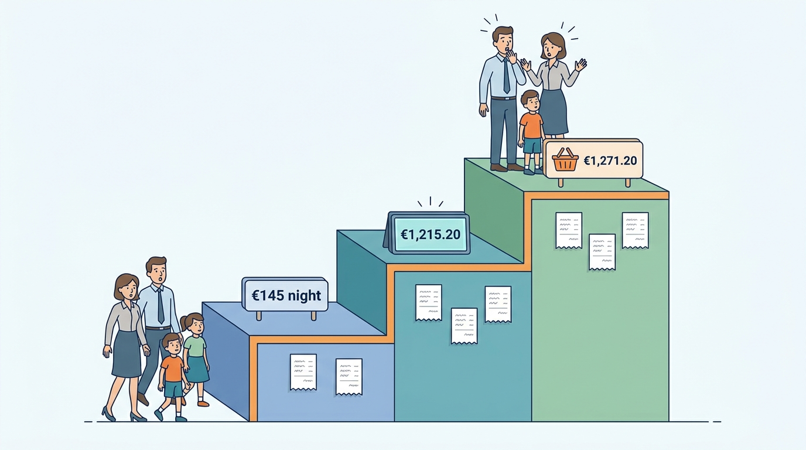
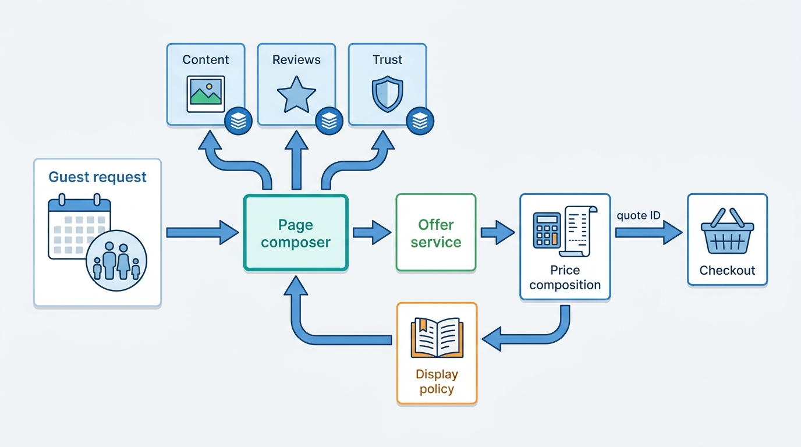
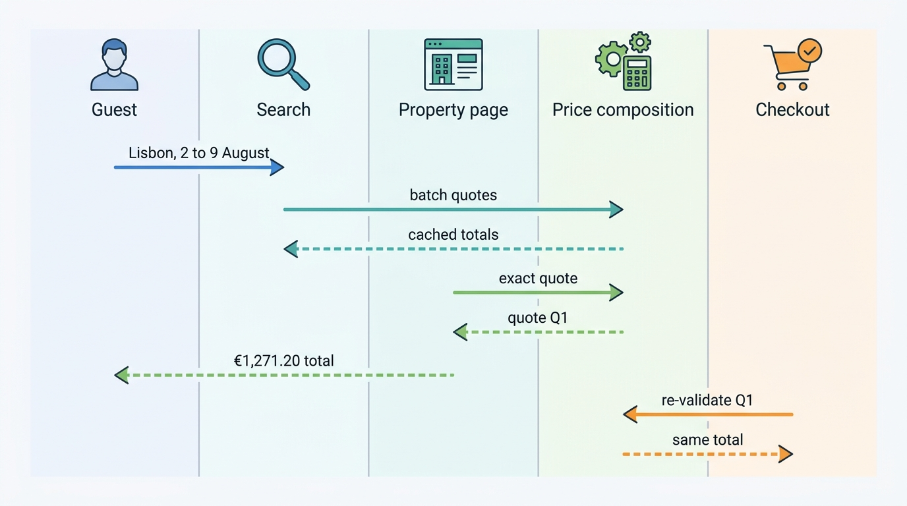
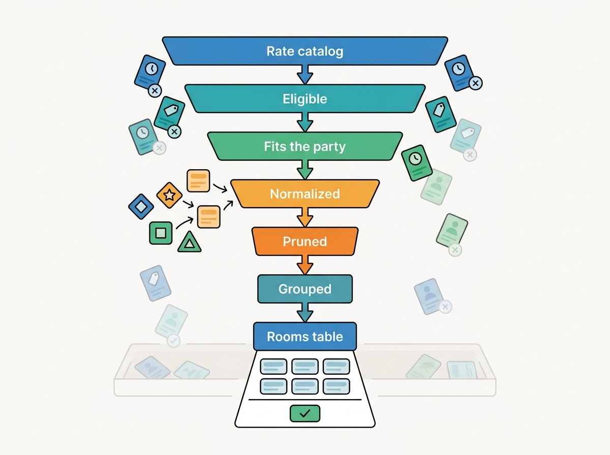
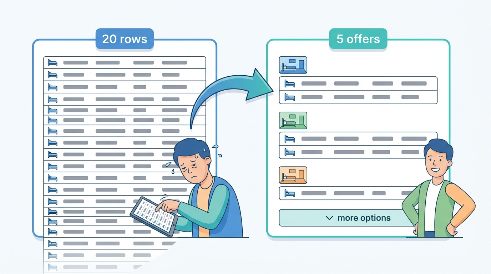

> **IN THIS CHAPTER, YOU WILL:** Take apart the property page and the listing page: how they are assembled from content, media, reviews, policies and live offers; how a rooms table turns dozens of rate plans into a choice a guest can make; and how the total price is composed, displayed and kept identical from the search card to checkout.

> **WHY THE BUSINESS CARES:** The property page is where intent becomes a booking or an abandoned tab. A price that grows between the search card and the payment step costs conversion, generates "why was I charged more?" contacts, and since 2025 is a regulatory exposure in the EU, the UK and the US. A rooms table nobody can read sends guests to a competitor or to the hotel's own site.

> **WHY ARCHITECTS SHOULD CARE:** The page is assembled by many teams from many systems, and the price on it must agree with two other surfaces that are built by other teams. If each surface composes the price itself, they will disagree. The page is also where the hotel and home models diverge most visibly, so a shared page architecture has to be designed for both rather than borrowed from one.

> **KEY POINTS:**
>
> * **Compose price once, display it many times.** Search cards, property pages, checkout, alerts and metasearch feeds should all render the same quote: an itemized breakdown with a quote identifier, computed by one price-composition service per engine and shaped by a shared offer contract. A per-market display policy, owned separately and versioned, decides which lines go into the headline total. Most "price changed at checkout" complaints come from surfaces that composed the price differently, not from inventory changes.
> * **A rooms table is a decision aid, not a dump of the rate catalog.** Enumerate the offers that fit the party, normalize their conditions (cancellation, payment timing, meal plan, occupancy) into comparable fields, drop offers that are strictly worse, and group the rest by room. This is where Rate Plan Sprawl reaches the guest, and pruning on the page is cheaper than pruning in every partner's extranet, though both are needed.
> * **Homes need evidence where hotels need comparison.** A hotel page competes on room and rate choice; a listing page competes on trust: verified-stay reviews, host track record, identity and registration status, house rules and honest location. That evidence comes from trust, reviews and regulatory systems, so the listing page depends on them at render time. Treat them as page dependencies with service-level objectives, not as decorations.

> **[FAILURE PATTERNS THIS CHAPTER ADDRESSES](where-stay-platforms-go-wrong.html):**
>
> * **Price Drift** — the property page is the second of four places a price is shown, and the place where guests first see fees, taxes and conditions that the search card left out.
> * **Rate Plan Sprawl** — every rate plan a partner creates becomes a row the guest must read, so the rooms table is where sprawl turns into lost bookings.
> * **The Hotel-Shaped Home** — a single page template built around room types and rate plans hides what a home guest needs (the host, the house rules, the calendar), and a home template flattens what a hotel guest needs (room choice).

 
Search answers "which places could work?" The property page answers **"is this the one, and what will it really cost?"** It is the page where the guest reads the cancellation terms, looks at the bathroom, checks the walk to the metro, counts the beds against the children, and decides whether to trust a stranger's home or a hotel they have never heard of. In both kinds of marketplace it is usually the page with the most traffic after search results, and it sits directly above checkout.

Architecturally the page is a junction. Content and media come from supply systems ([[content-and-media]]), offers from the availability engine ([[availability-engine]]), prices from the rate model and pricing engines ([[rates-and-availability-model]], [[dynamic-pricing]]), reviews from the reputation system ([[reviews-and-reputation]]), trust signals from identity and trust platforms, and policy text from the cancellation-policy engine ([[changes-and-cancellations]]). Each has its own owner and freshness. The page must render them in under a second **and make one promise out of them**: this room or home, these dates, this party, these conditions, this total.

This chapter owns **property detail assembly**, **rate comparison** and **total price display**. It closes Part IV: search found candidates, ranking ordered them, personalization remembered the guest, and this page turns one of them into an offer that checkout can honor ([[checkout-orchestration]]).

## Setting the Scene at Corvane: The Alfama Apartment That Cost 25% More

Corvane, the fictional travel group this book follows ([[meet-corvane]]), learned what its property pages were worth from a family from Prague.

On **11 February 2027** Tomáš and Jana Novak searched Nookaway, Corvane's hosted-stays marketplace, for Lisbon, **2–9 August**, two adults and two children aged 9 and 12. They saved an apartment in Alfama, abandoned the session, received a price alert, and on **14 February** booked it. Each surface showed them a different number:

| Surface (February 2027) | What it showed | Composed by |
| --- | --- | --- |
| Search card and map pin | "€145 night" | Search index price hint (nightly price only) |
| Listing page, top of page | "€145 night", star rating, host name | Listing page service, reading the same index document |
| Listing page, booking panel below the photos | €145 × 7 nights = €1,015; cleaning fee €70; Nookaway service fee €130.20; "Total before taxes €1,215.20" | Burrow, the Nookaway monolith, computing a quote from Almanac and pricing rules |
| Checkout, payment step | Lisbon tourist tax €56 added; **total €1,271.20** | Checkout tax step calling a tax-rules table in Burrow |

The arithmetic was correct everywhere. Seven nights at €145 is €1,015; the €70 cleaning fee brings the booking subtotal to €1,085; Nookaway's 12% guest service fee on that subtotal is €130.20; and Lisbon's tourist tax for two adults over seven nights at €4 per person per night is €56, with both children exempt under the age rule Corvane applies (under 13; see the note on sources below). The total of **€1,271.20 is 25% above the €1,015** that the headline nightly price suggested. Nobody lied; four components each told part of the truth.

**Figure 1:** *Each surface told part of the truth: €145 a night on the search card, €1,215.20 before taxes in the booking panel and €1,271.20 at checkout, 25% above the €1,015 the headline price suggested.*

Jana Novak wrote to support after booking to ask why the price had "gone up twice". The case reached Elena Petrova's customer-service quality review, and from there Noor van Dijk, Head of Regulatory Affairs and Privacy, asked a sharper question: **if a regulator replayed this session, which screen would count as the invitation to purchase, and did it show the total?**

The answer was uncomfortable on both sides of the group:

- **Nookaway** led with the nightly price on every surface. The listing page computed the stay total only in the booking panel, and the tourist tax, which depends on the guests' ages and the stay length, only at checkout, because only checkout collected the children's ages in a form the tax table could read.
- **Roomstead**, the group's accommodation marketplace, showed tax-inclusive room prices on EU property pages, but its search cards showed a nightly "from" price for the cheapest rate plan, often a non-refundable, room-only rate, and city tax payable at the hotel appeared only in a rooms-table tooltip. At Hotel Miradouro, which carries **37 rate plans** forming **168 products** on Roomstead ([[rates-and-availability-model]]), the Novaks would have seen 20 rows for a family of four.

Jonas Weber, who had become group-wide Head of Search and Ranking in 2027, made the point that turned a complaint into an architecture decision: search, the property page and checkout each had their own price code, **three implementations per brand, six in the group**, and every fix to one widened the gap to the others. Mariana Costa, the Group Chief Architect, put the question to the architecture forum in March 2027: *what should own the price a guest sees, and what should own how it is displayed?*

## What the Page Must Get Right: Concepts

Six terms carry the rest of the chapter.

- **Property detail page** (also *property page*; *listing page* on the hosted-stays side) is the page for one property or home, usually opened from search with dates and party already set. In the reference models behind this book it appears as two bricks: *Property Detail & Reviews* for the OTA and *Listing Detail & Review Trust* for hosted stays.
- An **offer** is a bookable combination for a specific stay: property or listing, room type (for hotels), rate plan, dates, occupancy, conditions and price. For a hotel the page shows many offers; for a home it usually shows one. [[availability-engine]] owns how offers are computed; this chapter owns how they are presented.
- A **quote** is a priced offer with an identity: a quote ID, an itemized **price breakdown**, the inputs it was computed from (rate and calendar versions, party, currency, point of sale), and a validity window. A quote is what makes "the price you saw" a fact that a later step can check.
- **Total price** is the amount the guest will pay for the stay, including all mandatory charges. The **headline price** is the most prominent number on a surface. Regulation in several markets now requires these two to be the same, or close to it.
- **Drip pricing** is the practice of showing a lower price first and adding unavoidable charges later in the purchase flow. The European Commission's 2021 guidance on the Unfair Commercial Practices Directive (UCPD) describes it as "situations where traders add costs along the purchase process, for example, by adding charges which are unavoidable and should have been included in the price from the outset" ([European Commission, 2021](http://publications.europa.eu/resource/celex/52021XC1229(05))).
- **Rate conditions** are the terms attached to a rate that change what the guest is buying: cancellation policy, payment timing (pay now, pay later, pay at the property), meal plan, occupancy, and any restriction such as non-transferability. Two offers for the same room at different prices are only comparable once their conditions are.

### Charges: what goes into a stay total

The total is built from lines with different owners, different payees and different rules. The table is the inventory I ask teams to agree on before they argue about display.

| Line | Hotel example | Home example | Mandatory? | Paid to | When paid | Depends on |
| --- | --- | --- | --- | --- | --- | --- |
| Accommodation | Room rate per night, per occupancy | Nightly price, weekend and seasonal overrides | Yes | Property or host (via platform on merchant and facilitated models) | Now or at property | Dates, occupancy, rate plan |
| Discounts | Member rate, mobile rate, early booking | Weekly and monthly discounts, last-minute | Applied automatically, or eligibility-based | — | — | Guest identity, stay length, booking window |
| Supplier fees | Resort fee, destination fee | Cleaning fee, pet fee, extra-guest fee | Cleaning and resort fees are usually mandatory; pet and extra-guest fees are conditional | Property or host | Now or at property | Party, stay, options chosen |
| Platform fees | Rarely charged to hotel guests | Guest service fee | Yes where charged | Platform | Now | Subtotal |
| Taxes in the rate | VAT on accommodation | VAT where the host or platform is liable | Yes | Tax authority via property, host or platform | With the accommodation | Jurisdiction, supplier status |
| Taxes per stay | City or tourist tax | Tourist tax | Yes | Municipality via property, host or platform | Now or at property | Jurisdiction, guests' ages, nights, sometimes price |
| Deposits | Card guarantee, incidentals hold | Refundable damage deposit | Sometimes | Held, not earned | Before or at arrival | Policy |
| Optional extras | Breakfast add-on, parking | Early check-in, linen | No | Property or host | Varies | Guest choice |

Two columns drive the architecture. **"Depends on"** shows that several mandatory lines cannot be computed without information a search card usually lacks: the children's ages, the stay length, the guest's membership. **"When paid"** shows that a hotel booking under the agency model, where the guest pays at the property and the platform invoices commission ([[merchant-and-agency-models]]), still has a total even though the platform collects none of it. Mandatory means mandatory to disclose, whoever collects it.

## Architecture: Fragments Around One Quote

The page has two halves with opposite properties. The **descriptive half** (photos, description, amenities, location, reviews, host profile) changes slowly, is the same for every guest, and can be cached and server-rendered. The **transactional half** (offers, prices, conditions) changes by the minute, depends on dates, party, currency and identity, and must not be cached beyond the quote's validity. Most page-architecture mistakes come from building both halves the same way.

**Figure 2:** *The property page as fragments around one quote. Descriptive, reputation and trust fragments are cacheable and owned by their source teams; the offer and price come from a single price-composition service, and a separately owned display policy decides how the breakdown becomes a headline. Checkout re-validates the quote by ID instead of recomputing the price.*

### Fragment ownership

The public record shows two large marketplaces arriving at fragment ownership from different starting points.

- In a 2026 engineering post, Booking.com described each major page, including the property page, as its own Node.js rendering service owned by that page's team, with sections such as the photo gallery, the reviews and the **rooms table** owned by different teams, some loaded at runtime through Webpack Module Federation so a section's owner can deploy alone. Pages are server-rendered because they "have to work when client-side JavaScript is not available, and they have to be crawl-able" ([Booking.com, 2026](https://medium.com/booking-com-development/node-js-at-scale-rebalanced-how-we-cut-cost-by-38-62ce247a3002)).
- Airbnb described in 2021 its server-driven UI system, the Ghost Platform, motivated by the listing page: "each time we need to add new features to our listing page, we need to release a new version of our mobile apps" ([Airbnb, 2021](https://medium.com/airbnb-engineering/a-deep-dive-into-airbnbs-server-driven-ui-system-842244c5f5)). The source is more than three years old and the current listing-page design is not public.

The common lesson is that a property page needs section owners who can ship independently. The one Corvane missed is that **the price is not a section**: if the rooms table, the booking panel and the map card each format price from different calls, the page disagrees with itself. Fragments may own their layout, not price composition.

The ownership contract I would write for Corvane's pages:

| Fragment or service | Owns | Freshness | Cacheable? | Must not |
| --- | --- | --- | --- | --- |
| **Page composer** | Layout per market and device, fragment orchestration, timeouts and fallbacks | Per request | Shell only | Compute or format price |
| **Descriptive content** | Name, description, photos, amenities, room descriptions, accessibility attributes | Minutes to days | Yes, invalidated by content events | Show unverified claims as verified |
| **Location** | Map, neighborhood, approximate or exact position, distances | Days | Yes | Reveal a home's exact address before booking ([[destinations-and-maps]]) |
| **Reputation** | Scores, review list, review summaries, verification statement | Hours | Yes, short TTL | Show reviews not linked to a completed stay as guest reviews |
| **Trust** | Host profile, identity status, trader status, registration number, protection program | Hours | Short TTL | Display a registration number that failed validation |
| **Policies** | House rules, check-in times, cancellation text per offer | With the offer | No, rendered from the offer's policy version | Paraphrase policy text separately from the policy engine |
| **Offer service** | Enumerating, filtering, normalizing and ordering offers for the stay | Per request | Only within quote validity | Format money |
| **Price composition** | The quote and its itemized breakdown | Per request | By quote ID | Decide what the headline includes |
| **Display policy** | Which lines are in the headline, labels, rounding, currency display, per market | Changes with law and product decisions | Yes, versioned | Change the amount of any line |

The last three rows separate **what the stay costs**, **which offers the guest sees** and **how the cost is presented**; they change for different reasons (rates hourly, presentation with experiments, display rules with law).

### The quote and its breakdown

A quote needs enough structure that every consumer can render it without recomputing it. A minimal shape for Corvane's shared **offer contract**, which the One Stay program, approved by the board in April 2027, made a group commitment: both marketplaces share the contract while keeping separate engines ([[converging-two-marketplaces]]):

| Field | Purpose |
| --- | --- |
| `quote_id`, `computed_at`, `valid_until` | Identity and validity; checkout re-validates by ID |
| `stay` | Property or listing, room type if any, rate plan if any, check-in, check-out, adults, children's ages |
| `inputs_version` | ARI or calendar version, fee schedule version, tax-rule version, promotion version |
| `lines[]` | Each line: type (accommodation, discount, supplier fee, platform fee, tax, deposit, extra), amount, currency, mandatory flag, payee, `payable_at` (now, at property, later), `included_in_rate` flag |
| `conditions` | Cancellation policy ID and version, payment schedule, meal plan, occupancy rules |
| `totals` | Sum of mandatory lines, split into payable now and payable at property, in the property's currency and the display currency, with the exchange-rate reference |
| `confidence` | `exact`, `cached` or `estimated`, with the reason (for example, "children's ages unknown") |

The `confidence` field is the one teams resist and the one that matters most. Search often cannot know the children's ages or the guest's loyalty tier; with the field, the display policy can say "includes taxes and fees" only when the quote is exact, and something more careful when it is not.

### One quote from search to checkout

The breakdown also gives Corvane a way to **measure** Price Drift instead of debating it. If every surface logs the quote ID and total it displayed, the gap between surfaces is a query.

**Figure 3:** *One quote from search to checkout. Search shows batch-computed totals marked as cached; the property page requests an exact quote for the stay and party; checkout re-validates that quote by ID rather than recomputing the price. Every surface logs the quote ID and the total it showed, so drift between surfaces becomes measurable.*

Three rules follow from the diagram.

1. **Search may be approximate; the property page should be exact.** Search computes prices for hundreds of candidates and can use caches and price hints ([[stays-search-architecture]], [[availability-engine]]). The property page asks about one property, so it can afford an exact quote.
2. **Checkout re-validates; it does not recompute independently.** Re-validation calls the same composition service with the same inputs and compares. If the price has really changed, because a hotel pushed a new rate or a host edited the calendar, the guest sees the change explicitly before paying. Recomputing with a different code path is how a page that said €1,215.20 becomes a checkout that says €1,271.20 with no change in any input. Expedia's partner API documents the pattern: a price check "confirms the price returned by the Shop response" and returns new details if it changed ([Expedia Group Rapid, n.d.](https://developers.expediagroup.com/rapid/lodging/shopping/about-shopping-api)). [[checkout-orchestration]] owns the hold and re-check mechanics.
3. **A price increase during checkout is a regulated event.** The Commission's 2021 UCPD guidance says that raising a price "during the booking process, in particular after the consumer has put it in his digital shopping cart or proceeds to payment, without giving the consumer reasonable time to complete the transaction" could be contrary to professional diligence ([European Commission, 2021](http://publications.europa.eu/resource/celex/52021XC1229(05))). A quote with a validity window, honored for that window, is the architectural answer: the price shown on the property page holds while the guest completes checkout.

## Total Price Display: Rules That Became Infrastructure

Price display used to be a design-system question. Between 2019 and 2025 it became a legal requirement in the three largest markets for European and American marketplaces, and the requirements differ in ways that land in code.

| Jurisdiction | Instrument and date | What the headline must include | Taxes | Architectural consequence |
| --- | --- | --- | --- | --- |
| **EU** | UCPD Directive 2005/29/EC, Article 7(4)(c); Commission guidance of 29 December 2021; CPC (Consumer Protection Cooperation) actions 2018–2020 | In an invitation to purchase, "the price inclusive of taxes", or how it is calculated where it cannot reasonably be calculated in advance, plus additional charges; unavoidable charges from the outset | Included | Totals with taxes on any surface that is an invitation to purchase; per-person taxes need the party |
| **UK** | Digital Markets, Competition and Consumers Act 2024, consumer provisions in force April 2025 | Drip pricing banned; the CMA's draft price-transparency guidance (2025) lists local taxes and charges payable on arrival among mandatory charges for the headline price | Included, including charges payable at the property | Payable-at-property lines must be in the headline |
| **US** | FTC Rule on Unfair or Deceptive Fees, 16 CFR Part 464, effective 12 May 2025; covers short-term lodging including "third-party platforms, resellers, and travel agents" | "The total price includes all charges or fees the business knows about and can calculate upfront", displayed "more prominently than other pricing information" | May be excluded, but disclosed before payment | Fee-inclusive headline; tax lines can follow, but before the payment step |

Sources: [UCPD](http://publications.europa.eu/resource/celex/32005L0029) (2005); [Commission guidance](http://publications.europa.eu/resource/celex/52021XC1229(05)) (2021); [CPC accommodation actions](https://commission.europa.eu/live-work-travel-eu/consumer-rights-and-complaints/enforcement-consumer-protection/coordinated-actions/accommodation-booking_en) (n.d.); [CMA, 2025](https://www.gov.uk/government/news/cma-to-boost-consumer-and-business-confidence-as-new-consumer-protection-regime-comes-into-force); [FTC FAQ, 2025](https://www.ftc.gov/business-guidance/resources/rule-unfair-or-deceptive-fees-frequently-asked-questions). The CMA guidance was a draft when this book's research was done; check the final text before relying on its list. This table is an architect's summary, not legal advice; [[stays-regulation]] covers the wider regulatory map and LISTED's [[marketplace-regulation]] covers consumer law for marketplaces in general.

Enforcement targeted both marketplace types, for different things. Following a 2018 CPC common position, Airbnb changed its presentation by July 2019 to show "the total price inclusive of all the applicable mandatory charges and fees"; Booking.com (December 2019) and Expedia Group (December 2020) gave EU-wide commitments on how they present offers, discounts and prices ([European Commission, n.d.](https://commission.europa.eu/live-work-travel-eu/consumer-rights-and-complaints/enforcement-consumer-protection/coordinated-actions/accommodation-booking_en)).

Airbnb announced on **21 April 2025** that total price display was standard worldwide: search results show "the total price of their stay", including all fees but generally before taxes, after a toggle that "almost 17 million guests" had used by the end of 2024 ([Airbnb, 2025](https://news.airbnb.com/total-price-display-is-now-standard-globally)). Earlier Airbnb announcements, seen for this book only in search excerpts and not verified, reportedly said that more than 300,000 listings lowered or removed cleaning fees after the toggle launched ([Airbnb, 2022–2023](https://news.airbnb.com/airbnb-is-introducing-total-price-display-and-updating-guest-checkout)). If so, **a display rule changed supplier pricing behavior**.

### The display policy as a component

The rules above are why I separate display from composition. A **display policy** takes a quote and a context (market, surface, device, guest state) and decides:

- which lines enter the headline (fees always; taxes in the EU and UK; payable-at-property charges where required);
- whether the headline is per stay or per night, and whether a secondary per-night figure may be shown (I allow it, smaller, labeled "per night, including fees");
- the wording that tells the guest what is and is not included ("includes taxes and fees", "+ €56 tourist tax, payable at the property");
- the currency display and rounding rule, applied once to the total and never to lines that are then summed;
- what to show when the quote's `confidence` is not exact, for example "total for 2 adults; children may change taxes" when ages are unknown.

The policy is data with a version, reviewed by legal and product, and every page view logs the policy version it used. When Noor van Dijk's team needs to change the UK headline because the CMA's final guidance differs from the draft, that is a policy change shipped in one place, not a sprint in four codebases. When an auditor asks what a guest in Lyon saw on 14 February, the quote log and the policy version answer it.

### Strikethrough prices and "deals"

Strikethrough prices are the other half of OTA display risk. The Omnibus Directive's 30-day prior-price rule (Article 6a of the Price Indication Directive) targets goods, and whether it applies to accommodation is unconfirmed; accommodation strikethroughs are policed mainly under the UCPD ([Directive (EU) 2019/2161](http://publications.europa.eu/resource/celex/32019L2161), 2019). Either way, **a "was" price is a claim, and claims need evidence**: price composition computes reference prices from its own sales history, stores the evidence with the quote, and the display policy decides whether a reduction may be shown. Expedia's partner API carries `strikethrough` amounts inside its price breakdown ([Expedia Group Rapid, n.d.](https://developers.expediagroup.com/rapid/lodging/shopping/about-shopping-api)). Promotions belong to [[promotions-and-loyalty]].

## Room Selection: From Rate Catalog to Decision

On the OTA side the rooms table is where the page earns or loses the booking. It is also where the data model of [[rates-and-availability-model]] meets a person with two children and a budget.

The raw material is large. Booking.com's connectivity documentation defines the sellable product as a **roomrate**, "a unique combination of room type, rate plan, and conditions", and allows up to 400 active roomrates per property ([Booking.com developers, n.d.](https://developers.booking.com/connectivity/docs/room-type-and-rate-plan-management/managing-roomrates.md)).

### The offer pipeline

Turning the catalog into a table is a pipeline with five stages, each owned by the offer service and each with a measurable effect on the page.

**Figure 4:** *From rate catalog to rooms table. Eligibility and occupancy fit remove what cannot be booked; normalization makes the remaining conditions comparable; pruning removes offers no rational guest would choose; grouping turns the rest into a table a guest can read.*

**Eligibility** applies the restrictions: minimum and maximum length of stay (MinLOS and MaxLOS), closed to arrival or departure, stop-sell, advance-purchase windows. It must apply them across every night of the stay, which is the availability engine's job; the page should never show an offer that the engine would reject.

**Occupancy fit** is harder than it looks for families. A room for "four guests" may mean two adults and two children in existing beds, or four adults with a sofa bed, and child pricing may depend on age bands. **Multi-room combinations are the page's problem** too (Expedia's partner API leaves them to the partner, per [[stays-search-architecture]]): the offer service generates combinations (one family room, or two doubles) and prices them as a set.

**Normalization** turns free text and partner codes into comparable fields: refundable until a date, partially refundable or non-refundable; pay now, pay later or pay at the property; meal plan; any special condition. Expedia's API, for example, exposes refundability as an enumerated attribute with penalties in a structured field (same source). Normalized conditions make pruning possible.

**Pruning** removes **dominated offers**: an offer is dominated when another offer for the same room has the same or better conditions on every normalized field and a lower or equal total. A breakfast-included flexible rate at €228 and a breakfast-included flexible "member" rate at €216 that the guest is eligible for are not both worth showing. Pruning is also where the page protects the guest from Rate Plan Sprawl that partners have not cleaned up.

**Grouping and ordering** puts offers under their room, orders rooms by fit and price, and orders offers within a room by a small number of meaningful choices: cheapest, most flexible, best value. The rest go behind "more options". Ordering here is ranking in the legal sense, "the relative prominence given to products", so the same transparency rules apply as to search results ([[stays-ranking]]). A rate that pays a higher commission must not rise in the rooms table without that being disclosed.

### Corvane's rooms table for the Novaks

Hotel Miradouro is an independent 84-room four-star hotel in Lisbon whose revenue manager, Duarte Silva, distributes through Corvane Connect. When the Novaks opened its Roomstead page on 11 February, the 2027 table did no pruning or normalization beyond eligibility. The figures below are illustrative, like everything about Corvane.

| Stage | Offers for 2 adults + children 9 and 12, 2–9 August | What removed them |
| --- | --- | --- |
| Rate catalog | 37 rate plans on 6 room types: 168 room-and-rate products | — |
| Eligible for all 7 nights | 97 room-and-rate offers | Closed-to-arrival on package plans; MaxLOS 5 on weekend plans; stop-sell on two suites; corporate plans not sold to leisure guests |
| Fits the party | 9 single-room offers (family room, junior suite) plus 11 two-room combinations | Doubles cannot hold four; sofa bed limited to one child under 12 |
| **Shown in February 2027** | **20 rows** | Nothing further |
| Normalized and pruned | 12 offers | 8 dominated: member and mobile variants the Novaks were not eligible for, identical conditions at higher prices |
| Shown by default after redesign | 5 offers in 3 room groups, 7 behind "more options" | Grouped by room; three choices per room at most |

Twenty rows for a family deciding between a family room and two connecting doubles is not choice; it is work. The family room's flexible, breakfast-included rate at an illustrative €228 per night appeared in four variants that differed only in a label and a few euros. The redesign removed none of Duarte's rate plans. It changed what a guest has to read.

**Figure 5:** *Pruning dominated offers and grouping by room turned Hotel Miradouro's 20 rows for the Novaks into 5 offers in 3 room groups, with 7 behind "more options", without removing any of the hotel's rate plans.*

The pruning result also became a supply signal: if 8 of 20 offers are dominated for a common family query, the hotel's rate structure has a problem that [[extranets-and-host-tools]] can show to Duarte, with the evidence. Fixing sprawl at the source is better; pruning on the page is the defense while the source is fixed.

## Trust Evidence: What a Listing Page Must Prove

A hotel guest choosing between two four-star hotels is mostly comparing rooms, rates and location; the hotel's existence, front desk and standards are taken for granted. A guest choosing a stranger's apartment is deciding whether to trust the stranger. **The listing page is where the hosted-stays marketplace presents its evidence**, and that evidence comes from systems the page team does not own.

| Evidence | Source system | What makes it evidence, not decoration |
| --- | --- | --- |
| **Reviews and scores** | Reviews and reputation ([[reviews-and-reputation]]) | Linked to a completed stay; the page states whether and how reviews are verified |
| **Host profile and track record** | Host accounts, messaging, reservations | Response rate, tenure and cancellation history computed from records, not self-declared |
| **Identity status** | Identity and verification ([[identity-accounts-and-access]]) | Shown only as "identity verified" when the check passed; no personal data exposed |
| **Trader or non-trader status** | Host onboarding | Drives which consumer rights apply; required in the EU for professional hosts |
| **Registration number** | Regulatory compliance ([[stays-regulation]]) | Displayed where the jurisdiction requires it, and only if valid |
| **Protection program** | Trust platform and claims | States what the guarantee covers, linked to the actual terms |
| **House rules and accessibility** | Listing content, moderation | Structured fields; accessibility claims backed by photos and review |
| **Location** | Destinations and geo ([[destinations-and-maps]]) | Approximate before booking, exact after; the page says which |

Several rows are now legal requirements, not product choices.

- **Reviews.** Since 28 May 2022 the Omnibus Directive has made "whether and how" a trader checks that reviews come from real users **material information** under the UCPD, and bans claiming they do without "reasonable and proportionate steps" ([Directive (EU) 2019/2161](http://publications.europa.eu/resource/celex/32019L2161), 2019). The reviews fragment carries a verification statement, and the review store must prove each review's link to a stay ([[reviews-and-reputation]]).
- **Trader status.** The 2019 CPC outcome for Airbnb included distinguishing "professional traders from private peer hosts" ([European Commission, n.d.](https://commission.europa.eu/live-work-travel-eu/consumer-rights-and-complaints/enforcement-consumer-protection/coordinated-actions/accommodation-booking_en)), and the Digital Services Act's compliance-by-design duty requires marketplace interfaces that let traders give legally required information ([Regulation (EU) 2022/2065](http://publications.europa.eu/resource/celex/32022R2065), 2022).
- **Registration numbers.** The EU Short-Term Rental Regulation, which applies from **20 May 2026**, requires platforms to ensure hosts provide a registration number where one is required **before** the listing is offered, and to display it clearly ([Regulation (EU) 2024/1028](http://publications.europa.eu/resource/celex/32024R1028), 2024). Hotels and similar accommodation are outside its scope, so a mixed marketplace needs per-listing classification to know whether the page must show one.

Generated summaries are the newest form of evidence and the riskiest. Booking.com announced in October 2024 a Property Q&A feature answering questions from a listing's details, reviews and photos ([Booking Holdings, 2024](https://www.bookingholdings.com/press-releases/booking-com-enhances-travel-planning-with-new-ai-powered-features-for-easier-smarter-decisions/)). A summary is a claim the platform makes. My rule: show it only if derived from verified-stay reviews and structured content, labeled as generated, linked to its sources and regenerated when they change.

Accessibility is two obligations. **Accessibility of the page** falls under the European Accessibility Act for e-commerce services from **28 June 2025** ([Directive (EU) 2019/882](http://publications.europa.eu/resource/celex/32019L0882), 2019): rooms tables, date pickers and price breakdowns must work with assistive technology. **Accessibility of the accommodation** is a data-quality problem: Airbnb described in 2021 a manual photo review of hosts' accessibility features ([Airbnb, 2021](https://news.airbnb.com/2021-winter-release/); the current process is not public). Either way, an accessibility claim needs a source and a status.

## Performance: A Heavy Page With a Short Budget

The property page is one of the heaviest pages a stays marketplace serves (dozens of photos, a map, hundreds of reviews, a computed rooms table) and it sits directly above checkout, where latency costs conversion ([[stays-search-architecture]] cites Booking.com's 2019 figure). The two-halves split is also the performance design.

- **Render the descriptive half first, from caches, on the server.** It is the same for every guest, it is what search engines index, and it gives the guest something to read while offers compute.
- **Stream or hydrate the transactional half separately**, with its own timeout and its own fallback. If the offer service is slow, the page shows the descriptive half and a clear "checking prices for your dates" state, not a cached price that may be wrong.
- **Never fall back to a stale price silently.** The fallback for a failed exact quote is the search quote marked as approximate, or no price, never an old exact-looking number. This is Phantom Availability's page-level form: an offer that renders from a cache after the room has gone.

The hosted-stays page has a different heavy part: the **calendar**, where every date change needs a new quote and availability check. Expedia tells partners distributing Vrbo inventory to call its availability calendar endpoint "on page load when the UI calendar view is displayed", and "caching is not supported at this time" ([Expedia Group Rapid, n.d.](https://developers.expediagroup.com/rapid/lodging/vacation-rentals/vrbo-availability-calendar)).

## In Practice: Corvane's Price Composition Program

The architecture forum's decision in March 2027 had four parts, each with an owner.

1. **One price composition service per engine, one contract for both.** Roomstead's composition runs over Tally and Pricegrid, Nookaway's over Almanac and its pricing rules; both emit quotes in the shared offer contract with the line types and fields described above. Rafael Mendes's Nookaway team owns the Nookaway service; Roomstead's pricing team owns the other. Jonas Weber's search team became the largest consumer of both.
2. **A group display policy service**, owned by a small team under the group product function with Noor van Dijk's regulatory team as mandatory reviewer, holding per-market rules as versioned configuration.
3. **Tax lines from one engine.** Tourist and city taxes come from **Levy**, the group tax engine One Stay committed to building ([[taxes-on-stays]]), so the Lisbon €4 rule exists once. Until Levy's first release in Q4 2027, both composition services read a shared, versioned tax-rule table.
4. **Party completeness moves earlier.** Search and the property page ask for children's ages when children are added, because without them the total is an estimate in every market that taxes adults and children differently or prices occupancy by age.

The Novaks' booking replayed through the new design, with the September 2027 behavior:

| Surface | Shown to the guest | Quote confidence |
| --- | --- | --- |
| Search card | **€1,271 total**, "€182 per night incl. taxes and fees" in smaller type | Cached, ages known |
| Listing page, top | €1,271.20 total for 7 nights, "includes cleaning fee, service fee and Lisbon tourist tax" | Exact, quote Q1 |
| Listing page, breakdown | €1,015 accommodation + €70 cleaning + €130.20 service fee + €56 tourist tax (2 adults × 7 nights × €4; children under 13 exempt) | Exact, quote Q1 |
| Checkout, payment step | €1,271.20, re-validated against Q1 | Exact |

Lisbon's rate of €4.00 per person per night for up to seven nights is as published in Airbnb's help center for Lisbon listings (undated, fetched October 2026) ([Airbnb, n.d.](https://www.airbnb.com/help/article/2290)); that page does not state a child exemption, so the under-13 exemption is Corvane's working assumption, unverified against the municipal regulation ([[taxes-on-stays]] carries the same caveat). The ratio matters more than the rate. **Short stays magnify the gap**: the same apartment for two nights in the same week costs €290 in nightly price, but €360 with cleaning, €43.20 in service fee and €16 in tourist tax, a total of **€419.20, 45% above the nightly figure**, against 25% for seven nights. A display rule that lets the nightly price lead hides the most for the guests who stay the shortest.

On the Roomstead side, the same contract carries lines that Nookaway never uses. A Hotel Miradouro agency booking has **payable at property** for both the room and the city tax; the display policy for EU markets shows a total that includes both and states that they are paid at the hotel. A merchant booking under "Pay with Roomstead" splits the same total into payable now (the room) and payable at property (the city tax, which the hotel collects at check-in). The guest sees one total either way; the split shows only in the breakdown.

The composition logs gave Jonas's team their first group-wide measure of Price Drift: the share of bookings whose checkout total differed from the property-page total for the same stay and party. In the program's illustrative figures it fell from **11%** of Nookaway bookings in February to under **1%** in October, the rest being genuine host calendar edits between the two views, and "price higher than shown" contacts fell by about two-thirds. Listing-to-booking conversion did not fall, which had been Rafael's main worry; the test ran on whole markets, because a guest who sees two display policies in one trip is the problem being tested ([[stays-experimentation]]).

## Trade-offs

| Decision | Option A | Option B | When A is right | When B is right |
| --- | --- | --- | --- | --- |
| **Where price is composed** | One composition service per engine, consumed by every surface | Each surface composes from shared libraries | Almost always; required when display rules are regulated | Small single-surface products with one team |
| **Exactness on the property page** | Exact quote at page load | Cached search price, exact only at checkout | Platform owns the calendar and price (hosted stays, push-connected hotels) | Supplier-pulled inventory with costly live calls, if the page labels the price as approximate |
| **Headline basis** | Stay total everywhere | Per-night with total nearby | EU and UK markets; any market with large fixed fees | Markets where law allows it and stays are long and fees small, with the total still prominent |
| **Taxes in the headline** | Included wherever computable | Excluded, disclosed before payment | EU and UK; per-person taxes when the party is known | US under the FTC rule, if the product team prefers comparability with US competitors |
| **Rooms table** | Curated: pruned, grouped, a few choices per room | Every eligible offer | Leisure guests, mobile, families | Business and agency users who need a specific rate plan, behind an "all rates" view |
| **Page rendering** | Server-rendered fragments with independent deploys | Server-driven UI across web and apps | Web-heavy traffic and SEO dependence | App-heavy traffic and frequent page changes across platforms |
| **Reference prices** | Computed from own sales history with stored evidence | Partner-supplied "was" prices | Always for platform-made claims | Never shown without validation |

The second row is where I would accept a different answer. An OTA with much bedbank or wholesaler inventory, where every exact quote costs a supplier call under a query budget, may keep the page on cached prices and spend the live call at checkout, accepting more visible "price changed" events ([[availability-engine]]). Showing a cached price as if it were exact is not defensible.

## Hotels and Homes: Where the Two Marketplaces Differ

The property page is where the two marketplaces look most alike to a guest, a page with photos and a price, and least alike in what the page must do.

| Dimension | Accommodation marketplace (hotel property page) | Hosted-stays marketplace (listing page) |
| --- | --- | --- |
| **The decision** | Which room and which rate at a property whose standards are mostly known | Whether to trust this home and this host at all |
| **Offer shape** | Many offers: room types × rate plans × occupancy, plus multi-room combinations | Usually one offer: the unit, with one cancellation policy and one price for the dates |
| **Hardest page component** | Rooms table: eligibility, occupancy fit, normalization, pruning | Calendar and quote: date changes, minimum stays, check-in day rules, fresh pricing per change |
| **Price lines that cause drift** | City tax and resort fees payable at the property; member and mobile rates; strikethrough references | Cleaning fee, guest service fee, tourist tax collected by the platform; weekly and monthly discounts |
| **Who collects what** | Agency: everything at the property; merchant: room now, city tax often at the property | Platform collects nearly everything at booking, including tax where it is liable |
| **Trust evidence** | Reviews, star rating, chain or brand, property facilities | Verified-stay reviews, host track record, identity and trader status, registration number, protection program, house rules |
| **Content source** | Partner feeds and extranet; changes rarely | Host-authored, changes often; Expedia asks partners to refresh Vrbo content at least weekly because it changes more often than hotel content ([Expedia Group Rapid, n.d.](https://developers.expediagroup.com/rapid/lodging/vacation-rentals/vrbo-integration-guide)) |
| **Regulatory focus on the page** | Total price with taxes and fees; strikethrough and discount claims; paid placement in the rooms table | Total price with host fees; trader status; registration number under the STR Regulation; review verification |
| **Typical failure** | Twenty rows nobody can compare; a tooltip tax; a "from" price for a rate nobody wants | A nightly price that is 25–45% below the real total; an unverified claim; a stale calendar |

Expedia's own API shows the difference: its Vrbo documentation describes "whole property only", "single-unit only" and "a single rate plan", separate house rules, and a rental agreement that "must be displayed on any check-out page" ([Expedia Group Rapid, n.d.](https://developers.expediagroup.com/rapid/lodging/vacation-rentals/vrbo-integration-guide)).

**What to share.** I would share the **offer contract and its price breakdown**, the **display policy service**, the **tax lines**, the **reviews read model**, the **page shell and design system**, and the **accessibility work** on interactive components. These are the same problem in both marketplaces, and two implementations of them is how a group ends up with two answers to a regulator. I would **not** share the **page templates' middle**: the rooms table and the listing trust block are different products for different decisions. A shared template with a rooms table of one row and a trust block bolted under it is The Hotel-Shaped Home in user-interface form. Where Roomstead sells apartments from professional managers and Nookaway pilots boutique hotels in 2028, the right test is the offer shape, not the brand: a unit with one offer gets the listing layout, a property with room types gets the rooms table, whichever marketplace sells it.

## Failure Modes

**The four-surface price.** Each surface computes or formats price itself; "price changed" contacts arrive with no change in any input. Defense: one composition service, quote IDs on every surface, an owned drift metric.

**The tooltip tax.** Charges payable at the property appear only in a tooltip or as "+ taxes" without an amount. Defense: the display policy places payable-at-property lines, always with an amount.

**The rate dump.** The rooms table renders every eligible offer. Defense: normalization, pruning and grouping, with an "all rates" view.

**The silent fallback.** When the offer service times out, the page shows a cached exact-looking price, Phantom Availability concentrated at peaks. Defense: fallbacks labeled approximate or showing no price ([[global-scale-and-reliability]]).

**The paraphrased policy.** Page copy describes the cancellation policy while the engine applies a different rule: Policy Spaghetti. Defense: render text from the offer's policy version ([[changes-and-cancellations]]).

**The evidence nobody checked.** Accessibility features, badges or registration numbers shown without a validated source. Defense: every evidence field carries a source and a status, and the trust fragment fails closed.

## The Chief Architect's View

The property page looks like a front-end concern and is governed like one, which is why its most important decisions often go unmade. At group scale I would make five decisions explicitly.

1. **Price composition is a platform capability with a named owner per engine and a shared contract.** No surface outside the composition services may sum price lines; enforce it with a lint rule that flags arithmetic on money types in page code.
2. **Display policy is a regulated configuration with a reviewer outside engineering.** Legal and regulatory affairs approve changes; every rendered price logs the policy version. The policy is the group's answer when a consumer authority asks what a guest saw.
3. **Drift is an SLO.** "Share of bookings where the checkout total differs from the last property-page total for the same stay and party" is measured daily per brand and market, with a target and an owner. It is the page-level partner of the price-accuracy metric in [[availability-engine]] (Roomstead's metasearch accuracy of 91% against a 97% target is the search-level version).
4. **Evidence fields fail closed.** Trust, registration and accessibility claims are shown only when their source system says they are valid now. The page team does not get to decide that a stale "verified" is better than nothing.
5. **Templates follow offer shape, not brand.** As the two marketplaces converge, decide page layout by whether a property has room types or is a single unit. This keeps the convergence decisions of [[converging-two-marketplaces]] from being made accidentally by whichever team owns the template.

What to watch: generated content on the page will grow faster than the evidence discipline behind it; display rules will keep moving (a proposed EU Digital Fairness Act is reported to target pricing practices, but is not law as of 2026); and AI assistants that book for guests will consume the quote contract without a page at all ([[ai-in-travel-stays]]). An itemized, versioned quote survives all three changes; a page that only formats a number does not.

## Questions to Ask

1. If we replay one guest session, can we list every price shown, from which quote ID and under which display-policy version?
2. How many code paths in our group compute a stay total? Who owns each one?
3. What share of bookings ends with a checkout total different from the last property-page total for the same stay and party, and how much of that difference is a real input change?
4. Which mandatory charges are payable at the property, and where on the page does the guest see their amount?
5. When we do not know the children's ages or the guest's membership, what does the page say about the total?
6. For a family of four at our ten largest hotels, how many rows does the rooms table show, and how many of them are dominated?
7. Who approves a change to the headline price rule in the UK, and how long does it take to ship?
8. Which trust and evidence fields are rendered from a validated source, and what happens when that source is unavailable?
9. Does anything in the rooms table's ordering depend on commission or a paid program, and is that disclosed?

The property page hands checkout a quote: a priced offer with an identity, conditions and a validity window. Whether that quote becomes exactly one confirmed booking, with one charge, even when a payment provider stalls or an app retries, is where Part V begins: [[part-5]].

## Sources and Evidence

*Company engineering and investor sources*

- [Node.js at scale, rebalanced: how we cut cost by 38%](https://medium.com/booking-com-development/node-js-at-scale-rebalanced-how-we-cut-cost-by-38-62ce247a3002), Booking.com Engineering, 2026 — per-page rendering services, team-owned page sections including the rooms table, server rendering for crawlability.
- [A deep dive into Airbnb's server-driven UI system](https://medium.com/airbnb-engineering/a-deep-dive-into-airbnbs-server-driven-ui-system-842244c5f5), Airbnb Engineering, 2021 — the listing page as the motivation for server-driven UI.
- [Total price display is now standard for guests worldwide](https://news.airbnb.com/total-price-display-is-now-standard-globally), Airbnb Newsroom, 2025 — worldwide total price display, 2019 origins, toggle usage.
- [Airbnb is introducing total price display and updating guest checkout](https://news.airbnb.com/airbnb-is-introducing-total-price-display-and-updating-guest-checkout), Airbnb Newsroom, 2022 — seen only in search excerpts; total-price ranking and cleaning-fee changes reported.
- [Taxes in Portugal (Lisbon tourist tax)](https://www.airbnb.com/help/article/2290), Airbnb Help Center, n.d. (live 2026) — Lisbon tourist tax of €4.00 per person per night, up to 7 nights.
- [2021 Winter Release](https://news.airbnb.com/2021-winter-release/), Airbnb Newsroom, 2021 — manual review of accessibility features; 100,000 features across 25,000 homes.
- [About the Shopping API](https://developers.expediagroup.com/rapid/lodging/shopping/about-shopping-api), Expedia Group Rapid, n.d. — price breakdown fields, refundability attributes, per-room pricing, price check and 0.1% variance.
- [Vrbo integration guide](https://developers.expediagroup.com/rapid/lodging/vacation-rentals/vrbo-integration-guide) and [Vrbo availability calendar](https://developers.expediagroup.com/rapid/lodging/vacation-rentals/vrbo-availability-calendar), Expedia Group Rapid, n.d. — single-unit, single-rate-plan model, rental agreement on checkout, weekly content refresh, uncached calendar on page load.
- [Booking.com enhances travel planning with new AI-powered features](https://www.bookingholdings.com/press-releases/booking-com-enhances-travel-planning-with-new-ai-powered-features-for-easier-smarter-decisions/), Booking Holdings, 2024 — Property Q&A and review summaries.

*Standards, regulation and documentation*

- [Directive 2005/29/EC (Unfair Commercial Practices Directive)](http://publications.europa.eu/resource/celex/32005L0029), EU, 2005 — Article 7(4)(c), price inclusive of taxes in an invitation to purchase.
- [Commission guidance on the UCPD (2021/C 526/01)](http://publications.europa.eu/resource/celex/52021XC1229(05)), European Commission, 2021 — drip pricing; price increases during the booking process.
- [Directive (EU) 2019/2161 (Omnibus)](http://publications.europa.eu/resource/celex/32019L2161), EU, 2019 — review verification as material information; prior-price rule for reductions.
- [Coordinated actions: accommodation booking](https://commission.europa.eu/live-work-travel-eu/consumer-rights-and-complaints/enforcement-consumer-protection/coordinated-actions/accommodation-booking_en), European Commission, n.d. — CPC outcomes for Airbnb (2019), Booking.com (2019) and Expedia Group (2020).
- [Regulation (EU) 2024/1028 (Short-Term Rental Regulation)](http://publications.europa.eu/resource/celex/32024R1028), EU, 2024 — registration number display, scope excluding hotels, application from 20 May 2026.
- [Regulation (EU) 2022/2065 (Digital Services Act)](http://publications.europa.eu/resource/celex/32022R2065), EU, 2022 — compliance by design for trader information.
- [Directive (EU) 2019/882 (European Accessibility Act)](http://publications.europa.eu/resource/celex/32019L0882), EU, 2019 — e-commerce services in scope from 28 June 2025.
- [Rule on Unfair or Deceptive Fees: FAQ](https://www.ftc.gov/business-guidance/resources/rule-unfair-or-deceptive-fees-frequently-asked-questions), US Federal Trade Commission, 2025 — total price for short-term lodging, prominence, tax exclusion with disclosure.
- [CMA to boost consumer and business confidence as new consumer protection regime comes into force](https://www.gov.uk/government/news/cma-to-boost-consumer-and-business-confidence-as-new-consumer-protection-regime-comes-into-force), UK Competition and Markets Authority, 2025 — DMCC Act consumer provisions and drip-pricing ban.
- [Draft price transparency guidance](https://assets.publishing.service.gov.uk/media/691b1fef0dcbf6343e9a28cc/Draft_price_transparency_guidance.pdf), UK CMA, 2025 — draft list of mandatory charges including local taxes payable on arrival.
- [Managing roomrates](https://developers.booking.com/connectivity/docs/room-type-and-rate-plan-management/managing-roomrates.md) and [Managing room types](https://developers.booking.com/connectivity/docs/room-type-and-rate-plan-management/managing-room-types.md), Booking.com Connectivity, n.d. (live 2026) — the roomrate as room type × rate plan × conditions; limits of 100 room types and 400 active roomrates.

*Research and practitioner sources*

Corvane is fictional; architectural recommendations and labeled inferences are the author's judgement.
