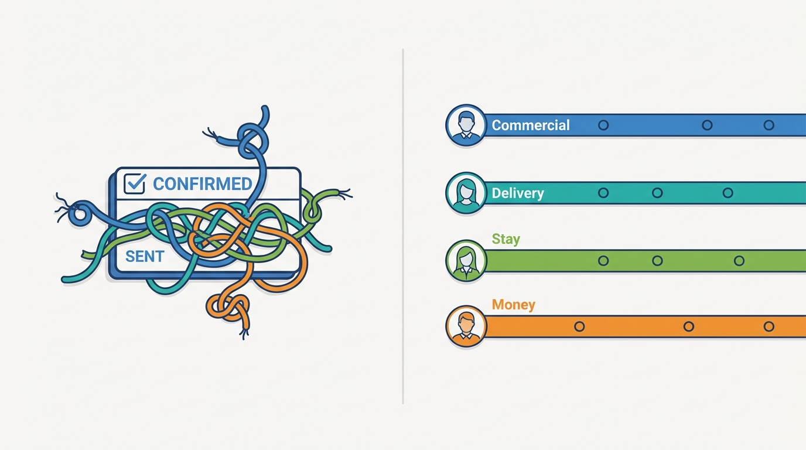
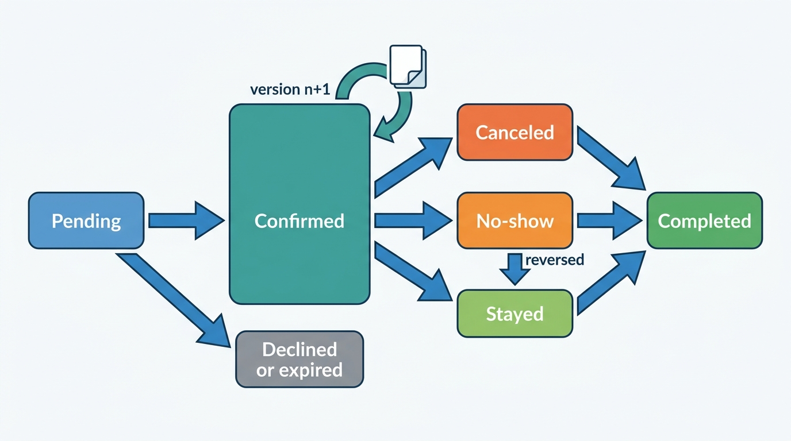
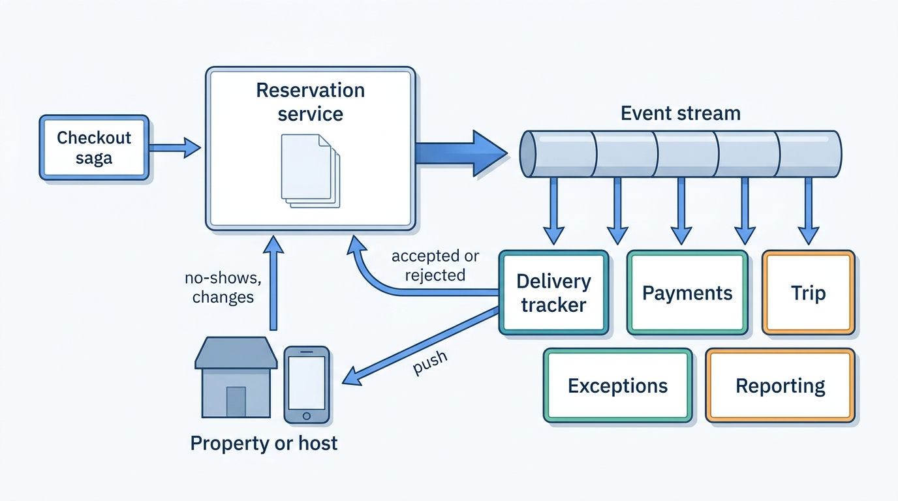
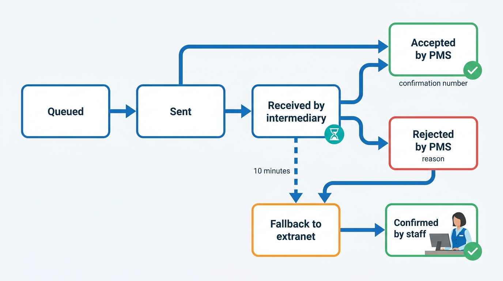
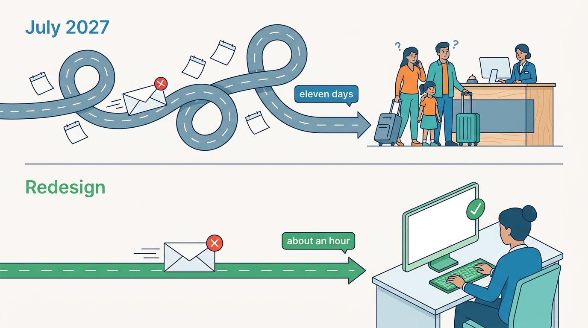

> **IN THIS CHAPTER, YOU WILL:** Design the reservation aggregate and its state machines, separate what was agreed from who knows about it and from what happened at the property, and build the delivery, pre-arrival verification, exception, no-show and completion machinery that keeps the guest, the marketplace and the property or host in agreement for weeks or months.

> **WHY THE BUSINESS CARES:** A guest who arrives to "we have no booking for you" is the most visible failure a stays marketplace can produce. The stay outcome also drives the money: payouts, commission invoices, virtual-card activation and tax reports all wait for a reservation to reach the right state.

> **WHY ARCHITECTS SHOULD CARE:** A reservation is replicated into systems the marketplace does not own and changed by parties it does not control, for months, without a shared transaction. Its state model, its event stream and the definition of "delivered" decide whether disagreements are found by a reconciliation job or by a guest at a front desk.

> **KEY POINTS:**
>
> * **A reservation is a versioned agreement, not a row with a status.** Keep four kinds of state apart: what was agreed (the commercial state and its versions), who knows about each version (delivery state per recipient), what happened at the property (stay state) and what was paid (money state, owned by payments). A single status field mixes all four and lies about at least one.
> * **"Delivered" means the supplier's system accepted this version and gave it a number, and that fact is checked again before arrival.** Acknowledgement from an intermediary is receipt, not delivery. A pre-arrival reconciliation of every arrival against the property's own records turns "booking not found at check-in" into an exception with a deadline, days before the guest travels.
> * **The stay outcome is the trigger for money, reviews and reporting, so get it from the right source.** Hotels report no-shows and departures; for homes the platform usually infers the stay from time passing without a dispute. Model arrival, no-show, stayed and completed as explicit, evented states with owners and clocks, or payouts, commission and regulatory reports will each infer them differently.

> **[FAILURE PATTERNS THIS CHAPTER ADDRESSES](where-stay-platforms-go-wrong.html):**
>
> * **Lost at the Front Desk** — a reservation marked "delivered" because a channel manager received it, never reached the hotel's property management system, and the first person to notice was the guest.
> * **Connectivity Roulette** — modifications and cancellations that fail on a partner's side leave two versions of the same reservation alive, and nothing compares them until the arrival date.
> * **The Hotel-Shaped Home** — one reservation state machine forced on both marketplaces either gives a single-calendar home a supplier-delivery process it does not need, or gives a hotel a host-approval step it never uses.

 
For the guest, a hotel booking is finished when the confirmation e-mail arrives. For the marketplace it has barely started. Before check-out the reservation is copied into a channel manager and a property management system, modified by the guest or the property, charged on a schedule, messaged about, and finally stayed, canceled or missed, over weeks or, for summer bookings, months. **A reservation is a long-lived, multi-party object whose state is replicated across systems the marketplace does not own**, and most of what goes wrong with it comes from that replication, not from the booking transaction.

This chapter takes over when the saga of [[checkout-orchestration]] confirms the reservation. It owns the **reservation state machine**, **reservation delivery** (what it means for the property or host to have the booking) and the **no-show**, and covers the reservation's events, exception queues, arrival, check-out, the completion triggers that release money and reviews, and the audit trail. Changes and cancellation policy belong to [[changes-and-cancellations]]; the guest's itinerary and messaging to [[trip-and-messaging]]; the transport of messages through the connectivity gateway to [[connectivity-and-channel-managers]]; and the oversold night to [[inventory-integrity]].

A Roomstead reservation and a Nookaway reservation are both promises of specific nights at a specific price; they differ in **who else holds a copy, who can change it, and who can tell the marketplace that the stay happened**, and those differences decide most of the architecture.

## Setting the Scene at Corvane: Nineteen Reservations Hotel Miradouro Never Had

Corvane, the fictional travel group this book follows (see [[meet-corvane]]), runs Roomstead, an OTA-style (online travel agency) accommodation marketplace, and Nookaway, a hosted-stays marketplace. **Hotel Miradouro**, an independent 84-room four-star hotel in Lisbon, sells on Roomstead through a cloud property management system (PMS) and Corvane Connect, the group's own channel manager. Its revenue manager, Duarte Silva, appears in [[connectivity-and-channel-managers]] for the €12 rate in March and in [[extranets-and-host-tools]] for a closure overwritten in September. This chapter is about July 2027; every figure is illustrative.

On the night of **Monday 5 July 2027**, at 23:30 Western European Summer Time, Miradouro's PMS vendor shipped a release that tightened validation of incoming reservations: a reservation whose rate plan code was not in the hotel's active rate table was now rejected instead of imported with a warning. Miradouro still sold four legacy rate plans on Roomstead, part of the 37 it kept through 2027 ([[rates-and-availability-model]]), whose codes the PMS had marked inactive months earlier. From that night, every reservation, modification or cancellation that referenced one of those codes bounced.

The bounce was invisible at Roomstead. Switchyard, Roomstead's connectivity gateway, pushed each reservation to Corvane Connect and received an HTTP 200 with Corvane Connect's own message ID within a second. That response meant "Corvane Connect has the message"; Switchyard recorded it as **acknowledged**, and Keystone, Roomstead's Java and Oracle monolith, which still owns reservations, set the reservation's `SENT_FLAG`. Corvane Connect then forwarded the reservation to the PMS, received "unknown rate code", retried five times over an hour, moved the message to a "failed deliveries" list in its hotel dashboard and e-mailed the hotel's shared reservations inbox, which also receives every channel's confirmation copies. Nobody opened the list or read the e-mail.

The first affected guest arrived on Saturday 10 July; the front desk could not find the booking, and the night manager re-created it by hand from the guest's phone. The same happened on Tuesday 13 July. On **Friday 16 July at 18:40** a family from Lyon arrived for two nights at a full hotel. Roomstead partner support opened the reservation in Keystone and saw "delivered 6 July 14:03". The family was walked to a hotel in Belém; Roomstead customer service paid **€390** for the difference and the taxi and recovered it from Corvane Connect, following the €12-rate precedent that a Corvane Connect fault must not leave the hotel paying.

When Corvane Connect's support team traced the rejection the next morning, the list for Miradouro held **33** failed messages since 5 July:

| Failed message | Roomstead | Other channels | Effect at the hotel |
| --- | --- | --- | --- |
| New reservations on legacy rate plans | **19** (44 room nights) | 7 | Guests unknown to the PMS; rooms still on sale everywhere |
| Modifications of earlier reservations | 3 | 0 | The PMS kept the old dates or room type |
| Cancellations of earlier reservations | 4 | 0 | 11 room nights held for guests who had canceled, withheld from every channel |

Three of the 19 Roomstead guests had already arrived; 16 were still to come, the furthest in October. The four failed cancellations had the opposite effect: rooms held for guests who were not coming, withheld from every channel.

Mariana Costa, Group Chief Architect, asked a question Roomstead could not answer: **how many other properties are in this state right now?** Keystone recorded only what Switchyard had sent. Aisha Rahman, VP Supply and Connectivity, ran a one-off comparison through Corvane Connect, the only partner whose records Corvane could read directly. Of about **260,000** Roomstead reservations arriving at Corvane Connect hotels in the next 30 days, **1,040** (0.4%) disagreed with the PMS: **610** missing, **260** at a different version (dates, room type or guests), **170** canceled on Roomstead but still active in the PMS. Nobody knew the rate for the other 139 certified connectivity partners.

The question for the architecture forum of One Stay, the group program that decides what Roomstead and Nookaway share, was not "how do we fix a PMS release" but **"what is a reservation's state, who may change each part of it, and how do we know that the property has the version the guest has?"**

## What a Reservation Is

The words first, because contracts and metrics depend on them.

| Term | Definition used in this book |
| --- | --- |
| **Reservation** | The marketplace's record of an agreement that a guest will stay at a property or home on specific nights, under specific terms, for a specific price. One reservation may hold several rooms. |
| **Reservation version** | One immutable state of the agreement's terms. A modification creates a new version; the reservation's identity does not change. |
| **Booking snapshot** | The commercial terms taken at confirmation and at each version (room type or listing, occupancy, rate plan, policies, itemized price, payment arrangement, content version), independent of later catalog changes ([[property-and-listing-model]]). |
| **Reservation delivery** | Making a reservation version known to every party that must act on it (PMS, channel manager, host, co-host), with proof that each one has it. |
| **Acknowledgement** | A recipient's statement that it has a version. A channel manager's acknowledgement proves receipt by the channel manager, not acceptance by the PMS. |
| **No-show** | A guest who neither arrives nor cancels; usually reported by the supplier, and it changes commission, fees and payouts. |
| **Completion** | The point after the stay when nothing more can change the money or reputation outcome: review windows closed, claims settled, final settlement posted. |
| **Reservation exception** | A reservation that needs a human decision before a deadline ([[extranets-and-host-tools]] owns the work queue). |

### Why a single status field fails

Keystone's reservation table has one `STATUS` column with values such as `CONFIRMED`, `CANCELLED`, `NOSHOW` and `MODIFIED`, and a separate boolean `SENT_FLAG`. Miradouro's reservations were `CONFIRMED` and sent. Both were true, and together they said something false.

A reservation carries at least four independent kinds of state, each with its own owner and clock:

| Dimension | Question it answers | Who changes it | Typical values |
| --- | --- | --- | --- |
| **Commercial state** | What is the agreement now? | Guest, property or host, marketplace (within policy) | Pending, confirmed, canceled, plus the current version |
| **Delivery state** | Who knows about which version? | Delivery service, from recipients' responses | Per recipient and version: queued, sent, received, accepted, rejected, fallback |
| **Stay state** | What happened at the property? | Property or host reports; time passes | Upcoming, arrival due, in stay, no-show, stayed |
| **Money state** | What was charged, held, paid out or invoiced? | Payments and settlement ([[stay-payments]], [[payouts-and-settlement]]) | Per payment plan: authorized, charged, refunded; payable, paid out; commission invoiced |

Mixing them in one field produces three defects. `MODIFIED` is a fact about history, not a state, and hides whether the modification was delivered. A canceled reservation that the PMS still holds is `CANCELLED` in the marketplace and active at the hotel, and no field can say so. And money logic starts reading reservation status, which is how a reservation switched from pay-at-property to "Pay now" was commission-invoiced in the April 2027 audit of [[merchant-and-agency-models]].

**The rule I use: one owner per dimension, one event stream for all of them, and no consumer that infers one dimension from another.** Payments may react to "stayed"; it may not decide it.

**Figure 1:** *A single status field mixes four kinds of state and lies about at least one; commercial, delivery, stay and money state each need their own owner.*

### The commercial state machine

The Productscape reference models list a "Reservation State Machine" inside the accommodation model's inventory and reservations brick without defining it, and the hosted-stays model has none at all ([[stays-capability-map]]). No company has published its internal reservation state machine; the version below is my reference model, built from states visible in partner APIs and help pages, not a description of any company's system.

**Figure 2:** *The commercial lifecycle of a reservation, as a reference model. Modification is a new version of a confirmed reservation, not a state; canceled, no-show and stayed are all outcomes that later settle into completed. Delivery, stay detail and money run as separate machines beside this one.*

Five choices in this machine are deliberate.

1. **Pending is short and has a reason.** The checkout saga creates the reservation as pending, invisible to the property; most reservations leave that state at the saga's pivot within seconds, and an abandoned attempt closes it as expired ([[checkout-orchestration]]). It stays pending longer only while a named gate is open, with an expiry: a host's decision on a request to book (24 hours at Nookaway), identity verification, or a bedbank or wholesale supplier that confirms synchronously.
2. **Modification is a version, not a state.** A date change creates version 2 of a confirmed reservation, recording what changed, who asked, who accepted and the price difference. Expedia's Rapid API shows the external form: a partner retains "the original itinerary number through a hard change" ([Expedia Group, Hard Change](https://developers.expediagroup.com/rapid/lodging/manage-booking/hard-change), n.d., live October 2026).
3. **Canceled carries a cause and an initiator**: guest under policy, property or host, platform under a disruption or regulatory order, fraud, payment failure. The cause decides refunds and penalties ([[changes-and-cancellations]]).
4. **No-show is reversible for a while.** Late arrivals get marked as no-shows and guests dispute no-show fees; reversal within a window is cheaper than a support case that edits money by hand.
5. **Completed is a real state.** Without it every downstream system defines "finished" for itself, and the reservation is never closed in any sense an auditor would accept.

Relocation, when an oversold guest is walked to another property, is **not** a state of the original reservation. [[inventory-integrity]] models it as a linked reservation with a cause code and a liable party; the original ends canceled with cause "relocated".

### The clocks

The lifecycle has more clocks than most teams write down. Corvane's set, after the redesign described below:

| Clock | Starts | Duration (Corvane 2027) | On expiry | Owner |
| --- | --- | --- | --- | --- |
| Host decision on a request to book | Request created | 24 hours (Nookaway) | Request expires; authorization released | Nookaway reservations |
| Delivery escalation | Version sent to a connected partner | 10 minutes without acceptance | Copy to the Partner Hub inbox with an alert ([[connectivity-and-channel-managers]]) | Switchyard |
| Delivery exception | Version not accepted and arrival within 7 days | 20 minutes | Exception to the property's front-office queue ([[extranets-and-host-tools]]) | Exception service |
| Pre-arrival verification | Arrival minus 7 days, then minus 48 hours | One check each | Mismatch becomes an exception with a deadline | Reservation service |
| At-risk arrival escalation | Exception still open | 3 hours before arrival | Roomstead partner support takes the case | Partner support |
| No-show reporting window | 00:00 local time on arrival day | Until 72 hours after scheduled check-out | Reservation becomes stayed by default | Reservation service |
| Host payout release | Scheduled check-in | 48 hours (Nookaway) | Payout released unless a check-in issue is open | Settlement |
| Completion | Scheduled check-out | 14 days (Nookaway); end of the no-show window plus invoicing (Roomstead) | Reservation completed | Reservation service |

The durations matter less than the principle: each is a **named, configurable timer with an owner and an expiry action**. In Keystone most of these clocks did not exist, because there was no state for an unaccepted delivery.

## Architecture: The Reservation Service and Its Neighbors

The architecture question is which service owns which part of the reservation, and how the others learn about changes.

**Figure 3:** *The reservation service owns the agreement and its states and publishes every change once. Delivery, exceptions, money, the guest's trip and regulatory reporting consume the stream; only the reservation service changes the reservation, and only the delivery tracker writes delivery state.*

| Component | Responsibility | Owns | Must not |
| --- | --- | --- | --- |
| **Reservation service** | Hold the reservation aggregate, apply commands (confirm, modify, cancel, report no-show, mark stayed), enforce the state machine | Versions, snapshots, commercial and stay state, identifiers | Charge, pay out, or talk to partners directly |
| **Delivery tracker** | Turn each version into delivery work per recipient; record received, accepted or rejected; escalate on clocks | Delivery state per recipient and version | Change the reservation's commercial state |
| **Connectivity gateway** (Switchyard, Nookaway partner API) | Transport, ordering, partner protocols, retries ([[connectivity-and-channel-managers]]) | Messages and partner sessions | Decide that a reservation is delivered without the recipient's response |
| **Exception service** | Derive work items from events and deadlines; route to roles; escalate | Exception cases and their state | Hold its own copy of reservation truth |
| **Payments and settlement** | Payment plans, virtual cards, payouts, commission invoices ([[stay-payments]], [[payouts-and-settlement]]) | Money state | Infer stay outcomes from status strings |
| **Trip and messaging** | Itinerary, check-in instructions, notifications, review invitations ([[trip-and-messaging]]) | Conversations, notifications | Modify reservations outside the reservation service |
| **Reporting** | Tax, platform reporting, short-term-rental activity data, analytics | Derived datasets | Read from the operational database instead of events |

### The aggregate: versions, snapshots and identifiers

A sketch of what the One Stay reservation contract holds:

| Part | Content | Why |
| --- | --- | --- |
| **Identity** | Marketplace reservation ID; brand; property or listing ID from the place registry; unit when known | Stable across versions; the key every partner deduplicates on |
| **External identifiers** | Channel manager ID, PMS confirmation number per room, bedbank or supplier reference, each with the system that issued it | The front desk searches by the PMS number; the guest quotes the marketplace number |
| **Versions** | Ordered list: version number, effective time, initiator, reason, the booking snapshot, the diff from the previous version | Modifications are auditable and reversible; partners apply versions in order |
| **Commercial state** | Current state, cause and initiator of cancellation | Figure 2 |
| **Stay state** | Arrival due, in stay, no-show, stayed; source of each fact (property report, host report, inferred by timer) | Money and reporting need to know whether "stayed" was reported or assumed |
| **Guest and party** | Booker, lead guest, number of adults and children (ages where tax requires them), country of residence | Delivery, tax ([[taxes-on-stays]]), short-term-rental reporting |
| **References** | Payment plan and payment arrangement ([[merchant-and-agency-models]]), discount lines ([[promotions-and-loyalty]]), quote ID ([[property-page-and-room-selection]]), conversation ID, linked reservations (relocation) | Other contexts own these; the reservation points to them |

Two design rules make this work. First, **versions are append-only**: a modification adds a snapshot and never overwrites one. OpenTravel modification messages behave this way on the wire; SiteMinder's documentation describes `OTA_HotelResModifyNotifRQ` as "a full overlay of the reservation" (search excerpt, n.d.). Second, **the snapshot is taken from the quote, not re-read from the catalog**, so a policy edit the day after booking does not change the reservation. Full event sourcing of the aggregate is a separate decision, compared under Trade-offs; I would not require it.

### Reservation delivery: a state per recipient and version

Delivery is where Miradouro failed, and the failure was semantic, not technical. Switchyard's transport worked. What failed was the meaning of "acknowledged".

**Figure 4:** *Delivery state for one version and one recipient. "Received by intermediary" is not an end state: only acceptance by the system the front desk uses, or a person at the property confirming the booking, closes delivery. A rejection carries its reason and goes to a person, not back into a retry loop.*

The rules that follow:

- **Three levels of acknowledgement, recorded separately.** *Sent* (the gateway transmitted), *received* (an intermediary has it), *accepted* (the property's system of record has it and returned its confirmation number). Only *accepted* or a human confirmation closes delivery. Booking.com's queue draws a similar line: it "waits until you acknowledge receiving the reservations successfully" ([Booking.com, Acknowledging new reservations](https://developers.booking.com/connectivity/docs/reservations-api/acknowledging-new-reservations-ota), n.d., live October 2026), but whether that acknowledgement comes before or after the PMS accepts is invisible to the channel.
- **Rejections are first-class.** "Unknown rate code" at Miradouro was a clear message that stopped one hop short of anyone who could act on it; a PMS rejection must travel back through the intermediary with its reason.
- **Delivery is per version.** Version 1 accepted and version 2 rejected means the hotel holds the old dates, as with Miradouro's three failed modifications. "Current version accepted" is the condition that matters.
- **The fallback is a work item, then sticky.** Booking.com e-mails a reservation to the property if it is not acknowledged within 30 minutes, extendable to 24 hours ([Booking.com, Reservations API overview](https://developers.booking.com/connectivity/docs/reservations-api/reservations-overview), n.d., live October 2026). The fallback that closes the gap is an extranet work item someone must confirm, and later versions follow it to the same channel ([[connectivity-and-channel-managers]]).
- **The guest-facing confirmation does not wait for delivery.** The marketplace confirms on its own commitment and takes on the duty to deliver; the delivery tracker discharges that duty.

For a hosted-stays marketplace most of this machinery collapses: for a host working in the app, the platform's calendar is the system of record and "delivery" is a notification. Delivery reappears for professional managers on Nookaway's partner API. Vrbo's help pages show the cost of skipping the acceptance level: for integrated managers, request status can take up to 24 hours to update in Vrbo's dashboard ([Vrbo Help, About booking requests for integrated accounts](https://help.vrbo.com/articles/IPM-About-booking-requests-for-integrated-accounts), n.d., live October 2026).

### Verifying before arrival

Delivery state says what the property accepted, not what it still holds a week later: a manual merge at the front desk, a room move that splits the booking or a PMS migration can lose an accepted reservation. **The cheapest moment to find a disagreement is a few days before arrival, when it is a phone call, not a walk.**

A pre-arrival reconciliation compares, per property and arrival date, the marketplace's active reservations at their current version with the property's own records. There are three ways to read the property's side:

| Method | How it works | Coverage | Cost |
| --- | --- | --- | --- |
| **Read-back** | The partner exposes an API that returns the PMS's reservations for a date range; the marketplace compares | Partners that build it | Partner development; certification test |
| **Arrivals manifest** | The marketplace sends an arrivals list with its IDs and versions; the partner answers per line "held, at this version, PMS number X" | Any partner that can process a list | One message per property per check |
| **Human confirmation** | Partner Hub shows the front office the arrivals list for the next 48 hours with a "confirm all" action and per-line problems | Extranet-managed and small properties | Staff attention; works only if it is a short task |

Read-back is the strongest and the rarest; I found no public channel that documents a reservation read-back as a partner obligation. The arrivals manifest is my recommendation for the general case, because it reuses the delivery channel and asks a question the partner can answer from its own database; it is an inference about good practice, not a documented standard. Printing the PMS confirmation number on the guest's confirmation once delivery is accepted also removes the "not found" that is really "searched by the wrong number".

### Supplier-originated transitions

Not every change starts with the guest. Hotels report no-shows, invalid cards and departures; hotels and hosts change dates on request; channel managers send cancellations the guest made by phone. These **inbound** transitions need the same discipline as outbound delivery: idempotent on the marketplace's reservation ID plus the partner's message ID, applied in order, rejected when they refer to a stale version.

Booking.com's Reporting API shows the shape. A property can mark a no-show "from 00:00 (midnight, in property's local time) on the planned check-in date" until 48 hours after the planned check-out date, with a `waived_fees` flag; if the fee is waived, Booking.com charges no commission. Invalid credit cards can be reported until midnight on the arrival day ([Booking.com, B.XML Reporting API](https://developers.booking.com/connectivity/docs/reporting-api/b_xml-reporting/), n.d., live October 2026). Expedia's Retrieve API "will reflect the latest check in/out dates in case of a change made by the property" ([Expedia Group, About the Manage Booking API](https://developers.expediagroup.com/rapid/lodging/manage-booking/about-mg-booking-api), n.d., live October 2026).

Three consequences for the design:

- **The reservation service accepts supplier commands within rules.** A no-show report is valid only in its window; a property's date change creates a version with initiator "property" and goes to the guest for information or consent.
- **Inbound commands change money downstream.** A waived no-show fee removes commission; an invalid-card report starts a payment-recovery clock. The reservation service publishes the transition; payments reacts.
- **Absence is also a signal.** For agency bookings the marketplace learns only that no no-show was reported before the window closed, and treats the reservation as stayed. Commission invoicing depends on that default ([[payouts-and-settlement]]), so it must be recorded as "inferred", not "reported".

### Reservation events as the backbone

Every consumer in Figure 3 learns about reservations from events; that is the only way the trip timeline, the payout scheduler, the review invitation, the exception queue, the tax engine and the warehouse can agree without polling the reservation database. At Corvane the reservation publishes one event type, `reservation.versioned`, carrying the full contract at each version and a change type; delivery responses travel as separate delivery events ([[event-driven-stays]] owns the contract and the mechanics: outbox or change data capture, per-reservation ordering, idempotent consumers, versioned schemas).

| Change or event | Published when | Main consumers |
| --- | --- | --- |
| `created` (version 1) | Reservation confirmed | Delivery, payments (payment plan), trip, personalization (close the search intent), reporting |
| `modified` | Modification accepted | Delivery, payments (price difference), trip, tax |
| `cancelled` | Any cancellation, with cause and initiator | Delivery, payments (refund and penalties), inventory (release nights), trip, reviews (suppress) |
| Delivery event | A recipient received, accepted or rejected a version | Exception service, partner health metrics, support context |
| `no-show` | Supplier report within the window; a reversal is a later version | Payments (fees, commission), support |
| `stayed` | Check-in or check-out reported, or inferred from the clock, with its source | Payout release (homes), reviews (invitation), commission invoicing |
| `completed` | Windows closed and settlement final | Archival, retention timers, analytics |

Clock-driven moments such as arrival day are computed from the reservation's dates in the property's time zone. Airbnb described in 2018 a change-data-capture service, SpinalTap, chosen over dual writes because reading the log "supports strong consistency and ordering guarantees on commit time" ([Airbnb Engineering, Capturing Data Evolution in a Service-Oriented Architecture](https://medium.com/airbnb-engineering/capturing-data-evolution-in-a-service-oriented-architecture-72f7c643ee6f), 2018; the current state is not public).

Two choices specific to reservations matter more than the transport:

- **Events carry the version, not just the ID.** A consumer that receives "reservation 123 changed" and reads the current state may skip a version; one that receives "version 3 of reservation 123" can apply versions in order and detect gaps.
- **Events carry the stay facts with their source.** "Stayed, inferred at window close" and "stayed, reported by the property" are different facts for commission disputes and for the European Union's short-term-rental activity data.

### Exceptions and the reservation inbox

Exceptions are the reservations that need a person. [[extranets-and-host-tools]] designs the work queue; this chapter supplies the rules that create items, each a state combination defined above:

| Rule | Condition | Deadline | Escalates to |
| --- | --- | --- | --- |
| Undelivered | Current version not accepted 20 minutes after sending, arrival within 7 days | Arrival minus 3 hours | Partner support |
| Rejected | Recipient rejected a version, with reason | Same | Partner support, plus the connectivity partner |
| Pre-arrival mismatch | Manifest or read-back disagrees with the current version | Arrival minus 3 hours | Partner support |
| Cancellation not applied | Canceled on the marketplace, still held by the property | Next arrival date of that room type | Partner support (availability is affected for all channels) |
| No-show to report | Arrival day passed, no check-in or no-show fact, property reports no-shows | End of the reporting window | None; the default applies |
| Host decision due | Request to book or modification awaiting the host | The request window | Request expires automatically |

Customer service reads the same queue ([[customer-service]]). Had it existed on 16 July, the partner support agent would have seen "rejected by PMS: unknown rate code" instead of "delivered".

### Arrival, no-show, check-out and completion

The second half of the lifecycle releases money and reputation, which is why its triggers need explicit definitions.

**Arrival** starts check-in instructions and access codes for homes ([[trip-and-messaging]]), virtual-card activation on a flexible-rate Pay with Roomstead booking ([[stay-payments]]), and the window in which a guest can report a failed check-in, which at Nookaway stops the host payout and opens a guest-guarantee case ([[protection-and-incidents]]).

**No-show** is a supplier fact at hotels, common enough that hotels overbook to offset it ([[inventory-integrity]]), and a rare, low-information event at homes, where a prepaid guest who never arrives costs the host nothing and the platform often never learns of it.

**Stayed** is the trigger for most money. Airbnb remits to the host "generally ... on the business day after the scheduled check-in" ([Airbnb Form 10-K for 2025](https://www.sec.gov/Archives/edgar/data/1559720/000155972026000004/abnb-20251231.htm), 2026); Booking Holdings recognizes revenue "when the traveler checks in" ([Booking Holdings Form 10-K for 2025](https://www.sec.gov/Archives/edgar/data/1075531/000107553126000009/bkng-20251231.htm), 2026); Expedia records agency revenue "when the stayed night occurs" ([Expedia Group Form 10-K for 2025](https://www.sec.gov/Archives/edgar/data/1324424/000132442426000008/expe-20251231.htm), 2026). The stay, not the booking, moves the money, so the state machine must produce the stay facts the ledger needs, when finance expects them.

**Completion** closes the reservation: review windows closed ([[reviews-and-reputation]]), claims settled, final settlement and commission posted. An open damage claim or chargeback sets a **disputed** flag that holds completion without changing the commercial outcome, until the claim or payments service closes the dispute.

### Auditability and retention

A reservation is evidence of a contract, a fee earned, tax collected and nights rented in a regulated city. Three obligations shape the record.

- **Tax and platform reporting.** The EU's Directive on Administrative Cooperation (DAC7) requires platform operators to keep the records behind their reports "for a period of not less than 5 years but not more than 10 years following the end of the Reportable Period" ([Council Directive (EU) 2021/514](http://publications.europa.eu/resource/celex/32021L0514), 2021), which favors immutable versions over overwritten rows.
- **Short-term-rental activity data.** Regulation (EU) 2024/1028, applying from 20 May 2026, requires platforms to send monthly, per unit in areas with a registration procedure, nights rented and guests per night "along with the country of residence of each guest" ([Regulation (EU) 2024/1028](http://publications.europa.eu/resource/celex/32024R1028), 2024). That is a stay fact: canceled reservations must not be counted ([[stays-regulation]]).
- **Data minimization.** Under the General Data Protection Regulation (GDPR), personal data stays identifiable "for no longer than is necessary" ([Regulation (EU) 2016/679, Art. 5](http://publications.europa.eu/resource/celex/32016R0679), 2016), so personal data sits in a separable part of the aggregate that a retention job can pseudonymize while amounts, dates, listing and country of residence remain.

The audit trail comes from the version list. Support agents change a reservation through the same commands as everyone else, with their identity and a reason code, never by editing a row.

## In Practice: Public Evidence and Corvane's Redesign

### What the public record shows

No company has published its internal reservation state machine or delivery tracker. The public record (partner API contracts, help-center rules and filings) is consistent: delivery is at least once with acknowledgement and a human fallback (Booking.com polls "once per twenty seconds", redelivers until acknowledged and e-mails after 30 minutes; [retrieving new reservations](https://developers.booking.com/connectivity/docs/reservations-api/retrieving-new-reservations-ota), n.d.); push delivery expects the PMS confirmation number in the response (Expedia's Booking Notification API, seen only as search excerpts of login-gated partner pages); suppliers originate transitions within windows; and money follows the stay.

> **INFERENCE, NOT DOCUMENTED:** From the public contracts one can infer that these marketplaces track delivery per reservation, since a 30-minute fallback or a required confirmation number only makes sense if something records whether it arrived. How they store reservation versions, what states they use internally, and whether they reconcile arrivals with partners are not public. The reference model in this chapter is built from the external contracts and engineering principles, not from any company's description of its systems.

The industry's PMS side confirms why delivery cannot end at the channel manager. SiteMinder's PMS interface documentation (seen as search excerpts) says an undelivered message should be "retained in the partner PMS application's retry cycle and resent once the error is resolved", and that resend "may need to be done manually upon expiry of retry cycle". Manual resend at the end of a retry cycle is precisely the step that failed at Miradouro: the cycle expired into a dashboard list no one read.

### Corvane's redesign: four decisions from August 2027

The architecture forum took the Miradouro case in August 2027, framed around the One Stay reservation contract (shared contract, separate engines), and made four decisions.

**1. Acceptance, not receipt, closes delivery.** Switchyard's 2028 certification requires connectivity partners to report receipt, then PMS acceptance with its confirmation number or rejection with a reason code from a published list ("unknown rate code", "room type not mapped", "property closed", "duplicate"). Partners that cannot report acceptance are certified at a lower tier, and their reservations are confirmed by staff through Partner Hub's arrivals task. Corvane Connect, held to the same rules as every partner ([[connectivity-and-channel-managers]]), committed to acceptance reporting by the end of Q4 2027.

**2. A reservation service outside Keystone, starting as a tracker.** Keystone's reservation module retires only by the end of 2029. The new reservation service, **Stayline**, owner of the One Stay reservation contract, starts as a consumer of Keystone's and Burrow's reservation events that maintains versions, delivery state and stay state for both brands (Q4 2027), then becomes the system of record for new Nookaway reservations (2028) and Roomstead reservations (2029). The first stage alone answers July's missing question: which reservations arriving this week has the property not accepted?

**3. Pre-arrival verification for every Roomstead arrival.** At 7 days and 48 hours before arrival, Stayline sends an arrivals manifest through Switchyard to partners that support it, and Partner Hub shows the 48-hour list to extranet-managed properties as a task. Mismatches become exceptions with the escalation clock of [[extranets-and-host-tools]]. The target is **99.5%** of arrivals verified at 24 hours before arrival by the end of 2028.

**4. Stay facts with sources.** The no-show reporting window for Roomstead properties runs from midnight on the arrival day to **72 hours** after scheduled check-out; at its end, Stayline marks the reservation "stayed, inferred" unless a no-show was reported. Commission invoicing reads that fact, not Keystone's status. Nookaway completes a reservation **14 days** after check-out, when the review and claim windows close, unless a dispute is open.

### Replaying Miradouro under the redesign

The forum's replay, with the July timeline and the new rules:

| Time | July 2027, as it happened | Under the redesign |
| --- | --- | --- |
| 5 July 23:30 | PMS release starts rejecting legacy rate codes | Same |
| 6 July 14:03 | First Roomstead reservation on a legacy plan; Keystone records "sent" | Corvane Connect reports receipt, then "rejected: unknown rate code" about an hour later, after its retries |
| 6 July, ~15:10 | Rejection in Corvane Connect's dashboard and a shared inbox | Delivery tracker sets "rejected"; exception to Miradouro's front-office queue and an alert to Corvane Connect's support |
| 7 July | 2 more rejections | Duarte reactivates or remaps the four codes in the PMS; Corvane Connect resends the rejected versions |
| 10, 13 July | Guests arrive unknown, re-created by hand | Reservations already accepted with PMS numbers |
| 16 July 18:40 | Family walked to Belém; €390 | Not walked |
| Weekly | No check | 7-day and 48-hour manifests would have caught the four cancellations still held in the PMS within days, returning 11 room nights to sale |

The redesign does not remove the cause: PMS releases will keep tightening validation, and legacy rate plans remain until the 2028 pruning migration ([[rates-and-availability-model]]). It changes **the distance between the failure and the first person who can fix it**: from eleven days and a guest at the desk to about an hour and a revenue manager at a screen. The case rested less on the €390 than on Mariana's question, which nobody could answer: how many other properties are in this state right now?

**Figure 5:** *The redesign shortens the distance from a rejected reservation to the first person who can fix it: from eleven days and a guest at the desk to about an hour and a revenue manager at a screen.*

### Worked example: the Novaks' reservation at Nookaway

The hosted-stays lifecycle is simpler at the delivery end and more inferential at the stay end. The Novak family from Prague booked an Alfama apartment on Nookaway on **14 February 2027** for **2–9 August**, **€1,271.20** in total ([[taxes-on-stays]] itemizes it).

| Date | Lifecycle event | Source of the fact | Consequence |
| --- | --- | --- | --- |
| 14 Feb | Confirmed, version 1 | Checkout saga | Calendar nights claimed in Almanac; snapshot taken; host notified in the app; payment plan created |
| 14 Feb | Delivery to the host: accepted | The host's app is Nookaway's own system | No external acknowledgement needed |
| 2 Aug | Arrival due | Clock | Check-in instructions released; check-in failure window opens |
| 2 Aug | Stay started | Inferred: scheduled check-in passed, no issue reported | Payout clock starts |
| 4 Aug | Host payout released | 48 hours after check-in, no open issue | Host payable of €1,041.60 paid out ([[payouts-and-settlement]]) |
| 9 Aug | Stay completed | Inferred at scheduled check-out | Review invitations to both sides; turnover task for the cleaner |
| 23 Aug | Reservation completed | Clock: 14 days after check-out, no dispute | Reservation closed; retention timers start; nights and four guests from Czechia counted in activity data |

Every stay fact here is inferred from time and the absence of a complaint, which is acceptable for hosted stays provided the record says "inferred". The **Dubrovnik damage claim** shows the alternative: when Ivan Horvat claimed after the party at his villa on 14 August 2027, Burrow's nightly job had already closed the reservation, so the €3,800 claim, the €3,450 reimbursement and the €900 recovered from the guest attached to a reservation that, in the data, ended without incident. Under Stayline the claim sets the disputed flag and holds completion.

## Trade-offs

| Choice | Option A | Option B | When A is right | When B is right |
| --- | --- | --- | --- | --- |
| **Reservation storage** | Mutable row with a status, plus an audit table | Append-only versions with current-state projection | Small platforms with few modifications and no partner delivery | Any marketplace with partner delivery, modifications, tax reporting or disputes |
| **Event sourcing** | Versions plus an outbox | Full event sourcing of the aggregate | Most teams: simpler queries, enough audit and replay | Teams that need to rebuild projections often and can carry the tooling |
| **State model** | One status enum | Separate commercial, delivery, stay and money states | Single-channel homes with no PMS and no deferred payments | Everything else; required once delivery or deferred money exists |
| **Delivery closure** | Intermediary receipt | Acceptance by the property's system or by a person | Never as the closing state; acceptable as a progress state | Always the closing state |
| **Pre-arrival verification** | None; rely on delivery | Manifest or read-back before arrival | Platforms whose calendar is the system of record | Any supply where the property holds its own copy |
| **Stay facts** | Inferred from time | Reported by the property or host | Homes, agency hotels without stay reporting | Hotels with PMS integration; any stay where money depends on the fact |
| **Ownership across brands** | One reservation engine for both marketplaces | One contract, separate engines | A group starting from scratch with one supply model | Groups with different supply models and legacy engines (Corvane) |

The row argued most is event sourcing. A reservation is a natural event log, but the versions are the events that matter; delivery responses and stay facts are better kept as small state machines with their own events than folded into one replayable stream that every support query must project.

## Hotels and Homes: Where the Two Marketplaces Differ

| Dimension | Accommodation marketplace (Roomstead) | Hosted-stays marketplace (Nookaway) |
| --- | --- | --- |
| **Where the reservation lives** | Copies in the marketplace, the channel manager and the PMS; the PMS is what the front desk uses | The platform is usually the system of record; copies exist only for PMS-connected managers |
| **Delivery** | The core problem: push or pull, acknowledgement, acceptance, fallback, pre-arrival verification | A notification to the host's app; full delivery only for managers on the partner API (53% of Nookaway's multichannel listings sync by API) |
| **Pending states** | Rare for direct supply; common for bedbank supply that confirms asynchronously | Request to book: 24-hour host decision on the 32% of listings without instant book |
| **Who changes it after booking** | Guest, property (dates, room moves, no-shows), marketplace support | Guest and host by mutual request; platform under policy |
| **No-show** | Reported by the hotel within a window; changes commission and fees | Rarely known; the guest has usually paid in advance |
| **Stay facts** | Reported (connected PMS) or inferred at the end of the no-show window | Inferred from time; a check-in issue or claim overrides |
| **What the stay triggers** | Commission invoices on departed stays, virtual-card activation, merchant revenue | Host payout 48 hours after check-in, review invitations, protection windows |
| **Typical failure** | Lost at the Front Desk: the PMS never accepted the booking | The double-booked night from a stale external calendar ([[calendar-sync]]); an inferred stay that was disputed |
| **Regulation** | Guest registration duties sit with the hotel; DAC7 excludes sellers with more than 2,000 rentals of one listing in a period, which covers most large hotels | STR activity data per unit and month; DAC7 for most hosts |

**What to share.** The reservation contract, event catalog, state definitions and clocks should be one group design, and eventually one service, because the guest, the money and the regulators see one kind of object. The delivery tracker can be shared too, since Nookaway's PMS-connected managers need the same three acknowledgement levels as hotels. What must not be shared is the assumption that every reservation has an external copy: forcing an in-app host's reservation through hotel delivery machinery is **The Hotel-Shaped Home**, and inferring the stay from time is wrong for a hotel whose PMS can report the departure.

## Failure Modes

| Failure | What it looks like | Prevention |
| --- | --- | --- |
| **Receipt treated as delivery** (Lost at the Front Desk) | "Delivered" in the marketplace; unknown at the desk | Acceptance with a PMS number as the only closing state; rejections forwarded with reasons |
| **Version split** | The hotel holds version 1 after the guest changed dates | Delivery state per version; manifests compare versions, not just IDs |
| **Cancellation not applied** | Rooms held for guests who are not coming; availability understated on every channel | Exception rule for cancellations not accepted; pre-arrival comparison |
| **Fallback as e-mail** | The reservation reached a shared inbox | Fallback as a work item with an owner and a deadline |
| **Status as a dumping ground** | `MODIFIED`, `PENDING_PAYMENT`, `NOSHOW_DISPUTED` in one column; payouts and invoices read it differently | Separate state dimensions; payments reacts only to stay events with source and time |
| **Silent stay inference** | A nightly job marks everything "stayed"; disputes and claims attach to closed reservations | Inferred facts recorded as inferred; a disputed flag that holds completion |
| **Retries that create duplicates** | A partner receives the same reservation twice and creates two PMS bookings | Deduplication on the marketplace ID, tested in certification |
| **Support edits outside the model** | Agents change dates in a back-office tool; no version, no delivery | All changes through the reservation service's commands |

## The Chief Architect's View

At group scale the reservation is the object that crosses every boundary in the book. The decisions I would put on the architecture forum's agenda:

**1. Define the reservation contract before the service**: identity, versions, snapshot contents, the four state dimensions, the clocks and the event catalog, for both brands. Owner: the Group Chief Architect with both reservation teams; payments, tax and regulatory affairs as mandatory reviewers, because they consume stay facts.

**2. Make acceptance a certification requirement.** Acceptance and rejection reporting, deduplication on the marketplace ID and arrivals manifests belong in connectivity certification, with deadlines and tiers. Owners: Aisha Rahman for Roomstead, Rafael Mendes for Nookaway's partner API.

**3. Measure the gap between the marketplace and the property**, per partner, property and brand: versions accepted within 10 minutes, arrivals verified 24 hours before arrival, and "not found at check-in" cases per 10,000 arrivals, published in partner health scores.

**4. Keep a single writer per dimension.** Reservation service for commercial and stay state, delivery tracker for delivery state, payments for money state; support tools go through the owning service's commands. Keystone's `PAYMENT_TYPE` and `SENT_FLAG` columns broke this rule.

**5. Plan the migration around events, not tables.** Building Stayline as a consumer of contract events gives the cross-brand view years before the engines move. Until a brand moves, Stayline is labeled a projection, and disagreements with the engine are Stayline defects.

**6. Govern retention as a design input.** Noor van Dijk's team owns the retention schedule; engineering owns the ability to apply it per field group.

What to watch: the share of stay facts that are inferred rather than reported, which says how much of your money runs on assumptions; the number of states and reasons, which grows quietly unless someone owns the contract; and partners whose acceptance rate cannot be measured.

## Questions to Ask

1. If a hotel's PMS rejects a reservation after the channel manager has received it, how long until a person who can fix it knows, and who is that person?
2. Can you list, right now, the reservations arriving in the next seven days that the property has not accepted at their current version?
3. Which systems hold a copy of a reservation, and which one wins when they disagree?
4. Is a modification a new version with its own delivery state, or an overwrite of the old one?
5. What happens to a cancellation that the property fails to apply, and who notices the rooms it is still holding?
6. Which stay facts are reported and which are inferred, and does every consumer know which is which?
7. Which events trigger payouts, commission invoices, virtual-card activation and review invitations, and is each consumer idempotent on version?
8. If the group shares a reservation contract across brands, which parts are mandatory for both and which are optional per supply model?

The reservation's states describe what can happen to it; the policies decide what *should* happen when a guest, a property or a host wants something different from what was agreed. [[changes-and-cancellations]] builds the policy engine, the modification flows and the mass-disruption handling that turn the transitions in Figure 2 into fair, consistent decisions.

## Sources and Evidence

### Company engineering and investor sources

- [Form 10-K for fiscal year 2025](https://www.sec.gov/Archives/edgar/data/1559720/000155972026000004/abnb-20251231.htm) — Airbnb, Inc., 2026. Funds held until check-in; host remittance generally on the business day after scheduled check-in.
- [Form 10-K for fiscal year 2025](https://www.sec.gov/Archives/edgar/data/1075531/000107553126000009/bkng-20251231.htm) — Booking Holdings Inc., 2026. Revenue recognized at check-in; not reversed by cancellations.
- [Form 10-K for fiscal year 2025](https://www.sec.gov/Archives/edgar/data/1324424/000132442426000008/expe-20251231.htm) — Expedia Group, Inc., 2026. Agency revenue recorded when the stayed night occurs.
- [Capturing Data Evolution in a Service-Oriented Architecture](https://medium.com/airbnb-engineering/capturing-data-evolution-in-a-service-oriented-architecture-72f7c643ee6f) — Airbnb Engineering, 2018. Change data capture from the system of record to Kafka; may describe a replaced system.

### Standards, regulation and documentation

- [Understanding the Reservations API](https://developers.booking.com/connectivity/docs/reservations-api/reservations-overview) — Booking.com Connectivity, n.d. (live October 2026). Per-provider queue; e-mail fallback after 30 minutes, extendable to 24 hours.
- [Acknowledging new reservations (OTA)](https://developers.booking.com/connectivity/docs/reservations-api/acknowledging-new-reservations-ota) — Booking.com Connectivity, n.d. Redelivery until acknowledged.
- [Retrieving new reservations (OTA)](https://developers.booking.com/connectivity/docs/reservations-api/retrieving-new-reservations-ota) — Booking.com Connectivity, n.d. Polling once per twenty seconds.
- [B.XML Reporting API](https://developers.booking.com/connectivity/docs/reporting-api/b_xml-reporting/) — Booking.com Connectivity, n.d. No-show and invalid-card reporting windows; waived fees and commission.
- [Hard Change](https://developers.expediagroup.com/rapid/lodging/manage-booking/hard-change) and [About the Manage Booking API](https://developers.expediagroup.com/rapid/lodging/manage-booking/about-mg-booking-api) — Expedia Group Developer Hub, n.d. Itinerary number retained through modifications; property-made date changes.
- Expedia Booking Notification API requirements — Expedia Group, n.d., seen only as search excerpts (login-gated). Confirmation number returned in the response.
- SiteMinder pmsXchange reservations reference — SiteMinder, n.d., seen as search excerpts. Full-overlay modifications; manual resend after the retry cycle.
- [About booking requests for integrated accounts](https://help.vrbo.com/articles/IPM-About-booking-requests-for-integrated-accounts) — Vrbo Help, n.d. Status lag of up to 24 hours for PMS-integrated managers.
- [Council Directive (EU) 2021/514 (DAC7)](http://publications.europa.eu/resource/celex/32021L0514) — Council of the European Union, 2021. Record retention of 5 to 10 years after the reportable period.
- [Regulation (EU) 2024/1028](http://publications.europa.eu/resource/celex/32024R1028) — European Parliament and Council, 2024. Monthly activity data per unit: nights, guests, country of residence; applies from 20 May 2026.
- [Regulation (EU) 2016/679 (GDPR)](http://publications.europa.eu/resource/celex/32016R0679) — European Parliament and Council, 2016. Storage limitation.

### Research and practitioner sources

- Productscape travel-accommodations and hosted-stays reference models (author's sibling repository), n.d. "Reservation State Machine" and "Reservation Exception Controls" as named but undefined modules; generic models, not descriptions of any company.

Corvane is fictional; architectural recommendations and labeled inferences are the author's judgement.
