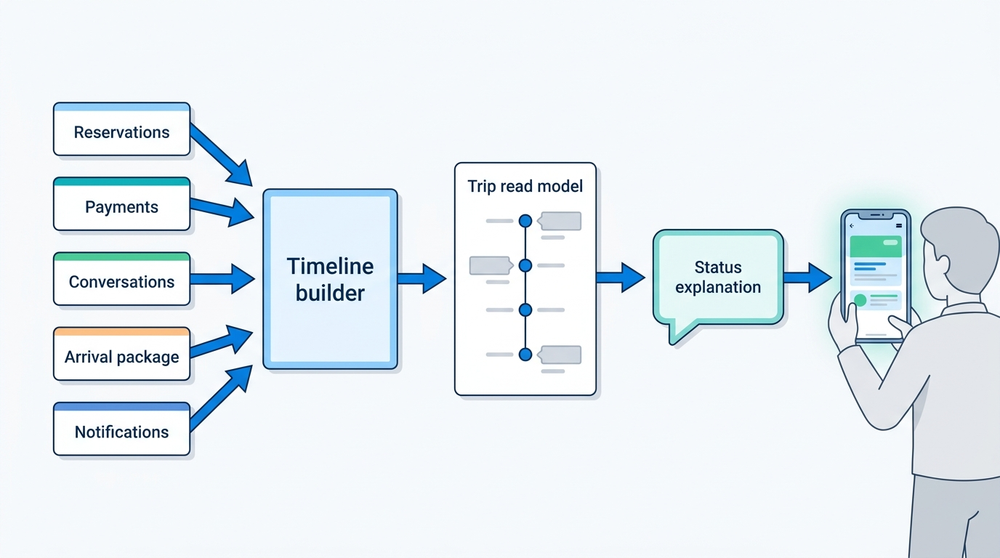
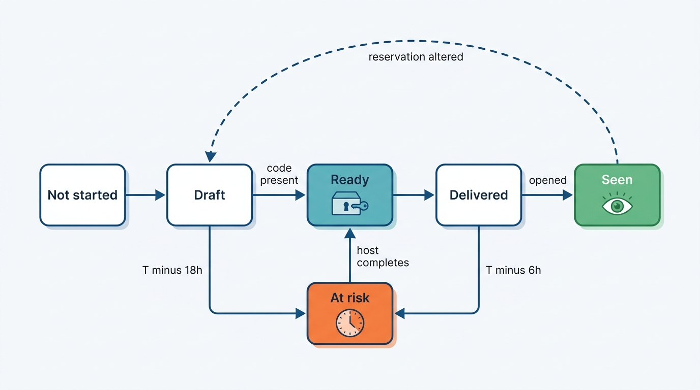
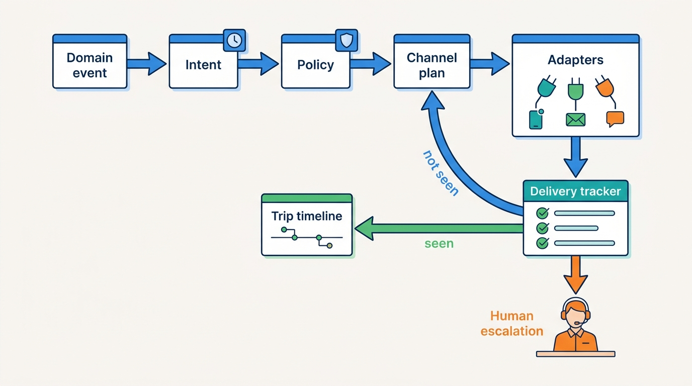
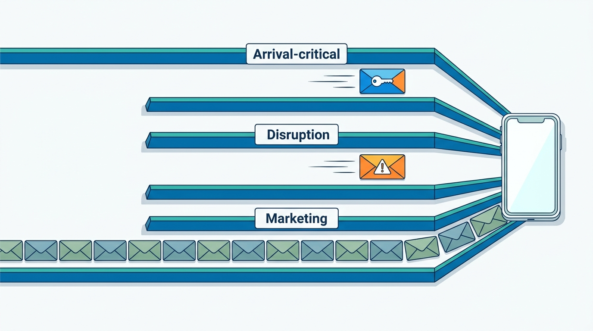
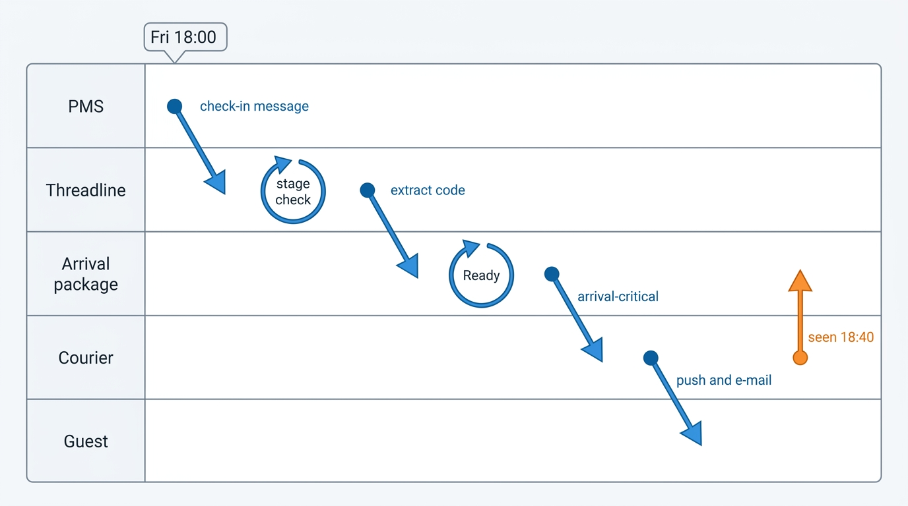

> **IN THIS CHAPTER, YOU WILL:** Follow a reservation from confirmation to the review invitation through the eyes of the guest: the trip timeline and what it must explain, check-in information and digital keys, guest–property and guest–host messaging with its translation, safety and retention rules, and the notification platform that carries all of it to e-mail, push, SMS and messaging apps.

> **WHY THE BUSINESS CARES:** Between booking and check-out the marketplace has already been paid, so every failure here is pure cost: a support contact, a rehoused guest, a lost repeat customer, a host who stops trusting the platform. A guest who cannot get into a home at 23:00 does not care whose system dropped the door code; they blame the brand on the confirmation e-mail.

> **WHY ARCHITECTS SHOULD CARE:** Trip, messaging and notifications sit downstream of everything and are owned by nobody in particular, so they collect copies of other services' state and silent failure modes: a trip page says "all set" while the access code is missing, and a strike-day e-mail waits behind a marketing campaign.

> **KEY POINTS:**
>
> * **The trip is a read model that must explain itself.** Build the trip timeline from reservation, payment, message, access and notification events, and derive each status line from facts ("your door code was delivered at 18:02 and opened at 18:40"), not from the reservation's state alone. "Confirmed" is not "ready to arrive".
> * **Messaging is a governed channel, and its rules depend on the stage of the trip.** One conversation store serves guests, hosts, hotel staff, property-management software and support. Contact redaction, link scanning, translation and retention apply as policy by stage, so that a rule written to stop off-platform deals before booking does not hide a door code the night before arrival.
> * **Some messages are deliverables with deadlines, and the platform must track them to the guest.** Notification routing chooses channels by event class, falls back when a channel stays silent, and escalates to a human when an arrival-critical message has not been seen. A delivery receipt from an e-mail vendor proves only that an e-mail vendor accepted the message.

> **[FAILURE PATTERNS THIS CHAPTER ADDRESSES](where-stay-platforms-go-wrong.html):**
>
> * **Lost at the Front Desk** — The reservation reached the host, but the door code, the late-arrival note or the changed check-in time did not reach the right person, and the guest stands at a locked door.
> * **Trust After the Incident** — Messaging safety rules arrive as reactions to scam waves, each bolted onto one code path, until a filter written for inquiries silently redacts arrival messages.
> * **Built for Sunny Days** — Disruption notices, rebooking offers and arrival-day messages all peak on the same days, and a notification stack sized for confirmations queues them behind newsletters.

 
After checkout ([[checkout-orchestration]]) and delivery to the property ([[reservation-lifecycle]]), the reservation enters the longest and quietest part of its life: for a Nookaway apartment booked in February for August, six months of a trip page, a few notifications and a conversation with a host the guest has never met. Then, in the last 48 hours, everything happens at once: arrival times, door codes, parking, a delayed flight.

The architectural problem is that **the marketplace owns the guest's experience of the trip but almost none of its facts.** The reservation belongs to the reservation service, the money to payments, the door code to the host's property management system (PMS) or lock platform, the address to the place registry, the delivery of an e-mail to a vendor. Assembled badly, these facts give the guest a confident status that is not true; carried badly, they reach nobody.

This chapter owns three terms: **trip timeline**, **guest–host messaging** (including guest–property messaging on the OTA side) and **notification routing**. It builds on the reservation state machine and delivery ([[reservation-lifecycle]]), the supply-side workspace and access codes ([[extranets-and-host-tools]]) and the address rules for homes ([[destinations-and-maps]]). [[customer-service]], which closes Part V, builds on its conversation store and notifications; changes and cancellations ([[changes-and-cancellations]]), fraud through hijacked partner accounts ([[travel-fraud]]) and review moderation ([[reviews-and-reputation]]) appear only where they meet the trip.

## Setting the Scene at Corvane: The Door Code That Said "[hidden]"

Corvane, the fictional travel group this book follows ([[meet-corvane]]), runs Nookaway, a hosted-stays marketplace, and Roomstead, an accommodation marketplace in the style of an online travel agency (OTA). In 2027 each brand still has its own messaging and e-mail stack: Nookaway's in Burrow, its Django monolith, Roomstead's in Keystone, its Java monolith. The One Stay program approved in April 2027 had put "one messaging and notifications platform" on its shared list, but nothing had been built.

In July 2027 Nookaway's trust team saw a rise in off-platform payment scams that started in pre-booking inquiries: a "host" would ask the guest to continue on WhatsApp and pay a deposit by bank transfer. Sofia Marín's team shipped a stronger contact-detail detector on **Thursday 5 August 2027 at 16:30**. It recognized phone numbers, e-mail addresses and digit sequences of six or more characters split by spaces or dots, a common way to slip a phone number past simpler filters, and replaced them with "[hidden]". The rule was meant for pre-booking threads only. Its exemption for confirmed reservations was keyed on a `thread_stage` field that Burrow's app and web code set. Messages sent by PMSs through Nookaway's partner API took an older code path that left the field empty, and the detector treated an empty stage as "inquiry".

**Maré Alta Stays**, the Algarve property manager with 340 units that had moved to Nookaway through its PMS in May 2027, sends check-in details automatically at 18:00 the day before arrival: the address, the key-box or keypad code, the Wi-Fi password and an after-hours phone number. On Friday 6 August those messages went out for Saturday's arrivals, Maré Alta's busiest changeover of the year. The partner API answered `201 Created` for each one. The guests saw this:

> *Welcome to Casa Sol, Albufeira! Your door code is [hidden]. If you need us after 20:00, call [hidden].*

What followed (the figures are illustrative, like everything about Corvane):

| Time (Western European Summer Time) | What happened | What the systems said |
| --- | --- | --- |
| Fri 6 Aug, 18:00 | Maré Alta's PMS sends 118 check-in messages for Saturday arrivals; 64 contain a code or phone number and are redacted | Partner API: 64 × `201 Created`. PMS: "sent" |
| Fri 6 Aug, 18:00–23:00 | Guests reply "the code is hidden?"; Maré Alta's staff resend; the resends are redacted too | Message volume normal; read receipts normal |
| Sat 7 Aug, 09:00 | Nookaway's own "Your trip is tomorrow / today" e-mail and push go out: "Check-in details: sent by your host" | Trip page: **"Confirmed — you're all set"** |
| Sat 7 Aug, 15:00–22:00 | Guests arrive at locked doors across Portugal, Spain and Greece; Nookaway's support receives **1,870** check-in contacts against a normal Saturday of about 450 | Support tool: contacts tagged "host unresponsive" and "can't access listing" |
| Sat 7 Aug, 19:30 | A support team lead notices that three guests quote "[hidden]" and escalates to Rafael Mendes's on-call engineers | First incident ticket |
| Sat 7 Aug, 21:40 | Rule rolled back; Burrow re-renders the original text of redacted post-booking messages | Guests see codes in old messages, if they reopen the thread |

Across Nookaway the rule redacted about **11,800** post-booking messages in 53 hours, of which about **2,960** were check-in messages in **1,140** reservations arriving 6–8 August. Most guests reached their hosts by phone or were let in by a neighbor. **41** families were rehoused for the night under Nookaway's guest guarantee at a cost of **€9,840**, and Maré Alta's after-hours line took 212 calls on Saturday evening.

Rafael's post-incident review listed four failures, and none of them was a bug in the detector:

1. **The rule had no idea of the trip's stage.** It inferred the stage from a field one client did not set, rather than asking the reservation service.
2. **The check-in message was just a message.** Nothing knew that a door code for a Saturday arrival was a deliverable with a deadline.
3. **The trip page reported state, not facts.** "Confirmed — you're all set" was correct about the reservation and said nothing about whether the guest could get in.
4. **Every signal was green.** The only signal that worked was a human in support reading three tickets.

![A family with suitcases at a locked holiday-house door at dusk, the phone showing Confirmed and a door code reading [hidden], while status lights glow green.](assets/images/24-trip-and-messaging/24-confirmed-not-ready.jpeg)
**Figure 1:** *On 7 August the trip page said the guests were all set while the door code read "[hidden]": the reservation was confirmed, but the guest could not get in.*

Mariana Costa, Group Chief Architect, put Rafael's list next to a Roomstead problem she had been carrying since the air-traffic-control (ATC) strike weekend in June, when Roomstead's disruption e-mails queued behind a marketing campaign (see "Notification Routing" below), and asked the architecture forum one question: **what should the group's shared trip, messaging and notification platform guarantee, and to whom?**

## Concepts: Trip, Conversation, Notification

- **Trip.** The guest-facing view of one or more reservations for one journey, from confirmation to the end of the review window. It owns no booking, payment or supply fact.
- **Trip timeline.** The ordered past and upcoming events of a trip, each with who acts and by when: a **read model** built from other services' events ([[event-driven-stays]]).
- **Trip status explanation.** The sentence at the top of the trip that says where the guest stands, derived from facts with a source and a time.
- **Arrival package.** Everything a guest needs to get from the street to the bed: address, check-in window, how to get in, parking, Wi-Fi, house rules, emergency contact. For a home part of it is secret and per reservation.
- **Access credential.** A code or digital key valid for one reservation's window, with a lifecycle driven by reservation events ([[extranets-and-host-tools]] owns access codes on the supply side).
- **Conversation.** A thread between a guest and a property or host about one inquiry or reservation, with the platform as a third party that can annotate, redact and intervene, and delegates (staff, co-hosts, a PMS, an assistant) as participants.
- **Structured request.** A message with a type and fields (arrival time, early check-in, date change, "cancel for less") that can be routed, answered with one tap and turned into a reservation change.
- **Notification** and **notification routing.** A notification is a message the platform sends a person through a channel *about* something; routing decides whether, when, through which channels and in which language, and what to do when a channel stays silent.
- **Disintermediation.** Guest and host completing the transaction off the platform, removing the marketplace's fee and protections; pre-booking contact rules exist mainly to prevent it.

Two distinctions carry most of the chapter. **A message is between people; a notification is from the platform**, even when a notification announces a message. And **a fact belongs to the service that owns it; the trip only explains it**. Every design mistake in the Saturday incident broke one of these two.

## The Trip Timeline: A Read Model That Must Explain Itself

Trip pages have converged on one shape. Airbnb's 2021 Trips tab redesign showed an arrival countdown, check-in details and upcoming reservations ([Airbnb 2021 Winter Release](https://news.airbnb.com/2021-winter-release/), 2021; the current design may differ), and its 2023 release made the host's **arrival guide** editable next to the amenities ([Airbnb 2023 Winter Release](https://news.airbnb.com/en-uk/airbnb-2023-winter-release/), 2023). Expedia Group's May 2024 release added self-service booking management for changes and cancellations on Expedia and Hotels.com ([Expedia Group, EXPLORE 2024](https://ir.expediagroup.com/news-and-events/news/news-details/2024/Put-Your-Trip-on-Autopilot-Expedia-Group-Introduces-New-Innovations-at-EXPLORE-to-Take-the-Stress-out-of-Travel-and-Enhance-Partner-Experience/default.aspx), 2024). None of these companies has published how its trip page is built; what follows is a reference architecture, not a description of theirs.

**Figure 2:** *The trip owns no facts. It is built from events of five services, and the status line the guest reads is derived from those facts, each with a source and a time, not from the reservation's state alone.*

The builder consumes ordered events, keyed by reservation, and keeps one document per trip: the reservations in it, the timeline entries, the current status explanation and the next action. The read model must be rebuildable from the event streams: when the explanation rules change, every trip is recomputed, and when a producer had a bug, the trip is repaired by replay rather than by hand.

### What the timeline shows

| Timeline entry | Source of the fact | What the guest should see | Who acts next |
| --- | --- | --- | --- |
| Booking confirmed | Reservation service | Dates, guests, total paid or due, policy in force | Nobody |
| Payment scheduled or taken | Payment state feed ([[stay-payments]]) | "€1,271.20 will be charged on …" or "Paid" | Guest, if a card fails |
| Free cancellation ends | Policy snapshot on the reservation ([[changes-and-cancellations]]) | Exact date and time in the guest's time zone | Guest |
| Host or property message | Conversation service | Unread count, last message, any open request | Guest or host |
| Check-in details | Arrival package service | Address, window, how to get in, readiness | Host until ready, then guest |
| Arrival | Reservation service, lock events where available | "Checked in at 16:42" (from a lock or the host) | Nobody |
| Check-out | Reservation service | Time and instructions | Guest |
| Review invitation | Review service ([[reviews-and-reputation]]) | Window and deadline | Guest |

Three rules keep the timeline honest.

1. **Derive status from facts with provenance.** Every status sentence cites the event it came from. "Your host shared check-in details at 18:02" is generated from an arrival-package event, not from a hope. If the fact is missing, say so: "Your host hasn't shared check-in details yet."
2. **Show the next action and its owner.** A trip page that lists events is a log; one that says "Your host usually shares the door code by 18:00 the day before. If you don't have it by 20:00, tap here" is a plan. The owner of the next step is often not the guest.
3. **Never compute money or policy in the trip.** The trip shows the refund the guest would receive if they canceled now by calling the policy evaluation that checkout and support use, not by re-implementing it. A second copy of the cancellation rules in the trip page is how **Policy Spaghetti** starts.

### One trip, many readers

The same read model serves the guest app, the web, the support agent's screen and AI assistants. Booking.com's October 2026 description of AgentHub, its platform for travel AI agents, places a "customer support chatbot" under "Cross-Sell & Trip Management" ([booking.ai, Introducing AgentHub](https://booking.ai/introducing-agenthub-booking-com-platform-for-modular-travel-ai-agents-68bc521a0f50), 2026). An assistant that answers "can I still cancel for free?" must read the same trip facts and call the same policy service as the screen, or it gives a third answer ([[ai-in-travel-stays]]); a 2026 secondary, unconfirmed report attributes the difficulties of Expedia's discontinued Romie assistant to answers not grounded in real-time reservation data ([Let's Data Science](https://letsdatascience.com/news/expedia-group-shares-ai-chatbot-lessons-learned-239f348a), 2026). On 7 August, support agents had to read each thread to find what a timeline entry "check-in details: redacted" would have stated in one line.

## Check-In Information as a Deliverable

On 7 August the reservation was right and the host had acted, yet the guest could not get in. The fix is to model check-in information not as one more message in a thread but as an **arrival package** with an owner, a deadline and a readiness state.

### What goes into the package

| Element | Hotel on Roomstead | Home on Nookaway |
| --- | --- | --- |
| Exact address and pin | Public, from the property content | Secret until booking; released at confirmation for instant book, at acceptance for request to book ([[destinations-and-maps]]) |
| Check-in window | Property policy; late arrival handled by the front desk | Host's listing setting, often changed per reservation |
| How to get in | "Reception open 24 hours" or opening hours | Key box, keypad, smart lock, meeting the host, a concierge desk |
| Secret per reservation | None, or a self-check-in kiosk reference | Door code or digital key, Wi-Fi password |
| Who produces it | Content team and property, once | Host, co-host, PMS or lock platform, per reservation |
| Failure on the day | Guest waits at the front desk; staff solve it | Guest stands outside a locked door; the marketplace's support solves it |

For a hotel, check-in, keys and housekeeping are the hotel's own operations, run in its PMS and key-card system, and the OTA is mostly out of the loop after delivering the reservation. For a home the marketplace participates in arrival: it carries the instructions and often the code, and it pays when check-in fails, through a guarantee such as Nookaway's. Airbnb's guest protection is documented to cover "inability to check-in" ([Airbnb Form 10-K FY2025](https://www.sec.gov/Archives/edgar/data/1559720/000155972026000004/abnb-20251231.htm), 2026), which makes a failed arrival a marketplace cost, not only a host's problem.

### Digital keys

Digital keys move part of the package into software. In August 2024 Airbnb made smart-lock integrations available to all US and Canada hosts with compatible Schlage, August and Yale locks: a unique code per reservation, "only active for the duration of a stay", updated when check-in or check-out times change, with host alerts when a lock goes offline ([Airbnb Newsroom](https://news.airbnb.com/smart-lock-integrations-available-to-all-us-and-canada-hosts), 2024). For PMS-managed locks, the PMS generates the codes, Airbnb relays them, and hosts must provide backup entry instructions ([Airbnb Help, article 4163](https://www.airbnb.com/help/article/4163), live page as of October 2026).

The credential's lifecycle is therefore driven by reservation events, and a missed alteration locks a guest out ([[extranets-and-host-tools]] works through that case). The backup entry instructions are part of the package the platform must deliver.

### Readiness as a state machine

Corvane's design makes each reservation's arrival package an object with its own state, owned by an arrival package service and checked against deadlines measured back from the check-in time.

**Figure 3:** *The arrival package has its own state machine. Deadlines measured back from check-in move it to "at risk", which notifies the host and then a person, and any change to the reservation sends it back to draft so the code and window are regenerated.*

- **Assemble from sources, do not copy text.** The package references the arrival guide version, the access credential and the reservation version; a code a PMS sends as free text is extracted into the package so readiness can be checked.
- **Measure readiness, not sending.** Ready means every element is present and valid for the current dates; delivered means a channel confirmed it; seen means the guest opened it.
- **Deadlines by arrival type.** A self-check-in home needs the package seen hours before arrival; a hotel with a 24-hour desk needs only the address and window.
- **Escalate along a ladder.** At-risk notifies the host as an "act now" event ([[extranets-and-host-tools]] defines the supply-side event classes), then the guest through a second channel, then a support queue with the reservation, the package and the thread already attached ([[customer-service]]).
- **Secrets are secrets.** Codes are stored encrypted, shown only to the guest and the host's delegates with an operations role, and never placed in e-mail subject lines or push previews on a locked screen.

## Guest–Host Messaging: A Governed Three-Party Channel

In a stays marketplace messaging is not a chat feature but a **three-party conversation store** with several kinds of client, time windows, safety controls, translation and legal retention: both a product and a trust-and-safety surface.

### What the public record shows

Booking.com's Connectivity Messaging API documentation is the most detailed public description of guest–property messaging (all quotations from live pages as of October 2026):

- **Windows.** Properties can message "From the time of booking until 7 days after the guest checkout" or after cancellation; when the guest writes, "the property gets an additional 14-day window to reply"; guests can message "till 66 days after the checkout" ([Understanding the Messaging API](https://developers.booking.com/connectivity/docs/messaging-api/understanding-the-messaging-api)).
- **Structured self-service requests.** Seven types, including check-in and check-out time, date change, "cancel for less", parking, bed preference, extra crib and extra bed. Date change and cancel-for-less "require response via the Extranet", and "Sending a message through the API will deactivate the property's ability to respond via the extranet" (same page): a **single-channel-of-reply** rule.
- **Redaction.** Messages flagged for phishing are replaced with "This message was deleted", attachments are removed, and from API version 1.3 an `is_redacted` attribute exposes the fact to the PMS (same page).
- **Integration pattern.** PMS and channel managers poll for new messages and tag them as read ([Use cases and best practices](https://developers.booking.com/connectivity/docs/messaging-api/use-cases-and-best-practices)).
- **Pre-reservation messaging** for request-to-book homes: each booking request opens a conversation that persists into the reservation; attachments are rejected and "contact information sharing is not allowed" ([Pre-reservation messaging](https://developers.booking.com/connectivity/docs/request-to-book/pre-reservation-messaging)).

On hosted stays, Airbnb reported **over 1.3 billion** messages in the twelve months to 30 June 2022, "more than 3.5 million a day" ([Airbnb via Hospitality Net](https://www.hospitalitynet.org/news/4112343.html), 2022; no newer figure was found). Its host messaging upgrades of around late 2024 add templates, AI-suggested replies visible only to the host and scheduled messages ([Airbnb Resources](https://www.airbnb.com/resources/hosting-homes/a/communicate-more-efficiently-with-messaging-upgrades-696), live page). Response rate is a Superhost criterion, at 90% ([Airbnb Help, article 829](https://www.airbnb.com/help/article/829), live page as of October 2026), so **message timestamps feed a host credential and ranking**. Airbnb has not published its messaging back end; nothing below describes it.

### The conversation model

> **INFERENCE, NOT DOCUMENTED:** The model below is a reference architecture derived from the public behavior above and from engineering principles. It is not a description of Booking.com's or Airbnb's systems.

| Element | Design |
| --- | --- |
| **Thread** | One per inquiry or reservation, keyed by reservation ID once booked; an inquiry thread continues into the reservation. Carries the trip **stage**, read from the reservation service, not set by clients |
| **Participants** | Guest and co-travelers; the host or property and its delegates under their grants; the platform (system messages, support agents) |
| **Message** | Immutable original text, author (person and the client used: app, extranet, PMS API, assistant), language, attachments, policy outcome, versioned edits |
| **Kinds** | Free text, structured request (typed, with state: open, accepted, declined, expired), system message, platform payment request |
| **Views** | Per reader: translated text, redacted or annotated rendering, unread count |
| **Events** | Message posted, request opened and resolved, read, redacted, reported, for the trip timeline, response-time metrics and trust |

Several clients write to the same thread, so a structured request answered in the extranet must not also be answered by the PMS. Booking.com's single-channel-of-reply rule is one answer; a lock on the request (first client to respond owns it, visible to the others) is another.

**Payments never travel as free text.** If the only legitimate way to ask a guest for money is a platform payment request, a system object rendered with the platform's own controls, then any free-text request to pay is anomalous by definition and can be blocked or flagged. The rule matters most on the OTA side.

### Safety: the channel is an attack surface

The best-documented fraud pattern in accommodation runs through the messaging channel. In 2023 Secureworks described an infostealer that took a hotel's Booking.com credentials, with which attackers could "see all upcoming bookings and directly message customers" and ask them to confirm payment details at malicious links ([Sophos/Secureworks](https://www.sophos.com/en-us/blog/vidar-infostealer-steals-booking-com-credentials-in-fraud-scam), 2023). In November 2024 KrebsOnSecurity documented such a message inside the Booking.com app minutes after a booking; Booking.com said "there has been no compromise of Booking.com's internal systems" and that the attacks "stem from partners' machines being compromised with malware" ([KrebsOnSecurity](https://krebsonsecurity.com/2024/11/booking-com-phishers-may-leave-you-with-reservations/), 2024). Corvane's version, the **November 2027 extranet phishing wave**, reached 4,100 Roomstead guests through Keystone's messaging; 310 paid, and Roomstead reimbursed **€212,000** ([[travel-fraud]] owns the incident and the account-security response).

Because the attacker writes from a genuine partner account, controls sit on the content and context of messages:

- **Link handling.** Extract URLs, check reputation and domain age, and warn or block links to payment pages that are not the platform's.
- **Language and pattern detection.** "Verify your card", "pay again", "your booking will be cancelled unless" from a property, especially to many guests within minutes.
- **Context.** A partner session that is new, from a new device, reading many upcoming reservations and messaging many of them is the pattern; rate-limit and hold such messages for review.
- **Redaction with notice.** When a message is hidden, both sides and the sender's software must be told, as Booking.com's `is_redacted` attribute does. Silent redaction turns a safety control into a delivery failure, as in Albufeira.

### Policy by stage

Make the stage an explicit input to every messaging policy, read from the reservation service, and write the policies as one table rather than as code scattered across clients.

| Stage | Contact details | Links and attachments | Payment requests | Who may start a thread |
| --- | --- | --- | --- | --- |
| **Inquiry or request to book** | Redacted, with notice to both sides | Blocked or images only; no files | Not allowed | Guest |
| **Confirmed, before arrival window** | Allowed from host to guest; guest's real contact masked by a relay | Scanned; external payment links blocked | Platform payment request only | Both |
| **Arrival window (T−72h to check-out)** | Allowed; arrival-critical content is never redacted, only flagged | Scanned; images and PDFs allowed | Platform payment request only | Both |
| **After check-out** | Allowed, masked relay | Scanned | Only for documented damage, through the claims flow ([[protection-and-incidents]]) | Both, within a window |
| **Closed** | Read-only for the parties; retained for disputes and legal holds | n/a | n/a | Nobody; support can reopen |

Policies are **versioned configuration evaluated by one policy service**, called by every client path, including the partner API, so the service, not the client, looks up the stage. Every policy outcome is an event with the rule version, so a spike of redactions on post-booking threads alerts within minutes instead of being noticed by a support lead after four hours.

### Translation

Airbnb's Translation Engine, announced in November 2021 for listing descriptions in "over 60 languages", was extended to messages in summer 2022 so that "Messages are automatically translated in the user's preferred language" ([Airbnb via Hospitality Net](https://www.hospitalitynet.org/news/4112343.html), 2022; the system has likely changed since). When a Czech family writes to a Portuguese host, there is no conversation without translation.

The pattern I recommend stores the **original text as the record**, translates asynchronously on posting, caches by target language, and always lets either party and support see the original, because disputes are decided on what was written. Two traps are specific to stays: **translation must not touch secrets** (a door code "4417 #" must survive translation byte for byte, so arrival-package content is rendered from structured fields rather than translated) and **translation must not hide abuse** (safety scanning runs on the original and on the translation).

### Attachments and retention

Attachments carry check-in videos, damage photos, identity documents hosts should not ask for, and malware: scan on upload, store apart from message text, strip photo location metadata, and refuse document types that have no place in a stay conversation.

Retention is a legal question with an architectural answer. Under the General Data Protection Regulation (GDPR), personal data is kept identifiable "for no longer than is necessary" ([Regulation (EU) 2016/679, Article 5(1)(c) and (e)](http://publications.europa.eu/resource/celex/32016R0679), 2016), yet messages are evidence for chargebacks months later ([[stay-payments]]), damage claims and trust cases. A defensible design keeps the thread for a fixed period after the trip closes, extends it only under a recorded legal hold, deletes attachments earlier than text, and deletes door codes soon after check-out.

## Notification Routing

Roomstead's June problem was about notifications. During the **ATC strike weekend (5–7 June 2027)**, about 17,000 Roomstead reservations were affected. Keystone's disruption e-mail ("Your trip may be affected: here are your options") went out through the same e-mail vendor account and sending queue as the "Summer weekends" campaign scheduled for Saturday morning, and the median disruption e-mail reached the guest **3 hours and 10 minutes** after the job started. Roomstead received 6,200 cancellation requests in 48 hours; a share of them would have been self-service changes if the e-mail had arrived first. Nobody had decided that a disruption notice outranks a newsletter, because no single system sent both and knew the difference.

### The pipeline

A notification platform has five stages.

**Figure 4:** *Notification routing as a closed loop. A domain event becomes an intent with a class and a deadline; policy decides whether and how to send; the delivery tracker feeds receipts back, falls back to another channel when the first stays silent, and hands arrival-critical failures to a person.*

1. **Intent.** A producing service (reservations, payments, conversation, alerts from [[personalization-and-recommendations]]) emits an *intent*: recipient, event class, template key with typed data, deadline, idempotency key. It does not choose channels or render text.
2. **Policy.** Consent (marketing needs it; a check-in instruction does not), channel preferences, quiet hours, deduplication, frequency caps and suppression after cancellation.
3. **Channel plan.** An ordered plan per class (push now, e-mail now, SMS if neither is seen within 30 minutes, then a human), rendered in the recipient's language and time zone.
4. **Adapters.** One per provider, each behind an interface so it can be replaced.
5. **Delivery tracking.** Accepted, delivered, seen, bounced, failed; receipts feed the trip timeline, the arrival package and the fallback loop.

### Classes, not campaigns

Guests need event classes like those defined for hosts and partners ([[extranets-and-host-tools]]): the class decides priority, channels and whether the guest may mute it.

| Class | Guest examples | Default plan | Mutable | Separate lane |
| --- | --- | --- | --- | --- |
| **Arrival-critical** | Check-in details, door code changed, host canceled, today's check-in time moved | Push + e-mail; SMS or messaging app if not seen; then support | No | Yes, highest priority |
| **Disruption** | Strike or weather affects your trip, rebooking options, property closed | Push + e-mail at once, SMS for arrivals within 72 hours | No | Yes |
| **Transactional** | Booking confirmed, payment taken or failed, refund issued, receipt | E-mail, push | Channel only | Yes |
| **Conversation** | New message, request answered | Push; e-mail digest if unread | Yes, with digest | No |
| **Account security** | New login, password changed | E-mail + push | No | Yes |
| **Engagement** | Price alerts, wishlist changes, review reminders | Push or e-mail within caps | Yes | No |
| **Marketing** | Campaigns, newsletters | E-mail, push, by consent only | Yes | Separate sending identity |

Separate lanes mean separate queues and quotas inside the platform and, for e-mail, separate sending domains or IP pools, so a bulk campaign can never delay an arrival-critical message and a campaign's spam complaints do not damage the reputation that transactional mail depends on. Mailbox providers enforce this from outside: since **1 February 2024**, Google requires senders of more than 5,000 messages a day to Gmail accounts to authenticate mail with SPF and DKIM (Sender Policy Framework and DomainKeys Identified Mail), publish a DMARC (Domain-based Message Authentication, Reporting and Conformance) policy, keep spam complaints below **0.30%** in its Postmaster Tools and offer one-click unsubscribe on marketing and subscribed messages ([Google Workspace Admin Help, Email sender guidelines](https://support.google.com/a/answer/81126), live page as of October 2026).

**Figure 5:** *Separate lanes keep a bulk campaign from delaying arrival-critical and disruption messages; in June 2027 Roomstead's disruption e-mail arrived a median 3 hours and 10 minutes late behind a campaign.*

### Messaging apps are not SMS with a logo

Guests increasingly expect trip messages in WhatsApp; on the supply side Agoda's August 2026 Partner Portal announcement included KakaoTalk booking notifications for South Korean motels and plans for WhatsApp and WeChat ([Agoda via Kyodo News PR Wire](https://kyodonewsprwire.jp/release/202608174214), 2026). Messaging-app channels come with their own rules. On the WhatsApp Business Platform, when a user writes to a business a 24-hour "customer service window" opens; "Businesses can only send non-template messages to users when this window is open", and outside it they can reach users only with pre-registered template messages in the marketing, utility or authentication categories ([Meta for Developers, WhatsApp pricing](https://developers.facebook.com/docs/whatsapp/pricing), live page reflecting pricing effective 1 October 2026). So arrival-critical templates must be approved in every language before they are needed, and the channel plan must know whether a window is open; the adapter, not the producing service, owns those rules.

### Locale, time zone and quiet hours

Three cheap-to-prevent bugs recur. **Time zones**: "check-in from 15:00" is the property's time, while a free-cancellation deadline must say whose time it is, so templates take typed times, never pre-formatted strings. **Language**: each recipient's own, with property names and addresses untranslated. **Quiet hours**: respected for engagement and conversation classes, overridden for arrival-critical and disruption classes, which is why those classes must stay narrow.

## In Practice at Corvane: Replaying 7 August

The architecture forum met on **2 September 2027** and decided:

- **Courier**, a group notification platform (intents, policy, channel plans, adapters, delivery tracker), owned by the group platform engineering team in Kraków. Nookaway moves first (Q1 2028); Roomstead's Keystone notifications follow by the end of 2028, transactional and disruption classes first.
- **Threadline**, a group conversation service (threads, participants, messages, structured requests, policy service, translation, attachments), owned by Nookaway engineering in Lisbon under Rafael Mendes, with Sofia Marín's trust team as mandatory reviewer of every policy change. Policy packs are per brand; the stage table is shared.
- **Arrival package service and trip timeline**, owned by Nookaway and built on the events of **Stayline**, the One Stay reservation service agreed in August ([[reservation-lifecycle]]), so that Roomstead can adopt them; Roomstead keeps its trip page but reads the same timeline events from 2028. For hotels, the arrival package complements Stayline's arrivals manifests, which confirm 7 days and 48 hours before arrival that the property holds the booking.
- **One rule for every client.** The partner API, Burrow's app and web paths and Keystone's extranet all call Threadline's policy service, which reads the stage from Stayline.

The **November 2027 phishing wave** hit Roomstead before any of this reached Keystone, and pulled Roomstead's guest–property messaging onto Threadline's safety scanning ahead of plan: the honest way a shared platform often gets its second tenant. Figure 6 replays Maré Alta's check-in message for one Saturday arrival on the new design.

**Figure 6:** *The same message on the new design. The policy service reads the trip's stage from the reservation, the arrival package extracts and validates the code, and Courier tracks the arrival-critical intent to "seen", so the trip page can say so.*

Each failure of 7 August has a design element that catches it:

| Failure on 7 August | What catches it on the new design | When |
| --- | --- | --- |
| 64 Maré Alta codes redacted (2,960 check-in messages group-wide) | Stage read from the reservation service: arrival-window threads are never redacted, only flagged | At send, Fri 18:00 |
| A code missing or invalid for whatever reason | Arrival package stays in draft (the extracted code reads "[hidden]"); "at risk" at T−18h notifies Maré Alta as an act-now event while its staff are still on shift | Fri 21:00, 18 hours before a 15:00 check-in |
| Package delivered but not seen | Courier falls back to SMS at T−6h, then routes to a support queue with the package attached | Sat 09:00 onward |
| Trip page says "you're all set" | Status derived from package state: "Your host hasn't shared check-in details yet" | Continuously |
| Redaction spike invisible | Policy outcomes are events; redactions on post-booking threads above baseline page the on-call | Within 15 minutes of Thu 16:30 |

The forum also set four service-level objectives (SLOs) that Courier and the arrival package service report weekly per brand: **arrival packages seen by the guest before T−6h** (target 98% for self-check-in homes), **arrival-critical intents delivered within 2 minutes** (99.5%), **disruption intents sent to all affected reservations within 15 minutes of the declaration** (from [[changes-and-cancellations]]), and **the share of guest check-in support contacts per 1,000 arrivals**, which on 7 August had been about four times normal. The business reads the last metric; engineers act on the first three.

The cost is modest: SMS, the expensive channel, is only a fallback for arrival-critical and disruption classes, and in Corvane's illustrative sizing reaches about 6% of self-check-in arrivals. The €9,840 of rehousing on one Saturday buys a great many text messages.

## The End of the Trip: Completion and the Review Invitation

Check-out is a reservation event ([[reservation-lifecycle]] owns completion), and the trip reacts in three ways:

- **Hide secrets.** Door codes and Wi-Fi passwords disappear from the guest's view; the arrival package is archived.
- **Open the review window.** The review service decides eligibility from the completed booking (stayed, not canceled, no-show or disputed); the timeline shows the invitation and deadline, and Courier sends it as an engagement-class intent. Collection, publication and moderation belong to [[reviews-and-reputation]].
- **Keep the conversation open for the window.** Lost items and damage evidence arrive after check-out; the thread stays writable for a defined period, then read-only.

The same stay events drive money: Nookaway pays the host 48 hours after scheduled check-in ([[payouts-and-settlement]]), so for the Novak family's Alfama stay, checking in on 2 August 2027, the trip timeline and the host's payout on 4 August read the same events and never disagree about the dates.

## Trade-offs

| Decision | Option A | Option B | When A is right | When B is right |
| --- | --- | --- | --- | --- |
| **Build or buy the notification platform** | Build intents, policy, plans and tracking in house; buy only channel delivery | Buy a customer-engagement platform that owns templates, journeys and sending | Many producing services, arrival-critical classes, fallback and escalation tied to trip state | Few producers, mostly marketing and lifecycle messaging, a small team |
| **Conversation store** | One group service with per-brand policy packs | One messaging system per brand | Shared safety, translation and retention rules; guests and professional managers active on both brands | Brands with genuinely different conversation models and no shared trust team |
| **Door codes** | Structured access credential in the arrival package | Free-text code in a message | Codes generated by integrations, self-check-in common, readiness must be checked | Mostly hosts meeting guests in person; codes rare |
| **Messaging-app channels** | Templates per class through the official business platform | No messaging apps; push, e-mail and SMS only | Markets where guests expect WhatsApp or similar, international guests without roaming data | Markets where push and e-mail are reliable, or where template approval cannot keep up with product changes |

Corvane chose Option A on every row except messaging apps: it started with WhatsApp templates for arrival-critical and disruption classes only, in the four markets where guests asked for them most.

## Hotels and Homes: Where the Two Marketplaces Differ

The trip, messaging and notification platform is the most shareable of the post-booking systems; the rules on top of it differ sharply.

| Dimension | Accommodation marketplace (Roomstead) | Hosted-stays marketplace (Nookaway) |
| --- | --- | --- |
| **Who answers the guest** | Hotel staff in shifts, often through the PMS via a messaging API; replies are operational | One host or a small manager team, on a phone; replies are personal and pre-booking questions are common |
| **Typical content** | Structured: arrival time, parking, bed type, invoice, early check-in | Free text: house rules, how to find the key box, neighborhood tips, questions before booking |
| **Pre-booking messaging** | Rare; mostly request-to-book homes sold on the OTA | Central: request-to-book inquiries, with a 24-hour host response window on Nookaway |
| **Check-in** | Front desk; the OTA is out of the loop after delivery | Self-check-in common; the platform carries codes and pays when arrival fails |
| **Main messaging risks** | Hijacked partner accounts phishing guests at scale (the Nov 2027 wave) | Off-platform payment scams before booking; harassment; party planning |
| **Response time** | An operational SLA in partner analytics | An input to host credentials and ranking |
| **Integration** | Messaging API for PMS and channel managers is a must-have connectivity surface | Partner API for professional managers; most individual hosts use the app |
| **Regulation and evidence** | Guest data passed to the hotel under the agency model; messages as evidence for payment disputes | Guest contact usually masked by a relay; messages as evidence for damage claims and trust cases |

**My judgement: share the channel, not the conversation rules.** Threadline, Courier, the stage model, translation, safety scanning, retention and the trip timeline builder are one problem in two marketplaces and should be built once, under One Stay, so a guest who books a hotel on Roomstead in May and a home on Nookaway in August gets the same trip timeline, notification preferences and phishing protection. What stays per brand is the policy pack (pre-booking contact rules, structured request types, response-time targets) and the arrival package template: a front desk and a key box are different things. The hosted-stays pack would redact hotels' operational messages; the hotel model would drop the pre-booking conversation that sells request-to-book homes, a small case of **The Hotel-Shaped Home**.

Convergence makes the shared layer more valuable: Roomstead's apartments from professional managers need self-check-in packages, and Nookaway's 2028 boutique-hotel pilot will need a hotel-style package and structured requests. With policy packs keyed to the unit type rather than the brand, both cases are configuration.

## Failure Modes

| Failure | What it looks like | Design response |
| --- | --- | --- |
| **"Confirmed" means "ready"** | Trip page says "all set" while the code is missing | Status from facts with provenance; arrival package readiness on the timeline |
| **Safety rule without stage** | A rule written for inquiries redacts arrival messages; nobody is told | One policy service reads the stage from reservations; redaction with notice; redaction-rate alerts by stage |
| **Delivery receipts as success** | E-mail "delivered" to a mailbox nobody checks while traveling | Track "seen" for arrival-critical classes; fall back to another channel; escalate |
| **Marketing shares the lane** | Disruption notices queue behind a campaign; campaign spam complaints hurt check-in e-mail deliverability | Separate lanes, quotas and sending identities per class |
| **Two clients answer one request** | The extranet accepts an early check-in that the PMS declines | Single-channel-of-reply or request locking; request state visible to all clients |
| **Free-text payment requests** | Phishing "verify your card" messages look like the hotel's own | Payments only as platform payment requests; block external payment links |
| **Disruption at peak** | Rebooking offers, cancellations and arrival messages peak on the same weekend | Disruption class with its own capacity; load tests at strike-weekend volumes |

## The Chief Architect's View

**What to decide.** Four decisions shape the rest: that trip, conversation and notification are **platform services with owners**, not features inside each brand's monolith; one **stage model** that every policy reads from the reservation service; one **class model** for notifications, whose arrival-critical and disruption classes cannot be muted or delayed by marketing; and that **arrival information is a deliverable** for every reservation where the guest will not meet a person at a desk.

**Who decides.** Policy packs need joint ownership: the trust team (Sofia Marín) owns safety rules, regulatory and privacy (Noor van Dijk) own retention, consent and the masked relay, and the brand product teams own structured request types and arrival templates. The forum's rule at Corvane is that any change to a messaging policy goes through Threadline's policy service with a shadow run against a week of real traffic, segmented by stage, before it enforces. The August rule would have shown 11,800 redactions on post-booking threads in its shadow run.

**What to watch.** Besides the four SLOs, review weekly per brand:

- the share of arrival packages that went at risk;
- redactions and blocks per stage, with alerts on change;
- fallback rate by channel;
- host and property response times, which also feed credentials and partner analytics;
- notification complaints, unsubscribe and spam rates per class.

**Long term.** AI assistants are becoming participants on both sides; each must act as a delegate under a grant, with its messages labeled. As more trust incidents start in messages, keep the original text as evidence and record scanning results as decisions the trust platform ([[stays-trust-and-safety]]) can audit.

## Questions to Ask

1. Where does the trip page's status sentence come from? Can you name the event behind each line, and what the page says when that event is missing?
2. Which messages in a trip are deliverables with deadlines? When one is delivered but not seen, after how long, through which channel, and when does a person get involved?
3. How is the trip stage determined for each messaging policy, and can any client path (API, extranet, PMS, assistant) bypass the policy service?
4. When a message is redacted or blocked, who is told, and what alert fires if redactions on post-booking threads rise?
5. Are door codes and other secrets structured, versioned and regenerated on reservation alterations, or are they free text in a message?
6. Which notification classes can a guest or host mute, and which can a marketing campaign delay? Do transactional, arrival-critical and marketing e-mail share a sending domain, an IP pool or a queue?
7. How long are messages, attachments and codes retained, and who can place a legal hold?
8. If an AI assistant writes a message on behalf of a host or answers a guest's question about their trip, which facts does it read and how is its output labeled?

Even with the best trip platform, some trips go wrong: a host cancels the night before, a family is walked from an oversold hotel, a strike strands thousands. The conversation and the trip timeline are then the evidence, and a support agent becomes the fourth party. [[customer-service]] takes up how a marketplace handles cases that involve three parties and a deadline.

## Sources and Evidence

### Company engineering and investor sources

- [Airbnb 2021 Winter Release](https://news.airbnb.com/2021-winter-release/), Airbnb Newsroom, 2021: Trips tab redesign with arrival countdown and check-in details; Translation Engine launch.
- [Airbnb 2023 Winter Release](https://news.airbnb.com/en-uk/airbnb-2023-winter-release/), Airbnb Newsroom, 2023: editable arrival guide.
- [Translation Engine launches Reviews after expanding to Messages](https://www.hospitalitynet.org/news/4112343.html), Airbnb via Hospitality Net, 2022: message translation; 1.3 billion messages in twelve months.
- [Smart lock integrations now available to all hosts in the US and Canada](https://news.airbnb.com/smart-lock-integrations-available-to-all-us-and-canada-hosts), Airbnb Newsroom, 2024: per-reservation codes, alteration handling, lock notifications.
- [Communicate more efficiently with messaging upgrades](https://www.airbnb.com/resources/hosting-homes/a/communicate-more-efficiently-with-messaging-upgrades-696), Airbnb, n.d. (c. 2024): quick replies, AI-suggested replies, scheduled messages, edit and unsend windows.
- [Form 10-K for fiscal year 2025](https://www.sec.gov/Archives/edgar/data/1559720/000155972026000004/abnb-20251231.htm), Airbnb, Inc., 2026: guest protection covering inability to check in.
- [Introducing AgentHub](https://booking.ai/introducing-agenthub-booking-com-platform-for-modular-travel-ai-agents-68bc521a0f50), Booking.com (booking.ai), 2026: trip-management and support agents, tracing and guards.
- [Put Your Trip on Autopilot (EXPLORE 2024)](https://ir.expediagroup.com/news-and-events/news/news-details/2024/Put-Your-Trip-on-Autopilot-Expedia-Group-Introduces-New-Innovations-at-EXPLORE-to-Take-the-Stress-out-of-Travel-and-Enhance-Partner-Experience/default.aspx), Expedia Group, 2024: self-service booking management.
- [Agoda Partner Portal announcement](https://kyodonewsprwire.jp/release/202608174214), Agoda via Kyodo News PR Wire, 2026: messaging-app booking notifications for partners.

### Standards, regulation and documentation

- [Understanding the Messaging API](https://developers.booking.com/connectivity/docs/messaging-api/understanding-the-messaging-api), Booking.com, n.d. (live as of October 2026): messaging windows, structured self-service requests, single-channel-of-reply rule, phishing redaction.
- [Messaging API: Use cases and best practices](https://developers.booking.com/connectivity/docs/messaging-api/use-cases-and-best-practices), Booking.com, n.d.: polling integration pattern, read tagging.
- [Pre-reservation messaging](https://developers.booking.com/connectivity/docs/request-to-book/pre-reservation-messaging), Booking.com, n.d.: request-to-book conversations, no attachments, no contact sharing.
- [Smart lock integration via PMS (article 4163)](https://www.airbnb.com/help/article/4163), Airbnb Help Center, n.d.: PMS-generated codes, first lock only, backup instructions.
- [How do I become a Superhost? (article 829)](https://www.airbnb.com/help/article/829), Airbnb Help Center, n.d.: response rate as a credential criterion.
- [Email sender guidelines](https://support.google.com/a/answer/81126), Google Workspace Admin Help, n.d. (requirements from 1 February 2024): authentication, spam-rate threshold, one-click unsubscribe for bulk senders.
- [WhatsApp Business Platform pricing](https://developers.facebook.com/docs/whatsapp/pricing), Meta for Developers, n.d. (pricing effective 1 October 2026): customer service window and template categories.
- [Regulation (EU) 2016/679 (GDPR)](http://publications.europa.eu/resource/celex/32016R0679), CELEX 32016R0679, 2016: data minimization and storage limitation (Article 5).

### Research and practitioner sources

- [Vidar infostealer steals Booking.com credentials in fraud scam](https://www.sophos.com/en-us/blog/vidar-infostealer-steals-booking-com-credentials-in-fraud-scam), Sophos (Secureworks Counter Threat Unit), 2023: hijacked partner accounts messaging guests.
- [Booking.com phishers may leave you with reservations](https://krebsonsecurity.com/2024/11/booking-com-phishers-may-leave-you-with-reservations/), KrebsOnSecurity, 2024: in-app phishing message after booking; Booking.com's statement.
- [Expedia Group shares AI chatbot lessons learned](https://letsdatascience.com/news/expedia-group-shares-ai-chatbot-lessons-learned-239f348a), Let's Data Science, 2026: secondary report on grounding trip assistants in live reservation data (low confidence).

Corvane is fictional; architectural recommendations and labeled inferences are the author's judgement.
