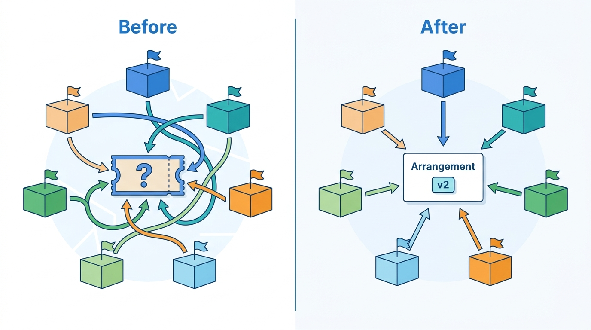
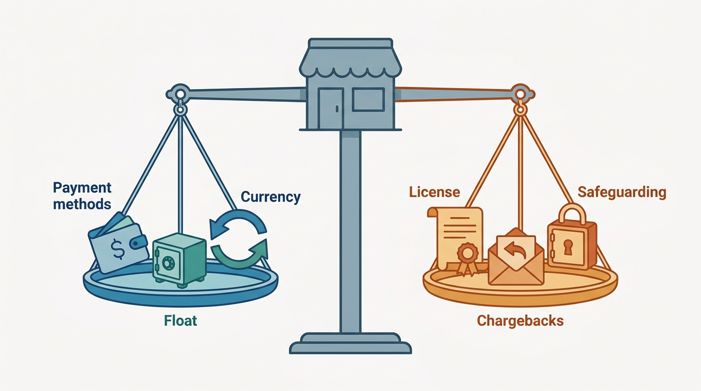
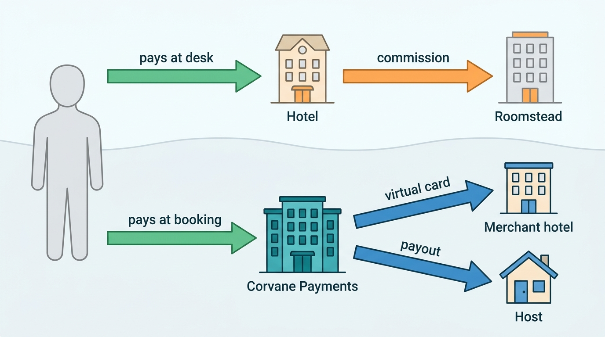
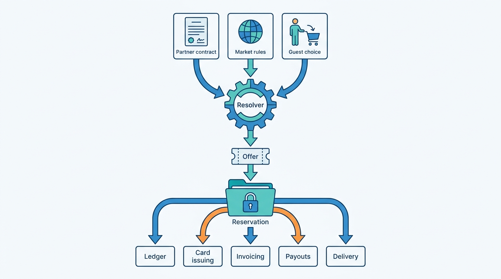
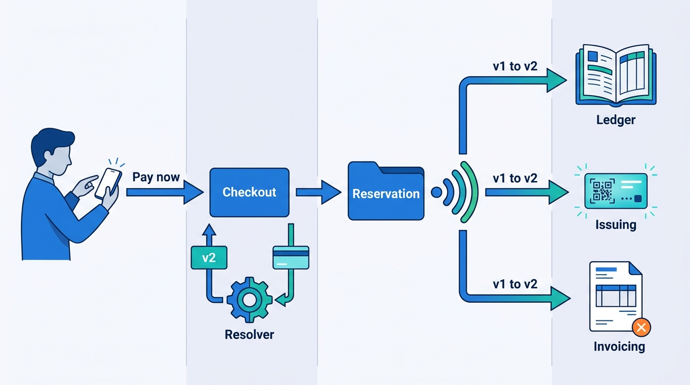

> **IN THIS CHAPTER, YOU WILL:** Learn the three ways a stays marketplace can stand in the money flow (agency, merchant and facilitated payments), what each one decides about liability, licensing, accounting, tax and cash, and how to design a payment-model normalization layer that lets one platform run several models side by side, even within one property.

> **WHY THE BUSINESS CARES:** The payment model decides how the marketplace earns (commission invoiced after the stay, or margin kept before the supplier is paid), how much cash it holds, which payment methods it can offer and which losses it absorbs. Moving share from agency to merchant is one of the largest commercial levers an OTA has, and one of the most expensive to get wrong.

> **WHY ARCHITECTS SHOULD CARE:** Every money system downstream (checkout, payment orchestration, ledger, card issuing, payouts, commission invoicing, tax, customer service) branches on the payment model. If each of them infers the model from its own flags, a single modification can produce a booking that is invoiced as agency and paid as merchant. If the model is a first-class, versioned record, the branches agree.

> **KEY POINTS:**
>
> * **The payment model is a fact about one booking, not a setting of one property.** Who is merchant of record decides who charges the guest, who holds the money, who carries chargebacks, fraud and currency risk, how revenue and VAT are treated and which way settlement runs. Resolve it on the offer, freeze it on the reservation and version it on every change.
> * **Merchant and facilitated models buy control at the price of liability.** Collecting the guest's money gives the marketplace payment methods, fewer no-shows, float and payment revenue. It also brings payment licensing, safeguarding, chargebacks, card issuing or payouts to individuals, and reconciliation, all concentrated in the platform instead of spread across thousands of properties.
> * **Normalize payment models in one place and let every other system consume the result.** A payment arrangement record states the collector, the collection schedule, the supplier settlement method, the commission direction and the liability matrix for each booking. Checkout, ledger, issuing, invoicing, payouts and support read it; none of them re-derives it.

> **[FAILURE PATTERNS THIS CHAPTER ADDRESSES](where-stay-platforms-go-wrong.html):**
>
> * **Ledgerless Money** — Agency receivables, merchant payables and host payouts are tracked in different systems with different meanings, so nobody can say what a property owes the marketplace or the marketplace owes the property.
> * **Policy Spaghetti** — The payment model is inferred separately by checkout, invoicing, card issuing and support tools, and a modified booking gets four different answers.
> * **Price Drift** — An agency booking shown in the guest's currency is charged at the desk in the hotel's currency, so the price on the card statement is not the price the marketplace displayed.

 
A night in a hotel or a home is paid for by the guest and delivered by someone else. Between those two parties the marketplace can stand in three places. It can introduce them and let the property take the money (**agency**). It can take the money itself and pay the property later (**merchant**). Or it can take the money as the agent of a host who cannot take it (**facilitated payments**, the hosted-stays default). The choice looks like a commercial term in a partner contract. It is an architectural decision, because **every system that moves, records or explains money branches on it**.

The decision is also no longer made once per company. OTAs (online travel agencies) run agency and merchant bookings side by side, sometimes for the same room on the same night, and the public record shows the mix moving fast toward merchant. Hosted-stays marketplaces have always collected, but they now sell hotels too, and hotels expect VAT invoices and card-based settlement that a payout to an individual host does not provide.

This chapter owns the **merchant model**, the **agency model**, **merchant of record** in the stays sense and **payment-model normalization**. It opens [[part-6]] because the chapters after it assume its vocabulary: [[stay-payments]] takes the guest's money under whichever model applies, [[payouts-and-settlement]] pays the supply side and invoices commission, [[taxes-on-stays]] decides who owes which tax, and [[refunds-and-reconciliation]] proves that every euro ended where the model said it would. Here the question is narrower and comes first: **who takes the money, and what does that decision demand from the systems?**

## Setting the Scene at Corvane: A 40% Target on an Agency-Era Reservation

Corvane, the fictional travel group this book follows (see [[meet-corvane]]), runs two payment worlds. **Roomstead**, its accommodation marketplace, has been an agency business since 2001: the guest pays at the property and Roomstead invoices commission after the stay. In 2024 it launched **"Pay with Roomstead"**, a merchant option in which Corvane Payments, the group's licensed electronic money institution (EMI), charges the guest and pays the property, mostly by virtual card. In 2026, **30%** of Roomstead's room nights were merchant and **70%** agency; Roomstead earned **€860 million** in agency commission and **€270 million** in merchant margin. **Nookaway**, the hosted-stays marketplace, has only ever collected: every guest pays through Corvane Payments, and hosts are paid out **48 hours after scheduled check-in**.

In May 2027 Marco Bellini, the Group CFO, confirmed the board's target of **40% merchant room nights at Roomstead by the end of 2028**. Mariana Costa, the Group Chief Architect, asked Leila Haddad's payments and finance engineering team a narrow question first: *where, today, does a Roomstead system decide whether a booking is agency or merchant?* The answer was seven places, none of them authoritative (the details below are illustrative, like everything about Corvane).

| Where | How it decides | What it drives |
| --- | --- | --- |
| Checkout (Roomstead web and apps) | Property flag "payments enabled" plus the guest's choice of "Pay now" | Whether to call Corvane Payments |
| **Keystone** reservation (Java monolith) | A `PAYMENT_TYPE` column written at booking | Reservation display, cancellation handling |
| Keystone commission invoicing | Monthly job over stayed reservations where `PAYMENT_TYPE = 'HOTEL'` | Commission invoices to properties |
| Corvane Payments issuing | Its own record of captured payments | Virtual card creation, loading and activation |
| **Switchyard** reservation delivery | Presence of card data in the reservation message | Whether the hotel sees "prepaid" or "guest pays at property" |
| Customer-service tool | Reads Keystone, shows "Prepaid" if `PAYMENT_TYPE = 'ROOMSTEAD'` | What agents promise about refunds |
| Snowflake finance reports | Joins Keystone and Corvane Payments data by reservation number | Merchant margin and deferred bookings |

Two incidents had already shown what happens when seven places decide. In the first quarter of 2027, Corvane Payments found **€1.8 million** unreconciled between the virtual-card issuing statements and Roomstead merchant reservations, mostly cards charged by hotels for reservations later canceled or modified (the gap is worked through in [[refunds-and-reconciliation]]). And in April 2027 an audit of 2026 found about **3,400** reservations booked as agency and switched to "Pay now" during a later modification. Corvane Payments had loaded a virtual card net of commission for each one, but Keystone's invoicing job read the original `PAYMENT_TYPE`, so the hotels were also invoiced the commission. Roomstead issued credit notes worth about **€129,000** and a round of apologetic account-manager calls.

Neither incident was a bug in a single system. Each system was right by its own definition. The problem was that the payment model had no owner and no record of its own, and a 40% merchant target would push ten million more room nights a year through that ambiguity. The question for the architecture forum was therefore not "how do we sell more Pay with Roomstead" but **"what is a payment model, where is it decided, and what does every money system need to know about it?"**

**Figure 1:** *Seven Roomstead systems each decided agency or merchant from their own flags; one versioned payment arrangement record gives them all the same answer.*

## Three Ways to Stand in the Money Flow

The terms are used loosely in the industry, so this chapter fixes them.

- **Agency model.** The marketplace acts as an agent that passes the reservation to the property and does not take the guest's payment for the stay. The property charges the guest, usually at the stay ("pay at property", "Hotel Collect"), and the marketplace invoices a **commission** afterwards. The marketplace may forward the guest's card details as a **guarantee** that the property can charge for a no-show.
- **Merchant model.** The marketplace (or its payment affiliate) charges the guest, usually at booking, holds the money, and pays the property the agreed net amount later, by bank transfer or by **virtual credit card (VCC)**, a single-use card number issued per booking and loaded with the amount owed. The marketplace keeps its commission or margin out of the money it collected.
- **Facilitated payments.** The hosted-stays form of collection: the platform's payment entity collects the guest's payment as the host's **limited payment collection agent**, holds it until a trigger (usually check-in), deducts fees and pays out the rest. Economically it resembles the merchant model; legally it is usually framed as collecting *on behalf of* the host rather than reselling the stay.
- **Merchant of record (MoR).** The party whose name the guest's payment is made to, who appears on the card statement, and who carries the card-scheme obligations for that payment: refunds, chargebacks and strong customer authentication. In stays, it is the answer to "who did the guest pay?"
- **Supplier of the accommodation.** The party that sells the stay itself. This is a separate question from merchant of record. A marketplace can be merchant of record for the *payment* while the hotel or host remains the supplier of the *stay*, or it can resell the stay in its own name. The difference changes VAT and revenue treatment (below), and confusing the two is a common source of legal and accounting surprises.

Payment model and **payment timing** are also different axes. "Pay later" is not agency: a merchant or facilitated booking can be charged at booking, before the free-cancellation deadline, in installments or after a deposit. An agency booking can be charged by the hotel at booking (an advance-purchase rate) or at check-out. [[stay-payments]] owns timing; this chapter owns who collects.

### What the public record shows

The documented definitions match these terms closely.

- **Booking Holdings**, in its fiscal-2025 annual report filed in February 2026, defines merchant revenues as coming from "transactions where we facilitate payments from travelers for the services provided, generally at the time of booking", and agency revenues as coming from transactions "where we do not facilitate payments from travelers", consisting "almost entirely of travel reservation commissions from Booking.com's accommodation reservations" ([Booking Holdings 10-K, 2026](https://www.sec.gov/Archives/edgar/data/1075531/000107553126000009/bkng-20251231.htm)).
- **Expedia Group**, in its fiscal-2025 10-K (February 2026), says that under the merchant model "we are the merchant of record for such bookings", while having "no control over the rooms" and not bearing "inventory risk"; under the agency model it acts "as the agent in the transaction, passing reservations booked by the traveler to the relevant travel provider" ([Expedia Group 10-K, 2026](https://www.sec.gov/Archives/edgar/data/1324424/000132442426000008/expe-20251231.htm)).
- **Airbnb's** Terms of Service (version published February 2026) say Airbnb is "not acting as an agent for any Member except for where Airbnb Payments acts as a collection agent", and its Payments Terms have hosts appoint Airbnb Payments as payment collection agent "solely for the limited purpose of accepting and processing funds from Guests"; once the guest pays, "the Guest's payment obligation to the Host(s) for the agreed upon amount is extinguished" ([Airbnb Terms, 2026](https://www.airbnb.com/help/article/2908); [Airbnb Payments Terms, 2026](https://www.airbnb.com/help/article/2909)).

The last clause is the architectural heart of facilitated payments. Because the guest's debt to the host is extinguished when the platform collects, **the platform, not the guest, now owes the host**, and the platform's ledger must say so.

### The shift is real and it is fast

The OTA side of the industry is moving from agency to merchant, and the filings let us date it. In Booking Holdings' reports, merchant revenues rose from **$10,936 million** in 2023 to **$17,755 million** in 2025, while agency revenues fell from **$9,414 million** to **$7,968 million**; the filing attributes the change to "the ongoing shift from agency to merchant" at Booking.com, and gives merchant gross bookings of **$130.0 billion** against agency gross bookings of **$56.1 billion** in 2025 ([Booking Holdings 10-K, 2026](https://www.sec.gov/Archives/edgar/data/1075531/000107553126000009/bkng-20251231.htm)). The same filing says that in 2025 "the incremental revenues from facilitating payments were greater than the associated incremental variable expenses", and names the cost side plainly: merchant processing brings "additional payment processing costs (which are typically higher for foreign currency transactions)" and the cost of "managing and detecting fraudulent payments". Expedia Group's 2025 revenue was **70% merchant, 22% agency and 8% advertising and other**, of $14.7 billion ([Expedia Group 10-K, 2026](https://www.sec.gov/Archives/edgar/data/1324424/000132442426000008/expe-20251231.htm)).

Not every OTA is moving the same way. Trip.com Group's annual report for fiscal 2025 says it acts "as an agent in substantially all of our hotel-related transactions" and recognizes accommodation commission "when the reservation becomes non-cancelable" ([Trip.com Group 20-F, 2026](https://www.sec.gov/Archives/edgar/data/1269238/000119312526183379/d27369d20f.htm), filed April 2026). Agency remains a viable model; it is simply a different set of systems.

## What a Payment Model Decides

The useful way to compare the models is not by who earns what but by **which obligations each one creates, and for whom**. I call this the **liability matrix**, and I ask every team that proposes a new payment option to fill it in before any design work starts.

| Obligation | Agency | Merchant (OTA) | Facilitated (hosted stays) |
| --- | --- | --- | --- |
| Charges the guest | Property, usually at the stay | Marketplace or its payment entity, at booking or on a schedule | Platform's payment entity, at booking or on a schedule |
| Holds the money before the stay | Nobody (a card may be held as guarantee) | Marketplace | Platform's payment entity, as the host's collection agent |
| Earns how | Commission invoiced after the stay | Commission or margin kept before paying the property | Guest and/or host fees kept before payout |
| Pays the supplier | Not applicable; the property already has the money | Net amount by VCC or bank transfer, after the stay or at a trigger | Payout to bank, card or wallet, after check-in |
| Settlement direction | **Receivable** from property | **Payable** to property | **Payable** to host |
| Strong customer authentication for the guest's card | Property's payment provider | Marketplace | Platform |
| Chargebacks and card fraud | Property | Marketplace | Platform, often after the host has been paid |
| Currency risk between booking and settlement | Guest and property | Marketplace | Platform |
| No-show and late-cancellation fees | Property charges the guaranteed card | Marketplace keeps or forwards them under the terms | Platform applies the host's policy |
| Refund on cancellation | Property (if it charged in advance) | Marketplace funds it, recovers from the property if paid | Platform funds it, recovers from future payouts if paid |
| Card data at the property and channel manager | Yes: PCI DSS scope extends to them | No: only a VCC reaches the hotel | No |
| Payment license | Not for the stay payment | Usually, or a licensed partner | Usually, or a licensed partner |
| Revenue recognized | Commission, at the stay | Net margin, at the stay | Fees, at check-in |

**Figure 2:** *Collecting the guest's money buys the marketplace control over payment methods, currency and float, at the price of licensing, safeguarding and chargebacks.*

Three rows deserve more than a table cell.

### Licensing: the commercial-agent question

In the European Economic Area (EEA), collecting money from one party and passing it to another is a payment service unless an exclusion applies. The Second Payment Services Directive (PSD2) excludes "payment transactions from the payer to the payee through a commercial agent authorised via an agreement to negotiate or conclude the sale or purchase of goods or services on behalf of **only the payer or only the payee**" (Article 3(b), [Directive (EU) 2015/2366](http://publications.europa.eu/resource/celex/32015L2366), 2015, applicable from January 2018). Recital 11 explains why the exclusion was narrowed: it had been applied "very differently across the Member States", including "by e-commerce platforms that act as an intermediary on behalf of both individual buyers and sellers". An agent acting for both sides is excluded only if it never comes "into possession or control of client funds".

The consequences for a stays marketplace are direct:

- An **agency-only OTA** never touches the stay payment and needs no license for it.
- A marketplace that **collects** is in scope unless it can argue that it is the commercial agent of only one side, typically the property or host. That is why collection terms appoint the platform as the *host's* collection agent. Whether a regulator accepts that position is a national question, and the large collectors have chosen to hold licenses anyway.
- Airbnb's fiscal-2025 10-K lists Airbnb Payments Luxembourg S.A. as "a licensed payments institution across the European Economic Area", Airbnb Payments UK Limited as an electronic money institution, a US money-transmitter structure regulated by the Financial Crimes Enforcement Network, and a registered payment service provider in Canada ([Airbnb 10-K, 2026](https://www.sec.gov/Archives/edgar/data/1559720/000155972026000004/abnb-20251231.htm)).
- Booking Holdings' 10-K says regulators "may determine, and in some cases are likely to determine" that parts of its business require payment licenses. Which Booking.com entity facilitates accommodation payments in the EEA, and under which authorization, is not stated in the filing or the traveler terms; this book does not assert one.

A license brings **safeguarding**: client money must be kept separate and protected. Airbnb's 10-K describes holding customer funds in "bankruptcy-remote bank accounts" or eligible liquid assets "equal to at least 100%" of the amounts held, and reports **$5,931 million** of funds held on behalf of customers at 31 December 2025. For an architect, safeguarding is a ledger requirement: the platform must be able to state, at any point in the day, how much money it holds for whom, separated from its own.

Corvane chose the license route in 2023–2024: Corvane Payments B.V. holds an EMI license from De Nederlandsche Bank and is passported across the EEA. That decision is why Pay with Roomstead could launch without a payment-service partner carrying the license, and why Corvane Payments, not Roomstead or Nookaway, is the merchant of record for every collected booking in the group.

### Accounting: gross versus net, and when

Under IFRS 15 (issued 2014, effective for periods from 1 January 2018) and its US counterpart ASC 606, a company that arranges for another party to provide a service is an **agent** and presents only its fee or margin as revenue; a **principal** that controls the service before it is transferred presents the full price ([IFRS Foundation, IFRS 15](https://www.ifrs.org/issued-standards/list-of-standards/ifrs-15-revenue-from-contracts-with-customers/), principal-versus-agent guidance). All three public stays companies present net:

- Booking Holdings' supplier contracts let suppliers "market their reservation availability without transferring to the Company the responsibility to deliver the travel services. Therefore, the Company's revenues are presented on a net basis", and revenue is recognized when travelers "begin using the arranged travel services" ([Booking Holdings 10-K, 2026](https://www.sec.gov/Archives/edgar/data/1075531/000107553126000009/bkng-20251231.htm)).
- Expedia records merchant hotel payments "in deferred merchant bookings until the stayed night occurs" and then recognizes revenue "net of amounts paid to suppliers" ([Expedia Group 10-K, 2026](https://www.sec.gov/Archives/edgar/data/1324424/000132442426000008/expe-20251231.htm)).
- Airbnb "presents revenue net, as an agent, because it does not control the right to use the properties", and its service fee is a single performance obligation "satisfied at the point of check-in" ([Airbnb 10-K, 2026](https://www.sec.gov/Archives/edgar/data/1559720/000155972026000004/abnb-20251231.htm)).

So the merchant model does **not** turn the marketplace into a principal for accounting; it changes the **balance sheet**, not the revenue line. Booking Holdings reported **$5.3 billion** of deferred merchant bookings at the end of 2025, "mostly subject to refunds for cancellations". The ledger must produce those balance-sheet objects per booking: guest money received, amount payable to the supplier, fee unearned until check-in, then earned. [[payouts-and-settlement]] and the finance book's [[designing-financial-ledgers]] cover the ledger mechanics.

### VAT: who is supplying the stay?

In the EU, accommodation is taxed where the property is (Article 47 of the VAT Directive, as amended by [Council Directive 2008/8/EC](http://publications.europa.eu/resource/celex/32008L0008), 2008). The harder question is what the marketplace itself supplies. In *Alpenchalets Resorts* (C-552/17, December 2018), the Court of Justice held that a travel agent supplying holiday accommodation rented from others, *in its own name*, falls under the special margin scheme for travel agents and "cannot be subject to a reduced tax rate" ([CJEU, 2018](http://publications.europa.eu/resource/celex/62017CJ0552)); Article 306 of the VAT Directive excludes those acting "solely as intermediaries".

That ruling is why **merchant of record for the payment** and **supplier of the stay** must be separate fields. A merchant-model OTA that resells rooms in its own name may owe margin-scheme VAT on its margin at the standard rate. One that collects as the property's disclosed agent supplies an intermediation service, and the hotel remains the supplier of the room. How each real OTA's contracts are characterized country by country is not public. Corvane's legal team chose the second structure for Pay with Roomstead: Corvane Payments collects as the property's limited payment collection agent, the property remains the supplier of the stay and issues the guest's VAT invoice for it, and Roomstead's commission is an intermediation fee to the property. [[taxes-on-stays]] owns the rest, including the EU's "VAT in the digital age" (ViDA) rule that will make platforms the *deemed supplier* of short-term accommodation from between July 2028 and January 2030, which changes the answer for non-VAT-registered hosts regardless of how the payment flows.

## Architecture: Payment-Model Normalization

The Productscape reference model for accommodation marketplaces names a module that most real platforms grow by accident: **Payment Model Normalization**, covering "pay-now, pay-later, pay-at-property, and managed-payment logic across markets" (a generic reference model, not a description of any company). The idea is right; the name undersells it. What must be normalized is not the payment but the **arrangement**: the set of obligations a booking creates.

**Figure 3:** *Three money flows in one group. In the agency flow money runs from the property to the marketplace; in the merchant and facilitated flows it runs through Corvane Payments to the supply side. The settlement direction flips, and so does who carries the risk.*

### The payment arrangement record

The core of the design is one record per offer and per reservation version. Its fields are the liability matrix made concrete.

| Field | Example values | Who reads it |
| --- | --- | --- |
| `model` | `AGENCY`, `MERCHANT`, `FACILITATED` | Everyone |
| `merchant_of_record` | `PROPERTY`, `CORVANE_PAYMENTS` | Checkout, payments, support, card statement descriptor |
| `supplier_of_stay` | `PROPERTY`, `HOST`, later `PLATFORM_DEEMED` | Tax engine, invoicing |
| `collection_plan` | At booking; before free-cancellation deadline; deposit + balance; at property | Payment orchestration ([[stay-payments]]) |
| `guarantee` | None; card forwarded; VCC guarantee | Reservation delivery, partner systems |
| `supplier_settlement` | None; VCC net on check-in day; bank transfer gross monthly; host payout 48 h after check-in | Issuing, payouts ([[payouts-and-settlement]]) |
| `commission_direction` | `INVOICE` (receivable) or `DEDUCT` (netted) | Commission invoicing, ledger |
| `currencies` | Rate currency, presentment currency, settlement currency | Pricing display, ledger, FX |
| `liabilities` | Chargeback, card fraud, FX, no-show fee, refund funding: each `MARKETPLACE`, `PROPERTY` or `HOST` | Risk, finance, support |
| `revenue_trigger` | Check-in; non-cancellable; stay night | Ledger and revenue recognition |
| `version`, `reason`, `effective_at` | `v2`, "guest switched to Pay now", timestamp | Audit, reconciliation |

The record is not a policy engine; it is the **output** of one. Its value lies in three rules.

1. **Resolve at quote time.** The model is decided when the offer is built, because it changes what the guest sees: whether "Pay now" is offered, the currency charged, whether the price includes a payment fee, and the cancellation terms that depend on who holds the money. An offer without a resolved arrangement cannot be shown honestly.
2. **Freeze at booking.** The reservation stores the arrangement as it was when the guest confirmed. Later changes to a property's contract (it disables merchant, changes its payout method) apply to new bookings, not to existing ones.
3. **Version on change.** A modification that changes the model, the amounts or the settlement creates a new version with a reason. Downstream systems react to the **difference** between versions: the ledger posts reversing and new entries, issuing voids or resizes the card, invoicing includes or excludes the booking. Airbnb described the same principle for its rebuilt payment orchestration in 2022: an alteration such as "adding another night to a stay" is modeled "as a new version in a sequence of plans for that product", so the versions together give "a complete history of the intended and actual money movement" ([Airbnb Engineering, 2022](https://medium.com/airbnb-engineering/rebuilding-payment-orchestration-at-airbnb-341d194a781b)). That post describes a system rebuilt four years ago; its current state is not public, but the versioning principle is the one I would copy.

### Where it sits

**Figure 4:** *One resolver, many consumers. The resolver combines the partner contract, market rules and the guest's choice into an arrangement on the offer; the reservation freezes it; every money system and partner channel reacts to arrangement events instead of inferring the model from its own flags.*

The resolver needs three inputs, each with a clear owner:

- **Partner contract and payment settings**, owned by the supply side: which models the property accepts, its payout method, its commission terms, whether it accepts guarantees. These come from [[partner-onboarding]] and the extranet ([[extranets-and-host-tools]]).
- **Market rules**, owned by payments and legal: where the group may collect (license coverage), which payment methods and currencies are available, local constraints such as countries where the payment entity cannot serve guests.
- **Guest choice**, captured by checkout: where both models are offered, the guest picks. Expedia's documented Expedia Traveler Preference program works this way, offering guests at participating hotels "the choice of whether to pay Expedia Group in advance under our merchant model (Expedia Collect) or pay at the hotel at the time of the stay under the agency model (Hotel Collect)" ([Expedia Group 10-K, 2026](https://www.sec.gov/Archives/edgar/data/1324424/000132442426000008/expe-20251231.htm)).

The resolver must be **deterministic and fast**: it runs on every offer the guest sees at checkout and on the property page, not on every search result. Search can carry a coarse "payment options" attribute for filtering ("pay at the property", "no prepayment") from a precomputed read model; the authoritative arrangement is built only when an offer becomes a quote ([[checkout-orchestration]]).

Ownership matters more than placement. I put the resolver and the arrangement contract with **payments and finance engineering**, not with the booking team, because the people who carry the consequences of a wrong arrangement are the ledger, the license holder and finance. The booking context owns the reservation; it stores the arrangement as an opaque, versioned value object and publishes it with its own events. [[stays-bounded-contexts]] discusses why the offer and reservation are the key aggregates; the arrangement is the money-shaped part of both.

### A modification that changes the model

The April 2027 audit at Roomstead came from exactly one flow: a guest switching from pay-at-property to prepay after booking. In the target design it looks like this.

**Figure 5:** *A model change is a new arrangement version, not an edited flag. Each consumer reacts to the same versioned event, so the ledger, the card and the commission invoice cannot disagree about which model the booking is on.*

Two details make this robust. The commission-invoicing run reads the **latest arrangement version effective at the stay date**, not a column written at booking. And reconciliation ([[refunds-and-reconciliation]]) compares each consumer's state with the arrangement version it claims to have processed, so a consumer that missed an event shows up as a mismatch the next morning, not as a hotel complaint six months later.

## Working Capital: Who Holds the Float

Payment model is also a treasury decision, and architects are usually the last to hear it. The model decides whether the marketplace holds other people's money or waits for its own.

- In **agency**, the marketplace is a creditor. It invoices commission after the stay and waits for payment, so it finances its own revenue for weeks and carries **collection risk** on every property.
- In **merchant** and **facilitated** models, the marketplace is a debtor. It holds the guest's money from collection until it pays the supplier, which can be months for an early booking. Airbnb's Payments Terms say Airbnb Payments "may combine collected funds and invest them, keeping the interest", and Airbnb reported **$705 million** of interest income in 2025 ([Airbnb Payments Terms, 2026](https://www.airbnb.com/help/article/2909); [Airbnb 10-K, 2026](https://www.sec.gov/Archives/edgar/data/1559720/000155972026000004/abnb-20251231.htm)). Expedia says payments to suppliers "are generally due within 30 days of check-in or stay" ([Expedia Group 10-K, 2026](https://www.sec.gov/Archives/edgar/data/1324424/000132442426000008/expe-20251231.htm)).

Float is not free money. It is a liability that must be safeguarded where the entity is licensed, and it shrinks on every cancellation, because the money goes back. It also creates **currency exposure**: Airbnb's 10-K says that when guests pay in one currency and hosts are paid in another, "we bear the currency risk of both the guest payment as well as the host payment due to timing differences". The longer the float, the larger the exposure.

For Corvane, an order-of-magnitude view helped the board see what the 40% target meant for treasury and for Fathom, the group's double-entry ledger. The assumptions below are illustrative, not reported figures.

| Flow (2026 base) | Annual value | Assumed average days held or outstanding | Approximate average balance |
| --- | --- | --- | --- |
| Roomstead agency commission receivable | €860 million commission | 45 days from stay to payment | about €106 million owed **to** Roomstead |
| Roomstead merchant guest funds | about €2.8 billion (30% of €9.2 billion stayed value) | 50 days from collection to card charge | about €380 million owed **by** Corvane Payments |
| Nookaway guest funds | about €3.0 billion of stays value (nightly prices and cleaning fees, before guest fees) | 60 days from collection to payout | about €490 million owed **by** Corvane Payments |

At 40% merchant, the Roomstead merchant balance grows by roughly a third and the agency receivable shrinks by about a seventh. Both are on the order of hundreds of millions of euros. Fathom must hold each of those balances per counterparty and per currency, and must be able to show the safeguarded amount every day. That is a ledger-design requirement written by a commercial target.

## In Practice: The Same Night Under Three Arrangements

### Documented patterns

The public record shows how large marketplaces run several models at once.

- **Booking.com: mixed model per property, two payout rails.** Booking.com's partner documentation (undated, read October 2026) describes "full facilitation", in which commission and payment fees are deducted from each payout, and a "mixed model", in which some reservations are facilitated and others collected by the property, with "a monthly invoice that includes the commission and service fees for all reservations of that month" ([Payments by Booking.com](https://partner.booking.com/en-gb/solutions/payments-bookingcom)). Its connectivity documentation lists bank transfer, a virtual card per booking, and Stripe "only available for Home properties in the US and Canada", with funds "released per reservation on the reservation check-in day". It distinguishes **gross** payouts (the partner settles commission invoices separately) from **net** payouts, and documents seven VCC activation policies, from "on booking date" to "long after check-out", including one that activates "on cancellation date" to pay a cancellation fee ([Booking.com Developers, Understanding payouts](https://developers.booking.com/connectivity/docs/payments-by-booking-onboarding-api/understanding-payouts)). One platform, in other words, runs a hotel-shaped settlement rail and a host-shaped one.
- **Expedia: guest choice per booking, and the property-collect edge cases.** Beyond the Traveler Preference program, Expedia's Rapid API documentation for property-collect bookings says the property "will charge customers at check-in" but card details are still captured, and that "Rapid will be the merchant of record for property collect bookings only when" strong customer authentication applies ([Expedia Group Developers, Property collect](https://developers.expediagroup.com/rapid/lodging/booking/property-collect), undated, read October 2026). Even an agency booking, in other words, can move the merchant of record for regulatory reasons. Expedia's lodging supply documentation also shows that reservations delivered to hotels carry a virtual card for Expedia Collect bookings ([Expedia Group Developers, Booking Notification](https://developers.expediagroup.com/supply/lodging/docs/booking_apis/booking_notification/getting_started/introduction), page dated 2025). For Vrbo inventory sold through Rapid, "All bookings are pre-paid": the hosted-stays side has no pay-at-property path.
- **Airbnb: one model, many timings.** Airbnb has only ever collected. Its complexity sits in timing (Reserve Now, Pay Later, launched in the United States in August 2025) and in payouts to individuals rather than in model choice. Its 2026 engineering description of the payments domain lists "Pay-in, Payout, Transaction Fulfillment, Processing, Wallet & instruments, Ledger, Incentives & Stored Value, Issuing, and Settlement & Reconciliation" as subdomains ([Airbnb Engineering, Pay as a Local, 2026](https://airbnb.tech/payments/pay-as-a-local/)). Its Payments Terms list VCC among host payout methods for eligible hosts, so the issuing pattern of OTAs also appears on the hosted-stays side.
- **Platform payment providers.** Marketplaces that do not want a license rent one. Stripe Connect describes *destination charges* as "best suited for marketplaces, such as a home rental marketplace", and *separate charges and transfers* for charges "created before the destination account is known" or split among several recipients; with both, "refunds and chargebacks reduce your platform's balance" ([Stripe Docs, Connect charges](https://docs.stripe.com/connect/charges), undated, read October 2026). Adyen's marketplace product lets a platform "split the payments between one or more users, deduct costs as needed, and hold funds until payout" ([Adyen Docs, Marketplaces](https://docs.adyen.com/marketplaces/), undated). The finance book's [[stripe]] and [[adyen]] chapters cover both in depth. Renting the license moves the regulatory burden, not the liability matrix: the platform still carries chargebacks.

> **INFERENCE, NOT DOCUMENTED:** Booking.com's growth in homes plausibly contributes to its shift toward merchant, because an individual renting one flat often cannot accept cards, so the platform must collect. The Stripe payout option limited to home properties is consistent with that reading. Booking.com has not described its internal payment-model architecture, and this is not a description of its systems.

### Corvane worked example: one Lisbon booking, three arrangements

The clearest way to see what the arrangement record carries is to follow one night through each model. Take a booking at **Hotel Miradouro**, the independent 84-room four-star hotel in Lisbon whose revenue manager, Duarte Silva, uses Corvane Connect and a cloud property-management system (PMS). The booking is two nights, **6–8 October 2027**, room "Superior Double", at **€140** per night, booked on **2 August 2027** by a guest from Prague who browses in Czech koruna. Miradouro's Roomstead commission is **15%** (an illustrative contract term). City tax is collected at the desk in both Roomstead models and is left out of the figures; [[taxes-on-stays]] covers it.

**Agency (pay at property).** Arrangement v1: `model = AGENCY`, `merchant_of_record = PROPERTY`, `guarantee = card forwarded`, `commission_direction = INVOICE`.

- Roomstead shows the price in koruna, converted at Roomstead's display rate. Switchyard delivers the reservation, with the guarantee card, to Miradouro's PMS through Corvane Connect.
- On 8 October the guest pays **€280** at the desk. The hotel's terminal offers dynamic currency conversion; the guest accepts, and the koruna amount on the card statement differs from the one Roomstead displayed. This is **Price Drift** that no Roomstead system can see or fix. EU rules require the conversion charge to be disclosed at the point of sale ([Regulation (EU) 2019/518](http://publications.europa.eu/resource/celex/32019R0518), 2019), but they do not make the two numbers match.
- Roomstead records a commission receivable of **€42** at the stay, invoices it in the early-November run for October stays, and is paid in December. VAT on the commission is reverse-charged in Portugal, where the hotel is established. Roomstead waits about two months for €42 and carries the risk that Miradouro pays late or not at all.

**Merchant (Pay with Roomstead).** Arrangement v1: `model = MERCHANT`, `merchant_of_record = CORVANE_PAYMENTS`, `supplier_of_stay = PROPERTY`, `collection_plan = at booking`, `supplier_settlement = VCC net, active from the earlier of non-refundable or check-in`, `commission_direction = DEDUCT`.

- On 2 August Corvane Payments charges the guest the koruna equivalent of **€280**, at the rate shown at checkout. The card statement matches the screen. The charge is authenticated with strong customer authentication, and Corvane Payments carries chargebacks and card fraud from now on.
- Fathom records €280 received, **€238 payable to Miradouro** and **€42 unearned commission**.
- Corvane Payments issues a virtual card loaded with €238, active from 6 October (the rate is flexible, so check-in comes first). Miradouro charges it at check-out through its own terminal; the hotel pays its own card-acceptance fee on that charge.
- On 6 October the €42 becomes earned revenue. Corvane Payments holds the guest's money for about 67 days, from 2 August to the card settlement after 8 October.
- If the guest cancels on 20 September, the arrangement gets a v2 with a refund of €280: the card is voided before it ever activates, and Fathom reverses the payable and the unearned commission. If the card had been active, as in the cards behind the €1.8 million gap, a void after the hotel has charged it produces exactly the mismatch that [[refunds-and-reconciliation]] has to chase.

**Facilitated (the Novak family's Nookaway booking).** For comparison, take the canonical Nookaway booking: on **14 February 2027** the Novaks booked an Alfama apartment for **2–9 August**: 7 nights × **€145** = €1,015, plus **€70** cleaning = **€1,085** subtotal, a 12% guest service fee of **€130.20**, and Lisbon tourist tax of **€56** that Nookaway collects; total **€1,271.20**. Arrangement: `model = FACILITATED`, `merchant_of_record = CORVANE_PAYMENTS`, `supplier_of_stay = HOST`, `supplier_settlement = payout 48 h after scheduled check-in`, `commission_direction = DEDUCT`.

- If the Novaks paid in full at booking, Fathom records €1,271.20 received, **€1,041.60 payable to the host** (the subtotal less the 4% host fee of €43.40), **€173.60 unearned fees** (€130.20 + €43.40) and **€56 tourist tax payable** to the municipality.
- On 2 August the fees become revenue; on **4 August** the payout of €1,041.60 is released. Corvane Payments has held the money for **171 days**.
- If a chargeback arrives in October, the host has already been paid. Nookaway either absorbs it or recovers it from the host's future payouts under the terms, which is why payout holds and risk scoring before payout belong to this model ([[payouts-and-settlement]], [[travel-fraud]]).

| | Agency | Merchant | Facilitated |
| --- | --- | --- | --- |
| Guest pays | €280 at the desk, in the hotel's terms | €280 at booking, as displayed | €1,271.20, as displayed |
| Marketplace earns | €42, invoiced | €42, deducted | €173.60, deducted |
| Supplier receives | €280 from the guest, then pays €42 | €238 on a card | €1,041.60 by payout |
| Marketplace cash position | Owed €42 for about 2 months | Holds €280 for about 67 days | Holds €1,271.20 for 171 days |
| Chargeback risk | Hotel | Corvane Payments | Corvane Payments, after payout |
| Price on card statement matches screen | Not guaranteed | Yes | Yes |

The table is the argument for a single arrangement record. Seven rows of consequences follow from one decision, and every row is read by a different system.

## Trade-offs: Which Models to Run

Few marketplaces choose one model; the real decision is which combination, and how the choice is made per booking.

| Option | Strengths | Costs and risks | When it is right |
| --- | --- | --- | --- |
| **Agency only** | No license for the stay payment; no float liability; no chargebacks; simplest money systems | Collection risk on commission; card data travels to properties (PCI DSS scope); no control over payment methods, currency or no-shows; weak position against Price Drift | Hotel-heavy supply with strong partners; markets where guests expect to pay at the desk; early-stage OTAs |
| **Merchant only** | Full control of checkout, methods and currency; float; fewer no-shows; payment revenue | License or partner; safeguarding; chargebacks and fraud; issuing or bank payouts to thousands of suppliers; FX exposure; some hotels refuse | Homes and apartments from managers who cannot take cards; packages; markets dominated by local payment methods |
| **Mixed, set per property** | Lets each partner choose; gradual migration | Every money system must handle both; property-level flags drift; modifications cross models | Most mature OTAs in transition |
| **Guest choice per booking** | Highest conversion; the guest picks the timing and the payer | The model becomes a checkout output, so the arrangement must be per booking and versioned; commission runs must exclude switched bookings | OTAs with both models at scale and a single arrangement record |
| **Facilitated, own license** | Full control of pay-in, hold and payout; the platform can design protection and pay-later products | Licenses in each region; KYC, safeguarding, payouts to individuals, tax reporting | Hosted stays at scale |
| **Facilitated, platform PSP** | Fast launch; the license and KYC tooling are rented | Less control over payout rails and timing; per-transaction cost; the platform still carries chargebacks | Hosted stays below the scale where a license pays back, or new markets |

My rule is that **the number of models a platform runs is a cost multiplier on every money system**, so add a model only when the arrangement record exists to absorb it. Roomstead's guest-choice ambition is reasonable; doing it before the arrangement exists is how it acquired seven definitions.

## Hotels and Homes: Where the Two Marketplaces Differ

| Dimension | Accommodation marketplace (OTA-style) | Hosted-stays marketplace |
| --- | --- | --- |
| Can the supplier take a card? | Almost always: hotels have terminals, PMS integrations and night-audit processes | Usually not: an individual with one flat has no acquiring contract |
| Default model | Agency historically, moving toward merchant; mixed per property and per booking | Facilitated only; the platform always collects |
| Supplier settlement | Virtual card per booking or bank transfer, gross or net, often weekly or monthly | Payout per reservation to bank, card or wallet, shortly after check-in |
| Commission direction | Both: invoiced (agency) and deducted (merchant) in the same month for one property | Deducted only; no invoicing flow |
| Who the platform pays | Businesses with VAT numbers and accounts departments | Individuals and small managers, who need KYC, tax-identity collection and simple statements |
| Chargeback exposure | Merchant bookings only; the hotel is paid after the stay, so losses can be netted | Every booking; the host is often paid before the dispute window closes |
| VAT and invoices | Hotel supplies the stay and invoices the guest; platform invoices commission B2B | Many hosts are not VAT-registered; the platform becomes deemed supplier under ViDA from 2028–2030 |
| Licensing | Needed in proportion to the merchant share | Needed for the whole business |
| Typical failure | One booking invoiced as agency and paid as merchant | Payout released before a dispute or damage claim |

**What to share.** The two marketplaces genuinely share the **payment arrangement contract and its vocabulary**, the **ledger** (Fathom), **pay-in orchestration and acquiring** ([[stay-payments]]), the **license and safeguarding** in Corvane Payments, and **reconciliation**. Corvane already shares all five, and One Stay keeps them shared.

**What not to share.** **Supplier settlement rails** differ for good reasons. A hotel wants one VCC per booking that its front desk can charge; a host wants money in their bank account two days after the guest arrives. **Commission invoicing** exists only on the OTA side. Forcing hosts into a monthly invoice-and-netting cycle, or hotels into individual payouts with KYC questions meant for people, is **The Hotel-Shaped Home** in money form. The convergence cases make the point sharper: when Nookaway pilots boutique hotels in 2028, those hotels will need VAT-compliant statements and possibly VCC settlement inside a facilitated marketplace. The arrangement record makes that a new combination of known fields (`model = FACILITATED`, `supplier_settlement = VCC`), not a new payment system.

## Failure Modes

- **The flag that means three things.** A single `payment_type` column is read as "who charged", "who settles" and "who invoices commission". The three diverge on the first modification, refund or switch. *Mitigation:* separate fields for merchant of record, settlement and commission direction, in a versioned arrangement.
- **Property-level model, booking-level reality.** The property's current payment setting is read at invoicing time instead of the arrangement the booking was made under. A hotel that enabled merchant in June gets its May agency bookings handled as merchant. *Mitigation:* freeze at booking, read the version effective at the stay.
- **Gross and net mixed silently.** Some payouts are gross (commission invoiced separately) and some are net (commission deducted). If the invoicing run does not know which, it invoices commission already deducted, as Roomstead did 3,400 times in 2026. *Mitigation:* `commission_direction` per booking, and a reconciliation check that each booking's commission was collected exactly once.
- **Virtual cards outliving their bookings.** Cards are issued at booking and activated on a schedule; modifications and cancellations must resize or void them. When they do not, hotels charge cards for reservations that no longer exist, which is the shape of the €1.8 million gap. *Mitigation:* issuing consumes arrangement versions, and every card carries the arrangement version it was issued for.
- **Paying before the risk window closes.** Facilitated payouts released soon after check-in leave the platform holding chargebacks and damage claims with no funds to net against. *Mitigation:* risk-tiered payout timing, holds, and recovery from future payouts, decided per arrangement, not per market.
- **Merchant without the costs on the dashboard.** Merchant share is reported as a revenue win while acquiring fees, FX costs, chargebacks and fraud sit in other cost lines. *Mitigation:* report contribution per payment model, using the arrangement as the join key.
- **License coverage assumed, not checked.** Merchant is enabled for a guest country or currency the payment entity is not authorized to serve. *Mitigation:* license and market rules are an input to the resolver, with tests per market.
- **Card data where it should not be.** Agency guarantees forward full card numbers through channel managers and PMS systems that may not be PCI DSS compliant. *Mitigation:* tokenized guarantees or VCC guarantees; treat forwarding as a liability to shrink.

## The Chief Architect's View

**The decisions.** Four decisions sit at group level, and none of them is purely technical.

1. **Which models each brand runs, in which markets.** Owned by the CFO and the brand general managers, with legal and the license holder. The Chief Architect's job is to state the systems cost of each combination before it is approved, using the liability matrix.
2. **Who owns the payment arrangement.** I would give the contract and the resolver to payments and finance engineering (at Corvane, Leila Haddad's team), with supply owning the partner payment settings that feed it and booking owning the reservation that stores it. Do not let it emerge in checkout.
3. **Merchant of record versus supplier of the stay.** A legal and tax decision that must be modeled explicitly, because ViDA will change it for non-registered hosts by 2030 at the latest without any change to payment flows.
4. **Build or rent the license.** Corvane built Corvane Payments. A group without one should compare the cost of licenses, safeguarding and compliance staff with platform-provider fees at its projected collected volume, and remember that renting the license does not rent away the chargebacks.

**At Corvane.** Mariana Costa's proposal to the architecture forum in June 2027 made the payment arrangement part of the One Stay **offer and reservation contract**: the same record for Roomstead and Nookaway, resolved by a service in Corvane Payments, frozen on both reservation models. Keystone keeps its `PAYMENT_TYPE` column for display only; commission invoicing moves to reading arrangement versions before the merchant share passes 35%. That sequencing is the important part: the 40% target is approved, but **growth beyond 35% waits for the arrangement record**, because every point of merchant share added on top of seven definitions adds reconciliation work that does not go away.

**What to watch.** Merchant share by brand, market and partner segment; contribution per payment model, after acquiring, FX, fraud and chargebacks; the number of bookings whose arrangement changed after booking, and the mismatch rate between arrangement versions and each consumer's state; agency commission days-outstanding and write-offs; average float and safeguarded balance per currency; virtual cards active for canceled or modified bookings; and the share of payment-related customer contacts per model (the Productscape reference model calls this "payment confusion contacts", a good name for a leading indicator).

**Long term.** Expect more models, not fewer: guest choice per booking, pay later on both sides, deemed-supplier VAT, hotels on the hosted-stays marketplace and homes on the OTA. A platform that treats the payment model as data can add each of these as a combination of fields. A platform that treats it as a branch in code adds a project each time.

## Questions to Ask

1. Where is the payment model of a booking decided today, and how many systems decide it independently?
2. Can every money system answer, for one booking: who charged the guest, who holds the money, who carries the chargeback, and which way commission flows?
3. Is the payment model resolved before the guest sees the final price, and does the displayed currency match what will be charged?
4. What happens to the ledger, the virtual card and the commission invoice when a guest switches from pay-at-property to prepay, or cancels after the card is active?
5. Are merchant of record and supplier of the stay modeled as separate fields, and has legal confirmed the VAT treatment of each combination?
6. Which entity holds the payment license for each market and currency where the platform collects, and is that coverage an input to the system or an assumption?
7. How much float does the platform hold per currency, how much of it is safeguarded, and can the ledger prove both daily?
8. For facilitated bookings, how much chargeback and damage exposure remains after the payout is released, and how is it recovered?
9. Is contribution reported per payment model after payment costs, or does merchant growth look better than it is?
10. If the hosted-stays marketplace starts selling hotels next year, which fields of the arrangement record change, and which systems need new code?

## From Who Collects to How They Collect

Once the arrangement record says who collects, when and in which currency, the next problem is collecting reliably: taking money for a night that will be consumed weeks or months later, from guests in dozens of countries, through cards, local methods and deferred charges, under strong customer authentication. That is the subject of [[stay-payments]].

## Sources and Evidence

### Company engineering and investor sources

- [Booking Holdings Inc., Form 10-K for fiscal year 2025](https://www.sec.gov/Archives/edgar/data/1075531/000107553126000009/bkng-20251231.htm), Booking Holdings / SEC, 2026: merchant and agency definitions, revenue and gross-bookings mix 2023–2025, net presentation and check-in recognition, deferred merchant bookings, payment-cost and licensing risk language.
- [Expedia Group, Form 10-K for fiscal year 2025](https://www.sec.gov/Archives/edgar/data/1324424/000132442426000008/expe-20251231.htm), Expedia Group / SEC, 2026: merchant of record definition, revenue mix, Expedia Traveler Preference, deferred merchant bookings, 30-day supplier payment terms.
- [Airbnb, Inc., Form 10-K for fiscal year 2025](https://www.sec.gov/Archives/edgar/data/1559720/000155972026000004/abnb-20251231.htm), Airbnb / SEC, 2026: net presentation, licensed payment entities, safeguarding, funds held for customers, interest income, currency risk.
- [Airbnb Terms of Service](https://www.airbnb.com/help/article/2908), Airbnb, 2026: collection-agent position.
- [Airbnb Payments Terms of Service](https://www.airbnb.com/help/article/2909), Airbnb, 2026: limited payment collection agent, extinguishment of the guest's debt, investment of collected funds, VCC payouts.
- [Rebuilding Payment Orchestration at Airbnb](https://medium.com/airbnb-engineering/rebuilding-payment-orchestration-at-airbnb-341d194a781b), Airbnb Engineering, 2022: versioned money plans for alterations.
- [Pay as a Local](https://airbnb.tech/payments/pay-as-a-local/), Airbnb Engineering, 2026: payment subdomains including issuing and settlement.
- [Payments by Booking.com](https://partner.booking.com/en-gb/solutions/payments-bookingcom), Booking.com for Partners, n.d. (read 2026): full facilitation and mixed model.
- [Understanding payouts](https://developers.booking.com/connectivity/docs/payments-by-booking-onboarding-api/understanding-payouts), Booking.com Developers, n.d. (read 2026): payout methods, gross and net payouts, VCC activation policies.
- [Rapid: Property collect](https://developers.expediagroup.com/rapid/lodging/booking/property-collect), Expedia Group Developers, n.d. (read 2026): property-collect mechanics and merchant of record under SCA.
- [Trip.com Group, Form 20-F for fiscal year 2025](https://www.sec.gov/Archives/edgar/data/1269238/000119312526183379/d27369d20f.htm), Trip.com Group / SEC, 2026: agency model for substantially all hotel transactions, commission recognized when non-cancelable.

### Standards, regulation and documentation

- [Directive (EU) 2015/2366 (PSD2)](http://publications.europa.eu/resource/celex/32015L2366), European Parliament and Council, 2015: commercial-agent exclusion (Article 3(b)) and Recital 11.
- [Council Directive 2008/8/EC](http://publications.europa.eu/resource/celex/32008L0008), Council of the EU, 2008: place of supply for accommodation.
- [Judgment C-552/17, Alpenchalets Resorts](http://publications.europa.eu/resource/celex/62017CJ0552), Court of Justice of the EU, 2018: travel-agent margin scheme for accommodation supplied in the agent's own name.
- [Regulation (EU) 2019/518](http://publications.europa.eu/resource/celex/32019R0518), European Parliament and Council, 2019: disclosure of currency-conversion charges at the point of sale.
- [IFRS 15 Revenue from Contracts with Customers](https://www.ifrs.org/issued-standards/list-of-standards/ifrs-15-revenue-from-contracts-with-customers/), IFRS Foundation, 2014: principal-versus-agent basis for net revenue presentation.
- [Understand how charges work in a Connect integration](https://docs.stripe.com/connect/charges), Stripe, n.d. (read 2026): marketplace charge types and chargeback liability.
- [Marketplaces](https://docs.adyen.com/marketplaces/), Adyen, n.d. (read 2026): split payments, holds and seller verification.

### Research and practitioner sources

- Productscape reference models for travel-accommodation and hosted-stays marketplaces, the author's sibling repository, n.d.: the "Payment Model Normalization" module and the "payment confusion contacts" indicator (generic models, not descriptions of any company).

Corvane is fictional; architectural recommendations and labeled inferences are the author's judgement.
