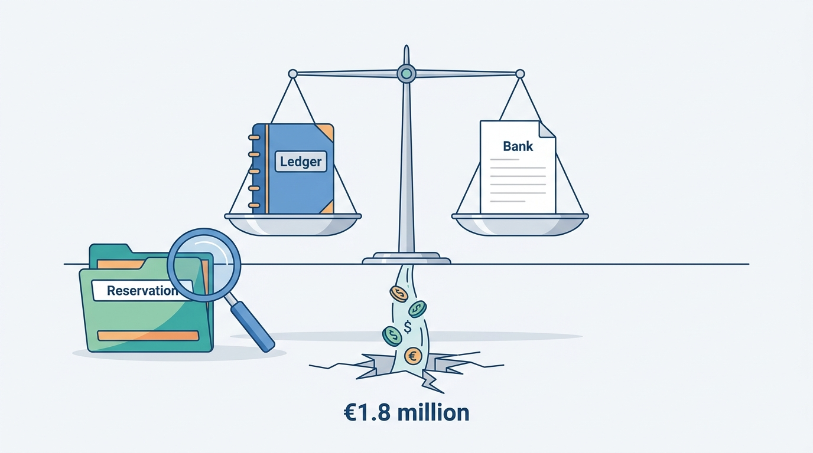
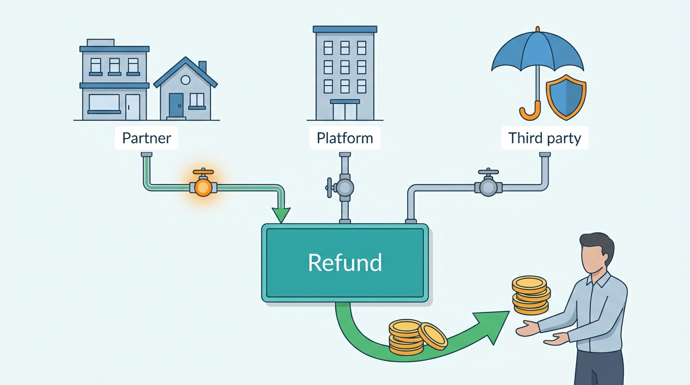
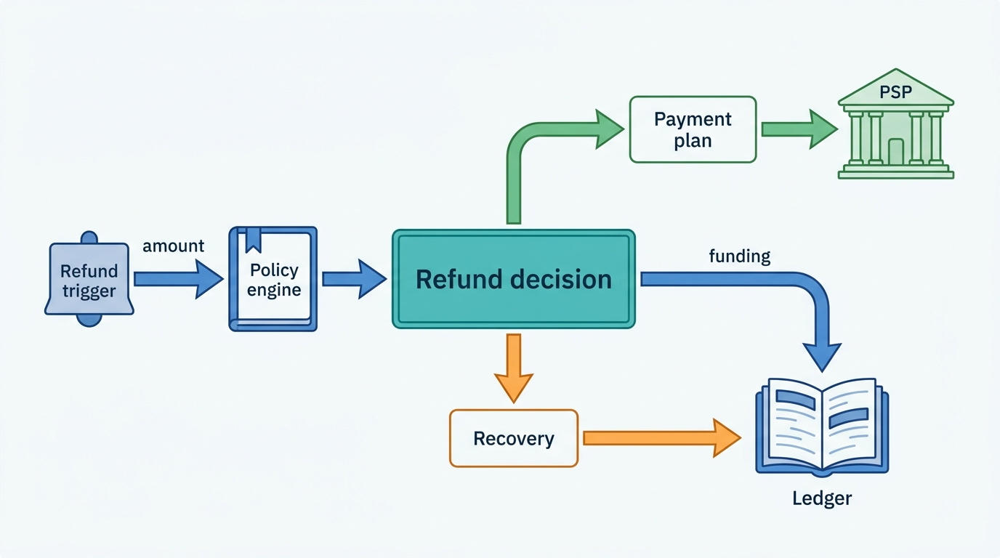
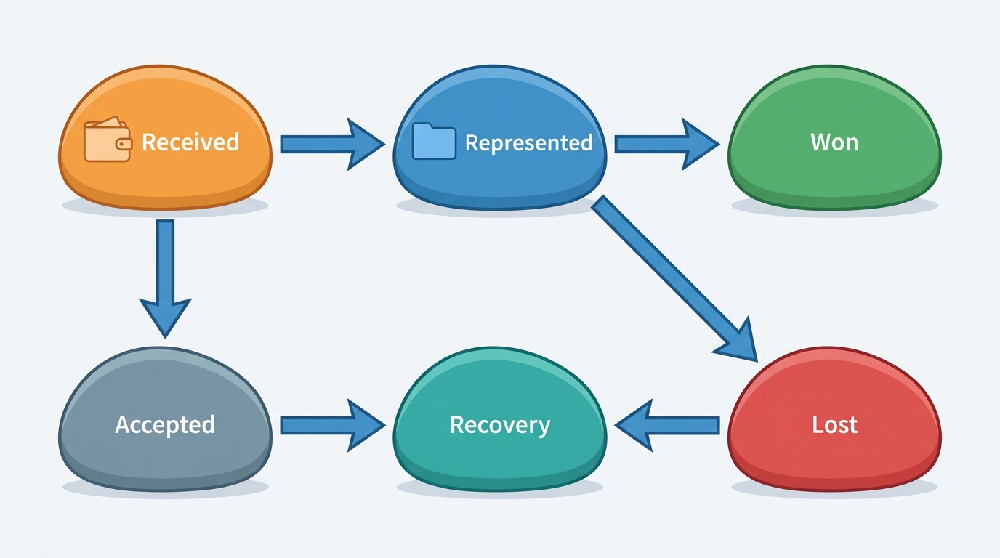
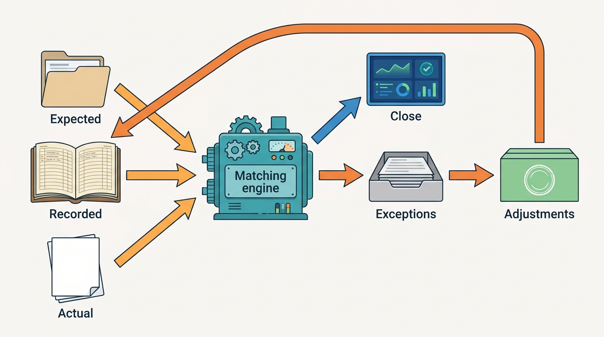
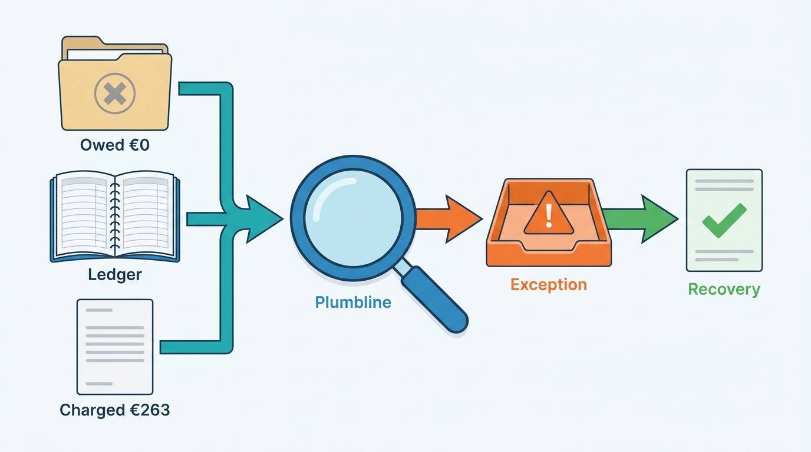

> **IN THIS CHAPTER, YOU WILL:** Follow money that moves backwards (refunds, chargebacks, recoveries and currency differences) and learn how a stays marketplace proves, every day and at month end, that its ledger agrees both with the outside world and with its own reservations. You will see the reconciliation architecture, the finance adjustment workflow, the close, and how Corvane traced a €1.8 million gap in its virtual cards.

> **WHY THE BUSINESS CARES:** Refunds, disputes and unreconciled balances are where a marketplace quietly loses money and where auditors and regulators look first. A finance chief needs to know who paid for every refund, which losses are fraud and which are policy, how much client money is held for whom, and whether the books can be closed in days rather than weeks.

> **WHY ARCHITECTS SHOULD CARE:** Reconciliation is the test suite of the money systems. If it compares only totals, or only the ledger with the bank, it passes while hotels charge cards for canceled stays. If it compares every transaction against the reservation that caused it, design errors in checkout, issuing, payouts and support surface the next morning as named exceptions with owners.

> **KEY POINTS:**
>
> * **Reconcile against the reservation, not only against the bank.** Classic three-way reconciliation proves that money moved as recorded. A stays marketplace also has to prove it was the right money, so the third leg is the reservation and its payment arrangement: what was owed, to whom, under which version. Corvane's €1.8 million gap passed every bank-side check and failed only this one.
> * **Every refund has a payee and a funder, and they are different questions.** Who gets money back is decided by the cancellation policy; who pays for it (the host, the property, the platform's goodwill budget, a protection program, an insurer) is a separate decision that must be recorded at the same moment, or the cost lands in the wrong account and recovery never happens.
> * **Corrections are typed, approved ledger events, never edits.** A finance adjustment has a reason code, an owner, evidence, an approval threshold and a partner-visible line. Measured by its rate and by the age of open exceptions, the adjustment workflow turns the month-end close from a discovery exercise into a confirmation.

> **[FAILURE PATTERNS THIS CHAPTER ADDRESSES](where-stay-platforms-go-wrong.html):**
>
> * **Ledgerless Money** — Refunds, recoveries, dispute losses and card overcharges sit in support tools, PSP dashboards and spreadsheets, so nobody can say what a hotel or host owes after a cancellation.
> * **Policy Spaghetti** — Refund amounts and funding rules are computed separately by checkout, support and payments, so a waived fee is refunded to the guest while the hotel keeps the money.
> * **Built for Sunny Days** — Reconciliation and refund operations sized for normal days drown when a strike or storm produces thousands of refunds, disputes and card changes in one weekend.

 
Most money in a stays marketplace moves forward: the guest pays, the platform holds, the property or host is paid. This chapter is about money that moves **backwards or sideways**: refunds, chargebacks months after a stay, recoveries from hosts already paid, currency differences and payouts that cannot be delivered.

Stays make this harder than retail. Money is held for weeks or months, so every booking can be changed, canceled or disputed while the platform holds it; the party who gets money back is rarely the party who should pay for it; and the supply side is paid through several rails, each with its own statement and timing. **A ledger that is internally balanced can still be wrong about the world**, and the only way to find out is to reconcile it, line by line, against the outside evidence and against the reservations it claims to describe.

This chapter closes Part VI ([[part-6]]) by checking the money the earlier chapters move: [[merchant-and-agency-models]] decided who holds the money, [[stay-payments]] how it is collected, [[payouts-and-settlement]] how the supply side is paid from a settlement ledger, and [[taxes-on-stays]] which part belongs to tax authorities. The chapter owns **three-way reconciliation** in its stays form and the **finance adjustment**. Cancellation policy itself belongs to [[changes-and-cancellations]], dispute evidence and fraud screening to [[stay-payments]] and [[travel-fraud]], and general ledger design to RECONCILED's [[designing-financial-ledgers]] and [[payments-to-ledger]].

## Setting the Scene at Corvane: A Gap Every Bank Statement Agreed With

Corvane, the fictional travel group this book follows (see [[meet-corvane]]), pays hotels for **Pay with Roomstead** merchant bookings mostly by virtual credit card (VCC): Corvane Payments, the group's licensed electronic money institution (EMI), issues a single-use card number per reservation through a partner issuing bank, loads it with the amount owed to the property, and the hotel charges it at its own terminal. In 2026 about 30% of Roomstead's room nights were merchant, which means on the order of **13 million** merchant reservations a year, nearly all with a card.

Fathom, Corvane Payments' double-entry ledger, tracked those cards in one "card issued, unsettled" account per currency. Each month payments operations compared the account's movements with the issuing bank's statement (loaded, charged, expired), and the totals agreed every month from launch in 2024 to the end of 2026. So did the safeguarding reconciliation.

In January 2027, preparing for the board's 40% merchant target, Leila Haddad, Head of Payments and Finance Engineering, started matching each card's **charges** to its reservation instead of matching monthly totals. The first full run, on **8 March 2027**, covered every card issued since launch. By 31 March the team had sized the result: **€1.8 million** that hotels had charged on cards and that Roomstead's reservations said was not owed to them. The figures are illustrative, like everything about Corvane.

| Cause | Cards | Amount | What happened |
| --- | --- | --- | --- |
| Non-refundable card charged at once; reservation later canceled with the fee waived | 3,870 | **€1.02 million** | The card activated at booking; the hotel charged it within days. Months later a support agent or the hotel waived the fee. Corvane Payments refunded the guest, and nothing asked the hotel to return the card charge. |
| Card charged at the original amount after a modification shortened the stay or reduced guests | 2,640 | **€0.41 million** | The guest was refunded the difference; the card was never resized because the change reached Keystone but not issuing. |
| Charged cards whose settlement line carried an outdated reservation number | 1,150 | **€0.23 million** | Keystone issues a new reservation number on some modifications; the card memo kept the old one. Money owed and paid correctly, but unmatched. |
| Cards loaded in a property's local currency, payable recorded in euros at the booking-day rate and never revalued | — | **€0.14 million** | Currency differences on cards for properties in Czechia, Hungary, Poland, Türkiye and the United Kingdom. |
| **Total** | | **€1.80 million** | |

Marco Bellini, the Group CFO, asked how €1.8 million could leave the company while every reconciliation passed. Leila's answer: **every check had compared Fathom with a bank; none had compared Fathom with the reservation.** Only the reservation knew that the hotel was no longer owed the money; in the first two rows Corvane had paid twice: to the guest as a refund and to the hotel through the card.

**Figure 1:** *Fathom and the bank statements agreed every month; only the reservation could show that €1.8 million had been charged by hotels that were no longer owed it.*

Mariana Costa, the Group Chief Architect, took two questions to the architecture forum in April 2027. **What exactly must a stays marketplace reconcile, and against what?** And **when money moves backwards, who decides who pays for it, and where is that decision recorded?**

## Concepts: Money That Moves Backwards

- **Refund.** Money returned to the guest, in whole or in part, initiated by the marketplace (or, in the agency model, the property).
- **Recovery.** An amount the marketplace claims back from a property or host after paying them, such as a cancellation fee or a card overcharge; in the settlement ledger, a **partner receivable** ([[payouts-and-settlement]]).
- **Chargeback.** A reversal of a card payment that the cardholder's issuing bank initiates through the card network after the cardholder disputes it. The **merchant of record** carries it. Unlike a refund, the platform does not choose it: the network moves the money first, and the platform can contest it with evidence (**representment**).
- **Foreign-exchange (FX) result.** The gain or loss when an amount recorded in one currency is settled in another at a different rate, often months after booking.
- **Reconciliation.** A control that compares two or more independent records of the same money, matches them line by line, and turns every difference into an **exception** with an owner. It proves completeness (nothing missing), accuracy (amounts agree) and existence (nothing invented).
- **Three-way reconciliation (stays).** In payments generally, "three-way" means the platform's records, the processor's settlement files and the bank statements. Here it means three *kinds* of record: the **business record** (the reservation, its payment arrangement version and its payment plan: what *should* have happened), the **ledger** (what the platform *recorded*) and the **external evidence** (what payment service providers (PSPs), banks, card issuers, payout rails and partners say *actually* moved). The business leg is where cancellations and modifications change what is owed.
- **Finance adjustment.** A ledger entry posted outside an automated business flow, to correct an error, recognize a loss, apply a goodwill decision or settle a reconciliation exception. It has a type, a reason, evidence, a maker and a checker. The Productscape reference model for accommodation marketplaces names a "Finance Adjustment Workflow" (a generic model, not a description of any company).
- **Suspense.** A holding account for money that cannot yet be attributed, such as an unmatched bank credit. Suspense is a queue, not a place to keep money.

## Refunds: Who Gets the Money Back, and Who Pays for It

Booking.com's terms say "any cancellation/no-show fee and any refund will depend on the Service Provider's cancellation/no-show policy" ([Booking.com Terms](https://www.booking.com/content/terms.html), updated 25 August 2025), and Airbnb's terms say "the amount refunded to you is determined by the Host's cancellation policy," unless other policies take precedence ([Airbnb Terms of Service](https://www.airbnb.com/help/article/2908), 2026). The policy decides the guest's refund. **The funding is a second event**, which payment systems often do not model:

- Booking Holdings' annual report for fiscal 2025 (filed February 2026) says that "in some instances, where we had agreed to provide free cancellations to consumers for non-refundable reservations, we did not estimate a recovery of prepayments already made to travel service providers", and that it may offer "cancellable room rates on behalf of a partner ... even if the partner has not provided a cancellable room rate" ([Booking Holdings 10-K, 2026](https://www.sec.gov/Archives/edgar/data/1075531/000107553126000009/bkng-20251231.htm)). In other words, the marketplace sometimes funds a refund that the supplier's policy would not have given, and the money already paid to the supplier stays with the supplier.
- Airbnb's 10-K for 2025 (February 2026) places "refunds and credits related to customer satisfaction and expenses associated with our host protection programs" in operations and support costs, and merchant fees and chargebacks in cost of revenue ([Airbnb 10-K, 2026](https://www.sec.gov/Archives/edgar/data/1559720/000155972026000004/abnb-20251231.htm)). Platform-funded refunds and dispute losses are different costs in different lines.
- Airbnb's Payments Terms (published February 2026) allow refunds larger than a host's payout to be recovered from the host's future payouts ([Airbnb Payments Terms, 2026](https://www.airbnb.com/help/article/2909)).

A design must therefore support three funders: **the supply partner** (by reversal before payout or recovery after it), **the platform** (as goodwill, guarantee or policy override) and **a third party** (an insurer, a protection program backed by one, or the PSP in a won dispute).

**Figure 2:** *The guest who gets money back is rarely the party who pays for it: every refund records its payee and one of three funders, the supply partner, the platform or a third party.*

### The funding matrix

| Refund situation | Guest refund decided by | Funded by | Ledger effect |
| --- | --- | --- | --- |
| Guest cancels inside the free-cancellation window | Cancellation policy | Nobody loses: reverse the pending payable and unearned fees | Reversals only; no expense |
| Guest cancels a non-refundable booking; partner agrees to waive | Partner, through the extranet or support | Partner: payable reversed, or recovery if already paid or card already charged | Reversal or new partner receivable |
| Guest cancels a non-refundable booking; platform waives as goodwill | Customer service, under a delegated authority | Platform goodwill budget; the partner keeps its money | Goodwill expense with a reason code |
| Property or host cancels | Policy: full refund to the guest | Partner: cancellation fee or relocation cost as a receivable; platform: guarantee spend above it | Refund reversal + partner receivable + guarantee expense |
| Overbooking: guest walked at the property | Relocation policy | Property under the partner terms; platform for the excess | Relocation expense + recovery receivable |
| Extenuating circumstances (strike, storm, closure) | Platform policy ([[changes-and-cancellations]]) | Usually the partner for the refund, the platform for any extras; per policy version | Reversals; policy-funded expense if the platform pays |
| Home not as described, failed check-in | Guarantee or protection program | Platform, with recovery from the host where the terms allow | Guarantee expense + host receivable |
| Damage claim by host | Protection program | Program or insurer, with recovery from the guest | Claim expense + guest receivable |
| Chargeback lost | Card network | Merchant of record, with recovery from the partner where liable | Dispute loss + optional partner receivable |

When Carmen Ruiz canceled the Bauers' Feria-week booking of her Seville apartment on 2 February 2027 because a competing platform had sold the same nights, the guests were refunded **€1,523.20** (the €1,360 subtotal plus the 12% guest fee of €163.20; taxes aside). Nothing had been paid out, so the refund was funded by reversing Carmen's pending payable of €1,305.60 and the €217.60 of unearned guest and host fees ([[payouts-and-settlement]] shows the entries). Nookaway's guest guarantee rehoused the Bauers for **€1,780**, and Nookaway funded the **€420** difference as guarantee expense; Carmen's **€130** host cancellation fee became a receivable recovered from her next payout. Net cost to Nookaway: **€290**, in two accounts with two different owners. After the King's Day overbooking in Amsterdam on 27 April 2027, Roomstead spent **€2,150** relocating four walked guests and recovered **€1,600** from Hotel Prinsenkade under the partner terms; the **€550** difference is Roomstead's relocation expense. In both cases the funding was recorded **in the same transaction** as the refund.

### Refund orchestration

**Figure 3:** *A refund is a decision with two outputs, written in the same transaction: the payment plan returns the guest's money, and the ledger records who funds it, with recoveries as receivables that payouts or invoices settle.*

1. **The refund decision is a record, not a button.** It carries the trigger, the policy version, the amount per payment-plan obligation, the funding split, the decision maker and any override authority. Support tools create refund decisions; they never call the PSP directly.
2. **Refund through the payment plan.** A refund is a new version of the plan from [[stay-payments]]: future charges are canceled first, holds released, virtual cards voided or resized, and only then is captured money returned. The **€1.02 million** row in Corvane's gap is what happens when the card step is skipped.
3. **Refunds and disputes are mutually exclusive on one payment.** Stripe's dispute documentation says a merchant "can't issue a refund outside the dispute process while the dispute is open" ([Stripe Docs, How disputes work](https://docs.stripe.com/disputes/how-disputes-work), n.d., read October 2026). Refunding a payment already charged back pays the guest twice, so the refund decision checks dispute state, and a dispute arriving after a refund is answered with the refund as evidence.
4. **Refund in the currency and to the instrument the guest paid with.** This keeps the statement honest and leaves the currency difference with the platform (see below). Where the instrument cannot receive it, the refund becomes an unclaimed-funds case, not a silent failure.

### Refunds after payout

A refund after the supply side has been paid creates a receivable from the host or property, recovered from future payouts, by netting or by invoice. For Nookaway, which pays hosts 48 hours after scheduled check-in, this is the normal case for anything after check-in. The year-end 2026 balance of **€3.4 million** in Nookaway host debit balances, owed by about 21,000 hosts, is the sum of such recoveries that future payouts had not yet covered ([[payouts-and-settlement]]). Recovery needs an aging policy, a provision and a write-off rule, owned by finance and executed by the adjustment workflow described below.

## Chargebacks: Liability That Outlives the Stay

A chargeback in stays differs from one in retail in when it arrives and who has already been paid. Stripe's documentation states the general rule: card networks "typically allow cardholders to initiate disputes within 120 days of the original payment", but "when a customer pays for a future event or service (like a vacation reservation ...), the dispute window starts on the event date, not the payment date"; the merchant then usually has 7–21 days to respond, and the issuer 60–75 days to decide ([Stripe Docs, How disputes work](https://docs.stripe.com/disputes/how-disputes-work), n.d., read October 2026). A guest who books in February for August can dispute until around December, long after the host or hotel was paid.

**Figure 4:** *A chargeback in the ledger. The network moves the money first, so the platform's books show a dispute receivable from day one. The decision that matters to finance is not only won or lost, but whether a partner is liable for the loss, which turns a dispute into a recovery.*

### What the ledger must do

- **Book the debit when the network takes the money**, not when the dispute is decided. The disputed amount moves from cash to a **dispute receivable**, and the fee to expense. If the outcome is a win, the receivable is cleared by the returned funds; if it is a loss, it becomes a loss in the account that matches its cause.
- **Classify the loss by cause, because the owners differ.** Card fraud (a stolen card used to book) belongs to the fraud team ([[travel-fraud]]). "Not as described" and "service not provided" disputes belong to the trust and protection teams, and often to a partner. "Canceled but not refunded" disputes are policy and support failures. A chargeback expense line that mixes them cannot be managed.
- **Provide for disputes that have not arrived yet.** Booking Holdings records "an allowance for resulting chargebacks"; Expedia's "other reserves", **$21 million** at the end of 2025, mainly accrue the cost of fraudulent card purchases "charged-back" in disputes; Airbnb reported **$67 million** of chargeback expense for 2025 ([Booking Holdings 10-K, 2026](https://www.sec.gov/Archives/edgar/data/1075531/000107553126000009/bkng-20251231.htm); [Expedia Group 10-K, 2026](https://www.sec.gov/Archives/edgar/data/1324424/000132442426000008/expe-20251231.htm); [Airbnb 10-K, 2026](https://www.sec.gov/Archives/edgar/data/1559720/000155972026000004/abnb-20251231.htm)). The ledger must therefore expose exposure by stay date and dispute window, so finance can compute the allowance from data.
- **Record the dispute in the currency it arrived in.** A chargeback on a payment the guest made in pounds arrives months later at a different rate; Stripe's example shows a €100 payment returning as €107.86. The difference is an FX result, not part of the guest's or partner's balance.
- **Supplier failure is a dispute wave.** Booking Holdings warns that if a major travel service provider "declares bankruptcy or otherwise ceases or limits operations, we could experience an increase in chargebacks" and losses on prepayments. A failing chain, bedbank or large vacation-rental manager is a reconciliation event as much as a support one; Corvane's Brightwell Beds wholesale agreement ([[content-and-media]]) is the kind of counterparty whose prepaid exposure should be visible per supplier.

Who carries the liability follows the payment model ([[merchant-and-agency-models]]); dispute evidence is assembled as described in [[stay-payments]].

## Currency: Where FX Gains and Losses Come From

[[stay-payments]] established the three currencies of a stays booking (rate, presentment and payout). Each pair produces FX results, and teams that plan only for the first source in the table are surprised by the other three.

| Source | When it arises | Example | Who should carry it |
| --- | --- | --- | --- |
| Collection vs payout | Guest pays in one currency, partner paid in another, weeks later | Guest pays pounds in February, host paid euros in August | Platform (Airbnb's 10-K says it bears "the currency risk of both the guest payment as well as the host payment due to timing differences") |
| Refund at a later rate | Guest refunded the same foreign amount weeks after paying | Pounds returned in September at September's rate | Platform; the guest gets back what they paid |
| Card settlement in local currency | Card loaded in the property's currency; payable recorded in euros | A Prague hotel's koruna card | Platform, revalued monthly |
| Chargeback at a later rate | Dispute arrives months later in the cardholder's currency | Network debits a different euro amount | Platform |

**The FX result needs its own account.** A guest from Manchester books three nights in Carmen's apartment, paying the euro total of **€436.80** as **£375.00** at Nookaway's displayed rate on 1 September (an illustrative rate of €1.1648 per pound, including the disclosed margin). Corvane Payments converts the pounds to euros on receipt. On 20 September the guest cancels inside the free window and is refunded **£375.00**. Buying those pounds now costs Corvane Payments **€430.50** at the day's rate of €1.1480. The guest is whole, Carmen's pending payable and the unearned fees are reversed at their euro amounts, and the **€6.30** difference is an FX gain for Corvane Payments. Refunding the euro equivalent instead would move the platform's FX risk onto the guest: **Price Drift** in reverse.

**Store every conversion** with its currencies, rate, rate source, timestamp and margin on the payment plan, so each FX result can be explained transaction by transaction. And **revalue open foreign-currency balances at period end**: unsettled cards, payables in non-euro payout currencies, and receivables. The **€0.14 million** row in Corvane's gap was three years of un-revalued card payables in five currencies.

## Architecture: Reconciliation as a System, Not a Spreadsheet

The public description that most stays architects know is Airbnb's 2018 engineering post: "Typically, merchants reconcile all the money movement on the platform via 3-way reconciliation between platform transaction records, processor settlement files, and bank statements." Airbnb built a service that imports daily processor reports from "a handful of gateways and dozens of processors", normalizes and de-duplicates them, and feeds reconciliation that can "'self-heal' certain aberrations when detected" ([Airbnb Engineering, 2018](https://medium.com/airbnb-engineering/measuring-transactional-integrity-in-airbnbs-distributed-payment-ecosystem-a670d6926d22)). Its 2016 post explains why the ledger came first: the old system's trigger-written audit tables had to be "reverse-engineer[ed]", and the replacement was double-entry, in which "money can't be created out of thin air" ([Airbnb Engineering, 2016](https://medium.com/airbnb-engineering/scaling-airbnbs-payment-platform-43ebfc99b324)). Both posts describe systems eight to ten years old that have since been rebuilt; Airbnb's 2026 payments post still lists "Settlement & Reconciliation" as a subdomain ([Airbnb Engineering, Pay as a Local, 2026](https://airbnb.tech/payments/pay-as-a-local/)), but the current internals are not public.

PSPs publish the external leg's shape: Adyen distinguishes transaction-level reports showing "each payment, refund, and chargeback included in a single payout batch" from a batch-level report used to "match them to your bank statement" ([Adyen Docs, Settlement reconciliation](https://docs.adyen.com/reporting/settlement-reconciliation), n.d., read October 2026).

### The components

**Figure 5:** *Reconciliation as a system. The matching engine compares what the business says should have happened, what the ledger recorded and what the outside world says moved; every break becomes an owned exception, every correction a typed ledger entry, and the close reads match status instead of rebuilding it.*

| Component | Responsibility | Must not |
| --- | --- | --- |
| **Evidence ingestion** | Fetch PSP settlement reports, bank statements (for example ISO 20022 end-of-day statements), issuer authorization and settlement files, payout confirmations and returns, partner remittances; validate, de-duplicate, normalize into one line format with source and file lineage | Drop or edit lines; a malformed file is an exception, not a skip |
| **Matching engine** | Apply versioned rules per reconciliation: exact key match, then tolerant matches (amount within FX tolerance, date window), many-to-one (a payout batch to its lines); record the rule that matched each pair | Post entries; it only matches and reports |
| **Exception queues** | One queue per break type, each with an owning team, a service level and aging buckets; auto-resolve known timing breaks after their window | Become a general inbox; an exception without an owner is a design defect |
| **Finance adjustment workflow** | Turn an approved resolution into typed ledger entries, with maker-checker approval and evidence | Allow free-form entries or direct database edits |
| **Close dashboard** | Show, per period and per entity, which reconciliations are complete, the open breaks by age and amount, and the summary entries sent to the general ledger | Hold its own totals; it reads the matcher and the ledger |

### What to reconcile, and on which key

The rule I use is that **every external reference must carry an internal key that leads back to the reservation and the version of its payment arrangement**: the PSP's merchant reference, the card's memo field, the payout's end-to-end identifier, the invoice number. Corvane's 1,150 unmatched cards came from a key that changed when the reservation changed.

| Reconciliation | Business leg | Ledger leg | External leg | Typical breaks |
| --- | --- | --- | --- | --- |
| **Pay-in** | Payment plan obligations due and charged | Cash in transit, guest funds held | PSP transaction-level report; bank statement for the batch | Capture without a booking; booking without a capture; fee differences; duplicate captures |
| **Refunds** | Refund decisions | Reversals and funding entries | PSP refund lines; bank | Refund executed without a decision; decision without execution; refund on a disputed payment |
| **Disputes** | Reservation and refund state | Dispute receivable, losses, recoveries | PSP dispute lines | Dispute on a refunded payment; loss without a cause code |
| **Virtual cards** | Arrangement version: amount owed, activation, cancellation | Card issued, unsettled | Issuer authorization and settlement files | Charge above amount owed; charge on a canceled booking; card never charged |
| **Payouts** | Release rules fired, holds | Available, in transit, paid | Rail confirmations and returns; bank | Returned payouts; payouts above available balance |
| **Agency commission** | Stayed reservations, no-shows | Commission receivable, invoices, credit notes | Partner payments on the bank statement | Commission on a canceled stay; double collection; unallocated partner payments |
| **Tax** | Tax determinations per reservation | Tax collected per jurisdiction | Filings and remittance payments | Liability without remittance; refund that did not reverse tax |
| **Safeguarding** | — | Client funds owed, per currency | Balances in safeguarded accounts | Shortfall or excess; funds outside safeguarded accounts |
| **Ledger to GL** | — | Fathom sub-ledger balances | SAP S/4HANA summary postings | Missing summary; mapping drift between accounts |

**Safeguarding is a legal reconciliation.** An EMI must safeguard funds received in exchange for electronic money (Article 7 of the second E-Money Directive, [Directive 2009/110/EC](http://publications.europa.eu/resource/celex/32009L0110), 2009, referring to the payment-services safeguarding rules now in Article 10 of [PSD2, Directive (EU) 2015/2366](http://publications.europa.eu/resource/celex/32015L2366), 2015). Under PSD2, funds may not be "commingled at any time" with other funds and, if not yet paid out by the end of the business day after receipt, must sit in a separate account at a credit institution or in secure, liquid, low-risk assets. In practice this means a **daily** comparison, per currency, of what Fathom says Corvane Payments owes guests, hosts and properties with the safeguarded balances, and a same-day correction of any shortfall.

**The business-to-ledger check is the one that catches design errors.** It asks, for every reservation version: are there exactly the ledger entries its arrangement and plan require, and does every ledger entry point to a reservation version? It would have caught Roomstead's **212** duplicate reservations of 14 January 2027 (**198** with duplicate charges) the same day, as two captures for one obligation ([[checkout-orchestration]]), and the 3,400 switched bookings of [[merchant-and-agency-models]] as commission collected twice.

> **INFERENCE, NOT DOCUMENTED:** None of Booking.com, Expedia or Agoda has described its reconciliation architecture publicly, and Airbnb's descriptions are from 2016 and 2018. The component boundaries and the business leg in this chapter are a reference architecture derived from accounting practice, the public filings and Airbnb's older posts, not a description of any company's systems.

## The Finance Adjustment Workflow

Every money system needs a way to correct itself. Undesigned, that way is a database console, a "manual credit" button in a support tool and a spreadsheet of month-end journal entries. Designed, it posts **typed** entries, as auditable as the original.

| Adjustment type | Example | Typical maker | Approval | Partner-visible? |
| --- | --- | --- | --- | --- |
| **Recovery** | Hotel charged a card above the amount owed | Reconciliation (automatic) | Automatic below a threshold; payments operations above | Yes, as a statement line with the reservation |
| **Goodwill** | Waived non-refundable fee, voucher | Customer service, under a delegated limit | Team lead above the agent's limit | No (guest-side) |
| **Policy override** | Extenuating-circumstances refund outside the published policy | Policy owner during an event | Pre-approved event rule | Yes, if the partner funds it |
| **Correction** | Wrong commission rate applied; fee posted twice | Finance operations | Maker-checker | Yes |
| **FX** | Revaluation, refund rate difference | System (period end) | None; rule-based | No |
| **Write-off** | Unrecoverable host debit balance; small card overcharge | Finance, under the write-off policy | Controller; CFO above a limit | Yes, the receivable is closed |
| **Reclassification** | Dispute loss recoded from "fraud" to "service" | Fraud or trust analyst | Maker-checker | No |

- **Each type has posting rules, approved by finance, executed as configuration.** An adjustment chooses a type and supplies facts; it cannot choose accounts. RECONCILED's [[designing-financial-ledgers]] describes posting rules as reviewed configuration.
- **Every adjustment references what it corrects**: a reservation version, a ledger entry, an exception, a dispute. An adjustment without a reference is rejected.
- **Approval scales with amount and with who benefits.** An adjustment that moves money to a partner or an employee-controlled account needs a second person; one that only reclassifies an expense may not.
- **Adjustments are rates, not anecdotes.** The **ledger adjustment rate** (adjustments per thousand reservations, by type and by originating system) is the best single indicator of where the automated flows are wrong. A rising rate of "correction" adjustments from one system is a bug report written by finance.

At Corvane, Nookaway's support tool had a "manual credit" action that wrote to Burrow's balances directly; in 2026 about **one Nookaway payout in 140** included an untyped manual credit or debit (an illustrative figure). With balances moving into Fathom ([[payouts-and-settlement]]), the button became a request into the adjustment workflow with the seven types above.

## Unclaimed Funds: Money Nobody Collects

Undeliverable money is easily booked, wrongly, as income.

- **Returned payouts.** In 2026, **0.65%** of Nookaway payouts, about 41,000, were returned or rejected ([[payouts-and-settlement]]); most were paid again after the host fixed the account.
- **Refunds that cannot reach the guest**, because the card has expired or the account is closed.
- **Virtual cards the hotel never charged.** The issuer returns the load, but the hotel is still owed the money; forgetting to charge a card is not waiving payment.
- **Unused credits and vouchers** issued as goodwill or compensation.

**Unclaimed money remains a liability to the person it belongs to** until it is paid, returned or handled under the applicable law, and it moves to a dedicated unclaimed-funds account, per owner and currency, with contact attempts recorded. What the law requires after that varies: US states have unclaimed-property (escheatment) laws, which Airbnb's 2025 annual report lists as a source of possible "additional liabilities" ([Airbnb 10-K, 2026](https://www.sec.gov/Archives/edgar/data/1559720/000155972026000004/abnb-20251231.htm)); in the EU, electronic money holders have a right to redemption "at any moment and at par value" (Article 11 of [Directive 2009/110/EC](http://publications.europa.eu/resource/celex/32009L0110)), and limitation periods are national. The architecture makes the legal answer possible: **every unclaimed balance has an owner, a jurisdiction, an age and a contact history**, so that legal can apply the rule and finance can report it.

At Corvane, the card case was the large one. At the end of 2026, about **€2.6 million** of expired, never-charged Pay with Roomstead cards had been returned by the issuer and credited to a general "card expiry" income account in Fathom (an illustrative figure). Roomstead reclassified them as payables still owed to the hotels and offered reissue or bank transfer; the income account was closed.

## The Close: Confirming, Not Discovering

In a stays marketplace the month-end close also fixes several estimates that only exist at period end: revenue for stays that took place in the period, the chargeback allowance for disputes not yet received, provisions for partner debit balances and agency commission that may not be paid, and FX revaluation of open balances.

**A close that reads the status of daily reconciliations finds the exceptions already owned and aged**; a close that starts by reconciling investigates every break under deadline.

| Close step | Input from the platform | Owner |
| --- | --- | --- |
| Cut-off | Ledger closed for the period at a timestamp; late events post to the next period with their effective date | Finance engineering |
| Reconciliation sign-off | Match rate and open breaks per reconciliation, by age and amount | Payments operations, per reconciliation |
| Revenue | Fees and commission earned at check-in in the period; unearned balances for future stays | Finance, from Fathom |
| Allowances and provisions | Exposure by stay date inside open dispute windows; receivable aging per partner type | Finance, from Fathom |
| FX revaluation | Open foreign-currency balances; period-end rates | System, reviewed by treasury |
| GL summary | Summary postings per account mapping to SAP S/4HANA | Finance engineering |
| Controls evidence | Adjustment log with approvals; reconciliation results; access reviews | Finance and internal audit |

The controls auditors test are mostly properties of the architecture: an append-only ledger, a source event or approved adjustment behind every entry, retained reconciliation results with the rule that matched them, and nobody who can both create and approve an adjustment.

**Fraud and protection losses need their own accounts, not a share of "other costs".** When attackers phished staff credentials at 230 Roomstead partner properties in November 2027 and **310** guests paid fraudsters, Roomstead reimbursed them **€212,000**. Those were neither chargebacks nor refunds; they were goodwill payments for losses outside the platform's payment flow ([[travel-fraud]]). When the **€3,450** Nookaway Cover paid Ivan Horvat after the August party at his Dubrovnik villa was offset by **€900** recovered from the guest, the net **€2,550** was a protection loss ([[protection-and-incidents]]). Separate accounts with cause codes for card fraud, account-takeover reimbursements, protection claims and goodwill give each owning team its own numbers.

## Corvane Worked Example: Closing the €1.8 Million Gap

In April 2027 Mariana's forum agreed a three-part plan: recover, stop the gap reopening, and find the next one in a day.

### Recover

Leila's team and Aisha Rahman's supply organization worked through the gap from April to September 2027.

| Row | Amount | Outcome by 30 September 2027 |
| --- | --- | --- |
| Canceled-but-charged and modified-but-charged cards | €1.43 million | **€1.06 million** recovered from hotels as receivables on their partner statements, collected with commission invoices or netted against bank transfers; **€0.37 million** written off: €0.22 million at properties that had left Roomstead and €0.15 million in charges older than 18 months that hotels disputed |
| Outdated reservation numbers | €0.23 million | Matched on card identifier; no loss; closed by reclassification adjustments |
| Un-revalued local-currency cards | €0.14 million | Booked as FX loss; monthly revaluation introduced |
| **Net loss** | | **€0.51 million** of the €1.8 million |

Each claim needed a statement line a hotel controller could trace to a reservation; recoveries from hotels on gross virtual-card settlement could not be netted ([[payouts-and-settlement]]).

### Stop it reopening

1. **Cards follow arrangement versions.** Issuing consumes the arrangement events from [[merchant-and-agency-models]]; a cancellation or modification voids or resizes the card before anything else in the refund flow happens. The card's memo carries the One Stay reservation identifier and arrangement version, which do not change when Keystone renumbers.
2. **Activation defaults to check-in.** Payment Plans v1 ([[stay-payments]]) moved activation to the plan and defaulted it to the check-in date; earlier activation needs a commercial reason and is reported.
3. **A refund on a charged card records its funder in the same transaction**: a receivable from the hotel if the hotel waived the fee, goodwill expense under the agent's limit if Roomstead did. The first row of the gap was a refund with no recorded funder.

### Find it in a day

**Plumbline**, Corvane Payments' reconciliation service, was built between May and October 2027 by Leila's team on AWS beside Fathom (an illustrative name, like every Corvane system). Its first reconciliations were the three that Corvane lacked: virtual cards at card level, the business-to-ledger check for both brands, and the daily safeguarding comparison. Pay-in, payouts and agency commission followed by the end of 2027.

**Figure 6:** *The check that the old reconciliation could not make. Issuer and ledger agree that the card was charged; only the reservation's arrangement version says the hotel was owed nothing. Plumbline compares all three and opens a recovery exception the morning after the charge.*

In the fourth quarter of 2027, Plumbline flagged **610** cards charged above the amount owed, worth **€118,000**, a median of one day after the charge; **91%** of the amount was recovered within 60 days. Corvane Payments' month-end close for October 2027 took six working days, down from eleven at the start of the year, with a target of four by the end of 2028.

## Trade-offs

| Choice | Option A | Option B | When A is right | When B is right |
| --- | --- | --- | --- | --- |
| **Granularity** | Aggregate reconciliation (period totals per account) | Transaction-level, keyed to the reservation | Small volumes with one flow per partner; as a secondary check | Any marketplace where bookings change after payment, which is every stays marketplace |
| **Cadence** | Monthly, during the close | Daily or intraday, continuous | Low-risk flows such as ledger-to-GL summaries | Safeguarding, cards, pay-in, payouts; anything where a break grows every day |
| **Build or buy the matcher** | Commercial reconciliation software | In-house matcher beside the ledger | Standard bank and PSP reconciliations, small engineering teams | When the business leg (reservation versions) must be matched; vendors rarely model it |
| **Refund before recovery** | Refund the guest at once; recover from the partner later | Recover or confirm partner funding first | Guest-facing refunds where the platform can carry the credit risk, which is usually right | Large, discretionary refunds against a partner with a disputed liability |
| **Auto-write-off threshold** | Write off small breaks automatically | Investigate every break | Breaks below the cost of investigation, with a reported total and a cap | Breaks with a cause that can repeat; a small break caused by a defect is a large one next month |
| **One reconciliation platform for both brands** | Shared matcher, rules and queues | Brand-specific reconciliation | When the ledger is shared, as Corvane's is | When brands have separate ledgers and legal entities with no plan to merge |

My rule on the last row: **reconciliation follows the ledger**. Where money is recorded once, reconcile it once; a second reconciliation stack for the same ledger only duplicates exception queues and argues about whose match is right.

## Hotels and Homes: Where the Two Marketplaces Differ

| Dimension | Accommodation marketplace (OTA-style) | Hosted-stays marketplace |
| --- | --- | --- |
| Who funds most refunds | The property, through its policy and by not charging or by returning card money; the OTA for goodwill and overrides | The host through reversal before payout, the platform through guarantees, recoveries from future payouts afterwards |
| Supply side paid before disputes close | Merchant: often, by card at check-in or check-out; agency: not applicable | Almost always; payout 48 hours after check-in at Nookaway |
| External evidence to reconcile | PSP reports, issuer card files, bank transfers, agency partner payments against invoices | PSP reports, payout rail confirmations and returns in many currencies, bank statements |
| Typical break | Card charged above what is owed after a change; commission collected twice; unallocated hotel payments | Payout returned; refund after payout with no future earnings to net; split payouts that do not add up |
| Recovery counterparty | A business with an accounts department and a contract | An individual, often with one listing and no future bookings |
| Losses that need their own accounts | Card fraud, account-takeover reimbursements, relocation | Card fraud, guarantee rehousing, protection claims |

**What to share.** Reconciliation should be shared wherever the ledger is: evidence ingestion, the matching engine and its rules, exception queues, the adjustment workflow, the close dashboard and the safeguarding comparison. At Corvane, Fathom is shared, so Plumbline is too.

**What not to share.** The **refund funding rules** and the **recovery processes** differ for good reasons. A hotel's recovery is a statement line and a conversation between finance departments; a host's is a deduction from the next payout, or a debit balance that may never be paid, with write-off rules sized for individuals. Forcing hotels into untraceable payout deductions, or hosts into invoices, is **The Hotel-Shaped Home** applied to money moving backwards. When Nookaway pilots boutique hotels in 2028, their recoveries follow the hotel process, because the funding rules are selected by the arrangement's supplier type, not by the brand.

## Failure Modes

- **Reconciling totals, or only against the bank**, which hid the €1.8 million gap; **refunds without a funder**; and **refunds on charged-back payments**. The mitigations are the business leg and the refund rules above.
- **Keys that change.** A reservation number reissued on modification, a PSP reference truncated by a bank, a card memo that cannot hold the identifier. *Mitigation:* a stable internal identifier carried in every external reference, tested per rail.
- **Suspense as a parking lot.** Unmatched lines sit in suspense for months and are cleared in bulk at year end. *Mitigation:* suspense is a queue with owners and aging; anything older than its window is an incident.
- **Reconciliation that cannot scale with a disruption.** A strike or storm produces thousands of refunds, voided cards and disputes in a weekend. During the air-traffic-control (ATC) strike weekend of 5–7 June 2027, Roomstead received **6,200** cancellation requests in 48 hours. *Mitigation:* event-level policy overrides with pre-approved funding rules, so a mass refund is one decision applied many times rather than thousands of individual adjustments; matchers and queues sized for peaks ([[global-scale-and-reliability]]).

## The Chief Architect's View

**The decisions.**

1. **Define what "reconciled" means, in writing.** For each money flow: which three records are compared, on which key, at what cadence, with which tolerance, and who owns the breaks. This is a joint decision of the Group Chief Architect and the CFO, because it defines what the auditors and the regulator will be shown.
2. **Make the business leg mandatory.** Any new money flow ships with its reconciliation rules and keys, or it does not ship; at Corvane this became an entry criterion of One Stay architecture review.
3. **Separate refund policy from refund funding, and give each an owner.** Policy belongs to the cancellation policy engine and its product owner ([[changes-and-cancellations]]). Funding rules belong to finance and the commercial owners of the partner terms. Delegated limits for goodwill belong to customer service leadership ([[customer-service]]).
4. **Put reconciliation with the ledger owner.** At Corvane, Plumbline sits with Leila Haddad's payments and finance engineering team, beside Fathom; the brands own the business events and the exception queues for their own breaks.

**What to watch.** Match rate and open breaks by value and age per reconciliation; the ledger adjustment rate by type and source system; time to detect card overcharges; refunds without a recorded funder (target zero); chargeback loss by cause and payment model; partner receivable aging; the daily safeguarding difference; and close duration in working days.

**Long term.** The number of flows will grow: pay later on Roomstead, split payouts, deemed-supplier VAT under the EU's "VAT in the digital age" rules ([[taxes-on-stays]]), hotels on Nookaway and individually owned homes on Roomstead. Each adds a reconciliation. Where reconciliation is a system with rules and owners, each is configuration; where it is a team with spreadsheets, each is headcount.

## Questions to Ask

1. For each money flow, which three records are reconciled, on which key, and how often? Which flows have no reconciliation at all?
2. Does any reconciliation compare the ledger with the reservation and its payment arrangement version, or only with banks and PSPs?
3. For a refund issued yesterday, can the system say who funded it, under which policy version and on whose authority?
4. What happens to a virtual card, a scheduled charge and a pending payout when a booking is canceled after the card has been charged?
5. Are open foreign-currency balances revalued at period end, and where do FX results from refunds and chargebacks land?
6. How many ledger corrections were made last month, of which types, from which systems, and who approved them?
7. Where does an expired card balance or a returned payout go, and is it still recorded as owed to someone?
8. If 6,000 bookings were canceled in a weekend, how many manual adjustments and exceptions would that create?

## From Money to Trust

Reconciliation proves that money ended where the reservation said it should. Many of the backward flows in this chapter, though, began with a failure of trust: a stolen card, a phished extranet account, a party in a villa, a home that was not as described. Part VII ([[part-7]]) turns to those failures and the systems that prevent them, starting with [[stays-trust-and-safety]].

## Sources and Evidence

### Company engineering and investor sources

- [Booking Holdings Inc., Form 10-K for fiscal year 2025](https://www.sec.gov/Archives/edgar/data/1075531/000107553126000009/bkng-20251231.htm), Booking Holdings / SEC, 2026: chargeback allowance, free cancellation of non-refundable reservations without recovery of prepayments, chargeback risk from supplier failure.
- [Expedia Group, Form 10-K for fiscal year 2025](https://www.sec.gov/Archives/edgar/data/1324424/000132442426000008/expe-20251231.htm), Expedia Group / SEC, 2026: "other reserves" for charged-back fraudulent card purchases ($21 million at year end), expected credit losses on receivable pools including hotel collect.
- [Airbnb, Inc., Form 10-K for fiscal year 2025](https://www.sec.gov/Archives/edgar/data/1559720/000155972026000004/abnb-20251231.htm), Airbnb / SEC, 2026: chargeback expense of $67 million and its year-on-year fall, classification of refunds and credits in operations and support, currency risk and remeasurement of balances held for hosts, escheatment risk.
- [Airbnb Terms of Service](https://www.airbnb.com/help/article/2908), Airbnb, 2026: refunds determined by the host's cancellation policy.
- [Airbnb Payments Terms of Service](https://www.airbnb.com/help/article/2909), Airbnb, 2026: holds when a host cancels, recovery of refunds from future payouts.
- [Booking.com Terms of Service](https://www.booking.com/content/terms.html), Booking.com, 2025: refunds governed by the service provider's policy.
- [Scaling Airbnb's Payment Platform](https://medium.com/airbnb-engineering/scaling-airbnbs-payment-platform-43ebfc99b324), Airbnb Engineering, 2016: from audit-trail tables to a double-entry financial pipeline.
- [Measuring Transactional Integrity in Airbnb's Distributed Payment Ecosystem](https://medium.com/airbnb-engineering/measuring-transactional-integrity-in-airbnbs-distributed-payment-ecosystem-a670d6926d22), Airbnb Engineering, 2018: three-way reconciliation, processor report ingestion, self-healing.
- [Pay as a Local](https://airbnb.tech/payments/pay-as-a-local/), Airbnb Engineering, 2026: "Settlement & Reconciliation" as a payments subdomain.

### Standards, regulation and documentation

- [Directive 2009/110/EC (second E-Money Directive)](http://publications.europa.eu/resource/celex/32009L0110), European Parliament and Council, 2009: safeguarding by e-money institutions (Article 7) and redemption at par (Article 11).
- [Directive (EU) 2015/2366 (PSD2)](http://publications.europa.eu/resource/celex/32015L2366), European Parliament and Council, 2015: safeguarding requirements (Article 10).
- [How disputes work](https://docs.stripe.com/disputes/how-disputes-work), Stripe, n.d. (read 2026): dispute windows from the service date for future services, response and decision times, no refunds during an open dispute, FX on disputed amounts.
- [Settlement reconciliation](https://docs.adyen.com/reporting/settlement-reconciliation), Adyen, n.d. (read 2026): transaction-level and batch-level settlement reports.

### Research and practitioner sources

- Productscape reference models for travel-accommodation and hosted-stays marketplaces, the author's sibling repository, n.d.: "Finance Adjustment Workflow", "Partner Remittance and Reconciliation", "Ledger adjustment rate" and "Finance reconciliation lead time" (generic models, not descriptions of any company).
- RECONCILED, the companion finance-architecture book: [[payments-to-ledger]] and [[designing-financial-ledgers]] for ledger and posting-rule design.

Corvane is fictional; architectural recommendations and labeled inferences are the author's judgement.
