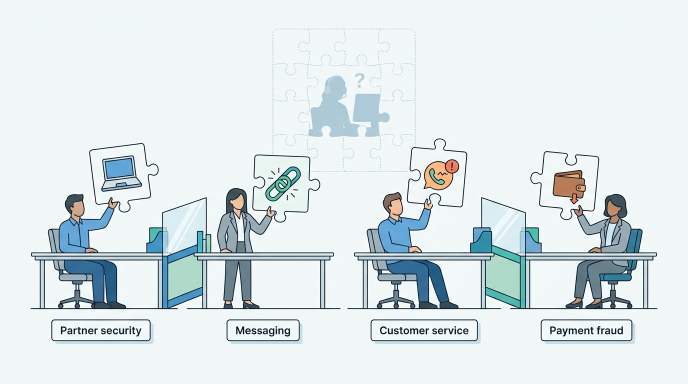
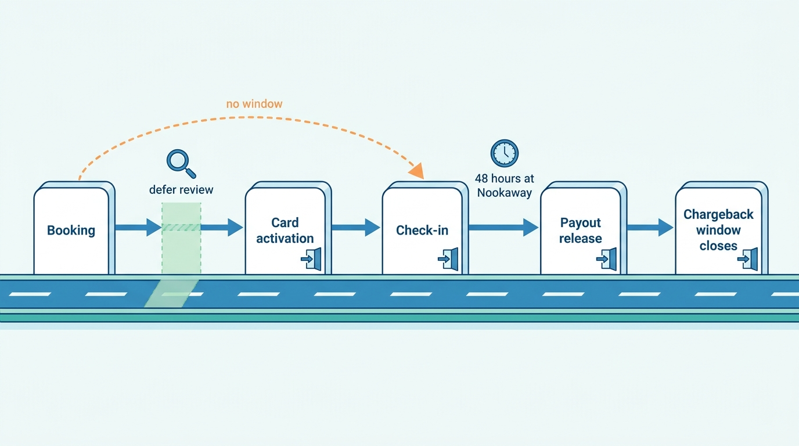
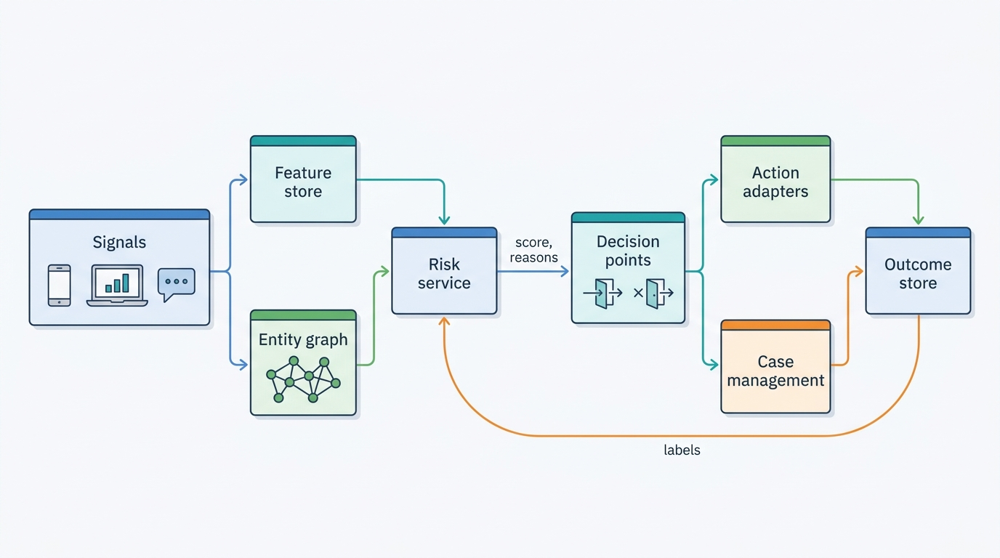
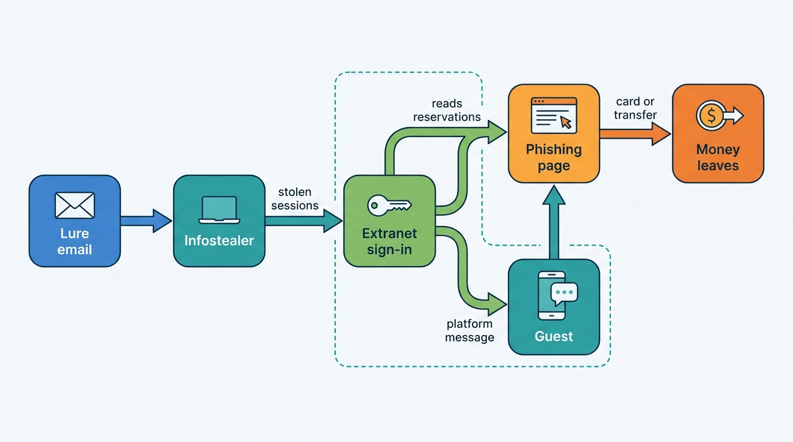
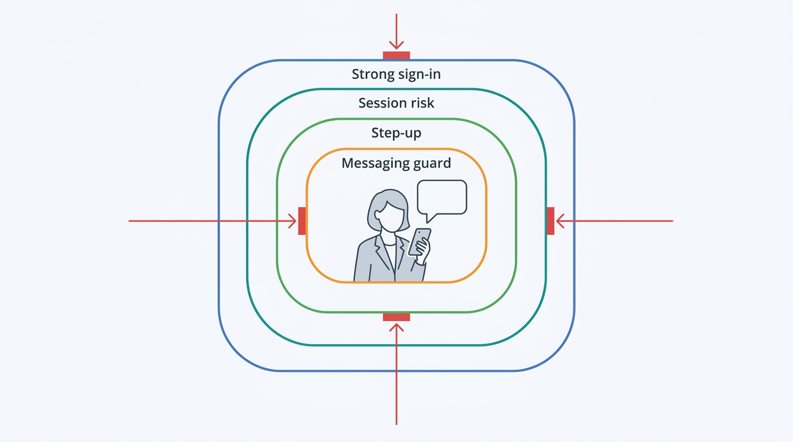

> **IN THIS CHAPTER, YOU WILL:** Learn the fraud types that hit stays marketplaces on the guest side and the supply side, and how a shared risk spine of signals, an identity graph, a booking risk score and graduated friction turns them into decisions. You will follow Roomstead's extranet phishing wave of November 2027 from the first stolen password to the redesign that came out of it.

> **WHY THE BUSINESS CARES:** Fraud costs a stays marketplace three times: in chargebacks and reimbursements, in good bookings declined by mistake, and in guests and partners who stop trusting the brand's own messages. In November 2027 Roomstead reimbursed **€212,000** to guests defrauded through messages that came from real hotel accounts inside its own app.

> **WHY ARCHITECTS SHOULD CARE:** Fraud decisions sit inside login, checkout, messaging, virtual card activation and payout release, each with its own latency budget and its own irreversible moment. If every team builds its own rules engine, the attack moves to the seam between them, and nobody sees the whole chain.

> **KEY POINTS:**
>
> * **Decide at the point of no return, not at the point of sale.** A stay is consumed weeks after it is booked, so most fraud decisions can wait until the money or the night becomes irreversible: virtual card activation, payout release, check-in. Deferred review is cheaper and more accurate than a hard decline at checkout, but only if the platform knows where each booking's points of no return are.
> * **The partner account is the new perimeter.** The best-documented travel fraud of 2023–2025 did not attack the platform; it stole hotel staff credentials and used the platform's trusted messaging to defraud guests. Phishing-resistant sign-in, session risk after login, step-up on sensitive actions and a messaging guard are fraud controls, not only identity hygiene.
> * **Share the risk spine, keep the policies per marketplace.** Signals, the identity graph, the feature store, case management and the outcome store work the same for hotels and homes, and attackers move between brands. Thresholds, actions and who carries the loss differ by business model, so each marketplace owns its decision policy on the shared spine.

> **[FAILURE PATTERNS THIS CHAPTER ADDRESSES](where-stay-platforms-go-wrong.html):**
>
> * **Trust After the Incident** — Roomstead's partner-account security, payment fraud, messaging filters and customer service each held a fragment of the November 2027 attack, and the controls that connected them were built only after 310 guests had paid.
> * **The Unwatched Model** — A booking risk model whose labels arrive months late, from chargebacks and reimbursements, drifts silently unless someone owns its evaluation, thresholds and false declines.

<br>
A stays booking is an unusually good target for fraud. It is expensive, often paid by card weeks before it is consumed, and fulfilled by a third party the platform does not control. The guest expects messages from the property about payment, so a message asking for money looks normal. The money moves along several paths (guest to platform, platform to hotel by virtual card, platform to host by payout, guest to hotel at the desk), each of which can be redirected.

Fraud in travel therefore runs on **both sides of the marketplace**. On the guest side it looks like retail card fraud: stolen cards, taken-over accounts, abused refunds and promotions. On the supply side it looks like nothing retail has: hijacked hotel extranets, fake homes and hosts whose payout accounts are quietly changed. **The two sides meet in the messaging channel**, where an attacker with a partner's password can talk to that partner's real guests.

Part VII ([[part-7]]) argues that trust is one platform of records, with detectors kept per marketplace. [[stays-trust-and-safety]] built that platform; this chapter supplies its fraud detectors and decision points, and [[identity-accounts-and-access]], next, supplies the sign-in and session controls they rely on. It owns two concepts: **extranet takeover** (the compromise of a partner or host account and what the attacker does with it) and the **booking risk score**. It does not re-teach generic risk scoring (LISTED's [[fraud-prevention]]), payments mechanics ([[stay-payments]]), the partner role model or identity verification, or damage, parties and reservation screening ([[protection-and-incidents]]).

## Setting the Scene at Corvane: The "Payment Verification" Messages of November 2027

Corvane, the fictional travel group this book follows (see [[meet-corvane]]), runs Roomstead, an accommodation marketplace sold mostly on the agency model, and Nookaway, a hosted-stays marketplace. In **November 2027** Roomstead met the attack the industry had documented since 2023.

It began with email. From 1 November, front-desk staff at independent hotels across Southern Europe received messages from "guests": a complaint, a lost passport, a link to photos of a stained carpet. The link delivered an infostealer, malware that copies saved passwords and browser session cookies. Among the stolen items were logins and live sessions for the **Partner Hub**, Roomstead's extranet (the web and app workspace in which properties manage their listing, reservations and guest messages; see [[extranets-and-host-tools]]).

| Date (2027) | What happened | What Corvane saw |
| --- | --- | --- |
| 1–7 Nov | Lure emails to hotel staff; infostealer collects Partner Hub credentials and session cookies | Nothing: the compromise happened on hotel computers |
| 6 Nov | First attacker sessions in Partner Hub, from residential proxy addresses in the same country as each hotel | Partner-account security logs showed new devices; the impossible-travel rule did not fire |
| 8–14 Nov | Attackers read upcoming reservations and messaged guests arriving within three weeks: "your card could not be verified; confirm within 24 hours or the booking will be cancelled" | Messaging filter passed the links: the 37 lookalike domains were registered in the previous ten days and the block list was updated weekly by hand |
| 8–13 Nov | Guests asked customer service whether the messages were genuine | About **1,260** contacts, tagged "payment question", spread across two outsourced contact centers |
| 13 Nov | A contact-center team lead escalated a cluster of identical messages | Trust and safety opened an incident in the afternoon |
| 14 Nov | Forced sign-out of all sessions at the 230 properties and at 1,100 more that had logins from the same proxy ranges; emergency rule held every partner message containing an external link | Wave contained; stragglers held |

By the time the incident closed, attackers had used compromised accounts at **230** Roomstead partner properties to message **4,100** guests. **310** guests paid the fraudsters, by card on a fake page or by bank transfer. Roomstead reimbursed all of them, **€212,000** in total, about **€684** each, although no Corvane system had been breached, because the messages had come through Roomstead's own channel under the hotel's real name.

The post-incident review found three things.

- **The lure fitted the business model.** About **86%** of the messaged guests held agency bookings: they had not paid Roomstead and expected the hotel to take payment, so "the hotel needs to verify your card" sounded plausible. The fake pages were prefilled with each guest's real dates, room and price, read from Partner Hub.
- **A second factor would not have been enough.** **148** of the 230 properties had no second factor on Partner Hub at all. The other 82 used text-message codes, and the attackers did not need them: they replayed session cookies the infostealer had copied, so no login, and no code, ever happened.
- **Every team held a fragment.** The partner-account security team saw new devices; the messaging team saw new domains; customer service saw worried guests; the payment-fraud team saw nothing, because no money moved through Corvane Payments. Each signal was weak alone. Nobody's system joined them.


**Figure 1:** *In November 2027 partner security, messaging, customer service and payment fraud each held one weak fragment of the attack, and no system joined them into one picture.*

Sofia Marín, Director of Trust and Safety, put the question to the group architecture forum in December: *which system should have known, within an hour, that one actor was operating dozens of hotel accounts and messaging their guests?* None could. Corvane had fraud tools but no fraud architecture.

## Concepts: Who Loses, and When

### Fraud, abuse and chargebacks

- **Account takeover** (ATO) is the use of a genuine account by someone who is not its owner. For guests it opens stored cards, loyalty balances and personal data; for partners and hosts, guests' reservations, the messaging channel and payout settings.
- **Abuse** uses legitimate features against their intent without stealing: multi-account promotion redemption, refund and guarantee abuse, review trading. **First-party fraud** is its card form: a guest who stays and then disputes the charge.
- Fraud **chargebacks**, borne by the merchant of record ([[stay-payments]]), are the main *label*, the confirmed outcome a model learns from, for guest-side payment fraud. They arrive weeks or months after the booking.

### The typology, by who loses first

The useful question for each fraud type is "**whose money or night is lost first, and on which path?**", because that decides who has the incentive and the data to stop it.

| Fraud type | Mechanism | Loses first: OTA agency | Loses first: OTA merchant | Loses first: hosted stays | Main controls |
| --- | --- | --- | --- | --- | --- |
| **Stolen-card booking** | Card-not-present payment with stolen card data | The property (it charges the card) | The platform (chargeback after paying the hotel) | The platform, often after the host is paid | Booking risk score, Strong Customer Authentication, deferred review |
| **Triangulation** | Fraudster sells cheap stays to real travelers and books them with stolen cards or accounts | The property | The platform | The platform | Guest-name and cardholder mismatch, booking-for-others patterns, resale monitoring |
| **Guest account takeover** | Stolen credentials used to book with saved cards or drain loyalty credit | The guest, then the platform | The platform | The platform | Login risk, step-up on new device, re-authentication to use stored value |
| **Extranet takeover** | Partner staff credentials or sessions stolen; attacker reads reservations and messages guests | The guest (pays the attacker) | The guest | The guest, or the host if the payout account is changed | Phishing-resistant sign-in, session risk, action step-up, messaging guard |
| **Fake supply** | A property or home that does not exist, or is not the lister's, sold to collect prepayment | The guest, who pays the fake property; rare on hotel paths, more on self-signed-up apartments | The platform (guest guarantee) | The platform (guest guarantee) | Onboarding verification, address checks, payout holds for new supply |
| **Off-platform payment** | Guest persuaded to pay by bank transfer outside the platform | The guest | The guest | The guest | Message content detection, structured payment requests, guest education |
| **Refund and guarantee abuse** | False "not as described", "no access", or no-show claims | The property | The platform | The platform or host | Claim history, evidence requirements, linking claimants |
| **Promotion and loyalty abuse** | Multi-account redemption, referral farming, credit theft | The platform | The platform | The platform | Account linking, redemption limits per device and instrument |

Two patterns stand out. First, **the business model moves the loss**. Under the agency model ([[merchant-and-agency-models]]) card fraud lands on the hotel, so an OTA can under-invest in it and still look healthy in its own accounts; under the merchant model the same booking becomes the platform's chargeback. Roomstead's move toward **40%** merchant bookings by 2028 moves card-fraud loss from hotels' ledgers onto Corvane Payments'. Second, **the guest is the first loser in the types the documented 2023–2025 campaigns used**, extranet takeover and off-platform payment, where no money touches the platform and payment-fraud tools see nothing.

### Points of no return

A **point of no return** is a moment after which a loss can no longer be avoided cheaply. A stays booking passes several, and which ones depends on the business model.

| Moment | What becomes irreversible | Roomstead agency | Roomstead merchant | Nookaway |
| --- | --- | --- | --- | --- |
| **Guest payment authorized** | Card details are used; a stolen card is now charged | Not the platform's step (the hotel charges later) | At booking | At booking, or on the Pay Later charge date |
| **Supplier can draw money** | The platform's money leaves its control | — | Virtual card becomes chargeable: on the **check-in date** by default since Payment Plans v1 | — |
| **Guest arrives** | The night is consumed; a fraudster or a reseller's customer is in the room | Check-in | Check-in | Check-in, often with no staff present |
| **Payout released** | The platform pays the supply side | — (commission invoiced later) | — (paid through the card) | **48 hours after scheduled check-in** |
| **Message delivered** | The guest has read the attacker's link | Any time | Any time | Any time |

Here stays fraud differs from retail, where the merchant must decide before the parcel ships. A stays platform holding a merchant booking for a flexible-rate night in August has, since Corvane's Payment Plans v1 moved virtual card activation to the check-in date (see [[stay-payments]]), until August to discover the card was stolen. If it cancels before activation, it refunds the card, the hotel resells the room and the loss is close to zero. If it discovers the fraud from a chargeback in October, it has paid the hotel and lost the full amount.

So the design rule is: **decide at the point of no return, not at the point of sale.** Checkout should block only what is clearly fraudulent and step up what is uncertain; everything else is accepted and kept under review until the next irreversible moment.

Message delivery is the exception: it has no review window, so messaging is the one surface where the decision must be synchronous.


**Figure 2:** *Points of no return along a stay. Deferred review works in the gap between booking and the next irreversible step; non-refundable rates, same-day arrivals and instant payouts close that gap, which is where fraudsters concentrate.*

## Architecture: One Risk Spine, Many Decision Points

The architecture below is the author's reference design, not any company's described internals. It has two halves. The **risk spine** is shared: it collects signals, links entities, computes features, scores, and stores outcomes. The **decision points** are many: login, checkout, message send, bank-detail change, virtual card activation, payout release, refund approval, promotion redemption. Each decision point calls the spine with its own context and latency budget, receives a score and reasons, and applies its own policy.


**Figure 3:** *The risk spine. Signals feed shared features and an entity graph; one risk service scores every decision point; each point applies its own policy; outcomes return as labels. The spine is shared across brands; the policies are not.*

| Component | Responsibility | Must not |
| --- | --- | --- |
| **Signal collection** | Device and session fingerprints, login events, booking and payment attributes, message metadata, listing and payout changes | Score anything itself |
| **Entity graph** | Link accounts, devices, payment instruments, email and phone, properties, listings and bank accounts; answer "what is this connected to?" | Hold raw payment card numbers |
| **Feature store and counters** | Precompute features and velocities (bookings per card per hour, messages with links per partner session) for low-latency reads | Compute graph traversals on the request path |
| **Risk service** | Return a score, reason codes and a recommended action for a decision request, within the caller's budget | Execute enforcement |
| **Decision policy (per marketplace)** | Map score and context to an action: allow, step up, defer review, hold, block | Be hidden in caller code |
| **Case management** | Queue deferred and held decisions for analysts; record evidence and outcome | Diverge from the outcome store |
| **Action adapters** | Apply decisions in owning systems: cancel a reservation, hold a payout, revoke sessions, hold a message, suspend a virtual card | Change other services' data directly |
| **Outcome store** | Collect labels from chargebacks, guest reports, reimbursements, analyst decisions and appeals, keyed to the decision that preceded them | Accept unlabeled "fraud" flags without a source |

LISTED's [[fraud-prevention]] chapter describes the generic real-time and batch split of such a service; three stays-specific features matter here.

**The reservation is the join key.** Payments, virtual cards, payouts, messages and chargebacks all hang off a reservation. If a chargeback cannot be joined to the reservation, the decision that allowed it and the thread that preceded it, the model cannot learn and the analyst cannot investigate. The One Stay reservation contract is therefore a fraud prerequisite.

**The graph spans both sides.** A stolen card used on Roomstead and a host bank account opened with the same email on Nookaway are one actor. Partner staff accounts belong in the graph too: in November 2027, 230 hotel accounts shared a handful of proxy ranges and device fingerprints. That link, visible in one query, was the signal nobody computed.

**Decisions carry their timing.** Every decision request names its decision point and the next point of no return for the object it scores. The policy can then choose "defer to review before card activation on 14 August" instead of a binary allow or block at checkout.

### The booking risk score

The **booking risk score** answers one question: *how likely is this reservation to end in a fraud loss, given everything known now?* It is computed at checkout, recomputed when new evidence arrives (a modification, a guest-name change, a graph link to confirmed fraud) and read at each later point of no return. Its inputs fall into five families; the stays-specific ones are the strongest.

| Family | Examples | Why it matters in stays |
| --- | --- | --- |
| **Payment** | Issuer country, card age on the account, authentication result | Card-not-present basics |
| **Account and device** | Account age, sign-in risk, known device, email and phone age | Separates guests from fresh fraud accounts |
| **Trip shape** | Lead time, length of stay, rate type, number of rooms, guest name vs cardholder name, destination vs card and IP country | Same-day, non-refundable, multi-room bookings for third parties are the triangulation signature |
| **Graph** | Distance to accounts, cards or devices with confirmed fraud; shared devices across many accounts | Organized fraud reuses infrastructure |
| **Supply side** | Property or listing age, recent partner-account risk, payout-detail changes | A booking at a property whose account was taken over yesterday is not a normal booking |

The response is a contract, not a number:

```
decision_request:
  decision_point: checkout          # or card_activation, payout_release, message_send ...
  marketplace: roomstead
  reservation_id: rsv-…
  next_point_of_no_return: card_activation@2028-08-14
booking_risk_response:
  score: 0.83                        # calibrated probability of a fraud loss
  reasons: [cardholder_guest_mismatch, same_day_arrival, device_new, graph_distance_2]
  recommended_action: step_up        # policy may override
  model_version: brs-roomstead-2028.02
  expires_at: next decision point or new evidence
```

The score must be **calibrated**, a probability rather than a rank, because the policy multiplies it by money. The rule I use for thresholds is a cost comparison: block or defer when the expected fraud loss (score × amount at risk at the next point of no return) exceeds the expected cost of the friction (the probability a genuine guest abandons × the margin and lifetime value lost). That arithmetic produces different thresholds for a €90 hostel bed under agency terms, where the platform's money is not at risk, and a €3,000 non-refundable villa week paid out 48 hours after check-in, and it should.

### Graduated friction

Between allow and block sits **step-up friction**: an extra check that costs a genuine guest a little and a fraudster a lot.

| Friction | Cost to a genuine guest | Effect on fraud | Use when |
| --- | --- | --- | --- |
| **3-D Secure challenge** (the card scheme protocol for Strong Customer Authentication, SCA) | Seconds; some abandonment | Strong against stolen card data; shifts fraud liability to the issuer when authentication succeeds | Card risk is the doubt; in the EU it is usually required anyway, so spend it on the risky bookings ([[stay-payments]]) |
| **Deferred review** | None at checkout; rare later cancellation | Strong if review completes before the point of no return | Flexible rates, long lead times, merchant bookings with late card activation |
| **Identity verification** (document and selfie) | Minutes; real drop-off | Strong against fake accounts and ATO | Hosted stays, high-value or high-risk bookings; owned by [[identity-accounts-and-access]] |
| **Rate or product restriction** | The guest loses an option | Removes the fraudster's preferred path | Require a refundable rate or exclude same-day arrival for high scores |
| **Block** | Loss of the booking and of the guest's goodwill | Complete for that attempt | Confirmed fraud indicators only |

## Hijacked Extranets: The Partner Account as Perimeter

### The documented chain

The best-documented fraud pattern in accommodation is a chain of four steps, and it has been reported consistently since 2023.


**Figure 4:** *The extranet takeover chain. The platform is not breached; the attacker borrows its most trusted asset, the reservation thread between a guest and a real property. Controls must act at sign-in, after sign-in, and on the message itself.*

- **Initial access.** In 2023 the Secureworks Counter Threat Unit described an actor who emailed hotel staff posing as a guest who had lost an ID, then linked to an archive containing the Vidar infostealer, which captured the hotel's Booking.com credentials. The hotel had not enabled multi-factor authentication (MFA) ([Secureworks via Sophos, 2023](https://www.sophos.com/en-us/blog/vidar-infostealer-steals-booking-com-credentials-in-fraud-scam)).
- **Abuse of the channel.** Secureworks noted that portal access "would allow the threat actor to see all upcoming bookings and directly message customers"; guests were then asked to confirm payment details. In November 2024 Brian Krebs documented a phishing message delivered inside the Booking.com app minutes after a booking, using the hotel's name and the reservation details. Booking.com told him "there has been no compromise of Booking.com's internal systems" and that the attacks "stem from partners' machines being compromised with malware" ([KrebsOnSecurity, 2024](https://krebsonsecurity.com/2024/11/booking-com-phishers-may-leave-you-with-reservations/)).
- **Industrialization.** In October 2024 ESET reported that the Telekopye scam-as-a-service groups had expanded to Booking.com and Airbnb, using compromised accounts of legitimate hotels and renters, with fake pages showing information that "matches real bookings made by the targeted users"; in the summer holiday season these scams surpassed the groups' marketplace scams in ESET's telemetry ([ESET WeLiveSecurity, 2024](https://www.welivesecurity.com/en/eset-research/telekopye-hits-new-hunting-ground-hotel-booking-scams/)). Krebs also reported underground offers of hotel reservations at "up to 50 percent" discounts through compromised accounts, a triangulation business built on the same access.
- **Evolving lures.** In March 2025 Microsoft described Storm-1865, a campaign that from December 2024 sent Booking.com-themed lures to hospitality staff and used a fake CAPTCHA to make them install credential-stealing malware ([Microsoft Threat Intelligence, 2025](https://www.microsoft.com/en-us/security/blog/2025/03/13/phishing-campaign-impersonates-booking-com-delivers-a-suite-of-credential-stealing-malware/)).
- **Scale.** A Booking.com statement relayed by Krebs in 2024 said its investments "blocked 85 million fraudulent reservations over more than 1.5 million phishing attempts in 2023"; no primary document was available to this book.

Malware names and lures change monthly. **The chain is the durable lesson**: compromise the partner, inherit the partner's trust, and spend it on the partner's guests.

### Layer 1: sign-in that phishing cannot reuse

Passwords are not a control against infostealers, and text-message codes only partly are. NIST's 2025 digital identity guidelines say plainly that "passwords are not phishing-resistant", require verifiers to offer a phishing-resistant option at their second assurance level and restrict the use of the public telephone network for one-time codes ([NIST SP 800-63B-4, 2025](https://pages.nist.gov/800-63-4/sp800-63b.html)). For a partner workspace that can read guests' names, dates and payment status, the target is **passkeys or an authenticator app for every staff account**, with text messages kept only as a recovery path.

The rollout is the hard part. Front desks share computers and rotate staff; holiday-home managers run dozens of logins. Mandating a second factor before the extranet offers individual staff accounts and roles ([[extranets-and-host-tools]]) pushes properties into sharing one login and one phone. Roles first, then mandatory strong sign-in.

### Layer 2: session risk after sign-in

Infostealers copy session cookies, so a strong factor at sign-in does not help once the session is stolen: **82** of the 230 compromised Roomstead properties had a second factor and lost anyway. Session protection has three parts.

1. **Bind sessions to devices.** A session token that is valid only with a key held on the device, or at least tied to a device fingerprint, cannot simply be replayed from another machine. Where binding is not available, short sessions and re-authentication for sensitive reads limit the window.
2. **Score the session continuously.** A partner **session risk** is recomputed on each meaningful action: a new device for a long-stable account, an unfamiliar network, reading all upcoming reservations in minutes, first use of messaging in months, messages with links to many guests. Each signal is weak; together they are decisive.
3. **Act on the session, not only the account.** High session risk revokes that session, forces fresh strong authentication and notifies the property's administrators through another channel. Locking the whole account stops the hotel working on a Saturday night and should be the last step.

### Layer 3: step-up on sensitive actions

Some partner actions are worth more to an attacker than others: changing payout bank details, exporting upcoming reservations, viewing guest card data under the agency model, adding an administrator, sending a message to many guests. These need **fresh strong authentication at the moment of the action** and an owner notification, regardless of how the session started. [[extranets-and-host-tools]] owns the role model; this chapter owns the threat model that decides which actions are sensitive. Bank-detail changes deserve one more control: a cooling-off hold on the next payout and re-verification of the new account's ownership, as [[partner-onboarding]] describes for first setup.

Machine credentials belong in the same model. A channel manager's API credential can read reservations and messages for thousands of properties ([[connectivity-and-channel-managers]]), so one stolen token is a takeover of all of them. Scoped tokens, rotation, network allow-lists and anomaly detection on integration traffic are the API's equivalent of these layers.

### Layer 4: the messaging guard

The last layer protects the guest when every partner-side control has failed. Because the platform owns the channel, it can enforce rules no email provider can.

- **Payment requests are structured, never free text.** If the only legitimate way for a property or host to ask a guest for money is a platform **payment request** object (amount, reason, link to the platform's own payment page), then any free-text request for payment, and any link to a page outside the platform's domains, is anomalous by definition. This one product decision turns a classification problem into a rule.
- **Links are inspected on send and on click.** Extract every URL, resolve redirects, check domain age and reputation, and compare against brand lookalikes. Newly registered domains in a partner message are held, not delivered.
- **Language is scored with context.** "Verify your card within 24 hours" means little from a long-established session and a lot from one that started an hour ago on a new device.
- **Delivery is reversible until it is read.** Hold suspicious messages; redact delivered ones when evidence arrives. Booking.com's connectivity documentation shows the pattern: messages flagged for phishing are redacted ("This message was deleted"), attachments are removed, and the API exposes an `is_redacted` attribute to partner systems ([Booking.com Messaging API documentation](https://developers.booking.com/connectivity/docs/messaging-api/understanding-the-messaging-api), n.d., live page fetched October 2026).
- **The guest is told the rule.** A persistent line in every thread ("we will never ask you to enter card details outside this app") costs nothing and gives the guest a test to apply.

The message thread and its delivery belong to [[trip-and-messaging]]; the guard is a decision point on the shared spine, called on send with a budget of tens of milliseconds.


**Figure 5:** *Four layers stand between a stolen partner password and a guest's money: sign-in that phishing cannot reuse, session risk after sign-in, step-up on sensitive actions and the messaging guard.*

## Fake Homes, Hijacked Hosts and Off-Platform Payment

On the hosted-stays side the supplier is often an individual and the money flows through the platform, so supply-side fraud aims at listings and payouts.

**Fake listings.** Corvane's own case, the fictional Turia Homes ring of July 2027 with fake apartments on both brands, belongs to [[stays-trust-and-safety]]. When the platform collects, the money stays inside it until payout, so the defense combines verification at listing time ([[partner-onboarding]]: address checks, photo reuse, registration numbers) and **payout timing** for new supply. Airbnb's help center states that a fraud review can delay funds "up to 45 days after guest check-in" ([Airbnb Help Center, article 425](https://www.airbnb.com/help/article/425), n.d., fetched October 2026). Nookaway pays 48 hours after scheduled check-in; for new listings, a later first release is its cheapest fraud control.

**Hijacked hosts.** A taken-over host account is worth most at its payout settings: change the bank account, wait for the next payout, leave. The controls are those of Layer 3 plus a graph check, because a new bank account already linked to other hosts, or to accounts closed for fraud, is a strong signal.

**Off-platform payment.** The oldest scam in hosted stays is the request to pay outside the platform: "a small discount if you transfer directly", or a "deposit" by bank transfer. It needs no takeover. Pre-booking messaging restrictions (no contact details, no attachments before a reservation exists) and the structured payment-request rule above are the architectural answers; LISTED's [[messaging-and-leads]] covers the general messaging controls of marketplaces.

Fraud aimed at the host, such as a stolen-card booking for a party, belongs to reservation screening in [[protection-and-incidents]], which asks the same spine a different question: not "will this booking be paid for?" but "will this stay harm the home?"

## Abuse From Inside the Rules: Refunds, Promotions and Loyalty

**Refund and guarantee abuse.** Nookaway Cover's guest guarantee (rebook or refund if check-in fails or the home is materially not as described) invites claims. Most are genuine, and a guarantee that treats claimants as suspects destroys its own value. The useful signals are relational: the same guest, device or instrument across many claims; claims filed after the stay with no message during it. The decision is not "fraud or not" but **how much evidence to ask for**, which keeps friction proportional. Refund mechanics belong to [[refunds-and-reconciliation]] and [[customer-service]].

**Promotion abuse.** Platform-funded coupons and referral credit attract multi-account farming. After Roomstead's **Autumn Cities** coupon (27 September–10 October 2027: a 15% app coupon capped at €50, **31,600** redemptions, cost **€1.30 million**; see [[promotions-and-loyalty]]), a graph review found about **1,060** redemptions from **350** accounts linked by device and payment instrument, almost all created during the campaign. The Circle 2–3 eligibility rule kept the leak small. The architectural point: **promotion eligibility should call the risk spine** at redemption, with limits per device and per instrument, not only per account.

**Loyalty and stored value.** Roomstead's Circle credit, about **€46 million** of outstanding balances at the end of 2026, is cash to an account taker: in 2026 about **16,000** Roomstead guest accounts were taken over by credential stuffing, mostly to spend Circle credit on resold bookings, and Roomstead restored **€1.2 million** of credit ([[identity-accounts-and-access]]). Using stored value should trigger the same sign-in risk check as using a stored card, and redemption by a new device should require fresh authentication.

## Feedback Loops: Labels That Arrive Months Late

Stays fraud labels are slow, biased and scattered.

| Label source | Typical delay after the decision | Bias |
| --- | --- | --- |
| Fraud chargeback | Weeks to months; for future services the dispute clock often runs from the stay date, not the booking date | Only on bookings that were allowed and charged; blocked bookings never get a label |
| Guest report of phishing or scam | Hours to days | Only guests who notice and report |
| Analyst decision on a deferred review | Hours to days | Reflects analysts' rules of thumb |
| Reimbursement or guarantee payout | Days to weeks | Mixes fraud with service failure |
| Partner report ("we did not send that") | Hours | Only properties that read their own message threads |
| Account recovery by the real owner | Days | Confirms takeover, rarely its start time |

Three practices follow.

- **Join every label to the decision that preceded it.** The outcome store keeps the request, score, model version and action, so "what did we decide, knowing what, and what happened?" has one answer.
- **Keep a holdout of allowed bookings.** Blocked bookings never produce a chargeback, so a model trained only on allowed bookings learns a world shaped by its own past decisions. A small random sample of borderline bookings, allowed and watched, gives unbiased labels at a measurable cost.
- **Watch the false declines.** Nobody reports the genuine guests turned away. Measure the **insult rate** (genuine guests declined or blocked, estimated from appeals, retries and the holdout) beside the fraud loss rate, and give both the same owner, one who can name the model's labels, their delay and their bias. Without that, a retrained model is The Unwatched Model in its purest form. Model monitoring itself belongs to the ML platform ([[stays-ml-platform]]).

## Collaboration: Fraud Is Not a Single-Platform Problem

The same actors attack every marketplace, and the same hotel sells on several. Three forms of collaboration pay off, besides sharing confirmed outcomes with the acquirer.

- **With partners.** Tell a property when its account shows takeover signals, with a specific instruction (revoke sessions, scan the front-desk computer, enable passkeys). For agency bookings, a risk flag on the delivered reservation would let the hotel ask for a guarantee before arrival; that is my recommendation, not documented practice, and needs care with what the platform says about a guest. Expedia Group announced a partner-facing **Fraud Prevention as a Service** at its EXPLORE event in May 2024 ([Expedia Group, 2024](https://ir.expediagroup.com/news-and-events/news/news-details/2024/Put-Your-Trip-on-Autopilot-Expedia-Group-Introduces-New-Innovations-at-EXPLORE-to-Take-the-Stress-out-of-Travel-and-Enhance-Partner-Experience/default.aspx)); its contents are not documented in the sources used here.
- **Against lookalike domains.** Takedowns and monitoring of new registrations shorten each wave. The 37 domains used against Roomstead guests were all registered within ten days of use; a feed of new lookalike registrations would have flagged them before the first message.
- **With law enforcement.** Organized groups are prosecuted only when platforms preserve evidence. Case records that keep message content, session details and payment destinations under legal hold are a design requirement.

## In Practice: The Public Record and Corvane's Redesign

### What the public record shows

- **Booking.com, 2026.** An AWS database blog post describes Booking.com's machine learning feature platform on Amazon ElastiCache, serving features at "p99.9 latency below 25 milliseconds at a scale of 200,000 requests per second" for use cases that include fraud detection as well as ranking ([AWS Database Blog, 2026](https://aws.amazon.com/blogs/database/inside-booking-coms-ultra-low-latency-feature-platform-with-amazon-elasticache/)).
- **Airbnb, 2026.** Airbnb's engineering blog described an identity graph of about 7 billion nodes and 11 billion edges that supports trust and safety by "identifying linked accounts", built on JanusGraph, DynamoDB and OpenSearch ([Airbnb Tech Blog, 2026](https://airbnb.tech/infrastructure/scaling-airbnbs-identity-graph-with-a-unified-knowledge-graph-infrastructure/)).
- **Airbnb, 2026 annual report.** Airbnb's Form 10-K for fiscal 2025 says that "AI capabilities now assist in risk assessment and rapid fraud and scam detection", reports chargeback expense of **$67 million** for 2025, and states that "we do not verify all listings for safety or compliance, relying instead on user-reported issues" ([Airbnb Form 10-K, 2026](https://www.sec.gov/Archives/edgar/data/1559720/000155972026000004/abnb-20251231.htm)). Verification lowers fraud; it does not end it.
- **Booking Holdings, 2026 annual report.** Booking Holdings records an allowance for chargebacks because it "may be held liable for fraudulent transactions on our platforms", and lists the costs "related to managing and detecting fraudulent payments" among those of merchant transactions ([Booking Holdings Form 10-K, 2026](https://www.sec.gov/Archives/edgar/data/1075531/000107553126000009/bkng-20251231.htm)).

> **INFERENCE, NOT DOCUMENTED:** None of these sources describes how a company's booking risk decision is made, where in the booking flow it runs, or which actions it can take. The risk spine in this chapter is the author's reference architecture, not a description of Booking.com's or Airbnb's systems.

### Corvane's redesign: booking risk scores on Warden, and Partner Shield

When the wave hit, the shared half of the spine was already approved. **Warden**, the One Stay group trust platform described in [[stays-trust-and-safety]] (approved in August 2027, first release in Q4 2027), provides the cross-brand entity graph, the decision service and log, enforcement and one case tool; detectors stay per brand. What Warden lacked in November was the fraud content: partner sessions in the graph, a booking risk score and a message-send gate for Roomstead. In **December 2027** the group architecture forum approved two pieces of work to add them.

**Booking risk scores as Warden detectors.** Kenji Arai's data and ML platform team builds one booking risk model per brand on the group feature platform, registered as Warden detectors and replacing Roomstead's checkout rules engine and Nookaway's payment-risk rules; reservation screening for parties stays a separate detector. Partner staff sessions, devices and payout bank accounts join Warden's graph. Each marketplace owns its decision policy: Roomstead's payment-fraud team sets thresholds for merchant and agency bookings; Nookaway's trust team sets them for guest payments and payouts.

**Partner Shield** is the extranet program, owned jointly by the partner-account security team and Aisha Rahman's supply organization. It rides on two platforms already planned: Corvane ID for staff sign-in ([[identity-accounts-and-access]]) and Threadline's safety scanning for messages ([[trip-and-messaging]]).

| Control | Before November 2027 | Partner Shield target |
| --- | --- | --- |
| Partner Hub sign-in | Password; optional text-message code (adopted by about a third of properties) | Passkeys through Corvane ID from Q1 2028; passkey or authenticator app mandatory for all staff accounts by **end of Q2 2028**; text codes for recovery only |
| Sessions | 30-day cookie, no binding | 12-hour sessions; re-authentication to read guest card data or export reservations; session risk score on every action |
| Sensitive actions | Bank-detail change by password | Step-up plus owner notification; 7-day hold on the next settlement after a bank change |
| Messages | Weekly hand-updated domain block list | Warden message-send gate for Roomstead from **mid-January 2028**: external links held unless allow-listed; structured payment requests for all properties from **March 2028** |
| Correlation | None across teams | Session, message and customer-service contact signals in one graph; an alert when one device or proxy range touches more than three property accounts in a day |

The worked example of the booking risk score came from Roomstead's merchant bookings, about **13.5 million** reservations in 2026 (30% of about 45 million). In a February 2028 replay of December 2027 traffic, the first Roomstead policy produced the following distribution (illustrative figures, like all Corvane numbers):

| Policy band | Share of merchant bookings | Action | Why this action |
| --- | --- | --- | --- |
| Low risk | 96.4% | Allow; normal authentication | Expected loss below friction cost |
| Elevated, card doubt | 2.7% | 3-D Secure challenge | Authentication answers the card question and moves liability |
| Elevated, flexible rate, check-in more than 7 days away | 0.6% | Allow, then deferred review before card activation | Review completes before money leaves; no friction at checkout |
| High, non-refundable or same-day | 0.2% | Require refundable rate, or decline | No point of no return after checkout |
| Confirmed indicators | 0.1% | Block; graph update | Shared device or card with confirmed fraud |

The replay estimated that deferred review would have canceled about **70%** of the fraud that reached chargeback in that band before any virtual card became chargeable, at the cost of about one genuine booking canceled for every eight fraudulent ones. Mariana Costa, the Group Chief Architect, asked for that ratio on the weekly fraud dashboard beside the fraud loss rate.

In late **January 2028** a smaller wave compromised **26** Partner Hub accounts at properties that had not yet moved to passkeys. The correlation alert fired within 50 minutes on a shared proxy range; the message-send gate held **610** of the **640** messages that contained external payment links; **3** guests paid. The other 30 went out before the session risk crossed its threshold, which is why the structured payment-request rule matters more than any model.

## Trade-offs

| Decision | Option A | Option B | When A is right | When B is right |
| --- | --- | --- | --- | --- |
| **When to decide** | Everything at checkout | Checkout for clear cases; deferred review to the point of no return | Instant payouts, non-refundable rates, same-day arrivals | Merchant bookings with late card activation; payouts after check-in |
| **Rules or models** | Hand-written rules | Calibrated models with rules as guards | New marketplace, few labels, fast-moving attack needing an immediate block | Enough labeled volume; rules kept for confirmed indicators and emergencies |
| **Build or buy scoring** | Acquirer or vendor fraud scoring | Own risk service on own features | Single marketplace, card fraud only, small team | Supply-side fraud, messaging, payouts and cross-brand graph that no vendor sees; vendor scores kept as input features |
| **One spine or per brand** | Separate fraud stacks per marketplace | Shared spine, per-marketplace policy | Brands with no shared users, partners or attackers | A group whose attackers and guests cross brands (most) |
| **Friction for guests** | Uniform (everyone verifies) | Targeted by score | Regulatory or safety mandates (identity for hosted stays) | Payment fraud, where uniform friction costs conversion for little gain |

## Hotels and Homes: Where the Two Marketplaces Differ

| Dimension | Accommodation marketplace (OTA-style) | Hosted-stays marketplace |
| --- | --- | --- |
| **Dominant supply-side threat** | Extranet takeover of hotel staff accounts, then guest phishing in the platform's messaging | Host account takeover with payout redirection; fake or misrepresented homes |
| **Who loses card fraud** | The hotel in the agency model; the platform in the merchant model | The platform, often after the host is paid |
| **Points of no return** | Virtual card activation, check-in; agency bookings have none for the platform | Payment, payout release 48 hours after check-in at Nookaway, check-in with no staff |
| **Guest identity posture** | Front desk checks identity; platform rarely verifies leisure guests | Platform verifies guests and hosts; verification is a booking gate |
| **Messaging risk** | Phishing from genuine hotel accounts; hotels legitimately ask about deposits and arrival | Off-platform payment requests; contact-detail exchange before booking |
| **What can be shared** | Signals, entity graph, feature store, risk service, case management, outcome store, messaging guard | The same, plus reservation screening on the same spine |

My judgement: **share the spine, the graph and the messaging guard; keep decision policies per marketplace.** The two marketplaces face the same attackers: the same devices, cards and proxy ranges appear on both brands, and a Roomstead partner may be a Nookaway host, so one group-wide graph is worth more than two good ones. They differ mainly in **who carries the loss and when the money becomes irreversible**, and that difference belongs in policy (thresholds, friction menus, liability rules), not in architecture. Corvane's 2028 pilot of boutique hotels on Nookaway will test that line: those bookings will need Roomstead's partner-account controls and Nookaway's payout policy at once.

## Failure Modes

- **Fraud tools without a fraud architecture.** Each team has a tool but there is no shared graph or outcome store, so the attack lives in the gaps, as Roomstead learned.
- **MFA as the finish line.** A second factor does not stop a replayed session (Layer 2).
- **Free-text payment requests.** The platform cannot tell a genuine deposit request from phishing (Layer 4).
- **Everything decided at checkout.** Hard declines for doubts that deferred review could settle lose good guests and catch less fraud.
- **Labels from allowed bookings only.** Without a holdout, each retraining makes the model more confident and less correct.
- **Customer-service blindness.** Contacts about suspicious messages tagged as "payment questions" never reach trust and safety. Contact reasons need a fraud category that pages someone.

## The Chief Architect's View

- **Make the risk spine a group platform, with policies per marketplace.** The Group Chief Architect owns the boundary; the Director of Trust and Safety owns fraud operations and policy governance; the data and ML platform owns the models' infrastructure; the payments head owns payment-side actions.
- **Map the points of no return per product.** For each booking type (agency, merchant flexible, merchant non-refundable, hosted stays, Pay Later), document when money and nights become irreversible. Every change to virtual card activation, payout timing or rate rules is then a fraud-exposure change, reviewed as such.
- **Hold partner accounts to staff standards.** Partner sign-in, sessions and integration credentials need the same engineering standard as Corvane's own staff access. Set a date for phishing-resistant sign-in and fund the role model that makes it possible.
- **Fix the messaging contract.** Structured payment requests and the messaging guard are product rules with legal and partner consequences; agree them with supply leadership and regulatory affairs, then make them non-negotiable.
- **Measure both errors.** Fraud loss rate (basis points of gross booking value), insult rate, deferred reviews completed before the point of no return, partner strong-sign-in coverage, time to contain a takeover, phishing messages delivered. Review them monthly beside conversion.
- **Keep humans on consequential decisions.** Declines, account locks and payout holds affect people's money and trips. Data-protection law limits purely automated decisions with significant effects (GDPR Article 22); every automated action needs a reason code, an appeal path and an analyst who can reverse it ([[stays-regulation]] covers the legal map).

Watch over the long term: the merchant shift, which moves fraud loss onto the platform; AI-written lures, which push defenses from language toward structure; and agentic booking ([[ai-in-travel-stays]]), which makes "a new device booking for someone else" normal.

## Questions to Ask

1. For each booking type we sell, where are the points of no return, and which of our fraud decisions run before each one?
2. Can one query show every account, device, card, property account and bank account linked to a confirmed fraud case, across both brands?
3. What share of our partner staff accounts use phishing-resistant sign-in, and what stops a stolen session cookie from being replayed?
4. Which partner actions require fresh authentication, and who is notified when they happen?
5. Can a property or host ask a guest for money in free text today? If so, how do we tell a deposit request from phishing?
6. What do we do with a partner message containing a link to a domain registered last week, and how long does it take?
7. For our fraud model, which labels does it learn from, how late do they arrive, and how do we see the outcomes of bookings we declined?
8. What is our insult rate, who is accountable for it, and how fast does trust and safety hear about ten customer contacts on the same suspicious message?
9. Which integration credentials can read reservations or send messages for more than 100 properties, and how are they monitored?

## From Fraud to Identity

Most of the controls in this chapter depend on knowing who someone is and what they may do: guest verification levels, host and partner verification, staff accounts and roles, passkeys, sessions and one identity across brands. That foundation is the subject of [[identity-accounts-and-access]].

## Sources and Evidence

### Company engineering and investor sources

- [Inside Booking.com's ultra-low latency feature platform with Amazon ElastiCache](https://aws.amazon.com/blogs/database/inside-booking-coms-ultra-low-latency-feature-platform-with-amazon-elasticache/) — AWS Database Blog, 2026: Booking.com's feature platform serving fraud detection and ranking at p99.9 below 25 ms.
- [Scaling Airbnb's identity graph with a unified knowledge graph infrastructure](https://airbnb.tech/infrastructure/scaling-airbnbs-identity-graph-with-a-unified-knowledge-graph-infrastructure/) — Airbnb Tech Blog, 2026: identity graph for linked-account detection; scale and stack.
- [Airbnb, Inc. Form 10-K for fiscal year 2025](https://www.sec.gov/Archives/edgar/data/1559720/000155972026000004/abnb-20251231.htm) — Airbnb, 2026: AI in fraud and scam detection, chargeback expense, limits of listing verification.
- [Booking Holdings Inc. Form 10-K for fiscal year 2025](https://www.sec.gov/Archives/edgar/data/1075531/000107553126000009/bkng-20251231.htm) — Booking Holdings, 2026: chargeback allowance and fraud costs of merchant transactions.
- [Expedia Group introduces new innovations at EXPLORE](https://ir.expediagroup.com/news-and-events/news/news-details/2024/Put-Your-Trip-on-Autopilot-Expedia-Group-Introduces-New-Innovations-at-EXPLORE-to-Take-the-Stress-out-of-Travel-and-Enhance-Partner-Experience/default.aspx) — Expedia Group, 2024: announcement of Fraud Prevention as a Service for partners.
- [Understanding the Messaging API](https://developers.booking.com/connectivity/docs/messaging-api/understanding-the-messaging-api) — Booking.com Connectivity documentation, n.d. (fetched October 2026): phishing redaction and the `is_redacted` attribute.
- [How payouts work (article 425)](https://www.airbnb.com/help/article/425) — Airbnb Help Center, n.d. (fetched October 2026): fraud review may delay payouts up to 45 days after check-in.

### Standards, regulation and documentation

- [NIST SP 800-63B-4: Authentication and Authenticator Management](https://pages.nist.gov/800-63-4/sp800-63b.html) — National Institute of Standards and Technology, 2025: phishing-resistant authentication, restrictions on telephone-network codes.
- [Commission Delegated Regulation (EU) 2018/389 (SCA RTS)](http://publications.europa.eu/resource/celex/32018R0389) — European Commission, 2018: Strong Customer Authentication and its exemptions.
- [Regulation (EU) 2016/679 (GDPR)](http://publications.europa.eu/resource/celex/32016R0679) — EU, 2016: Article 22 on automated individual decisions.

### Research and practitioner sources

- [Vidar infostealer steals Booking.com credentials in fraud scam](https://www.sophos.com/en-us/blog/vidar-infostealer-steals-booking-com-credentials-in-fraud-scam) — Secureworks Counter Threat Unit (Sophos), 2023: the hotel-account takeover chain; missing MFA.
- [Booking.com phishers may leave you with reservations](https://krebsonsecurity.com/2024/11/booking-com-phishers-may-leave-you-with-reservations/) — Brian Krebs, KrebsOnSecurity, 2024: in-app phishing from partner accounts; Booking.com's statements; resale of reservations.
- [Telekopye hits new hunting ground: hotel booking scams](https://www.welivesecurity.com/en/eset-research/telekopye-hits-new-hunting-ground-hotel-booking-scams/) — ESET Research, 2024: scam-as-a-service on Booking.com and Airbnb with prefilled real booking data.
- [Phishing campaign impersonates Booking.com, delivers a suite of credential-stealing malware](https://www.microsoft.com/en-us/security/blog/2025/03/13/phishing-campaign-impersonates-booking-com-delivers-a-suite-of-credential-stealing-malware/) — Microsoft Threat Intelligence, 2025: Storm-1865 lures and fake-CAPTCHA delivery to hospitality staff.
- [[fraud-prevention]] — LISTED, 2026: generic risk scoring service, step-up friction and feedback-loop design for marketplaces.

Corvane is fictional; architectural recommendations and labeled inferences are the author's judgement.
