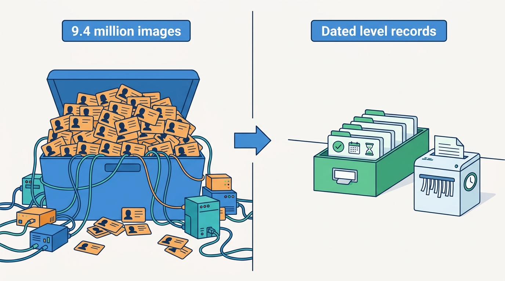
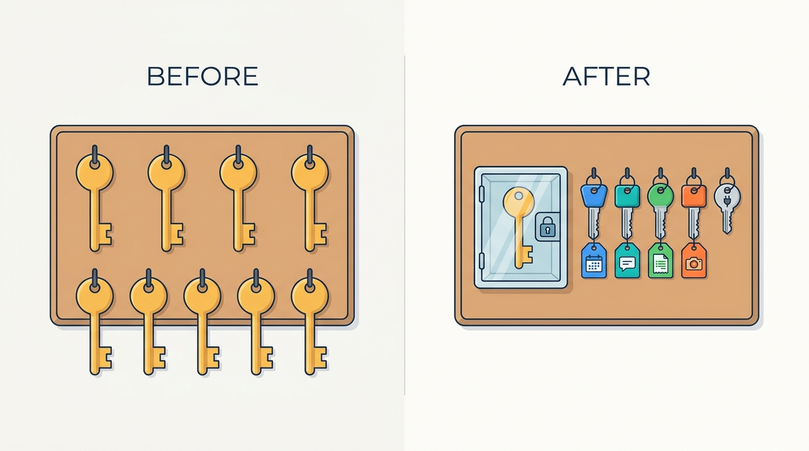
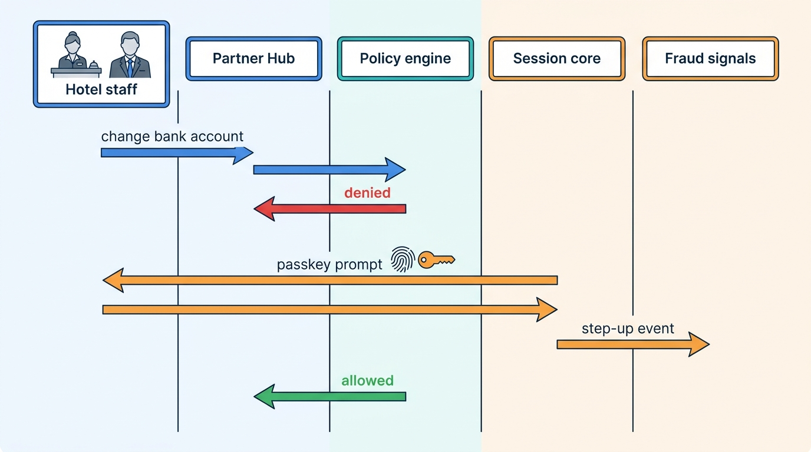

> **IN THIS CHAPTER, YOU WILL:** Take apart the identity layer of a stays marketplace: traveler accounts and profiles, wallets and saved payment methods, identity levels for guests and hosts, partner staff accounts and roles, authentication with passkeys and step-up, sessions, the authorization engine, one identity across brands, and the privacy rules that decide what not to keep.

> **WHY THE BUSINESS CARES:** Every login that fails is a lost booking, every account taken over is a refund and a support case, and every unnecessary identity check costs conversion. For a group with several brands, identity is also the precondition for cross-brand loyalty and for knowing that a host suspended on one brand is not still earning on the other.

> **WHY ARCHITECTS SHOULD CARE:** Identity is the one dependency that every other context reads on every request. If authentication, verification evidence, profile data and authorization rules are spread across monoliths, each security or regulatory change is built once per application, and a weak path in one of them is the path attackers use.

> **KEY POINTS:**
>
> * **Separate the person, the brand account and the evidence.** One identity core holds credentials, sessions and verified attributes; each brand keeps its own account, profile and consents; verification outcomes are stored as dated evidence with an expiry, and raw documents are deleted on schedule. Merging these into one "user" table is how a group ends up unable to link brands lawfully or to delete what it no longer needs.
> * **Ask for identity in proportion to the action, not at the door.** Define a small ladder of identity levels and let a policy decide which action, in which market and segment, needs which level. Guests of a hotel need little; a guest booking a whole home on a peak weekend, a host receiving payouts and a hotel clerk changing bank details need more. Step-up at the moment of risk beats friction at sign-up.
> * **Authorization is a graph of grants, evaluated in one place.** Hotel staff, management companies, co-hosts, cleaners, PMS vendors and support agents all act on behalf of someone else. One policy engine evaluating delegation grants, with phishing-resistant authentication and step-up on money and bulk actions, replaces a dozen role checks that disagree.

> **[FAILURE PATTERNS THIS CHAPTER ADDRESSES](where-stay-platforms-go-wrong.html):**
>
> * **Trust After the Incident** — two-factor codes, ID checks and session controls arrive one incident at a time, each bolted onto one application, so the account that was hardened on one brand is still open on the other.
> * **The Hotel-Shaped Home** — a staff-and-roles account model forced onto a host with one apartment, or a one-person host account forced onto a hotel with forty staff, produces shared passwords on one side and permission sprawl on the other.

 
Every reservation on a stays marketplace joins three identities: the guest who books, the property or host who supplies the night, and the people and systems who act for each of them. The supplier may be one woman with an apartment in Seville or a hotel with a front office, a revenue manager, a finance clerk, a management company and a channel manager writing into its account at 02:00. **How much the marketplace needs to know about each of them, and what each may do, is an architectural decision**, not a sign-up form.

The two marketplace types answer differently. An **accommodation marketplace** (OTA-style; OTA = online travel agency) leaves guest identity to the hotel's front desk, because friction costs conversion; its identity problem is on the supply side, where hotel staff accounts are the main target of credential theft. A **hosted-stays marketplace** puts two strangers in one home, so it verifies guests and hosts with documents and selfies. A group that runs both needs one identity layer, strict where homes need it and light where hotels do not.

Part VII ([[part-7]]) treats trust as a platform. [[stays-trust-and-safety]] built the trust decision and [[travel-fraud]] the detection of account and extranet takeover; both assume the marketplace knows who someone is and what they may do. This chapter supplies that foundation: the trust platform's entity graph is built on its accounts, and the screening in [[protection-and-incidents]] steps guests up to its identity levels. It owns three terms: **identity level** (stays), the **partner role model** and the **traveler profile**. It builds on the supply-party records and KYB (know-your-business) verification of [[partner-onboarding]] and the delegation grants of [[extranets-and-host-tools]]; payment authentication stays with [[stay-payments]] and the regulatory map with [[stays-regulation]].

## Setting the Scene at Corvane: Three Logins and Nine Million Passports

Corvane, the fictional travel group this book follows (see [[meet-corvane]]), had **two identity systems** for its two marketplaces in 2027, plus a third for Corvane Connect, its channel manager. When the board approved the **One Stay** program in April 2027, "Corvane ID (one identity across brands)" was the first line of its shared scope. In June 2027 Mariana Costa, the Group Chief Architect, asked the identity working group for a baseline before the architecture forum decided what "one identity" meant.

**Roomstead**, the OTA, had kept accounts in Keystone, its Java and Oracle monolith, since 2001. About **44 million** accounts had signed in at least once in 2024–2026; **26 million** of them were members of Roomstead Circle, the loyalty program. Accounts were optional: **41%** of reservations on Roomstead's own web and apps in 2026 were made without signing in. Passwords created before 2015 had been stored as salted SHA-1 hashes and were re-hashed only when their owner next signed in; **6.8 million** active accounts still had the old hash. Credential stuffing, the replay of passwords leaked from other sites, took over about **16,000** guest accounts in 2026, mostly to spend Circle credit on resold bookings; Roomstead restored **€1.2 million** of credit. On the supply side, Partner Hub, the extranet, had about **1.3 million** staff logins. A second factor by text-message code was optional, and about a third of properties used it; **63%** of users held Partner Hub's "Administrator" role, the only one of its four fixed roles that could do everything.

**Nookaway**, the hosted-stays marketplace, kept accounts in Burrow, its Django monolith: about **12.6 million** guest accounts active in 2024–2026 and **610,000** hosts. Everyone needed an account to book. Hosts had completed document-and-selfie verification since 2018; guests did so only when Nookaway's reservation screening asked, which happened on **21%** of 2026 bookings. The privacy review found the cost of that diligence: Burrow had kept every identity document and selfie since 2016, about **9.4 million** images in a storage bucket readable by the support tool and dozens of service accounts. Noor van Dijk, Head of Regulatory Affairs and Privacy, put one sentence at the top of their memo: "We are storing passports to prove we checked passports."

Two more facts framed the decision. About **2.4 million** people had accounts with the same verified e-mail address on both brands. And Roomstead's Irish company and Nookaway's Portuguese company were **separate data controllers** under the General Data Protection Regulation (GDPR), with privacy notices that did not mention each other.

So the forum's question was not "which identity product do we buy". It was: **what must be one thing across the group, what must stay per brand, and how much should Corvane know about each guest, host and partner employee to let them do what they came to do?**

## Concepts: The Vocabulary of Who Someone Is

Identity work goes wrong when one word, "user", covers six different things. I separate them like this.

| Term | Definition | Example |
| --- | --- | --- |
| **Identity (principal)** | The thing that authenticates: a person or a software client, with credentials and sessions | Tomáš Novak's Corvane ID; Corvane Connect's API client |
| **Account** | A brand's relationship with an identity: terms accepted, status, brand-specific settings | Tomáš's Roomstead account (since 2014); Jana's Nookaway account |
| **Traveler profile** | The guest-side data a brand keeps to serve the person: names, contact points, preferences, saved companions, loyalty membership, references to stored payment methods | Tomáš's Circle 2 status and saved card reference |
| **Party** | A legal or natural person on the supply side, with verification, beneficial owners and payout accounts ([[partner-onboarding]]) | Hotel Miradouro's operating company; Carmen Ruiz as a host |
| **Grant** | A delegation from one party to another on a target with a scope ([[extranets-and-host-tools]]) | Miradouro's front office may reply to guests and act on reservations |
| **Identity level** | A verified assurance about an identity, with evidence, method, date and expiry | "Government ID and selfie matched, 3 February 2027, valid 36 months" |

Four more terms carry the rest of the chapter:

- A **passkey** is a public-key credential under the W3C Web Authentication standard (WebAuthn), usually synchronized across a person's devices by the platform's password manager. It is bound to the site's domain, so a lookalike phishing page cannot use it ([W3C WebAuthn Level 2](https://www.w3.org/TR/webauthn-2/), 2021).
- **Step-up authentication** asks for a fresh, stronger proof before a sensitive action, inside an existing session: changing a payout account, exporting reservations, adding an administrator.
- **Phishing-resistant** authentication cannot be relayed by a fake site. The US National Institute of Standards and Technology's 2025 digital identity guidelines require verifiers to "offer at least one phishing-resistant authentication option" at their middle assurance level, restrict the use of SMS for one-time codes, and allow syncable authenticators such as passkeys at that level but not at the highest one ([NIST SP 800-63B-4](https://pages.nist.gov/800-63-4/sp800-63b.html), 2025).
- **KYC** (know your customer) verifies a natural person; **KYB** verifies a business. [[partner-onboarding]] owns both as processes; this chapter treats their *results* as identity evidence.

### Identity levels for stays

An **identity level** is the marketplace's statement of how sure it is that an identity belongs to a real, specific, reachable person. It is not a badge and not a risk score. The ladder I use has four levels for people, plus the business verification that onboarding owns.

| Level | What has been proven | Typical evidence | Typical expiry |
| --- | --- | --- | --- |
| **IL0 — Session** | Nothing; a browser or app instance | First-party device identifier, consent state | Session or device lifetime |
| **IL1 — Reachable** | Control of an e-mail address or phone number | One-time code or link; passkey bound to the account | Re-check when contact point changes |
| **IL2 — Paying** | Control of a payment instrument, authenticated by its issuer | 3-D Secure-authenticated card on file, verified bank account | Instrument lifetime |
| **IL3 — Documented** | Legal name matched to a government document and to the person presenting it | Document check, selfie or liveness match, or a national electronic ID; database match where lawful | 24–36 months, or on name change |
| **KYB** (supply) | The legal entity exists, the signatory may act for it, beneficial owners are known | Trade register, documents, screening ([[partner-onboarding]]) | Annual for high-risk segments |

Two rules make the ladder useful. **Levels are facts with evidence, and policies consume them.** The identity core records "IL3 reached by document and selfie at a named vendor on a date, expiring on a date"; it does not decide whether a guest may book. **Levels expire.** A selfie from 2019 says little about who holds the account in 2027. Airbnb's annual report for fiscal 2025 is candid about the limit of a one-time check: users "are not required to re-verify their identity" after their initial verification ([Airbnb Form 10-K FY2025](https://www.sec.gov/Archives/edgar/data/1559720/000155972026000004/abnb-20251231.htm), 2026).

## Architecture: An Identity Core, Brand Accounts and One Policy Engine

The generic reference models behind this book split the identity layer into three domains: **Identity and Access Management** (an identity API, an authentication and session core, a role and access policy engine and an identity event feed), **Traveler Account and Wallet** (the traveler profile store) and, on the hosted-stays side only, **Identity and Verification** for guest and host document checks (Productscape accommodation model, bricks `idam` and `acct`; hosted-stays model, brick `idvr`; generic models, not descriptions of any company). The accommodation model has no guest-verification brick and the hosted-stays model no access-management brick; a group platform has to close both gaps.

**Figure 1:** *The identity layer as five components. Authentication proves who is acting; the policy engine decides whether they may act, from grants and identity levels; verification feeds outcomes, not documents, into the level store; brand accounts and profiles hang off the identity; every change is published for trust, fraud and audit.*

| Component | Responsibility | Owns | Must not |
| --- | --- | --- | --- |
| **Authentication and session core** | Credentials, passkeys, social and enterprise sign-in, challenge selection, sessions, tokens, step-up, revocation | Credential store, session store, token issuance (OpenID Connect and OAuth 2.0) | Decide business permissions; store profile data |
| **Identity level store** | Current levels per identity, with method, evidence reference, date, expiry | Level records and their history | Keep raw documents or selfies |
| **Verification service** | Cases with vendors: document, selfie, database checks, national electronic IDs; KYB through onboarding | Cases, vendor results, retention schedule for raw evidence | Grant access; it only reports outcomes |
| **Policy engine** | Evaluate "may identity I perform action A on object O now?" from grants, roles, identity level and session context | Policy definitions, decision logs | Be bypassed by local role checks in applications |
| **Brand accounts and traveler profiles** | Per-brand terms, status, preferences, companions, loyalty membership, payment method references, consents | Profile data per brand controller | Share data across brands without a link the person made |
| **Identity event feed** | Sign-ins, failures, new devices, credential changes, level changes, grant changes | Event contracts | Carry secrets or document images |

Three boundaries in that table carry the design. **Verification is separate from the level**: booking and payouts read only the outcome, never the evidence. **The profile is separate from the identity**: credentials, sessions and verified attributes are one per person across the group, while profiles, preferences and consents are one per brand, which is what makes "one identity across brands" lawful. And **authentication is separate from authorization**. An OpenID Connect token says who the person is and how and when they authenticated; it should not carry a hotel group's permissions on 200 properties, which change faster than tokens expire. The application asks the policy engine at the moment of the action, so a grant revoked at 10:00 fails the 10:01 request, whatever token the client holds.

### Authentication: passkeys first, the challenge chosen on the server

Stays have an unusual login rhythm. Guests sign in a few times a year, often on a new phone, and hosts sign in when a reservation arrives. Airbnb's 2026 description of its "Flexible Authentication" rebuild names the consequence: "a failed login means a lost booking." Airbnb moved to an "identify first, then challenge" design in which a server-side policy engine chooses the challenge most likely to succeed for that person and market, for example a WhatsApp one-time code in Brazil or Naver sign-in in South Korea, and offers a server-driven "try another way" picker; "the client never decides which challenge to present" ([Airbnb Engineering, Flexible Authentication](https://medium.com/airbnb-engineering/flexible-authentication-reimagining-authentication-for-millions-of-users-at-airbnb-3a8a4c917137), 2026). Airbnb frames the policy engine around success rate; the post does not say it is used for fraud-driven step-up.

I would build authentication for any stays marketplace in four layers:

1. **Identify** the account from an e-mail, phone number, passkey or federated sign-in, without revealing whether the account exists.
2. **Choose a challenge on the server** from the methods the identity has, the market, the device and the session risk. Passkeys first where enrolled; e-mail links or codes as recovery; SMS only where nothing better works, given NIST's restriction on it; social sign-in (Google, Apple) where guests expect it.
3. **Issue a session** with an assurance record: which method, when, from which device. That record is what step-up checks later.
4. **Step up per action**, not only at login. The policy engine returns "allowed after a fresh phishing-resistant proof" for actions that move money or expose many guests.

For partner staff I would go further: **phishing-resistant authentication is mandatory** for extranet roles that can see guest contact details, message guests or touch finance, because the documented extranet attacks of 2023–2025 started with stolen hotel credentials. A 2023 Secureworks investigation found the victim hotel had not enabled multi-factor authentication on its Booking.com access ([Sophos/Secureworks](https://www.sophos.com/en-us/blog/vidar-infostealer-steals-booking-com-credentials-in-fraud-scam), 2023). In 2024 Booking.com told KrebsOnSecurity that two-factor authentication "is required and enforced, including for partners to access payment details", though Krebs noted it was unclear whether this covered all partners ([KrebsOnSecurity](https://krebsonsecurity.com/2024/11/booking-com-phishers-may-leave-you-with-reservations/), 2024). Codes from SMS or an authenticator app can be relayed by a real-time phishing page; passkeys cannot. [[travel-fraud]] owns detection of extranet takeover; identity owns making stolen passwords worthless.

### Sessions: long for guests, short and bound for money

Infostealer malware takes session cookies as well as passwords, so a strong login protects only the moment of login; session design has to assume theft.

| Session class | Lifetime | Re-authentication | Revocation |
| --- | --- | --- | --- |
| **Guest browsing and trip management** | Long (weeks to months, sliding) | Step-up for changing e-mail, phone, password or saved payment methods, and for redeeming stored credit | On password change, on fraud signal, by the guest from a device list |
| **Guest checkout** | Within the browsing session | Payment authentication is the issuer's job (3-D Secure, [[stay-payments]]) | With the session |
| **Host app** | Long on a registered device | Step-up for payout and tax details, co-host grants, bulk messages | On device removal, on grant change, on risk signal |
| **Extranet staff** | Short (a working day), idle timeout | Phishing-resistant at login; step-up for bank details, exports, new administrators, bulk messages | Immediately on grant revocation; on anomaly (new country, bulk reads) |
| **Support agents** | Shift-length, managed device only | Per case: access opens on an assigned case | Case closed, shift ended |
| **Machine clients** (PMS, channel managers) | Short-lived access tokens from client credentials | Not applicable; credential rotation | Grant revocation stops the next token |

Three choices sit behind the table: **short tokens with centrally controlled refresh**, so revocation takes effect within minutes; **a device list the person can prune**; and **session signals published to fraud models**, because a long-stable hotel account suddenly reading every upcoming reservation from a new country is the strongest takeover signal ([[travel-fraud]]).

### Authorization: one engine for roles and grants

[[extranets-and-host-tools]] modeled delegation as data: a grant links a delegate party to a target (property, listing, portfolio or legal entity) with a role, scopes and a validity period. This chapter owns the **partner role model** on top of those grants, in three layers, and the engine that evaluates them.

1. **Scopes** are fine-grained permissions on supply objects: `calendar:write`, `rates:write`, `reservations:act`, `messages:reply`, `guest_contact:read`, `finance:read`, `payout:configure`, `team:manage`, `export:bulk`.
2. **Roles** are named bundles of scopes that suppliers understand, with a published catalog per marketplace: Owner, Manager, Revenue, Front office, Finance, Content, Cleaner, Connected system. Each role has a **ceiling**: a grantor can only grant scopes they hold, and some scopes, such as `payout:configure`, are never delegable.
3. **Policies** add conditions that roles cannot express: identity level ("`payout:configure` requires IL3 or KYB signatory"), session assurance ("`export:bulk` requires a phishing-resistant proof in the last 10 minutes"), context ("`guest_contact:read` only for reservations arriving within 30 days").

Relationship-based access control is the natural engine for this, because the question is a path through a graph: does this person act for a company that holds a Manager grant on a portfolio that contains this listing? Google's Zanzibar paper describes the pattern at scale: permissions stored as relation tuples and evaluated as graph traversals, with consistency guarantees so that a revoked permission is not honored by a stale cache ([Pang et al., USENIX ATC](https://www.usenix.org/conference/atc19/presentation/pang), 2019).

Machine identities follow the same path. A PMS vendor is a party with a grant; its API calls carry a client credential, and, when it acts for a specific hotel, a token that names both the client and the hotel. The OAuth token-exchange standard defines an `act` claim for exactly this "acting on behalf of" case ([RFC 8693](https://www.rfc-editor.org/rfc/rfc8693), 2020). AI assistants that reply to guests or change prices for a host are the newest machine delegates and need the same grant, scopes and audit trail ([[ai-in-travel-stays]]).

Internal users are the third population. A support agent at an outsourced contact center needs a guest's reservation and messages for the case in front of them, not the ability to search every account. **Case-bound access**, where opening a case grants read access to its parties for the case's lifetime and every read is logged, is the control I would insist on before any group-wide customer-service platform goes live ([[customer-service]]).

## The Traveler Profile, the Wallet and What Not to Keep

The **traveler profile** is the easiest place to over-collect. My test for each field: **which action needs it, who reads it, and when is it deleted?**

| Field group | Needed for | Lives in | Do not |
| --- | --- | --- | --- |
| Name, contact points, language, currency | Booking, confirmations, support | Brand profile; contact points verified in the identity core | Copy into every service; read them by reference |
| Saved companions (names, children's ages) | Pre-filling party size and child-age rules for prices and tourist tax ([[taxes-on-stays]]) | Brand profile, only if the guest saves them | Store ages from a single booking as a permanent profile fact |
| Preferences (bed type, accessibility needs, smoking) | Filtering and requests to the property | Brand profile, purpose-tagged | Infer health data from accessibility choices; treat it as special-category data if you do |
| Loyalty membership and tier | Member prices and benefits ([[promotions-and-loyalty]]) | Loyalty service; profile holds a reference | Compute tier in the profile |
| Saved payment methods | Faster checkout, scheduled charges | Payment vault in the payments institution; profile holds tokens and display data (brand, last four digits) | Store card data anywhere near the profile |
| Stored credit and balances | Redemption | Ledger accounts ([[payouts-and-settlement]] and [[stay-payments]]) | Keep a balance column in the profile |
| Identity documents | IL3 verification; national guest-registration duties at the property | Verification service with short retention; registration data with the property | Keep passport images as profile attachments |
| Trip intents, wishlists, alerts | Personalization ([[personalization-and-recommendations]]) | Intent store under the identity | Merge across brands without the person's link |

The word **wallet** misleads. In a stays group, the wallet shown in an account is a view over three systems owned elsewhere: payment instruments in a vault, stored value in a ledger, and loyalty status in a program service. Airbnb's payments platform description lists "Wallet & instruments" and "Incentives & Stored Value" as separate subdomains of payments, not of accounts ([Airbnb Engineering, Pay as a Local](https://airbnb.tech/payments/pay-as-a-local/), 2026). The account owns the presentation and the authorization to use them; it should own none of the money.

### Privacy and data minimization

GDPR sets the frame: data must be "adequate, relevant and limited to what is necessary" and kept identifiable "for no longer than is necessary" (Article 5(1)(c) and (e)); biometric data processed "for the purpose of uniquely identifying a natural person" is a special category that needs an Article 9 exception, which covers selfie-to-document matching; and Article 25 requires data protection by design ([Regulation (EU) 2016/679](http://publications.europa.eu/resource/celex/32016R0679), 2016). Four design rules follow for stays.

1. **Keep outcomes, not evidence.** Store "IL3 by document and selfie, vendor reference, date, expiry"; delete the raw images on a schedule the system enforces once no dispute or legal duty needs them.
2. **Guest registration is the property's duty.** Spain, Italy, France and other Schengen states require hotels and many rentals to record guest identity for the police; France requires the form for non-French guests to be kept for six months ([Service-Public.fr](https://www.service-public.gouv.fr/particuliers/vosdroits/F2043), 2026). A platform may help the property collect it; it should not become a second copy of every guest's passport.
3. **Mask contact details where the marketplace mediates.** Hosted-stays platforms commonly relay e-mail and phone between guest and host, for privacy and against fraud. OTAs in the agency model pass guest contact details to the hotel because the hotel is the supplier; the scope `guest_contact:read` should still be limited to reservations that need it.
4. **Legal retention beats deletion, but only for what the law names.** A guest's right to erasure (Article 17) does not remove a host's tax records: platform operators must keep DAC7 due-diligence records for "not less than 5 years but not more than 10 years" after the reporting period ([Council Directive (EU) 2021/514](http://publications.europa.eu/resource/celex/32021L0514), 2021). Deletion needs a map of which records survive under which duty, in which store, and for how long.

**Figure 2:** *Keep outcomes, not evidence: instead of 9.4 million stored ID images readable by many services, Corvane ID keeps dated identity-level records and deletes raw images 30 days after a decision.*

## Identity Across Brands: Link People, Not Databases

A group with several brands has three options, and the choice is as much legal as technical.

| Option | What it means | Works when | Fails when |
| --- | --- | --- | --- |
| **Separate identities per brand** | Each brand runs its own accounts and credentials | Brands are run as separate businesses that may be sold; little customer overlap | Every security control is built twice; a host banned on one brand keeps earning on the other; cross-brand loyalty is impossible |
| **Shared identity, separate brand accounts** | One credential and session core; each brand keeps its own account, profile and consents; brands link when the person chooses | Brands are separate controllers or separate products, with real but partial overlap | The shared core is under-funded and brands keep local login paths "for now" |
| **One merged account and profile** | One customer record across brands, one profile, one loyalty status | Brands are presented as one product to the customer, under one privacy notice | Brands are separate controllers; customers did not expect their data to move; merges are done by e-mail match |

Expedia Group shows where the third option leads when a group commits to it. Its **One Key** loyalty program, launched in the United States in July 2023, uses one currency across Expedia, Hotels.com and Vrbo, and Expedia migrated the Hotels.com and Vrbo front ends onto the Brand Expedia stack in 2023 ([Expedia Group Form 10-K FY2025](https://www.sec.gov/Archives/edgar/data/1324424/000132442426000008/expe-20251231.htm), 2026; [One Key launch release](https://www.hospitalitynet.org/news/4117344.html), 2023). One currency across three brands requires a shared member identity. How Expedia links or merges accounts across its brands is not documented in the sources read for this book; this is an inference from the program's design, not a description of Expedia's systems.

The danger in every merge is **account linking by e-mail address**. If brand A did not verify e-mail addresses when accounts were created, an attacker can register the victim's address on brand A in advance and wait for an automatic merge to hand them the victim's brand-B account. Researchers who analyzed 75 popular services in 2022 found "at least 35 of these were vulnerable" to such "pre-hijacking" attacks, including attacks that exploit the merge of a classic account with a federated one ([Sudhodanan and Paverd, USENIX Security](https://www.usenix.org/conference/usenixsecurity22/presentation/sudhodanan), 2022). The rule I use: **link two accounts only after the person proves control of both in the same session**, and never treat an unverified e-mail as proof.

Regulation adds an authentication method to plan for. The 2024 revision of the EU's electronic identification regulation (eIDAS) requires each Member State to provide at least one **European Digital Identity Wallet** within 24 months of the relevant implementing acts, and obliges designated very large online platforms that require user authentication to accept the wallet "upon the voluntary request of the user and in respect of the minimum data necessary" ([Regulation (EU) 2024/1183, Article 5f](http://publications.europa.eu/resource/celex/32024R1183), 2024). Booking.com has been a designated very large online platform under the Digital Services Act since 25 April 2023 ([European Commission](https://digital-strategy.ec.europa.eu/en/policies/list-designated-vlops-and-vloses), n.d.); a smaller marketplace is not bound by Article 5f, but the wallet reaches IL3 more cheaply than a selfie vendor, with less data.

## In Practice: Corvane ID

The architecture forum decided in **June 2027**. Corvane ID would be **one identity core with separate brand accounts**, the middle option above. The group identity team in Kraków, part of the platform hub, would run it; the Roomstead and Nookaway account teams would keep their profiles and account screens. The forum wrote down five decisions.

1. **One person, one Corvane ID; one account per brand.** Credentials, passkeys, sessions, devices, identity levels and the identity event feed are group services. Profiles, preferences, consents and loyalty stay with each brand, which remains the data controller for them; the group entity running Corvane ID processes identity data on each brand's behalf. A guest who never links brands sees no change except a better login.
2. **Linking is the person's act.** Cross-brand linking requires proof of control of both accounts in one session. After linking, the person signs in once, and the brands may show "your trips across Roomstead and Nookaway"; nothing else moves without a purpose the person accepted. This matched the rule [[personalization-and-recommendations]] had already set for trip intents.
3. **Identity levels are shared evidence; policies are per brand.** An IL3 check done for Nookaway counts for Roomstead if the person has linked the accounts. Each brand decides which actions require which level.
4. **One policy engine for supply-side access.** Partner Hub, the Nookaway host app, the partner APIs and Corvane Connect evaluate grants in one engine, using the delegation model of [[extranets-and-host-tools]] and the supply-party records of [[partner-onboarding]].
5. **Evidence retention by schedule.** Raw verification images are deleted **30 days** after a decision unless a dispute or legal hold exists; outcomes are kept as level records. Burrow's 9.4 million stored images were purged in **October 2027**, except about 31,000 under legal hold or open claims.

A sixth followed in August 2027. Turia Homes, the fake property manager of July 2027, had used the same bank account and phone number on both brands and was suspended on Nookaway 16 days before Roomstead learned of it ([[stays-trust-and-safety]]). When the forum approved **Warden**, the group trust platform, it made the identity event feed (sign-ins, device changes, level changes, grant changes) one of Warden's inputs and built its entity graph on Corvane ID accounts. One identity layer is what lets the second brand see the first brand's evidence.

The rollout order followed risk, not convenience: **Partner Hub staff and Nookaway hosts first (Q1 2028)**, because supply accounts are the most valuable to attackers and the step-up rollout described in [[extranets-and-host-tools]] needed per-person identities; **guest accounts of both brands through 2028**; **Corvane Connect users in 2029**. The November 2027 extranet phishing wave ([[travel-fraud]]) arrived while the Partner Hub migration was being built, and it settled the argument about text-message codes: they became a recovery method only, and a passkey or authenticator app became mandatory for every Partner Hub staff account by the end of Q2 2028. Attackers in the wave also replayed stolen session cookies, which no sign-in factor stops; only the session rules do.

### The identity-level policy

The forum's first policy table names only the actions where identity matters and leaves everything else at IL1 or below.

| Action | Roomstead (hotels and professional apartments) | Nookaway (homes) | Why |
| --- | --- | --- | --- |
| Search, save, alerts | IL0 | IL0 | No risk to anyone; consent rules apply ([[personalization-and-recommendations]]) |
| Book | IL0 (guest checkout); IL1 to manage the trip | IL1, plus IL2 at payment | The hotel checks identity on arrival; a home has no front desk |
| Book a whole home on a high-risk date or with a risk flag | IL1 (risk score handled by fraud models) | **IL3** before confirmation | Party and damage risk sits with the host ([[protection-and-incidents]]) |
| Redeem stored credit, change e-mail or saved card | Step-up (passkey or e-mail challenge) | Same | The 2026 Circle-credit takeovers |
| Publish a listing or open a property | KYB through onboarding; IL3 for individual owners of homes | **IL3** for every host and co-host | DSA trader traceability and fake listings ([[partner-onboarding]]) |
| Receive a payout or change payout details | KYB signatory or owner; phishing-resistant step-up | Owner at IL3; phishing-resistant step-up | Payout redirection |
| See guest contact details, message guests, export reservations | Phishing-resistant authentication; scoped grant | Same for co-hosts and managers | Extranet takeover leads to guest phishing |

### Worked example 1: the Novak family links two accounts

Tomáš Novak opened a Roomstead account in 2014 and is a Circle 2 member; his password still had the pre-2015 hash. Jana Novak booked the family's Alfama apartment on Nookaway on **14 February 2027** for **€1,271.20**, the booking that runs through this book; Nookaway's screening did not require IL3 for an August stay in a two-bedroom apartment booked by a guest with three past stays, so she was at IL2.

In **May 2028** Tomáš signs in to Roomstead after Corvane ID has gone live for guests:

| Step | What happens | Data that moves |
| --- | --- | --- |
| 1 | Identify by e-mail; the server chooses a password challenge, because no passkey exists; on success the old hash is replaced | None outside Roomstead |
| 2 | Offer passkey enrollment; Tomáš accepts on his phone | A public key in the identity core |
| 3 | Roomstead account becomes a brand account of a new Corvane ID | Contact points and credentials move to the core; profile, Circle status and saved card token stay with Roomstead |
| 4 | No automatic link to Jana's Nookaway account, and none to his own: he has no Nookaway account | Nothing |

A month later Jana, planning the 2028 summer trip, signs in to Nookaway and is offered "Use the same sign-in for Roomstead". She has a Roomstead account from a 2023 hotel booking, under the same e-mail. The link requires a challenge for each account in one session, and the screen lists what linking does: one sign-in, trips from both brands in one list if she agrees, her Nookaway IL2 level recognized by Roomstead. It does not merge Jana's and Tomáš's accounts, because a family is not an identity. The children's ages that Nookaway asked for at checkout, which set the Lisbon tourist tax at **€56** because Lisbon exempts guests under 13 ([[taxes-on-stays]]), stay on the 2027 reservation. They become profile data only if Jana saves her children as companions, and then only as birth years she can edit or delete.

### Worked example 2: Hotel Miradouro's eleven administrators

Hotel Miradouro, the independent 84-room four-star hotel in Lisbon whose rates Duarte Silva manages, had **11** Partner Hub users in 2027, and **9** of them were Administrators, because the old role model had no other way to let the front office handle reservations and messages. Two used SMS codes; the others had none.

Migration to Corvane ID in February 2028 mapped people to roles from what they had done in the previous 90 days, then asked the hotel's owner to confirm:

| Person or system | New role | Key scopes | Authentication |
| --- | --- | --- | --- |
| General manager (KYB signatory) | Owner | All, including `payout:configure` and `team:manage` | Passkey; step-up for payout and team changes |
| Duarte Silva, revenue manager | Revenue | `rates:write`, `calendar:write`, analytics | Passkey |
| 7 front-office staff | Front office | `reservations:act`, `messages:reply`, `guest_contact:read` for arrivals within 30 days | Passkey on shared desk PCs bound to each person |
| Finance clerk | Finance | `finance:read`, invoices; no payout changes | Passkey |
| Marketing assistant | Content | Photos and descriptions | Passkey |
| Corvane Connect | Connected system | ARI write, reservations read and acknowledge | Client credentials; token names the hotel |

Administrators fell from nine to **one**. Bulk exports of upcoming reservations, which the hotel had never used, now require the Owner role and a fresh passkey proof. The point is the same one [[extranets-and-host-tools]] made for Alfama Keys: **make sharing unnecessary before making it impossible**. A front-office clerk who can do her job with her own passkey has no reason to borrow the manager's password, and an attacker who steals hers can reply to arriving guests' messages but cannot change the bank account or download every reservation.

**Figure 3:** *At Hotel Miradouro, administrators fell from nine to one: each person got a key cut for their own job instead of a copy of the master key.*

Corvane tracks three migration figures: share of Partner Hub sessions authenticated with a passkey (target **90%** by end of 2028), share of users holding Owner or payout scopes (target under **10%**), and step-up failures on payout changes, reviewed weekly with Sofia Marín's trust team.

**Figure 4:** *Step-up on money. The policy engine, not the extranet screen, decides that a payout change needs both the right scope and a fresh phishing-resistant proof; the session core runs the challenge and publishes the event to fraud models.*

## Trade-offs

**Build or buy the identity core?**

| Option | Strength | Weakness | When it is right |
| --- | --- | --- | --- |
| **Commercial customer-identity (CIAM) service** | Protocols, passkeys, social sign-in and attack protection maintained by a vendor | Per-account pricing at tens of millions of accounts; limited control over challenge selection; data residency terms | A marketplace with one brand and standard needs |
| **Open-source identity server, self-run** | Full control, no per-account price | You run a security-critical service with its own on-call | A group with a platform team and specific flows |
| **Build in-house** | Exact fit to stays flows | Cryptographic protocols, passkeys and recovery are easy to get subtly wrong | Rarely; only the parts that are domain logic |

My recommendation is to **buy or adopt the protocol layer and build the domain layer**: OpenID Connect, OAuth 2.0, WebAuthn and session handling from a maintained product or open-source server; identity levels, linking rules, the policy engine's role catalog and the grant graph as your own services, because they encode how your marketplace works.

**When to verify guests' identity?**

| Approach | Conversion cost | Protection | Fits |
| --- | --- | --- | --- |
| **Never** (front desk does it) | None | None for the platform; hotel bears it | Hotels with staffed reception |
| **Everyone, before first booking** | Highest; paid per check | Every guest is documented | Homes-only platforms that make it a brand promise; Airbnb's choice since 2023 |
| **Risk- and segment-based** (Corvane's Nookaway) | Paid only where needed | Strong where screening points; weaker against a determined first-time abuser | Mixed supply; markets with different risk |
| **Supply-requested** | Borne by hosts who opt in | Partial; may exclude guests unfairly | As an add-on, with non-discrimination checks |

Airbnb announced in June 2023 that all guests booking homes and all primary hosts globally must complete identity verification, with unverified hosts' calendars blocked ([Airbnb newsroom](https://news.airbnb.com/an-update-on-identity-verification-on-airbnb), 2023), and its help center says that "every host, new co-host, and booking guest must be identity verified", using third-party databases, document photos, selfies and, in some countries, document chip reading ([Airbnb Help, article 1237](https://www.airbnb.com/help/article/1237), live page as of October 2026). Its 2025 Summer Release cited "over 200 million verified guests and hosts" ([Airbnb newsroom](https://news.airbnb.com/airbnb-2025-summer-release), 2025). Universal verification suits a homes marketplace whose trust promise depends on it; for an OTA it is the wrong default.

The same reasoning places authorization: a **central policy engine** for the supply side, where grants, hierarchies and step-up conditions meet, and plain ownership checks on the guest side, where most decisions are "is this your booking?" and a central call adds latency without changing the answer.

## Hotels and Homes: Where the Two Marketplaces Differ

| Dimension | Accommodation marketplace (OTA-style) | Hosted-stays marketplace |
| --- | --- | --- |
| **Guest identity** | Account optional; guest checkout common; documents checked at the front desk | Account required; document verification common, sometimes mandatory |
| **Supplier identity** | A business: KYB, a signatory, many staff; individual owners only for homes sold on the OTA | A person: KYC for every host and co-host; KYB only for professional managers |
| **Main identity threat** | Theft of hotel staff credentials, then guest phishing from inside the platform | Takeover of host accounts and payout redirection; fake hosts; guest accounts used for parties |
| **Access model** | Multi-user staff accounts with roles, under chains, management companies and owner companies | One owner retrofitted with co-hosts, cleaners and managers; split payouts per beneficiary |
| **Machine identities** | Channel managers, PMS and CRS act for thousands of hotels | PMS and channel managers act for professional managers; iCal feeds act for nobody |
| **Login rhythm** | Guests rarely; staff daily | Guests rarely; hosts when a booking arrives |
| **Regulatory identity duties** | DSA trader traceability for traders; DAC7 for small sellers; guest registration at the property | DSA traceability for traders and a trader declaration for others; DAC7 for nearly every host; registration numbers per unit |
| **Privacy pressure point** | Guest contact details passed to hotels | ID documents and selfies held by the platform |

**What to share.** I would share nearly all of this chapter's architecture, because it solves the same problem on both sides: the authentication and session core, passkeys and step-up, the identity level store and verification service, the policy engine and grant graph, the identity event feed, and the retention machinery. **What differs is policy, not machinery**: which actions need IL3, which roles each catalog holds and how long sessions last stay per brand as configuration, and the profile stays per brand for legal reasons. Convergence makes the sharing urgent: an OTA that sells homes from individual owners needs IL3 for those owners and none for hotel guests; a homes platform that adds boutique hotels needs staff roles and KYB. A shared engine with policies by supply type handles both; two engines each grow a poor copy of the other.

## Failure Modes

| Failure | Symptom | Fix |
| --- | --- | --- |
| **Verification without expiry** | A 2019 selfie vouches for whoever holds the account in 2027 | Dated levels with expiry; re-verify on risk signals and on payout-detail changes |
| **Documents kept as proof of checking** | Millions of ID images in a bucket many services can read | Keep outcomes; delete raw evidence on an enforced schedule |
| **Merge by e-mail** | Accounts pre-hijacked through an unverified address on one brand | Link only with proof of control of both accounts in one session |
| **Second factor that can be relayed** | MFA "enabled", takeovers continue | Phishing-resistant methods for staff; step-up per sensitive action |
| **Local permission checks** | Extranet and API give different answers; revoked users still write through one path | One policy engine; decision logs; revocation events |
| **Support agents with search-all access** | Insider browsing; vendor staff exposure | Case-bound access with logging |

## The Chief Architect's View

I treat identity as a **group policy domain with a platform underneath**, not as infrastructure left to a vendor.

**Decide**, at group level, the boundary between the shared identity core and the per-controller brand accounts, with the legal arrangement that makes it lawful; the identity-level ladder, its evidence and expiry; the role catalog per marketplace, the never-delegable scopes and the step-up list; the linking rule; and the retention schedule, with the map of records that survive erasure under named legal duties.

**Who decides.** The group identity team owns the core and the engine. Trust and safety owns the identity-level policies and the step-up list. Regulatory affairs and privacy, Noor van Dijk's team at Corvane, is a mandatory reviewer of every new field in a profile and every change to linking or retention. Brand product leads own their account experience and their role catalogs within the group model.

**Watch**, every month:

- sign-in success rate by method and market, and bookings abandoned at sign-in;
- share of partner and host sessions on phishing-resistant methods;
- accounts taken over per million active accounts, by brand and by entry path;
- share of supply users holding payout or Owner scopes;
- verification cases per booking and their cost, by segment;
- raw verification evidence older than its retention date, which should be zero.

**Long term.** Two shifts will test the design: EU digital identity wallets that prove an attribute ("over 18", "resident of Portugal") without handing over a document, and more actions taken by software for people, such as PMS vendors, co-host tools and AI assistants booking for travelers. A layer that separates the actor from the principal, the evidence from the decision and the role from the user absorbs both; a password table in each monolith does not.

## Questions to Ask

1. What is an "account" in your platform, and is it the same thing as an identity, a profile and a supplier party?
2. Which actions require which identity level, and where is that written down? Who can change it, and when does each verification expire?
3. How long do you keep identity documents and selfies, who can read them, and can you prove deletion?
4. Which partner and host actions require phishing-resistant step-up? Do they include bulk messaging and bulk exports as well as payout changes?
5. If you revoke a staff member's grant at 10:00, which paths still work at 10:05?
6. How are accounts linked across brands, and what stops an attacker from pre-registering a victim's e-mail on one of them?
7. Can a support agent read a guest's data without an open case? Who reviews those reads?
8. Which machine clients act for which suppliers, and does every call record both the client and the supplier?
9. If a guest asks you to delete their data, which records survive, under which legal duty, and for how long?

Identity tells the marketplace who the guest and the host are. The next question is what each of them says about the other after the stay, and why anyone should believe it: [[reviews-and-reputation]].

## Sources and Evidence

### Company engineering and investor sources

- [Flexible Authentication: Reimagining Authentication for Millions of Users at Airbnb](https://medium.com/airbnb-engineering/flexible-authentication-reimagining-authentication-for-millions-of-users-at-airbnb-3a8a4c917137) — Airbnb Engineering, 2026: "identify first, then challenge"; server-chosen challenges; "a failed login means a lost booking".
- [An update on identity verification on Airbnb](https://news.airbnb.com/an-update-on-identity-verification-on-airbnb) — Airbnb newsroom, 2023: mandatory verification of guests booking homes and primary hosts by end of June 2023.
- [Identity verification (help article 1237)](https://www.airbnb.com/help/article/1237) — Airbnb Help Center, n.d. (live page, October 2026): every host, new co-host and booking guest verified; methods.
- [Airbnb 2025 Summer Release](https://news.airbnb.com/airbnb-2025-summer-release) — Airbnb newsroom, 2025: "over 200 million verified guests and hosts".
- [Airbnb Form 10-K for fiscal year 2025](https://www.sec.gov/Archives/edgar/data/1559720/000155972026000004/abnb-20251231.htm) — Airbnb, 2026: users not required to re-verify identity after initial verification.
- [Pay as a Local](https://airbnb.tech/payments/pay-as-a-local/) — Airbnb Engineering, 2026: payments subdomains including "Wallet & instruments" and "Incentives & Stored Value".
- [Expedia Group Form 10-K for fiscal year 2025](https://www.sec.gov/Archives/edgar/data/1324424/000132442426000008/expe-20251231.htm) — Expedia Group, 2026: One Key rollout; Hotels.com and Vrbo front ends migrated to the Brand Expedia stack in 2023.
- [Expedia Group launches One Key](https://www.hospitalitynet.org/news/4117344.html) — Expedia Group press release via Hospitality Net, 2023: one loyalty currency across Expedia, Hotels.com and Vrbo.

### Standards, regulation and documentation

- [Web Authentication: An API for accessing Public Key Credentials, Level 2](https://www.w3.org/TR/webauthn-2/) — W3C, 2021: the standard behind passkeys; origin-bound credentials.
- [NIST SP 800-63B-4, Digital Identity Guidelines: Authentication and Authenticator Management](https://pages.nist.gov/800-63-4/sp800-63b.html) — NIST, 2025: phishing-resistant option required at AAL2; SMS restricted; syncable authenticators not allowed at AAL3.
- [RFC 8693, OAuth 2.0 Token Exchange](https://www.rfc-editor.org/rfc/rfc8693) — IETF, 2020: the `act` claim for acting on behalf of another party.
- [Regulation (EU) 2024/1183 (European Digital Identity Framework)](http://publications.europa.eu/resource/celex/32024R1183) — EU, 2024: wallets per Member State; Article 5f acceptance by very large online platforms.
- [Regulation (EU) 2016/679 (GDPR)](http://publications.europa.eu/resource/celex/32016R0679) — EU, 2016: minimization, storage limitation, special-category biometric data, erasure, data protection by design.
- [Council Directive (EU) 2021/514 (DAC7)](http://publications.europa.eu/resource/celex/32021L0514) — EU, 2021: platform operators' record-keeping for 5 to 10 years.
- [List of designated very large online platforms and search engines](https://digital-strategy.ec.europa.eu/en/policies/list-designated-vlops-and-vloses) — European Commission, n.d.: Booking.com designated on 25 April 2023.
- [Regulation (EU) 2022/2065 (Digital Services Act)](http://publications.europa.eu/resource/celex/32022R2065) — EU, 2022: Article 30 trader traceability.
- [Fiche de police pour les clients étrangers](https://www.service-public.gouv.fr/particuliers/vosdroits/F2043) — Service-Public.fr, 2026: French guest-registration form kept for six months.

### Research and practitioner sources

- [Zanzibar: Google's Consistent, Global Authorization System](https://www.usenix.org/conference/atc19/presentation/pang) — Pang et al., USENIX ATC, 2019: relationship-based authorization as relation tuples and graph evaluation.
- [Pre-hijacked Accounts: An Empirical Study of Security Failures in User Account Creation on the Web](https://www.usenix.org/conference/usenixsecurity22/presentation/sudhodanan) — Sudhodanan and Paverd, USENIX Security, 2022: account pre-hijacking, including through classic–federated account merges.
- [Vidar infostealer steals Booking.com credentials in fraud scam](https://www.sophos.com/en-us/blog/vidar-infostealer-steals-booking-com-credentials-in-fraud-scam) — Sophos/Secureworks CTU, 2023: hotel without MFA; stolen extranet credentials used to message guests.
- [Booking.com Phishers May Leave You With Reservations](https://krebsonsecurity.com/2024/11/booking-com-phishers-may-leave-you-with-reservations/) — KrebsOnSecurity, 2024: Booking.com's statement on enforced two-factor authentication for partners.
- Productscape travel-accommodations and hosted-stays marketplace models (bricks `idam`, `acct`, `trst`, `idvr`) — the author's generic reference models, n.d.: the identity, account and verification domains; not descriptions of any company.

Corvane is fictional; architectural recommendations and labeled inferences are the author's judgement.
