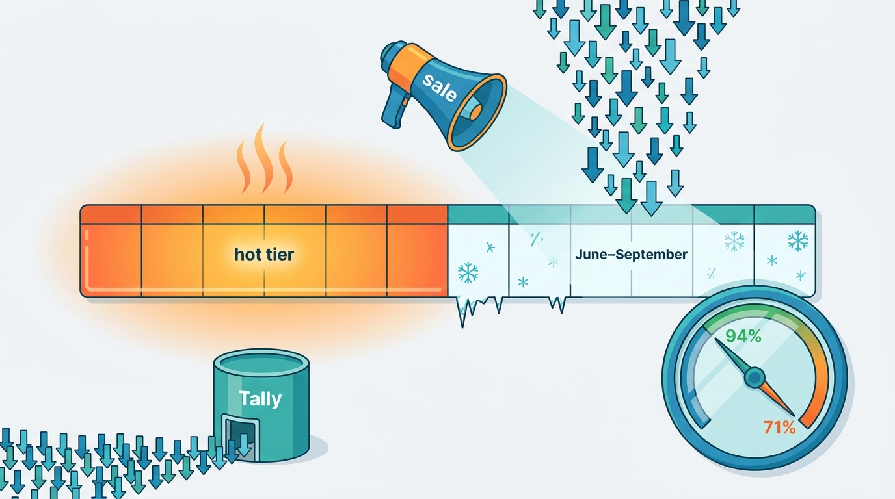
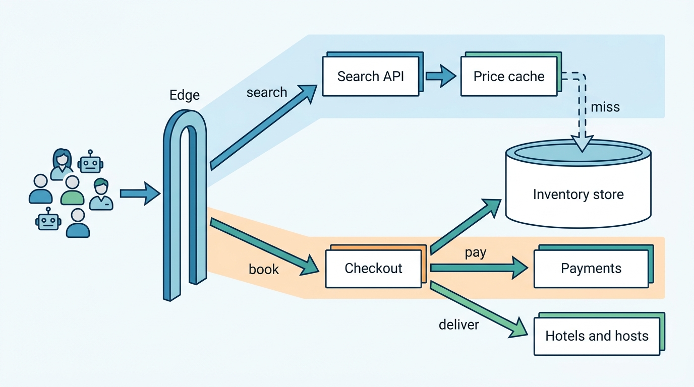
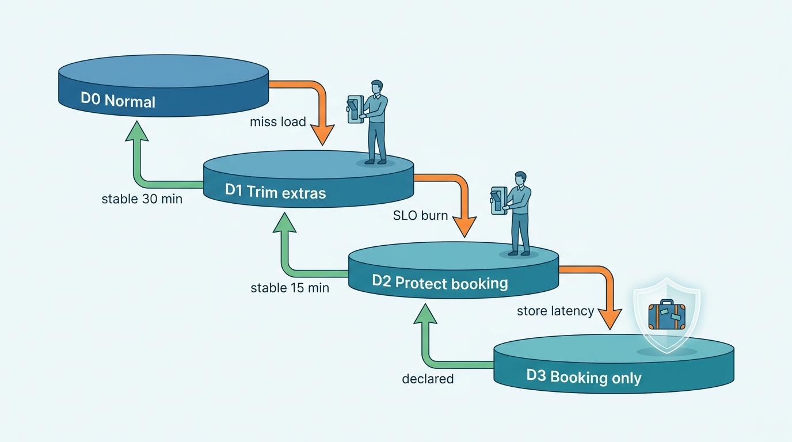
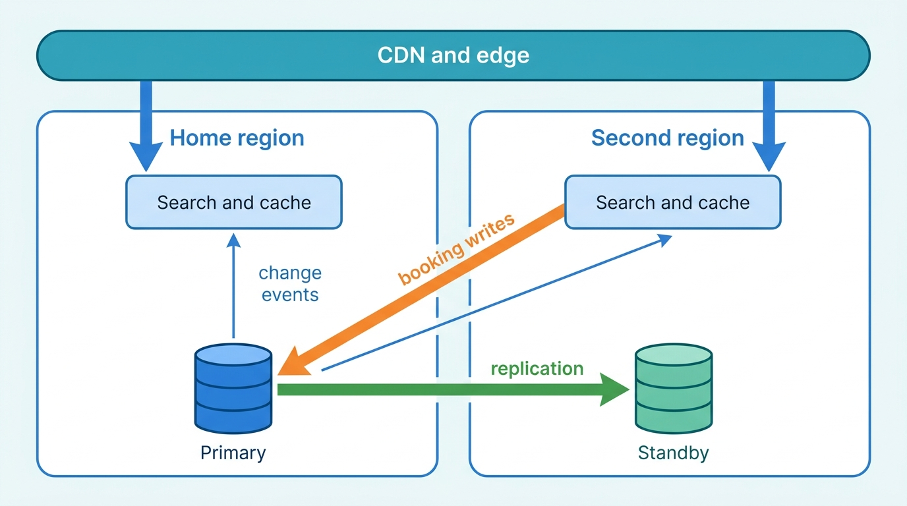
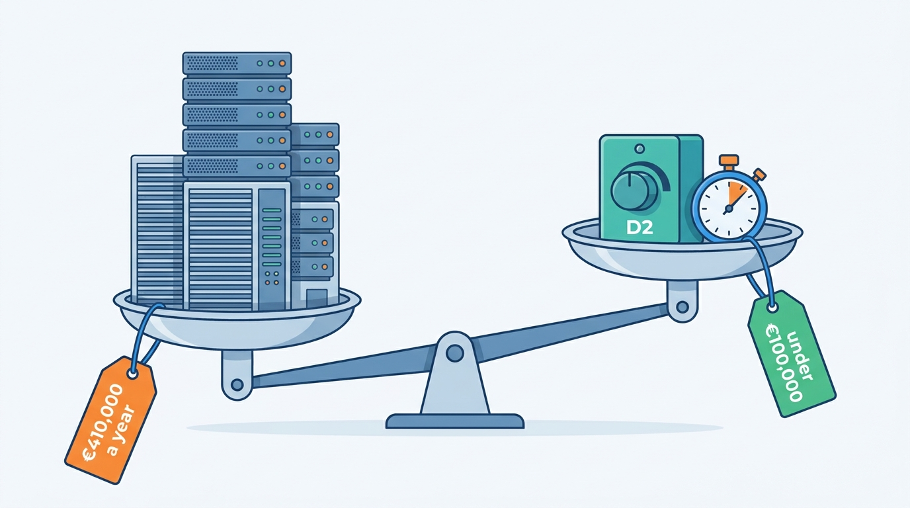

> **IN THIS CHAPTER, YOU WILL:** Learn how to set reliability objectives for the four journeys a stays platform must keep (search, book, pay, deliver), how to design named degradation modes and traffic classes for peaks, how to place regions, data and localization, and how to rehearse the failures that come together: a cloud region, a payment provider, a channel manager or a whole country's flights.

> **WHY THE BUSINESS CARES:** In travel, the biggest selling days are also the riskiest. A sale, a holiday or a strike brings the most demand and the most change at the same time. A platform that slows down or shows wrong prices on those days loses the revenue the campaign was bought to win. A platform that runs at peak capacity all year wastes margin on the other 360 days.

> **WHY ARCHITECTS SHOULD CARE:** Reliability in a stays marketplace is mostly about correctness under load. Most failures show the guest something wrong rather than an error page: a stale price, an undelivered reservation, a double charge. Each one comes from a decision about caches, retries, write ownership or fallbacks that was made, or skipped, long before the incident.

> **KEY POINTS:**
>
> * **Set objectives on journeys, and count correctness as reliability.** The four journeys that matter are search, book, pay and deliver. Each needs an objective that covers whether the answer was *right* (the price held, the reservation reached the front desk), not only whether it was fast. Service-level dashboards stay green while guests see Phantom Availability.
> * **Peaks break caches and partners before they break servers, so design degradation in advance.** Define named degradation modes, with triggers, an order, the labels guests see and an owner who can declare them. Shed traffic by class: unverified bots first, then broad partner crawls, then browsing extras. Booking, payment and reservation delivery are shed last, and never silently.
> * **Replicate reads freely, but give every night and every reservation one home for writes.** Browsing can run active-active across regions and at the network edge. Inventory decrements, calendar claims and reservations need a single writer per property or listing, with a rehearsed failover. Region choices are also residency and cost choices, so track **cost per booking** as an architecture metric beside latency.

> **[FAILURE PATTERNS THIS CHAPTER ADDRESSES](where-stay-platforms-go-wrong.html):**
>
> * **Built for Sunny Days** — capacity, caches and partner integrations are sized for an average day, so sales, holidays and mass cancellations reach them all at once.
> * **Phantom Availability** — under load, a fallback serves cached prices that look exact, and the "price changed" errors arrive at checkout, on the busiest day of the year.
> * **Lost at the Front Desk** — during a region failover or a partner outage, reservations are confirmed to guests but never acknowledged by the property, and nobody is watching the delivery queue.

 
The earlier chapters of this book make the platform correct: one price, one calendar, one reservation delivered. This chapter asks whether it stays correct on its worst days. **Demand arrives in peaks**: a sale opens at midnight, summer booking starts in January, and metasearch engines and affiliates scale up their crawls when guests do. **Failures arrive together**: an air-traffic-control strike creates thousands of cancellations, rebookings and price changes in one weekend, on the same services that take new bookings.

Most of the load is also **work that someone else asked for**. Shopping traffic from metasearch engines, affiliates and scrapers grows faster than bookings, and every request reads the most expensive data in the system: a live price for specific dates. Roomstead, in Corvane's example, serves about 1,400 shopping requests for every reservation. Scale in this business means **serving the browsing cheaply enough that the booking can be served correctly**.

This chapter owns three terms: the **journey SLO** (service-level objective) for stays, the **degradation mode** and **cost per booking**. It also covers localization, the "market context" every request carries. It builds on the price cache of [[availability-engine]], the search pipeline of [[stays-search-architecture]] and the events of [[event-driven-stays]]. [[demand-channels]] applies its traffic classes and retry budgets to partners, and [[evolving-the-platform]] builds its fitness functions on its journey objectives. Mass-cancellation policy belongs to [[changes-and-cancellations]] and payment routing to [[stay-payments]].

## Setting the Scene at Corvane: Forty Minutes on Black Friday

Corvane, the fictional travel group this book follows (see [[meet-corvane]]), ran Roomstead's first group-wide Black Friday campaign in 2027. The **Early Summer 2028** sale opened at 00:00 CET on **Friday 26 November 2027**. It offered partner-funded deals on stays from June to September 2028, and about **41,000** properties opted in. The capacity plan, signed off in October, assumed a peak of **80,000** availability lookups a second. That was 1.25 times the 2026 peak of 64,000, and the plan assumed Pricegrid's usual 94% cache hit rate.

The peak came at 20:14 CET, when European evening browsing overlapped with the US afternoon and the second campaign email. Availability lookups reached **96,000 a second**: about **9,600 shopping requests a second**, each (a search page, a property page or a partner API call) making about ten reads in **Pricegrid**, Roomstead's precomputed price-and-availability cache. The volume was survivable; the cache was not. Pricegrid's hit rate fell from **94% to 71%**.

The cause was the campaign itself. Pricegrid's hot tier holds arrivals up to 180 days ahead, which on 26 November meant late May 2028 ([[availability-engine]] describes the cell design). The sale sent guests to June–September 2028, **outside the hot tier**, so every cell had to be computed on demand from **Tally**, the store of ARI (availability, rates and inventory: the updates a property's systems send to each channel). Calendar-driven warming covered King's Day and the Feria, but the campaign team chose the sale dates after the warming plan was fixed, and nobody connected the two calendars.

**Figure 1:** *The Black Friday sale sent guests to June–September 2028 arrivals, outside Pricegrid's 180-day hot tier, so the hit rate fell from 94% to 71% and on-demand computations rose to about 27,800 a second against capacity for 12,000.*

On a normal peak, 6% misses on 64,000 reads is about **3,800** on-demand computations a second. On Black Friday, 29% misses on 96,000 reads was about **27,800**, more than seven times as many. The on-demand path was sized for **12,000** a second. At 20:14 Jonas Weber, Head of Search and Ranking and the duty decision-maker for search that evening, declared **degradation mode D2**. Roomstead ran in it for **40 minutes**, until 20:54:

- search cards showed grid prices only, and cards whose cell missed showed **"check price"** rather than an estimate;
- on-demand capacity was reserved for property pages and price checks, the steps closest to a booking;
- flexible dates, price sort and the price-alert evaluator were paused;
- the map showed pins without prices above a threshold zoom ([[destinations-and-maps]]);
- unverified automated traffic was challenged, and affiliate API quotas dropped to their contracted floors.

Checkout, payments and reservation delivery were never degraded. During the 40 minutes, about 18% of search cards showed "check price", server-side search latency at the 95th percentile (p95) rose to 610 ms against a 500 ms target, and price-changed outcomes at the price check rose only from 1.1% to 1.3%. Roomstead took about **298,000** reservations that day, 2.4 times an average day.

The review on 2 December found that the plan had worked and one detail had not. One large affiliate partner received HTTP 429 ("too many requests") responses without a Retry-After header. Its client retried immediately, and its request rate **tripled** during the window: the quotas were set per partner but had no retry budget. Mariana Costa, Group Chief Architect, then asked the architecture forum whether the group knew, for every journey and both brands, **what "working" means, what it would give up first, and what a sale, a strike or a lost region would cost.**

## Concepts: Journeys, Objectives and Modes

### The four journeys

A stays platform promises a specific night, in a specific place, at a specific price. Four journeys keep that promise, each with its own users, dependencies and definition of failure.

| Journey | Starts | Ends | Who notices failure first | Typical external dependency |
| --- | --- | --- | --- | --- |
| **Search** (shop) | A query for a place, dates and a party | A page of offers, or a priced property page | Guests, metasearch accuracy checkers | Price cache, search index, maps |
| **Book** | "Reserve" pressed | A definite outcome: confirmed, pending host response, or declined with a reason | Guests, customer service | Inventory store, hold service, fraud scoring |
| **Pay** | Payment details submitted, or a scheduled charge due | Authorized, captured or declined with a class | Guests, finance | Payment service provider (PSP), card networks, 3-D Secure |
| **Deliver** | Reservation confirmed | The property's system or the host has the reservation, and other channels' availability is closed | Property front desk, hosts, guests at arrival | Channel managers, property-management systems (PMS), iCal feeds, notifications |

Most platforms forget the fourth journey. A booking confirmed to the guest that never reaches the hotel is **Lost at the Front Desk**; one that reaches the host while another platform's calendar stays open is **The Double-Booked Night**. Neither shows as an error until the guest arrives.

### Journey SLOs

Google's SRE workbook defines a service-level objective as "a target level for the reliability of your service", and the error budget as "100% minus the SLO". It advises writing SLOs "in terms of user-centric actions", which it calls critical user journeys ([Google, *The Site Reliability Workbook*, 2018](https://sre.google/workbook/implementing-slos/)). A **journey SLO** for stays applies that advice with one extension: the indicator counts an outcome as good only if it was **fast, definite and correct**.

- **Fast**: within a latency threshold the guest or partner would accept.
- **Definite**: the outcome is known. "Confirmed" or "declined" are good outcomes. "Pending" with no time limit, a timeout the client will retry, or a confirmation whose payment state is unknown are not.
- **Correct**: the promise survived. The price held to checkout, the reservation was acknowledged, or the calendar closed on other channels.

Service SLOs (the latency of Pricegrid, the error rate of Switchyard) remain as diagnostics. The journey SLO is the one the business signs, and it decides when to spend error budget on releases and when to stop.

### Degradation mode and disruption mode

A **degradation mode** is a named, pre-agreed state of the platform in which it deliberately does less, so that the most important journeys keep their objectives under load or partial failure. It has a trigger, an order of steps, guest-visible labels, an owner who may declare it, and an exit condition. A timeout is not a degradation mode, and neither is an autoscaler. Both are what happens when nobody designed one.

A **disruption mode** changes **business rules**, not capacity, and is often confused with it. An air-traffic-control strike, a wildfire or a city shutting short-term rentals overnight triggers it. Operations sets a disruption flag with a scope (an area, dates, a cause); at Corvane it lives in the disruption registry of **Clause**, the group cancellation policy engine. Smart pricing freezes price decreases ([[dynamic-pricing]]), the cancellation engine applies extenuating-circumstances rules ([[changes-and-cancellations]]), customer service routes affected trips first ([[customer-service]]) and ranking stops treating cancellations as a demand signal. During the ATC strike weekend of **5–7 June 2027**, about **17,000** Roomstead and **2,600** Nookaway reservations were affected, and Roomstead received **6,200** cancellation requests in 48 hours. That weekend needed both modes: degradation for the load on self-service cancellation, disruption for the rules.

### Cost per booking

**Cost per booking** is the platform's run cost for a period (cloud, data centers, licenses, CDN, maps, third-party APIs) divided by the reservations made, and also by the reservations stayed. The FinOps Foundation calls this kind of measure **unit economics**: linking "what an organization spends on technology" to "the value that technology spending creates", with cost "per transaction" as a standard example ([FinOps Foundation, Unit Economics](https://www.finops.org/framework/capabilities/unit-economics/), n.d.). In stays, split it by journey: search cost follows look-to-book, booking and payment cost follow bookings, delivery cost follows partner connections. A reservation that is later canceled still pays for its search.

## Architecture: Journeys, Tiers and Homes

### The journey map

Figure 2 shows the journeys of an OTA-style marketplace. Nookaway's differ in the inventory box (Almanac instead of Tally and Pricegrid) and the delivery targets (hosts and iCal feeds instead of channel managers).

**Figure 2:** *Four journeys over one stack. Search reads the price cache and falls back to the inventory store. Book, pay and deliver write. Degradation sheds load at the edge and in search so that the write journeys never compete with browsing for the inventory store.*

**The search path and the book path share the inventory store** through the cache-miss route. On Black Friday that route turned browsing into load on the system of record the book path needs. Put a **bulkhead** there, a separately sized pool or replica for miss traffic, so that browsing can saturate its own capacity and never the capacity checkout depends on.

### Corvane's journey SLOs

The forum adopted the following objectives in December 2027, measured over rolling 28-day windows and reported per brand and per market. The thresholds are illustrative; the structure is the point.

| Journey | Indicator (good events ÷ valid events) | Roomstead target | Nookaway target | Owner |
| --- | --- | --- | --- | --- |
| **Search** | Shopping requests answered with a complete page within 800 ms server-side, excluding traffic shed by class | 99.0% | 99.0% | Group search (Jonas Weber) |
| **Search correctness** | Price checks that return the shown price and availability | 98.0% | 99.0% | Group search, with supply |
| **Book** | Checkout attempts that reach a definite outcome within 10 s, with no duplicate reservation | 99.9% | 99.9% | Brand checkout teams |
| **Pay** | Authorizations and scheduled charges with a definite, classified result within 15 s; zero duplicate captures | 99.95% | 99.95% | Corvane Payments (Leila Haddad) |
| **Deliver** | Reservations acknowledged by the property's system within 10 minutes, or moved to the Partner Hub inbox with an alert | 99.5% | — | Roomstead supply (Aisha Rahman) |
| **Deliver (homes)** | Reservations whose nights are closed in Almanac and in Nookaway's iCal export within 60 s, and the host notified | — | 99.9% | Nookaway (Rafael Mendes) |

Three choices in this table are deliberate.

1. **The search SLO excludes shed traffic only when it was shed by class.** A refused unverified scraper does not count against the objective; a guest's request that times out does. Otherwise a team could meet its SLO by shedding guests.
2. **Book and pay count duplicates as failures.** The 212 duplicate reservations of **14 January 2027**, 198 of them with duplicate charges, came from a mobile retry without the original idempotency key during a PSP latency spike ([[checkout-orchestration]]). Each request was fast and returned success, so a latency-and-errors SLO would have shown nothing wrong.
3. **Delivery has a timer, not only a success rate.** The SLO turns the 10-minute acknowledgement rule of Switchyard's reservation-delivery contract ([[connectivity-and-channel-managers]]) into an objective with an error budget, so a channel manager that drifts from 2 to 9 minutes becomes visible before King's Day does it again.

### Degradation modes

Corvane's degradation ladder has one structure across brands; each brand fills in its own steps. Every mode is a configuration flag, declared by a named on-call role and read by services at runtime.

**Figure 3:** *The degradation ladder. Triggers are measured, but every step down below D1 is declared by a named person, and every step back up waits for a stable period. Modes trade breadth of browsing for the integrity of booking, payment and delivery.*

| Mode | What stops or changes | What guests see | What never changes |
| --- | --- | --- | --- |
| **D1 Trim extras** | Price-alert evaluation and recommendation refreshes paused; flexible dates off; the exact-check stage in search shrunk; affiliate quotas at contracted floor | Fewer price sorts, "from" prices below the first positions, labeled | Prices on property pages and checkout are exact |
| **D2 Protect the booking path** | Search serves grid prices only; misses shown as "check price"; on-demand capacity reserved for property pages and price checks; map pins without prices above a zoom threshold; unverified automation challenged | "Check price" on some cards; maps ask to zoom in | Price check at commitment; checkout; delivery |
| **D3 Booking only** | Search serves cached result pages for the most common queries; new sessions for long-tail queries queued with a waiting page; partner APIs return a documented "degraded" status | A waiting page for some searches | Checkout for guests already on a property page; payment; delivery; cancellation self-service |

The **"what never changes"** column matters most. A degraded page may show less, but what it shows must be correct or labeled as approximate. A cached price shown as if it were exact, the "silent fallback" of [[property-page-and-room-selection]], causes **Phantom Availability** exactly when the cache is least accurate.

### Traffic classes at the edge

Bots are part of normal traffic. Imperva's 2025 report estimates that automated traffic makes up **51%** of web traffic, and "bad bots" **37%** ([Imperva, 2025 Bad Bot Report](https://www.imperva.com/resources/resource-library/reports/2025-bad-bot-report/), 2025). In travel, some automated traffic is wanted: metasearch engines check prices, affiliates query availability, and verified price-accuracy checkers must not be blocked (Google's Hotel Center lists *Blocked* as a mismatch reason; see [[availability-engine]]). So **classify every request at the edge and give each class its own budget**:

| Class | Examples | Identified by | Budget rule | Shed order |
| --- | --- | --- | --- | --- |
| **Guest, signed in or with a session** | Web and app users | Session, device signals | Protected | Last |
| **Verified price checker** | Metasearch accuracy crawlers | Allow-list, reverse DNS, signed requests | Small, fixed, protected | Never shed below floor |
| **Metasearch live query** | Live price requests from metasearch partners | Partner credentials | Contracted rate; prioritized by partner conversion | Fourth |
| **Affiliate and B2B API** | White-label sites, travel agents | API keys | Contracted floor plus burst; retry budget enforced | Third |
| **Search-engine crawler** | Organic search bots | Verified bot identity | Served from cached, server-rendered pages | Second (to cache only) |
| **Unverified automation** | Scrapers, price harvesters | Bot scoring, behavior | Challenge or refuse | First |

Expedia's Rapid documentation sets partner rate limits "monthly, taking into account a partner's traffic vs. revenue" ([Expedia Group, Rapid rate limiting](https://developers.expediagroup.com/rapid/lodging/shopping/rate-limiting), n.d.), so the expensive live-availability path is rationed by how often the caller's traffic books. In 2023 Agoda reported that in its Price Delivery System, serving "over a million requests per second", broad searches from **affiliate traffic** caused cache evictions ([Agoda Engineering, 2023](https://medium.com/agoda-engineering/improving-performance-using-distributed-cache-with-couchbase-aa7ebf3a12c9)).

Corvane's affiliate retry storm adds the rule that quotas alone miss: **every rejection must tell the client when to come back, and every client contract must include a retry budget**.

### Regions and homes for writes

Three common topologies suit different data:

- **Active-active reads.** Search, content and price-cache reads are served from every region and from the edge. They are safe to replicate because they are stale by design and the price check at commitment corrects them.
- **Single-home writes with failover.** Each property, listing or reservation has one home region where its writes are applied. A standby in another region holds a replica and takes over after a declared failover. This is the right default for inventory and reservations.
- **Multi-writer with conflict resolution.** Two regions accept writes for the same entity and reconcile later. This is acceptable for carts and preferences. For one-unit calendars it is a way to build **The Double-Booked Night** into the platform.

The public record supports the general pattern, though not the internals of any company's booking path. Booking.com's database team said in 2024 that MySQL is its main relational store, with a single primary for writes and "tens/hundreds of replicas for READs", always deployed across more than two regions ("typically 3 regions in Europe"). Its slide states: "In general, choose availability over consistency" ([Androulidakis, SREcon24 EMEA, 2024](https://usenix.org/system/files/srecon24emea_slides-androulidakis.pdf)). In 2025 Agoda described **active-passive** Kafka consumption across its data centers, each consumer group running in one at a time, after rejecting a stretched cluster for "high latency between Agoda's geographically distant data centers" ([Agoda Engineering, 2025](https://medium.com/agoda-engineering/how-agoda-handles-kafka-consumer-failover-across-data-centers-a3edbacef6d0)). None of the sources researched for this book describes an active-active, multi-region booking write path at Airbnb, Booking.com or Expedia.

> **INFERENCE, NOT DOCUMENTED:** A plausible reference architecture for an OTA, and not a description of any company's systems, replicates reads widely and keeps inventory writes on one primary per partition. It tolerates small oversell windows that the hotel resolves by relocating a guest. A hosted-stays platform with one-unit calendars needs one serialization point per listing, whatever its read topology.

**Figure 4:** *Replicate reads, home the writes. Both regions serve browsing. Writes for a property or listing go to its home region, and a declared failover promotes the standby. Change events feed both regions' read models, so search capacity grows by adding regions and write correctness does not depend on them.*

### Corvane's estate against that shape

Corvane's 2027 estate fits this shape unevenly, with gaps typical of a group built by acquisition:

| System | Where it runs (2027) | Read topology | Write topology | Gap |
| --- | --- | --- | --- | --- |
| Roomstead Keystone (reservations, contracts) | Co-located data centers, Dublin and Frankfurt | — | Oracle primary in Dublin, standby in Frankfurt | Failover is a manual, multi-hour runbook last rehearsed in 2025 |
| Roomstead search, Pricegrid, Tally | AWS eu-west-1 and eu-central-1 | Active-active | Tally on Cassandra across both regions | A cold Pricegrid region needs hours to re-warm |
| Nookaway Burrow, Almanac, search | Google Cloud europe-west1 only | Single region | Single region | **No second region at all** |
| Corvane Payments and Fathom | AWS eu-central-1 | — | Single region, multi-zone | Region loss stops payments for both brands |
| Corvane Connect | Azure West Europe | — | Single region | Region loss stops ARI delivery for 14,500 hotels to 60+ channels |

In December 2027 the forum decided four things. Nookaway would build a **warm standby** for Almanac and the booking path in a second Google Cloud region by the end of 2028, with an objective of a 30-minute recovery time (RTO) and a recovery point (RPO) of under one minute. Corvane Payments would do the same in eu-west-1 first, because both brands depend on it. Keystone's failover would be rehearsed every quarter until the reservation module retires. Pricegrid would keep active-active reads but add a **warm-start snapshot**, so that a region can come back from a snapshot plus the change stream in minutes rather than re-warming from Tally. The public benchmark was Agoda's 2026 report that a drained price-cache cluster takes about **three hours** to re-warm ([Agoda Engineering, 2026](https://medium.com/agoda-engineering/how-agoda-scaled-its-price-cache-with-dragonflydb-0828e478e84f)).

### Data residency

Region choice is also a legal choice for data such as guest identities, identity-document images, payment data and the addresses of private homes. The GDPR does not require data to stay in the EU. It restricts transfers to third countries to those with an adequacy decision or appropriate safeguards ([Regulation (EU) 2016/679, Chapter V](http://publications.europa.eu/resource/celex/32016R0679), 2016). The US position has changed twice. In July 2020 the Court of Justice invalidated the Privacy Shield in *Schrems II* (Case C-311/18), and on 10 July 2023 the Commission adopted an adequacy decision for the EU-US Data Privacy Framework ([Commission Implementing Decision (EU) 2023/1795](http://publications.europa.eu/resource/celex/32023D1795), 2023). An architecture that assumes the current framework will last is making a bet.

Corvane hosts everything in the EU, so its residency exposure lies in **vendors**: outsourced contact centers, maps, translation and analytics tools that receive guest data. My rule: every data class carries a residency tag, and every outbound integration declares which classes it receives and where they go, so "what leaves the EU if the framework falls?" is a query, not a project. [[stays-regulation]] covers the legal side.

## Localization: The Market Context Every Request Carries

Roomstead serves its site in **41 languages** and prices in **52 currencies**, and Nookaway operates in **31 countries**. Each request is answered for one market, and the market changes more than the language:

| Dimension | Example | Where it is decided | What goes wrong if it is decided twice |
| --- | --- | --- | --- |
| **Language and formats** | Portuguese (Brazil) vs Portuguese (Portugal); date and number formats | Locale from user choice, then the request | Mixed-language pages; misread dates (3/4 vs 4/3) |
| **Currency and FX snapshot** | A Czech guest paying in CZK for a Lisbon home priced in EUR | Market context, with a dated FX snapshot attached to the quote | Price Drift between feed, page and charge |
| **Point of sale** | The market whose rules apply to the display | Market context | A metasearch price that is right for one point of sale shown in another |
| **Price display rules** | Totals including fees and taxes in EU and UK markets | Display policy service ([[property-page-and-room-selection]]) | One surface shows totals and another shows nightly prices |
| **Legal text** | Cancellation terms, trader identity, registration numbers | Market policy registry ([[stays-regulation]]) | Terms on the page differ from those the policy engine applies |
| **Payment methods** | Pix in Brazil, iDEAL in the Netherlands | Payment orchestration ([[stay-payments]]) | Methods offered that the market cannot use |
| **Tax presentation** | Tourist tax per adult per night | Tax engine, Levy ([[taxes-on-stays]]) | Taxes shown on one surface and added later on another |

The architectural move is to resolve all of this **once per request** into a **market context**: an immutable value (locale, currency, FX snapshot ID, point of sale, legal market, display policy version) that travels with the request and is recorded on every quote. In Corvane's May 2027 accuracy audit, currency conversion accounted for **0.8 points** of mismatch: the feed used a daily FX snapshot and the site an hourly one, and they rounded differently ([[availability-engine]]). That was a market-context problem, not staleness. Google checks prices "in the currency that a user would find on Google" and advises keeping conversions "updated every few hours" ([Google Hotel Center Price Accuracy Policy](https://support.google.com/hotelprices/answer/6064419?hl=en), n.d.).

Hotel descriptions are translated in batches; host-written listings, messages and reviews are translated when read. **Translation belongs on the D1 list**: a degraded page can show the original language with a "translate" link, and translation should never hold up a booking.

## In Practice: What the Public Record Shows

No public source gives a front-door search rate or a Black Friday traffic multiple for Booking.com, Airbnb, Expedia or Agoda. The figures below are internal throughput or practice descriptions, each dated: orders of magnitude and patterns, not comparable benchmarks.

### Latency has a conversion price

Booking.com's widely cited 2019 KDD paper on 150 production models reported that "an increase of about 30% in latency cost about 0.5% in conversion rates" ([Bernardi et al., 2019, via Acolyer's summary](https://blog.acolyer.org/2019/10/07/150-successful-machine-learning-models/)). The finding is seven years old and concerns model-serving latency, but it remains the best public evidence that latency in travel costs revenue, so degradation should cut extras before it adds delay.

### Proving capacity before the peak

Large stays platforms find their ceilings with **real traffic shapes** rather than synthetic ones. In 2026 Booking.com described automated capacity tests that send a growing share of traffic to one instance to find the load it can sustain, extended to Kafka consumers by a partition assignor that simulates losing an instance "without killing a healthy consumer" ([Booking.com Engineering, 2026](https://medium.com/booking-com-development/how-we-built-automated-capacity-testing-for-kafka-consumers-1853623bce78)). Also in 2026, Airbnb described replaying captured database query traces: on one cluster, 80% more write traffic raised average commit latency from about 6 ms to 34 ms, which located the ceiling "well before real traffic did" ([Airbnb Engineering, 2026](https://medium.com/airbnb-engineering/beyond-synthetic-testing-capturing-and-replaying-real-database-workloads-at-airbnb-cea7ee9b1ab2)).

Corvane's Black Friday plan scaled the 2026 peak by 1.25 and kept its shape; the sale changed the shape. A test that replayed the campaign's own date distribution would have found the problem.

### Seasonality: two peaks, not one

Airbnb reports that Nights and Seats Booked are lowest in the fourth quarter, with the travel peak in the third ([Airbnb 10-K FY2025](https://www.sec.gov/Archives/edgar/data/1559720/000155972026000004/abnb-20251231.htm), 2026); Expedia says that "Vrbo has seen seasonally stronger bookings in the first quarter" ([Expedia Group 10-K FY2025](https://www.sec.gov/Archives/edgar/data/1324424/000132442426000008/expe-20251231.htm), 2026); Booking Holdings reports gross bookings "generally similar in each quarter" in 2025 ([Booking Holdings 10-K FY2025](https://www.sec.gov/Archives/edgar/data/1075531/000107553126000009/bkng-20251231.htm), 2026). My reading is that a stays platform has **two load curves**. The booking curve (search, checkout, authorization) peaks early in the year for vacation rentals and is flatter for a global OTA. The stay curve (check-ins, messaging, support, payouts, damage claims) peaks in the third quarter, and at Nookaway, which pays hosts 48 hours after check-in, payouts follow it. Capacity plans and support staffing need both.

### Configuration is a global failure domain

Agoda runs "thousands of microservices" across four data centers: Hong Kong, Singapore, Amsterdam and Ashburn. In 2026 it explained why it had moved more than 34,000 configuration keys into a reviewed, schema-validated Git workflow: "A single change to a global/ key in HK would instantly propagate to all four production data centers simultaneously" ([Agoda Engineering, 2026](https://medium.com/agoda-engineering/how-we-eliminated-configuration-related-outages-and-scaled-consul-management-at-agoda-a6f22199ab98)). Multiple regions do not protect against a bad global change, and **degradation flags are themselves global configuration**, so Corvane's carry a scope (brand, market, journey) and an expiry, and declaring D3 for all brands needs two people.

### Hosting choices differ, and cost is a reason

Airbnb relies "primarily on Amazon Web Services" ([Airbnb 10-K FY2025](https://www.sec.gov/Archives/edgar/data/1559720/000155972026000004/abnb-20251231.htm), 2026), while Agoda's CTO said in 2025 that "running in-house remains more cost-effective" at its size ([Agoda Engineering, 2025](https://medium.com/agoda-engineering/agodas-cto-on-why-managers-should-code-running-on-prem-and-adopting-generative-ai-b1b4c5c7028b)). Cost work does not require a hosting change: in 2026 Booking.com reported a **38%** compute cost cut on its largest Node.js rendering service "with no code changes in the service itself" ([Booking.com Engineering, 2026](https://medium.com/booking-com-development/node-js-at-scale-rebalanced-how-we-cut-cost-by-38-62ce247a3002)).

## Corvane Worked Example: Cost per Booking and the Black Friday Budget

Corvane had never measured cost per booking until Marco Bellini, Group CFO, asked what Black Friday's extra capacity had cost. Kenji Arai's data platform team built the first breakdown from 2026 cloud bills, data-center contracts and vendor invoices.

| | Roomstead | Nookaway |
| --- | --- | --- |
| Platform run cost, 2026 | **€96 million** (8.0% of revenue) | **€31 million** (7.2% of revenue) |
| Reservations made | about 45 million | about 6.9 million |
| Reservations stayed | about 30 million | about 6.0 million |
| Cost per reservation made | **€2.13** | **€4.49** |
| Cost per stayed reservation | **€3.20** | **€5.17** |
| Revenue per stayed reservation | €40 | €72 |
| Largest cost driver | Search and availability: about **46%** (€44 million) | Host tools, messaging, trust and payouts: 38% |

The two brands spend on different things. At Roomstead, search and availability take about 46% of the cost because of look-to-book: about 1,400 shopping requests per gross reservation means about **63 billion** a year, around 2,000 a second on average, at roughly **€0.0007** each ([[stays-marketplace-economics]]), most of it on traffic that never books. Nookaway's cost per booking is higher, but so is its revenue per booking, and its cost sits in the host side of the product, not in browsing.

Serving the evening's 27,800 misses a second without degradation would have needed about **2.3 times** the on-demand fleet. With autoscaling and reserved capacity, the team estimated the extra fleet at about **€410,000** a year, mostly in reserved Redis memory and Tally read capacity. D2 cost about 6% fewer bookings than forecast during its 40 minutes; at about €40 of revenue per stayed reservation, under €100,000. **Degradation was the cheaper capacity**, provided it was designed, labeled and short. The forum bought neither the fleet nor more degradation; it funded the fix that removed the cause: the campaign calendar now feeds the warming calendar, so a sale's target dates are precomputed a week ahead, and the team replays the sale's expected date distribution in a capacity test two weeks before launch.

**Figure 5:** *Designed degradation was the cheaper capacity: avoiding D2 would have needed about €410,000 a year of extra fleet, while its 40 minutes cost under €100,000 in lost revenue.*

**19%** of shopping requests at the peak came from unverified automation, and challenging it at the edge removed it before it reached Pricegrid. The forum estimated that applying the D2 bot rules permanently would remove about **8%** of Pricegrid reads; Jonas's team made the change in January 2028, keeping the verified-checker allow-list.

## Disaster Scenarios: Failures That Arrive Together

A stays platform's worst days combine failures: a region outage during a sale, a payment provider incident on a holiday Friday, a channel manager outage on a festival night. Corvane rehearses these scenarios:

| Scenario | Corvane precedent or exposure | Blast radius | Planned response | Journey protected first |
| --- | --- | --- | --- | --- |
| **Cloud region loss** (AWS eu-west-1) | Roomstead search active-active; Payments single-region in eu-central-1 | Half of Roomstead's search capacity; none of Payments | Shift reads; enter D1 until the price cache is warm from snapshot | Search correctness |
| **Single-region platform loss** (Google Cloud europe-west1) | Nookaway in 2027 | All of Nookaway | Until the standby exists: static status page, iCal export kept from a replica, host notifications by email from another provider | Deliver (calendar closed elsewhere) |
| **PSP outage or latency spike** | 212 duplicate bookings, 14 January 2027 | All card payments, both brands | Idempotent retries only; pending-payment state with a held reservation; scheduled charges paused, not failed | Pay (no duplicates) |
| **Channel manager outage** | King's Day, 26–27 April 2027: updates queued for 47 minutes; 9 rooms oversold | One partner's hotels on all channels | Detect from the partner's health score; tighten close-out on its last rooms; route deliveries to the Partner Hub inbox | Deliver |
| **Mass disruption** | ATC strike weekend, 5–7 June 2027 | Thousands of reservations; support and policy engines | Declare disruption mode; self-service cancellation moved to a queue with confirmed receipt; D1 for browsing | Book changes, then deliver |
| **Bad global configuration change** | (none yet) | Every region at once | Scoped, expiring flags; staged rollout of config; two-person rule for global scope | All |

The rehearsals produced two rules. First, **every scenario must name its first journey to protect**; under pressure, teams protect whatever is in front of them. Second, **"pause" is not "fail"**. A scheduled charge postponed during a PSP incident is a later, successful charge. A scheduled charge failed during the same incident becomes a decline, a re-authentication email and possibly a lapsed booking, as Nookaway's March 2027 declines showed ([[stay-payments]]). The payment scheduler needs a pause state that its operators can apply by issuer, method or market.

The ATC strike also showed that self-service cancellation is a **write-heavy journey that guests start like browsing**: each request reads policy, computes a refund and writes a reservation change. On disruption days it competes with new bookings for the reservation store while support capacity is short. Corvane made cancellation requests **asynchronous with a confirmed receipt**: the guest gets a reference number at once, and a queue applies the change at a controlled rate, with the same policy outcome.

## Trade-offs

| Decision | Option A | Option B | When A is right | When B is right |
| --- | --- | --- | --- | --- |
| **Peak capacity** | Provision for the forecast peak at normal hit rate | Provision for a typical peak and design degradation | A predictable, high-margin peak with known shape | Unpredictable shapes; degradation is cheaper than idle capacity |
| **Write topology** | Single home per entity, standby elsewhere | Multi-writer with conflict resolution | Inventory, calendars, reservations, money | Carts, wishlists, preferences |
| **Shedding** | By traffic class at the edge | By latency (timeouts, circuit breakers) inside | Always as the first line | As a backstop when classes are wrong |
| **Fallback for prices** | Show "check price" | Show the last known price | Commitment is near (property page, checkout) | Never unlabeled; labeled "from" prices in low positions only |
| **Hosting** | Public cloud | Own data centers | Variable load, many regions, small platform team | Stable, very large load and a strong infrastructure organization (Agoda, 2025) |

The table hides one asymmetry. Choosing B for **peak capacity** is reversible: if degradation costs too much, buy capacity next year. Choosing B for **write topology** is not: a calendar that accepted writes in two regions has already double-booked someone. I would accept degradation risk freely and multi-writer risk almost never.

## Hotels and Homes: Where the Two Marketplaces Differ

| Dimension | Accommodation marketplace (Roomstead) | Hosted-stays marketplace (Nookaway) |
| --- | --- | --- |
| **Traffic shape** | High look-to-book; a large share from metasearch, affiliates and bots; sale peaks | More app and signed-in traffic; map and flexible-date browsing; the January planning peak for summer |
| **What breaks first at peak** | Price cache hit rate, on-demand computation, partner paths (connectivity in, live quotes out) | Calendar writes and payment at booking; the iCal fetch fleet; host messaging |
| **Main write load** | Inbound ARI from 140 connectivity partners, about 650 million messages a day | Host edits, Smart Rate's nightly run, bookings; about 3.7 million iCal fetches a day |
| **Consistency regime** | Room-type counters; small oversell windows tolerated and resolved by relocation | One unit per listing; one writer per listing, no oversell window |
| **Delivery journey** | Acknowledgement from a PMS or channel manager within 10 minutes | Calendar closed on Nookaway and in its iCal export; host notified; PMS acknowledgement for listings connected by PMS or channel-manager API |
| **Degradation at the commitment step** | "Check price" in search; exact price check at commitment | Never degrade the calendar check; a stale-feed listing can switch to request-to-book |
| **Seasonality** | Bookings fairly even across the year; stays peak in summer | Bookings peak in the first quarter; stays and payouts peak in the third |
| **Cost per booking driver** | Search and availability (about 46%) | Host tools, messaging, trust, payouts (38%) |
| **Regional topology** | Reads active-active; Tally across two regions | Single region today; warm standby by end of 2028 |

**What to share.** The journey SLO framework, the degradation-mode mechanism (flags, scopes, declaration roles, expiry), edge traffic classification and bot defense, the market-context service, the cost-per-booking model and the disaster-rehearsal program should all be **group platforms**: they have the same shape in both marketplaces, and every duplicate gets less practice. The **contents** of each degradation mode and each journey's thresholds stay with the brands. "Check price" is a sound OTA step; for homes, the comparable step is switching stale-feed listings to request-to-book. Calendar Sync v2's two-second re-check of stale feeds for instant book fails open by design ([[calendar-sync]]), which is sound for a two-second timeout but not for a forty-minute declared degradation, so Nookaway's D2 should change that default.

## Failure Modes

- **The forecast that kept last year's shape** — the peak arrives on plan and the cache hit rate does not, because the campaign moved demand to other dates, longer stays or new audiences. See the Black Friday scene and "Proving capacity before the peak".
- **The silent fallback** — a cached price shown as exact, or a default "available" when the calendar check times out; calendar and inventory checks must fail closed at commitment. See "Degradation modes".
- **Retries that multiply the peak** — request rates rise after shedding begins, and duplicate bookings appear when retries skip idempotency keys. See "Traffic classes at the edge" and "Corvane's journey SLOs".
- **The single-region platform nobody calls single-region** — an acquired platform has never failed over, and its recovery time objective is a guess; put it on the architecture board's risk register with a dated plan. See "Corvane's estate against that shape".
- **Degradation without a declarer** — nobody knows who may switch a mode on, or nobody switches it off, so a 40-minute incident becomes a 4-hour one and "check price" stays on the next morning. See "Degradation modes" and "Configuration is a global failure domain".
- **Undelivered reservations in the failover** — the delivery queue, its outbox or its acknowledgement timers stay behind, and Lost at the Front Desk appears hours after the incident closes. Delivery state must replicate with the reservations, and every failover runbook ends by reconciling the delivery queue against partners' acknowledgements.

## The Chief Architect's View

**Decide the journeys and their objectives at group level, and leave the thresholds to the brands.** The board does not need Pricegrid's p99 latency. It needs to know that search, book, pay and deliver met their objectives last month in every market, and what they cost per booking. I would make the journey SLO report and the cost-per-booking report one monthly document, because every reliability decision is also a cost decision.

**Approve each brand's degradation ladder as an architecture decision, and review it after every use.** A mode that was declared and worked still deserves review: Black Friday 2027's lesson was in a missing header.

**Fund correctness of the write path before regional reach for reads.** A second read region improves latency for some guests; a rehearsed failover for reservations and payments protects every guest. Corvane funded Payments' standby first, then Nookaway's, then read regions only where measured conversion justifies them. A single-region platform is acceptable while small, if the risk has a date and an owner.

**Treat automated traffic as a market, not a nuisance.** Metasearch engines and affiliates are demand channels with contracts; scrapers are a cost with no revenue. The edge classification, partner quotas and the verified-checker allow-list are commercial decisions, and need a joint owner from [[demand-channels]] and the search platform.

**Watch two trends.** Agentic shopping assistants will add a class of automated traffic that is partly wanted and will need identification and budgets, as metasearch has ([[ai-in-travel-stays]]). And regulatory data exchanges, such as those under the EU Short-Term Rental Regulation, add delivery journeys with deadlines that deserve SLOs too.

## Questions to Ask

1. What are our journey SLOs for search, book, pay and deliver, and do they count correctness (price held, reservation acknowledged, calendar closed elsewhere) as well as latency?
2. What does our platform give up first under load? Who may declare each degradation mode, and when did we last use one?
3. Where does cache-miss traffic go, and can browsing ever take capacity that checkout needs?
4. How do we classify automated traffic at the edge, and does every rejection include a Retry-After header?
5. Which of our systems run in a single region, and when did we last rehearse failing them over, including the reservation delivery queue?
6. For one-unit calendars and reservations, where is the single writer, and is there any path that accepts writes in two places?
7. Does each campaign's date and audience plan feed cache warming and a capacity test that replays its traffic shape?
8. What happens to scheduled charges during a PSP outage: are they paused or failed?
9. Where is the market context (locale, currency and FX snapshot, point of sale, display rules) resolved, and is it recorded on every quote?
10. What does a booking cost us per journey and per brand, and who owns that number?

Reliability and cost are both measured through the platform's data. The next chapter, [[marketplace-intelligence]], turns to the data platform itself: how a stays group collects, governs and shares the events and metrics that every decision in this chapter depends on, starting with the question Corvane found harder than it expected, what exactly counts as a booking.

## Sources and Evidence

### Company engineering and investor sources

- [Beyond synthetic testing: Capturing and replaying real database workloads at Airbnb](https://medium.com/airbnb-engineering/beyond-synthetic-testing-capturing-and-replaying-real-database-workloads-at-airbnb-cea7ee9b1ab2), Airbnb Engineering, 2026 — replaying real query traces to locate database ceilings.
- [Airbnb, Inc. Form 10-K for fiscal year 2025](https://www.sec.gov/Archives/edgar/data/1559720/000155972026000004/abnb-20251231.htm), Airbnb / SEC, 2026 — hosting on AWS; seasonality of bookings and stays.
- [How we built automated capacity testing for Kafka consumers](https://medium.com/booking-com-development/how-we-built-automated-capacity-testing-for-kafka-consumers-1853623bce78), Booking.com Engineering, 2026 — capacity tests for HTTP services and consumers.
- [Node.js at scale, rebalanced: how we cut cost by 38%](https://medium.com/booking-com-development/node-js-at-scale-rebalanced-how-we-cut-cost-by-38-62ce247a3002), Booking.com Engineering, 2026 — platform-level compute cost reduction.
- [MySQL at Booking.com (SREcon24 EMEA slides)](https://usenix.org/system/files/srecon24emea_slides-androulidakis.pdf), Androulidakis / USENIX, 2024 — single-primary, replica-heavy topology across three European regions; "availability over consistency".
- [Booking Holdings Inc. Form 10-K for fiscal year 2025](https://www.sec.gov/Archives/edgar/data/1075531/000107553126000009/bkng-20251231.htm), Booking Holdings / SEC, 2026 — gross bookings similar across quarters.
- [Expedia Group, Inc. Form 10-K for fiscal year 2025](https://www.sec.gov/Archives/edgar/data/1324424/000132442426000008/expe-20251231.htm), Expedia Group / SEC, 2026 — Vrbo's first-quarter booking season.
- [Rapid rate limiting](https://developers.expediagroup.com/rapid/lodging/shopping/rate-limiting), Expedia Group Developer Hub, n.d. — partner limits based on traffic versus revenue.
- [How Agoda scaled its price cache with DragonflyDB](https://medium.com/agoda-engineering/how-agoda-scaled-its-price-cache-with-dragonflydb-0828e478e84f), Agoda Engineering, 2026 — three-hour cache re-warm; hit-ratio failover.
- [How Agoda handles Kafka consumer failover across data centers](https://medium.com/agoda-engineering/how-agoda-handles-kafka-consumer-failover-across-data-centers-a3edbacef6d0), Agoda Engineering, 2025 — active-passive consumption across data centers.
- [How we eliminated configuration-related outages and scaled Consul management at Agoda](https://medium.com/agoda-engineering/how-we-eliminated-configuration-related-outages-and-scaled-consul-management-at-agoda-a6f22199ab98), Agoda Engineering, 2026 — four data centers; global configuration blast radius.
- [Improving performance using distributed cache with Couchbase](https://medium.com/agoda-engineering/improving-performance-using-distributed-cache-with-couchbase-aa7ebf3a12c9), Agoda Engineering, 2023 — affiliate traffic evicting pricing caches.
- [Agoda's CTO on why managers should code, running on-prem and adopting generative AI](https://medium.com/agoda-engineering/agodas-cto-on-why-managers-should-code-running-on-prem-and-adopting-generative-ai-b1b4c5c7028b), Agoda Engineering, 2025 — on-premises hosting as a cost choice.

### Standards, regulation and documentation

- [Implementing SLOs](https://sre.google/workbook/implementing-slos/), Google, *The Site Reliability Workbook*, 2018 — SLO, error budget and critical user journeys.
- [Unit Economics](https://www.finops.org/framework/capabilities/unit-economics/), FinOps Foundation, n.d. — unit cost metrics such as cost per transaction.
- [Hotel Center Price Accuracy Policy](https://support.google.com/hotelprices/answer/6064419?hl=en), Google, n.d. — price checks in the user's currency; conversion freshness.
- [Regulation (EU) 2016/679 (GDPR)](http://publications.europa.eu/resource/celex/32016R0679), EU, 2016 — Chapter V rules on transfers to third countries.
- [Commission Implementing Decision (EU) 2023/1795 on the EU-US Data Privacy Framework](http://publications.europa.eu/resource/celex/32023D1795), European Commission, 2023 — current adequacy basis for EU-US transfers, after the Court of Justice's 2020 *Schrems II* judgment (Case C-311/18).

### Research and practitioner sources

- [150 successful machine learning models: 6 lessons learned at Booking.com](https://blog.acolyer.org/2019/10/07/150-successful-machine-learning-models/), Adrian Colyer's summary of Bernardi, Mavridis and Estevez (KDD), 2019 — latency increase of about 30% costing about 0.5% conversion.
- [2025 Bad Bot Report](https://www.imperva.com/resources/resource-library/reports/2025-bad-bot-report/), Imperva, 2025 — automated traffic at 51% of web traffic, bad bots at 37%.

Corvane is fictional; architectural recommendations and labeled inferences are the author's judgement.
