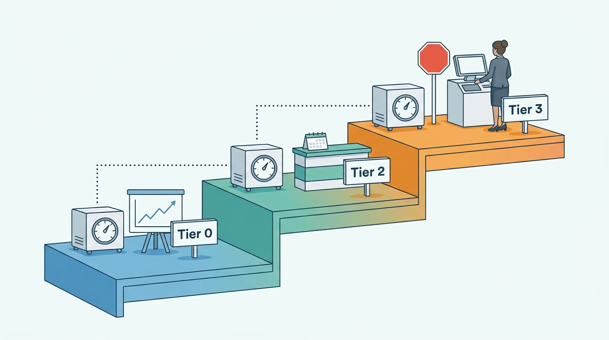
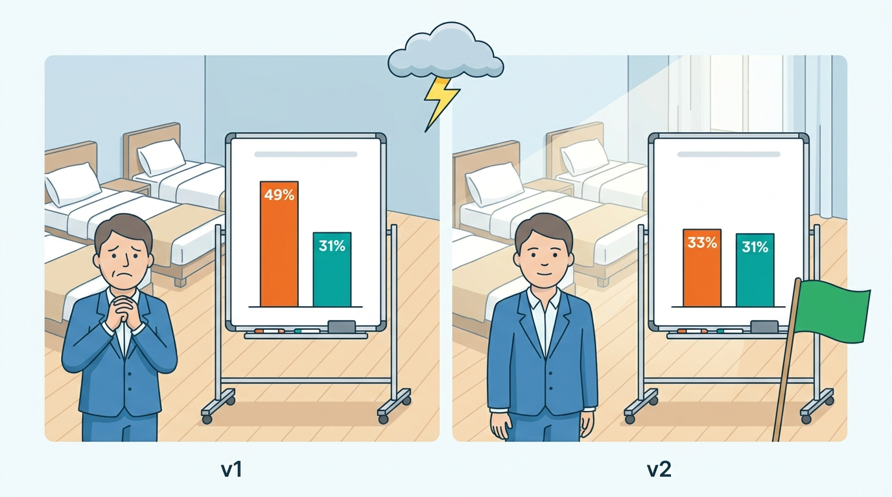

> **IN THIS CHAPTER, YOU WILL:** Map the machine-learning use cases of a stays marketplace by the decisions they drive and the cost of a wrong answer, and take apart the platform that runs them: the feature platform, training and evaluation with delayed and reversible labels, serving, monitoring for drift, and model governance under the EU AI Act and consumer law.

> **WHY THE BUSINESS CARES:** Models already set nightly prices for hosts, order every results page, screen reservations, flag fraud, forecast cancellations for finance and route support contacts. When one of them is wrong, partners lose money, guests are walked or refused, and the forecast the CFO presents to the board is off by millions. The business needs to know which models exist, who answers for each one, and how quickly a bad one can be stopped.

> **WHY ARCHITECTS SHOULD CARE:** Most production ML failures in stays are not modeling failures. They are data-path failures (features computed differently in training and serving), reuse failures (a model built for one decision quietly feeding another) and shock failures (a strike or a pandemic changing the data faster than the model). All three are fixed in the platform and its contracts, not in the notebooks.

> **KEY POINTS:**
>
> * **Classify every model by the decision it drives, not by its algorithm.** A cancellation probability that feeds a finance forecast and the same number shown to a hotel deciding whether to overbook are two different products with different owners, tests and risks. The model registry should record approved uses, and every new consumer is a new approval.
> * **Define features once and compute them point-in-time correct.** Stays labels arrive weeks or months late and are often reversed by cancellations, so training data built from today's tables leaks the future. A feature platform that serves the same definitions online and offline, and logs what was served, removes the largest single source of silent model error.
> * **Plan for shocks as a platform capability.** Strikes, pandemics and major events change booking and cancellation behavior faster than any retraining cycle. A shared disruption signal, a declared hold behavior per model and monitoring of outputs, not only inputs, let a group stop or freeze models in hours instead of finding out from partners weeks later.

> **[FAILURE PATTERNS THIS CHAPTER ADDRESSES](where-stay-platforms-go-wrong.html):**
>
> * **The Unwatched Model** — a cancellation model built for a finance forecast is reused in a partner tool and a checkout proposal, and nobody owns what it now decides or notices when a strike distorts its inputs.
> * **Built for Sunny Days** — models trained on normal seasons make their worst predictions exactly when a disruption arrives, the moment the business most needs them to be right or to stop.
> * **Phantom Availability** — ranking and pricing models served stale or skewed features score offers that no longer exist at that price, and learn from the failures as if they were guest choices.

 
A stays marketplace runs on predictions: whether a guest will book, whether the booking will survive until the stay, whether a reservation is fraudulent or a party, whether two supplier records are the same hotel. **The question for an architect is not whether to use machine learning but how many consequential decisions are already being made by models nobody can list.**

The public record from Booking.com, Airbnb, Expedia Group and Agoda is uneven, but it agrees on three things that make stays ML different from retail or advertising ML. **Outcomes are delayed and reversible**: a booking made in February is a stay, or a cancellation, in August. **The world shocks the data**: COVID-19, strikes, volcanic ash and festivals change demand by multiples in days. **Decisions land on third parties**: a price written into a host's calendar or a risk label shown to a hotel is acted on by someone who did not build the model and cannot see inside it.

This chapter owns three terms: the **ML platform (stays)**, the **feature platform** and **model governance (stays)**. In Part VIII ([[part-8]]) it applies the part's rule, share the machinery and not the meaning, to models. It builds on the data platform of [[marketplace-intelligence]] and the online tests of [[stays-experimentation]]. The ranking, pricing, screening and fraud models of earlier chapters all run on the platform it describes, and their "who owns this model?" questions are answered here. Generative AI assistants and agents belong to [[ai-in-travel-stays]].

## Setting the Scene at Corvane: The Cancellation Model Nobody Owned

Corvane, the fictional travel group this book follows (see [[meet-corvane]]), runs **Roomstead**, an accommodation marketplace with 640,000 bookable properties, and **Nookaway**, a hosted-stays marketplace with 1.15 million listings. In 2026, **34%** of Roomstead's 109 million booked room nights were canceled. For a business that recognizes agency commission only on stayed nights, the cancellation rate is the largest uncertainty in every forecast.

In 2025 a revenue-analytics team in Dublin built **Tideline**, a model that estimates, for each open Roomstead reservation, the probability that it will be canceled before arrival. Its first consumer was finance: summing the probabilities over roughly five million open future reservations gave a forecast of cancellation-adjusted room nights and commission for the next two quarters, much better than applying last year's rate. Tideline was a gradient-boosted tree model trained weekly in a notebook pipeline on Snowflake and scored nightly in batch. It worked.

Then it was reused, twice:

1. In **March 2027**, the Partner Hub team launched **Cancellation Outlook** for hotels: each reservation in the extranet carried a "low / medium / high" cancellation-risk band, and a calendar view showed expected cancellations per night. Partner Hub needed scores for reservations made minutes ago, so the team reimplemented Tideline's features in Java inside the partner API, reading Keystone, Roomstead's Java and Oracle monolith, directly.
2. In **May 2027**, Roomstead's merchant product team proposed **Flex eligibility**: hide free-cancellation rate plans at checkout from guests whose predicted cancellation probability exceeded 0.6, and show them only non-refundable rates.

The second reuse never shipped; the first went wrong. The **ATC strike weekend** of 5–7 June 2027, when an air-traffic-control strike over France disrupted travel across Europe, affected about 17,000 Roomstead reservations and produced 6,200 cancellation requests in 48 hours. One of Tideline's strongest features was the **destination's cancellation rate over the trailing seven days**. For Paris it more than tripled in a week. For the next three weeks Tideline told Paris-area hotels that their late-June guests would cancel at an average of **49%**; they actually canceled at **31%**, close to normal. Some hotels used Cancellation Outlook to decide how far to overbook. Between 12 and 30 June Roomstead relocated **96** guests from **31** Paris-area hotels, against about 20 in a normal three weeks. Roomstead's partner terms let it recover relocation costs from hotels that overbook deliberately, but the hotels pointed at the risk bands Roomstead had shown them. Roomstead waived recovery and absorbed **€38,400**.

In the post-incident review Mariana Costa, Group Chief Architect, asked Kenji Arai, Head of Data and ML Platform, who owned Tideline, which decisions consumed it, and why Partner Hub's scores differed from the batch scores. The answers took two weeks. Nobody owned the model as a product; the analytics team owned a forecast and did not know about one of its three consumers. And on a sample of June reservations the Java reimplementation and the batch pipeline disagreed by more than 0.10 in probability for **17%** of reservations, because Keystone counted a guest's "previous cancellations" including those made by the property, and Snowflake excluded them.

A wider inventory followed. Kenji's team found **226** models running in production across the group (Roomstead 141, Nookaway 72, Corvane Connect and Corvane Payments 13). Owners could be named for 151 of them. **38** made or fed decisions that reached a guest, partner or host directly. Only Nookaway's Smart Rate pricing model (see [[dynamic-pricing]]) had a shock hold, added in July 2027.

The figures are illustrative; the pattern is not: **a model's risk is set by the decisions that consume it, and those change without anyone touching the model.**

## What an ML Platform Is For in Stays

An **ML platform (stays)** is the shared infrastructure and the governance record that let a marketplace build, run and stop models that make decisions about stays, guests, partners and hosts. It has five technical jobs and one governance job:

| Job | What it does | What goes wrong without it |
| --- | --- | --- |
| **Feature platform** | Defines features once and computes them for training (offline, point-in-time correct) and for serving (online, low latency) | Training-serving skew; leakage of future information into training; duplicated feature pipelines |
| **Training and evaluation** | Reproducible training on versioned data; offline evaluation on time-based splits and replayed shocks | Models that look good in notebooks and fail in production |
| **Serving** | Batch scoring, online inference within a latency budget, and streaming inference | Each team runs its own serving stack; latency budget violations |
| **Monitoring** | Input drift, output drift, calibration against late-arriving labels, consumer health | Drift discovered by partners or finance, weeks later |
| **Registry and lineage** | Every model version, its data, features, code and consumers | Nobody can say which model produced a decision |
| **Governance** | Owner, approved uses, consequence tier, evaluation and approval record, regulatory classification | The Unwatched Model |

A **feature** is a named, typed value computed about an entity (guest, listing, property, reservation, destination, search) as of a point in time, such as "the destination's cancellation rate over the last 7 days".

A **feature platform** is the component that holds feature *definitions* and compiles each definition into a batch computation for training data, a streaming or batch computation for an **online store** (a low-latency key-value store read at inference time), and an offline log. It is broader than a **feature store**, which is often only the online and offline storage. Airbnb described the two shortcuts a feature platform avoids when it open-sourced **Chronon** in 2024: "replicate offline-online", which causes inconsistency and label leakage, and "log and wait", which makes every new feature wait weeks for logged data before a model can use it ([Airbnb Engineering, 2024](https://medium.com/airbnb-engineering/chronon-airbnbs-ml-feature-platform-is-now-open-source-d9c4dba859e8)).

**Point-in-time correctness** means that a training example for a decision made at time *t* contains only feature values knowable at *t*. Stays breaks it more easily than most domains, because reservations are modified, canceled and re-priced after the decision. Tideline's offline AUC of **0.86** fell to **0.77** in a point-in-time backtest, because its weekly training extract read the reservation's current "modified" flag rather than the flag as of the scoring date. Modifications often precede cancellations, so the model had been learning from the future.

**Training-serving skew** is any difference between the feature values a model saw in training and the values it receives in production. Tideline's Java reimplementation was skew by construction.

### Labels that arrive late and change their mind

Stays labels, the outcomes a model learns to predict, have three properties most ML platforms are not designed for.

| Property | Example | Consequence for the platform |
| --- | --- | --- |
| **Delay** | A cancellation label is final only after the arrival date, up to a year or more after booking; a review label weeks after checkout | Training sets for recent periods are incomplete; monitoring must estimate quality before labels arrive |
| **Reversal** | A booking (positive) becomes a cancellation (negative); a host acceptance becomes a host cancellation | Labels need versions and an "as of" date, like features |
| **Censoring by policy** | A reservation blocked by screening never shows whether it would have been a party; a fraud-declined card never charges back | The model learns only from what it let through; needs holdouts or exploration to see the rest |

The platform consequence: **store labels like features**, with event time, version and "as of" date, so training can ask what was known about an outcome on 1 March and monitoring can ask how calibrated last quarter's predictions were once the stays are complete.

Booking.com's 2019 lessons describe one response to delay: analyzing the **distribution of model responses** to detect defects before labels, such as whether a guest will leave a review, arrive ([Colyer's review of Bernardi et al., 2019](https://blog.acolyer.org/2019/10/07/150-successful-machine-learning-models/)). A multi-task ranker with separate booking and cancellation heads ([[stays-ranking]]) is another: each head learns from labels of the age it needs. [[stays-experimentation]] owns the same problem for experiments, the **delayed-outcome metric**.

## The Use-Case Portfolio

The portfolio sorts models by the decision they drive, their serving mode and label delay, and what a wrong answer costs. The owning chapter covers each family in depth.

| Use case | Decision it drives | Marketplace | Serving mode | Label delay | Cost of a wrong answer | Owning chapter |
| --- | --- | --- | --- | --- | --- | --- |
| **Ranking** | Order of results for a query | Both | Online, tens of ms | Days (booking) to months (stay) | Lost bookings; unfair exposure | [[stays-ranking]] |
| **Recommendations and embeddings** | Home page, similar stays, alerts | Both | Batch and streaming | Days | Wasted attention; irrelevant alerts | [[personalization-and-recommendations]] |
| **Pricing and rate recommendations** | Price of a night (hosted stays) or advice to hotels | Mostly hosted stays | Batch nightly | Weeks | Host revenue lost; trust in the feature | [[dynamic-pricing]] |
| **Cancellation prediction** | Forecasts; ranking head; partner insight | Both, larger in OTA | Batch and online | Until arrival | Forecast error; overbooking; unfair treatment if used per guest | This chapter |
| **Demand forecasting** | Finance plans, capacity, marketing spend | Both | Batch | Months | Misallocated capital and capacity | [[marketplace-intelligence]] |
| **Payment fraud and account takeover** | Approve, challenge or decline | Both | Online, synchronous | 60–120 days (chargebacks) | Losses or false declines | [[travel-fraud]] |
| **Reservation screening** | Allow, redirect or block a booking | Hosted stays | Online, synchronous | Weeks (party or damage reports) | Harm to homes and neighbors; refused guests | [[stays-trust-and-safety]] |
| **Price and availability freshness** | When to refresh a cached price; whether a rate is still bookable | OTA | Online and streaming | Minutes | Phantom availability; supplier quota waste | [[availability-engine]] |
| **Entity matching** | Are two supplier records the same property or room | OTA | Batch | Weeks (review) | The Same Hotel Twice | [[content-and-media]] |
| **Content classification and quality** | Photo tags, policy violations, content scores | Both | Batch and streaming | Days | Misleading listings; moderation errors | [[content-and-media]] |
| **Translation** | Listing text, reviews, messages | Both, larger in hosted stays | Batch and online | Rarely labeled | Misunderstood house rules and policies | [[content-and-media]] |
| **Customer-service intent and routing** | Which queue or agent; self-service or human | Both | Online | Hours | Slow help in urgent cases; workforce effects | [[customer-service]] |
| **Host acceptance and reliability** | Request-to-book ranking and nudges | Hosted stays | Batch and online | Hours to months | Declined requests; double bookings | [[stays-ranking]], [[calendar-sync]] |

**A few families carry most of the value.** Ranking, pricing, fraud and screening make most money-relevant decisions and need tight latency budgets and the strongest governance. The long tail (photo tags, translation, routing) needs a cheap, standard path.

**OTA-specific models are about suppliers.** Agoda's 2020 PriceAggregator paper is the best public description: suppliers allow only a limited number of price queries per second, "never enough to cover all user searches", so a system "intelligently determines when, how and what to send to the suppliers", and online A/B tests showed significantly more bookings ([Agoda, 2020](https://arxiv.org/abs/2008.02087)). The paper is six years old and may describe a replaced system; the problem it solves has not gone away.

**Hosted-stays-specific models are about hosts and homes.** Airbnb's 2018 pricing paper (eight years old; the current system is not public) chose a booking-probability classifier plus a bounded regression precisely because "there are no 'identical' products" on a homes marketplace ([Ye et al., KDD 2018](https://www.kdd.org/kdd2018/accepted-papers/view/customized-regression-model-for-airbnb-dynamic-pricing)).

**Every family needs an online test.** Booking.com's 2019 paper sorted its models into six families, from traveler preference to content augmentation, and found that increasing a model's offline performance "does not necessarily translate into a gain in" business value ([Colyer, 2019](https://blog.acolyer.org/2019/10/07/150-successful-machine-learning-models/)). The inventory is seven years old; the lesson still holds.

## Architecture: One Platform, Many Decisions

**Figure 1:** *The stays ML platform. Features are defined once and feed both training and serving; the registry gates which version serves which decision; monitoring compares served scores with labels that arrive weeks later and can hold a model through the registry.*

### The feature platform

The feature platform's contract has four clauses.

1. **One definition, two computations.** A feature is declared once (source, entity key, aggregation, window, freshness). The platform compiles it into a backfill for training data and a batch or streaming job that writes the online store. **The stream that feeds the online store is also the record for the offline store**, so the two cannot drift apart silently. No team reimplements a feature in a service, as Partner Hub did with Tideline.
2. **Point-in-time joins.** Training sets are built by joining each labeled event (a search impression, a reservation at scoring time) to feature values as of that event's timestamp. Mutable sources (reservations, listings, calendars) are read from change logs or snapshots, never from current tables.
3. **Served values are logged.** For online models, the platform logs the feature vector actually served with a request ID. That log is the ground truth for the next training set and for any complaint.
4. **Freshness is declared and monitored.** Each feature states its expected staleness; the serving path reports actual staleness, and models can declare a fallback when a feature is late.

Airbnb's Chronon is the most fully documented public example. Its repository describes batch and streaming computation, point-in-time-accurate backfills, low-latency serving and online/offline consistency monitoring ([Chronon on GitHub](https://github.com/airbnb/chronon), live 2026). In a 2026 post Airbnb described adding a push mode and in-pipeline model inference to Chronon so that a Transformer encoding the guest journey runs inside the streaming pipeline; the effective staleness of the guest-journey embedding fell "from roughly two days to less than a minute", with a 1.67% offline NDCG gain ([Airbnb Engineering, 2026](https://medium.com/airbnb-engineering/the-guest-journey-updated-in-real-time-extending-airbnbs-sequence-recommender-with-chronon-8f1582578553)). Freshness is a model input, and the feature platform decides how fresh it can be.

Booking.com described the serving side of its feature platform in January 2026. Features are computed in Snowflake, Apache Flink or Apache Spark, published to Kafka with one topic per feature group, and written by a Java service into Amazon ElastiCache, which serves ranking, fraud detection and other real-time predictions at about 200,000 requests per second with a client-side p99.9 below 25 milliseconds. The Kafka topics are also materialized into Snowflake for training and point-in-time queries, and teams change feature schemas through merge requests in a shared Git repository ([AWS Database Blog, 2026](https://aws.amazon.com/blogs/database/inside-booking-coms-ultra-low-latency-feature-platform-with-amazon-elasticache/)). The post, co-written with AWS, describes the storage path, not consistency guarantees. Agoda mentioned in 2026 that it already used DragonflyDB in-house "for a feature store" when it moved its price cache onto it ([Agoda Engineering, 2026](https://medium.com/agoda-engineering/how-agoda-scaled-its-price-cache-with-dragonflydb-0828e478e84f)).

**Figure 2:** *One definition, two computations. The streaming job writes the online store and the offline store from the same records, and serving logs what it read, so training sees exactly what production saw.*

### Training and evaluation

Training in stays needs three evaluation habits that generic ML tooling does not enforce.

- **Time-based splits only.** Random splits leak seasonality and the guest's own later behavior. Train on bookings made before a cutoff, evaluate on bookings made after it.
- **Evaluation on complete outcomes.** Evaluate on cohorts whose labels are final, and report recent cohorts separately; a cancellation model scored on reservations whose arrival date has not passed mixes answered and unanswered questions.
- **Replay of past shocks.** Evaluate every consequential model on held-out disruption periods (a pandemic month, a strike weekend, a major event) and test its declared shock behavior on them.

Expedia Group's 2026 post on the "quiet tax" on ML teams lists where their time goes when the platform is thin: CI/CD, retraining, inference setup and "cluster and resource sizing on Databricks and Kubernetes" ([Expedia Group Tech, 2026](https://medium.com/expedia-group-tech/the-quiet-tax-on-machine-learning-teams-43d71bd539c7)). That list is the platform team's backlog.

### Serving

Three serving modes cover almost every stays use case.

| Mode | Typical uses | Latency budget | Design rule |
| --- | --- | --- | --- |
| **Batch** | Smart pricing runs, finance forecasts, listing embeddings, entity matching | Hours | Output is data with a version; consumers read it, never the model |
| **Online synchronous** | Ranking, fraud at checkout, reservation screening | 10–150 ms inside a journey budget | Features fetched in bulk from the online store; a defined fallback when the model or a feature is late |
| **Streaming** | Fresh embeddings, feed tiering, anomaly detection on rate updates | Seconds | Inference inside the stream processor; outputs written to the online store |

Latency belongs in the architecture budget, not in the model team's backlog. Booking.com's 2019 lessons report a synthetic experiment in which an increase of about 30% in latency cost about 0.5% in conversion ([Colyer, 2019](https://blog.acolyer.org/2019/10/07/150-successful-machine-learning-models/)). Expedia Group reported in 2026 that rewriting its lodging ranking stack in Keras 3 cut P99 inference latency by two thirds ([Expedia Group Tech, 2026](https://medium.com/expedia-group-tech/how-keras-3-helped-modernise-expedia-groups-lodging-ranking-stack-7fec96f052fd)). The search chapter's budget gives ranking 120 ms of a 500 ms server-side target ([[stays-search-architecture]]); the platform must make that possible without each team building its own cache.

**Every score leaves serving with its provenance**: model version, feature-set version, request ID. A decision service that records a price, a ranking position or a screening outcome stores those IDs with it, so "which model decided this?" has an answer.

### Monitoring: watch the outputs

Input drift monitoring (has the distribution of a feature changed?) is necessary but not sufficient: during a strike, feature histograms can stay within bounds while a model's output doubles in one market. In stays, the most useful signals are about outputs.

- **Output distribution** per market and segment: mean score, share above a decision threshold, compared with the same week last year and the last four weeks.
- **Decision rates** downstream: share of reservations blocked, prices lowered, partners shown "high risk".
- **Calibration on completed cohorts**: predicted against actual as labels arrive, per market.
- **Directional residuals**: a forecast that misses in the same direction for several periods has a structural problem, not noise.

The last signal comes from Airbnb's forecasting team, which forecasts demand, bookings and cancellations across thousands of markets. In a 2026 post, Harrison Katz described treating every retrain as one of three choices: **refit** (same structure, newer data), **respecify** (change the model's structure because the process changed) or **hold** (leave the model alone when the miss is within normal range). After COVID, refit-only error ran about three times the pre-shock baseline; a cancellation-timing assumption learned during the shock stayed in the model after behavior had normalized, and routine refits hid it; and refitting on a one-off spike "pulled the model toward an unrepresentative level" ([Airbnb Engineering, 2026](https://medium.com/airbnb-engineering/how-we-knew-covid-was-over-and-what-our-models-had-to-unlearn-c606b9bdb0ab)). A companion post describes building break detection into the model itself ([Airbnb, 2026](https://airbnb.tech/data/what-covid-did-to-our-forecasting-models-and-what-we-built-to-handle-the-next-shock/)).

Monitoring can be bought: Booking.com reported in July 2026 that it uses Arize AI to observe both ML models and AI agents ([booking.ai feed](https://booking.ai/feed), 2026). Bought or built, it has to know about decisions and markets.

## Drift and Shocks: Planning for the Bad Weekend

**Drift** is any change between the data a model learned from and the data it now sees. In stays it comes in three kinds, and each needs a different response.

| Kind | Stays examples | Speed | Right response |
| --- | --- | --- | --- |
| **Gradual drift** | Mobile share of bookings rises; a market's lead times lengthen | Months | Scheduled refit with calibration checks |
| **Structural break** | COVID-19; a new cancellation policy; a city's short-term-rental cap; a fee model change | Days, permanent | Respecify; retrain on post-break data; possibly retire the model |
| **Transient shock** | ATC strike, storm, volcanic ash, a festival canceled, a cloud outage | Hours, temporary | Hold or freeze; exclude the window from training; resume |

COVID-19 was all three at once: a shock to bookings, a structural break in lead times and cancellation behavior that lasted years, and a slow drift back. Retraining on a transient shock teaches the model the shock, which is why "retrain faster" is the wrong default.

**The architectural answer is a shock register shared by all models.** The business usually knows about a transient shock (a strike, a storm) before any monitor sees it. A **disruption signal**, scoped to markets and dates and set by an operations role, lets every model declare in advance what it does when the signal is on.

- **Hold**: keep serving the last good version and freeze features that move with the shock (a pricing model stops lowering prices; Corvane's Smart Rate guardrail policy v3 already did this with its shock hold, see [[dynamic-pricing]]).
- **Widen**: keep serving but show wider intervals or a "disrupted" flag to consumers (a forecast or a partner insight).
- **Exclude**: keep the window out of training data or down-weight it, until a person decides whether the shock was structural.
- **Stop**: switch to a non-model fallback (a rule, a default order, a human queue).

The shock register belongs to the ML platform because the decision of which models to hold must be made once, for all of them, in the first hours of an incident. [[global-scale-and-reliability]] handles the traffic side of the same weekend.

## Model Governance: Owners, Uses and Consequences

**Model governance (stays)** is the set of records and rules that make every production model accountable: who owns it, which decisions it may feed, how wrong it may be, how it was evaluated, who approved it, and how to stop it. It is the cure for **The Unwatched Model**, and it is a platform feature, not a committee.

### Classify by consequence

The governance burden should scale with the consequence of a wrong decision, not with model complexity. A four-tier classification works for stays.

| Tier | Definition | Stays examples | Required before production |
| --- | --- | --- | --- |
| **0: Internal analytics** | Output read by employees only, no automated action | Exploratory forecasts, dashboards | Registry entry, owner |
| **1: Operational** | Automated action on the marketplace's own operations | Cache refresh priority, iCal feed tiering, support queue forecasts | Plus monitoring and a fallback |
| **2: Third-party facing** | Output reaches or changes something a guest, partner or host sees or relies on | Ranking, pricing written to calendars, partner insights, translation of house rules | Plus model card, offline and shock evaluation, online experiment, approved-use list, freeze authority |
| **3: Decisions about a person** | Output decides whether a specific guest or host can book, list, be paid or must do something extra | Reservation screening, fraud declines, account restrictions, per-guest offer eligibility | Plus legal and privacy review, explanation and contest path, fairness testing on protected and proxy attributes, human review of edge cases |

**A model's tier is the highest tier of any consumer.** Tideline was built as tier 0 (a finance forecast), became tier 2 when Partner Hub showed it to hotels, and would have become tier 3 with Flex eligibility. Its code did not change at any step. The registry must therefore record **approved uses**, and a new consumer must request one, which is a five-minute review for most cases and a stop for a few.

**Figure 3:** *Tideline's code never changed, but its consequence did: built as a tier 0 finance forecast, it became tier 2 when hotels saw it, and Flex eligibility would have made it tier 3.*

### The model card and the registry entry

The registry entry I ask for has eleven fields: name and version; owning team and named accountable person; decision(s) it feeds, with consumer services; tier; label definition and label delay; feature set version; evaluation report (time split, completed cohorts, shock replay); known limitations and prohibited uses; declared shock behavior; monitoring dashboard and alert routes; and the regulatory classification. The platform fills most fields; people write and review owner, uses, tier, limitations and shock behavior.

### The EU AI Act and the rest of the rulebook

The EU **Artificial Intelligence Act** ([Regulation (EU) 2024/1689](http://publications.europa.eu/resource/celex/32024R1689)) entered into force on 1 August 2024. Its prohibitions and AI-literacy duties apply from 2 February 2025, its rules for general-purpose AI models from 2 August 2025 and most remaining provisions, including the transparency duties of Article 50, from 2 August 2026. The AI Omnibus, part of the Commission's 2025 digital simplification package, entered into force on 27 July 2026 and moved the obligations for **high-risk systems** listed in Annex III to **2 December 2027** and those for systems in products covered by Annex I to 2 August 2028 ([European Commission, AI Act policy page](https://digital-strategy.ec.europa.eu/en/policies/regulatory-framework-ai), live October 2026). Dates in this area have moved once already; check them before relying on them.

For a stays marketplace the Act is narrower than many teams assume, and sharper in two places.

| Use case | Classification under the AI Act (my reading, as of October 2026) | Why |
| --- | --- | --- |
| Ranking, recommendations, pricing advice to hosts, cancellation forecasts | Not high-risk | Not in Annex III; the dynamic-pricing chapter reaches the same conclusion for Smart Rate |
| Payment-fraud detection | Not high-risk | Annex III point 5(b) lists creditworthiness assessment "with the exception of AI systems used for the purpose of detecting financial fraud" |
| Selfie-to-ID identity verification | Not high-risk as remote biometric identification | Annex III point 1(a) excludes "biometric verification the sole purpose of which is to confirm that a specific natural person is the person he or she claims to be"; GDPR Article 9 still applies |
| Customer-service chatbots and AI agents | Transparency duties (Article 50) | People must be told they are interacting with an AI system ([[ai-in-travel-stays]]) |
| **Routing, task allocation and performance monitoring of support agents** | **Possibly high-risk** | Annex III point 4(b) covers AI used "to allocate tasks based on individual behaviour or personal traits or characteristics or to monitor and evaluate the performance and behaviour" of workers; this includes outsourced contact-center staff working on the marketplace's tools |
| **Guest risk scores reused outside their context** | **Risk of the Article 5 prohibition** | Article 5(1)(c) prohibits scoring people based on social behavior or predicted characteristics where the score leads to unfavorable treatment "in social contexts that are unrelated" to where the data was collected, or treatment that is "unjustified or disproportionate" |

Flex eligibility walked into the second sharp place: a guest-level score used to withhold flexible rates is profiling with a consequence for one guest, and other rules bite before the AI Act does:

- **GDPR Article 22** ([Regulation (EU) 2016/679](http://publications.europa.eu/resource/celex/32016R0679)) gives people the right not to be subject to decisions based solely on automated processing that significantly affect them, with exceptions that require safeguards, including human intervention and the right to contest. Whether withholding a refundable rate is "significant" is arguable; blocking a booking or an account usually is.
- **The Geo-blocking Regulation** ([Regulation (EU) 2018/302](http://publications.europa.eu/resource/celex/32018R0302)) forbids applying different general conditions of access to services, accommodation among them, for reasons of a customer's nationality, residence or place of establishment. A cancellation model with country of residence or card-issuing country among its strongest features turns "high predicted risk" into a residence-based condition.
- **The Consumer Rights Directive**, as amended by the Omnibus Directive ([Directive (EU) 2019/2161](http://publications.europa.eu/resource/celex/32019L2161)), requires traders to tell consumers when a price was personalized on the basis of automated decision-making.

Noor van Dijk, Corvane's Head of Regulatory Affairs and Privacy, reviewed Flex eligibility in May 2027 and stopped it on the second and third points before the AI Act question came up. My rule is simpler than any of these texts: **a score built to forecast an aggregate is never used to treat an individual differently without a new model, a new evaluation and a new approval.**

## In Practice at Corvane: Kiln and Tideline v2

On **21 July 2027** the architecture forum took the Tideline incident, the inventory and Kenji's proposal as part of One Stay, the group program whose scope already included one data platform. It agreed five things.

**1. Kiln, one group ML platform.** Kenji's Data and ML Platform team in Barcelona builds and runs **Kiln** for both brands: registry, feature platform, training orchestration, serving templates and monitoring. Budget: **€8.5 million** of One Stay's €145 million over 2027–2030, and a platform team growing from 22 to 38 people. Models stay with the product teams that own the decisions; the platform owns the machinery, not the models. The December 2027 capability map v2 recorded ML, with experimentation, as a shared engine on the strength of this decision ([[converging-two-marketplaces]]).

**2. Adopt an open-source feature platform; do not build one.** The team chose Chronon over building on the group's streams, for its point-in-time backfills, streaming support and consistency checks. The online store runs in each brand's cloud (Roomstead on AWS, Nookaway on Google Cloud), next to the services that read it; feature definitions and the offline store are shared, on the group data platform described in [[marketplace-intelligence]]. Each brand keeps its own entity keys: a Roomstead property and a Nookaway listing are different entities even when the place registry links them to the same building.

**3. The registry is the gate.** No model version serves a tier 1 or higher consumer unless it has a registry entry, and serving templates refuse to load unregistered versions. The 75 models without an owner had **90 days** to get one or be switched off; 19 were switched off, most of them duplicates.

**4. A group disruption signal.** The ops disruption flag that Smart Rate's guardrails used since July 2027 became a platform signal, scoped by market and date range, set by the group operations duty manager. Every tier 2 and 3 model declared its behavior when the flag is on.

**5. Tideline becomes a product with two outputs.** Revenue analytics stays the owner, under a named lead. Tideline v2 has two approved uses: the finance forecast (tier 0), and Partner Hub's Cancellation Outlook (tier 2), which now shows **expected cancellations per night with an interval**, not a risk band per guest. Hotels never see a guest-level score. Flex eligibility is not an approved use.

Tideline v2 went live on **18 October 2027**. The illustrative results:

| Measure | Tideline v1 (June 2027) | Tideline v2 (October 2027) |
| --- | --- | --- |
| Offline AUC, random split | 0.86 | not reported |
| AUC, point-in-time backtest on completed cohorts | 0.77 | 0.79 |
| Batch and online scores differing by more than 0.10 | 17% of reservations | 0.4% |
| Calibration error, mean across 40 largest markets | 3.1 points | 1.2 points |
| Replay of 5–30 June 2027, Paris late-June arrivals: predicted vs actual cancellation rate | 49% vs 31% | 33% vs 31% (disruption flag on: destination features frozen at 4 June values) |
| Consumers with an approved use | 0 of 3 | 2 of 2 |

The honest AUC barely moved; the June improvement comes from shock behavior and removed skew, not a better model. **In stays, the platform is usually worth more accuracy than the next model architecture.**

**Figure 4:** *Replaying the strike weeks, Tideline v1 told Paris-area hotels to expect 49% late-June cancellations against an actual 31%; v2, with the disruption flag freezing destination features, predicted 33%.*

On Nookaway's side, the **reservation-screening** model, which had let the August party at Ivan Horvat's villa through (see [[protection-and-incidents]]), was the first tier 3 model registered in Kiln, with a model card, a contest path for refused guests and a fairness review of its features led by Sofia Marín's trust team. Calendar Sync v2's feed tiering, which decides which iCal feeds to poll every 15 minutes ([[calendar-sync]]), was registered as tier 1, with a rule-based fallback.

## Trade-offs: How Much Platform, and Whose

| Decision | Option A | Option B | When A is right | When B is right |
| --- | --- | --- | --- | --- |
| **Feature platform** | Build in-house | Adopt open source (Chronon, Feast) or buy managed | Very large scale with unusual latency or storage needs, and a long-lived platform team | Almost everyone else; the point-in-time and consistency logic is hard to get right and already exists |
| **Platform scope across brands** | One group platform | One per brand | Brands share clouds, data platform and talent; models move between brands | Brands on different clouds with no shared data platform yet; the shared platform would be a third system |
| **Online inference vs precompute** | Online model per request | Batch scores read from a store | Inputs change per request (dates, party, price); ranking, fraud | Inputs change daily; pricing runs, embeddings, forecasts |
| **Model ownership** | Central ML team owns all models | Product teams own models; platform owns machinery | Few models, early stage | Many models feeding many decisions; ownership must sit with whoever owns the decision |
| **Governance depth** | Same process for every model | Tiered by consequence | Very small portfolios | Any portfolio of more than a few dozen models; uniform heavy process gets bypassed |
| **Shock behavior** | Retrain faster | Hold, widen or exclude by declared policy | Gradual drift | Transient shocks; retraining on a strike teaches the model the strike |

For a group of Corvane's size I recommend the right-hand column in most rows. The exception is a group whose brands have no shared data platform at all: there the data platform comes first, and an ML platform built before it will reimplement the warehouse.

## Hotels and Homes: Where the Two Marketplaces Differ

| Dimension | Accommodation marketplace (OTA-style) | Hosted-stays marketplace |
| --- | --- | --- |
| **Distinctive model families** | Price and availability freshness, supplier query allocation, property and room matching, content curation across supplier feeds | Pricing for hosts, host acceptance and reliability, reservation screening for parties and damage, translation of host-written text |
| **Entity the features describe** | Property × room type × rate plan × date, from many suppliers | Listing × night, from one host |
| **Data volume and sparsity** | Dense: many identical rooms, many bookings per property | Sparse: unique homes with a handful of bookings a year; cold start is the norm |
| **Label problems** | High cancellation rates (34% of Roomstead room nights); free-cancellation rates booked as options | Host-side cancellations and declines; outcomes censored by screening |
| **Where outputs land** | Mostly inside the marketplace (order, cache, matching); partner insights are advisory | Often in the host's calendar or the guest's eligibility: prices written, bookings blocked |
| **Highest tier typically reached** | Tier 3 for payment fraud and account security | Tier 3 for screening, fraud and host account restrictions, more often and on more people |
| **Shock exposure** | Disruptions arrive as mass cancellations and supplier outages | Disruptions arrive as mass cancellations and host pricing errors in thousands of calendars |
| **Regulatory pressure** | P2B and DSA on ranking; consumer law on personalized prices | The same, plus GDPR and nondiscrimination questions on guest screening |

**What to share.** The feature platform, registry, serving templates, monitoring, disruption signal and governance process are the same machinery for both marketplaces; nothing in the table argues for two registries. Destination-level features (demand, events, cancellation rates by market) are also better computed once.

**What not to share.** Models and entity keys. A ranking or pricing model trained on hotel room types and rate plans does not transfer to unique homes, and forcing one entity model on both is **The Hotel-Shaped Home** in feature form. Guest-level features can be shared across brands only where the guest has linked accounts and the purpose is compatible; that boundary is the identity chapter's ([[identity-accounts-and-access]]).

## Failure Modes

- **Reuse without approval** — each new consumer adds consequence without adding tests; screening scores reused for marketing or support priority are more dangerous than Tideline. See Classify by consequence.
- **Reimplemented features** — skew appears on day one and grows with every schema change. See The feature platform.
- **Training on the present** — current tables leak later modifications and cancellations into training (Tideline: 0.86 to 0.77 AUC). See What an ML Platform Is For in Stays.
- **Latency creep** — each model team adds a feature fetch or a bigger model to the ranking path, and search p95 drifts past its budget with no single change to blame. See Serving.
- **Censored outcomes accepted as truth** — a screening or fraud model retrained only on what it let through never learns it refused good guests; a small randomized holdout or a review sample is the only way to see the other side.
- **Proxies for protected attributes** — country, language, card issuer, device and name features reproduce nationality or ethnicity in guest-level decisions, so fairness testing has to look at proxies, not only at fields named "nationality".
- **Orphaned models** — a third of Corvane's production models had no named owner. See The model card and the registry entry.
- **Learning the shock** — see Drift and Shocks.

## The Chief Architect's View

**Decide the platform boundary, not the algorithms.** The group-level decisions are the ones Corvane took in July 2027. Two reasons behind them matter most: without the split between platform and model owners, the central team becomes every model's bottleneck or every product team builds its own platform; and a policy that says "register your models" is ignored, while a serving template that will not load an unregistered version is not. Build only what is specific to stays: supplier freshness, label versioning, shock handling.

**Approval follows the tier.** The architecture board, or a delegated model review group, approves tier 3 uses; product owners approve tier 2 with a checklist; tier 0 and 1 are self-service.

**Who decides.** At Corvane: Kenji Arai owns Kiln; product leads own models and their outcomes (the Nookaway pricing lead for Smart Rate, Jonas Weber's org for the rankers, Sofia Marín's team for screening); Noor van Dijk's team is a mandatory reviewer for tier 3 uses; the architecture forum decides platform scope and the tiering rules.

**What to watch.** Five numbers on one page, reviewed monthly: the share of production models with a named owner and approved uses (target 100%); the share of tier 2 and 3 models with a passed shock replay; the batch-online disagreement rate for models served both ways; calibration error on completed cohorts for the forecasting models; and the time from setting the disruption signal to all declared holds taking effect. Corvane's target for the last one is under one hour.

**Long-term consideration.** Generative models and agents are arriving on the same platform ([[ai-in-travel-stays]]). Their evaluation differs (Airbnb's 2026 practice samples 5% of live de-identified traffic daily for programmatic checks and model-based judges ([Airbnb Engineering, 2026](https://medium.com/airbnb-engineering/eval-driven-development-lessons-from-evaluating-genai-at-scale-e817e5ae5788))), but the governance record is the same: owner, approved uses, tier, evaluation, shock and stop behavior. Build the registry for classic models now, and agents will not need a second one.

## Questions to Ask

1. Can you list every model in production, its owner, the decisions it feeds and the consumers that read it? How long would that take?
2. For each model that reaches a guest, partner or host, what is its consequence tier, and who approved its current uses?
3. Are any features computed in one language for training and reimplemented in another for serving? What is the measured disagreement?
4. Are training sets built point-in-time correct from change logs, or from current tables?
5. How are cancellation and other delayed labels versioned, and on which cohorts are models evaluated?
6. What does each consequential model do when a strike, storm or outage hits a market, and who can switch that behavior on at 03:00?
7. Which monitors watch model outputs and downstream decision rates per market, not only feature distributions?
8. For models that refuse, block or decline, how do you see the outcomes of the cases you refused?
9. Which guest-level features could act as proxies for nationality or residence, and where are they used?
10. Which of your models fall under Annex III or Article 5 of the AI Act, Article 22 of the GDPR, or the Geo-blocking Regulation, and who signed that assessment?

The models in this chapter decide what guests see and pay once they arrive. Where they arrive from is the subject of the last chapter of Part VIII: web and apps, search engines, metasearch and partner distribution, each with its own latency, accuracy and dependency problems ([[demand-channels]]).

## Sources and Evidence

### Company engineering and investor sources

- [Chronon, Airbnb's ML Feature Platform, Is Now Open Source](https://medium.com/airbnb-engineering/chronon-airbnbs-ml-feature-platform-is-now-open-source-d9c4dba859e8) — Airbnb Engineering, 2024. Define features once for training and serving; the "replicate offline-online" and "log and wait" failure modes.
- [Chronon repository](https://github.com/airbnb/chronon) — Airbnb, live 2026. Batch and streaming computation, point-in-time backfills, online/offline consistency monitoring.
- [The Guest Journey, Updated in Real Time: Extending Airbnb's Sequence Recommender with Chronon](https://medium.com/airbnb-engineering/the-guest-journey-updated-in-real-time-extending-airbnbs-sequence-recommender-with-chronon-8f1582578553) — Airbnb Engineering, 2026. Push mode and in-pipeline inference; staleness from about two days to under a minute.
- [How We Knew COVID Was Over and What Our Models Had to Unlearn](https://medium.com/airbnb-engineering/how-we-knew-covid-was-over-and-what-our-models-had-to-unlearn-c606b9bdb0ab) — Harrison Katz, Airbnb Engineering, 2026. Refit, respecify or hold; shock-era assumptions hidden by refits.
- [What COVID Did to Our Forecasting Models (and What We Built to Handle the Next Shock)](https://airbnb.tech/data/what-covid-did-to-our-forecasting-models-and-what-we-built-to-handle-the-next-shock/) — Harrison Katz, Airbnb, 2026. Structural breaks in lead times; break detection in the model.
- [Eval-Driven Development: Lessons from Evaluating GenAI at Scale](https://medium.com/airbnb-engineering/eval-driven-development-lessons-from-evaluating-genai-at-scale-e817e5ae5788) — Airbnb Engineering, 2026. Daily 5% sampling of live traffic with programmatic checks and judges.
- [Customized Regression Model for Airbnb Dynamic Pricing](https://www.kdd.org/kdd2018/accepted-papers/view/customized-regression-model-for-airbnb-dynamic-pricing) — Ye et al., KDD 2018. Booking-probability classifier plus bounded price regression for unique listings.
- [Inside Booking.com's Ultra-Low-Latency Feature Platform with Amazon ElastiCache](https://aws.amazon.com/blogs/database/inside-booking-coms-ultra-low-latency-feature-platform-with-amazon-elasticache/) — Schaefers et al., AWS Database Blog, 2026. Kafka-fed online store, Snowflake offline store, 200,000 requests per second at p99.9 below 25 ms; ranking and fraud consumers.
- [booking.ai feed](https://booking.ai/feed) — Booking.com, 2026. July 2026 item on Arize AI for observability of ML models and agents.
- [The Quiet Tax on Machine Learning Teams](https://medium.com/expedia-group-tech/the-quiet-tax-on-machine-learning-teams-43d71bd539c7) — Expedia Group Tech, 2026. Where ML teams' time goes without platform support.
- [How Keras 3 Helped Modernise Expedia Group's Lodging Ranking Stack](https://medium.com/expedia-group-tech/how-keras-3-helped-modernise-expedia-groups-lodging-ranking-stack-7fec96f052fd) — Expedia Group Tech, 2026. Training 30% faster; P99 inference latency cut by two thirds.
- [How Agoda Scaled Its Price Cache with DragonflyDB](https://medium.com/agoda-engineering/how-agoda-scaled-its-price-cache-with-dragonflydb-0828e478e84f) — Clarkson Chang, Agoda Engineering, 2026. Existing in-house DragonflyDB use for a feature store.
- [PriceAggregator: An Intelligent System for Hotel Price Fetching](https://arxiv.org/abs/2008.02087) — Agoda, 2020. Model-driven allocation of limited supplier price queries; age warning.

### Standards, regulation and documentation

- [Regulation (EU) 2024/1689 (Artificial Intelligence Act)](http://publications.europa.eu/resource/celex/32024R1689) — EU, 2024. Article 5 prohibitions, Article 50 transparency, Annex III high-risk areas (points 1(a), 4(b), 5(b)).
- [Regulatory framework for AI (AI Act application timeline and AI Omnibus)](https://digital-strategy.ec.europa.eu/en/policies/regulatory-framework-ai) — European Commission, live October 2026. Omnibus in force 27 July 2026; Annex III high-risk obligations from 2 December 2027.
- [AI Act implementation timeline](https://artificialintelligenceact.eu/implementation-timeline/) — Future of Life Institute, updated 2026. Dates cross-checked.
- [Regulation (EU) 2016/679 (GDPR)](http://publications.europa.eu/resource/celex/32016R0679) — EU, 2016. Article 22 automated individual decisions; Article 9 biometric data.
- [Regulation (EU) 2018/302 (Geo-blocking Regulation)](http://publications.europa.eu/resource/celex/32018R0302) — EU, 2018. No different general conditions of access by nationality or residence.
- [Directive (EU) 2019/2161 (Omnibus Directive)](http://publications.europa.eu/resource/celex/32019L2161) — EU, 2019. Disclosure of prices personalized by automated decision-making.

### Research and practitioner sources

- [150 Successful Machine Learning Models: 6 Lessons Learned at Booking.com (review)](https://blog.acolyer.org/2019/10/07/150-successful-machine-learning-models/) — Adrian Colyer, The Morning Paper, 2019, reviewing Bernardi, Mavridis and Estevez, KDD 2019. Model families, offline-versus-business gains, latency cost, response-distribution analysis for delayed labels.

Corvane is fictional; architectural recommendations and labeled inferences are the author's judgement.
