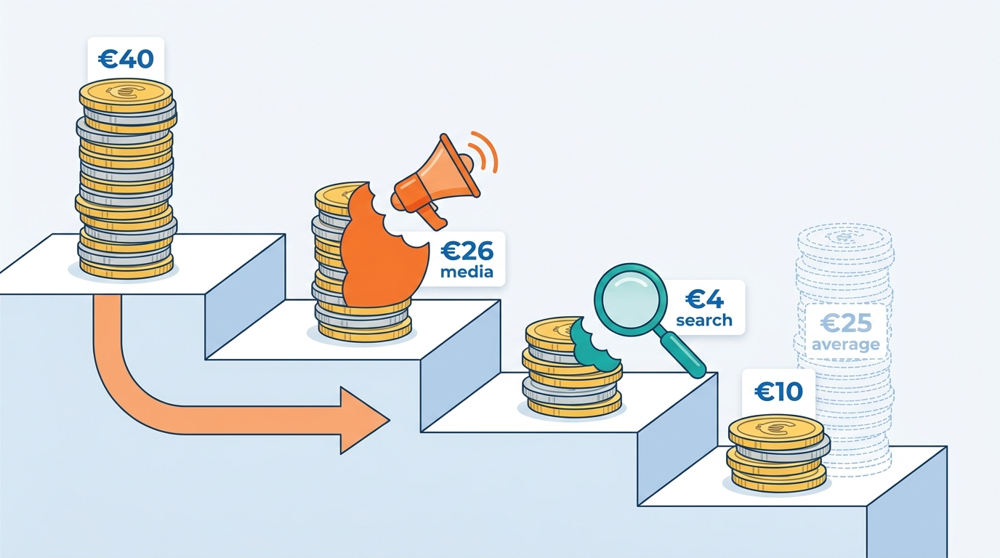
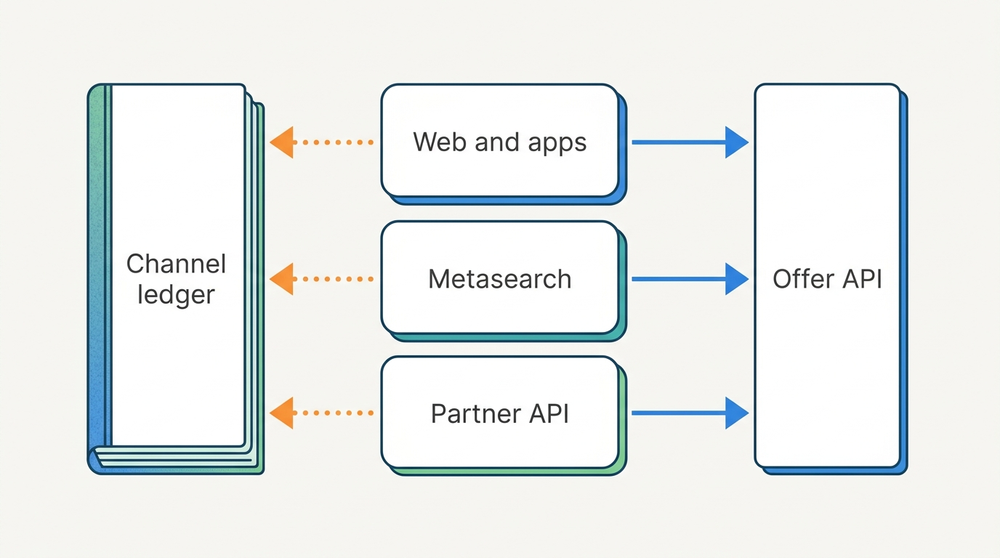
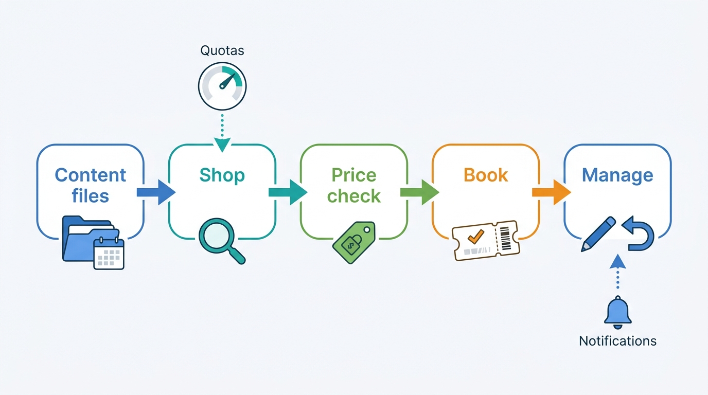
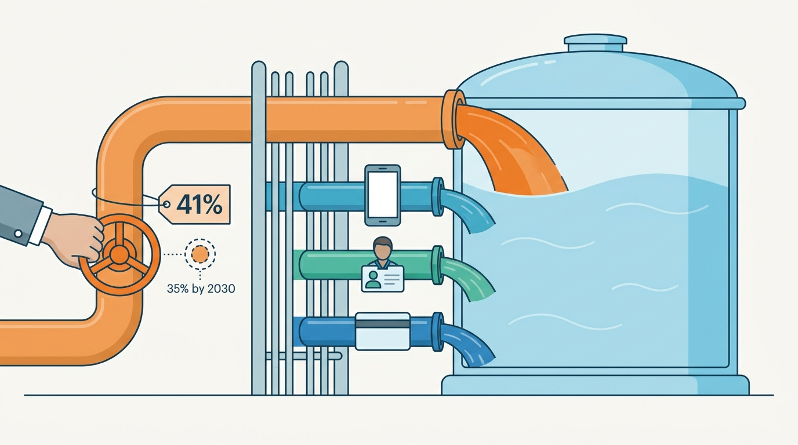

> **IN THIS CHAPTER, YOU WILL:** Map the demand side of a stays marketplace: web and app front ends and their backends-for-frontends, search-engine landing pages, metasearch integrations with price feeds, live queries and landing pages, and the partner distribution APIs that serve affiliates, white-label sites, travel agents and corporate travel. You will see how each channel connects to the same offer and reservation contracts, and how to measure what each channel really earns.

> **WHY THE BUSINESS CARES:** An OTA spends a third or more of its revenue buying guests, and much of that spend goes to a few companies whose rules it does not set. Which channels the marketplace can afford, and how exposed it is when one of them changes its rules, depends on engineering choices: price accuracy, landing speed, quotas and attribution.

> **WHY ARCHITECTS SHOULD CARE:** Most shopping traffic on an OTA comes from systems outside it, and those systems read the most expensive data the platform has. If every channel builds its own price, its own landing logic and its own booking path, the marketplace pays for the same offer several times and shows several different prices for it.

> **KEY POINTS:**
>
> * **A channel is a client of the offer, not a copy of it.** Web, apps, landing pages, metasearch feeds and partner APIs should all call one stay query, one offer computation and one reservation contract. The channel layer adds what is specific to each audience: rendering, feeds, quotas, payment flows and tracking. It must never add its own price arithmetic or its own booking path.
> * **Metasearch and partner APIs are integrations with contracts, not marketing tools.** A metasearch engine enforces price accuracy, response deadlines and landing rules. A partner API carries look-to-book ratios ten times those of the marketplace's own site. Both need an owned integration service, quotas set by traffic against revenue, retry budgets, and a click-and-quote record that ties every paid click to the offer it advertised.
> * **Judge channels on stayed contribution and dependence, not on clicks.** A channel's real value is revenue from stays it brought, minus its media cost, its search cost and its cancellations. Measure the share of bookings whose last external click came from one company, and invest in owned channels (apps, accounts, loyalty) and in accuracy, rather than trying to win every paid auction.

> **[FAILURE PATTERNS THIS CHAPTER ADDRESSES](where-stay-platforms-go-wrong.html):**
>
> * **Phantom Availability** — a metasearch feed, a landing page or a partner cache that advertises a price the marketplace no longer sells costs a paid click and, at scale, the channel itself.
> * **Price Drift** — when the feed exporter, the landing page and the partner API each compose taxes, fees, currency and member prices their own way, the guest who clicked an ad sees a different number on arrival.
> * **Built for Sunny Days** — partner and metasearch traffic grows with guest demand, so a channel layer without quotas, retry budgets and traffic classes fails on exactly the days the marketplace needs it most.

 
A guest rarely arrives at a stays marketplace by typing its address. They arrive from a search engine's ad or its hotel results, from a metasearch site that compared five sellers of the same hotel, from an airline's "book a hotel" page, from a travel agent's tool, or from the app on their phone. Each of these is a **demand channel**: a path by which guest demand reaches the marketplace's supply. Some of them the marketplace owns, and some it rents at a price set in someone else's auction.

Part VIII has built the platform beneath both marketplaces; this last chapter covers its **external clients**. Channel budgets sit with marketing, but each channel is an integration with the offer and reservation systems: a metasearch engine sends price queries and enforces accuracy policies, a white-label site calls the shopping API thousands of times per booking, and a corporate travel tool books a room and pays by virtual card.

This chapter owns three terms: **metasearch integration**, the **B2B distribution API** (business-to-business) and **landing assembly**. It builds on [[availability-engine]], which owns price accuracy and the offer kernel, on [[stays-search-architecture]], whose pipeline every channel must call, and on [[stays-marketplace-economics]], which owns look-to-book. Bot defense and traffic classes belong to [[global-scale-and-reliability]], and attribution models to [[marketplace-intelligence]]; this chapter uses both. Its rule for the two marketplaces, share the channel machinery but not the channel strategy, is the first case of the argument [[converging-two-marketplaces]] makes for the whole platform.

## Setting the Scene at Corvane: How Much of Roomstead Belongs to One Company?

Corvane, the fictional travel group this book follows (see [[meet-corvane]]), spent **€390 million** on marketing at Roomstead in 2026, its OTA-style marketplace. **€330 million** of it was performance marketing: about €150 million on paid search, €140 million on metasearch and €40 million on affiliates and social. Paid search and metasearch brought **38%** of Roomstead's sessions.

On **Monday 6 September 2027**, preparing the 2028 budget, Marco Bellini (Group CFO) asked a question that the May metasearch downgrade had made urgent ([[availability-engine]] tells that story): *how much of Roomstead's business depends on decisions made by one company we do not control?* Kenji Arai's data team and Roomstead's distribution team traced the last external click before each of Roomstead's roughly 45 million gross reservations of 2026. The figures, like everything about Corvane, are illustrative.

| Channel (last external touch) | Share of gross reservations | Shopping requests per reservation in that channel | Media or commission cost |
| --- | --- | --- | --- |
| Direct and app (no external touch) | 37% | about 400, across the four rows that land on own web and apps | Brand share of €60M |
| Organic search | 19% | (same pool) | None per click |
| Paid search | 15% | (same pool) | ~€150M |
| Link affiliates and CRM e-mail | 4% | (same pool) | Part of ~€40M |
| **Metasearch** (price feed, live queries, landing) | **18%** | **about 3,600** | **~€140M** |
| **Affiliate API and white label** | **7%** | **about 6,300** | Part of ~€40M |

The shopping-request column reconciles with the 1,400 shopping requests per gross reservation that Roomstead serves across all channels: about 300 per reservation come from its own web and apps, about 650 from metasearch queries and about 450 from affiliate API calls. Metasearch traffic therefore costs Roomstead about **€20.5 million** a year in search infrastructure, partner API traffic about **€14.2 million**, and its own sites about **€9.5 million**, at the €0.0007 per request that [[stays-marketplace-economics]] derives.

First, **one search engine** supplied the last external click on about **41%** of Roomstead's gross reservations: nearly all organic search, all paid search and a large share of metasearch clicks through its hotel results. Second, a stayed reservation from metasearch carried about **€26** of media cost and **€4** of search cost against Roomstead's average **€40** of revenue per stayed reservation, which left about €10 of contribution against Roomstead's average of €25.

**Figure 1:** *A stayed reservation from metasearch carried about €26 of media cost and €4 of search cost against €40 of revenue, leaving about €10 of contribution against Roomstead's average of €25.*

Roomstead's channel layer had grown one channel at a time:

- The **metasearch feed exporter** (2014, inside Keystone, Roomstead's Java monolith) produced hotel lists and price feeds; landing URLs were built by a separate marketing service; click tracking lived in a third-party tag. Nobody could join a click to the price it had advertised.
- The **affiliate XML API** (2013, also in Keystone) served about **2,300** affiliates, of which **46** API partners (white-label sites of three airlines, two banks and several travel-agency tools) made **78%** of API bookings. Every partner had the same fixed quota of 50 requests a second, whatever it sold. One price-comparison partner made one booking per **48,000** requests.
- **Destination landing pages**: about **2.6 million** indexable URLs, generated from a 2016 place list. For a default stay of the next weekend for two adults, **58%** of them showed fewer than five bookable properties. The search results page had been a client-rendered single-page application since 2019, so crawlers saw a loading shell unless a separate prerendering service answered.

Nookaway, Corvane's hosted-stays marketplace, had the opposite profile: about **58%** of its gross reservations came direct or through its app, **24%** from organic search, **11%** from guest referrals and CRM, and **7%** from paid search, with almost no metasearch. Its question was different: should it distribute its homes to other sellers at all?

Mariana Costa, Group Chief Architect, framed the work for the architecture forum of **12 October 2027** as one question: *which parts of the demand side should be shared contracts, which should be channel-specific integrations, and what should we measure to know whether a channel is worth having?*

## Concepts: Channels, Integrations and What They Share

### Demand channels

A **demand channel** is a route by which a guest's intent reaches the marketplace, defined by who controls the surface the guest sees and how the marketplace pays for the visit. Four families matter in stays:

| Family | Who controls the surface | How the marketplace pays | Examples |
| --- | --- | --- | --- |
| **Owned** | The marketplace | Development and brand cost | Web, iOS and Android apps, e-mail and push to known guests |
| **Search engines** | The search engine | Organic: nothing per click; paid: cost per click (CPC) | Organic results for "hotels in Alfama"; paid text ads |
| **Metasearch** | A comparison site that shows several sellers of the same property | Per click, or a commission per booking or stay, depending on the engine and program | Google's hotel results, trivago, KAYAK |
| **Partner distribution** | A reseller that shows the marketplace's supply under its own brand or inside its own tool | Commission share or a margin the reseller adds | Affiliates, white-label sites, travel agents, corporate travel tools |

The families overlap, so an OTA may buy clicks from a metasearch site its competitor owns: trivago is a metasearch business majority-owned by Expedia Group, which reports it as a separate segment earning advertising revenue from referrals ([Expedia Group 10-K, 2026](https://www.sec.gov/Archives/edgar/data/1324424/000132442426000008/expe-20251231.htm)); KAYAK is one of Booking Holdings' primary consumer brands ([Booking Holdings 10-K, 2026](https://www.sec.gov/Archives/edgar/data/1075531/000107553126000009/bkng-20251231.htm)).

### Metasearch integration

**Metasearch integration** is the set of interfaces through which an accommodation marketplace supplies a comparison engine with the properties it sells, the prices for specific stays, and the pages where a clicking guest lands, and through which it measures what those clicks became. Google's partner documentation is the most complete public description of the parts ([Google for Developers, 2025–2026](https://developers.google.com/hotels/hotel-prices/dev-guide/pos-syntax)):

- A **hotel list feed**: an XML file of the partner's properties, with name, address and coordinates, which Google matches to its own map listings. Each ID "must be unique to your site for all time" ([Google, Hotel list feed, 2025](https://developers.google.com/hotels/hotel-prices/dev-guide/hlf)). This is [[content-and-media]]'s mapping problem, run in reverse: the marketplace's property is matched to someone else's.
- **Price delivery**, in four documented modes ([Google, Pricing delivery modes, 2025](https://developers.google.com/hotels/hotel-ads/dev-guide/delivery-mode)): ARI push (availability, rates and inventory messages from which Google computes prices itself, visible "within 15 to 20 minutes"); Pull, in which "Google queries your service on a regular basis to refresh its cache"; Changed Pricing, which pulls only a subset; and Live Pricing Queries, "pricing requests from Google for a current auction".
- A **point-of-sale file** that defines landing pages: for each point of sale (POS, the market, language, currency and device of the user), a URL template into which Google substitutes the stay and the click context.
- **Price accuracy** enforcement, which [[availability-engine]] covers: Google requires prices to be "accurate and bookable online" and hides itineraries or switches off partners whose landing pages disagree ([Google Hotel Center Help, n.d.](https://support.google.com/hotelprices/answer/6064419?hl=en)).

Google's documentation says each Live Pricing Query has a deadline "typically up to 4000 milliseconds", that a late answer loses that search but should still be sent so it can be cached, and that live queries apply only where Google holds no cached price ([Google, Query messages, 2026](https://developers.google.com/hotels/hotel-prices/dev-guide/query-messages)). The same page notes that in European Economic Area (EEA) countries, Live Query is no longer available for hotel-specific searches under Google's "New Search experience". **The rules of a metasearch channel are written by the engine and change without the marketplace's consent**, which is the architectural reason to keep them inside one integration service rather than spread across the platform.

### The B2B distribution API

A **B2B distribution API** lets another business sell the marketplace's supply to its own customers: search, price, book and manage stays, under the reseller's brand or inside its tools. Expedia Group's Rapid API is the most fully documented example. Its lodging flow is content, geography, shopping, price check, booking and itinerary management ([Expedia Group Developer Hub, n.d.](https://developers.expediagroup.com/rapid/lodging)). Content is pulled as files and "requires daily refreshes". Shopping returns rates for up to 250 properties per request and returns tokenized links that "expire after a short period" ([Rapid Shopping, n.d.](https://developers.expediagroup.com/rapid/lodging/shopping/about-shopping-api)). The response schema is "the same for B2B and B2C", and "only the launch and compliance requirements differ by audience".

The commercial weight of this channel is visible in filings. Expedia Group's fiscal 2025 annual report describes its B2B segment as fueling "a wide range of travel and non-travel companies including airlines, offline travel agents, online retailers, corporate travel management and financial institutions", connected through Rapid, white-label or co-branded templates, or an agent tool. B2B gross bookings were **$35.7 billion** in 2025, up 20%, while consumer gross bookings grew about 3% ([Expedia Group 10-K, 2026](https://www.sec.gov/Archives/edgar/data/1324424/000132442426000008/expe-20251231.htm)). Booking.com's Demand API serves the same kind of partner and documents three payment flows: the partner charges the traveler and pays Booking.com by virtual credit card (VCC); a corporate flow in which the partner "pays using VCC (e.g. AirPlus) or MOTO flows for business travel" (mail order or telephone order, a card-not-present method); and payment at the property ([Booking.com Developers, n.d.](https://developers.booking.com/demand/docs/payments/overview)).

The forms differ in what the partner controls:

| Form | Who renders the guest experience | Who takes payment | Typical contract |
| --- | --- | --- | --- |
| **Link affiliate** | The marketplace (the guest is sent to its site with a tracking ID) | The marketplace | Commission share on stayed bookings |
| **White label** | The marketplace, themed in the partner's brand | Usually the marketplace | Commission share; partner brand on the page |
| **API reseller** | The partner, from API data | Partner or marketplace, per flow | Commission or net rate plus partner margin |
| **Travel agent tool** | The marketplace's agent tool, or the agency's own system | Agency, guest at property, or marketplace | Agent commission |
| **Corporate travel** | A travel management company (TMC) or a corporate booking tool | The company's central card or VCC; invoice | Negotiated rates; policy and duty-of-care data |

### Landing assembly

**Landing assembly** is the composition of an entry page (a destination page, a metasearch landing, a campaign page) from a default or supplied stay query, the search pipeline's results, editorial and structured content, and merchandising slots, rendered so that crawlers, humans and accuracy checkers read the same prices. Landing pages call the same pipeline as guest search ([[stays-search-architecture]]); this chapter owns the rest: which pages exist, how they render, which slots they carry and how they are measured.

## Architecture: One Offer, Many Doors

The architecture I recommend has three layers. At the bottom are the **shared contracts** that [[stays-search-architecture]], [[availability-engine]] and [[checkout-orchestration]] own: the stay query, the offer with its price composition and validity stamp, the price check and the reservation. In the middle are **channel adapters**, one per family, each owning what is specific to its audience. At the top is the **edge**, which classifies traffic before it costs anything.

**Figure 2:** *Every door calls the same offer. Web and app backends, the metasearch integration and the partner API are adapters over one stay query and offer API. Each writes to a channel ledger that joins clicks, quotes and bookings, so channels can be compared on what they earned.*

What separates the adapters is what each must not do:

| Adapter | Responsibility | Owns | Must not |
| --- | --- | --- | --- |
| **Backend for frontend (BFF)**, per surface | Assemble pages and app screens from domain APIs; server-render crawlable pages; apply surface-specific layout and merchandising | Page composition, rendering budget, slot layout | Compute prices, decide availability, or call the ARI store directly |
| **Metasearch integration** | Hotel list feeds, price delivery, live-query answers, landing resolution, click-and-quote logging, partner reporting | Engine contracts, feed schedules, POS mapping, click records | Hold its own copy of fee, tax, currency or member logic |
| **Partner distribution API** | Partner onboarding and keys; content files; shop, price check, book and manage; quotas and retry budgets; partner payment flows | Partner contracts, quotas, partner reporting | Bypass the price check or create reservations outside the reservation contract |
| **Channel ledger** | One record per click, quote, session and booking with its channel, and its later outcome (stayed, canceled) | Channel facts for attribution and accuracy | Decide attribution credit itself; [[marketplace-intelligence]] owns the models |

### Web and apps: backends for frontends and server rendering

Three documented cases show the range of designs. Booking.com, in a September 2026 post, says each major page (home, search results, property page) has its own Node.js rendering service owned by the team for that page, that sections such as the rooms table are owned by different teams and can be deployed independently through Webpack Module Federation, and that pages are server-rendered because they "have to work when client-side JavaScript is not available, and they have to be crawl-able". The same post describes leaving Perl rendering "one fragment at a time", each swap behind an experiment ([Booking.com Engineering, 2026](https://medium.com/booking-com-development/node-js-at-scale-rebalanced-how-we-cut-cost-by-38-62ce247a3002)). Airbnb described in 2021 a server-driven UI system, the Ghost Platform, that sends screen structure from the server to web, iOS and Android to address the problem that "each time we need to add new features to our listing page, we need to release a new version of our mobile apps" ([Airbnb Engineering, 2021](https://medium.com/airbnb-engineering/a-deep-dive-into-airbnbs-server-driven-ui-system-842244c5f5); five years old, and the current state is not public). Agoda, in May 2026, described serving white-label partners from one design system with design tokens and per-partner themes: "New partner = new theme, not new code" ([Agoda Engineering, 2026](https://medium.com/agoda-engineering/how-agoda-powers-multiple-travel-brands-with-one-design-system-a48de5f906af)).

Apps carry many of the bookings and the longest tail of versions: Trip.com reported that "over 90% of our total transaction orders were executed through our mobile channels" in 2025 ([Trip.com Group 20-F, 2026](https://www.sec.gov/Archives/edgar/data/1269238/000119312526183379/d27369d20f.htm)); Booking Holdings reported its mobile-app share of room nights as a mid-fifties percentage ([Booking Holdings 10-K, 2026](https://www.sec.gov/Archives/edgar/data/1075531/000107553126000009/bkng-20251231.htm)). Because **app releases cannot be recalled**, a rule in the client (a retry policy, a price label) stays wrong while old versions remain installed. Corvane learned this from a retry shipped in a January 2027 app release, which created 212 duplicate bookings ([[checkout-orchestration]]). The rules I use:

1. **Prices, policies and eligibility are rendered from server data, never computed in the client.** The client may format a number; it may not add a fee.
2. **Every client call that changes state carries a server-minted idempotency key**, and client retry behavior is part of the API contract, with a server-side minimum supported version.
3. **Server-driven layout for surfaces that change weekly** (landing modules, merchandising slots, trip screens); native screens for the booking path, where stability matters more than speed of change.

### Landing pages and SEO

Search-engine optimization (SEO) for stays is about destination and theme pages: "Hotels in Alfama", "Apartments with a pool in the Algarve", "Hotels near Lisbon airport". No company in this book's research has published its landing-page architecture; the design below is my recommendation, consistent with [[destinations-and-maps]] and [[stays-search-architecture]].

- **The page set comes from the destination graph.** Places and their parent edges define which pages exist, their URLs and breadcrumbs. A page exists only where the place holds enough bookable supply for a default stay; below the threshold it redirects to its parent.
- **Pages are search results with a default stay.** Landing assembly runs the search pipeline with a declared default (for example, next weekend, two adults) and caches the result. Every "from €62" carries the offer's validity stamp and is recomputed when it expires; a price claim on a landing page is subject to the same consumer law as a search result ([[property-page-and-room-selection]]).
- **Server-render the first view** with the prices and the property list in the HTML, and the same structured data for crawlers and for price-accuracy checkers. Google's hotel price structured data, based on Schema.org's `Hotel` and `HotelRoom` types, exists so that Google can "accurately extract prices from your webpages" for validation ([Google for Developers, n.d.](https://developers.google.com/hotels/hotel-prices/structured-data/hotel-price-structured-data)).
- **Search-engine crawlers are served from cache**, never from live availability ([[global-scale-and-reliability]]).

### Merchandising slots

**Merchandising slots** (a "deals this weekend" strip, a member-price banner, a sponsored property) are placements on landing pages and the home screen that the BFF fills from a decision service. Two rules keep them from becoming a second, unaudited ranking. First, a slot's content comes from the same offer and eligibility services as search, so a "deal" shown on a landing page is a real, bookable price for the shown guest ([[promotions-and-loyalty]] owns eligibility). Second, any slot that a partner pays for is labeled and logged as paid visibility, under the same disclosure rules as ranking ([[stays-ranking]]).

## Metasearch in Practice

### The click as a contract

A metasearch click is a promise made on the marketplace's behalf by someone else: "this hotel, these dates, this party, this total, from this seller". Google substitutes the advertised stay and price into the landing URL. Its documented variables include the check-in and check-out dates, `PARTNER-HOTEL-ID`, `PARTNER-ROOM-ID` and `RATE-PLAN-ID`, the occupancy, `USER-COUNTRY`, `USER-DEVICE`, `USER-CURRENCY`, and `PRICE-DISPLAYED-TOTAL`, `PRICE-DISPLAYED-TAX` and `PRICE-DISPLAYED-FEES`, "the total room cost shown to the user" ([Google, Landing page URLs, 2026](https://developers.google.com/hotels/hotel-prices/dev-guide/pos-urls)).

So the marketplace can **check every paid click on arrival**: the landing resolver reads the advertised total, re-quotes the stay through the offer API, logs both in the click record, and only then renders the page. Accuracy is then measured on every paid click, not on the engine's sample. [[availability-engine]]'s sampler remains the measure of the cache; the click-time check is the measure of what guests actually saw.

**Figure 3:** *A metasearch click checked on arrival. The integration answers the engine's live query from the offer API, then re-quotes the same offer when the guest lands, records both totals against the click, and tells the page whether the advertised price still holds and why not.*

### What the landing page should do when the price has moved

The engine's policy and consumer law allow neither hiding the change nor showing the old price as available. My rules for the landing resolver:

| Outcome of the click-time re-quote | Landing behavior | Recorded as |
| --- | --- | --- |
| Same offer, same total | Show the advertised room and rate first, total identical to the ad | Match |
| Same offer, lower total | Show the lower total | Match (in the guest's favor) |
| Same offer, higher total | Show the new total, say that the price changed since the search, offer alternatives | Mismatch, with the cause from the kernel's composition trace |
| Rate sold out, others available | Say so, show the next-best rate of the same room type | Mismatch: stale availability |
| Property sold out for the stay | Say so, show alternatives nearby and other dates | Mismatch: stale availability |
| Advertised rate was audience-restricted (member, mobile) and the guest is not eligible | Show the public total; offer sign-in if eligibility is possible | Mismatch: audience leakage |

The cause column matters more than the count. [[availability-engine]] decomposed Roomstead's nine points of mismatch in May 2027 into stale price (3.6), stale availability (2.1), fee and tax composition (1.4), currency (0.8), member-price leakage (0.6) and other (0.5). The first two are cache problems. The last three are channel problems: the feed exporter composed taxes, currency and audience differently from the landing page. **A channel adapter that composes prices is a Price Drift generator**, and the cure is that it calls the offer kernel and nothing else.

### Price delivery: which mode, for which supply

| Mode | Who does the arithmetic | Freshness | Load on the marketplace | Fits |
| --- | --- | --- | --- | --- |
| **ARI push** | The engine computes prices from rates, restrictions and taxes the marketplace sends | Minutes after a change | Low; one message per change | Hotels and properties with simple, push-based ARI; partners that want few queries |
| **Pull and Changed Pricing** | The marketplace | Bounded by the pull schedule and hint frequency | Moderate, scheduled | Marketplaces with a fast offer cache and complex price composition |
| **Live queries** | The marketplace | Current, within the deadline | Proportional to engine traffic, peaky | Long-tail itineraries; supply with volatile prices |

For an OTA with derived rates, member prices and city taxes, ARI push hands the composition problem to the engine, whose arithmetic will disagree with the marketplace's in exactly the cases guests notice. My default is **pull for the popular head of itineraries, live queries for the tail, and push only where the marketplace's own composition is trivially reproducible**. In every mode, the feed is generated from the offer API, never from a separate export of the ARI store.

### Who metasearch is good for

Metasearch lets every seller of the same hotel, and increasingly the hotel itself, compete on displayed price. Under the EU Digital Markets Act (DMA), Booking was designated a gatekeeper for Booking.com on 13 May 2024, and Article 5(3) of the DMA bars gatekeepers from preventing business users from offering different prices or conditions through other intermediaries or their own direct channels ([European Commission, DMA gatekeepers, n.d.](https://digital-markets-act.ec.europa.eu/gatekeepers_en); [Regulation (EU) 2022/1925](https://eur-lex.europa.eu/eli/reg/2022/1925/oj), 2022); courts in several EU countries had already restricted such clauses ([[stays-regulation]] covers the details). An OTA's metasearch position therefore rests on accuracy, landing conversion, payment and member options and supply breadth, not on a guaranteed lowest price.

Booking Holdings' 2025 annual report states the alternative strategy plainly. It reports that consumers "coming directly to our platforms" booked a mid-fifties percentage of its room nights in 2025, up year on year, which "benefited our marketing efficiency" ([Booking Holdings 10-K, 2026](https://www.sec.gov/Archives/edgar/data/1075531/000107553126000009/bkng-20251231.htm)). Airbnb's report credits its brand with allowing "lower reliance on paid marketing channels" ([Airbnb 10-K, 2026](https://www.sec.gov/Archives/edgar/data/1559720/000155972026000004/abnb-20251231.htm)). Metasearch is a channel to be accurate and efficient in, and one whose share a marketplace should reduce by turning first bookings into returning guests.

## Partner Distribution in Practice

### The flow and its freshness contract

A partner distribution API exposes the steps of the marketplace's own checkout, separated by explicit freshness contracts. I would design it on Rapid's documented pattern:

**Figure 4:** *The partner distribution flow. Each step trades freshness for cost: content is cached by the partner, shopping is live but rate-limited by what the partner sells, the price check produces a binding quote, and booking and management go through the same reservation contract as the marketplace's own checkout.*

- **Content** is pulled as files with incremental updates and an inactive-property list, so the partner can map properties into its own catalog.
- **Shopping** is live, bounded in size (Rapid caps it at 250 properties and 8 rooms per request) and rate-limited.
- **Price check** returns a binding quote with a validity period, or a new price, or "search again". At Corvane, binding quotes are held for 15 minutes from the price check, the same as on Roomstead's own checkout ([[availability-engine]]).
- **Booking** creates a reservation through the reservation contract, with the partner's payment flow, and returns retrieval links.
- **Management** covers changes, cancellations and notifications, through the same cancellation policy engine as the marketplace's own site ([[changes-and-cancellations]]).

### Quotas by traffic against revenue

Partner traffic has the highest look-to-book ratios on the platform, because partners refresh their own caches broadly. Agoda described in 2023 how broad searches from affiliate traffic drove evictions in its Price Delivery System, which serves prices for its "web, mobile, and affiliate APIs" ([Agoda Engineering, 2023](https://medium.com/agoda-engineering/improving-performance-using-distributed-cache-with-couchbase-aa7ebf3a12c9)). Expedia's Rapid documentation states the governing rule: rate limits are calculated "monthly, taking into account a partner's traffic vs. revenue", typically over a three-month window, with "a very generous allowance for the first 3 months" for new partners ([Rapid rate limiting, n.d.](https://developers.expediagroup.com/rapid/lodging/shopping/rate-limiting)).

I would make this look-to-book contract explicit in four parts:

1. **A shopping budget per partner**, recalculated monthly from stayed bookings over a trailing window, with a floor for new partners and a seasonal adjustment.
2. **A retry budget**: every rejection returns HTTP 429 with a Retry-After header, and the partner contract caps retries. [[global-scale-and-reliability]] describes what happened when Corvane forgot the header on Black Friday 2027: one affiliate's client retried immediately and tripled its request rate.
3. **A traffic class at the edge**, so a partner's broad crawl is shed before guest traffic on a peak day.
4. **A cost line per partner** in the channel ledger: commission or margin plus search cost, against stayed revenue. A partner whose search cost exceeds its commission margin is a partner the marketplace is paying to browse.

### Travel agents and corporate travel

Agency and corporate demand adds four requirements:

- **Payment flows**: the corporation's central card or a VCC, an invoice with the right VAT details, or payment at the property with the company's card on file. Booking.com's Demand API documents the corporate VCC and MOTO flows ([Booking.com Developers, n.d.](https://developers.booking.com/demand/docs/payments/overview)); [[stay-payments]] owns the card mechanics.
- **Negotiated and qualified rates**: corporate rate plans visible only to an authenticated company, which are audience-restricted offers and must go through the same eligibility checks as member prices. Rapid exposes business rates through a `travel_purpose=business` attribute ([Rapid Shopping, n.d.](https://developers.expediagroup.com/rapid/lodging/shopping/about-shopping-api)).
- **Traveler data and duty of care**: the company needs to know where its travelers are staying, so reservations carry the traveler's identity, the booker's and the company's references, and changes must be delivered back to the agency or TMC.
- **Policy**: corporate booking tools enforce travel policy (price caps per city, approved properties). The marketplace provides the data; the tool enforces the policy.

I would not build a separate stack for corporate demand: it is a set of rate audiences, payment flows and data fields on the same partner API.

## A Worked Example: One Click on Hotel Miradouro

In the target design that Corvane's forum approved in October 2027, Roomstead's metasearch integration is a service called **Lantern** and its partner API is **Gangway** (both described in the next section). To test the design, the distribution team replayed real clicks from early October 2027 through a Lantern prototype. Here is one of them.

On **Tuesday 5 October 2027**, a guest in Madrid compared hotels in Lisbon for **Friday 22 to Sunday 24 October**, two adults. Hotel Miradouro, the 84-room four-star hotel run by Duarte Silva's revenue team, sells its Standard Double Flexible rate at **€132** a night that weekend, including Portugal's 6% reduced VAT on accommodation. Lisbon's city tax is **€4** per adult per night, payable at the hotel on Roomstead's agency bookings.

1. **The live query.** In the replay, the engine has no cached price for this itinerary and sends a live query for 20 Lisbon properties. Lantern calls the offer API in one batch; 18 offers come from Pricegrid's hot tier, 2 from on-demand computation. Lantern answers in **310 ms**, well inside the engine's deadline, with the room total of **€264** and a tax element of **€16** marked "payable at the property".
2. **The click.** The guest clicks Roomstead's offer. The landing URL carries the stay, `PARTNER-HOTEL-ID`, the rate plan ID, `USER-COUNTRY=ES`, `USER-CURRENCY=EUR` and `PRICE-DISPLAYED-TOTAL=280`.
3. **The re-quote.** Lantern resolves the point of sale (Spain, Spanish, euro, mobile) and re-quotes the same offer through the offer API. Kernel version and composition are identical; the total is €264 plus €16. Lantern writes the click record: advertised €280, current €280, match, kernel version, Pricegrid cell age 41 seconds.
4. **The landing page.** The BFF renders Miradouro's property page with the advertised room and rate first, the total of €280 shown with the €16 city tax labeled as payable at the hotel, and the hotel's other rooms below. The guest books, as the real guest did.
5. **The outcome.** The reservation carries the click record's ID, so the channel ledger later marks the click "stayed" or carries the cancellation against metasearch.

In the real October click, the old design failed. The 2014 feed exporter composed the city tax into the advertised total for some points of sale and not others, while the landing page showed the room total alone: the guest saw €264 under a €280 ad, and the engine's checker would have scored it as a mismatch. Neither number was wrong; their composition differed. That is the **1.4 points** of fee and tax mismatch in [[availability-engine]]'s audit. Of the 1.2 million Spanish and Portuguese clicks replayed, the prototype matched **96.9%** on arrival, against **95.7%** measured on the same clicks in the old path; nearly all the remaining mismatches were stale prices and availability, which belong to Pricegrid's freshness work rather than to the channel.

## Corvane's Decisions: Lantern, Gangway and the Page Set

The forum of **12 October 2027** approved four decisions.

**1. Lantern, Roomstead's metasearch integration.** One service, with no pricing code of its own, owns hotel list feeds, price delivery (pull for the popular head, live queries for the tail), landing resolution, click-time re-quoting and the click-and-quote record. It replaces the 2014 feed exporter and the marketing landing-URL service by the end of Q2 2028. Owner: Roomstead distribution engineering in Dublin. Its accuracy dashboard shows Corvane's click-time match rate on all paid clicks beside each engine's reported score.

**2. Gangway, the group partner distribution API.** The partner flow above on the One Stay offer and reservation contracts, with the four-part look-to-book contract (quotas recalculated monthly from stayed revenue, mandatory Retry-After, retry budgets, a cost line per partner). It replaces the 2013 affiliate XML API by the end of 2028. The 46 API partners migrate first; the 2,300 link affiliates keep tracking links. Corporate and agency rates arrive as audience-restricted offers in 2029.

**3. Landing pages from Waypoint.** The page set is derived from Waypoint, the group destination graph ([[destinations-and-maps]]); a page exists only where the place has at least **ten** bookable properties (or, for Nookaway, ten listings) for the default stay, otherwise it redirects to its parent. Pages are server-rendered from the search pipeline and carry validity-stamped prices. The client-rendered search page gets a server-rendered first view in 2028, which retires the prerendering service. On the 2027 page list, the rule removes or redirects about **1.5 million** of the 2.6 million indexable URLs.

**4. Dependence as a tracked number.** The share of gross reservations whose last external click came from one company (2026 baseline **41%**) is reported quarterly to the executive team. There is no cap; the ambition is **35% by 2030**, through the app, signed-in guests and Roomstead Circle, not by withdrawing from paid channels.

**Figure 5:** *One search engine supplied the last external click on about 41% of Roomstead's gross reservations in 2026; the ambition is 35% by 2030, reached through the app, signed-in guests and Roomstead Circle rather than by leaving paid channels.*

Nookaway's listings would **not** be distributed through Gangway before 2029, and then only as a calendar-first product with host opt-in, for the reasons in the Hotels and Homes section below.

## Trade-offs

| Decision | Option A | Option B | Choose A when | Choose B when |
| --- | --- | --- | --- | --- |
| Metasearch price delivery | Push ARI and let the engine compute | Pull and live queries answered by the offer API | Price composition is simple and stable; traffic budget is tight | Derived rates, member prices, local taxes; accuracy is the binding constraint |
| Where the metasearch logic lives | Inside the search or pricing teams' services | A dedicated integration service | One engine, low volume | Several engines, engine-specific rules, significant spend |
| Web rendering | Client-rendered single-page application | Server-rendered first view, then hydration | Signed-in tools (extranets, agent tools) that crawlers never see | Destination, search and property pages that need crawling, fast first paint and price checks |
| App UI changes | Native screens per release | Server-driven layout | Booking path, payment, anything safety-critical | Landing modules, merchandising, trip timeline |
| Partner surface | Link affiliates and white label only | Full API reseller program | Few large partners; supply is the differentiator | Many resellers, travel agents and corporate demand worth its look-to-book |
| Partner quotas | Fixed per partner | Recalculated from traffic against revenue | Small program, few partners | Large program; partners with very different conversion |
| Landing page set | Generated for every place and filter | Derived from the destination graph and gated on bookable supply | Never, in my view | Always |

The second row has the largest consequences: spreading metasearch logic across search and pricing services scatters engine-specific rules (point-of-sale mapping, live-query deadlines, landing URL variables, EEA changes) across teams that do not own the commercial relationship.

## Hotels and Homes: Where the Two Marketplaces Differ

| Dimension | Accommodation marketplace (OTA-style) | Hosted-stays marketplace |
| --- | --- | --- |
| **Channel mix** | Large paid share: paid search and metasearch; affiliates and B2B resellers | Mostly direct, app and organic; referrals; little metasearch |
| **What guests compare** | The same hotel from several sellers, on price | Different homes, on fit, photos and trust; the home is often sold only by its host's chosen platforms |
| **Metasearch** | Central: price feeds, live queries, accuracy policies, landing rules | Vacation-rental comparison sites exist, but the comparison is between homes rather than sellers |
| **Landing pages** | Destination and hotel pages; bid targets for paid search as much as organic pages | Destination and category pages ("cabins", "homes with a pool"); mostly organic |
| **Outbound distribution** | Natural: room-type inventory with many units can be resold | Constrained: one-unit calendars, host acceptance, house rules, deposits; already multi-listed by hosts |
| **Partner API shape** | Shop by room type and rate plan, occupancy, many units | Calendar first: per-day availability, valid arrival and departure days, one rate plan, payment schedules |
| **Look-to-book exposure** | Highest; partner and metasearch traffic dominate | Lower; mostly own traffic |
| **Main channel failure** | Phantom Availability and Price Drift on paid clicks | Double booking when a distributed calendar is stale |
| **What can be shared** | Edge and traffic classes, BFF framework, landing assembly on the shared search pipeline, channel ledger, partner API framework (keys, quotas, retry budgets) | The same, with different products on the partner API |

Rapid's documentation is the clearest public evidence of how different hosted stays are when distributed. Vrbo inventory in Rapid is "single-unit only" with "a single rate plan"; same-day bookings and windows under 72 hours are excluded "because hosts need time to process bookings and prepare the property"; a rental agreement "must be displayed on any check-out page"; and the availability calendar returns per-day availability and stay rules, with "Caching is not supported at this time" ([Rapid Vrbo integration guide](https://developers.expediagroup.com/rapid/lodging/vacation-rentals/vrbo-integration-guide) and [availability calendar](https://developers.expediagroup.com/docs/products/rapid/lodging/vacation-rentals/vrbo-availability-calendar), n.d.; the vacation-rentals page says the product is available only to a limited number of partners). **A hotel-shaped shopping API cannot sell homes**, and a hosted-stays marketplace that distributes its homes adds one more channel to the calendar-sync problem that [[calendar-sync]] describes.

My judgement for a group running both: **share the channel machinery, not the channel strategy.** The machinery in the table's last row is one platform. The OTA should invest in metasearch accuracy and partner distribution because its guests compare sellers. The hosted-stays marketplace should invest in direct, app and organic channels, and distribute outward only for hosts who opt in, through a calendar-first product with no caching and a lead time.

## Failure Modes

- **The feed with its own arithmetic** — feed, landing page and partner API each compose taxes, fees, currency and member prices; mismatch causes then name a tax, a fee or an audience rather than availability. See What the landing page should do when the price has moved.
- **Landing on the wrong thing** — the click advertised a room and rate, but the page shows the cheapest room, another currency or a results page; the guest leaves and the engine scores a mismatch. See the same section.
- **Partners without budgets** — fixed quotas, or none, give a price-comparison partner the same capacity as an airline's white-label site that books a hundred times more, so the broadest crawler evicts the cache guests need, and rejections without Retry-After multiply the load. See Quotas by traffic against revenue.
- **The partner booking path** — partner reservations skip the idempotency keys, price check or cancellation policy of the main checkout, so duplicate bookings and Policy Spaghetti follow. See The flow and its freshness contract.
- **A million thin pages** — pages for every place and filter dilute crawl budget, show near-empty results and carry "from" prices cached for days. See Landing pages and SEO.
- **Measuring clicks, not stays** — channels compared on bookings made favor refundable bookings that later cancel; the channel ledger must carry the stay outcome.
- **Dependence nobody owns** — the share controlled by one external company grows, spread across marketing, search and distribution, until an engine changes its rules. See Corvane's decision 4.

## The Chief Architect's View

**What to decide.**

1. **The channel-adapter rule**: no adapter computes prices or creates reservations by another path. The architecture board owns it, because it is what prevents Price Drift across channels.
2. **One owner per external integration**, answering for the engine's or partner's contract and the channel's cost. At Corvane, Lantern belongs to Roomstead distribution engineering and Gangway to a group team, because Gangway's framework is shared across brands.
3. **The look-to-book contract.** Distribution sets the commercial terms; the platform sets the capacity envelope; neither may change the other's numbers alone.
4. **The channel ledger as a governed data product**, owned jointly with the data platform, so that attribution, accuracy and channel profitability read the same records ([[marketplace-intelligence]]).
5. **The dependence metric**, and which owned-channel investments should reduce it.

**Who decides.** The CFO and the brand's commercial lead decide spend per channel; the Chief Architect decides how channels connect and what they may not do; the data platform decides how the facts are recorded. Disputes go to the architecture forum, with the channel ledger as evidence.

**What to watch.** Click-time match rate by engine and cause; live-query latency against each engine's deadline; shopping requests and search cost per stayed booking by partner; stayed, cancellation-adjusted contribution per channel; and the dependence share.

**Long-term considerations.** Engines change their surfaces (the EEA live-query change removed an integration mode by a rule nobody at the marketplace wrote); AI assistants may shop through partner APIs at scale, as broad-query, low-booking partner clients (Booking Holdings' 10-K warns that third-party AI features may "satisfy user intent without directing users to our services"; [[ai-in-travel-stays]] takes up the strategy); and hotels' direct-booking pressure, strengthened by the end of parity clauses, will keep compressing metasearch margins. The answer to all three is the same: **accurate, cheap offers behind every door, and more guests who come back without being bought again.**

## Questions to Ask

1. Which channels call our offer API, and which compute or cache prices themselves? Who owns reducing the second list to zero?
2. Can we join a single paid click to the price it advertised, the price we showed on landing, and whether the stay happened?
3. What is our click-time match rate by engine and point of sale, and how does it compare with the engines' own scores?
4. Which price delivery mode do we use with each metasearch engine, and why? What is our live-query latency at the 99th percentile against each engine's deadline?
5. How are partner quotas set? What is each partner's search cost against its commission margin, and do our rejections return Retry-After?
6. Do partner bookings go through the same price check, idempotency keys, reservation contract and cancellation policy engine as our own checkout?
7. How many landing pages do we publish, how many have enough bookable supply for their default stay, and are their prices validity-stamped?
8. Which business rules live in the app client, and how long would it take to correct one in every installed version?
9. What share of our gross bookings comes from the last click of one external company, and what are we doing about it?
10. For the hosted-stays side: if we distributed our homes to other sellers, how would their calendars stay as fresh as our own?

This chapter shared the channel machinery between the two marketplaces and kept their channel strategies apart. [[part-9]] opens the Chief Architect's agenda, and its first chapter, [[converging-two-marketplaces]], asks what to share and what to keep apart for the whole platform.

## Sources and Evidence

### Company engineering and investor sources

- [Booking Holdings Form 10-K for fiscal 2025](https://www.sec.gov/Archives/edgar/data/1075531/000107553126000009/bkng-20251231.htm), Booking Holdings, 2026 — marketing scale, direct and mobile-app shares of room nights, KAYAK as a consumer brand, AI risk factor.
- [Expedia Group Form 10-K for fiscal 2025](https://www.sec.gov/Archives/edgar/data/1324424/000132442426000008/expe-20251231.htm), Expedia Group, 2026 — B2B segment, its partners and connection modes, B2B and B2C gross bookings, trivago as a metasearch segment.
- [Airbnb Form 10-K for fiscal 2025](https://www.sec.gov/Archives/edgar/data/1559720/000155972026000004/abnb-20251231.htm), Airbnb, 2026 — lower reliance on paid marketing.
- [Trip.com Group Form 20-F for fiscal 2025](https://www.sec.gov/Archives/edgar/data/1269238/000119312526183379/d27369d20f.htm), Trip.com Group, 2026 — over 90% of orders through mobile channels.
- [Node.js at Scale, Rebalanced](https://medium.com/booking-com-development/node-js-at-scale-rebalanced-how-we-cut-cost-by-38-62ce247a3002), Booking.com Engineering, 2026 — per-page rendering services, fragment ownership, server rendering for crawlability, strangler migration from Perl.
- [A Deep Dive into Airbnb's Server-Driven UI System](https://medium.com/airbnb-engineering/a-deep-dive-into-airbnbs-server-driven-ui-system-842244c5f5), Airbnb Engineering (Ryan Brooks), 2021 — server-driven UI to avoid app releases for listing-page changes.
- [How Agoda Powers Multiple Travel Brands with One Design System](https://medium.com/agoda-engineering/how-agoda-powers-multiple-travel-brands-with-one-design-system-a48de5f906af), Agoda Engineering, 2026 — white-label partners as themes.
- [Improving Performance Using Distributed Cache with Couchbase](https://medium.com/agoda-engineering/improving-performance-using-distributed-cache-with-couchbase-aa7ebf3a12c9), Agoda Engineering, 2023 — affiliate traffic driving price-cache evictions.

### Standards, regulation and documentation

- [Pricing delivery modes](https://developers.google.com/hotels/hotel-ads/dev-guide/delivery-mode), Google for Developers, 2025 — ARI push, Pull, Changed Pricing and Live Pricing Queries, with freshness expectations.
- [Query messages](https://developers.google.com/hotels/hotel-prices/dev-guide/query-messages), Google for Developers, 2026 — live query deadlines, eligibility and the EEA restriction.
- [Landing page URLs](https://developers.google.com/hotels/hotel-prices/dev-guide/pos-urls), Google for Developers, 2026 — variables substituted into landing URLs, including the displayed total.
- [Point of Sale file syntax](https://developers.google.com/hotels/hotel-prices/dev-guide/pos-syntax), Google for Developers, 2025 — landing pages per point of sale.
- [Hotel list feed](https://developers.google.com/hotels/hotel-prices/dev-guide/hlf), Google for Developers, 2025 — property feed and permanent IDs.
- [Hotel price structured data](https://developers.google.com/hotels/hotel-prices/structured-data/hotel-price-structured-data), Google for Developers, n.d. — machine-readable prices for validation.
- [Price Accuracy Policy](https://support.google.com/hotelprices/answer/6064419?hl=en), Google Hotel Center Help, n.d. — accurate and bookable prices and their enforcement.
- [Rapid Lodging overview](https://developers.expediagroup.com/rapid/lodging), [About the Shopping API](https://developers.expediagroup.com/rapid/lodging/shopping/about-shopping-api) and [Rate limiting](https://developers.expediagroup.com/rapid/lodging/shopping/rate-limiting), Expedia Group Developer Hub, n.d. — content, shop, price check, book and manage; request limits; quotas by traffic against revenue.
- [Vrbo integration guide](https://developers.expediagroup.com/rapid/lodging/vacation-rentals/vrbo-integration-guide) and [Vrbo availability calendar](https://developers.expediagroup.com/docs/products/rapid/lodging/vacation-rentals/vrbo-availability-calendar), Expedia Group Developer Hub, n.d. — distributing hosted stays: single unit, lead time, rental agreement, uncached calendar.
- [Demand API payments overview](https://developers.booking.com/demand/docs/payments/overview), Booking.com Developers, n.d. — partner, corporate (VCC and MOTO) and pay-at-property flows.
- [Gatekeepers](https://digital-markets-act.ec.europa.eu/gatekeepers_en), European Commission (Digital Markets Act), n.d. — Booking's designation for Booking.com.
- [Regulation (EU) 2022/1925, the Digital Markets Act](https://eur-lex.europa.eu/eli/reg/2022/1925/oj), Official Journal of the EU, 2022 (CELEX 32022R1925) — Article 5(3) on price and condition parity.

### Research and practitioner sources

- No primary engineering source on any company's SEO landing-page architecture was found; the landing-page design in this chapter is the author's recommendation.

Corvane is fictional; architectural recommendations and labeled inferences are the author's judgement.
