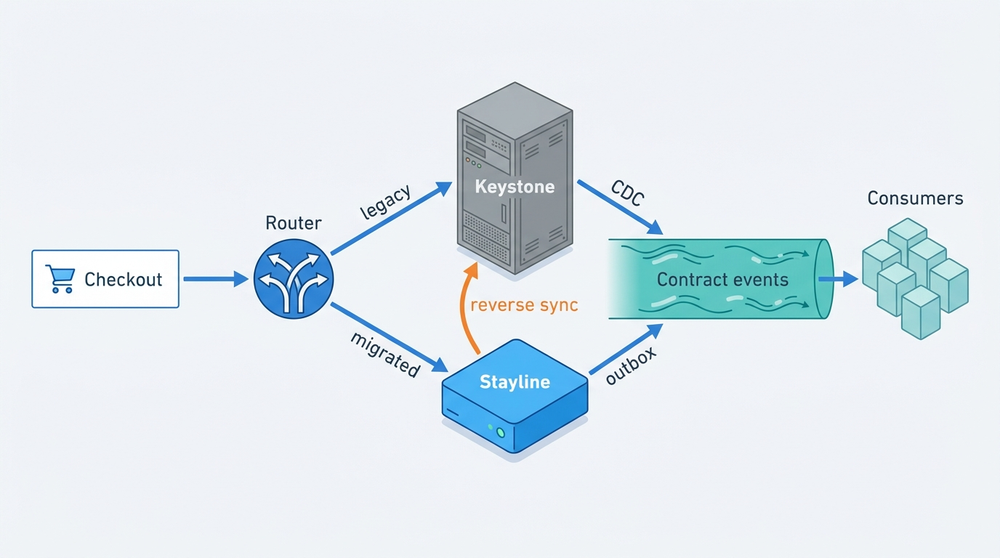
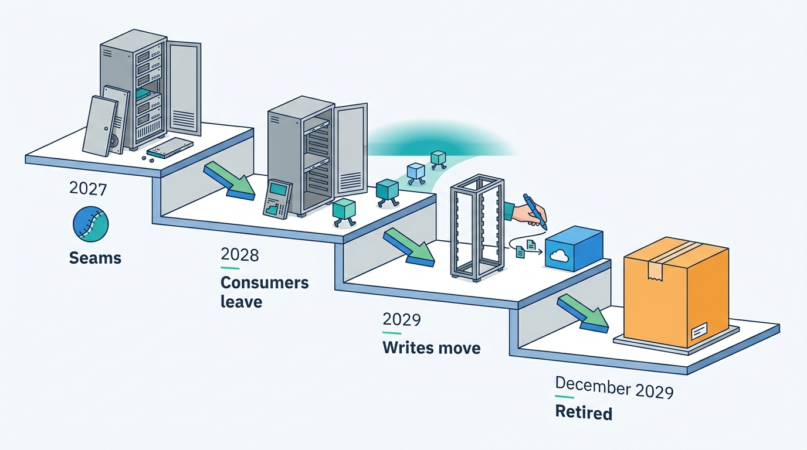
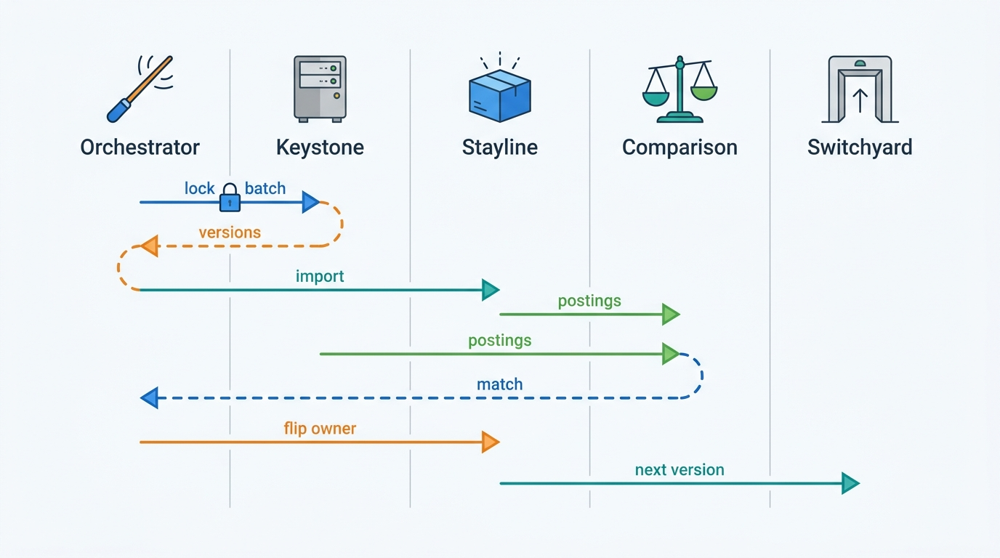
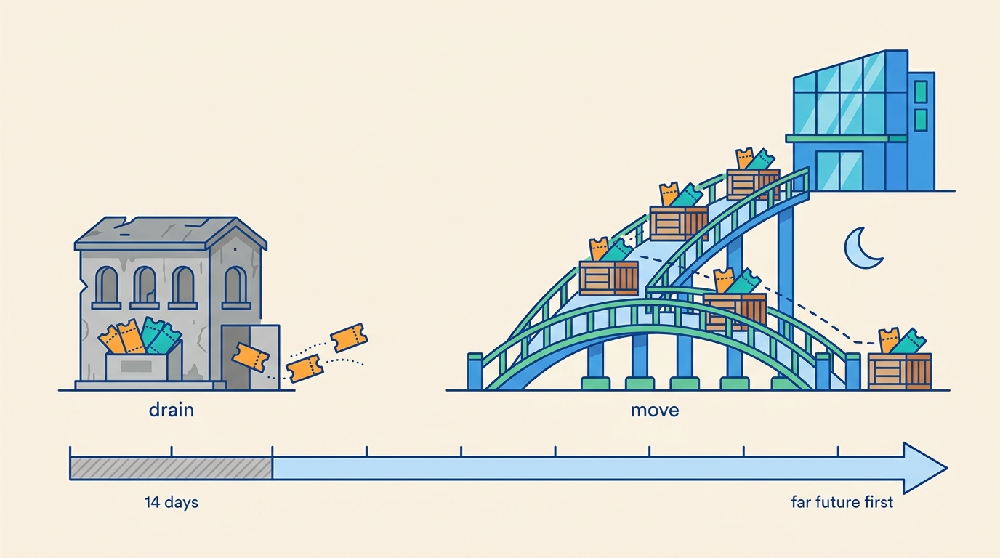

> **IN THIS CHAPTER, YOU WILL:** Learn how to retire a booking monolith while it keeps selling: what to extract first, how to run old and new side by side on availability, prices and reservations, how to move reservations that are already confirmed for future dates, and how to roll back, measure progress and decide when there is no way back.

> **WHY THE BUSINESS CARES:** A migration that loses one night in ten thousand loses thousands of guests a year at front desks, and a migration that never finishes pays for two platforms indefinitely. The CFO wants the old system's cost gone; the marketplace GM wants no dip in conversion, partner trust or payouts while it goes.

> **WHY ARCHITECTS SHOULD CARE:** In a stays marketplace the old system holds promises with dates up to sixteen months away, plus a tail of no-shows, commission, chargebacks and tax records after each stay. The cutover date is the easy part. The design decides what happens to the millions of reservations that exist on that date.

> **KEY POINTS:**
>
> * **Move the contract before the code.** Put the shared offer and reservation contract, and the events that carry it, in front of the monolith first. Every consumer and every partner then migrates once, to the contract, and the engine behind it can change later without anyone noticing.
> * **A parallel run is judged by explained differences, not by a match rate.** Compare old and new on prices, availability decisions and reservation state, including money, and do not cut over until every class of difference has a cause and an owner. A 99.4% match hides the classes that matter.
> * **Reservations already on the books set the timeline.** With bookings up to sixteen months ahead and a months-long tail after check-out, draining the old system is too slow and a big-bang move is too risky. Migrate new bookings by market cohort, move future reservations in arrival-date batches, leave imminent arrivals where they are, and keep a reverse sync until a signed point of no return.

> **[FAILURE PATTERNS THIS CHAPTER ADDRESSES](where-stay-platforms-go-wrong.html):**
>
> * **Lost at the Front Desk** — a reservation that is moved between systems without its partner identifiers, sequence numbers and delivery state can be confirmed to the guest and unknown to the hotel.
> * **Ledgerless Money** — a migration that moves reservations before the consumers of money do leaves commission, cards, refunds and payouts reading two systems that disagree.
> * **Price Drift** — two pricing paths running side by side without a disciplined comparison give guests different totals depending on which system answered.

 
Every stays marketplace older than about ten years runs on a system its engineers would not build today. The reasons are rarely technical taste. The old system holds the reservations, the partner contracts and the commission logic. It has been tuned through a decade of peaks. And it cannot be paused, because the marketplace sells nights every second and has promised nights for next year's summer. **Modernizing a stays platform means replacing the engine of something that is flying, full of passengers who boarded months ago.**

**Figure 1:** *Modernizing a stays platform means replacing the engine while the marketplace keeps selling, with guests on board who booked months ago.*

This chapter belongs to Part IX ([[part-9]]), the Chief Architect's agenda. It owns two terms: **in-flight reservation migration**, moving confirmed future reservations from one system of record to another, and the **parallel run** as applied to stays, running old and new paths side by side on live traffic and comparing their results. It builds on the reservation contract and Stayline of [[reservation-lifecycle]], the outbox and change-data-capture design of [[event-driven-stays]], the checkout attempt contract of [[checkout-orchestration]] and the boundaries of [[stays-bounded-contexts]]. It does not re-teach them.

The argument: **a stays migration is a sequence of seams, not a project with a cutover date.** First the contract, then the consumers, then the logic, then the writes, and last the promises already made.

## Setting the Scene at Corvane: 5.6 Million Promises in Keystone

Corvane, the fictional travel group this book follows (see [[meet-corvane]]), runs **Roomstead**, an accommodation marketplace, on **Keystone**, a Java monolith on Oracle rewritten in 2004 and hosted in co-located data centers in Dublin and Frankfurt. About 180 newer services on AWS surround it, but in 2027 Keystone still creates every Roomstead reservation, holds the partner contracts and runs commission invoicing. The **One Stay** program, approved in April 2027 with a budget of **€145 million** over three years, set one dated target that the board remembers: **retire Keystone's reservation module by the end of 2029.**

By December 2027 the first pieces were in place. Since the spring, checkout had used a server-minted attempt ID as its idempotency key at every hop ([[checkout-orchestration]]). Since June, every reservation carried a versioned payment arrangement ([[merchant-and-agency-models]]). In the autumn, the Roomstead reservations team had built a **CDC translator**, a change-data-capture reader of Keystone's Oracle log that emits `reservation.versioned` events in the One Stay contract ([[event-driven-stays]]). **Stayline**, the One Stay reservation service, consumed those events as a tracker of versions, delivery state and stay state ([[reservation-lifecycle]]).

On **13 December 2027** the team ran the first full comparison between Stayline's projection and Keystone's open book: every confirmed Roomstead reservation with an arrival date still ahead. Keystone held about **5.6 million**, with arrivals up to sixteen months away. Stayline disagreed on **31,400** of them, 0.56%.

| Class of difference | Reservations | Cause |
| --- | --- | --- |
| Renumbered modifications | 14,900 | Keystone issues a new reservation number on some modifications; the translator treated the new number as a new reservation |
| Writes outside the booking path | 7,800 | A nightly PL/SQL job that cancels reservations with invalid cards updated status columns directly, in transactions the translator did not recognize as reservation versions |
| Multi-room bookings | 5,200 | Keystone stores a booking of several rooms as one record with room lines; the contract had one reservation per room, and partial cancellations split differently |
| Archived rate plans | 2,100 | The rate plan had been archived in Tally, the ARI store, after booking, so the translator could not resolve the product |
| Arrival-date boundary | 1,400 | Properties in the Americas, where Keystone stored arrival as a UTC timestamp, not a local date |

None of these had harmed a guest, because Stayline was still a projection. Each would have harmed guests if Stayline had been the system of record. Marco Bellini, the CFO, asked the question that framed the next two years: **"On the day Keystone stops taking bookings, it will still hold five or six million reservations for future stays. What happens to them, and how will we know nothing was lost?"**

## Concepts: Seams, Parallel Runs and Reservations in Flight

### Strangler fig, and what it leaves out

Martin Fowler's **strangler fig** pattern, which he first described in 2004 and rewrote in 2024, replaces a legacy system gradually: "we move bits of behavior from the legacy system into the new code base", accepting **transitional architecture**, code "that will go away once the modernization is complete", because it lowers risk and delivers value earlier ([Fowler, 2024](https://martinfowler.com/bliki/StranglerFigApplication.html)). The pattern is right for stays platforms, and nobody serious argues for a big-bang rewrite of a booking engine. But the usual description intercepts *requests*: put a facade in front, route one endpoint at a time to the new system. A stays platform also holds *state with a future*: reservations for dates that have not happened yet, whose lifecycle will continue in whichever system owns them. Request routing moves new work. It does not move promises already made.

### The terms this chapter uses

- **Seam.** A point where behavior can be redirected without changing the code on either side: a contract, an event stream, an API facade, a library call. Modernization is the work of creating seams and then moving work across them.
- **System of record.** The one system whose write decides the truth of an entity. During a migration there must be exactly one per reservation at any moment, and every other copy must say it is a copy.
- **Projection.** A read model built from the system of record's events. Stayline in 2027 is a projection of Keystone for Roomstead.
- **Parallel run.** Old and new execute the same input on live traffic and their outputs are compared. In a **shadow run** only the old result is used; in a **dual run** a share of traffic uses the new result. Airbnb's monolith migration, described in 2018, ramped dual reads from 1% to 100% with mismatch checks, sent writes to a separate shadow database and compared them with production ([InfoQ, 2018](https://www.infoq.com/presentations/airbnb-soa-migration/)).
- **In-flight reservation migration.** Moving a confirmed reservation whose stay has not finished from one system of record to another, with its identifiers, version history, delivery state, payment arrangement and policy snapshots intact, so that guest, partner and ledger see no change.
- **Drain.** The alternative: new bookings go to the new system, old reservations finish their lifecycle in the old system.
- **Reverse sync.** After cutover, the new system writes its changes back into the old one, so that remaining readers keep working and rollback stays possible.
- **Point of no return.** The dated decision after which rollback is no longer supported, usually because the reverse sync is switched off.

### Why booking windows decide the method

The time a reservation lives in the system of record is the booking window plus the stay plus the **post-stay tail**: no-show reporting, commission invoicing, refunds after complaints, chargebacks, and records kept for tax reporting. In Corvane's illustrative 2026 data, half of Roomstead's stayed reservations were booked more than 18 days ahead and a tenth more than 110 days ahead; Nookaway's figures were 41 and 160 days ([[stays-experimentation]]). Roomstead takes bookings up to about sixteen months ahead.

That makes draining slow. If Roomstead stopped writing new reservations to Keystone on 1 January 2029, Keystone would still own reservations arriving in April 2030, and their tail would run into the second half of 2030. To retire the module by the end of 2029 by draining alone, new bookings would have to leave Keystone by mid-2028, before the logic they depend on had moved. **In a stays marketplace, either the migration moves reservations in flight, or the old system lives a year and a half longer than the plan says.** Most real programs need both: drain the edges, migrate the middle.

## Architecture: Contract First, Engine Last

The architecture of a stays migration is the order in which seams are built. Figure 2 shows the shape Corvane adopted; the order matters more than the boxes.

**Figure 2:** *Contract first, engine last. Consumers read only the contract events; the router decides per market cohort which engine writes a reservation; a reverse sync keeps Keystone correct for rollback and for its remaining readers until the point of no return.*

### Four stages, in this order

**Stage 1: put a contract in front of the monolith.** Before anything moves, define the contract that the new system will own (the offer and reservation contract of One Stay) and make the old system publish it. For Keystone this was the CDC translator, owned by the team that knows Keystone's tables, tested against a corpus of recorded transactions. The rule from [[stays-bounded-contexts]] applies here: **nothing new reads the monolith's tables.** Raw table changes would make Keystone's schema the contract and freeze it.

**Stage 2: move the consumers to the contract.** Every system that reads reservations moves from Keystone's tables or extracts to the contract stream: the settlement ledger, commission invoicing, the tax engine, notifications, support tools, analytics. This is the least visible stage and the one that decides whether the later cutover is boring. A consumer still reading Keystone directly at cutover either sees nothing for migrated reservations or forces a reverse sync to stay forever. Count the remaining direct readers; the count must reach zero before any write moves.

**Stage 3: extract the logic the write path depends on.** A reservation is created by checkout logic: re-pricing, policy evaluation, payment arrangement, allocation. While that logic lives inside the monolith, a new reservation service would have to duplicate it, and duplicated pricing is Price Drift by construction. Corvane's extractions were the **offer kernel** for fees, taxes, currency and audience ([[availability-engine]]), **Clause** for cancellation policy ([[changes-and-cancellations]]) and the payment arrangement service ([[merchant-and-agency-models]]). Each is first called by Keystone itself, in shadow and then for real, so the monolith becomes a client of the new logic before the logic gets a new client.

**Stage 4: move the writes, then the reservations in flight.** A **reservation router** behind the checkout coordinator decides, per market cohort, which engine creates a reservation. The checkout attempt contract makes this possible without the apps noticing: the attempt ID is the idempotency key whichever engine answers. When a cohort moves, new reservations are written by Stayline; then that cohort's future reservations are migrated in batches; imminent arrivals stay in Keystone and drain.

### What each component owns during the transition

| Component | Owns during migration | Must not |
| --- | --- | --- |
| **CDC translator** | The mapping from Keystone tables to contract versions; the recorded-transaction test corpus | Expose table changes; infer money facts from legacy columns |
| **Reservation router** | Per-cohort routing of new reservations; the routing table as versioned configuration | Route by guest or session: a booking and its later modifications must hit the same engine |
| **Stayline** | System of record for migrated cohorts; outbox of contract events; reverse sync | Accept writes for a reservation it does not own |
| **Migration orchestrator** | Batches of in-flight moves, per-reservation locks, verification and audit log | Move a reservation with an open modification, open delivery exception or open payment action |
| **Comparison service** | Parallel-run comparisons, difference classes, owners and trends | Report only a match rate |
| **Reverse sync adapter** | Writing Stayline versions back into Keystone tables for remaining readers and rollback | Run past the point of no return |

The **ownership register** is the hinge of the design. For every reservation, one field says which engine is its system of record, and every write path checks it. A modification request for a migrated reservation that reaches Keystone through an old path is rejected and redirected, not applied. The 7,800 status updates from Keystone's nightly job showed why: writes that bypass the owning path are the normal state of a twenty-year-old monolith, and each one becomes a split-brain reservation once two engines exist.

### Identifiers survive the move

Partners and guests hold reservation numbers. Hotel PMSs match modifications by them; guests quote them to support; virtual-card memos carry them. A migration that changes identifiers creates the **Same Hotel Twice** of reservations: two records for one stay. The rules:

1. **The external reservation number never changes**, whichever engine owns it. Stayline stores Keystone's number as the partner-facing identifier and assigns its own internal ID.
2. **Version sequences continue.** Keystone kept a per-reservation sequence for partner modification messages; Stayline continues that sequence, so a PMS that has seen version 4 will accept version 5 and reject a replayed version 3.
3. **Renumbering stops before migration.** Keystone's habit of issuing new numbers on some modifications, the source of 14,900 tracker differences and of €0.23 million of the €1.8 million card reconciliation gap ([[refunds-and-reconciliation]]), was switched off in Keystone itself in Q1 2028. Since then, Keystone versions a modified reservation under its existing number instead of renumbering it.

## Parallel Runs: Proving the New Path on Live Traffic

A parallel run answers one question: does the new path produce the same business result as the old one, and where it does not, do we know why? Stays platforms need three kinds, because a reservation is a decision about availability, a price and a durable record.

| Parallel run | What is compared | Granularity | Typical difference classes |
| --- | --- | --- | --- |
| **Availability decision** | Bookable or not, for the same product, dates and occupancy | Per request, sampled | Restriction evaluation order, closed-to-arrival handling, time zones, cache staleness on one side |
| **Price** | Itemized quote: room price, fees, taxes, discounts, currency | Per quote line | Rounding order, tax inclusion, member-rate stacking, exchange-rate timing |
| **Reservation state** | Full contract version after each change, plus derived money postings | Per reservation version | Renumbering, side-door writes, multi-room splits, policy snapshot differences |

### Shadowing the price before moving it

The price is where a parallel run pays for itself first. From **4 October 2027**, Keystone's checkout called the offer kernel in shadow for every Roomstead checkout in Spain and Portugal, the markets where the kernel already served Pricegrid and the metasearch feed. Keystone's own total was charged; the kernel's itemized quote was logged beside it. In the first four weeks, about **1.9 million** checkout quotes were compared and **2.6%** differed by more than one cent.

| Difference class | Share of differing quotes | Owner and fix |
| --- | --- | --- |
| Rounding order (per night vs per stay) | 38% | Kernel rule adopted; Keystone's per-stay rounding retired |
| City tax shown in total vs payable at property | 27% | Display policy decision ([[property-page-and-room-selection]]); kernel correct |
| Member and country rates stacked beyond the discount ceiling | 19% | Keystone defect, the same one the Autumn Cities coupon exposed ([[promotions-and-loyalty]]); kernel correct |
| Exchange rate fixed at search vs at checkout | 11% | Rate-lock rule in the offer contract |
| Unexplained | 5% | Investigated case by case |

The useful output was the table, not the 2.6%. Two of the classes were Keystone defects that guests had been paying for. One was a policy question nobody had decided. **A parallel run is how a migration finds the business rules nobody wrote down**, which is why it cannot be delegated to the migration team alone: product and finance owners must decide which side is right for each class.

The forum's cutover rule for pricing was: four consecutive weeks, including one peak weekend, with unexplained differences below 0.05% of quotes, and every explained class either fixed or accepted in writing by its owner. Spain and Portugal met it in February 2028; the kernel became the price of record there, and the remaining Roomstead markets follow through mid-2028, the condition for the group's 97% metasearch price-accuracy target ([[availability-engine]]).

### Shadow writes for reservations

For reservations, the comparison runs the other way round from pricing. Before a cohort moves, Stayline receives every Keystone change through the translator and also **re-executes** the change through its own write path into a shadow store: the modification or cancellation is applied by Stayline's logic, and the resulting version is compared with Keystone's. Differences show where Stayline's logic, not the translator, disagrees. Airbnb described the same reason for shadow writes in 2018: the team could not "dual write to the same database", so new-path writes went to a separate database and were compared using strongly consistent reads ([InfoQ, 2018](https://www.infoq.com/presentations/airbnb-soa-migration/)).

The comparison must include money. For each version, the comparison service derives the postings Fathom, Corvane's double-entry ledger, would make from Keystone's version and from Stayline's, and compares those as well. Two reservations can look identical on screen and differ by a refundable amount or a commission base. The Nookaway shadow ledger run of 2027, which found 2,870 disagreements in its first six weeks, is the reason Corvane does this ([[event-driven-stays]]).

## In Practice: The Public Record and Corvane's Keystone Exit

### What companies have documented

The public record on stays-platform migrations is thin on reservations and richer on everything around them. Several cases teach a specific lesson.

**Airbnb, monolith to services (2015–2019).** In a 2018 QCon talk, Jessica Tai described the move from Monorail, a Ruby on Rails monolith to which more than 200 engineers committed by about 2015, with about 15 hours of blocked deploys a day. The first extraction was the homes data model, "accessed by almost every feature"; thousands of call sites ruled out rewriting callers, so the team intercepted data access with a custom ActiveRecord adapter that routed queries to the new service. Reads were dual-run behind a gate ramped from 1% to 100%, writes went to a shadow database, and production traffic was replayed to compare old and new code. The talk named a **middle tier for shared write validation, with reservation validation as the example** ([InfoQ, 2018](https://www.infoq.com/presentations/airbnb-soa-migration/); [InfoQ, 2019](https://www.infoq.com/news/2019/02/airbnb-monolith-migration-soa/)). The evidence is eight years old and the architecture has moved on twice since; the method has aged well. The lesson: intercept at the data-access seam when callers are too many to change.

**Booking.com, Perl pages to Node fragments (described 2026).** Booking.com's engineers wrote that they replaced Perl rendering "one fragment at a time: a Perl-rendered page would start serving a single React component from a Node service, then another, with each swap behind an experiment so it could be measured and reverted on its own" ([Booking.com Engineering, 2026](https://medium.com/booking-com-development/node-js-at-scale-rebalanced-how-we-cut-cost-by-38-62ce247a3002)). The lesson: in a company that already experiments on everything, the experiment platform is the migration's safety net, and each fragment's cutover is a measured, reversible change.

**Booking.com, data lake to the cloud (2025).** The data department moved about 80–90 PB from Hadoop to S3 and Snowflake within a year, in prioritized waves rather than a big bang, coordinated through a central migration interface, and deliberately left about 110 PB of raw data behind ([Booking.com Engineering, 2026](https://medium.com/booking-com-development/how-we-migrated-europes-largest-data-lake-on-time-and-without-turning-the-lights-off-61ee8a07db76)). The lesson: deciding what not to migrate is part of the plan.

**Expedia Group, one front end for three brands (2021–2023).** Expedia's annual reports describe completing the migration of Hotels.com's front end onto the Brand Expedia platform in 2022 ([Expedia Group 10-K FY2022, 2023](https://www.sec.gov/Archives/edgar/data/1324424/000132442423000007/expe-20221231.htm)) and, in 2023, migrating Vrbo's as well, creating "one unified front-end stack" ([Expedia Group 10-K FY2023, 2024](https://www.sec.gov/Archives/edgar/data/1324424/000132442424000007/expe-20231231.htm)). In May 2024 the company said "Vrbo's recovery following the recent re-platforming has been slower than anticipated, which has put pressure on gross bookings", and lowered guidance ([Expedia Group Q1 2024 results, 2024](https://www.sec.gov/Archives/edgar/data/1324424/000132442424000024/earningsrelease-q12024.htm)). The filings speak of the front end; they do not say the back-end inventory or supply systems were merged, and they do not explain the slower recovery. The lesson, as my reading and not Expedia's: a hosted-stays brand moved onto an OTA-shaped platform can lose demand even when the migration works technically, so commercial metrics belong in the cutover criteria alongside error rates.

**Agoda, price cache and post-booking (2019–2026).** Agoda moved its supplier price cache from 72 SQL Server shards to DragonflyDB using dual reads that checked parity (above 99.9%) and then an **A/B experiment on booking metrics** before going to 100% ([Agoda Engineering, 2026](https://medium.com/agoda-engineering/how-agoda-scaled-its-price-cache-with-dragonflydb-0828e478e84f)). Separately, it split post-booking out of its core monolith in 2019 by porting the code "line by line", saw the new service grow its own coupling, and in 2026 described introducing a modular monolith with enforced component boundaries ([Agoda Engineering, 2026](https://medium.com/agoda-engineering/how-we-cut-the-coupling-tax-in-a-post-booking-api-2156a3175538)). The lesson: a line-by-line port moves the monolith's design along with its code; extraction is the moment to change the model, not only the runtime.

> **INFERENCE, NOT DOCUMENTED:** None of these companies has published how it moved confirmed future reservations between systems of record. A plausible reference approach for a large OTA, not a description of any company's practice, is the one this chapter recommends: contract events first, consumer migration, cohort routing of new bookings, batched migration of future reservations with identifiers preserved, and a reverse sync until a point of no return.

### Corvane's Keystone Exit Plan

The architecture forum approved the **Keystone Exit Plan** on **20 December 2027**, a week after the open-book comparison. Its first decision was about scope: **the target is Keystone's reservation module, not Keystone.** Roomstead's property catalog and the Partner Hub web module, which also live in Keystone, have their own plan for 2030 and later. Saying so in writing removed a year of false expectations.

The plan has three waves; Figure 3 shows them against the dates other chapters already committed to.

**Figure 3:** *The Keystone Exit Plan. Each wave removes a reason for the next one to touch Keystone: by the time writes move in 2029, nothing that matters reads Keystone directly and no business rule exists only inside it.*

**Wave 0 (2027): contracts and seams.** Done before the plan was written: the checkout attempt contract, the payment arrangement record, the CDC translator and Stayline as tracker. Their value was already visible: the arrivals verification of [[reservation-lifecycle]] and the cross-brand event stream of [[event-driven-stays]] need no Keystone change.

**Wave 1 (2028): consumers and logic leave.** The commitments come from the chapters that own each piece:

| Keystone responsibility | Destination | Date |
| --- | --- | --- |
| Partner staff logins | Corvane ID ([[identity-accounts-and-access]]) | February 2028 |
| Cancellation policy evaluation | Clause: merchant bookings Q2 2028, agency path Q4 2028 ([[changes-and-cancellations]]) | Q2–Q4 2028 |
| Checkout re-pricing | Offer kernel, market by market ([[availability-engine]]) | By mid-2028 |
| Reviews | Vouch ([[reviews-and-reputation]]) | 2028 |
| Commission invoicing | Service reading Fathom ([[payouts-and-settlement]]) | 2028 |
| Guest and partner notifications | Courier ([[trip-and-messaging]]) | By end of 2028 |
| Renumbering on modification | Switched off in Keystone | Q1 2028 |

The wave's exit criterion is a number: **zero direct readers of Keystone's reservation tables outside Keystone itself**, measured from Oracle audit logs, not from team self-reports. In December 2027 the count was 23 jobs, extracts and integrations.

**Wave 2 (2029): writes and reservations in flight move by cohort.** Cohorts are markets grouped by the properties' location, because a property's reservations should live in one engine: the hotel's PMS, the virtual cards and the arrivals manifest all work per property. Portugal goes first in Q1 2029: its properties already run on the kernel and Clause pilots, and Hotel Miradouro and Hotel Torre de Ferro are among the partners who agreed to be watched closely. Spain and Italy follow, then Northern and Central Europe, then the Americas and Asia-Pacific, with the last cohort switching in September 2029.

### Moving the reservations in flight

For each cohort, the sequence in Figure 4 runs after new bookings move.

**Figure 4:** *Migrating one batch of reservations in flight. Each reservation is locked for seconds, imported with its full history, compared including money, and then its ownership flips. A reservation that does not match stays in Keystone and goes to a queue, not into Stayline with a known defect.*

The rules that make it safe:

1. **Batch by arrival date, far future first.** Reservations arriving more than 120 days out move first: they change rarely, and a defect found in them has months to be fixed before anyone checks in. Batches then move toward the present.
2. **Leave the edge to drain.** Reservations arriving within **14 days** stay in Keystone until they complete. They are in active delivery and pre-arrival verification, and moving them adds risk for no benefit. For a cohort the size of Portugal's, this leaves about 21,000 reservations to drain over roughly ten weeks, including the post-stay tail.
3. **Skip anything open.** A reservation with a modification in progress, an open delivery exception, a pending refund or a disputed card charge is skipped and retried in a later batch. Every reservation in Keystone is locked for writes for a few seconds while it moves; writes that arrive during the lock queue and replay against the new owner.
4. **Carry everything the lifecycle needs.** Versions with timestamps, both policy snapshots, the payment arrangement version, the partner identifiers and message sequence, delivery state and the PMS confirmation number, and stay facts already recorded.
5. **Compare money before flipping.** The derived Fathom postings must match to the cent; no "close enough".
6. **Send nothing to partners or guests because of the move.** A migration is not a modification. The next real change continues the partner sequence from Stayline. Partners must not receive a burst of "modified" messages that their PMS will process as changes.

Corvane's estimate for Portugal shows the shape. In March 2029 Roomstead's Portuguese properties are expected to hold about **240,000** future reservations. About 21,000 drain; about 219,000 move in **nine** nightly batches over three weeks, run between 01:00 and 05:00 Lisbon time, when Portuguese modification traffic is lowest. The rehearsal on a December 2028 snapshot is the gate: the cohort does not start until a full rehearsal leaves fewer than 0.01% of reservations in the difference queue, each with a known class.

**Figure 5:** *For Portugal, about 219,000 future reservations move in nine nightly batches, far-future arrivals first, while about 21,000 arriving soon drain in Keystone.*

### Reverse sync and the point of no return

After a cohort's new bookings move, Stayline writes every version back into Keystone's tables through the reverse sync adapter. This keeps whatever still reads Keystone, the Partner Hub web module above all, correct, and it keeps rollback cheap: flip the router back and the ownership register, and Keystone continues from current data.

The reverse sync is transitional architecture in Fowler's sense, and it is the piece most tempting to keep forever. The plan therefore gives each cohort a **point of no return**: 90 days after its last batch, signed by Tobias Lindqvist (CTO) and Marco Bellini (CFO) on the evidence of four numbers (zero unexplained differences in the money comparison, partner acceptance rates at or above pre-migration levels, support contact rates on migrated reservations no higher than on drained ones, and no open rollback condition). After it, the adapter for that cohort is switched off and rollback means a forward fix.

### What the plan measures

| Metric | What it shows | Corvane target |
| --- | --- | --- |
| Direct readers of Keystone reservation tables | Whether Wave 1 is done | Zero by end of 2028 |
| New reservations written by Stayline | Progress of the write path | 100% of Roomstead by September 2029 |
| Future reservations owned by Keystone | Progress of the in-flight move | Zero outside drain windows by November 2029 |
| Unexplained differences, price and reservation | Whether the new path is trusted | Below 0.05% of quotes; below 0.01% of migrated reservations |
| Partner acceptance and "booking not found" contacts | Whether partners noticed anything | No worse than the cohort's previous quarter |
| Conversion and cancellation rate per cohort | Whether guests noticed anything | Within the experiment's guardrail band |
| Keystone run cost | Whether the old cost is actually leaving | Oracle licences and the Frankfurt standby reduced after the last cohort |

The metric that is deliberately absent is "percentage of code migrated". Lines of code moved say nothing about which promises are safe.

## Trade-offs

| Choice | Option A | Option B | When A is right | When B is right |
| --- | --- | --- | --- | --- |
| **Existing reservations** | Drain in the old system | Migrate in flight | Short booking windows, generous deadline, old system cheap to keep | Long windows, a dated retirement, expensive or risky old system |
| **Cutover unit** | Market cohort by property location | Percentage of traffic | Reservation state, partner delivery and cards are per property | Stateless reads: search, content, page fragments |
| **Interception seam** | Contract events from the monolith (CDC translator) | Data-access interception inside the monolith | Many consumers, monolith code risky to change | Callers inside one codebase, too many to edit (Airbnb's adapter) |
| **Parallel run** | Shadow (old result used) | Dual (share of traffic uses new result) | Writes, money, anything partners see | Reads and decisions that can be measured by experiment |
| **Rollback** | Reverse sync until a point of no return | Forward fix only | Cohorts with partners and money at stake | Low-stakes, easily repaired components |
| **Logic extraction** | Old system calls new logic first | New system reimplements logic | Pricing, policy, tax: rules must exist once | Logic that is being deliberately redesigned |
| **Model change** | Change the model during extraction | Port line by line, change later | The old model is the cause of the defects (renumbering, `PAYMENT_TYPE`) | The model is sound and the problem is runtime or scale |

The pair most often decided by default is drain versus migrate. Teams choose drain because it avoids touching confirmed reservations, then discover that the old system must run for a year and a half after the "cutover" with every consumer reading two places. Migration in flight is harder to build and easier to finish.

## Hotels and Homes: Where the Two Marketplaces Differ

The method is shared; the risks are not. Corvane runs the same plan twice: Stayline becomes system of record for new Nookaway reservations in 2028, moving them out of **Burrow**, Nookaway's Django monolith, a year before Roomstead.

| Dimension | Accommodation marketplace (Roomstead from Keystone) | Hosted stays (Nookaway from Burrow) |
| --- | --- | --- |
| **Booking window** | Median 18 days; a tenth beyond 110 | Median 41 days; a tenth beyond 160: more in flight, for longer |
| **Who holds a copy** | Hotel PMSs via channel managers, with reservation numbers and sequences | Host apps and messages; PMSs for professional managers; other platforms through iCal exports |
| **Cutover unit** | Property location: one engine per property | Listing or host: a professional manager's units should move together |
| **Money in flight** | Pay-at-property commission and virtual cards loaded net of commission | Funds held until payout 48 hours after check-in; Pay Later charges scheduled weeks ahead (about 410,000 confirmed-but-uncharged reservations in March 2027) |
| **Typical migration defect** | Renumbered modifications, multi-room splits, side-door batch jobs | Admin screens writing tables directly; calendar blocks lost when the reservation moves without its Almanac claim |
| **What guests and hosts notice** | Hotel cannot find the booking at check-in | Calendar reopens and a night is sold twice; payout arrives late or twice |
| **Extra cutover criterion** | Partner acceptance rate per connectivity partner | Payout time and scheduled-charge success rate |

Two hosted-stays risks deserve a sentence each. A migrated Pay Later reservation must carry its stored-credential references; the Semana Santa declines of March 2027, when about 4,240 scheduled charges failed because cards were stored without them ([[stay-payments]]), are what losing that reference looks like. And a reservation must never move without its calendar claim: Almanac blocks nights per listing, and a migration that recreates the reservation but not the block is the Double-Booked Night caused by the platform itself.

**What to share:** the migration orchestrator, the comparison service and its difference classes, the ownership register, the reverse-sync pattern and the point-of-no-return governance. **What not to share:** cohort definitions, cutover criteria and the drain rules, which follow each marketplace's supply and money.

## Failure Modes

- **The cutover that only moved new bookings.** New reservations go to the new system; old ones stay; consumers read both. Two years later the old system is still running "for a few legacy reservations". *Defense:* plan in-flight migration from the start and measure future reservations still owned by the old system.
- **The match rate as a success criterion.** A 99.4% match is announced; the 0.6% contains every multi-room booking and every renumbered modification. *Defense:* report difference classes with owners; cut over on unexplained differences, not on matches.
- **Comparing screens, not money.** Two reservations render identically and differ in refundable amount or commission base. *Defense:* derive ledger postings from both sides and compare them to the cent.
- **Migration as modification.** Moving a reservation emits "modified" messages to partners and guests; PMSs process them, some as cancellations and re-bookings. *Defense:* migration events are internal; the partner sequence continues only on real changes.
- **Side-door writers.** Batch jobs, admin screens and support tools write the old tables directly and create split-brain reservations after cutover. *Defense:* inventory writers from database audit logs before Wave 2; the ownership register rejects writes to migrated reservations.
- **Identifiers that change on the way.** New reservation numbers in the new system; hotels hold the old ones; guests quote either. *Defense:* the external number never changes; renumbering stops before migration.
- **Peak-season cutovers.** A cohort moves in the weeks before its peak, and the first real load test is Feria week or King's Day. *Defense:* a calendar of no-move windows per cohort, and a cutover only after the cohort's last peak has run in shadow.
- **The eternal reverse sync.** Rollback support is never switched off because one reader still needs it. *Defense:* a signed point of no return per cohort, and remaining readers moved or retired before it.

## The Chief Architect's View

**Set the target as a module, a date and a definition of done.** "Retire Keystone" is a slogan. "Retire Keystone's reservation module by December 2029, meaning no reservation is owned by it and its tables are archived read-only" is a plan. Say in writing what is out of scope; Corvane's catalog and Partner Hub web module are, and saying so prevented the plan from absorbing them.

**Sequence by dependency, not by team readiness.** The tempting order is to move whatever team is ready first. The safe order is contract, consumers, logic, writes, in-flight state. Each wave removes a reason for the next to touch the monolith. When a team wants to move its write path before consumers have left, the answer is no, because every consumer still reading the old tables becomes a reverse-sync requirement.

**Decide who rules on each difference.** Parallel runs turn up business rules: which rounding is right, whether a tax is in the total, whether two discounts may stack. The migration team cannot decide those. At Corvane, price classes go to the offer-kernel owners with Noor van Dijk's regulatory team as mandatory reviewer for display questions; reservation and money classes go to the reservation contract owners and Leila Haddad's payments team. The forum tracks only the unexplained remainder.

**Pay for transitional architecture openly.** The CDC translator, the router, the reverse sync and the comparison service will all be deleted. Budget them as part of the migration, and budget their removal. Fowler's argument that this cost buys lower risk ([Fowler, 2024](https://martinfowler.com/bliki/StranglerFigApplication.html)) holds; the failure is pretending the cost does not exist and letting the transitional pieces become permanent.

**Watch the commercial numbers as closely as the technical ones.** Expedia's statement about Vrbo's slower recovery after re-platforming is the public reminder that a technically clean migration can still cost bookings. Every Corvane cohort has conversion, cancellation and partner-acceptance guardrails, and the point of no return requires them.

**Who decides what.** The Group Chief Architect owns the plan, the contract and the cohort order. The Roomstead reservations team owns the translator, the router and Stayline's Roomstead path. The CTO and CFO sign each point of no return. Elena Petrova's customer-service organization signs readiness for each cohort, because support agents will see both engines during the transition. The architecture forum reviews the plan quarterly against the metrics above.

## Questions to Ask

1. What exactly will be retired, by when, and what is explicitly out of scope?
2. How many reservations will the old system own on the day new bookings leave it, and how long until the last one completes, including the post-stay tail?
3. Which consumers still read the old system's tables directly, and how do you know the count is complete?
4. Which business rules (pricing, policy, tax, payment type) exist only inside the old system, and which have been extracted and called by it?
5. What does the parallel run compare: screens, or contract versions and ledger postings? Who decides which side is right for each difference class?
6. Which partner-facing identifiers and sequences does a migrated reservation keep, and what will a hotel's PMS receive on migration night?
7. What is the cutover unit, and why does it keep each property's or listing's reservations in one engine?
8. How is a write to a migrated reservation through an old path detected and rejected?
9. How do you roll back a cohort, until when, and who signs the point of no return on what evidence?
10. Which commercial metrics would stop the next cohort?

## From Old Engines to New Assistants

A migration ends when nothing important lives only in the old system. At Corvane that day is planned for December 2029, and the plan is credible because it is a sequence of seams that each pay off on their own: a contract that partners and the ledger already read, logic that the monolith already calls, cohorts that can be rolled back until someone signs that they will not be. The same discipline, contracts first and evaluation before trust, applies to the newest kind of system arriving in stays marketplaces: assistants and agents that search, book and answer on someone's behalf. [[ai-in-travel-stays]] takes that up.

## Sources and Evidence

### Company engineering and investor sources

- [The Great Migration: from Monolith to Service-Oriented](https://www.infoq.com/presentations/airbnb-soa-migration/), Jessica Tai, QCon SF / InfoQ, 2018 — Monorail scale, data-access interception, ramped dual reads, shadow-database writes, middle tier for reservation validation (may describe a replaced system).
- [Airbnb's Migration from Monolith to Services](https://www.infoq.com/news/2019/02/airbnb-monolith-migration-soa/), InfoQ, 2019 — summary of the same migration, SOA rather than microservices.
- [Node.js at scale, rebalanced: how we cut cost by 38%](https://medium.com/booking-com-development/node-js-at-scale-rebalanced-how-we-cut-cost-by-38-62ce247a3002), Booking.com Engineering, 2026 — Perl pages replaced one fragment at a time behind experiments.
- [How We Migrated Europe's Largest Data Lake](https://medium.com/booking-com-development/how-we-migrated-europes-largest-data-lake-on-time-and-without-turning-the-lights-off-61ee8a07db76), Booking.com Engineering, 2026 — wave-based migration, data deliberately left behind.
- [Expedia Group Form 10-K for 2022](https://www.sec.gov/Archives/edgar/data/1324424/000132442423000007/expe-20221231.htm), Expedia Group, 2023 — Hotels.com front-end migration completed in 2022; Vrbo migration begun late 2022.
- [Expedia Group Form 10-K for 2023](https://www.sec.gov/Archives/edgar/data/1324424/000132442424000007/expe-20231231.htm), Expedia Group, 2024 — Hotels.com and Vrbo front ends migrated onto one stack.
- [Expedia Group first-quarter 2024 results](https://www.sec.gov/Archives/edgar/data/1324424/000132442424000024/earningsrelease-q12024.htm), Expedia Group, 2024 — Vrbo's slower recovery after re-platforming.
- [How Agoda Scaled Its Price Cache with DragonflyDB](https://medium.com/agoda-engineering/how-agoda-scaled-its-price-cache-with-dragonflydb-0828e478e84f), Agoda Engineering, 2026 — dual-read parity and an A/B test on booking metrics before full cutover.
- [How We Cut the Coupling Tax in a Post-Booking API](https://medium.com/agoda-engineering/how-we-cut-the-coupling-tax-in-a-post-booking-api-2156a3175538), Agoda Engineering, 2026 — 2019 line-by-line split of post-booking, later modular monolith.

### Standards, regulation and documentation

- No standard governs reservation migration. Partner-facing identifier and version rules are those of the connectivity contracts discussed in [[connectivity-and-channel-managers]] and [[reservation-lifecycle]].

### Research and practitioner sources

- [Strangler Fig Application](https://martinfowler.com/bliki/StranglerFigApplication.html), Martin Fowler, 2024 — gradual replacement and the case for transitional architecture.

Corvane is fictional; architectural recommendations and labeled inferences are the author's judgement.
