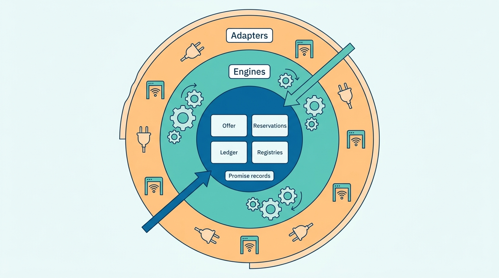
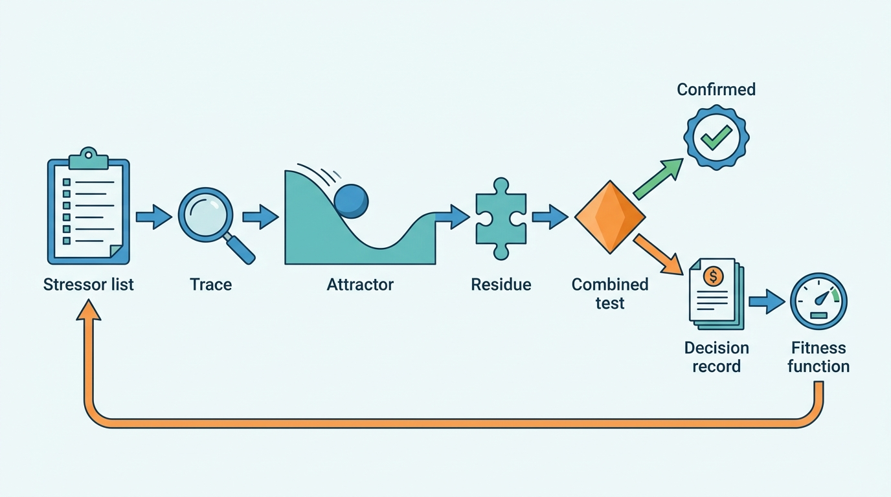
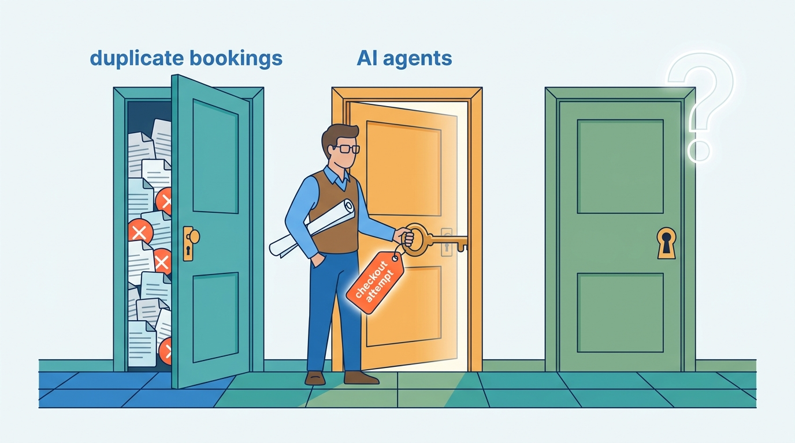
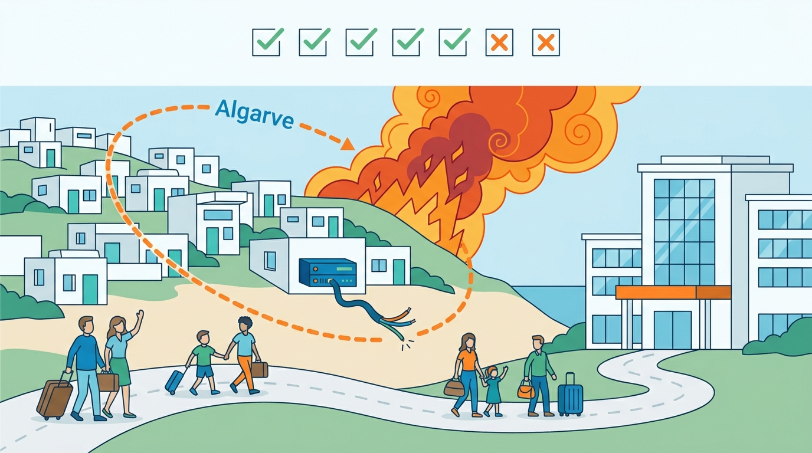
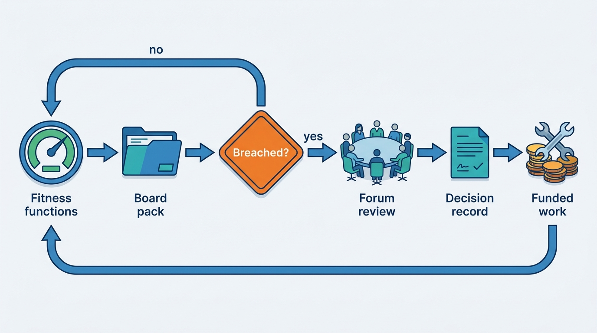

> **IN THIS CHAPTER, YOU WILL:** Learn how to run a stressor analysis on a stays platform, how to tell the records that must outlive every engine from the engines that should be replaceable, and how to define five stays fitness functions that a board can read. The chapter also gathers the book's argument into one map, from the sixteen failure patterns to the separations that answer them.

> **WHY THE BUSINESS CARES:** In the last decade the travel industry lost most of its business for a season, gained a new class of regulation every year or two, and rebuilt its main platforms at least once. Each of those changes cost the companies that were not ready more than the change itself. A platform that absorbs the next one keeps its revenue, its partners and its licence to operate.

> **WHY ARCHITECTS SHOULD CARE:** Ten-year architecture is not about choosing the right technology for 2036. It is about which separations you make now, which records you keep readable without the systems that wrote them, and which few numbers tell you, year by year, whether the platform is drifting back toward the failures this book describes.

> **KEY POINTS:**
>
> * **Design against stressors, not forecasts.** Nobody predicted a pandemic, a national registry annulled by a court or an AI agent booking a holiday. You can, however, list stressors and ask what each one breaks. The separations that survive one stressor usually survive others nobody named, and a combined stressor that the existing parts handle without new code is the best evidence that the decomposition is right.
> * **Keep the promise records portable and the engines replaceable.** Over ten years almost every engine, cloud, connectivity partner and model will be replaced at least once. The offer, the versioned reservation, the ledger and the place and policy registries must outlive all of them: readable without the system that wrote them, with history, and replayable into a successor.
> * **Govern the decade with a few stays fitness functions.** Price accuracy, double-booking rate, reservation delivery rate, time to payout and cost per booking each need an owner, a threshold, a cadence and a decision that a breach triggers. Together they tell a board whether the platform keeps its promise better or worse each year, whichever systems happen to be running it.

> **[FAILURE PATTERNS THIS CHAPTER ADDRESSES](where-stay-platforms-go-wrong.html):**
>
> * **Built for Sunny Days** — over a decade the "rare" events become routine: a pandemic, a strike season, a wildfire summer, a supplier's insolvency, and a platform that was tested only against normal traffic meets all of them unprepared.
> * **City-by-City Firefighting** — regulation is the most predictable stressor of the decade, and a platform that treats every new rule as an emergency project pays for it again with each rule.
> * **The Hotel-Shaped Home** — long-term convergence pressure tempts groups to merge supply models in the name of simplicity, which removes exactly the separations that let the platform absorb change.

 
Every chapter of this book has described one part of a stays platform as it should work in a given year. This chapter is about time. **A stays platform is a ten-year asset in a business that changes every two years.** Between 2016 and 2026 the industry re-platformed, lost most of its bookings in the spring of 2020, and absorbed a new European regulation every year or two. The platforms that came through this well had predicted none of it; as far as the public record shows, they could change one thing without breaking everything else.

This chapter gives that ability a method and a measure, and owns both terms. The method is **stressor analysis**: list what could happen, find what it breaks, and build the separation that survives it. The measure is the **stays fitness function**: a few numbers, each tied to part of the guest's promise, that show whether the architecture is getting better or worse. It builds on the boundaries of [[stays-capability-map]] and [[stays-bounded-contexts]], the journey objectives of [[global-scale-and-reliability]], and the sharing and migration decisions of [[converging-two-marketplaces]] and [[modernizing-a-live-marketplace]]. It ends the book's main argument and hands over to the case studies of [[part-10]].

## Setting the Scene at Corvane: "What Will We Be Fixing in 2032?"

Corvane, the fictional travel group this book follows ([[meet-corvane]]), held the first annual review of its One Stay program with the board on **14 December 2027** in Lisbon. Mariana Costa, Group Chief Architect, had prepared a one-page list of 2027. It named fourteen incidents, from the **212 duplicate bookings** in January to the **extranet phishing wave** in November, and next to each one the separation the group had built in response.

Daniel Okonkwo, Group CEO, read it and asked the question this chapter answers: "Every line on this page was a surprise. We are spending €145 million on One Stay. What will we be fixing in 2032, and will what we are building survive it?"

Mariana's answer had three parts. She could not tell him what would happen in 2032. She could tell him **which stressors the platform survives and which it does not**, because her team had tested both brands against nine of them in a two-day workshop on **18–19 November 2027**. And she could give him **five numbers** for the board pack, from the first quarter of 2028, that would show each year whether the platform kept its promise better or worse than the year before.

Table 1, a shortened version of her page, is also a summary of this book. Each 2027 incident broke an assumption of the naive architecture, and each fix pulled apart something that design had bound into one record, flag or code path. This chapter turns that pattern into a method.

| 2027 incident | Assumption it broke | Separation built in response | Chapter |
| --- | --- | --- | --- |
| €12 rate at Hotel Miradouro (9 March) | A partner's price message is a fact | Availability and price as assertions with provenance and guards | [[connectivity-and-channel-managers]] |
| Seville double booking (2 February) | One home has one calendar | Calendar claims with provenance; adaptive sync | [[calendar-sync]] |
| King's Day overbooking (27 April) | The hotel's systems are always current | Allocation ledger, oversell case model, liability matrix | [[inventory-integrity]] |
| 212 duplicate bookings (14 January) | One request is one booking | Server-minted checkout attempt as the idempotency key | [[checkout-orchestration]] |
| Miradouro's missing reservations (July) | "Sent" means delivered | Delivery closes only on PMS acceptance; Stayline | [[reservation-lifecycle]] |
| ATC strike weekend (5–7 June) | Cancellation is an individual event | Clause and declared disruptions | [[changes-and-cancellations]] |
| Smart Rate on the strike weekend | A pricing model's output is safe to apply | Guardrail policy and shock hold | [[dynamic-pricing]] |
| €1.8 million reconciliation gap (Q1) | The bank statement is the truth | Card-level reconciliation against the reservation | [[refunds-and-reconciliation]] |
| Semana Santa declines (March) | A future charge is a later transaction | Versioned payment plans | [[stay-payments]] |
| Spain/Portugal metasearch downgrade (May) | Each consumer may compute the price | One offer kernel | [[availability-engine]] |
| Turia Homes (July) | Each brand can police its own supply | Warden: shared entity graph, enforcement receipts | [[stays-trust-and-safety]] |
| Check-in instructions redacted (August) | One messaging policy fits every stage | Stage-aware Threadline, Courier lanes | [[trip-and-messaging]] |
| Autumn Cities coupon (September) | A discount is a price | Funded discount lines on the reservation | [[promotions-and-loyalty]] |
| Extranet phishing wave (November) | Partner logins are trusted channels | Partner account as perimeter; send gate | [[travel-fraud]] |

**Table 1:** *Corvane's 2027 in one page: fourteen surprises, each traced to a broken assumption and the separation that answers it.*

## Concepts: Stressors, Residues and Fitness Functions

### Residuality, briefly

**Residuality theory**, developed by Barry O'Reilly ([Procedia Computer Science, 2020](https://doi.org/10.1016/j.procs.2020.03.120); [*Residues*, Leanpub, 2024](https://leanpub.com/residuality)), treats a business system as something that cannot be predicted and can only be stressed. Its vocabulary, as this book uses it:

- **Naive architecture** — the design that satisfies today's functional requirements and assumes today's world stays put.
- **Stressor** — any change in the environment, likely or not: a regulation, a disaster, a supplier failure, a new competitor, a technology shift. Residuality deliberately does not estimate probability; an implausible stressor is still useful if it reveals a hidden coupling.
- **Attractor** — the state the business falls into under the stressor, usually not the one the design intended. "Listings removed, guests stranded, money held by nobody" is an attractor.
- **Residue** — what is left of the architecture after the stressor, and by extension the structural change that lets the next version survive it. In practice a residue is nearly always a **separation**: two things that had been one record become two, each with its own lifecycle.
- **Residual architecture** — the design after many stressors have each left their residue.

The central claim is that **residues generalize**: a separation built for one stressor removes a coupling, and couplings are what turn a surprise into a failure, so it tends to help with stressors nobody listed.

The two Productscape reference models behind this book, generic models of a fictional operator rather than descriptions of any company, each include such a stress test. The accommodation model's residual architecture separates "physical property and unit, owner, operating partner, connectivity source, license and jurisdiction, … availability assertion, reservation, confirmation evidence, traveler intent, stay obligation, … merchant, safeguarded funds, partner receivable, payout route, refund". The hosted-stays model reaches the same list from the other side. **Two models with opposite starting points converge on one set of separations**, the strongest argument in this book for one shared domain vocabulary across hotels and homes ([[property-and-listing-model]]).

### Stressor analysis for stays

**Stressor analysis (stays)** is the practice of testing a stays platform against a list of environmental changes, tracing each one through the promise (the night shown is available, the price shown is paid, the booking reaches the property or host, the money reaches the right party, and guest and host can trust each other), and recording for each stressor the attractor, the residue and its status: **integrated** (the platform already has the separation), **candidate** (designed, not built), **gap** or **survived by composition**.

The last status tests the decomposition. A **combined stressor** puts several stressors on one guest at once, such as an evacuation from an unlicensed home booked through a failed distributor. If the existing residues handle it with a coordinating case and no new structure, the decomposition is right; if not, the analysis has found the next residue.

### The stays fitness function

**Fitness functions** come from evolutionary architecture: Neal Ford, Rebecca Parsons and Patrick Kua describe them as making "explicit what 'fit' means with as much automation as possible" ([*Building Evolutionary Architectures*, O'Reilly Media, 2017](https://evolutionaryarchitecture.com/); second edition 2022). They can be structural checks in a build pipeline or outcome measures over a running system.

A **stays fitness function** is an outcome measure of one part of the guest's promise, taken the same way across engines and years, with an owner, a threshold, a cadence and **a decision that a breach triggers**. The last element separates it from a service-level objective (SLO). A journey SLO ([[global-scale-and-reliability]]) protects this month's error budget for the team that runs the journey. A fitness function protects the decade, is reported to the board, and its breach reopens an architecture decision rather than paging an engineer.

| | Journey SLO | Stays fitness function | Product KPI |
| --- | --- | --- | --- |
| Question | Is the journey healthy this month? | Is the architecture keeping the promise better than last year? | Is the business growing? |
| Horizon | 28 days | Quarters and years | Quarter |
| Owner | Journey team | Architecture forum, a named executive | Product line |
| Breach means | Freeze risky releases | Reopen a design decision or fund a residue | Change the plan |
| Must survive | A release | A re-platforming | A reorganization |

**Table 2:** *Three kinds of measure. The fitness function is defined so that it survives the replacement of the systems that produce it.*

## Architecture: Durable Records, Replaceable Engines

### What lasts and what does not

Over ten years almost everything in Corvane's 2027 landscape will be replaced: Keystone by 2029, Pricegrid's cache tier probably twice, both search engines, every ranking and pricing model several times, at least one cloud arrangement, and some of the 140 connectivity partners, which will merge, fail or be bought. What must survive all of these is the **record of the promise**: what was offered, what was agreed, who owes whom, and which rules applied. The architecture that follows has three rings (Figure 1).

**Figure 1:** *Durable records, replaceable engines. Adapters change with partners and markets, engines change with technology, and the records that carry the guest's promise must stay readable and replayable through all of it.*

The four promise records, and the chapters that design them:

- **Offer and quote** — the itemized price with its quote ID, validity, fee, tax and discount lines and the rule versions used ([[property-page-and-room-selection]], [[availability-engine]]). It lets anyone reconstruct, years later, what the guest was shown.
- **Reservation versions** — each version of the agreement with its policy snapshot, payment arrangement, delivery evidence and stay outcome ([[reservation-lifecycle]], [[merchant-and-agency-models]]). At Corvane this is **Stayline**.
- **Ledger** — double-entry obligations per party: guest, property or host, distributor, tax authority, insurer ([[designing-financial-ledgers]], [[payouts-and-settlement]]). At Corvane, **Fathom**.
- **Place and policy registries** — property and unit identities, jurisdictions, registration numbers, and the effective-dated rules for eligibility, cancellation, tax and display: the place registry, **Ordinance**, **Clause** and **Levy** content ([[stays-regulation]], [[taxes-on-stays]]).

ARI (availability, rates and inventory) is the hard case. The *store* is an engine, and Corvane deliberately runs two (Tally and Almanac). But the ARI *vocabulary*, the change stream and the provenance of each assertion must be portable: a replacement engine, or a regulator asking why a night was sold, will need them. [[rates-and-availability-model]] keeps the stream for 13 months for this reason.

### What "portable" means

A record is **portable** when four things are true:

1. **Readable without its writer.** The schema is documented in the event catalog ([[event-driven-stays]]) and a consumer can read the record without calling the engine that produced it.
2. **Historical.** Versions are kept rather than overwritten, so the state at any past time can be rebuilt. Reservations are versioned agreements; ledger corrections are new entries, never edits.
3. **Replayable.** A successor can be loaded from the record, as Fathom's shadow balances for Nookaway hosts were bootstrapped from a snapshot of about 13 million reservations in 2027 ([[event-driven-stays]]).
4. **Neutral.** The record uses group identifiers (party, place, unit, reservation) rather than one engine's keys, so it survives the engine's retirement.

Not everything deserves portability's cost. Search indexes, caches, feature stores and model weights are derived and should be rebuildable, not portable. The test: **if this system vanished tonight, could we rebuild it from records we still hold?** If yes, it is an engine. If no, it is a promise record, or it is hiding one.

### Optionality: paying for the right to change your mind

Some decisions keep options open and cost money now. Separating Corvane Connect behind Switchyard's public APIs under the May 2027 neutrality rule ([[connectivity-and-channel-managers]]) cost Connect some convenience, but Corvane could now sell Connect, or lose it, without unpicking private integrations. Keeping Almanac beside Tally costs two inventory engines, but keeps the option of selling Nookaway, merging it differently, or replacing either engine alone.

I **pay for optionality where the decision is hard to reverse and the stressor list contains a plausible reason to reverse it.** A shared reservation contract is hard to reverse and cheap to version, so build it early. A merged supply model is hard to reverse and would be wanted only if hotels and homes stopped being different businesses, which no evidence suggests. A shared search engine is reversible at moderate cost, so [[stays-search-architecture]] rightly deferred it. Optionality bought for stressors nobody can name is just cost, and generic layers "in case" often hide the very differences between hotels and homes that matter; every option should point at a row in the stressor table.

### The stressor loop

Stressor analysis is a yearly process, not a one-off workshop (Figure 2).

**Figure 2:** *The stressor loop. A residue is not finished until a combined stressor confirms it and a fitness function watches it.*

## The Public Record: A Decade of Stressors

None of the companies below has published a residuality analysis. The facts are documented; reading them as a sequence of stressors is my interpretation.

**Platform shifts.** Airbnb described growing from fewer than 100 services at the end of 2016 to more than 500 by 2020 ([InfoQ, 2021](https://www.infoq.com/presentations/airbnb-api-architecture/)). It then introduced **Viaduct**, a data-oriented service mesh with one central GraphQL schema, in November 2020; by 2025 its traffic had grown about eightfold and more than 130 teams hosted code in it ([Airbnb Tech, 2025](https://airbnb.tech/infrastructure/viaduct-five-years-on-modernizing-the-data-oriented-service-mesh/)). Booking.com moved from a 2015 Mesos prototype through OpenShift to its own Kubernetes platform ([CNCF case study, 2020](https://www.cncf.io/case-studies/bookingcom/), six years old). Expedia Group completed the move of Hotels.com's front end onto the Brand Expedia stack in 2022 ([Expedia 10-K FY2022, 2023](https://www.sec.gov/Archives/edgar/data/1324424/000132442423000007/expe-20221231.htm)) and had one unified front-end stack, Vrbo included, in 2023 ([Expedia 10-K FY2023, 2024](https://www.sec.gov/Archives/edgar/data/1324424/000132442424000007/expe-20231231.htm)). The filings speak of the front end; they do not say that supply or inventory systems were merged. In May 2024 it reported that "Vrbo's recovery following the recent re-platforming has been slower than anticipated" and lowered guidance ([Expedia Q1 2024 results, 2024](https://www.sec.gov/Archives/edgar/data/1324424/000132442424000024/earningsrelease-q12024.htm)). The filings do not say why. The lesson I draw is an inference: moving a hosted-stays brand onto an OTA-shaped front end is a stressor in its own right, and its cost lands on the side whose differences were least visible.

**A demand collapse.** In March 2020 Airbnb applied its extenuating-circumstances policy to COVID-19 cancellations, committed up to $250 million for affected hosts and recorded $205.1 million of such payments in 2020 ([Airbnb 10-K FY2020, 2021](https://www.sec.gov/Archives/edgar/data/1559720/000155972021000010/airbnb-10k.htm)). Booking Holdings reported that cancellations raised customer-service costs and "higher than normal cash outlays to refund consumers for prepaid reservations" ([Booking Holdings 10-K FY2020, 2021](https://www.sec.gov/Archives/edgar/data/1075531/000107553121000019/bkng-20201231.htm)). Expedia described "significant spikes in customer support call volumes" ([Expedia 10-K FY2020, 2021](https://www.sec.gov/Archives/edgar/data/1324424/000132442421000015/expe-20201231.htm)). In 2026 Airbnb wrote that its forecasting team now separates three responses to a shock: refit the model, respecify it, or hold it ([Airbnb Engineering, 2026](https://medium.com/airbnb-engineering/how-we-knew-covid-was-over-and-what-our-models-had-to-unlearn-c606b9bdb0ab)). Two residues follow: **a disruption is a declared, effective-dated object**, and **every consequential model needs a hold mode** ([[stays-ml-platform]]).

**Regulation as a steady stream.** The EU's platform-to-business ranking transparency applied from 12 July 2020 ([Regulation (EU) 2019/1150](http://publications.europa.eu/resource/celex/32019R1150)). DAC7 platform reporting covers periods from 1 January 2023 ([Directive (EU) 2021/514](http://publications.europa.eu/resource/celex/32021L0514)). The Commission designated Booking a gatekeeper under the Digital Markets Act (DMA) for Booking.com on 13 May 2024 ([European Commission, DMA gatekeepers](https://digital-markets-act.ec.europa.eu/gatekeepers_en)). The Short-Term Rental Regulation applies from 20 May 2026 ([Regulation (EU) 2024/1028](http://publications.europa.eu/resource/celex/32024R1028)). The next day, Spain's Supreme Court annulled the national short-term-rental registry while upholding the digital single window and platform data-sharing ([CGPJ, 2026](https://www.poderjudicial.es/cgpj/es/Poder-Judicial/Tribunal-Supremo/Noticias-Judiciales/El-Tribunal-Supremo-anula-el-Registro-Unico-de-arrendamientos-de-corta-duracion-por-considerar-que-el-Estado-carece-de-competencia-para-su-creacion)). VAT in the Digital Age (ViDA) makes platforms the deemed supplier of short-term accommodation from a date each Member State chooses between 1 July 2028 and 1 January 2030 ([Directive (EU) 2025/516](http://publications.europa.eu/resource/celex/32025L0516)). That is a new regime roughly every eighteen months, and one that reversed within a day. The residue is the one [[stays-regulation]] builds: **a rule is effective-dated data with a legal source**, so that a reversal is a new rule version, not a project.

## Corvane's Stressor Workshop

The November 2027 workshop gathered 23 people: Mariana, the brand engineering leads, Leila Haddad (payments), Sofia Marín (trust and safety), Noor van Dijk (regulation), Elena Petrova (customer service), Kenji Arai (data and ML), Jonas Weber (search) and representatives of finance and supply. They listed 31 stressors in the first hour and chose nine to trace in depth, picked for spread rather than likelihood. Table 3 shows the result.

| Stressor | Attractor without the residue | Residue | Status, Dec 2027 |
| --- | --- | --- | --- |
| **Pandemic-scale collapse**: bookings fall 70% in three weeks; cancellations ten times normal | Support queues for weeks; refunds paid by hand; pricing models cut prices into an empty market | Clause disruptions; Payment Plans (uncharged Pay Later bookings need no refund); model hold mode | Integrated in design: Kiln's group disruption signal (July 2027); hold behavior still being declared model by model ([[stays-ml-platform]]) |
| **Wildfire evacuation** during active stays | Guests found one by one by phone; relocations booked as unlinked bookings | Declared disruption, Stayline stay state, Courier disruption lane, Harbor relocation | **Gap**: disruption geography is a list of municipalities, not a Waypoint area |
| **Distributor insolvency**: a bedbank or channel manager fails with prepaid money in flight | Booking references with no room held; nobody knows who owes whom | Delivery evidence on each reservation version; distributor payables in Fathom; payment arrangement record | Integrated for Nookaway; Roomstead after Stayline becomes its system of record (2029) |
| **Licensed-operator rule**: a city requires a local licensed operator for every remote owner | Shared logins; payouts to the wrong party | Delegation service, place registry, beneficiary registry | Candidate: beneficiary registry 2028 |
| **Permit suspension** with 12 hours' notice | Listings deleted, history lost, guests stranded | Ordinance eligibility per unit and date, Clause, Harbor | Survived by composition |
| **ViDA deemed supplier** | VAT charged on the fee only; invoices in the wrong name | Levy, payment arrangement, supplier VAT status per Member State | Candidate: design date 1 July 2028 |
| **AI agents as a major demand channel** | Agents scrape prices and book with stale quotes | Quote IDs with validity; checkout attempt contract; traffic classes | Integrated for Roomstead: Frontdoor v2 with agent identity, actor chain and look-to-book budgets (November 2027); Nookaway agents quote only ([[ai-in-travel-stays]]) |
| **Primary acquirer or cloud region lost** | Payments stop for both brands | Payment routing; warm standby | Candidate: standbys by end of 2028 ([[global-scale-and-reliability]]) |
| **Brand sale or acquisition** | Years of unpicking shared tables | Group identifiers, brand-scoped data, Connect neutrality | Integrated for Connect; partial for Nookaway (Corvane ID linking) |

**Table 3:** *Nine stressors traced through the promise. Most residues already existed, built in response to 2027 incidents for other reasons.*

**Residues built for one surprise kept turning up in the answer to another.** The checkout attempt contract was built for 212 duplicate bookings; it is also what makes AI agents safe to accept. The payment arrangement record was built after an invoicing audit; it is also what ViDA and a distributor's insolvency need. That was Mariana's answer to Daniel: the platform could not be made ready for 2032 by guessing 2032, but it could be made of parts that had survived many different shocks.

**Figure 3:** *Residues generalize: the checkout attempt contract built after 212 duplicate bookings is also what makes AI agents safe to accept.*

### The combined stressor: Algarve, August 2029

On the second day the group ran a combined stressor, modeled on the reference models' "evacuation through an insolvent distributor" case. The assumptions, all illustrative: in August 2029 a wildfire forces the evacuation of part of the western Algarve; **Maré Alta Stays**, the 340-unit property manager that joined Nookaway in May 2027, has **96** units in the zone with **71** guest parties in residence and **138** arrivals in the next ten days; its PMS vendor went into administration the week before, so its API connection is down; and Portugal has applied ViDA's deemed-supplier rule since January 2029.

| Step | Residue used | Worked on paper? |
| --- | --- | --- |
| Declare the disruption and find affected stays | Clause registry; Stayline stay state; place registry jurisdictions | Partly: the area had to be entered as parishes by hand |
| Close the calendar despite the dead PMS link | Almanac is Nookaway's truth; PMS link health states ([[calendar-sync]]) | Yes |
| Reach guests in residence within 15 minutes | Courier disruption lane; Threadline direct to guests, bypassing the PMS | Yes |
| Rehouse 71 parties, some in Roomstead hotels | Harbor relocation service; federated search | **No**: Harbor could not book Roomstead supply for a Nookaway guest |
| Refund future arrivals and reverse VAT | Clause policy snapshot; Levy deemed-supplier lines; Fathom | Yes, if Levy reverses the platform's VAT lines with the refund |
| Decide who funds what | Recovery decisions with funder and liable party ([[customer-service]]) | Yes |
| Pay Maré Alta for nights stayed, hold the rest | Fathom payables per party; release rules | Yes |

**Table 4:** *The Algarve tabletop: five of seven steps ran on existing parts. The two gaps became decisions.*

Two gaps emerged, and the architecture forum turned both into decisions on **20 December 2027**. First, **destination operating state**: a declared disruption references a Waypoint area ([[destinations-and-maps]]), not a list of municipalities typed by an analyst, so that "who is inside the fire zone" is a spatial query over the place registry. Second, **cross-brand relocation**: Harbor may book Roomstead supply on behalf of a Nookaway guest as a merchant reservation through the shared offer and reservation contract, with the recovery decision as its funding source. Both residues reuse existing contracts and neither needs a new engine: the sign of a decomposition that is close to right.

**Figure 4:** *The Algarve tabletop put a wildfire, a failed PMS vendor and a new tax rule on 71 guest parties at once; five of seven steps ran on existing parts.*

## The Stays Fitness Functions

The second half of Mariana's answer was the five numbers, adopted by the architecture forum on **20 December 2027** for the board pack from the first quarter of 2028. Each can be computed the same way whether Keystone or Stayline holds Roomstead's reservations.

| Fitness function | Definition | 2026 baseline | Threshold | Owner | A breach triggers |
| --- | --- | --- | --- | --- | --- |
| **Price accuracy** | Price checks (metasearch-sampled and own) where the shown price and availability held at checkout | Roomstead 91% (metasearch) | 97% by mid-2028; never below the prior year | Jonas Weber with supply | Review of every price path outside the offer kernel |
| **Double-booking rate** | Oversold or conflicting reservations per 10,000 stayed, both brands | Roomstead about 1.8; Nookaway about 5 | Under 1 for both by 2030 | Aisha Rahman, Rafael Mendes | Review of the integrity policy for the affected unit types |
| **Reservation delivery rate** | Arrivals whose current version the supplier's system confirmed, verified 24 hours before arrival; for homes, nights closed in Almanac and the iCal export within 60 seconds | Not measured (July 2027 sweep: 0.4% of arrivals disagreed) | 99.5% verified by end of 2028 | Aisha Rahman; Rafael Mendes | Certification review of the partners involved |
| **Time to payout** | Share of partner payouts arriving on the date the policy promises, with an explained statement; payout return rate | Nookaway return rate 0.65% | 99% on the promised date; returns under 0.3% | Leila Haddad | Review of release rules and payout rails |
| **Cost per booking** | Platform run cost per stayed reservation, by brand | Roomstead €3.20; Nookaway €5.17 | Grows more slowly than revenue per stayed reservation | Tobias Lindqvist | Review of the most expensive journey |

**Table 5:** *Corvane's five stays fitness functions. Baselines come from [[availability-engine]], [[inventory-integrity]], [[reservation-lifecycle]], [[payouts-and-settlement]] and [[global-scale-and-reliability]].*

The five cover the promise with the fewest numbers. Price accuracy watches **the price shown is the price paid**. The double-booking rate watches **the night shown is available**. Delivery watches **the booking reaches the property or host**. Time to payout watches **the money reaches the right party**. Cost per booking watches whether the platform can afford to keep the other four. Trust has no single number that a board can read without misinterpreting it; Sofia Marín's team reports enforcement receipts and claim outcomes separately ([[stays-trust-and-safety]]).

Four design rules made the set work.

1. **Measure at the promise, not in the engine.** Price accuracy compares what the guest saw with what checkout charged, not Pricegrid's lag. When Pricegrid is replaced, the number continues.
2. **Same definition for both brands where the promise is the same**, different where it is not. Delivery for hotels means a PMS confirmation; for homes it means the calendar closed elsewhere. One definition would have been the Hotel-Shaped Home in a dashboard.
3. **Every function has a decision attached.** A breach does not create a ticket; it puts the named review on the forum's agenda with the owner presenting.
4. **Read the definitions from the metric layer.** All five are Tier 1 metrics in Gauge ([[marketplace-intelligence]]), with history restated when a definition changes.

Beside these outcome measures, the forum adopted **structural fitness functions** that run in build pipelines and nightly checks: no new reader or writer of Keystone's reservation tables (23 direct readers in December 2027, zero by the end of 2028 under the Keystone Exit Plan); every reservation write goes through the owner's outbox ([[event-driven-stays]]); no service outside the offer kernel composes a guest-facing price; every event contract change passes a compatibility check in the catalog; and once a year a **portability drill** rebuilds one brand's reservations and balances for a past month from Stayline and Fathom records alone and compares them with the books. The first drill is scheduled for Nookaway in the fourth quarter of 2028, after its balances move into Fathom.

**Figure 5:** *Fitness functions close the loop between the board and the architecture: a breach reopens a decision, and the decision is measured by the same function.*

## The Book in One Map

The sixteen failure patterns of [[where-stay-platforms-go-wrong]] are the attractors this book keeps returning to. Table 6, the synthesis of Parts I to IX on one page, pairs each with the residue that answers it and the signal that shows it coming back.

| Failure pattern | The residue that answers it | Signal that it is returning |
| --- | --- | --- |
| Phantom Availability | Bounded-staleness read model, offer kernel, re-check at commitment ([[availability-engine]]) | Price accuracy |
| The Double-Booked Night | Calendar claims with provenance; one writer per unit ([[calendar-sync]], [[inventory-integrity]]) | Double-booking rate |
| Rate Plan Sprawl | Few facts, many rules; audience as offer condition ([[rates-and-availability-model]]) | Products per property |
| Price Drift | Compose once, display many times ([[property-page-and-room-selection]]) | Checkout total ≠ page total |
| The Same Hotel Twice | Property and room mapping as a platform service ([[content-and-media]]) | Duplicates found per sweep |
| Connectivity Roulette | Assertions with provenance, guards, certification ([[connectivity-and-channel-managers]]) | Guard holds and partner health |
| Lost at the Front Desk | Delivery closes on acceptance; arrival manifests ([[reservation-lifecycle]]) | Reservation delivery rate |
| The Hotel-Shaped Home | Shared vocabulary and contracts, separate engines ([[stays-bounded-contexts]]) | Workarounds per supply type |
| Pay-to-Rank Creep | Bounded policy layer; transparency from configuration ([[stays-ranking]]) | Positions moved by paid programs |
| Policy Spaghetti | One policy engine, versioned snapshots ([[changes-and-cancellations]]) | Support overrides per 1,000 cancellations |
| Ledgerless Money | Settlement ledger of record ([[payouts-and-settlement]]) | Time to payout; unexplained balances |
| The Tax Patchwork | Rules engine with a liability decision ([[taxes-on-stays]]) | Jurisdictions on hard-coded rules |
| Trust After the Incident | Detection, decision and enforcement separated ([[stays-trust-and-safety]]) | Enforcement receipts outstanding |
| City-by-City Firefighting | Rules as effective-dated data ([[stays-regulation]]) | Days from rule publication to enforcement |
| Built for Sunny Days | Journey SLOs and designed degradation ([[global-scale-and-reliability]]) | Error budget spent on peak days |
| The Unwatched Model | Model governance with a hold mode ([[stays-ml-platform]]) | Models without an owner or monitor |

**Table 6:** *Sixteen attractors, sixteen residues. Five of the signals are the board's fitness functions; the others belong in the forum's quarterly review.*

The middle column repeats one idea, which the book has argued part by part for availability, price, delivery, money, trust and rules: **separate the things that change for different reasons, and give each promise record one owner.**

## Trade-offs: How to Plan for a Decade

| Approach | Strength | Weakness | When it is right |
| --- | --- | --- | --- |
| **Risk register** | Familiar; auditors accept it | Estimates probability, so rare events get no design attention | Compliance reporting, alongside one of the others |
| **Scenario planning** | Good for strategy and investment | Few, coherent futures; little guidance on structure | Board strategy every three to five years |
| **Periodic re-platforming** | Clears accumulated debt at once | Expensive, risky, freezes the business; the Vrbo case shows the cost | Rarely; when the core model is wrong, not merely old |
| **Stressor analysis with fitness functions** | Finds couplings directly; residues generalize; measurable | Needs discipline every year; can drift into abstraction for its own sake | The default for a platform expected to live ten years |
| **Adopting a vendor platform** | Moves engine risk to a supplier | Promise records may become the vendor's | For engines only, if the records stay yours |

**Table 7:** *Five ways to plan for a decade. They combine, but only stressor analysis tells you what to separate.*

The main tension inside stressor analysis is **optionality versus simplicity**. Every residue adds a concept, a record or a contract; Corvane's 2027 work added more than a dozen named services. Added without discipline, residues become the over-abstracted platform that nobody can change, which is its own attractor. The control is the combined stressor: a new residue earns its place if it lets a combined case run on existing parts, as the Algarve tabletop's two extensions did.

## Hotels and Homes: Where the Two Marketplaces Differ

The method is the same for both marketplaces. The stressors land differently.

| | Accommodation marketplace (Roomstead) | Hosted stays (Nookaway) |
| --- | --- | --- |
| Most dangerous stressors | Distributor or channel-manager failure; metasearch and AI channel shifts; price regulation | City rules and licensing; disasters at homes in residence; tax-collector duties (ViDA, DAC7) |
| Where the truth lives | Outside: the property's systems assert availability | Inside: Almanac is the unit's truth |
| Record most at risk | Reservation delivery evidence and distributor payables | Eligibility evidence and host payout routes |
| Regulation's direction | Mostly platform and consumer law; hotels largely outside short-term-rental law | Growing every year: registration, data sharing, deemed supply, operator licensing |
| Fitness function under most pressure | Price accuracy, delivery | Double-booking rate, time to payout |
| What can be shared | The method, the stressor list, the five definitions, the promise records | The same |

**Table 8:** *One method, two exposure profiles.*

My judgement: share the stressor workshop, the fitness-function definitions and the promise records across the group, and let each brand own its residues for the stressors that hit it hardest. Where Nookaway and Roomstead differ most, such as who holds the truth about a night, a shared residue would be the Hotel-Shaped Home again.

## Failure Modes

- **Residues as shelfware.** The workshop produces a table and nothing is built. Every gap needs a decision record with a date and an owner, or it was a seminar.
- **Fighting the last incident.** A fix for the incident's exact shape: a guard for €12 rates rather than provenance for every assertion. Ask whether the fix would help with a different stressor.
- **Vanity fitness functions.** Numbers measured inside one engine (cache lag, uptime), or with no decision attached — see the four design rules.
- **Portability theatre.** Exports nobody has rebuilt anything from — see the portability drill.
- **Abstracting everything.** Every engine wrapped in a generic interface "in case" — see Optionality.
- **The ten-year rewrite.** Waiting for a big re-platform instead of evolving. Keystone's retirement works because it is staged behind contracts over three years ([[modernizing-a-live-marketplace]]).
- **Ownership decay.** Owners leave and the residue's record goes unowned. Fitness functions and registries need named successors, reviewed yearly with the stressor list.

## The Chief Architect's View

**Own the stressor list.** It belongs to the Group Chief Architect, is reviewed every year with the brand leads, and gains new rows from every serious incident and every regulatory consultation. I would keep it to around 30 stressors, short enough to read in one sitting, and trace nine to twelve in depth each year, chosen for spread.

**Put five numbers in front of the board, and no more.** A board cannot govern architecture, but it can read the five; every other measure belongs to the forum.

**Treat the promise records as the group's real assets.** Engines are expenses with a lifetime; the records' owners, schemas and retention rules deserve the same seniority as the engines that write them.

**Decide what you will not share, and write down why.** The pressure to merge will return with each new executive and each cost review; the decision record of [[converging-two-marketplaces]] names the stressors that justify two inventory engines, so the next debate starts from evidence.

**Watch three trends.** AI agents shopping and booking for guests will make the quote and checkout contracts the most important interfaces in the platform ([[ai-in-travel-stays]]). Regulation will keep turning platforms into tax collectors and data providers, which rewards the registries. Professional supply will keep blurring the line between hotels and homes, so draw the boundary by unit cardinality and source of truth, not by brand.

## Questions to Ask

1. Which stressors have we traced through our platform in the last year, and which were chosen because they were unlikely rather than likely?
2. For our last five incidents, what separation did we build, and would it help with a different stressor?
3. Which records would we need to rebuild our reservations and balances if our largest engine vanished tonight, and when did we last try?
4. Which of our records use one engine's keys rather than group identifiers for party, place, unit and reservation?
5. What are our fitness functions for price accuracy, double booking, delivery, payout and cost per booking? Do they survive a re-platforming, and what decision does each breach trigger, presented by whom?
6. Which combined stressor did we run most recently, and what new structure did it need?
7. Where are we paying for optionality, and which stressor does each option answer?
8. Which decisions not to share a component are recorded with their reasons?

This is where the book's own argument ends. Part X turns to the public record of the companies that have lived through these stressors at scale. [[part-10]] introduces the four case studies, starting with [[case-booking-com]]: how one of the largest accommodation marketplaces built experimentation, connectivity and the agency model, and where the public evidence stops.

## Sources and Evidence

### Company engineering and investor sources

- [Airbnb, Inc. Form 10-K for fiscal year 2020](https://www.sec.gov/Archives/edgar/data/1559720/000155972021000010/airbnb-10k.htm), Airbnb / SEC, 2021 — COVID-19 extenuating-circumstances policy, $250 million host fund, $205.1 million recorded in 2020.
- [Booking Holdings Inc. Form 10-K for fiscal year 2020](https://www.sec.gov/Archives/edgar/data/1075531/000107553121000019/bkng-20201231.htm), Booking Holdings / SEC, 2021 — pandemic cancellations raised service costs and refund outlays.
- [Expedia Group, Inc. Form 10-K for fiscal year 2020](https://www.sec.gov/Archives/edgar/data/1324424/000132442421000015/expe-20201231.htm), Expedia Group / SEC, 2021 — spikes in support volumes.
- [How we knew COVID was over (and what our models had to unlearn)](https://medium.com/airbnb-engineering/how-we-knew-covid-was-over-and-what-our-models-had-to-unlearn-c606b9bdb0ab), Airbnb Engineering, 2026 — refit, respecify or hold as responses to drift.
- [Airbnb API architecture (QCon Plus talk)](https://www.infoq.com/presentations/airbnb-api-architecture/), InfoQ, 2021 — from fewer than 100 services (2016) to more than 500 (2020).
- [Viaduct, five years on](https://airbnb.tech/infrastructure/viaduct-five-years-on-modernizing-the-data-oriented-service-mesh/), Airbnb Tech, 2025 — the data-oriented service mesh introduced in 2020 and its growth.
- [Booking.com case study](https://www.cncf.io/case-studies/bookingcom/), CNCF, 2020 — container platform history from 2015.
- [Expedia Group, Inc. Form 10-K for fiscal year 2022](https://www.sec.gov/Archives/edgar/data/1324424/000132442423000007/expe-20221231.htm), Expedia Group / SEC, 2023 — Hotels.com front-end migration completed in 2022.
- [Expedia Group, Inc. Form 10-K for fiscal year 2023](https://www.sec.gov/Archives/edgar/data/1324424/000132442424000007/expe-20231231.htm), Expedia Group / SEC, 2024 — Hotels.com and Vrbo front ends moved onto one stack.
- [Expedia Group Q1 2024 earnings release](https://www.sec.gov/Archives/edgar/data/1324424/000132442424000024/earningsrelease-q12024.htm), Expedia Group / SEC, 2024 — Vrbo's slower recovery after re-platforming.

### Standards, regulation and documentation

- [Regulation (EU) 2019/1150 (platform-to-business)](http://publications.europa.eu/resource/celex/32019R1150), EU, 2019 — ranking transparency from 12 July 2020.
- [Council Directive (EU) 2021/514 (DAC7)](http://publications.europa.eu/resource/celex/32021L0514), EU, 2021 — platform reporting from the 2023 period.
- [Gatekeepers](https://digital-markets-act.ec.europa.eu/gatekeepers_en), European Commission (DMA), n.d. — Booking designated for Booking.com on 13 May 2024.
- [Regulation (EU) 2024/1028 (short-term rentals)](http://publications.europa.eu/resource/celex/32024R1028), EU, 2024 — applies from 20 May 2026.
- [El Tribunal Supremo anula el Registro Único de arrendamientos de corta duración](https://www.poderjudicial.es/cgpj/es/Poder-Judicial/Tribunal-Supremo/Noticias-Judiciales/El-Tribunal-Supremo-anula-el-Registro-Unico-de-arrendamientos-de-corta-duracion-por-considerar-que-el-Estado-carece-de-competencia-para-su-creacion), CGPJ, 2026 — annulment of Spain's national registry; single window upheld.
- [Council Directive (EU) 2025/516 (ViDA)](http://publications.europa.eu/resource/celex/32025L0516), EU, 2025 — platforms as deemed suppliers of short-term accommodation from between 1 July 2028 and 1 January 2030.

### Research and practitioner sources

- [An Introduction to Residuality Theory: Software Design Heuristics for Complex Systems](https://doi.org/10.1016/j.procs.2020.03.120), Barry M. O'Reilly, *Procedia Computer Science*, 2020 — stressors, attractors and residues.
- [Residues: Time, Change, and Uncertainty in Software Architecture](https://leanpub.com/residuality), Barry M. O'Reilly, Leanpub, 2024 — the book-length treatment of residuality.
- [Building Evolutionary Architectures](https://evolutionaryarchitecture.com/), Neal Ford, Rebecca Parsons and Patrick Kua, O'Reilly Media, 2017 (second edition 2022) — fitness functions.

Corvane is fictional; architectural recommendations and labeled inferences are the author's judgement.
