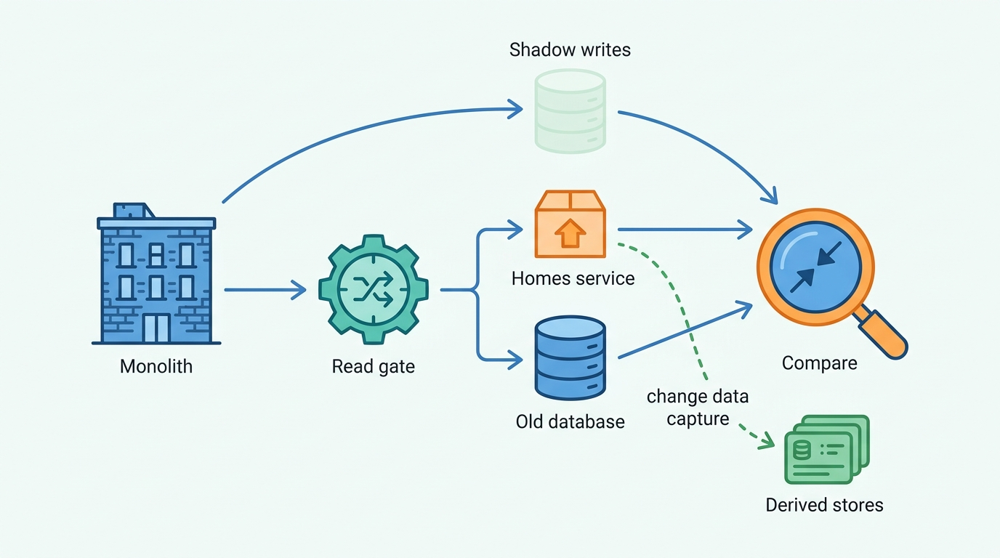
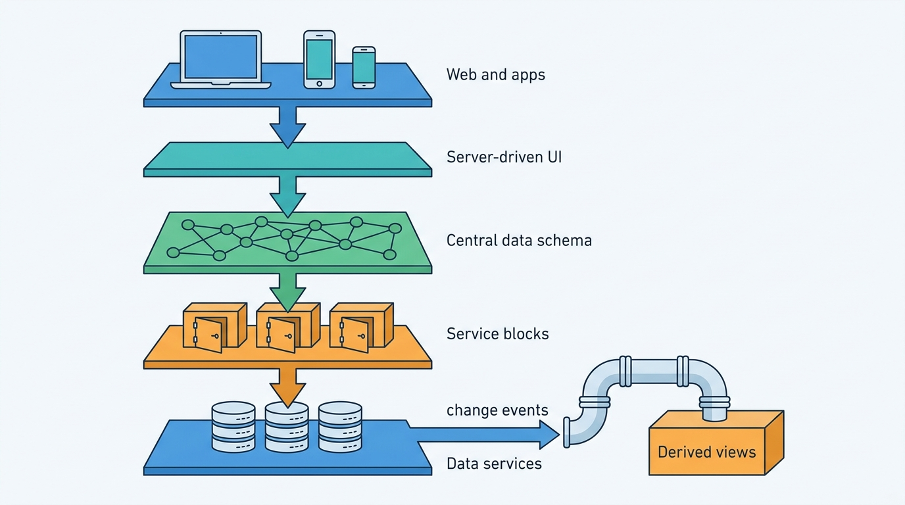
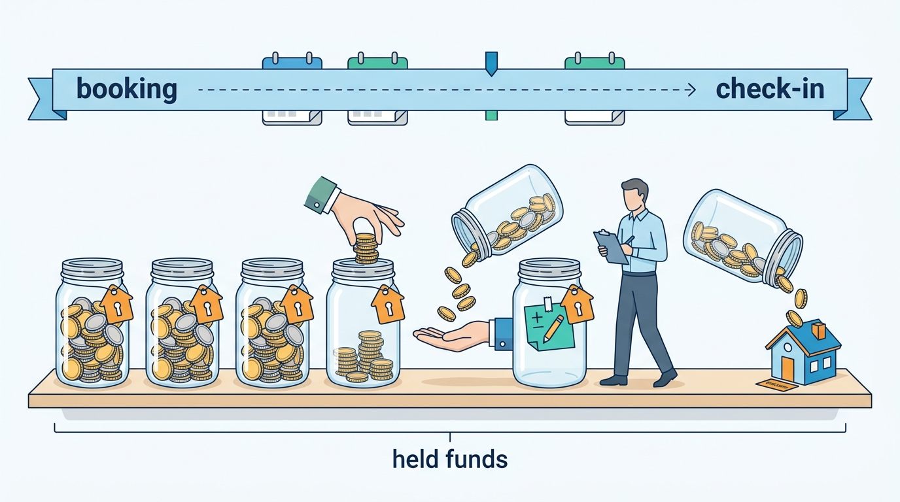
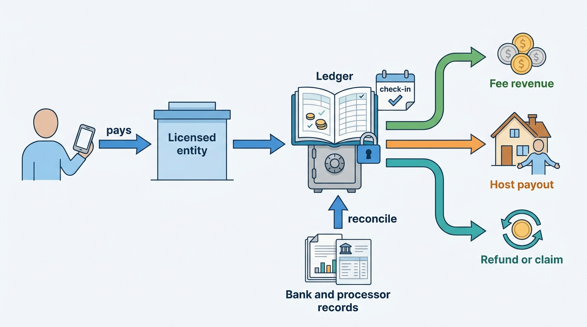
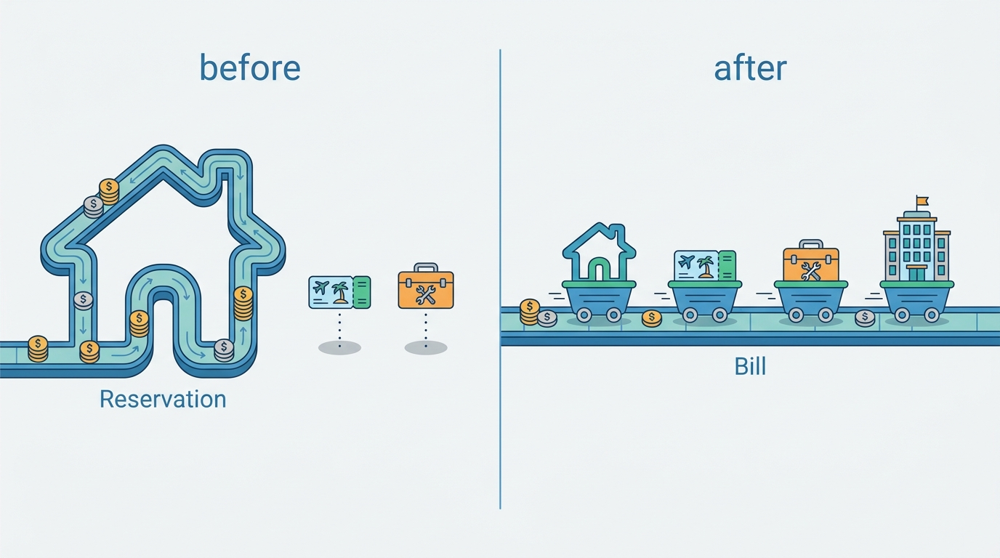

> **IN THIS CHAPTER, YOU WILL:** Trace Airbnb's public engineering and investor record from 2016 to 2026: the Monorail migration, the move from service sprawl to a GraphQL data mesh, a payments platform built around custody, a decade of published search research, trust products and the 2025–2026 expansion into services, experiences and hotels. You will separate what Airbnb documented from the author's interpretation, see where the evidence stops, and compare the case with the book's patterns and Corvane's choices.

> **WHY THE BUSINESS CARES:** Airbnb held **$12.2 billion** of guests' money on 30 June 2026 and pays more than five million hosts in about 50 currencies. Its fee migration, pay-later program and trust products were each as much a systems change as a commercial one.

> **WHY ARCHITECTS SHOULD CARE:** No other hosted-stays marketplace has published so much dated material on migration technique, payments, search and trust. The record is uneven: rich on platforms and models, silent on the calendar service. Knowing which is which keeps a team from copying a guess.

> **KEY POINTS:**
>
> * **Custody shapes the payments platform.** Airbnb is merchant of record, holds the full booking amount until check-in, and pays the host about a day later. Its published payments history runs from a double-entry financial pipeline (2016) through idempotency and orchestration rebuilt around a bill rather than a reservation (2019–2022) to licensed entities and a domain-structured platform (2026).
> * **One-unit inventory shapes search, ranking and trust, but the calendar itself is undocumented.** Airbnb's papers optimize uncanceled bookings, diversity and host acceptance because each listing can be booked once per date. Its trust products make the reservation itself a risk decision. How the calendar prevents double booking has never been described in public.
> * **The reusable lessons are migration discipline and generalization, not components.** Dual reads behind a ramped gate, shadow writes, a data-access interception layer and one central data schema are techniques any marketplace can use. The 2025–2026 move into services, experiences and hotels shows the other lesson: a model built around a stay had to be generalized before the business could change.

> **[FAILURE PATTERNS THIS CHAPTER ADDRESSES](where-stay-platforms-go-wrong.html):**
>
> * **Ledgerless Money** — Airbnb's 2016 account of reverse-engineering mutable records and audit triggers to find out what happened to money is the clearest public description of the pattern, and its fix.
> * **The Double-Booked Night** — a three-hour iCal refresh is documented; any host who syncs calendars that way carries cross-platform double-booking risk that no internal design can remove.
> * **The Hotel-Shaped Home** — in reverse: billing and orchestration "tightly coupled with the concept of a reservation for a stay" had to be rebuilt before experiences, services and hotels could share the rails.

 
Airbnb is the reference case for the hosted-stays side of this book for a plain reason: it has published more about how it works than any other short-term-rental marketplace. Its engineering blog, conference talks, academic papers, SEC filings and help-center terms together describe a decade of change. **The record shows a company whose architecture was shaped less by its technology choices than by three business facts**: it holds the guest's money until check-in, it sells homes that can be booked once per night, and it asks strangers to trust each other.

This chapter reads that record in five threads: the service architecture, money, calendar and search, trust, and the 2025–2026 expansion beyond homes. For each it asks *what is documented, when, and what does it imply for an architect who is not Airbnb?* It ends by comparing the record with the patterns argued in Parts I–IX and with the choices of Corvane, the fictional travel group this book follows.

## How to Read This Case

Part X cases follow stricter evidence rules than the chapters (see [[part-10]]). A **documented fact** carries its source and publication year in the sentence. **The author's interpretation** is marked "my reading" or sits in the Chief Architect's view. A **reference-architecture inference** appears in a callout labeled `INFERENCE, NOT DOCUMENTED` and describes how a system like this could be built, not how Airbnb built it.

Three cautions apply throughout.

- **Evidence age.** Airbnb's record spans 2014–2026, and the company rewrote large parts of its stack in that time. Sources older than about three years describe history, and this chapter says so.
- **Blog dates.** Airbnb moved its engineering blog from Medium to airbnb.tech, and several airbnb.tech posts share one date, which suggests batch re-publication; treat such dates as "no later than".
- **Volume metrics.** Airbnb's headline metric is now **Nights and Seats Booked**, which adds seats booked for experiences and services to nights booked for stays, net of cancellations ([Form 10-K for 2025](https://www.sec.gov/Archives/edgar/data/1559720/000155972026000004/abnb-20251231.htm), 2026). It is not a pure stays count and does not compare directly with an OTA's room nights.

Corvane appears only in the final comparison. Its hosted-stays brand, Nookaway, is a composite of industry patterns, not a disguised Airbnb: its fees, payout timing, systems and history were chosen to differ ([[meet-corvane]]).

### The business in 2025–2026

| Metric | Value | Period | Source |
| --- | --- | --- | --- |
| Nights and Seats Booked | 533 million (+8%) | 2025 | 10-K, 2026 |
| Gross booking value (GBV) | $91.3 billion (+12%) | 2025 | 10-K, 2026 |
| Revenue | $12.24 billion; implied take rate about 13.4% (my arithmetic) | 2025 | 10-K, 2026 |
| Hosts | "over 5 million"; "over 5.5 million" by Q2 2026 | Feb / Aug 2026 | 10-K; Q2 2026 letter |
| Average nights per booking (stays) | 3.7 | 2025 | 10-K, 2026 |
| Revenue from listings outside the US | 61% | 2025 | 10-K, 2026 |
| Payment currencies | about 50 | 2025 | 10-K, 2026 |
| Funds held for guests | $6.96 billion (31 Dec 2025); $12.2 billion (30 Jun 2026) | — | 10-K; Q2 2026 letter |
| Employees; third-party support workers | about 8,200; about 13,000 | 31 Dec 2025 | 10-K, 2026 |

The 10-K counts hosts by available listing and warns that "some individuals may have more than one host account and therefore may be counted more than once". It does not publish an active-listing count, so this chapter quotes none.

## Timeline: Airbnb in Dated Events

| Date | Event | Source |
| --- | --- | --- |
| 2007 | Founded "when two hosts welcomed three guests to their San Francisco home" | 10-K, 2026 |
| c. 2015 | Monorail, a Ruby on Rails monolith, has 200+ engineers committing and about 15 hours of deploy blockage a day | QCon talk, 2018 |
| Sep 2016 | Payments' second generation: billing interface, append-only payments gateway, double-entry financial data pipeline | Airbnb Engineering, 2016 |
| Jan 2018 | Three-way reconciliation across "a handful of gateways and dozens of processors" | Airbnb Engineering, 2018 |
| Aug 2018 | SpinalTap change data capture; KDD papers on search embeddings and dynamic pricing | Airbnb Engineering; KDD, 2018 |
| Dec 2018 | 250+ services and 1,000 endpoints on the interface-definition framework | QCon SF, 2018 |
| Apr 2019 | Orpheus idempotency library; 50% of services on Kubernetes | Airbnb Engineering; QCon London, 2019 |
| Aug 2020 | Party ban introduced (codified 2022) | Airbnb Newsroom, 2023 |
| Nov 2020 | Viaduct, a "data-oriented service mesh", introduced; over 500 services by 2020 | Airbnb Engineering, 2020; QCon Plus, 2021 |
| Feb 2022 | Payment orchestration rebuilt as DAGs of idempotent steps, modeled around a bill | Airbnb Engineering, 2022 |
| Aug 2022 | Anti-party reservation screening in the US and Canada | Airbnb Newsroom, 2022 |
| Jun 2023 | Identity verification required for all guests booking homes and all primary hosts | Airbnb Newsroom, 2023 |
| Apr 2024 | Chronon feature platform open-sourced | Airbnb Engineering, 2024 |
| Oct 2024 | Co-Host Network launched with 10,000+ co-hosts in 10 countries | Airbnb Newsroom, 2024 |
| May 2025 | Services launched in 260 cities; Experiences relaunched in 650 cities | Airbnb Newsroom, 2025 |
| Aug 2025 | Reserve Now, Pay Later for US guests on US listings | Airbnb Newsroom, 2025 |
| Oct 2025 | Transition from split fee to a single host-only fee begins | 10-K, 2026 |
| Feb 2026 | Reserve Now, Pay Later worldwide (17 Feb); "Pay as a Local" describes the domain-structured payments platform | Airbnb Newsroom; airbnb.tech, 2026 |
| Apr–Jun 2026 | Skipper workflow engine; identity graph; multi-product data architecture; EU Short-Term Rental Regulation applies (20 May) | airbnb.tech, 2026; EUR-Lex |
| Aug 2026 | "Thousands of boutique and independent hotels" added; AI assistant resolves nearly 45% of issues it starts | Q2 2026 letter |

## Thread 1: From Monorail to a Data Mesh

### The migration (2015–2019)

The fullest account is Jessica Tai's talk at QCon San Francisco, [The Great Migration: from Monolith to Service-Oriented](https://www.infoq.com/presentations/airbnb-soa-migration/) (InfoQ, December 2018), with [InfoQ's write-up](https://www.infoq.com/news/2019/02/airbnb-monolith-migration-soa/) (2019). Both are more than seven years old and describe a migration then in progress.

Monorail, the Rails monolith, had become a deploy bottleneck: by about 2015 more than 200 engineers committed to it, shipping about 200 commits a day with about 15 hours of blockage a day. The first thing extracted was not a feature but the **homes data model**, "accessed by almost every feature". Thousands of call sites ruled out a rewrite, so the team intercepted data access with a custom ActiveRecord adapter that routed queries to the new service.

The talk named four service types with a strict dependency direction:

| Service type | Role as described in 2018 |
| --- | --- |
| Data service | Sole owner of its data; gatekeeper for reads and writes |
| Derived data service | Reads from data services and adds its own store and logic |
| Middle-tier service | Shared write-validation logic, for example **reservation validation**, kept out of data services |
| Presentation service | Assembles data for a product surface |

Migration safety came from comparison, not confidence. Reads ran on both paths behind a gate ramped 1% → 5% → 10% → 25% → 50% → 100%, with mismatch checks. Writes went to a **shadow database**, because "we can't dual write to the same database", and were compared with production. Twitter's Diffy replayed production traffic against old and new code. Thrift was the interface definition language, and standard dashboards and alerts were generated from it. [SpinalTap](https://medium.com/airbnb-engineering/capturing-data-evolution-in-a-service-oriented-architecture-72f7c643ee6f) (2018) streamed database changes from MySQL, DynamoDB and an in-house store into Kafka by reading database logs, so search indexes and caches could follow the new services without dual writes. The reported results: more than 250 services, deploys from hours to minutes, the search page about three times faster and the home description page more than ten times faster. Tai called the result "closer to service-oriented architecture (SOA)" than to microservices, because components and storage were shared.

**Figure 1:** *Airbnb's documented migration safety net (2018): intercept data access, ramp reads behind a gate with comparison, shadow writes, and let change data capture keep derived stores in step.*

**My reading:** the reusable lesson is the order of work. Airbnb extracted the most-shared *data* first, behind an interception layer, and put shared *business rules* such as reservation validation in a middle tier rather than in data services or in each product. A middle-tier reservation validator is where a one-unit marketplace would naturally enforce "no overlapping nights". The talk names the service type; it does not describe the rules inside it.

### Taming the services (2020–2026)

The move to services created its own problem. By 2020 Airbnb ran more than 500 services, and in her 2021 talk [How to Tame Your Service APIs](https://www.infoq.com/presentations/airbnb-api-architecture/) (InfoQ, 2021) Tai described **SOA v2**: a GraphQL data aggregator so that presentation services stop duplicating data fetching, and **service blocks**, groups of services behind one facade API.

That aggregator became [Viaduct](https://medium.com/airbnb-engineering/taming-service-oriented-architecture-using-a-data-oriented-service-mesh-da771a841344) (2020), described as a "data-oriented service mesh" with one central GraphQL schema: "it is the service mesh, i.e., Viaduct, not the data consumer, that knows which services provide which data element". Five years on, [Viaduct, Five Years On](https://airbnb.tech/infrastructure/viaduct-five-years-on-modernizing-the-data-oriented-service-mesh/) (airbnb.tech, 2025) reported traffic up about eightfold, 130+ teams hosting code inside it, over 1.5 million lines of hosted code, over 75% of requests internal and incident-minutes halved. The [Ghost Platform](https://medium.com/airbnb-engineering/a-deep-dive-into-airbnbs-server-driven-ui-system-842244c5f5) (2021) pushes server-driven UI to web, iOS and Android on top of Viaduct, because "each time we need to add new features to our listing page, we need to release a new version of our mobile apps". [Riverbed](https://medium.com/airbnb-engineering/riverbed-optimizing-data-access-at-airbnbs-scale-c37ecf6456d9) (2023) builds materialized views from change-data-capture events, serializing changes per document through Kafka and backfilling from warehouse snapshots; its motivating example was payments after the move to SOA.

Underneath, Airbnb runs primarily on Amazon Web Services (10-K, 2026), with Istio across "tens of thousands of pods, dozens of Kubernetes clusters, and thousands of VMs" ([Seamless Istio Upgrades at Scale](https://airbnb.tech/infrastructure/seamless-istio-upgrades-at-scale/), airbnb.tech date 2025).

**Figure 2:** *The documented layering as of 2025–2026: one data schema in front, services grouped behind facades, and derived views built from change events rather than from dual writes.*

**My reading:** Airbnb went from a monolith to hundreds of services and then pulled *data access* back into one place. That is not a reversal: writes and business rules stay with services, while the read graph every screen needs is centralized. [[stays-bounded-contexts]] argues for the same split, and [[modernizing-a-live-marketplace]] for the same migration order.

## Thread 2: Money Held Until Check-In

### The commercial facts that drive the design

The 10-K (2026) states the model plainly: "When a guest books and pays for a stay, experience, or service on our platform, we hold the total amount the guest has paid until check-in, at which time we recognize our service fee as revenue and initiate the process to remit the payment to the host, which generally occurs on the business day after the scheduled check-in." Airbnb is merchant of record, bears all payment processing costs including chargebacks, and presents revenue net because it "does not fulfill rental promises, bear inventory risk, or set prices". Because hosts may cancel until check-in, accounting treats each booking as a contract that completes at check-in.

Three further documented facts complete the picture:

- **Licensed entities.** Airbnb Payments, Inc. is a FinCEN-registered money services business with state money-transmitter licenses; Airbnb Payments Luxembourg SA is a licensed payment institution across the European Economic Area; Airbnb Payments UK Limited is an electronic money institution; a Canadian entity is registered too (10-K, 2026). Hosts appoint Airbnb Payments as limited payment-collection agent, and once the guest pays, "the Guest's payment obligation to the Host(s) … is extinguished" ([Payments Terms](https://www.airbnb.ie/help/article/2909), 2026).
- **Payout rules.** Payouts start "by the end of the business day after the Guest's scheduled check-in date"; hosts without two completed stays are paid after check-out; stays of 28 nights or more pay monthly; payouts can be held for fraud review or a pending refund decision, and when a host cancels, funds may be held "for up to 72 hours" (Payments Terms, 2026).
- **Float.** Funds held for customers were $6.96 billion at the end of 2025 and $12.2 billion at the end of June 2026, the seasonal peak before summer check-ins. Interest income was $705 million in 2025.

**My reading:** this makes Airbnb's payments platform a **custody and disbursement system with a long-lived liability per booking**, not a pass-through. Every booking opens a payable that lives for weeks or months and can change through alterations, cancellations, refunds and claims. That is a different machine from an agency OTA's commission invoicing, as [[merchant-and-agency-models]] explains.

**Figure 3:** *My reading: holding guest funds until check-in turns every booking into a payable that lives for weeks or months and can change before the host is paid.*

### Ten years of published payments engineering

| Year | Published change | What it solved |
| --- | --- | --- |
| 2016 | [Scaling Airbnb's Payment Platform](https://medium.com/airbnb-engineering/scaling-airbnbs-payment-platform-43ebfc99b324): billing interface with discrete items (nights, fees, taxes); payments gateway with an append-only data model; financial data pipeline "constructed around the principle of double-entry bookkeeping" | Finance had relied on audit-trail triggers and "had to reverse-engineer these audit entries to infer what happened" |
| 2016 | Brazilian Boleto support: the reservation waits in pending payment until cash is confirmed | A general pattern for asynchronous payment and booking |
| 2018 | [Measuring Transactional Integrity](https://medium.com/airbnb-engineering/measuring-transactional-integrity-in-airbnbs-distributed-payment-ecosystem-a670d6926d22): three-way reconciliation of platform records, processor settlement files and bank statements; payout batch files leave systems "out-of-sync" for hours | Integrity across "a handful of gateways and dozens of processors" |
| 2019 | [Avoiding Double Payments](https://medium.com/airbnb-engineering/avoiding-double-payments-in-a-distributed-payments-system-2981f6b070bb): Orpheus, an idempotency library with keys stored on a sharded primary database | Retries across services without charging twice |
| 2022 | [Rebuilding Payment Orchestration](https://medium.com/airbnb-engineering/rebuilding-payment-orchestration-at-airbnb-341d194a781b): workflows as DAGs of retryable idempotent steps; "five 9s" of consistency; data model built "around the concept of a bill"; alterations as new versions in a sequence of plans | Billing and orchestration had been "tightly coupled with the concept of a reservation for a stay" |
| 2026 | [Pay as a Local](https://airbnb.tech/payments/pay-as-a-local/): domain-structured services (Pay-in, Payout, Transaction Fulfillment, Processing, Wallet & instruments, Ledger, Incentives & Stored Value, Issuing, Settlement & Reconciliation); Multi-Step Transactions for redirect, async and direct flows; YAML payment-method configuration; a payment service provider (PSP) emulator | 20+ local payment methods launched in about 14 months |
| 2026 | [Skipper](https://airbnb.tech/infrastructure/skipper-building-airbnbs-embedded-workflow-engine/): embedded durable workflows, at-least-once actions, compensation in reverse order; used by payments, insurance and others | Long-running money workflows inside the owning service's database |

The 2022 migration is worth a second look: four phases (pricing, payouts, bookings, data migration), "over 30 milestones" for stays bookings alone, and two orchestration systems running in parallel behind a translation layer for most of the migration.

**Figure 4:** *The documented money cycle: the guest pays a licensed entity, the platform holds the funds until check-in, then recognizes its fee and releases the host's payout; reconciliation runs against processor and bank records.*

> **INFERENCE, NOT DOCUMENTED:** Airbnb names "Ledger" as a payments subdomain (2026) and described a double-entry financial pipeline in 2016, but no source read for this book describes its current ledger's data model. A plausible reference design, not a description of Airbnb's systems, is an append-only double-entry ledger with accounts per booking for guest funds receivable, funds held, payable to host, unearned and earned fee, taxes collected and chargeback exposure, versioned on every alteration. The 10-K's matching "funds receivable" asset and "funds payable" liability are the accounting shadow of such a design. [[payouts-and-settlement]] and the sibling book's [[designing-financial-ledgers]] develop it.

### Product changes that were payments changes

Two recent products show how commercial decisions land in systems.

**Reserve Now, Pay Later** launched for US guests on US listings on 14 August 2025 and became available worldwide on 17 February 2026 for listings with flexible or moderate cancellation policies ([Airbnb Newsroom](https://news.airbnb.com/reserve-now-pay-later-is-now-available-worldwide/), 2026). Nothing is due at booking; the full amount is charged automatically before the free-cancellation period ends, so "hosts have time to secure another booking even if a guest cancels". If the charge fails, the guest has 72 hours to pay by another method or the booking may be canceled (Payments Terms, 2026). Adoption was "over 70 percent" of eligible bookings in Q4 2025. The Q2 2026 letter notes that unearned fees stayed flat at $2.8 billion because the program defers guest payments.

**The single host-only fee.** "In October 2025, the Company began transitioning to a single-fee structure, charging only the host a service fee" (10-K, 2026). The help center gives 15.5% for most hosts (16% in Brazil and Mexico), against the old split of 3% from hosts plus 14.1–16.5% from guests; a host who switches "cannot switch back", and bookings made before the switch keep the old fee ([Airbnb service fees](https://www.airbnb.com/help/article/1857), n.d.). In July 2026 Airbnb announced that most remaining hosts would migrate in 2026.

**My reading:** pay-later turns a paid booking into a promised one, with a scheduled charge that can fail and a calendar that stays blocked while it is unpaid; [[stay-payments]] treats that state machine. The fee change is a pricing-engine, display and ledger migration with two fee models coexisting per booking until the last old booking checks out. Its commercial effect is to make a hosted-stays fee look like an OTA commission: the host is charged, and the guest sees one price.

## Thread 3: One Calendar, Many Models

### What is documented about availability

Almost nothing about the calendar service itself. The documented facts are at the edges:

- **iCal sync.** "Airbnb updates synced calendars every 3 hours"; manual refresh is rate-limited; nights booked on another site's calendar are blocked, but "nights that you block on another calendar may or may not be blocked on Airbnb" ([Sync your calendars](https://www.airbnb.com/help/article/99), n.d.).
- **Connected software.** Property-management and channel-manager partners use partner API programs, not a public API. The [API Terms](https://www.airbnb.com/terms/api) (updated 15 October 2025) require an NDA and a data-security review, let Airbnb set "call, volume, and rate limits at any time", and require partners to implement mandatory features within six months. Airbnb named 34 Preferred Software Partners for 2024.
- **Search pressure.** In its 2025 [embedding-based retrieval](https://airbnb.tech/ai-ml/embedding-based-retrieval-for-airbnb-search/) work Airbnb rejected an HNSW index partly because "frequent updates to pricing and availability" inflated its memory footprint; it used inverted-file (IVF) clusters as an ordinary search filter instead.

> **INFERENCE, NOT DOCUMENTED:** For a one-unit listing, a defensible reference design, not a description of Airbnb's systems, is one availability record per listing-night or interval, a conditional write or lock on the requested nights at booking, a short hold during payment authorization, and asynchronous propagation of the change to search indexes and connected channels. Whatever the internal design, a three-hour inbound iCal refresh means that **hosts who sync by iCal accept a window in which another platform can sell a night Airbnb has already sold, and the reverse**. [[calendar-sync]] and [[inventory-integrity]] work through the design and its residual risk.

### Search and ranking: a decade of published research

Here the record is unusually rich. Airbnb's papers, read in sequence, describe how ranking changes when inventory is a single unit:

| Year | Work | What it established |
| --- | --- | --- |
| 2018 | [Real-time Personalization using Embeddings](https://www.kdd.org/kdd2018/accepted-papers/view/real-time-personalization-using-embeddings-for-search-ranking-at-airbnb) (KDD) | Embeddings for a market where guests rarely book the same item twice and each listing hosts one booking per date range |
| 2018 | [Applying Deep Learning to Airbnb Search](https://arxiv.org/abs/1810.09591) (KDD 2019) | Gradient-boosted trees "plateaued"; move to neural networks |
| 2020 | [Improving Deep Learning for Airbnb Search](https://arxiv.org/abs/2002.05515) | Position bias and cold start for new listings |
| 2022 | [Learning To Rank Diversely](https://arxiv.org/abs/2210.07774) (CIKM 2023) | A listing's booking probability depends on the other results |
| 2023 | [Journey Ranker](https://arxiv.org/abs/2305.18431) (KDD) | Multi-task model for weeks-long journeys and host rejection or cancellation |
| 2024 | [Learning to Rank for Maps](https://arxiv.org/abs/2407.00091) (KDD) | List-ranking assumptions "simply break down for maps" |
| 2025 | [Interleaving and Counterfactual Evaluation](https://arxiv.org/abs/2508.00751) (KDD) | Up to 100× more sensitive than A/B tests for ranking |
| 2025–2026 | Embedding-based retrieval; guest-journey sequence model with a setwise ranker; real-time updates through Chronon | Two-stage retrieval and ranking; journey embedding staleness from about two days to under a minute |

**My reading:** three hosted-stays properties recur across these papers. **Single-unit inventory** means popularity cannot scale up, so diversity matters. **Host-side failure** means a booking can be rejected or canceled by the host, so the documented objective is *uncanceled* bookings, not clicks; the 2026 [guest-journey post](https://airbnb.tech/ai-ml/personalizing-airbnb-search-by-learning-from-the-guest-journey/) reports gains in "uncanceled bookers" and "uncanceled nights". **Long journeys** mean guests compare for weeks, which motivates sequence models. The 2018–2020 papers are history; the stack has been extended at least three times since. [[stays-ranking]] builds on them.

Two adjacent records are thinner. On pricing, the only paper is the KDD 2018 [Customized Regression Model for Airbnb Dynamic Pricing](https://www.kdd.org/kdd2018/accepted-papers/view/customized-regression-model-for-airbnb-dynamic-pricing): a booking-probability classifier per listing-night, a regression with a custom loss for the price, and a personalization layer, deployed in Price Tips and Smart Pricing. Today's [Smart Pricing help page](https://www.airbnb.com/help/article/1168) (n.d.) documents host-set minimums and maximums and says prices never change pending or confirmed reservations; it does not say how often prices are recalculated. On experiments, Holtz and coauthors measured, in Airbnb meta-experiments, that interference between treated and control units biased the estimate of a fee test by 32.60% ([arXiv](https://arxiv.org/abs/2004.12489), 2020), the effect [[stays-experimentation]] calls marketplace interference. Chronon ([open-sourced in 2024](https://medium.com/airbnb-engineering/chronon-airbnbs-ml-feature-platform-is-now-open-source-d9c4dba859e8)) defines a feature once for training and serving; see [[stays-ml-platform]].

## Thread 4: Trust Built as a Product

Airbnb's 10-K (2026) lists its "system for trust": reviews, account protection, risk scoring, secure payments, a nondiscrimination policy, watchlist and background checks in some jurisdictions, fraud and scam prevention, insurance and similar protections, booking restrictions, an urgent safety line, a neighborhood support line, anti-party technology and a guest refund policy. It is also candid about the limits: "We do not verify all listings for safety or compliance, relying instead on user-reported issues."

| Control | Documented facts | Architectural role (my reading) |
| --- | --- | --- |
| **Identity verification** | Required by end of June 2023 for all guests booking homes and all primary hosts; unverified hosts have calendars blocked and unverified guests cannot book ([Airbnb Newsroom](https://news.airbnb.com/an-update-on-identity-verification-on-airbnb), 2023) | A gate in the booking path, enforced through the calendar |
| **Reservation screening** | Anti-party system in the US and Canada from August 2022, using review history, account age, trip length, distance and weekday; blocked guests can still book a private room or hotel; a 2021 Australian pilot cut unauthorized parties 35% ([2022](https://news.airbnb.com/airbnb-introduces-new-anti-party-technology-in-us-and-canada)); 0.039% of 2022 reservations led to a party allegation ([2023](https://news.airbnb.com/an-update-on-our-work-to-crack-down-on-parties-and-disruptive-behavior)); more than 20,000 US guests redirected from entire homes over 4 July 2025 ([2026](https://news.airbnb.com/airbnbs-anti-party-system-returns-for-july-4-weekend)) | A pre-booking decision with more outcomes than allow or deny, and holiday modes |
| **Identity graph** | 7 billion nodes and 11 billion edges for resolving identities and linked accounts; JanusGraph, DynamoDB and OpenSearch ([airbnb.tech](https://airbnb.tech/infrastructure/scaling-airbnbs-identity-graph-with-a-unified-knowledge-graph-infrastructure/), 2026) | Shared feature source for fraud and trust decisions |
| **Protection** | AirCover for Hosts: damage protection up to $3 million per stay and liability coverage up to $1 million, liability through a captive insurance subsidiary (10-K, 2026); guest cover for host cancellations, failed check-in and inaccurate listings | Claims become a platform workflow with payments attached |
| **Fairness measurement** | Project Lighthouse measures acceptance-rate gaps by perceived race with p-sensitive k-anonymity ([2020](https://news.airbnb.com/wp-content/uploads/sites/4/2020/06/Project-Lighthouse-Airbnb-2020-06-12.pdf)); Booking Success Rate 91.4% for guests perceived as Black against 94.1% for white guests in 2021 data ([2022](https://news.airbnb.com/sixyearadupdate)) | Privacy-preserving measurement pipeline; product changes that remove discretionary decisions |

> **INFERENCE, NOT DOCUMENTED:** Airbnb has not published the models behind risk scoring and screening: features beyond the 2022 list, thresholds, latency budget or where in the flow they run. A plausible reference design, not a description of Airbnb's systems, is a synchronous risk decision at reservation request, fed by account, payment, device and graph features, returning allow, step-up verification, redirect to another listing type or block, with outcome labels from party reports and damage claims. [[stays-trust-and-safety]] and [[protection-and-incidents]] develop it.

**My reading:** the record shows trust built in layers over a decade, several of them after public pressure, and then bundled as one host-facing promise. Bundling identity, screening and protection under one product name makes a commercial point, but the architectural lesson is that they share data: the verification state gates the calendar, review history feeds screening, and claims produce the labels screening learns from. The Lighthouse results also show why request-to-book flows carry fairness risk that instant confirmation removes.

## Thread 5: Beyond Homes: Experiences, Services and Hotels

On 13 May 2025 Airbnb launched **Airbnb Services** (ten categories in 260 cities) and relaunched **Experiences** in 650 cities in a redesigned app ([2025 Summer Release](https://news.airbnb.com/airbnb-2025-summer-release), 2025). By the second quarter of 2026 it had expanded Services to partner services such as car rentals and airport pickups, and had added "thousands of boutique and independent hotels" in more than 20 destinations; hotels were "a single-digit percentage of nights booked" but hotel nights grew about three times as fast as homes ([Q2 2026 Shareholder Letter](https://s26.q4cdn.com/656283129/files/doc_financials/2026/q2/Airbnb-Q2-2026-Shareholder-Letter-FINAL.pdf), 2026). Hotels are not new to the group: the 10-K names HotelTonight among acquired businesses and excludes it from listing metrics.

The data-warehouse team's [Scaling beyond one](https://airbnb.tech/uncategorized/scaling-beyond-one-how-airbnb-evolved-its-data-architecture-for-a-multi-product-world/) (airbnb.tech, 2026) says what the expansion did to the data model:

- Services introduced a **parent listing with many offerings**, radius-based **service areas** instead of fixed locations, and availability as **business hours converted into bookable slots**, "unlike date-based Homes or start-time-based Experiences".
- Each data domain had to be "either completely separate by product type or completely monolithic". Product-facing domains separated; cross-cutting ones such as customer support stayed monolithic, because that "was the only way to maintain a single, unified view of a user's support history".
- Payments, messaging and customer support stayed product-agnostic.

The post covers the offline warehouse, not online services. The same letter claims Airbnb has "rebuilt Airbnb from the ground up to be an AI-native company" and reports that "nearly 45% of issues that begin with our AI assistant are now resolved without a human agent", in more than 50 languages. I treat the first phrase as positioning and the second as a dated, self-reported metric; [[customer-service]] and [[ai-in-travel-stays]] discuss what such numbers do and do not show.

**My reading:** the 2022 orchestration rebuild, which moved billing from a reservation to a bill, was the precondition for this expansion: without it, every new product would have needed its own money path. Hotels move Airbnb toward OTA-style supply with room types and many units per property, which the documented calendar mechanics for homes do not obviously cover. How Airbnb models hotel inventory is not public. [[converging-two-marketplaces]] treats the same convergence from the other direction.

**Figure 5:** *My reading: rebuilding billing around a bill instead of a reservation for a stay let homes, experiences, services and hotels share one money path.*

**Regulation as an input.** The 10-K names the EU Digital Services Act and the EU Short-Term Rental Regulation among laws that may increase liability. The latter, [Regulation (EU) 2024/1028](http://publications.europa.eu/resource/celex/32024R1028), applies from 20 May 2026 and requires platforms to collect and display registration numbers and report activity data monthly for units in registration areas. The 10-K also reports that in 2025 Spain's consumer ministry proposed a fine of about €65 million over short-term-rental listing rules, and that Airbnb has "resolved some disputes by agreeing to remove listings or share data with authorities". Its design for registration checks is not public; [[stays-regulation]] owns the topic.

## Trade-offs the Case Illustrates

| Choice Airbnb documented | Alternative | What Airbnb gained | What it costs or risks |
| --- | --- | --- | --- |
| Merchant of record for every booking, funds held until check-in | Facilitated payments through a PSP that holds funds; agency model | One price, one refund path, payout control as a fraud lever, float income | Licenses on three continents, safeguarding, chargeback costs, a ledger with long-lived liabilities |
| Data first, behind an interception layer, with dual reads and shadow writes | Rewrite features service by service | Thousands of call sites moved without rewriting them | A long period of parallel paths and comparison tooling |
| One central GraphQL schema hosting tenant code (Viaduct) | Each team publishes its own APIs; clients compose | Less duplicated fetching; one read graph for every surface | A shared runtime that 130+ teams depend on; its upgrades are platform events |
| Ranking on uncanceled bookings, with diversity and journey models | Click or gross-booking objectives | Ranking aligned with stays that happen | Delayed labels; heavier models and evaluation |
| iCal sync at a three-hour cadence alongside partner APIs | API-only connectivity | Any host with any other calendar can multichannel | A documented window for cross-platform double bookings |
| Trust controls in the booking path (verification, screening) | Post-booking review only | Fewer incidents, measurable reductions | Friction and false positives for legitimate guests; fairness review needed |

## Where the Public Evidence Stops

| Question | What is public | What is not |
| --- | --- | --- |
| How does the calendar prevent double booking? | iCal cadence and rules; API terms; that availability updates are frequent | Storage, concurrency control, hold semantics for instant book and request-to-book, merging of iCal and API updates |
| What does the ledger look like today? | Double-entry pipeline (2016); "Ledger" as a subdomain (2026); the balance-sheet pair | Account model, versioning on alteration, payout batching, how held funds are modeled |
| How do screening and risk models work? | Signals named in 2022; outcome rates; holiday redirections | Model type, features, thresholds, latency, decision outcomes |
| How does Smart Pricing work now? | The 2018 paper; host-facing rules | Model family, recalculation cadence, serving system |
| How are hotels modeled? | Hotel supply added; HotelTonight excluded from metrics | Inventory model, connectivity, rate plans |
| Are older platforms still running? | Bighead, Zipline, Minerva and the Experiment Reporting Framework appear in 2014–2021 sources | Whether they were retired, renamed or replaced |
| How many listings are active? | Host counts and definitions | A current active-listing count |

## The Chief Architect's View

Airbnb's record gives me five decision rules for a hosted-stays platform.

**Decide custody before you design payments.** Whether the platform holds guest funds until check-in decides the licenses, the ledger, the payout scheduler, the refund path and the treasury function. Airbnb's design follows from holding funds; a platform that leaves custody with a PSP builds less and controls less. Make the decision explicit, with finance and legal, before choosing a payment provider. [[merchant-and-agency-models]] gives the options.

**Model money around bills, not reservations.** Airbnb's 2022 post names the coupling that made new products hard. A billing model with versioned plans per product lets the same rails carry stays, experiences, services and hotel rooms. This is cheap to get right early and expensive to retrofit.

**Copy the migration technique, not the target.** Dual reads with a ramped gate, shadow writes, interception at the data-access layer and change data capture into derived stores are portable to any monolith. A central GraphQL mesh is a later decision that pays when many teams build many screens on one read graph; a smaller platform may not need it.

**Treat the calendar as the hardest unpublished system, and design it yourself.** The most useful company in the field has not shown how its calendar works. Write down the invariant (no two confirmed reservations on one unit for one night), its enforcement point, its hold semantics and the residual risk from polled feeds, and measure it as a fitness function.

**Bundle trust controls only if they share data.** Verification, screening, protection and reviews make a product when the verification state gates the calendar, reviews and claims feed screening, and claims draw on the ledger. Separate tools with separate data are just several reactions to incidents.

## Comparing the Case to the Book's Patterns and to Corvane

Airbnb's record supports most of the book's hosted-stays arguments and is silent where the book is most prescriptive, on the calendar.

| Book pattern or claim | Airbnb's record | Verdict |
| --- | --- | --- |
| Hosted-stays inventory is one unit per night; integrity is a hard invariant ([[inventory-integrity]], [[calendar-sync]]) | Papers built on "one booking per date range"; three-hour iCal sync documented | Supported in ranking; calendar internals not public |
| One ledger that says who is owed what ([[payouts-and-settlement]], [[refunds-and-reconciliation]]) | Double-entry pipeline (2016), three-way reconciliation (2018), Ledger subdomain (2026) | Strongly supported, and the 2016 post documents the failure first |
| Idempotent, durable money workflows ([[stay-payments]], [[event-driven-stays]]) | Orpheus (2019), DAG orchestration (2022), Skipper (2026) | Strongly supported |
| Extract shared data first and migrate with comparison ([[modernizing-a-live-marketplace]]) | Homes data model first; dual reads, shadow writes, Diffy | Supported |
| Rank on stays, not bookings; design experiments for interference ([[stays-ranking]], [[stays-experimentation]]) | "Uncanceled" objectives; 32.60% interference bias measured (2020); interleaving | Strongly supported |
| Trust as a pre-booking decision on the reservation ([[stays-trust-and-safety]]) | Screening and verification gates in the booking path | Supported; models undocumented |
| Share identity, payments, messaging and support across products; keep supply models separate ([[converging-two-marketplaces]]) | Payments, messaging and support product-agnostic; product data separated (2026) | Supported for homes, experiences and services; hotels not yet documented |
| Regulation lands on the listing and the calendar ([[stays-regulation]]) | EU STR Regulation and Spanish enforcement named in the 10-K | Consistent; design not public |

Nookaway is deliberately unlike Airbnb in its numbers and history (see [[meet-corvane]]), but the case sharpens several of Corvane's 2027 choices.

| Corvane choice (2027) | Airbnb parallel | What the case suggests |
| --- | --- | --- |
| Nookaway's Burrow monolith (Django, since 2012) with about 60 Go services; the One Stay program shares contracts but keeps Almanac as Nookaway's calendar engine | Monorail to services, then one read graph over them | Migrate by data domain with dual reads and shadow writes; do not mistake service count for progress |
| Fathom becomes the settlement ledger of record for both brands; Burrow's mutable payout tables migrate by mid-2028 | 2016: audit triggers replaced by a double-entry pipeline; 2022: billing rebuilt around a bill | Right direction; model the bill per product now, before Nookaway pilots boutique hotels in 2028 |
| Nookaway Pay Later (October 2026) charges 10 days before the free-cancellation deadline | Reserve Now, Pay Later charges before the deadline, with a 72-hour grace period | Same shape; a grace path for failed charges and a forecast of deferred cash belong in the design |
| Split fee (12% guest + 4% host) with an optional 17% host-only fee for connected managers | Mandatory migration to a host-only fee from October 2025 | Any fee change must carry per-booking fee versions through pricing, display and the ledger |
| Calendar Sync v2: tiered iCal polling and a pre-booking re-check for instant book | Three-hour iCal refresh documented; no published mitigation | Corvane goes further than the public record; measure conflicts per 10,000 stays to prove it |
| One trust platform under Sofia Marín; Nookaway Cover up to €500,000 damage and €1 million liability | Verification, screening and AirCover bundled as one promise | Share data between verification, screening, reviews and claims, not only a team |
| Nookaway's 2028 boutique-hotel pilot runs on the hotel-type engine (Switchyard, Tally, Stayline delivery) under the cross-type routing rule ([[converging-two-marketplaces]]) | Boutique hotels added in 2026, a single-digit share of nights | Corvane decided what Airbnb has not documented: the supply segment, not the brand, chooses the engine. Airbnb's own answer is not public |

**The sharpest lesson for Corvane is the bill.** Airbnb had to rebuild payment orchestration because money had been modeled around "a reservation for a stay". The One Stay program's shared offer and reservation contracts, and Fathom's move to ledger of record, are the moment to make the bill, not the reservation, the unit of money, before hotels, add-ons or anything else Nookaway sells arrive on the same rails.

## Questions to Ask

1. Who holds guest funds between booking and check-in in our marketplace, under which license, and which system can say the balance per booking at any moment?
2. Is our money modeled around a reservation or around a bill that any product can produce? What would adding a second product type cost?
3. Where is the invariant "no two confirmed reservations on one unit for one night" enforced, and what is our measured double-booking rate by sync method?
4. For our monolith migration, do we have dual reads with comparison, shadow writes and an interception layer, or are we rewriting features and hoping?
5. Do our ranking and pricing models optimize stays that happen, or bookings that may be canceled?
6. Do verification, screening, reviews and claims share data, or are they separate tools with separate stores?
7. When we change fees, how many fee models will coexist per booking, and for how long?
8. Which of our claims about another company's architecture rest on a dated source, and which on inference?

Airbnb is the strongest public case on the hosted-stays side. The next case, [[case-expedia-vrbo]], follows a group that runs both marketplace types and has published how it consolidated brands, including Vrbo, onto one platform: the question this book asks of Corvane.

## Sources and Evidence

### Company engineering and investor sources

- [Form 10-K for fiscal year 2025](https://www.sec.gov/Archives/edgar/data/1559720/000155972026000004/abnb-20251231.htm) — Airbnb, Inc., 2026. Scale metrics, custody until check-in, merchant of record, licensed entities, trust system and its limits, single-fee transition, AWS hosting, Spanish fine, HotelTonight.
- [Q2 2026 Shareholder Letter](https://s26.q4cdn.com/656283129/files/doc_financials/2026/q2/Airbnb-Q2-2026-Shareholder-Letter-FINAL.pdf) — Airbnb, 2026. Funds held, fee migration, boutique hotels, AI assistant resolution rate.
- [Payments Terms of Service](https://www.airbnb.ie/help/article/2909) — Airbnb, 2026. Collection-agent clause, payout timing and holds, pay-later charge failures.
- [Airbnb service fees](https://www.airbnb.com/help/article/1857) — Airbnb Help Center, n.d. (fetched 21 October 2026). Split and single fee levels; no switching back.
- [Sync your calendars](https://www.airbnb.com/help/article/99) — Airbnb Help Center, n.d. (fetched 21 October 2026). Three-hour iCal refresh and its limits.
- [Smart Pricing](https://www.airbnb.com/help/article/1168) — Airbnb Help Center, n.d. (fetched 21 October 2026). Host bounds; no change to confirmed reservations.
- [API Terms of Service](https://www.airbnb.com/terms/api) — Airbnb, 2025. Partner programs, security review, rate limits.
- [Reserve Now, Pay Later is now available worldwide](https://news.airbnb.com/reserve-now-pay-later-is-now-available-worldwide/) — Airbnb Newsroom, 2026. Worldwide launch and adoption.
- [Airbnb 2025 Summer Release](https://news.airbnb.com/airbnb-2025-summer-release) — Airbnb Newsroom, 2025. Services and Experiences launch.
- [An update on identity verification on Airbnb](https://news.airbnb.com/an-update-on-identity-verification-on-airbnb) — Airbnb Newsroom, 2023. Verification for all guests booking homes and primary hosts.
- [New anti-party technology in the US and Canada](https://news.airbnb.com/airbnb-introduces-new-anti-party-technology-in-us-and-canada) — Airbnb Newsroom, 2022. Screening signals; 35% pilot reduction.
- [An update on our work to crack down on parties](https://news.airbnb.com/an-update-on-our-work-to-crack-down-on-parties-and-disruptive-behavior) — Airbnb Newsroom, 2023. Party ban dates; outcome rates.
- [Anti-party system returns for July 4 weekend](https://news.airbnb.com/airbnbs-anti-party-system-returns-for-july-4-weekend) — Airbnb Newsroom, 2026. 20,000+ redirected guests.
- [A six-year update on Airbnb's work to fight discrimination](https://news.airbnb.com/sixyearadupdate) — Airbnb Newsroom, 2022. Booking Success Rates by perceived race.
- [Measuring discrepancies in Airbnb guest acceptance rates using anonymized demographic data](https://news.airbnb.com/wp-content/uploads/sites/4/2020/06/Project-Lighthouse-Airbnb-2020-06-12.pdf) — Airbnb anti-discrimination team, 2020. Project Lighthouse method.
- [The Great Migration: from Monolith to Service-Oriented](https://www.infoq.com/presentations/airbnb-soa-migration/) — J. Tai, QCon SF / InfoQ, 2018. Service types, dual reads, shadow writes, results.
- [Airbnb's Migration from Monolith to Services](https://www.infoq.com/news/2019/02/airbnb-monolith-migration-soa/) — InfoQ, 2019. SOA framing; SpinalTap.
- [How to Tame Your Service APIs](https://www.infoq.com/presentations/airbnb-api-architecture/) — J. Tai, QCon Plus / InfoQ, 2021. SOA v2, service counts.
- [Capturing Data Evolution in a Service-Oriented Architecture](https://medium.com/airbnb-engineering/capturing-data-evolution-in-a-service-oriented-architecture-72f7c643ee6f) — Airbnb Engineering, 2018. SpinalTap.
- [Taming Service-Oriented Architecture Using a Data-Oriented Service Mesh](https://medium.com/airbnb-engineering/taming-service-oriented-architecture-using-a-data-oriented-service-mesh-da771a841344) — Airbnb Engineering, 2020. Viaduct introduced.
- [Viaduct, Five Years On](https://airbnb.tech/infrastructure/viaduct-five-years-on-modernizing-the-data-oriented-service-mesh/) — Airbnb Tech, 2025. Viaduct scale and tenancy.
- [A Deep Dive into Airbnb's Server-Driven UI System](https://medium.com/airbnb-engineering/a-deep-dive-into-airbnbs-server-driven-ui-system-842244c5f5) — Airbnb Engineering, 2021. Ghost Platform.
- [Riverbed: Optimizing Data Access at Airbnb's Scale](https://medium.com/airbnb-engineering/riverbed-optimizing-data-access-at-airbnbs-scale-c37ecf6456d9) — Airbnb Engineering, 2023. Materialized views from change events.
- [Seamless Istio Upgrades at Scale](https://airbnb.tech/infrastructure/seamless-istio-upgrades-at-scale/) — R. R. Panchal, Airbnb Tech, 2025 (airbnb.tech date). Mesh footprint.
- [Scaling Airbnb's Payment Platform](https://medium.com/airbnb-engineering/scaling-airbnbs-payment-platform-43ebfc99b324) — Airbnb Engineering, 2016. Double-entry financial pipeline; Boleto pattern.
- [Measuring Transactional Integrity in Airbnb's Distributed Payment Ecosystem](https://medium.com/airbnb-engineering/measuring-transactional-integrity-in-airbnbs-distributed-payment-ecosystem-a670d6926d22) — Airbnb Engineering, 2018. Three-way reconciliation.
- [Avoiding Double Payments in a Distributed Payments System](https://medium.com/airbnb-engineering/avoiding-double-payments-in-a-distributed-payments-system-2981f6b070bb) — Airbnb Engineering, 2019. Orpheus.
- [Rebuilding Payment Orchestration at Airbnb](https://medium.com/airbnb-engineering/rebuilding-payment-orchestration-at-airbnb-341d194a781b) — Airbnb Engineering, 2022. DAG orchestration; bill-centered model; migration phases.
- [Pay as a Local](https://airbnb.tech/payments/pay-as-a-local/) — Airbnb Tech, 2026. Payment domains; Multi-Step Transactions.
- [Skipper: Building Airbnb's Embedded Workflow Engine](https://airbnb.tech/infrastructure/skipper-building-airbnbs-embedded-workflow-engine/) — Airbnb Tech, 2026. Durable workflows.
- [Scaling Airbnb's Identity Graph](https://airbnb.tech/infrastructure/scaling-airbnbs-identity-graph-with-a-unified-knowledge-graph-infrastructure/) — Airbnb Tech, 2026. Identity graph scale and use.
- [Scaling beyond one](https://airbnb.tech/uncategorized/scaling-beyond-one-how-airbnb-evolved-its-data-architecture-for-a-multi-product-world/) — Airbnb Tech, 2026. Multi-product data model.
- [Embedding-Based Retrieval for Airbnb Search](https://airbnb.tech/ai-ml/embedding-based-retrieval-for-airbnb-search/) — Airbnb Tech, 2025 (airbnb.tech date). Two-tower retrieval; IVF over HNSW.
- [Personalizing Airbnb Search by Learning from the Guest Journey](https://airbnb.tech/ai-ml/personalizing-airbnb-search-by-learning-from-the-guest-journey/) — Airbnb Tech, 2026. Sequence model; uncanceled-booking gains.
- [Chronon, Airbnb's ML Feature Platform, Is Now Open Source](https://medium.com/airbnb-engineering/chronon-airbnbs-ml-feature-platform-is-now-open-source-d9c4dba859e8) — Airbnb Engineering, 2024. Define-once features.

### Standards, regulation and documentation

- [Regulation (EU) 2024/1028 on short-term rental data](http://publications.europa.eu/resource/celex/32024R1028) — EU, 2024, applicable from 20 May 2026. Registration numbers and platform reporting.

### Research and practitioner sources

- [Real-time Personalization using Embeddings for Search Ranking at Airbnb](https://www.kdd.org/kdd2018/accepted-papers/view/real-time-personalization-using-embeddings-for-search-ranking-at-airbnb) — M. Grbovic, H. Cheng, KDD, 2018. One-unit inventory in ranking.
- [Customized Regression Model for Airbnb Dynamic Pricing](https://www.kdd.org/kdd2018/accepted-papers/view/customized-regression-model-for-airbnb-dynamic-pricing) — P. Ye et al., KDD, 2018. Three-stage price suggestion.
- [Applying Deep Learning to Airbnb Search](https://arxiv.org/abs/1810.09591) — M. Haldar et al., arXiv / KDD 2019, 2018. Move to neural ranking.
- [Improving Deep Learning for Airbnb Search](https://arxiv.org/abs/2002.05515) — M. Haldar et al., arXiv / KDD 2020, 2020. Position bias and cold start.
- [Learning To Rank Diversely at Airbnb](https://arxiv.org/abs/2210.07774) — M. Haldar et al., arXiv / CIKM 2023, 2022. Diversity-aware ranking.
- [Optimizing Airbnb Search Journey with Multi-task Learning](https://arxiv.org/abs/2305.18431) — Tan et al., arXiv / KDD 2023, 2023. Journey Ranker; host rejection and cancellation.
- [Learning to Rank for Maps at Airbnb](https://arxiv.org/abs/2407.00091) — M. Haldar et al., arXiv / KDD 2024, 2024. Map ranking.
- [Harnessing the Power of Interleaving and Counterfactual Evaluation for Airbnb Search Ranking](https://arxiv.org/abs/2508.00751) — Q. Zhang et al., arXiv / KDD 2025, 2025. Experiment sensitivity.
- [Reducing Interference Bias in Online Marketplace Pricing Experiments](https://arxiv.org/abs/2004.12489) — D. Holtz, R. Lobel, I. Liskovich, S. Aral, arXiv, 2020. 32.60% interference bias in an Airbnb fee test.

Corvane is fictional; architectural recommendations and labeled inferences are the author's judgement.
