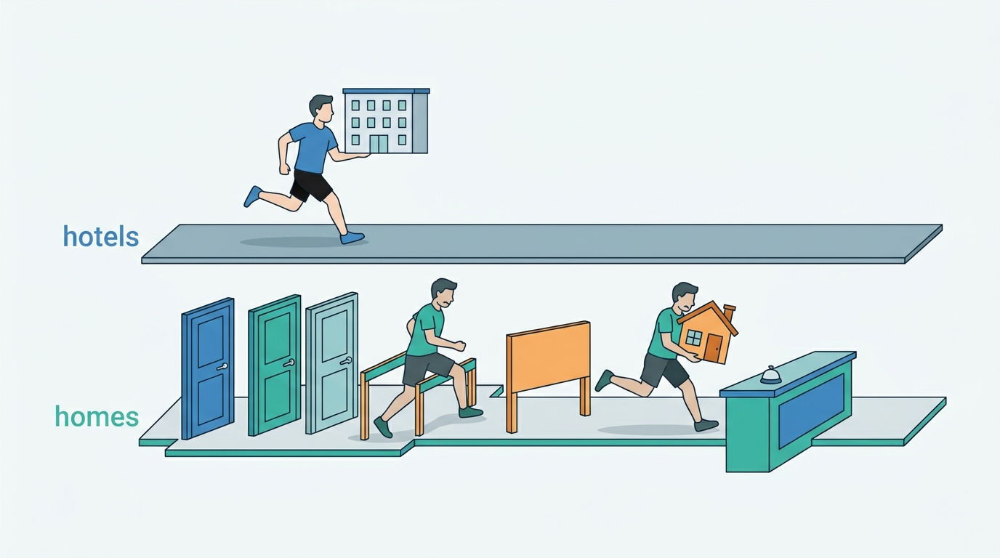
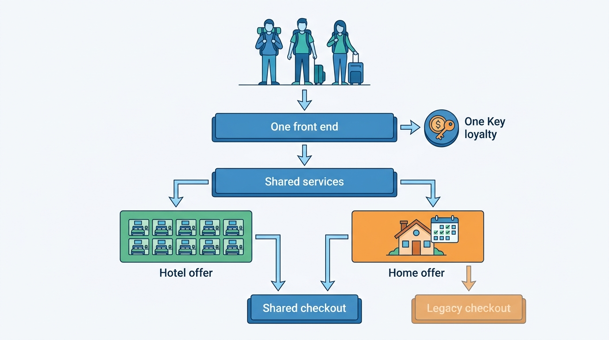
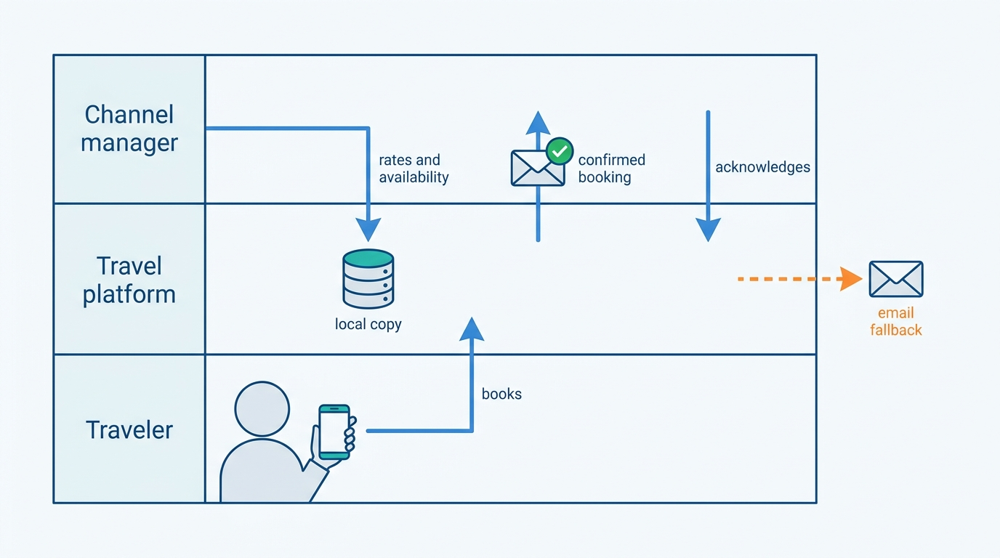
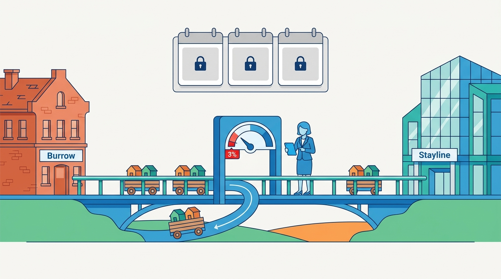

> **IN THIS CHAPTER, YOU WILL:** Trace Expedia Group's public record from the 2020 platform operating model through the Hotels.com and Vrbo front-end migrations, the 2024 guidance cut and the shared platform of 2026. You will read Expedia's partner documentation as evidence of what was merged and what was not, separate documented fact from the author's interpretation, and test the case against the book's patterns and Corvane's choices.

> **WHY THE BUSINESS CARES:** Brand consolidation is sold to boards as faster releases and lower cost. Expedia's record shows the other side: a hosted-stays brand moved onto a hotel-led stack lost momentum, and the group lowered its full-year guidance in May 2024 because of it.

> **WHY ARCHITECTS SHOULD CARE:** No other group running both marketplace types has documented its consolidation this precisely, year by year in its filings and field by field in its partner APIs. The record shows which layers converged and how long the hosted-stays model persisted underneath, along with where the migration hurt.

> **KEY POINTS:**
>
> * **Expedia converged the layers that face the traveler, and its filings claim no more.** Hotels.com moved onto the Brand Expedia front end in 2022 and Vrbo in 2023, creating "one unified front-end stack"; One Key unified loyalty from 2023; by 2026 servicing, search capabilities, payments and fraud operations ran on "shared platform infrastructure". No filing says that hotel and Vrbo supply, inventory or pricing were merged.
> * **Expedia's partner documentation shows the hosted-stays model still distinct in 2026.** Through its Rapid API, Vrbo homes are single-unit, single-rate-plan, pre-paid products with payment schedules, damage deposits, rental agreements, host lead time and an availability calendar that may not be cached. Some Vrbo bookings still go through "legacy Vrbo checkout systems", and cancellations made shortly after a booking may need time for "the back end" to settle.
> * **The hotel brand migrated quietly; the homes brand triggered a guidance cut.** In May 2024 Expedia said that "Vrbo's recovery following the recent re-platforming has been slower than anticipated" and lowered its guidance; that quarter hotel bookings grew 12% against 4% for lodging overall. The lesson for a two-marketplace group is to converge contracts and shared engines first, and to migrate the hosted-stays storefront last, against its own guardrails.

> **[FAILURE PATTERNS THIS CHAPTER ADDRESSES](where-stay-platforms-go-wrong.html):**
>
> * **The Hotel-Shaped Home** — Vrbo's slower recovery after moving onto a front end built for a hotel brand is the most public cost of the pattern, and Rapid's separate Vrbo rules show the supply model resisting it.
> * **Phantom Availability** — Expedia's supply contract says travelers book against a copy "stored locally in Expedia Group's systems" that the hotel "cannot reject", while for the Vrbo calendar "caching is not supported", two opposite answers to the same freshness problem.
> * **Lost at the Front Desk** — Expedia's documented delivery rules (per-booking ordering, acknowledgement before the next message, a sticky fallback to email) are a public template for keeping reservations from going missing at the property.

 
Expedia Group is the clearest public case of one company running both kinds of stays marketplace at scale. At the end of 2025 it counted about **3.6 million** lodging properties, of which about **2.4 million** were Vrbo vacation rentals and about **1.2 million** were hotels and other properties sold through its other brands. Lodging was **80%** of its revenue. Between 2020 and 2025 it moved three consumer brands with different histories (a full-service online travel agency, a hotel specialist and a former vacation-rental classifieds business) onto one front end, one loyalty program and a set of shared services, and it reported the steps in its annual filings.

**The case is valuable because it shows both what converged and what did not, in the company's own words.** Expedia's filings date the consolidation and name its cost. Its partner documentation, written for software engineers rather than investors, shows that hotels and Vrbo homes still enter, sell and book through different rules in 2026. Read together, they support the argument of [[converging-two-marketplaces]]: **choose the storefront by brand and the engine by supply segment, converge contracts before code bases, and treat the hosted-stays brand as the riskiest tenant of any shared front end.**

## How to Read This Case

Part X cases follow stricter evidence rules than the chapters in Parts I–IX (see [[part-10]]). A **documented fact** carries its source and publication date in the sentence. **The author's interpretation** is marked "my reading" or sits in the Chief Architect's view. A **reference-architecture inference** appears in a callout labeled `INFERENCE, NOT DOCUMENTED`.

**The evidence comes in three kinds, and each has a blind spot.** Annual reports (10-K filings) and earnings releases are dated and precise about what was migrated, but describe outcomes, not systems. Partner documentation (the Rapid distribution API and the lodging supply APIs) is the most detailed technical evidence, but mostly undated, and describes interfaces, not internals. The engineering blog covers ranking, machine learning and data, but almost never the consolidation. Where an interface implies something about internals, the chapter labels the implication.

Corvane, the fictional travel group this book follows (see [[meet-corvane]]), appears only in the final comparison. Its hosted-stays brand Nookaway is not a disguised Vrbo, and its OTA Roomstead is not a disguised Expedia or Hotels.com.

## Timeline: Expedia Group, Hotels.com and Vrbo in Dated Events

Dates are those of the cited filings, releases and pages. Brand and program facts are as of October 2026 and may change.

| Date | Event | Source |
| --- | --- | --- |
| 1995–2006 | VRBO founded to advertise one owner's condominium; HomeAway, founded 2005, rolls up listing sites and buys VRBO in 2006 | Company histories ([[two-stay-marketplaces]]) |
| Nov 2015 | Expedia announces the acquisition of HomeAway for about $3.9 billion | Company histories |
| 2019 | HomeAway rebranded Vrbo, Expedia's main vacation-rental brand | Company histories |
| 2020 | Expedia "unified its technology, product, data engineering, and data science teams" and shifted to "a platform operating model" | 10-K FY2023 (Feb 2024); 10-K FY2025 (Feb 2026) |
| 2021 | Migration of Brand Expedia, Hotels.com and Vrbo "onto one unified technology front-end infrastructure" begins | 10-K FY2022 (Feb 2023) |
| 2022 | Hotels.com front-end stack migration completed; Vrbo migration begins "in late 2022" | 10-K FY2022 (Feb 2023) |
| 2023 | Vrbo front end migrated; "one unified front-end stack"; One Key loyalty launched in the US (July) | 10-K FY2023 (Feb 2024); launch release (2023) |
| 8 Feb 2024 | CEO describes "completing a massive transformation" in 2023 | Q4 2023 earnings release |
| 2 May 2024 | "Vrbo's recovery following the recent re-platforming has been slower than anticipated"; full-year guidance lowered | Q1 2024 earnings release |
| 8 Aug 2024 | New CEO Ariane Gorin reports "sequential improvement in our consumer brands" | Q2 2024 earnings release |
| 2024 | One Key launched in the UK | 10-K FY2024 (Feb 2025) |
| 6 Feb 2025 | "All three of our core consumer brands achieved bookings growth" in Q4 2024 | Q4 2024 earnings release |
| 2025 | One Key in more Brand Expedia markets, "with the majority of Expedia Rewards members now migrated" | 10-K FY2025 (Feb 2026) |
| 13 Feb 2026 | Customer servicing, data centers, search capabilities, payment processing and fraud operations named as "shared platform infrastructure" | 10-K FY2025 |
| 2026 (n.d.) | Rapid's Vrbo guide routes some bookings to "legacy Vrbo checkout systems" | Rapid Vrbo integration guide, live October 2026 |

## Two Brands, Two Businesses

The consolidation joined brands that do not earn money the same way. The filings describe the difference plainly.

| | Hotels (Brand Expedia, Hotels.com, B2B) | Vrbo |
| --- | --- | --- |
| Supply | About 1.2 million hotels and alternative accommodations through the other brands (end 2025) | About 2.4 million "online bookable alternative accommodations" (end 2025) |
| Description in the 10-K | Hotels.com "focuses on lodging accommodations" | "Specializing in unique whole home inventory, primarily in North American leisure markets" (FY2024) |
| Business model | Merchant ("we are the merchant of record") or agency; at hotels in Expedia Traveler Preference, the traveler chooses to pay Expedia now (Expedia Collect) or pay at the hotel (Hotel Collect) | Moved "from a listings-based classified advertising model to an online transactional model"; "primarily offers a pay-per-booking service model" with a traveler service fee (FY2024) |
| Revenue timing | Merchant hotel revenue recognized when the stayed night occurs | Revenue lags bookings by "several months or more"; bookings seasonally stronger in the first quarter (FY2024) |
| Weight in results | Lodging revenue growth "primarily driven by... our hotel business" (FY2025) | Most of the property count |

Sources: [Expedia Group 10-K FY2024](https://www.sec.gov/Archives/edgar/data/1324424/000132442425000008/expe-20241231.htm), February 2025; [Expedia Group 10-K FY2025](https://www.sec.gov/Archives/edgar/data/1324424/000132442426000008/expe-20251231.htm), February 2026.

**The property count and the revenue weight point in opposite directions.** Two-thirds of Expedia's properties are Vrbo homes, but the filing attributes lodging growth mainly to hotels. In 2025 merchant revenue was 70% of Expedia's $14.7 billion, agency 22%, and advertising and other 8%, and its B2B segment, which resells Expedia's supply to airlines, agencies, retailers and banks, grew gross bookings 20% against 3% for its consumer brands (10-K FY2025). About half of its roughly 16,000 employees work in technology roles.

My reading is that these numbers set the platform's priorities: a shared stack is tuned for the traffic and revenue it carries most, which at Expedia is hotel shopping on consumer and partner channels. [[stays-marketplace-economics]] makes the general point that listing counts are not a proxy for business weight.

## Phase 1: A Platform Operating Model (2020–2021)

Expedia's filings place the decision in 2020, when it "unified its technology, product, data engineering, and data science teams" ([10-K FY2023](https://www.sec.gov/Archives/edgar/data/1324424/000132442424000007/expe-20231231.htm), February 2024) and shifted "to a platform operating model" (10-K FY2025). The organization moved first; the technical migrations followed.

At the same time Expedia was in "a multi-year effort to migrate products, data storage and processing, key portions of our consumer and affiliate sites, as well as back-office application functionality, to new technology platforms" and to increase its use of public cloud, naming Amazon Web Services ([10-K FY2024](https://www.sec.gov/Archives/edgar/data/1324424/000132442425000008/expe-20241231.htm), February 2025). The same risk factor warns that such migrations "have been in the past, and may continue to be in the future, more time consuming and expensive than originally anticipated", and that "as we continue to migrate legacy systems to newer information technology systems, we increase the risk of system interruptions".

**Brand consolidation therefore ran on top of a cloud migration and a re-organization**, not as a stand-alone project, which helps explain its length: 2020 to at least 2025.

## Phase 2: Hotels.com Onto Brand Expedia (2021–2022)

The FY2022 report gives the order: "In 2021, we began migrating our core Retail brands (Brand Expedia, Hotels.com and Vrbo) onto one unified technology front-end infrastructure... In 2022, we completed the migration of the Hotels.com front-end technology stack on to the Brand Expedia platform... In late 2022, we began the technology migration of our Vrbo business onto the Brand Expedia front-end" ([10-K FY2022](https://www.sec.gov/Archives/edgar/data/1324424/000132442423000007/expe-20221231.htm), February 2023).

Two features of the wording matter. **The target was Brand Expedia's platform, not a new one**: the incumbent's stack became the group stack. And **the noun is "front end"** throughout, not supply or inventory.

Hotels.com was the easy first tenant: it sells the same product as Brand Expedia, hotel rooms by room type and rate plan, from much of the same supply, and no public statement attributes a slowdown to its migration. Its loyalty program outlived the migration: Hotels.com Rewards was still offered outside the US and UK in early 2025 (10-K FY2024).

## Phase 3: Vrbo Onto the Same Front End (Late 2022–2023)

The FY2023 report announces the result: "we migrated both the Hotels.com and Vrbo front-end stacks onto the Brand Expedia stack and created one unified front-end stack in 2023, which increases our test-and-learn capacity and feature release velocity" ([10-K FY2023](https://www.sec.gov/Archives/edgar/data/1324424/000132442424000007/expe-20231231.htm), February 2024). The stated benefits are experimentation capacity and release speed: one stack runs more experiments and ships features to three brands at once.

In July 2023 Expedia launched One Key in the US, a loyalty program spanning Brand Expedia, Hotels.com and Vrbo with one currency, OneKeyCash; the launch release said it was the first time "a major online vacation rental platform will have a loyalty program" ([Expedia Group via Hospitality Net](https://www.hospitalitynet.org/news/4117344.html), 2023). One Key reached the UK in 2024 and more Brand Expedia markets in 2025, "with the majority of Expedia Rewards members now migrated" (10-K FY2025).

**Loyalty is where the guest layer converged furthest.** A traveler can earn on a hotel night and redeem on a Vrbo home. As [[promotions-and-loyalty]] argues, a marketplace-funded currency such as OneKeyCash is a liability in a ledger rather than a rate condition, which is why it can span a hotel brand and a homes brand without either supply model changing.

## Phase 4: The Bill Arrives (2024)

In February 2024 the CEO, Peter Kern, described 2023 as a year of "completing a massive transformation" and said the company was "in the best place we've ever been technologically" ([Q4 2023 earnings release](https://www.sec.gov/Archives/edgar/data/1324424/000132442424000005/earningsrelease-q42023.htm), 8 February 2024). Three months later he said: "Vrbo's recovery following the recent re-platforming has been slower than anticipated, which has put pressure on gross bookings... given the Vrbo drag and the rate of acceleration in B2C thus far, we are lowering our full year guidance to a range of mid to high single digit top line growth" ([Q1 2024 earnings release](https://www.sec.gov/Archives/edgar/data/1324424/000132442424000024/earningsrelease-q12024.htm), 2 May 2024). He added that "the underpinning of the work we have done on the platform is in place".

The releases do not break out Vrbo's bookings. They do report total lodging gross bookings growth and hotel bookings growth every quarter, and the gap between them is the closest public trace of the hosted-stays side.

| Period (release date) | Lodging gross bookings growth | Hotel bookings growth | Gap |
| --- | --- | --- | --- |
| Full year 2023 (8 Feb 2024) | 11% | 18% | 7 points |
| Q1 2024 (2 May 2024) | 4% | 12% | 8 points |
| Q2 2024 (8 Aug 2024) | 8% | 11% | 3 points |
| Q3 2024 (7 Nov 2024) | 8% | 10% | 2 points |
| Q4 2024 (6 Feb 2025) | 12% | 14% | 2 points |

Sources: Expedia Group earnings releases for [Q4 2023](https://www.sec.gov/Archives/edgar/data/1324424/000132442424000005/earningsrelease-q42023.htm), [Q1 2024](https://www.sec.gov/Archives/edgar/data/1324424/000132442424000024/earningsrelease-q12024.htm), [Q2 2024](https://www.sec.gov/Archives/edgar/data/1324424/000132442424000036/earningsrelease-q22024.htm), [Q3 2024](https://www.sec.gov/Archives/edgar/data/1324424/000132442424000049/earningsrelease-q32024.htm) and [Q4 2024](https://www.sec.gov/Archives/edgar/data/1324424/000132442425000005/earningsrelease-q42024.htm).

The arithmetic supports one statement: in each period the non-hotel part of lodging, mostly Vrbo, grew more slowly than hotels, most of all in the first quarter of 2024, Vrbo's peak booking season. By August 2024, under a new CEO, Ariane Gorin, Expedia reported "sequential improvement in our consumer brands"; in February 2025 it said that "all three of our core consumer brands achieved bookings growth" in the fourth quarter. The slowdown faded over about a year.

**Figure 1:** *In Q1 2024, Vrbo's peak booking season, hotel bookings grew 12% against 4% for lodging overall: the closest public trace of Vrbo's slower-than-anticipated recovery after re-platforming.*

> **INFERENCE, NOT DOCUMENTED:** Expedia named the effect, not the cause. A plausible reading, consistent with the supply contract described in the next section, is that a front end built for hotel shopping carries hotel assumptions that a whole-home brand must work around: date-first search where homes guests often search by group size and flexible dates; a rooms-and-rates page where a home has one unit and a house-rules and rental-agreement step; cancellation and payment displays built for pay-now or pay-at-hotel, where Vrbo has payment schedules and refundable damage deposits; and search-engine landing pages and URLs that change in any re-platforming. Together, in a brand whose bookings concentrate in the first quarter, small conversion losses on each would show in the annual numbers. None of this is Expedia's explanation.

## Phase 5: Shared Platform, Distinct Supply (2025–2026)

By February 2026 Expedia's description of its platform had widened beyond the front end: "All of our transaction-based businesses now benefit from our shared platform infrastructure, including customer servicing and support, data centers, search capabilities, payment processing, and fraud operations" ([10-K FY2025](https://www.sec.gov/Archives/edgar/data/1324424/000132442426000008/expe-20251231.htm), February 2026). The same report states the direction: "developing configurable technical capabilities that support various travel products while using simpler, standard architecture and common applications and frameworks", with websites and apps "powered primarily through cloud platforms and, to a lesser extent, legacy company-owned data centers".

Engineers describe the same model from inside. In May 2026 Expedia's head of platform engineering, Rick Fast, wrote that his organization "builds the technology that all of these brands and their partners run on: APIs, data and AI services, developer tools, CI/CD infrastructure, and the shared capabilities that let thousands of engineers ship reliably at scale" ([Expedia Group Technology](https://medium.com/expedia-group-tech/just-because-we-can-build-it-should-we-a292fbdd22ce), 5 May 2026). In July 2026 Expedia's machine-learning principles included "Build on shared foundations; specialize only when justified" and "Minimize and sunset manual business rules" ([Expedia Group Technology](https://medium.com/expedia-group-tech/how-expedia-group-builds-ai-that-lasts-at-scale-434677770fe9), 14 July 2026). Its lodging ranking service, rebuilt in 2026 around Keras 3, ONNX, TensorRT and Triton, is described as one service that returns "a personalised property ranking on top of a lightweight candidate generator" ([Expedia Group Technology](https://medium.com/expedia-group-tech/how-keras-3-helped-modernise-expedia-groups-lodging-ranking-stack-7fec96f052fd), 11 August 2026); the post does not say whether Vrbo results use the same model. [[stays-ranking]] covers that lineage, including the 2023 Juggler model for business adjustments.

**"Search capabilities" says shared capabilities, not one index or one ranking model.** A June 2026 post on debugging Spark jobs shows, in passing, an Iceberg table named `lodging_content_vrbo_room_type_profile_history` ([Expedia Group Technology](https://medium.com/expedia-group-tech/using-llms-to-analyze-spark-sql-plans-a-practical-approach-to-debugging-long-running-jobs-35eace7eeec4), 30 June 2026): the shared data platform holds Vrbo lodging content as its own dataset, and nothing more can be read from it.

## What the Partner APIs Reveal: Hotels and Homes in One Contract

Filings say what was merged. **Partner documentation shows what was not, because an interface cannot hide a difference its users must handle.** Expedia's Rapid API lets other businesses (airlines, agencies, retailers, banks) sell Expedia's lodging. It sells hotels and Vrbo homes "via the same Rapid API", through a content, shop, price check, book and manage flow described in [[demand-channels]] and [[availability-engine]]. The Vrbo pages then list everything that differs.

### Two products behind one API

| Dimension | Hotel inventory in Rapid | Vrbo inventory in Rapid |
| --- | --- | --- |
| Unit model | Room types with many rate plans and bed groups | "Whole property only, no shared accommodations"; "single-unit only"; "a single rate plan"; unit configuration instead of bed groups |
| Access | Available to Rapid partners generally | "650k+ instant book" properties, for a "limited number of partners" |
| Payment | Expedia Collect, or Property Collect where the hotel charges at check-in | "All bookings are pre-paid"; payment schedules and refundable damage deposits excluded unless the partner enables them |
| Meaning of `merchant_of_record` | Who charges the card | "Does not represent who will charge the card": `expedia` means "EG checkout systems", `property` means "legacy Vrbo checkout systems" (distribution of the latter "disabled by default") |
| Currency | `country` sets the traveler's point of sale | "The billing currency will always match the property's currency"; shopping in the destination currency is needed to reach most supply |
| Booking window | No minimum lead time documented | "Same day bookings are not supported"; windows under 72 hours excluded because hosts "require time to process a booking request, prepare their property" |
| Availability calendar | Through shopping | Separate calendar per day: available, minimum and maximum stay, check-in and check-out validity, up to three years ahead; "Caching is not supported at this time" |
| Changes | Hard change, guest name change, hold and resume | No hold and resume; "Guests may request changes to the host, or via cancel and re-book (recommended)" |
| Cancellation | No settling caveat documented | Within four hours of booking creation, "the back end requires additional time to settle"; retry every 10 minutes, escalate after five hours |
| Content and terms | Daily content refresh; policies | Weekly refresh at least, as Vrbo content changes "more often"; `enhanced_house_rules`; a rental agreement that "must be displayed on any check-out page" |
| Packages | Packages sold mainly under the merchant model (10-K) | "You cannot market or book Vrbo properties as part of a package" |
| Host conduct | Partner terms | Hosts are penalized for canceling; cancellation frequency affects Premier Host status and "property placement in search results" |

Sources: [Rapid Vrbo integration guide](https://developers.expediagroup.com/rapid/lodging/vacation-rentals/vrbo-integration-guide), [Vacation rentals overview](https://developers.expediagroup.com/rapid/lodging/vacation-rentals/about-vacation-rentals-api) and [Vrbo availability calendar](https://developers.expediagroup.com/rapid/lodging/vacation-rentals/vrbo-availability-calendar), Expedia Group Developer Hub, undated, fetched 21 October 2026; hotel rows from the Rapid [Shopping](https://developers.expediagroup.com/rapid/lodging/shopping/about-shopping-api) and [Property Collect](https://developers.expediagroup.com/rapid/lodging/booking/property-collect) pages, same dates.

Four rows carry most of the architectural information.

**The calendar row is the hosted-stays inventory model in one sentence.** A hotel's inventory is a count per room type and night; a home's is one bit per night plus rules that make some dates valid only as arrivals or departures. The calendar "should be called on page load", and the no-caching rule is the opposite of the hotel posture, where partners cache content daily and shop under rate limits. [[calendar-sync]] and [[inventory-integrity]] explain why a one-unit calendar cannot tolerate a stale copy.

**The payment rows show money as part of the supply model.** About 20–30% of Vrbo properties use a payment schedule for booking windows over three months; enabling schedules adds "+15-25% more available properties", and damage deposits apply to about 2%, often higher-end homes. A hotel-shaped checkout with "pay now" or "pay at the hotel" cannot express either. [[stay-payments]] develops payment plans and deposits as first-class objects.

**The `merchant_of_record` row is the strongest public evidence that back-end consolidation was incomplete in 2026.** For hotels the field says who charges the card. For Vrbo it routes the booking to one of two checkout systems, Expedia Group's or the "legacy Vrbo" one, and the deciding factors are attributes of the home and the request: no damage deposit, no payment schedule, and a search in the destination currency. My reading is that homes the shared checkout can express go through it, and the rest still book through Vrbo's own, three years after the front-end migration. The page is undated, so the routing may change.

**The cancellation row shows eventual consistency in the contract.** A partner that cancels a fresh Vrbo booking may be told to wait while "the back end" settles, with a retry schedule measured in hours. Hotel cancellations carry no such caveat.

Figure 2 places the documented layers on one picture.

**Figure 2:** *What the public record documents: one front end, one loyalty program and shared services above two distinct offer shapes, with some Vrbo bookings still routed to a legacy checkout in 2026. The arrows show documented relationships, not internal service calls.*

### Two paths for homes

Rapid's overview counts "over 900,000 vacation rentals", in two groups: "265k+ integrated with Expedia Group", "available to all Rapid partners" and "primarily managed by professional hosts", and "650k+ integrated with Vrbo", a "limited offering to select partners", managed "by a mix of professional and private hosts" (Rapid vacation rentals overview, undated, fetched October 2026). The undated figures describe what Rapid can distribute, not the size of Vrbo (2.4 million listings in the FY2025 10-K).

**So Expedia sells homes through two supply paths**: one through its hotel-style lodging supply, mostly professional managers, and one through Vrbo, including private owners, under Vrbo's single-unit rules. My reading is that this is the split [[property-and-listing-model]] describes: managed apartments often fit a room-type model, owner-run homes need a listing model. The supply segment, not the brand, decides the shape.

### How hotel supply gets in

The hotel side of the contract is documented in Expedia's lodging supply APIs, which accept connections only from "property management systems, channel managers, and central reservation systems"; "at this time we're not accepting direct connections from individual properties" ([Expedia Group Developer Hub](https://developers.expediagroup.com/supply/lodging), undated, fetched October 2026). The Availability and Rates (AR) API, read in a copy dated December 2025, updates inventory "per room type" and rates per room type and rate plan, by Expedia IDs only, up to two years ahead, with minimum and maximum length of stay, closed-to-arrival and closed-to-departure restrictions, and rates as sell or net ([Expedia Group, AR introduction](https://developers.expediagroup.com/supply/lodging/docs/avail_and_rate_apis/avail_rates/getting_started/introduction), © 2025). [[connectivity-and-channel-managers]] compares it with other channels' interfaces.

Reservations flow back under rules that put the overbooking risk on the hotel. Travelers "book against the most recent information received from you... and stored locally in Expedia Group's systems"; reservations "have already been confirmed with the traveler", and "you cannot reject these reservation notifications. Inventory issues are not an acceptable reason to reject a booking" ([Expedia Group, Booking Notification introduction](https://developers.expediagroup.com/supply/lodging/docs/booking_apis/booking_notification/getting_started/introduction), © 2025, read in an archived copy of December 2025). Delivery is ordered per booking, with the next message sent only after the previous one is acknowledged, and failed messages fall back to email, after which later changes to that booking also go by email. The same page says the push API is no longer offered to new partners; newer integrations use retrieval and GraphQL reservation APIs.

**Figure 3:** *Expedia's documented hotel supply contract: the OTA sells from its own copy of the hotel's availability, the hotel cannot reject a confirmed booking, and delivery is ordered and acknowledged per booking.*

The Vrbo side of supply connectivity is the weakest part of the public record. Expedia's 10-K says Vrbo's listing services help partners "manage an availability calendar, respond to customer inquiries, edit the content of a property listing"; the developer hub lists an "Integration Central" product to "integrate your connectivity product on the Vrbo platform", but its page was empty when fetched. One property-management system's public API, Hostaway's, lists separate channels for the Vrbo API and for Vrbo calendars synchronized by iCalendar feed ([Hostaway API reference](https://api.hostaway.com/documentation), changelog to October 2026). **In 2026 hotels and homes still entered Expedia through different doors.**

## The Layer Map: What Was Consolidated, and When

The table pulls the phases into one view. "Converged" means documented as shared at the date given; "distinct" means documented as different; a blank means no public evidence either way.

| Layer | 2020–2021 | 2022–2023 | 2024–2026 |
| --- | --- | --- | --- |
| Organization (technology, product, data teams) | Converged (2020) | Converged | Converged |
| Guest front end | Migration begins (2021) | Hotels.com (2022), Vrbo (2023): one stack | Converged |
| Loyalty | Separate programs | One Key, US (2023) | UK (2024), more markets (2025); legacy programs remain elsewhere |
| Servicing, payments, fraud, data centers | — | — | Named as shared (FY2025) |
| Search | — | — | "Search capabilities" shared; one lodging ranking service described (2026), Vrbo use not stated |
| Offer and booking contract to partners | — | — | Distinct hotel and Vrbo rules in one API |
| Checkout | — | — | Shared checkout for some Vrbo bookings; "legacy Vrbo checkout" for others |
| Supply connectivity | — | — | Distinct: hotel AR and reservation APIs; Vrbo connectivity not publicly documented |
| Inventory and pricing engines | — | — | Not public |

**Convergence moved from the guest inward and stopped, as far as the public record shows, at the offer.** What a traveler sees, earns and calls about is shared; what is sold, and how it is counted, follows the supply type.

## A Reference Architecture for "Shared Front, Distinct Supply"

The public record describes the layers but not how they connect. The inference below fills that gap only to reason about coupling.

> **INFERENCE, NOT DOCUMENTED:** A plausible reference architecture — not a description of Expedia Group's systems — has one front-end platform per surface (web, apps, partner API) that renders from a common offer contract able to carry both a room-and-rate offer and a single-unit stay offer with a payment plan, a deposit and a rental agreement. Behind the contract sit two supply engines: a hotel engine holding room-type inventory, rate plans and restrictions pushed by channel managers, sold from a stored copy; and a homes engine holding one calendar per unit with arrival and departure validity, quoted per stay and checked live. Shared engines (identity, loyalty ledger, payments, fraud, servicing) serve both. A booking router chooses a checkout by what the offer needs, which is the role Rapid's `merchant_of_record` flag plays externally. The coupling risk sits in the front end and the contract: every hosted-stays concept the contract cannot express becomes either a workaround in the shared front end or a reason to keep a legacy path.

## Trade-offs the Case Illustrates

| Option | What Expedia's record shows | When it is right | When it fails |
| --- | --- | --- | --- |
| **Converge organization and engineering platform** (teams, cloud, CI/CD, data) | Done in 2020 and reported as enabling everything after | Almost always, once brands share an owner | When a brand may be sold soon, without tenant boundaries |
| **Converge the guest front end onto the incumbent brand's stack** | Hotels.com without public cost; Vrbo with a guidance cut | When the moving brand sells the same supply shape as the incumbent | When the moving brand's product (search, page, checkout) differs, unless the stack is first generalized for it |
| **Converge loyalty as a ledger currency** | One Key across hotels and homes, market by market over three years | When enough guests use more than one brand | When it is used to justify merging what the currency does not need merged |
| **Share platform services** (servicing, payments, fraud) | Named as shared in 2026 | Where the work is the same for hotels and homes | When hosted-stays needs (deposits, schedules, host payouts, claims) are left to brand workarounds |
| **One partner API with distinct product rules** | Rapid sells both, with separate Vrbo rules, calendar and limited access | When partners want both supply types through one integration | When the shared contract hides differences partners must handle |
| **Keep a legacy path for what the shared stack cannot express** | "Legacy Vrbo checkout" routed by supply attributes | As a deliberate, measured transition | When it becomes permanent and nobody owns retiring it |

**No row is a maturity step.** Each paid off where the hotel and homes problems were the same and cost where they were not.

## Failure Modes the Record Exposes

1. **The incumbent's stack as the group's stack.** Brand Expedia's front end suited the hotel brand that followed it; my reading is that it left Vrbo the most hotel assumptions to absorb. Generalize a shared front end for the most different tenant before that tenant moves.
2. **Migrating the seasonal brand into its season.** The slowdown peaked in the first quarter of 2024, when Vrbo's bookings are seasonally strongest (10-K FY2024), so it showed in the full-year numbers. Migration calendars should follow each brand's booking curve.
3. **Success metrics set at group level.** "Test-and-learn capacity and feature release velocity" do not measure whether Vrbo guests still book. Brand-level booking guardrails are the missing measure.
4. **Contract gaps that become legacy paths.** Payment schedules and damage deposits are the documented attributes that keep some Vrbo bookings on the legacy checkout. Any concept the shared contract cannot express turns into a second system.
5. **Freshness rules copied across supply types.** Hotel availability is sold from a stored copy and refreshed by push; Vrbo's calendar must not be cached. A shared search or partner layer that applies one caching policy to both will sell nights that no longer exist ([[availability-engine]]).

## Where the Public Evidence Stops

No public source found for this book answers the following questions, and the chapter does not fill them with inference.

| Question | What is public | What is not |
| --- | --- | --- |
| Were Vrbo's supply, inventory and pricing systems merged with the hotel side? | Front end (2023), "shared platform infrastructure" for servicing, data centers, search capabilities, payments and fraud (2026) | Any statement about inventory, calendar, pricing or listing services |
| Why did Vrbo's recovery lag? | The effect and the guidance cut (May 2024) | Expedia's own diagnosis, the metrics involved, or what was changed |
| How large was the slowdown? | Lodging and hotel growth per quarter | Vrbo gross bookings, conversion or traffic per quarter |
| How do Vrbo partners connect supply? | A 10-K sentence; one PMS's channel list | The Vrbo supply API, its certification and its iCalendar import interval |
| When will the legacy Vrbo checkout be retired? | Routing rules on an undated page (live October 2026) | Plans, dates or volumes |
| What did the consolidation cost and save? | Qualitative benefits; one guidance cut | Program budgets, savings, headcount effects |

Two items are volatile as of October 2026: Vrbo's availability on Rapid ("currently only available to a limited number of partners"), and the undated figures on the vacation-rentals page.

## The Chief Architect's View

Expedia's record gives me five decision rules.

**Converge from the contract outward, not from the front end inward.** Expedia converged the most visible layer first and documented distinct supply rules years later. I would reverse the order for a group with two supply types: agree the offer and reservation contract that can carry a hotel room and a single-unit home, generalize the front end against that contract, and only then move a brand onto it. A front end built against a contract has no hotel assumptions left to impose.

**Migrate the most different brand last, against its own guardrails.** Hotels.com, a hotel brand on a hotel platform, moved without public cost. Vrbo did not. The rule I use is that the tenant whose product differs most from the shared stack moves last, by market cohort, outside its peak season, with brand-level conversion and booking guardrails that can stop the migration. Group-level release velocity is not a success measure for a brand losing bookings.

**Let the supply segment, not the brand, choose the engine.** Rapid's two groups of homes, one integrated through Expedia's lodging supply and one through Vrbo, show that professionally managed apartments and owner-run homes need different models even inside one group. The routing decision belongs in the architecture, written down, as [[converging-two-marketplaces]] argues.

**Name every legacy path and give it an owner and a date.** A "legacy Vrbo checkout" in 2026 is not a failure; keeping a path the shared contract cannot yet express is the safe choice. It becomes one without an owner, a volume measure and a retirement criterion.

**Read your own partner documentation as an architecture audit.** Expedia's most precise statement of its convergence is in a developer guide, because partners must handle every difference. A page of exceptions for one brand means the platform has not converged at that layer.

## Comparing the Case to the Book's Patterns and to Corvane

Expedia's record supports every book pattern it touches, and adds a warning about the order of convergence.

| Book pattern or claim | Expedia's record | Verdict |
| --- | --- | --- |
| Share what follows the guest, the money and the law; keep what follows how supply is counted ([[converging-two-marketplaces]]) | Front end, loyalty, servicing, payments and fraud shared; distinct Vrbo offer, calendar and checkout path | Strongly supported |
| Hosted stays need a one-unit calendar model, not room-type counts ([[property-and-listing-model]], [[rates-and-availability-model]]) | Rapid: "single-unit only", "a single rate plan", per-day arrival and departure validity | Supported, in the company's own contract |
| The OTA sells from a copy; the hosted-stays calendar must stay live ([[availability-engine]], [[inventory-integrity]]) | AR copy "stored locally", hotel "cannot reject"; Vrbo calendar "caching is not supported" | Supported |
| Deliver reservations in order, acknowledged, with a sticky fallback ([[reservation-lifecycle]], [[connectivity-and-channel-managers]]) | Booking Notification rules | Supported |
| Payment plans and deposits are first-class in hosted stays ([[stay-payments]]) | Schedules and deposits change which checkout a Vrbo booking uses | Supported; adds evidence that gaps here create legacy paths |
| Marketplace-funded loyalty is a ledger liability that can span brands ([[promotions-and-loyalty]]) | One Key across hotels and homes, rolled out by market | Supported |
| Migrate by cohort with commercial guardrails ([[modernizing-a-live-marketplace]]) | Vrbo slowdown after a one-brand migration; recovery over about a year | Supported by the cost of not doing it, as far as the public record shows |

Corvane's One Stay program sits close to Expedia's 2026 end state and far from its 2021 starting point. It was approved in April 2027 at **€145 million** over three years, and its December 2027 capability map v2 recorded 23 shared engines, 6 shared contracts and 20 brand-specific capabilities, over 49 ([[converging-two-marketplaces]]).

| Corvane choice (2027) | Expedia parallel | What the case suggests |
| --- | --- | --- |
| Storefronts stay per brand; channel machinery (edge, backend-for-frontend framework, landing assembly, partner API framework) is shared ([[demand-channels]]) | One front-end stack for three brands (2021–2023) | Corvane's order is safer for its homes brand; it forgoes some release-velocity gains Expedia reported |
| Shared offer and reservation contracts first; Tally and Pricegrid for Roomstead, Almanac for Nookaway | Distinct hotel and Vrbo rules behind one Rapid API | The contract is the layer Expedia's partner documentation shows it still had to split; Corvane builds it first |
| Group-wide loyalty declined until Corvane ID lets guests link accounts in 2028 | One Key spanning three brands from 2023 | Expedia shows loyalty can span hotels and homes; Corvane is right to measure overlap first, since Roomstead Circle is partly partner-funded rate conditions |
| Gangway will not distribute Nookaway homes before 2029, then only calendar-first with host opt-in | Vrbo on Rapid: limited partners, calendar API, no caching | Expedia's rules are the template for Corvane's 2029 product |
| Nookaway's 2028 boutique-hotel pilot runs on the hotel engine; Costa Keys' 38 Málaga apartments sell as five room types on Roomstead and 38 listings on Nookaway | Rapid's 265k homes "integrated with Expedia Group" versus 650k "integrated with Vrbo" | Engine by supply segment is what Expedia's own supply paths look like |
| Stayline becomes system of record for new Nookaway reservations in 2028 | Some Vrbo bookings still on "legacy Vrbo checkout" in 2026 | Name and measure Burrow's remaining booking paths from the start |

**The last row is where Corvane is most exposed.** Moving new Nookaway reservations onto Stayline in 2028 is Corvane's equivalent of Vrbo's re-platforming: the hosted-stays brand's booking path moves onto shared machinery. Nookaway's bookings are seasonal too: about 34% of its gross bookings are made from January to March. In December 2027 Mariana Costa, Corvane's Group Chief Architect, used Expedia's Q1 2024 numbers to set the migration's terms with Rafael Mendes, Nookaway's VP Engineering. Nookaway's move to Stayline runs in cohorts of hosts and listings (a professional manager's units move together, as [[modernizing-a-live-marketplace]] requires), with no cohort switching between 1 January and 31 March 2028. Each cohort carries a **brand guardrail**: if its gross bookings fall more than **3%** below a matched control group for two consecutive weeks, new bookings for the cohort route back to Burrow while the gap is diagnosed. Every booking type that Burrow still handles because Stayline's contract cannot yet express it is reported weekly with its share of bookings and a named owner. Group release velocity is reported beside these numbers, not instead of them.

**Figure 4:** *Nookaway moves to Stayline by cohort, never between 1 January and 31 March 2028, and a cohort routes back to Burrow if its bookings fall more than 3% below its control group for two weeks.*

## Questions to Ask

1. Which layers have we actually converged, and would our own partner documentation agree with the strategy deck?
2. Can our offer and reservation contract express a single-unit home with a payment schedule, a damage deposit and a rental agreement, as well as a hotel room with rate plans? If not, where does each missing concept live today?
3. Whose stack is becoming the group stack, and which tenant's product differs most from it?
4. When does each brand's booking season peak, and does our migration calendar avoid it?
5. What brand-level guardrail would stop a migration, and who has the authority to pull it?
6. Which legacy booking, checkout or supply paths remain after consolidation, what share of bookings do they carry, and which contract gap keeps each alive?
7. Do our availability caches and partner APIs apply the right freshness rule to each supply type, or one rule to both?
8. For apartments and homes, which supply segment decides the engine, and where is that rule written down?
9. Does our loyalty design need anything beyond a shared ledger currency, and have we measured how many guests use more than one brand?

Expedia shows a group converging its guest layers in public and its supply model persisting underneath. The next case, [[case-agoda-trip-com]], turns to two Asian OTAs whose documented problems sit lower in the stack: supplier price caches, multi-product booking engines and supply at the scale of billions of queries a day.

## Sources and Evidence

### Company engineering and investor sources

- [Form 10-K for fiscal 2022](https://www.sec.gov/Archives/edgar/data/1324424/000132442423000007/expe-20221231.htm) — Expedia Group, 2023. Front-end migration from 2021; Hotels.com completed in 2022; Vrbo begun late 2022.
- [Form 10-K for fiscal 2023](https://www.sec.gov/Archives/edgar/data/1324424/000132442424000007/expe-20231231.htm) — Expedia Group, 2024. Team unification in 2020; one unified front-end stack in 2023 and its stated benefits.
- [Form 10-K for fiscal 2024](https://www.sec.gov/Archives/edgar/data/1324424/000132442425000008/expe-20241231.htm) — Expedia Group, 2025. Vrbo's model and markets; revenue lag and first-quarter seasonality; technology-migration risk factors; Hotels.com Rewards outside the US and UK.
- [Form 10-K for fiscal 2025](https://www.sec.gov/Archives/edgar/data/1324424/000132442426000008/expe-20251231.htm) — Expedia Group, 2026. Property counts; revenue mix; B2B growth; platform operating model; shared platform infrastructure; One Key rollout; platform direction.
- Earnings releases for [Q4 2023](https://www.sec.gov/Archives/edgar/data/1324424/000132442424000005/earningsrelease-q42023.htm) (8 February 2024), [Q1 2024](https://www.sec.gov/Archives/edgar/data/1324424/000132442424000024/earningsrelease-q12024.htm) (2 May 2024), [Q2 2024](https://www.sec.gov/Archives/edgar/data/1324424/000132442424000036/earningsrelease-q22024.htm) (8 August 2024), [Q3 2024](https://www.sec.gov/Archives/edgar/data/1324424/000132442424000049/earningsrelease-q32024.htm) (7 November 2024) and [Q4 2024](https://www.sec.gov/Archives/edgar/data/1324424/000132442425000005/earningsrelease-q42024.htm) (6 February 2025) — Expedia Group. Transformation statement; Vrbo's slower recovery and the guidance cut; lodging and hotel growth by quarter; recovery statements.
- [One Key launch release](https://www.hospitalitynet.org/news/4117344.html) — Expedia Group via Hospitality Net, 2023. One Key's US launch across three brands.
- [Just Because We Can Build It, Should We?](https://medium.com/expedia-group-tech/just-because-we-can-build-it-should-we-a292fbdd22ce) — Rick Fast, Expedia Group Technology, 2026. Platform engineering serves all brands and partners.
- [How Expedia Group Builds AI That Lasts at Scale](https://medium.com/expedia-group-tech/how-expedia-group-builds-ai-that-lasts-at-scale-434677770fe9) — Xavier Amatriain, Expedia Group Technology, 2026. Shared foundations and specialization principles for ML.
- [How Keras 3 Helped Modernise Expedia Group's Lodging Ranking Stack](https://medium.com/expedia-group-tech/how-keras-3-helped-modernise-expedia-groups-lodging-ranking-stack-7fec96f052fd) — Conor Worthington, Expedia Group Technology, 2026. One lodging ranking service.
- [Using LLMs to Analyze Spark SQL Plans](https://medium.com/expedia-group-tech/using-llms-to-analyze-spark-sql-plans-a-practical-approach-to-debugging-long-running-jobs-35eace7eeec4) — Expedia Group Technology, 2026. A Vrbo lodging-content table in the shared data platform.

### Standards, regulation and documentation

- [Rapid Vrbo integration guide](https://developers.expediagroup.com/rapid/lodging/vacation-rentals/vrbo-integration-guide) — Expedia Group Developer Hub, n.d. (fetched 21 October 2026). Vrbo unit, payment, currency, checkout routing, booking window, change, cancellation, content and host rules.
- [Rapid vacation rentals overview](https://developers.expediagroup.com/rapid/lodging/vacation-rentals/about-vacation-rentals-api) — Expedia Group Developer Hub, n.d. (fetched 21 October 2026). Two groups of homes; limited availability; payment schedule and deposit shares.
- [Rapid Vrbo availability calendar](https://developers.expediagroup.com/rapid/lodging/vacation-rentals/vrbo-availability-calendar) — Expedia Group Developer Hub, n.d. (fetched 21 October 2026). Per-day calendar, three-year horizon, no caching.
- [Rapid Shopping API](https://developers.expediagroup.com/rapid/lodging/shopping/about-shopping-api) and [Property Collect](https://developers.expediagroup.com/rapid/lodging/booking/property-collect) — Expedia Group Developer Hub, n.d. (fetched 21 October 2026). Hotel offer and payment rules.
- [Lodging supply connectivity hub](https://developers.expediagroup.com/supply/lodging) — Expedia Group Developer Hub, n.d. (fetched October 2026). Who may connect; GraphQL APIs.
- [Availability and Rates API introduction](https://developers.expediagroup.com/supply/lodging/docs/avail_and_rate_apis/avail_rates/getting_started/introduction) and [Booking Notification API introduction](https://developers.expediagroup.com/supply/lodging/docs/booking_apis/booking_notification/getting_started/introduction) — Expedia Group, © 2025 (archived copies of December 2025). Hotel ARI model; booking against a stored copy; delivery rules.
- [Hostaway Public API Reference](https://api.hostaway.com/documentation) — Hostaway, 2026 (changelog). API and iCalendar channels to Vrbo listed separately.

### Research and practitioner sources

- Company histories of [Vrbo](https://en.wikipedia.org/wiki/Vrbo) and [HomeAway](https://en.wikipedia.org/wiki/HomeAway) — Wikipedia, accessed 21 October 2026. Founding, acquisition and rebrand dates only.

Corvane is fictional; architectural recommendations and labeled inferences are the author's judgement.
