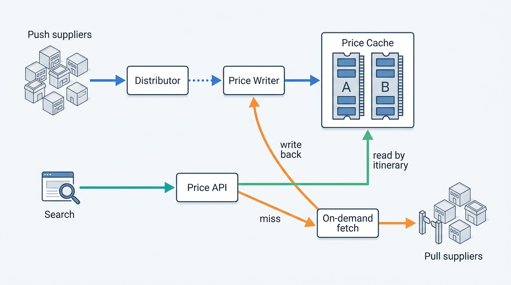
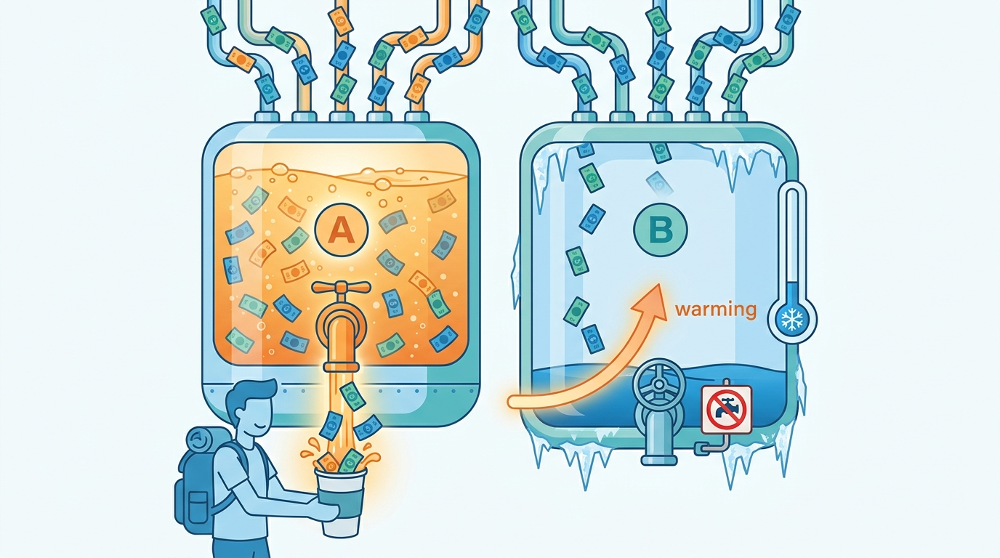
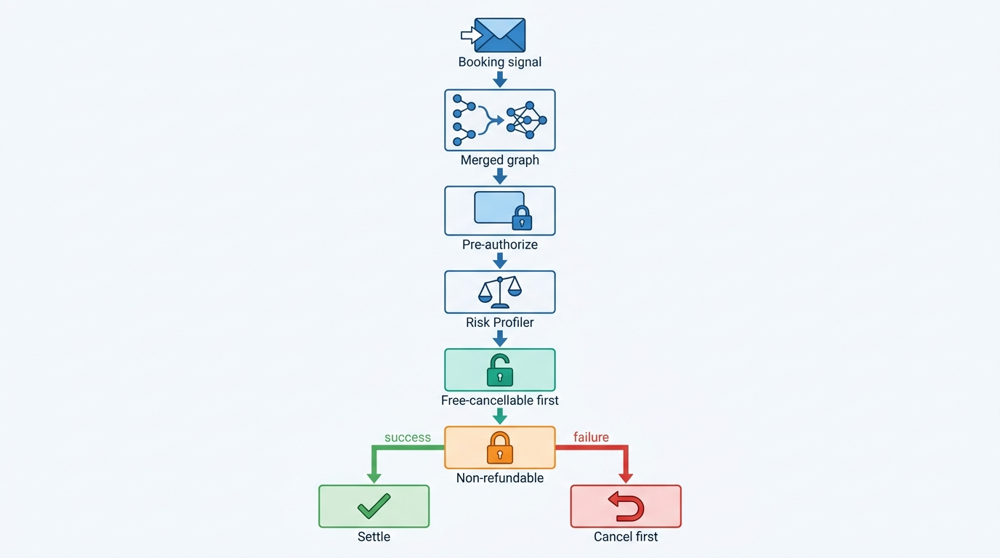
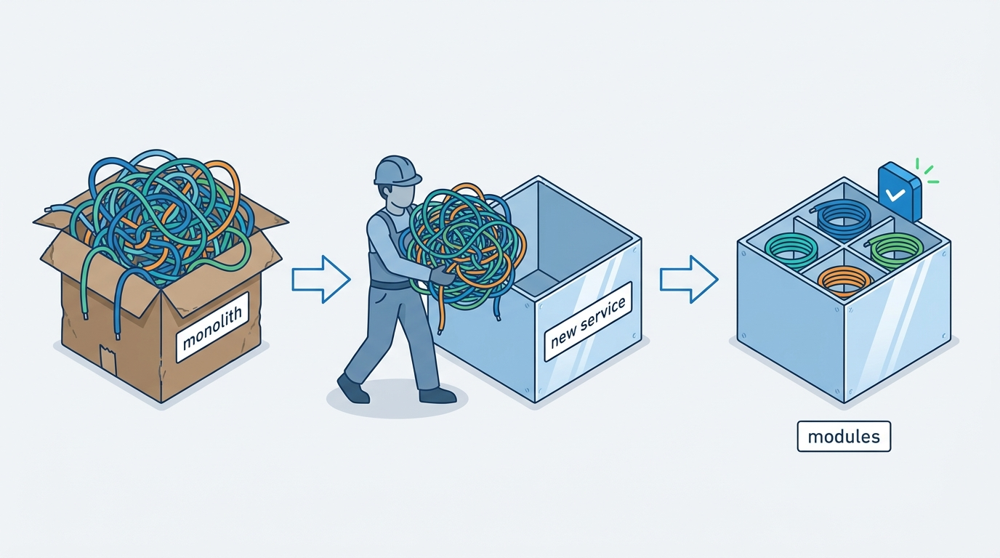
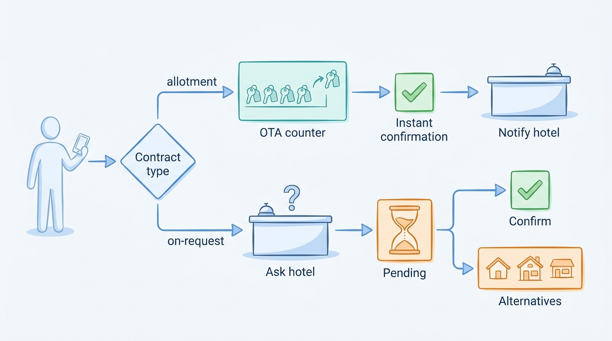

> **IN THIS CHAPTER, YOU WILL:** Read Agoda's public engineering record from 2020 to October 2026 layer by layer (supply, price cache, booking, post-booking, platform, experimentation) and Trip.com's much thinner record (one annual filing, one product announcement and three open-source repositories). For each, you will separate what is documented from the author's reading, see where the evidence stops, and compare both with the book's patterns and Corvane's choices.

> **WHY THE BUSINESS CARES:** Agoda and Trip.com are the two large OTAs built around Asia-Pacific demand, and both compete for hotels that European groups want to add. Their records show what selling hotel rooms at Asian scale costs: price data that is written far more often than it is read, supplier queries that must be rationed, and a confirmation promise that depends on what the hotel has contracted in advance.

> **WHY ARCHITECTS SHOULD CARE:** Agoda publishes concrete, dated engineering about the parts of an OTA that most companies keep quiet: the price cache, booking orchestration across products, duplicate-booking prevention across data centers, and a post-booking service rebuilt after a line-by-line migration. Trip.com shows the opposite case, a company whose architecture can be read only from a filing, and so it is a lesson in reading evidence honestly.

> **KEY POINTS:**
>
> * **An OTA that aggregates suppliers sells from a cache, and the cache is a product.** Agoda's price cache takes about five writes for every read, its first tier held only one- to four-night stays, and its hit ratio decides both whether customers see prices and when traffic fails over. Freshness is bought with rationed supplier queries, not only with engineering.
> * **Agoda designs its booking path for partial failure and for its own retries.** Its booking graphs confirm the free-cancellable product first, its deduplication works after traffic moves between data centers, and its post-booking service was rebuilt as a modular monolith after a line-by-line port carried the old coupling into a new codebase.
> * **Trip.com's public record is a filing and some infrastructure repositories, and should be read as such.** Its 20-F documents an agency model with guaranteed-allotment and on-request hotel contracts, a hotel matching system and incremental rate updates. Its ranking, inventory and booking internals are not public, and this case does not invent them.

> **[FAILURE PATTERNS THIS CHAPTER ADDRESSES](where-stay-platforms-go-wrong.html):**
>
> * **Phantom Availability** — Agoda's record shows how much machinery it takes to keep a supplier-price copy fresh enough to sell from: expiry times (TTLs), rationed pulls, write-behind on misses and a hit-ratio failover.
> * **The Same Hotel Twice** — both companies aggregate the same hotels from many suppliers, and Trip.com names a hotel matching system as core search technology.
> * **Built for Sunny Days** — Agoda's three-hour cache re-warm, its cross-data-center deduplication and its configuration blast radius show what breaks when traffic moves or a cluster restarts.

 
Agoda and Trip.com are often grouped together as "the Asian OTAs" (online travel agencies), and the grouping hides more than it shows. **Agoda**, headquartered in Singapore, is one of Booking Holdings' primary consumer brands. It sells mostly accommodation to travelers in Asia-Pacific, and it has published one of the most detailed engineering blogs in travel. **Trip.com Group** began as Ctrip in 1999. It owns Ctrip, Trip.com, Qunar and Skyscanner, earns over a third of its revenue from transportation ticketing, and acts as an agent in almost all of its hotel business. It publishes very little in English about how its systems work.

Part X tests the book's patterns against real companies. This case asks two questions. **What does an OTA built on aggregated supply look like when its engineers describe it?** Agoda answers that question in unusual detail. **What can an architect responsibly conclude when a company describes itself only in a filing?** Trip.com is the test of that discipline. The answers support three arguments of this book: an OTA sells from a copy, and the copy needs an owner ([[availability-engine]]); the booking path must give a definite answer when its dependencies fail or repeat themselves ([[checkout-orchestration]]); and a migration that moves code without changing its design moves the coupling too ([[modernizing-a-live-marketplace]]).

**Agoda gets most of the pages because it published most of the evidence, not because its choices are better.** Every statement below is true at the date of its source and no further.

## How to Read This Case

Part X cases follow stricter rules than the chapters in Parts I–IX (see [[part-10]]). A **documented fact** carries its source and publication year in the sentence. **The author's interpretation** is marked "my reading" or sits in the Chief Architect's view. A **reference-architecture inference** appears only in a callout labeled `INFERENCE, NOT DOCUMENTED`.

Three limits shape the case:

- **Agoda's record is engineering-rich and business-poor.** Booking Holdings does not report Agoda separately, so the only Agoda volumes are those its engineers published. Posts from before 2023 carry an age warning: they may describe replaced systems.
- **Trip.com's record is business-rich and engineering-poor.** The fiscal 2025 Form 20-F, filed in April 2026, is detailed about revenue and contracts and has a few paragraphs about technology. No English-language engineering blog was reachable for this book. Three open-source repositories from Trip.com's framework teams are the only first-party technical artifacts, and they describe infrastructure, not hotel systems.
- **Neither company has published its ranking architecture, its hotel inventory model or its reservation state machine.** Where this matters, the chapter says so instead of borrowing from interview-preparation write-ups.

Corvane, the fictional travel group this book follows (see [[meet-corvane]]), appears only in the final comparison. Its Roomstead marketplace buys from a fictional Singapore-based bedbank, but Corvane is a composite of industry patterns and is not a disguised description of Agoda, Trip.com or any other company.

## The Two Companies in Dated Facts

| | Agoda | Trip.com Group |
| --- | --- | --- |
| **Ownership** | One of Booking Holdings' five primary consumer brands, "catering primarily to consumers in the Asia-Pacific region, with headquarters in Singapore" (Booking Holdings 10-K, 2026) | Listed holding company; brands include Ctrip, Trip.com, Qunar (consolidated from 2015) and Skyscanner (from 2016); renamed from Ctrip in 2019 (20-F, 2026) |
| **Origins** | "Began its journey in 2005 as a pioneer in online hotel bookings" (Agoda Engineering, 2025) | "Commenced our business in June 1999"; overseas expansion since 2009 (20-F, 2026) |
| **Accommodation scale** | Not reported separately; Booking Holdings attributes merchant gross-bookings growth "primarily" to Booking.com and Agoda (10-K, 2026) | Accommodation revenue RMB 26.1 billion in 2025, **42%** of total revenue; about **1.7 million** accommodation listings on its open platform at end-2025 (20-F, 2026) |
| **Money model for hotels** | Pay-now and pay-later ("Book with ZeroPay") flows in the booking engine (Agoda Engineering, 2025) | "We act as an agent in substantially all of our hotel-related transactions"; revenue recognized "when the reservation becomes non-cancelable" (20-F, 2026) |
| **Hosting** | "Four data centers in Asia, Europe, and the US", run in-house because it "remains more cost-effective" (Agoda Engineering, 2025): Hong Kong, Singapore, Amsterdam and Ashburn (2026) | "We use both public and private cloud technologies" (20-F, 2026) |
| **Channels** | Web, apps, affiliate APIs, white-label partner sites | Over 90% of 2025 transaction orders on mobile; Trip.com in 27 languages, 44 currencies and 48 local sites (20-F, 2026) |

## Agoda: The Record, Layer by Layer

### Supply in: push streams and rationed pulls

Agoda documents **both** ways an OTA receives supply, which is rare.

**Push.** Hotels and channel managers send availability and rate updates. Agoda's supply API implements the OpenTravel `OTA_HotelAvailNotifRQ` message: stop-sell as `RestrictionStatus Status="Close"`, closed-to-arrival and closed-to-departure as restrictions on that status, minimum and maximum length of stay (LOS) as `SetMinLOS` and `SetMaxLOS`. Each update addresses a room type and rate plan together, and its `Start` and `End` dates are **inclusive** ([Agoda Supply API](https://developer.agoda.com/supply/reference/ota_hotelavailnotifrq), n.d.; the URL redirected to agoda.com when rechecked on 21 October 2026). Booking.com's B.XML availability message treats its `to` date as exclusive, so a channel manager that serves both must translate every date range; [[connectivity-and-channel-managers]] treats this as the reason to normalize every dialect at the edge.

Push volumes are bursty. In a 2024 post on Kafka load balancing, Agoda wrote that "a single supplier can provide 1.5M price updates and offer details in just one minute". A **distributor** "consumes price updates from 3rd party systems and distributes processing jobs to downstream processor service in multiple data centers", and "any delays or failures in reflecting these updates can lead to incorrect pricing and customer booking failures". Naive partitioning failed because the private cloud mixes hardware generations and because messages differ widely in cost: some trigger third-party HTTP calls, others only database writes ([Agoda Engineering, 2024](https://medium.com/agoda-engineering/how-we-solve-load-balancing-challenges-in-apache-kafka-8cd88fdad02b)).

**Pull.** For suppliers that are not hotels (wholesalers and other distributors), Agoda asks for prices instead of receiving them. Its 2020 paper says that "each supplier only allows Agoda to fetch for the hotel price with a limited amount of Queries Per Second (QPS)", which "is never enough to cover all user searches. Inevitably, many user searches have to be ignored. Hence, booking lost." The paper's system, PriceAggregator, "intelligently determines when, how and what to send to the suppliers to fetch for price", and online A/B tests showed it "increases Agoda's bookings significantly" ([Agoda, arXiv, 2020](https://arxiv.org/abs/2008.02087)). Search-index excerpts of two companion blog posts describe a proactive fetcher running at a constant QPS and "SmartTTL", which estimates how long each supplier price stays valid. *Age warning: this is 2020 evidence; whether PriceAggregator still runs in front of the 2026 cache is not public.*

My reading of the two modes together: **freshness at an aggregating OTA is a budget, not a property.** The push side spends Agoda's own capacity on updates that arrive whether or not anyone searches. The pull side spends a supplier's capacity, which the supplier rations. In both cases a model or a policy decides which prices are worth keeping fresh, and that decision has a booking cost when it is wrong. [[stays-ml-platform]] counts such freshness models among the OTA-specific uses of ML.

On 17 August 2026 Agoda announced the **Agoda Partner Portal**, "formerly known as" the Yield Control System (YCS), with revenue-management tools, a comp-set benchmark and AI pricing suggestions that partners must verify ([Agoda via Kyodo News PR Wire, 2026](https://kyodonewsprwire.jp/release/202608174214)). An undated help page from a property-management-system (PMS) vendor says that single exclusive-use units went to **Agoda Homes** while properties with two or more units went to YCS ([NightsBridge](https://nightsbridge-6.screenstepslive.com/a/1973011-how-to-navigate-within-your-agoda-ycs-partner-extranet), n.d.). If it still holds, that is a hotel-versus-home boundary drawn at onboarding; the current state is not verified.

### The price cache: a copy keyed by itinerary

The best single source in this case is Agoda's August 2026 post on its **Price Cache** ([Agoda Engineering, 2026](https://medium.com/agoda-engineering/how-agoda-scaled-its-price-cache-with-dragonflydb-0828e478e84f)). The cache "stores terabytes of volatile rate data fetched from our global network of suppliers". Search reads from it: "A cache hit provides an immediate response. A cache miss triggers an on-demand workflow that fetches the latest rates and integrates them back into the system." The Price API reads by "hotel, occupancy, check-in date, and check-out date", so the key is an **itinerary**, not a night, and each entry holds price data per supplier.

The load shape is the most useful number in the public record of OTAs.

| Measure (before migration unless stated) | Value |
| --- | --- |
| Reads | about **300,000** per second |
| Writes | close to **1.5 million** per second (about 1.6 million after migration) |
| Read-to-write ratio used in load tests | **1:6**, about 10 keys per `MGET` |
| P99 latency requirement | under **50 ms** |
| Data in memory | about **1.5 TB**, growing |
| Legacy store | SQL Server, **72 shards**, application-level routing, scaled only in steps (6 → 12 → 18 servers) with manual remapping; hardware doubled in early 2024 and near its limits again within a year |
| After migration to DragonflyDB | read P99 about **8 ms** at about 300,000 reads per second (an eightfold improvement); write P99 about 10 ms |

Agoda chose DragonflyDB, a Redis-compatible in-memory store, for its multi-threaded design, cluster mode, existing in-house use, and **built-in expiry**, which retired a custom job that had purged stale supplier data from SQL Server.

The migration was staged with care:

1. **Hot data first.** The first deployment was a single 1 TB instance holding only "itineraries with a length of stay between one and four days". Within months it reached about 900 GB and its 90% memory threshold, and evictions "risked preventing customers from seeing the best available prices". Agoda moved to clusters of three shards each, holding the full dataset.
2. **Dual reads for parity.** SQL Server kept serving customers while the Price API read DragonflyDB asynchronously and compared two proxies: the number of suppliers returned and the length of each supplier's price data. Both matched above **99.9%**; the rest were timestamps and unique IDs.
3. **An A/B experiment on booking metrics** moved customers to the new store, then to 100% within a few weeks.
4. **Maintenance and failover.** Two clusters, A and B, allow one to be patched while the other serves. A cluster that restarts empty takes writes immediately but stays unreadable, because "serving traffic from an empty cache could result in customers receiving no prices"; in the example given it took about **three hours** to warm to its peer's hit ratio. Agoda then automated failover: every five seconds each application pod compares the two clusters' hit ratios over the previous five minutes and marks a cluster unreadable if it trails by at least 10 percentage points and the gap is statistically unlikely to be noise, recovering at 3 points. Pods decide independently, with no coordinator; in a drill about 40 pods failed over within about two minutes. Agoda is exploring restoring a cluster from a snapshot instead of warming it cold.

**Figure 1:** *Agoda's price path, assembled from posts published in 2020, 2024 and 2026. Each box is documented; the dotted edge from the 2024 distributor to the 2026 writer is the author's reading, because no post connects them. What the figure shows is the load shape: writes arrive from suppliers whether or not anyone searches, and reads hit a copy keyed by itinerary.*

Three things here matter beyond Agoda. First, **writes dominate reads**, because supplier updates do not wait for demand; an OTA that designs its price store as a read cache with occasional invalidation has the problem the wrong way round. Second, **the hit ratio is a business metric and a health signal at once**: a cold cluster means customers see no price, so warming and failover belong to the product. Third, **short stays dominate**, which justifies tiering by length of stay, and creates a predictable failure when demand moves outside the tier. [[availability-engine]] builds its staleness budget and hot-tier design on the same observations.

**Figure 2:** *A restarted cluster takes writes at once but stays unreadable until it is warm, about three hours in Agoda's example, because an empty cache would show customers no prices.*

A related 2023 post describes the **Price Delivery System (PDS)**, which "serves hotel room prices for our web, mobile, and affiliate APIs, handling over a million requests per second in four data centers". Its local in-memory metadata caches had a 50% hit ratio, and **affiliate traffic with broad searches** drove the evictions. A shared Couchbase cache improved PDS response time by 20% ([Agoda Engineering, 2023](https://medium.com/agoda-engineering/improving-performance-using-distributed-cache-with-couchbase-aa7ebf3a12c9)). The relationship between PDS and the 2026 Price Cache is not described. My reading: **distribution partners' broad searches break pricing caches**, which is also why Expedia Group's B2B API rations partners by conversion ([[case-expedia-vrbo]]).

### Booking: graphs, risk ordering and duplicate prevention

Agoda's **Multi-Product Booking Engine (MPBE)**, described in November 2025, receives a booking signal from RabbitMQ, and a workflow orchestrator generates a **dynamic graph** of steps (availability confirmation, fraud check, payment and so on), each run by a single-purpose asynchronous agent. "Book with ZeroPay" reuses the hotel graph with the payment step switched off by flag. For a cart such as flight plus hotel, the per-product graphs are **merged**: itinerary-level steps such as card pre-authorization and settlement run once, and product-level steps run in sequence or in parallel. A **Risk Profiler** chooses the confirmation order from cancellation terms: confirm the free-cancellable product first, so that it can be rolled back without penalty if the other fails. Agoda reported four regions, 96 Kubernetes pods per region, "over 25 unique booking graphs" and graphs of "up to 60 nodes" ([Agoda Engineering, 2025](https://medium.com/agoda-engineering/how-agodas-multi-product-booking-engine-powers-seamless-travel-bookings-61fc6e746821), read via an archived copy).

**Figure 3:** *Agoda's cart booking as described in 2025. The order of confirmation is a risk decision: confirming the product that can be undone for free first turns a two-supplier transaction into one with a cheap compensation path.*

My reading: this is a **saga whose compensation cost is priced before it runs**; cancellation terms are an input to the plan, not a failure path written later. [[checkout-orchestration]] generalizes the idea for any commitment that crosses a supplier boundary.

Agoda's **booking deduplication**, described in July 2024, addresses the opposite problem: two bookings where the customer wanted one. "Delays in the booking creation process led customers to rebook when they did not receive a confirmation email", and Agoda then paid the cancellation costs. The service detects an identical earlier booking and asks the customer, "Is this a duplicate booking?" The legacy version worked only within one data center, so it failed when traffic was moved during incidents. The redesign writes every new booking as a **candidate** to both a local database and a **central** database that holds all data centers' candidates, queries both in parallel, and merges the results with rules for every failure combination: trust the side that returned more, and when statuses disagree prefer Inactive over Active over Awaiting. Static fields are hashed into one column so that one table serves every product, and a unique-key constraint catches duplicate API requests within about a second ([Agoda Engineering, 2024](https://medium.com/agoda-engineering/booking-deduplication-how-agoda-manages-duplicate-bookings-across-multiple-data-centers-08ddbe9e22f1), read via an archived copy).

This is the most direct public description of **Built for Sunny Days** I know of in travel: a safeguard that failed precisely when an incident moved traffic, which is when duplicate bookings are most likely.

### After the booking: from a line-by-line port to a modular monolith

On 20 October 2026 Agoda published the history of **BAPI**, the write-oriented service that orchestrates cancellations, amendments, refunds and customer communications ([Agoda Engineering, 2026](https://medium.com/agoda-engineering/how-we-cut-the-coupling-tax-in-a-post-booking-api-2156a3175538)). In 2019 Agoda split its core monolith into booking creation and post-booking and ported the post-booking code "line by line into a new application, without attempting a broader redesign". After the legacy service was retired and its traffic moved to BAPI, merge requests "more than quadrupled between 2022 and 2025", some files exceeded 4,000 lines, and the package-by-layer structure let business logic, data access and utilities mix.

A rewrite was ruled out. Agoda introduced a **modular monolith**: domain components such as `rebook`, `cancellation` and `payment`, each with application, service, repository and model layers; repository-specific models never leave the repository; objects are created only through typed builders; and sibling services do not call each other. The rules run as ArchUnit tests in CI as a hard gate, which the authors describe as architectural fitness functions. New modules use the framework by default, and legacy areas move when feature work touches them.

The authors measured the result and were careful about it. In Q2 2026, merge requests made at least 90% in framework code finished review **64%** faster at the median than comparable legacy merge requests (1.08 against 3.02 hours) and received first feedback 34% sooner, with small samples of 4 to 21 framework merge requests a month. From June to August 2026, 91% of framework merge requests had recorded AI-agent activity against 69% for legacy, and framework code took about 29% fewer prompts per 100 changed lines.

My reading: **a line-by-line port moves the design along with the code.** The split of 2019 gave post-booking its own deployment and scaling, but not its own boundaries, and the coupling regrew inside the new service as contributors arrived. The lesson [[modernizing-a-live-marketplace]] takes from this is that extraction is the moment to change the model, not only the runtime, and that boundaries survive only when the build enforces them.

**Figure 4:** *My reading: a line-by-line port moves the design along with the code; Agoda's post-booking service regrew its coupling until module boundaries enforced in the build began to separate it.*

### Platform: own data centers, Kafka and configuration

In a May 2025 interview, Agoda's CTO, Idan Zalzberg, said Agoda operates "our own infrastructure across four data centers in Asia, Europe, and the US", because "at our current size, running in-house remains more cost-effective and gives us greater control"; for portability it "moved from HDFS to a proprietary S3 provider that is protocol-compliant" ([Agoda Engineering, 2025](https://medium.com/agoda-engineering/agodas-cto-on-why-managers-should-code-running-on-prem-and-adopting-generative-ai-b1b4c5c7028b)). Its private cloud runs on Kubernetes with mixed hardware generations ([Agoda Engineering, 2024](https://medium.com/agoda-engineering/how-we-solve-load-balancing-challenges-in-apache-kafka-8cd88fdad02b)).

**Kafka** is Agoda's event and replication backbone. In 2023 Agoda sent "around 1.8 trillion events per day" through it, growing about twice a year since 2015, and used it as "an asynchronous API" and for "data replication across our on-premise data centers". Agoda runs many smaller clusters per use case and **attributes cost to teams by bytes produced** ([Agoda Engineering, 2023](https://medium.com/agoda-engineering/how-agoda-manages-1-8-trillion-events-per-day-on-kafka-1d6c3f4a7ad1)). By mid-2025 the platform ingested "over 3 trillion records" a day. Agoda rejected stretch clusters across its distant data centers and runs consumers **active-passive**, with an extension that keeps consumer-group offsets synchronized in both directions so that only one consumer group is active per pair of data centers ([Agoda Engineering, 2025](https://medium.com/agoda-engineering/how-agoda-handles-kafka-consumer-failover-across-data-centers-a3edbacef6d0)).

**Configuration** was named "our biggest risk". Agoda runs "thousands of microservices" across Hong Kong, Singapore, Amsterdam and Ashburn, with more than 34,000 Consul keys. Global keys are managed in Hong Kong and replicated without gradual rollout, so "a single change to a global/ key in HK would instantly propagate to all four production data centers simultaneously". After a misconfigured key caused an incident that "took hours to diagnose", Agoda moved Consul to a Git-reviewed, schema-validated workflow with UI writes blocked for onboarded paths ([Agoda Engineering, 2026](https://medium.com/agoda-engineering/how-we-eliminated-configuration-related-outages-and-scaled-consul-management-at-agoda-a6f22199ab98)).

### Experimentation as a release mechanism

Agoda runs one-tailed A/B tests with a **p-value threshold of 0.3 to 0.45**, arguing that a business running many experiments should maximize the sum of the lift it actually ships rather than minimize false positives ([Agoda Engineering, 2023](https://medium.com/agoda-engineering/why-we-use-lenient-p-value-thresholds-like-0-4-for-a-b-experiments-at-agoda-part-1-e93c7c56e666), read via an archived copy). Agoda also uses experiments for **infrastructure**: the price-cache cutover was an A/B test on booking metrics.

My reading: a lenient threshold is defensible when most changes are small, reversible and measured on an outcome that arrives quickly. It is weaker for changes whose outcome arrives months later, such as cancellation-policy displays that raise bookings and later cancellations. [[stays-experimentation]] discusses delayed outcomes in stays.

### Paid visibility and white-label distribution

The **Agoda Growth Program** gives joining properties a Preferred Partner badge, "a ranking boost" and extra Agoda spend on metasearch and pay-per-click ads, for an incremental "cost per booking" of 10%, 12% or 15% by plan, with a 90-day minimum ([Agoda Partner Hub, 2025](https://www.partnerhub.agoda.com/?p=95313)). The program publishes ranking effects to partners as "average boosted ranking". Agoda's ranking architecture itself is not public.

For **white-label partners**, Agoda serves several brands from one design system with design tokens and per-partner themes: "New partner = new theme, not new code" ([Agoda Engineering, 2026](https://medium.com/agoda-engineering/how-agoda-powers-multiple-travel-brands-with-one-design-system-a48de5f906af)). Combined with the affiliate traffic in PDS, this places a large part of Agoda's architecture on the **distribution edge**: supply arrives from partners and demand leaves through partners, and both edges load the price path.

## Trip.com: What a Filing and Three Repositories Can Tell You

Trip.com Group is larger than Agoda by any public measure, and much less visible. This section uses only first-party sources: the fiscal 2025 Form 20-F, filed on 28 April 2026 ([Trip.com Group, 2026](https://www.sec.gov/Archives/edgar/data/1269238/000119312526183379/d27369d20f.htm)), a July 2023 product announcement and three open-source repositories.

### What the 20-F documents about hotels

**An agency OTA with two kinds of hotel contract.** Trip.com earns "substantially all" accommodation revenue "through commissions from hotel reservation partners" and recognizes it "when the reservation becomes non-cancelable". It contracts hotels under "two agency models, the 'guaranteed allotment' model and the 'on-request' model. Under the 'guaranteed allotment' model, a hotel guarantees us a specified number of available rooms every day, allowing us to provide instant confirmations on such rooms to our users before notifying the hotel." A risk factor adds that the business "depends significantly upon our ability to contract with hotels in advance for the guaranteed availability of certain hotel rooms". The filing does not describe how on-request bookings are confirmed.

**Matching and incremental updates.** "Our technologies for accommodation searches include a hotel matching system and model algorithms. These technologies can support billions of queries per day" and "rapidly process tens of billions of data points needed to calculate numerous room types, room status data, and room price data incrementally updated every day." The hotel matching system is the only named piece of accommodation architecture in the filing.

**Partners and channels.** Trip.com offers "an e-booking system for accommodation partners, which provides standardized information input to accommodation partners to digitalize their offerings". Its "open platform" lets partners post their own offerings beside negotiated ones and also distributes to "international partners, search engines, e-commerce platforms, and other channels"; it provided about 1.7 million accommodation listings at the end of 2025.

**Discovery and AI.** The filing lists TripBest, "a ranking system for products in travelling destinations" that weighs reviews, sales and popularity; WenDao/TripGenie, an AI travel assistant; and Trip.Planner. The July 2023 announcement describes TripGenie taking text or voice, extracting the key details with a large language model, and opening a curated hotel list with the filter already applied, for example hotels near a Bangkok metro line ([Trip.com Group, 2023](https://www.trip.com/newsroom/introducing-tripgenie-groundbreaking-ai-travel-assistant)). It claims its predecessor doubled order conversion; that is a vendor claim. [[ai-in-travel-stays]] reads this as a language model placed in front of an existing search stack, not replacing it.

**Spend and constraints.** Product development was 24% of net revenue in 2025 (RMB 15.1 billion). The filing lists PRC outbound-data assessments and Vietnam's 2024 cross-border data rules as risks.

> **INFERENCE, NOT DOCUMENTED:** The two contract models imply two confirmation paths, and a plausible reference architecture for an agency OTA that uses them, not a description of Trip.com's systems, looks like Figure 5. A guaranteed-allotment booking decrements an allotment counter the OTA holds, confirms the guest at once and notifies the hotel afterwards, so the OTA's own inventory is the system of record for those rooms until the release date. An on-request booking forwards the request and waits for the hotel, so the guest sees "pending" and the platform must time out, chase and offer alternatives. Revenue recognized only when the reservation becomes non-cancelable implies that the reservation record carries the cancellation deadline as a first-class field that finance reads. None of this is stated in the filing beyond the sentences quoted above.

**Figure 5:** *Two confirmation paths an agency OTA with allotment and on-request contracts plausibly needs. Inference from the 20-F's contract description, not a description of Trip.com's systems. The allotment path makes the OTA's counter the source of truth; the on-request path makes the hotel's answer the source of truth.*

### What three open-source repositories show, and what they do not

Trip.com's framework teams publish infrastructure on GitHub. Three repositories are relevant to an architect, all read in October 2026, with Chinese text translated by the author:

- **Apollo**, a configuration management system with real-time push of configuration to applications, versioned releases and rollback. Its Chinese README says it "was born in Ctrip's framework R&D department"; the repository dates from 2016 and is now maintained under the `apolloconfig` organization ([Apollo](https://github.com/apolloconfig/apollo), 2016–2026).
- **X-Pipe**, a Redis multi-data-center replication system. Its README says it was developed by Ctrip's framework department, that "the open source version is consistent with Ctrip's internal production version", and that Redis across Ctrip handled about 20 million reads and writes per second, about 1 million of them writes. The README is undated and the repository dates from 2016, so the figure carries an age warning ([X-Pipe](https://github.com/ctripcorp/x-pipe), 2016–2026).
- **DRC** (Data Replicate Center), database middleware for two-way or multi-way MySQL replication. Its README explains why: MySQL ran with a primary and replica in one data center and a disaster-recovery replica in another, applications in the second site wrote across sites, and failover needed a manual database switch. DRC aims at **active-active across sites**, where each site reads and writes locally and a site failure needs only a traffic switch, and at keeping overseas and domestic data local to each region as the business expands abroad ([DRC](https://github.com/ctripcorp/drc), 2021–2025).

My reading: these repositories show a company that took **multi-site writes** seriously enough to build and publish replication middleware for both its cache tier and its relational databases. They do not show which hotel or reservation data uses them, how conflicts in bidirectional replication are resolved for inventory, or whether the international Trip.com site runs on the same stack as Ctrip. An architect should not read DRC as evidence that Trip.com books hotel rooms active-active; it is evidence that the infrastructure option exists inside the company.

## Trade-offs the Case Illustrates

| Option | What the record shows | When it is right | When it fails |
| --- | --- | --- | --- |
| **Itinerary-keyed price cache with TTL** | Agoda: hotel × occupancy × check-in × check-out, per supplier; 5:1 writes to reads; built-in expiry replaced a purge job (2026) | Many suppliers per hotel, prices that change constantly, short stays dominant | When demand moves outside the hot tier, or a cold cluster is put back into service too early |
| **Rationed pull from suppliers** | Agoda: QPS caps "never enough"; a model decides what to fetch (2020) | Bedbank and wholesale supply that cannot push | When the budget is spent evenly instead of on likely conversions |
| **Risk-ordered multi-product booking** | Agoda MPBE: free-cancellable product confirmed first (2025) | Carts that combine suppliers with different cancellation terms | Single-product bookings, where the graph adds nothing |
| **Central plus local duplicate detection** | Agoda: candidates in local and central databases, merged by rule (2024) | Several data centers with traffic moved during incidents | When the central store becomes a write dependency for every booking |
| **Modular monolith with enforced boundaries** | Agoda BAPI after a line-by-line port (2019–2026) | A live service with many contributors that cannot pause for a rewrite | When rules live in documents rather than in the build |
| **Guaranteed allotment** | Trip.com: instant confirmation before notifying the hotel (2026) | High-demand hotels where instant confirmation wins bookings | When allotment and the hotel's own inventory drift and the OTA sells rooms the hotel has also sold |

## Failure Modes the Record Exposes

1. **A cold cache treated as a healthy one.** Reading a restarted cluster before it is warm shows customers no prices; see The price cache ([[global-scale-and-reliability]]).
2. **A tier sized for the usual, not the next campaign.** Tiering by length of stay is right only while the demand mix holds; see The price cache ([[availability-engine]]).
3. **Safeguards that fail exactly when traffic moves.** See Booking, on local-only deduplication ([[checkout-orchestration]]).
4. **Coupling that survives a migration.** See After the booking, on BAPI ([[modernizing-a-live-marketplace]]).
5. **Global configuration with no rollout.** One unreviewed Consul key reached four production data centers at once; see Platform ([[global-scale-and-reliability]]).

## Where the Public Evidence Stops

| Question | What is public | What is not |
| --- | --- | --- |
| How does Agoda rank hotels? | A paid program with a "ranking boost" (2025) | Models, features, the weight of payment, any transparency statement |
| Does PriceAggregator still feed the 2026 Price Cache? | Both are documented, six years apart | How they connect, and whether SmartTTL still sets expiry |
| How does Agoda hold and commit hotel inventory at booking? | "Availability confirmation" as a graph step (2025) | The reservation state machine and locking |
| How are Agoda Homes and hotel supply modeled? | A PMS vendor's undated page on separate paths | The current data model and whether the paths have merged |
| How does Trip.com confirm on-request bookings? | The contract model exists (2026) | Timeouts, chasing, alternatives, guest messaging |
| Does Trip.com run hotel bookings active-active? | Replication middleware for multi-site writes (DRC, 2021–2025) | Which data uses it, and how inventory conflicts are resolved |
| Do the international Trip.com site and Ctrip share a stack? | Brands reported together for operating data | Any statement about shared or separate systems |

Two facts are volatile as of October 2026: the Agoda Partner Portal name, which older documentation and PMS vendors still call YCS, and Trip.com's accommodation listing count, which the filing ties to the open platform rather than to directly contracted hotels.

## The Chief Architect's View

What I take from these two companies is a set of decision rules, each conditioned on the evidence.

**Treat the price copy as a product with an owner and a budget.** I would give the price copy a named owner, a staleness budget per supply mode, a hit-ratio objective, and an explicit query budget per pull supplier that a model or a policy spends on likely conversions. Without those, Phantom Availability is a capacity accident waiting for a campaign.

**Measure infrastructure changes in booking terms.** Every staleness decision is also a booking decision. As with Agoda's cache cutover, I would require of every change on the price or booking path technical parity, then a commercial read, then the cutover.

**Put the cost of undoing into the booking plan.** MPBE's risk ordering is cheap to adopt for any commitment that crosses a supplier boundary, including a single hotel booked through a bedbank with a payment step: commit first what can be undone for free.

**Design every safeguard for the day traffic moves.** Deduplication, idempotency and rate limits belong in failover drills, not only in normal operation.

**Enforce boundaries in the build, and expect a port to carry the old design.** When extracting a service from a monolith, I would budget for the model change at the time of extraction, and I would encode the boundaries as tests from the first commit.

**Read a filing for contracts, not for architecture.** Trip.com's 20-F says which promises the system must keep (instant confirmation on allotted rooms, revenue on non-cancelable reservations, matched hotels across suppliers), not how. I would design from those contracts and stop there, rather than fill the gap with an interview-preparation diagram.

## Comparing the Case to the Book's Patterns and to Corvane

The book's patterns, as the two records test them:

| Book pattern or claim | Agoda and Trip.com record | Verdict |
| --- | --- | --- |
| An OTA sells from a copy with a staleness budget ([[availability-engine]]) | Agoda's itinerary-keyed Price Cache, TTL expiry, on-miss fetch (2026) | Strongly supported |
| Pull supply needs a query budget and designed "price changed" handling ([[connectivity-and-channel-managers]]) | PriceAggregator under supplier QPS caps (2020) | Supported; evidence is old |
| Matching is core OTA infrastructure ([[content-and-media]]) | Trip.com's "hotel matching system" (2026) | Supported in principle; method not public |
| Checkout must give one definite outcome despite retries and failover ([[checkout-orchestration]]) | Agoda's cross-data-center deduplication (2024); MPBE risk ordering (2025) | Strongly supported |
| Agency and merchant need different reservation and money records ([[merchant-and-agency-models]]) | Trip.com agency revenue on non-cancelable reservations; allotment vs on-request (2026) | Supported |
| Modernize by seams, with enforced boundaries ([[modernizing-a-live-marketplace]]) | BAPI's port and later modular monolith (2019–2026) | Supported, including the failure the chapter warns about |
| Experiment on infrastructure and judge on bookings ([[stays-experimentation]]) | Cache cutover by A/B test on booking metrics (2026); lenient p-values (2023) | Supported; the threshold choice is debatable for delayed outcomes |
| One-unit calendars need a different engine from room-type inventory ([[property-and-listing-model]]) | Agoda Homes reportedly onboarded separately (undated) | Weakly supported; current state unverified |

Now Corvane, as of its 2027 decisions in the scenario. Corvane's Roomstead sells mostly European supply and only 11% in Asia-Pacific, which is why it signed **Brightwell Beds**, a fictional Singapore-based bedbank, in June 2027. Its scale is smaller than Agoda's by an order of magnitude on the price path. The comparison sharpens six choices.

| Corvane choice (2027) | Agoda or Trip.com parallel | What the case suggests |
| --- | --- | --- |
| **Pricegrid** keeps a Redis hot tier of arrivals within 180 days, 1–7 nights and 1–4 adults, with a 94% hit rate; on Black Friday 2027 the hit rate fell to 71% because campaign dates lay outside the hot tier, and Roomstead degraded for 40 minutes ([[global-scale-and-reliability]]) | Agoda's one-to-four-night hot tier filled within months; reads stay off a cluster until it is warm; failover on hit-ratio divergence | Corvane's fix (the campaign calendar feeds warming) matches Agoda's lesson that tiers follow demand. Pricegrid's warm-start snapshots are the restore-from-snapshot step Agoda says it is still exploring. A hit-ratio comparison across Pricegrid replicas would add automatic failover |
| **Brightwell Beds** supply is queried, and a booking exists only when Brightwell's API confirms it ([[checkout-orchestration]]) | PriceAggregator spends a supplier's QPS budget on likely conversions (2020) | Treat Brightwell's query allowance as a managed budget with an owner and a model, not as a rate limit to stay under |
| **Concord** maps Brightwell's 41,000 properties to existing supply (8,410 new) and sweeps nightly for duplicates ([[content-and-media]]) | Trip.com's hotel matching system as core search technology | Same pattern. Concord's review queue and nightly sweep are more than the public record shows for either company |
| The **checkout attempt contract** after the 212 duplicate bookings: one server-minted attempt ID end to end and a natural-key guard (same account, property or listing, dates and party within 30 minutes) | Agoda's deduplication asks the guest and works across data centers | The guard is only as good as the site it reads. Roomstead fails over from Dublin to Frankfurt and Nookaway adds a standby region by end of 2028, so the guard must read candidates written in either site, as Agoda's does |
| The **Keystone Exit Plan** retires Keystone's reservation module by end of 2029 in contract-first waves ([[modernizing-a-live-marketplace]]) | BAPI's line-by-line port regrew coupling; the modular monolith fixed it with build-enforced rules | Corvane's waves change the model as they move it; the case argues for adding fitness-function tests on the new boundaries from the first wave |
| **Front Row** became Ranking Policy v1 in October 2027: at most three positions up, only past properties less than 10% more relevant ([[stays-ranking]]) | Agoda's program sells a ranking boost by cost per booking; its bounds are not public | Corvane's caps are the auditable form. Agoda's record cannot show whether its boost is bounded, which is the question a regulator would ask |

Two contrasts are worth stating plainly. **Hosting**: Corvane runs co-located data centers and three public clouds, while Agoda chose four private data centers for cost and control and Trip.com mixes public and private cloud. The choice follows load stability and team strength, not fashion. **Hotels and homes**: neither company's public record says much about hosted stays, which is itself informative. Both are OTA-shaped, and the book's argument for a separate one-unit calendar engine at Nookaway ([[converging-two-marketplaces]]) gets no support or contradiction from them.

## Questions to Ask

1. What is our price store's write-to-read ratio, and is it designed as a write-heavy store or as a read cache with invalidation?
2. Which supply is pushed and which is pulled, and who owns the query budget for each pull supplier?
3. What does a cold cache replica do when it restarts, and how long until it is safe to read?
4. Does our length-of-stay or date-range hot tier follow the campaign calendar, or only last year's demand?
5. When a booking spans two suppliers, which one do we confirm first, and why?
6. Does our duplicate-booking guard still work when traffic moves to another region during an incident?
7. When we extracted a service from the monolith, did we change its model, and which tests enforce its boundaries now?
8. For agency contracts, which rooms can we confirm instantly, and what does the guest see while a hotel decides?

This is the last case in Part X. The reference pages follow, beginning with [[domain-coverage]], which maps every domain of the two reference models to the chapters that cover it, including the supply, pricing and booking domains this case has tested against two real OTAs.

## Sources and Evidence

### Company engineering and investor sources

- [How Agoda Scaled Its Price Cache with DragonflyDB](https://medium.com/agoda-engineering/how-agoda-scaled-its-price-cache-with-dragonflydb-0828e478e84f) — Clarkson Chang, Agoda Engineering, 2026. Price Cache load, keys, migration phases, hit-ratio failover, re-warm time.
- [How We Cut the Coupling Tax in a Post-Booking API](https://medium.com/agoda-engineering/how-we-cut-the-coupling-tax-in-a-post-booking-api-2156a3175538) — Pungchaichan, Mallick, Al Tariq and Mohta, Agoda Engineering, 2026. BAPI's 2019 port, modular monolith, ArchUnit rules, review and AI-agent measurements.
- [How We Eliminated Configuration-Related Outages and Scaled Consul Management at Agoda](https://medium.com/agoda-engineering/how-we-eliminated-configuration-related-outages-and-scaled-consul-management-at-agoda-a6f22199ab98) — Supavet Amornruksakul, Agoda Engineering, 2026. Four data centers, 34,000 keys, global replication blast radius, GitOps.
- [How Agoda Powers Multiple Travel Brands with One Design System](https://medium.com/agoda-engineering/how-agoda-powers-multiple-travel-brands-with-one-design-system-a48de5f906af) — Lehtonen and Jittjana, Agoda Engineering, 2026. White-label themes and tokens.
- [How Agoda Simulates Booking Flows to Test Flight Integrations](https://medium.com/agoda-engineering/how-agoda-simulates-booking-flows-to-test-flight-integrations-204ec4f2e128) — Attaphong Rattanaveerachanon, Agoda Engineering, 2026. Per-supplier connector layer for flights.
- [How Agoda's Multi-Product Booking Engine Powers Seamless Travel Bookings](https://medium.com/agoda-engineering/how-agodas-multi-product-booking-engine-powers-seamless-travel-bookings-61fc6e746821) — Agoda Engineering, 2025 (archived copy). Dynamic booking graphs, cart merging, Risk Profiler, scale.
- [Agoda's CTO on Why Managers Should Code, Running On-Prem, and Adopting Generative AI](https://medium.com/agoda-engineering/agodas-cto-on-why-managers-should-code-running-on-prem-and-adopting-generative-ai-b1b4c5c7028b) — Agoda Engineering, 2025 (archived copy). Four data centers; in-house hosting rationale.
- [How Agoda Handles Kafka Consumer Failover Across Data Centers](https://medium.com/agoda-engineering/how-agoda-handles-kafka-consumer-failover-across-data-centers-a3edbacef6d0) — Agoda Engineering, 2025 (archived copy). Over 3 trillion records a day; active-passive consumers.
- [Booking Deduplication: How Agoda Manages Duplicate Bookings Across Multiple Data Centers (Part 1)](https://medium.com/agoda-engineering/booking-deduplication-how-agoda-manages-duplicate-bookings-across-multiple-data-centers-08ddbe9e22f1) — Audchadaporn Lertchanvit, Agoda Engineering, 2024 (archived copy). Local and central candidates, merge rules, hashed candidate table.
- [How We Solve Load Balancing Challenges in Apache Kafka](https://medium.com/agoda-engineering/how-we-solve-load-balancing-challenges-in-apache-kafka-8cd88fdad02b) — Yifan Huang, Agoda Engineering, 2024 (archived copy). 1.5 million updates a minute from one supplier; distributor and processors.
- [Improving Performance Using Distributed Cache with Couchbase](https://medium.com/agoda-engineering/improving-performance-using-distributed-cache-with-couchbase-aa7ebf3a12c9) — Johan Tiesinga, Agoda Engineering, 2023 (archived copy). Price Delivery System load and affiliate-driven evictions.
- [How Agoda Manages 1.8 Trillion Events per Day on Kafka](https://medium.com/agoda-engineering/how-agoda-manages-1-8-trillion-events-per-day-on-kafka-1d6c3f4a7ad1) — Napong Thammanochit, Agoda Engineering, 2023 (archived copy). Two-step logging, use-case clusters, cost attribution.
- [Why We Use Lenient P-Value Thresholds Like 0.4 for A/B Experiments at Agoda, Part 1](https://medium.com/agoda-engineering/why-we-use-lenient-p-value-thresholds-like-0-4-for-a-b-experiments-at-agoda-part-1-e93c7c56e666) — Varat Intaraprasonk, Agoda Engineering, 2023 (archived copy). Threshold of 0.3 to 0.45 and its rationale.
- [Agoda Growth Program](https://www.partnerhub.agoda.com/?p=95313) — Agoda Partner Hub, 2025. Badge, ranking boost and cost per booking by plan.
- [Agoda unveils Agoda Partner Portal (formerly YCS)](https://kyodonewsprwire.jp/release/202608174214) — Agoda via Kyodo News PR Wire, 2026. Extranet rename and features.
- [Form 10-K for fiscal 2025](https://www.sec.gov/Archives/edgar/data/1075531/000107553126000009/bkng-20251231.htm) — Booking Holdings, 2026. Agoda's position and region; merchant growth attribution.
- [Form 20-F for fiscal 2025](https://www.sec.gov/Archives/edgar/data/1269238/000119312526183379/d27369d20f.htm) — Trip.com Group, 2026. Agency model, guaranteed allotment and on-request contracts, hotel matching, incremental updates, open platform, channels, product development spend, data rules.
- [Introducing TripGenie](https://www.trip.com/newsroom/introducing-tripgenie-groundbreaking-ai-travel-assistant) — Trip.com Group, 2023. AI assistant applying search filters; vendor conversion claim.
- [Apollo](https://github.com/apolloconfig/apollo) — repository and Chinese README, 2016–2026. Configuration system born in Ctrip's framework R&D department.
- [X-Pipe](https://github.com/ctripcorp/x-pipe) — Ctrip framework department, repository 2016–2026, README n.d. Redis multi-data-center replication; internal Redis load figure.
- [DRC](https://github.com/ctripcorp/drc) — Ctrip framework architecture R&D, repository 2021–2025. Bidirectional MySQL replication for multi-site active-active and overseas data.

### Standards, regulation and documentation

- [OTA_HotelAvailNotifRQ](https://developer.agoda.com/supply/reference/ota_hotelavailnotifrq) — Agoda Supply API, n.d. (read 22 October 2026). Restrictions and inclusive date ranges in Agoda's OpenTravel implementation.
- [How to navigate within your Agoda YCS partner extranet](https://nightsbridge-6.screenstepslive.com/a/1973011-how-to-navigate-within-your-agoda-ycs-partner-extranet) — NightsBridge, n.d. Separate onboarding paths for Agoda Homes and YCS (secondary).

### Research and practitioner sources

- [PriceAggregator: An Intelligent System for Hotel Price Fetching](https://arxiv.org/abs/2008.02087) — Agoda authors, arXiv, 2020. Supplier QPS limits and model-driven fetching; age warning.

Corvane is fictional; architectural recommendations and labeled inferences are the author's judgement.
