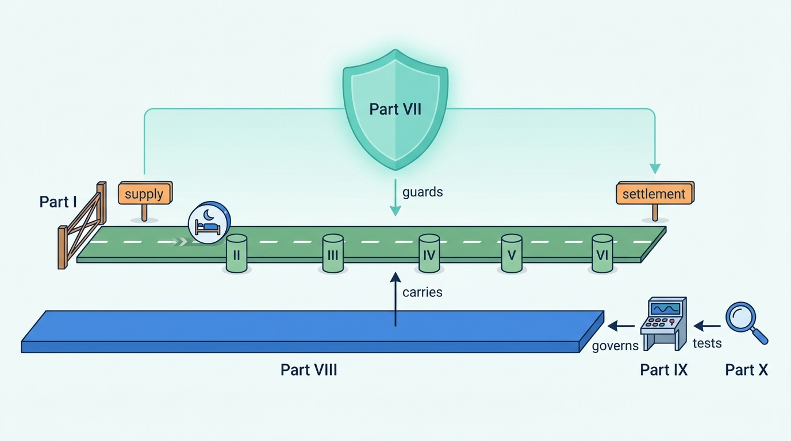

> **IN THIS SECTION, YOU WILL:** Learn what this book argues, who it is for and how its ten parts are organized; find the chapter for the decision in front of you; see how the book compares hotels and homes; and learn to tell documented facts from industry practice, labeled inference, recommendation and the fictional Corvane.

> **WHY THE BUSINESS CARES:** A stays marketplace earns its revenue on nights actually stayed, and loses it on nights shown but gone, sold twice, repriced at checkout, never delivered to the front desk or paid to the wrong party. Most of those losses start in the systems and appear in no one team's report.

> **WHY ARCHITECTS SHOULD CARE:** The promise of a night crosses more boundaries than almost any other product: from a hotel's system or a host's phone, through caches, rankers, sagas, ledgers and tax engines, to a card network and a front desk. The Chief Architect is one of the few people who looks at all of them, and must decide what two different marketplaces should share.

> **KEY POINTS:**
>
> * **A stays marketplace sells a perishable promise that someone else fulfills.** Judge its architecture by how reliably the promise holds from the search result to the morning of check-out: the night shown is available, the price shown is the price paid, the booking reaches the property or host, the money reaches the right party, and guest and host can trust each other.
> * **Two marketplace types keep that promise with different machinery, so the book compares them instead of merging them.** The OTA-style accommodation marketplace copies rooms and rates from hotel systems it does not control; the hosted-stays marketplace holds one calendar per home, the guest's money and the trust between strangers itself. Every chapter from Part II to Part VIII says where they differ and what a group can share.
> * **Ten parts form a learning path, and a routing table lets you start with the decision on your desk.** Every statement says what kind of statement it is: dated documented fact, industry practice, labeled inference, the author's recommendation, or an illustration from Corvane, the fictional travel group the book follows.

 
At 23:40 on a Friday in August, a family of four stands at the reception desk of a full hotel in a southern European city, holding a confirmation e-mail. The night manager is polite and firm: **there is no booking under that name**. The family booked through a marketplace seven weeks earlier and paid in advance.

The next morning, every team shows that its system worked. Search served the room at the price the hotel's channel manager had pushed. Checkout created one reservation and one charge. The connectivity gateway received a technical acknowledgement. The payment provider settled. Support closed the case in 41 minutes with a refund and a voucher. Nobody owns the question the family is asking, because the question is not about any one of those systems: **who promised us this room, and why did the promise not reach the people who had to keep it?**

A Chief Architect who follows that night from the search result to the front desk finds the reasons quickly. "Acknowledged" meant that an intermediary received the message, not that the hotel's property-management system (PMS) accepted it. A rate-plan code had been remapped the week before, and the PMS rejected the reservation silently. Nothing compared the marketplace's list of arrivals with the hotel's before the guests travelled. The marketplace paid the refund, though the contract made the hotel liable, because the support tool could not see the contract. **The family's question is an architecture question.** Its answer runs through a delivery state that was never modeled, a mapping that had no owner, a check that was never designed and a refund that never reached the ledger as a claim.

This book is about answering that kind of question, and about designing stays marketplaces where it is asked less often.

## Who This Book Is For

The book is written for people who are accountable for how the systems of a travel or stays marketplace fit together:

- **Chief architects and enterprise architects of travel groups**, who must decide what an OTA and a hosted-stays marketplace in the same group should share, and what each must keep.
- **Principal and staff engineers, and search, pricing, payments, data and machine-learning leads**, who own one stage of the promise and need to understand the stages on either side of it.
- **Product and engineering directors** of online travel agencies (OTAs), vacation-rental and hosted-stays marketplaces, channel managers and property-management software vendors.

The book takes the perspective of **a Chief Architect of a travel group that runs both kinds of marketplace** and must decide what they share. Almost all of the reasoning applies to a single-brand platform; the trade-offs are drawn at group scale, where paying for a capability twice becomes visible.

**What it assumes.** Architecture literacy: you know what an API, a database, an event stream, a cache and a cloud region are, and you have made and defended architecture decisions. The book does not explain them.

**What it does not assume.** Travel, payments and regulatory vocabulary. Availability, rates and inventory (ARI), rate plans, look-to-book ratios, virtual cards, merchant of record, tourist taxes and the EU Short-Term Rental Regulation are each defined where they first matter, in the chapter that owns them.

## The Argument: A Perishable Promise

An accommodation marketplace sells **a promise about a night**: this room or this home, in this place, on these dates, for this party, at this total price. Three properties make the promise unusual.

It is **perishable**. A night unsold by the evening it begins is lost forever, and a night sold twice cannot be manufactured, so hotels and hosts sell on every channel at once.

It is **fulfilled by someone else**. A hotel's staff, a host's cleaner or a manager's key box keeps the promise, and most of the truth about it (rooms left, whether the home is free, today's price) lives in systems and phones the marketplace does not control.

It is **delayed**. A guest books in February for August; in between, the guest may cancel, the money may sit in an account for months, a city may change its rules and a strike may close the airport. Revenue arrives on stayed nights, while costs arrive on every search.

The book's central claim follows: **the architecture of a stays marketplace should be judged by how reliably the promise holds from the search result to the morning of check-out.** Five conditions make it hold:

1. **The night shown is available**, on every surface, including the map pin, the alert e-mail and the metasearch feed.
2. **The price shown is the price paid**, from the search card to the card statement, with fees, taxes and currency added in one place.
3. **The booking reaches the property or host**, in the version that was agreed, and someone checks before the guest travels.
4. **The money reaches the right party**: the hotel, the host, the co-host, the city and the marketplace, each recorded in one ledger.
5. **Guest and host can trust each other**: the home exists, the message is genuine, the review is real, and someone will help when the night goes wrong.

**Figure 1:** *The promise of a night holds only if all five conditions hold, from the search result to the morning of check-out.*

Each architectural choice is judged by the condition it protects. A cache's staleness budget is set by what a wrong price costs in lost metasearch traffic; a booking acknowledgement is the difference between a reservation and a family at a reception desk at midnight.

The chapters work on one condition at a time. The last chapter of Part IX, [[evolving-the-platform]], draws the five together into a few **stays fitness functions** (price accuracy, double-booking rate, reservation delivery rate, time to payout and cost per booking) that a group can measure every quarter.

## Two Marketplaces, Compared, Not Merged

An **accommodation marketplace**, or OTA-style marketplace, sells rooms in professionally run properties by room type and **rate plan**, a priced package of conditions such as breakfast or free cancellation. Its truth lives in the hotel's PMS or channel manager, which pushes availability and rates in. Its hard problems are **supply integration and inventory accuracy**: thousands of connections, caches at look-to-book ratios above a thousand searches per booking, the same hotel from several suppliers, and agency and merchant money flows.

A **hosted-stays marketplace** sells nights in homes and rooms run by individual hosts and professional managers. It holds **one calendar per unit**, usually the guest's money and much of the trust between two strangers. Its hard problems are **trust and one-unit integrity**: a calendar that must never sell a night twice across platforms that sync by polling, verification of both sides, damage protection, payouts to individuals, and city-by-city short-term-rental regulation.

The categories are converging. Booking Holdings' [annual report for fiscal 2025](https://www.sec.gov/Archives/edgar/data/1075531/000107553126000009/bkng-20251231.htm) (published 2026) counts about 3.9 million "homes, apartments and other unique places to stay" among roughly 4.4 million properties, and hosted-stays platforms now sell boutique hotels. Yet [[two-stay-marketplaces]] shows both kinds of company still keeping separate supply rules for each. **Convergence is real at the guest's end and shallow at the supply end.**

That is why the book compares the two instead of merging them. A group that treats hotels and homes as one product ends up with **The Hotel-Shaped Home**: homes squeezed into room types with a quantity of one, or a sixty-room hotel flattened into sixty one-unit calendars. A group that treats them as unrelated businesses pays twice for identity, payments, ledgers, tax and trust, which are the same problem in both.

The book's working rule, argued in [[stays-capability-map]], [[stays-bounded-contexts]] and [[converging-two-marketplaces]], is **share what follows the guest, the money and the law; keep what follows how supply is counted.** In practice that gives three grades of sharing:

| Grade | What it means | Typical examples |
| --- | --- | --- |
| **Shared engine** | One implementation for both marketplaces, because the meaning is the same | Identity, payment orchestration, the settlement ledger, the tax engine, the cancellation-policy engine, notifications, verification, trust decisions |
| **Shared contract, separate engines** | One interface and vocabulary, two implementations, because the meanings rhyme but the data shapes differ | The offer and price quote, the reservation record and payment arrangement, search queries and filters, stay rules, property and unit identity |
| **Brand-specific** | Each marketplace keeps its own, because the supply or the risk differs in kind | Room-type inventory and one-unit calendars, connectivity, ranking models, release and payout policies |

Every chapter in Parts II to VIII has a section titled **"Hotels and Homes: Where the Two Marketplaces Differ"**: a table setting the two side by side (supply, data model, integration, failure modes, regulation, what can be shared) and a judgement on what to share. Where the two are the same, it says so.

## How the Book Is Organized

The book opens with three preface pages, follows the promise through eight parts, turns to the Chief Architect's agenda in Part IX, tests the patterns against public cases in Part X and ends with reference material. Each part's argument fits in a sentence:

| Section | The part's argument | Chapters |
| --- | --- | --- |
| **Preface** | What the book is for, how stay platforms fail, and which group the examples follow | This page, [[where-stay-platforms-go-wrong]], [[meet-corvane]] |
| **[[part-1]]** MARKETPLACE | **The type is decided by where the truth lives**, and the economics are requirements: revenue arrives on stayed nights, costs on every search | 1–4: marketplace types and history, economics, capability maps, bounded contexts |
| **[[part-2]]** SUPPLY | **Supply is master data with many writers**: separate what exists from how it is sold, and record who asserted each fact | 5–10: property and listing model, onboarding, content and mapping, connectivity, calendar sync, extranets and host tools |
| **[[part-3]]** INVENTORY | **Reads and writes need different answers**: serve offers from read models with a measured staleness budget, and guarantee at the commit point | 11–15: ARI model, availability engine, inventory integrity, dynamic pricing, promotions and loyalty |
| **[[part-4]]** DISCOVERY | **Stays search retrieves promises, not documents**: availability joined for every night, one quote on every surface, order as a logged policy | 16–20: search, destinations and maps, ranking, personalization, the property page |
| **[[part-5]]** BOOKING | **The reservation crosses every boundary**: a keyed saga, a versioned agreement tracked to the front desk, one policy engine | 21–25: checkout, reservation lifecycle, changes and cancellations, trip and messaging, customer service |
| **[[part-6]]** MONEY | **Money is a set of decisions recorded before it moves**, posted to one ledger and reconciled against the reservation as well as the bank | 26–30: payment models, payments, payouts, taxes, refunds and reconciliation |
| **[[part-7]]** TRUST | **Trust is a platform of records, not a collection of tools**: local detection, shared decisions with receipts, rules as versioned data | 31–36: trust and safety, fraud, identity, reviews, protection, regulation |
| **[[part-8]]** PLATFORM | **Share the machinery, not the meaning**: events, metrics, experiments, models and degradation judged on stays and designed before the peak | 37–42: events, scale and reliability, metrics, experimentation, ML platform, demand channels |
| **[[part-9]]** LEADERSHIP | **The Chief Architect's main product is a small set of governed records**: contracts outlast engines, teams and models, and decisions are records with owners and review dates | 43–47: convergence, organization, modernization, AI, long-term evolution |
| **[[part-10]]** PRACTICE | **The public record is richest on contracts and platforms and silent on engines**; underneath convergence, hotels and homes stay different | 48–51: Booking.com, Airbnb, Expedia Group and Vrbo, Agoda and Trip.com |
| **Reference** | The coverage map, templates, definitions and sources | [[domain-coverage]], [[toolkit]], [[glossary]], [[bibliography]] |

**Figure 2:** *Parts II to VI follow one night from supply to settlement, each keeping one condition of the promise; Part VII guards it, Part VIII carries it, Part IX decides what a group shares and how it changes, and Part X tests the patterns against the public record.*

Part I is the one part not to skip: later chapters justify their targets by pointing back to it.

Each part opens with a short introduction, and each chapter follows the same shape: opening callouts with three key points and the failure patterns it addresses; a Corvane scene that poses the question; concepts, architecture, documented practice and a worked example; trade-offs, the hotels-and-homes comparison and failure modes; the Chief Architect's view; questions for a design review; and Sources and Evidence.

## Start With the Decision in Front of You

The parts are a learning sequence for a first reading. If a decision is already waiting, find the row that matches it, read the chapter in the **Start with** column, and follow the **Then** column in order if you need more. Return to Part I whenever a term or a number is unfamiliar.

| Your immediate need | Start with | Then |
| --- | --- | --- |
| The board asks whether the hotel brand and the homes brand should run on one platform | [[converging-two-marketplaces]] | [[stays-capability-map]], [[stays-bounded-contexts]], [[case-expedia-vrbo]] |
| A metasearch partner flags our price accuracy, or "sold out" and "price changed" errors are part of the funnel | [[availability-engine]] | [[rates-and-availability-model]], [[demand-channels]], [[stays-search-architecture]] |
| A home was sold twice because calendars on two platforms disagreed | [[calendar-sync]] | [[inventory-integrity]], [[property-and-listing-model]], [[extranets-and-host-tools]] |
| Channel-manager updates are a surprise every week, and a wrong rate stayed on sale for an hour | [[connectivity-and-channel-managers]] | [[rates-and-availability-model]], [[event-driven-stays]], [[partner-onboarding]] |
| The same hotel appears several times from different suppliers, with different photos and prices | [[content-and-media]] | [[property-and-listing-model]], [[entity-resolution]], [[stays-search-architecture]] |
| The total at checkout is higher than on the search card or the property page | [[property-page-and-room-selection]] | [[availability-engine]], [[promotions-and-loyalty]], [[taxes-on-stays]] |
| A partner asks why their property fell in the results, and nobody can explain position 23 | [[stays-ranking]] | [[promotions-and-loyalty]], [[stays-experimentation]], [[stays-regulation]] |
| An app retry or a slow payment provider created duplicate bookings and double charges | [[checkout-orchestration]] | [[stay-payments]], [[reservation-lifecycle]], [[event-driven-stays]] |
| Guests arrive and the front desk has no booking for them | [[reservation-lifecycle]] | [[connectivity-and-channel-managers]], [[trip-and-messaging]], [[customer-service]] |
| Checkout, support macros and the partner's system give different answers about a cancellation | [[changes-and-cancellations]] | [[customer-service]], [[refunds-and-reconciliation]], [[stay-payments]] |
| The OTA is moving from agency to merchant bookings, or the homes brand is adding Pay Later | [[merchant-and-agency-models]] | [[stay-payments]], [[payouts-and-settlement]], [[payments-fundamentals]] |
| Finance cannot reconcile card statements, payouts and reservations at quarter end | [[refunds-and-reconciliation]] | [[payouts-and-settlement]], [[designing-financial-ledgers]], [[marketplace-intelligence]] |
| A city's tourist tax, DAC7 platform reporting or the EU's VAT in the Digital Age (ViDA) rules land on the roadmap | [[taxes-on-stays]] | [[payouts-and-settlement]], [[stays-regulation]], [[merchant-and-agency-models]] |
| A registration regime or night cap forces thousands of listings offline, or a court annuls it | [[stays-regulation]] | [[partner-onboarding]], [[stays-trust-and-safety]], [[property-and-listing-model]] |
| Fraudsters message guests from hijacked hotel extranet accounts | [[travel-fraud]] | [[identity-accounts-and-access]], [[extranets-and-host-tools]], [[stays-trust-and-safety]] |
| A strike, a sale or a peak weekend brings mass cancellations, rebookings and a falling cache hit rate | [[global-scale-and-reliability]] | [[changes-and-cancellations]], [[stays-ml-platform]], [[availability-engine]] |
| A legacy reservation monolith must be retired while bookings sixteen months ahead sit in it | [[modernizing-a-live-marketplace]] | [[event-driven-stays]], [[stays-bounded-contexts]], [[case-airbnb]] |
| We are piloting an AI trip assistant, or AI agents want to book on travelers' behalf | [[ai-in-travel-stays]] | [[stays-ml-platform]], [[identity-accounts-and-access]], [[demand-channels]] |

Two rows start somewhere unexpected, on purpose. The duplicate-hotel row starts with content, because property mapping is a content-catalog service before it is a search problem. The checkout-total row starts with the property page, because most price differences are different arithmetic in different places, not stale data.

## How to Read the Evidence

**Company-aware but company-neutral.** The book draws on the public record of Booking.com, Airbnb, Expedia Group (including Vrbo and Hotels.com), Agoda, Trip.com, channel managers and connectivity providers, and on standards (OpenTravel, HTNG, iCalendar) and regulation, because advice untested against real precedents is generic.

**Five kinds of statement.** Architecture writing becomes unreliable when facts, habits, guesses, opinions and examples blur into one voice. Every chapter keeps them apart:

| Kind of statement | What it is | How to recognize it |
| --- | --- | --- |
| **Documented fact** | A company's public statement, a filing, a regulation, a standard, a date | Linked inline the first time it matters, with the **year of publication** in the sentence ("in a 2019 engineering post…"), and listed in Sources and Evidence. Regulations cite the official text and dates of application. |
| **Industry practice** | What stays marketplaces commonly do | Phrased as "commonly" or "a typical pattern is", with no invented percentages. It describes the field, not a rule. |
| **Reference-architecture inference** | How a system like this is plausibly built, reasoned from engineering principles | When it concerns a real company, it is labeled: a callout marked **INFERENCE, NOT DOCUMENTED**, or "a plausible reference architecture, not a description of that company's systems". |
| **Recommendation** | My judgement as a Chief Architect | First person ("I would", "the rule I use"), with the reasoning and the conditions under which it does not hold. Argue with it. |
| **Illustration** | An example set at Corvane | Labeled fictional the first time Corvane appears in each chapter. Its numbers come from one canonical record and agree across the book. |

Two distinctions are easy to lose. A Corvane figure, such as Roomstead's 1,400 shopping requests per reservation, is an illustration, not a benchmark. And a recommendation that sounds like a fact, such as "the payout engine is not the system of record for what a host is owed", is still a recommendation, with reasoning and exceptions.

**Why claims carry dates.** Companies' statements about their own platforms change fast. In its [fourth-quarter 2023 earnings release](https://www.sec.gov/Archives/edgar/data/1324424/000132442424000005/earningsrelease-q42023.htm) (8 February 2024), Expedia Group's chief executive described 2023 as a year of "completing a massive transformation". Three months later, the [first-quarter 2024 release](https://www.sec.gov/Archives/edgar/data/1324424/000132442424000024/earningsrelease-q12024.htm) (2 May 2024) said that "Vrbo's recovery following the recent re-platforming has been slower than anticipated" and lowered the year's guidance. Both were true when written; a chapter citing only the first, undated, would describe a migration whose hardest consequence had not yet appeared ([[case-expedia-vrbo]]).

Regulation moves as well: Spain's national short-term-rental registry ([Real Decreto 1312/2024](https://www.boe.es/buscar/act.php?id=BOE-A-2024-26931)) applied from 1 July 2025, and in May 2026 the Supreme Court annulled the provisions that created it ([[stays-regulation]]). So every company and regulatory claim carries its date, evidence older than about three years is flagged as possibly out of date, and renamed brands are given their former name once.

**As of October 2026.** Facts were checked against public sources in October 2026 unless a chapter says otherwise. Check the source before relying on a date-sensitive statement in a board paper or a contract.

## What the Book Draws On

The book uses three kinds of material, and no other.

- **Two domain models.** The book started from two Productscape domain models in my sibling repository: one of an OTA-style travel accommodations marketplace (34 product bricks, or named business capabilities) and one of a hosted-stays marketplace (21 bricks). Their authoring notes name Booking.com and Airbnb as inspiration, but both are **generic reference models, not descriptions of Booking.com, Airbnb or any other company**. [[domain-coverage]] maps all 55 bricks to chapters, shows that only 12 of the 34 OTA bricks have a same-concept counterpart in the hosted-stays model, and lists the seven capabilities the book added because neither model has them, from a tax engine to content mapping.
- **The public record of the named companies.** Engineering posts and papers, talks, filings, developer documentation and help pages, each cited with its publication year.
- **Standards, regulation and research.** OpenTravel and HTNG specifications, iCalendar, EU and national legal texts, card-scheme rules, and published research and practitioner books.

**No internal material.** Nothing here comes from confidential documents or inside knowledge of any company. Where a chapter needs a situation the public record cannot supply, it uses Corvane.

## Corvane and the Toolkit

**Corvane Group is fictional.** It is a privately held travel group headquartered in Lisbon, with €1.692 billion of revenue in 2026. **Roomstead**, founded in Dublin in 2001, is an accommodation marketplace with 640,000 bookable properties, 70% of its room nights on the agency model and a merchant product growing beside it. **Nookaway**, founded in Lisbon in 2012 and acquired in 2021, is a hosted-stays marketplace with 1.15 million listings that holds the guest's money until after check-in. Around them sit **Corvane Connect**, a channel manager, and **Corvane Payments**, a licensed payments institution; beneath them the group runs two of almost everything, on three clouds. In April 2027 its board approves **One Stay**, a €145 million program (2027–2030) to share identity, payments and the ledger, trust, messaging, support, tax and data, and one offer and reservation contract, while each brand keeps its own supply engine. [[meet-corvane]] introduces its systems, people and recurring worked examples, from the €12 rate on sale for 38 minutes at Hotel Miradouro to the Seville double booking. Corvane is a composite of patterns, not a disguise for any company. When Mariana Costa, its Group Chief Architect, makes a decision, ask what the equivalent would be in your marketplace.

The **[[toolkit]]** collects fourteen templates, from the two-marketplace capability map to the booking saga card and the architecture decision record, each with a hotel and a home column where the two differ. The [[glossary]] defines the book's terms, grouped by part, and names the chapter that owns each one.

## What the Book Does Not Cover

The book is about stays. Three neighboring subjects are covered only where they touch the architecture; [[domain-coverage]] gives the reasons.

- **Partner CRM and market management**: account managers, commission negotiation and partner health. Usually bought as CRM software; its architectural questions (one partner record, one source of commission terms) are answered in [[partner-onboarding]] and [[payouts-and-settlement]].
- **Managed business travel**: company accounts, travel policy and invoicing. A business with its own platforms, covered only as a channel in [[demand-channels]] and an invoicing context in [[stay-payments]].
- **Connected trips and packages**: flights, cars and package holidays. Only the package flag that changes cancellation rights ([[changes-and-cancellations]]) and checkout disclosures ([[checkout-orchestration]]).

## The Failure Patterns

Stays platforms rarely break the promise of a night through one bad decision. They break it through recurring patterns that each looked reasonable when chosen: one more rate plan, one more ranking boost, one more refund macro. The next page, [[where-stay-platforms-go-wrong]], names sixteen of them, from **Phantom Availability**, **The Double-Booked Night** and **Connectivity Roulette** through **Price Drift**, **Lost at the Front Desk** and **Policy Spaghetti** to **Ledgerless Money**, **City-by-City Firefighting**, **Built for Sunny Days** and **The Unwatched Model**. Each comes with its warning signs, mechanism, cost, the marketplace type it hits hardest and the chapters that address it. The family at the reception desk met **Lost at the Front Desk**. Every chapter opens by naming the patterns it works on.

## A Living Journal

This book is a living journal, a work in progress that I revise as I learn more through [my work](https://obren.io). Every chapter has a "View spec" link in its byline that opens the specification it was written against: its intent, audience, success criteria, what it leaves to other chapters and its open questions. Read the book as current thinking with its limits stated, not as a finished text.

I developed the book through AI-mediated authoring: I set the concept, the structure, the chapter contracts and the arguments; AI tools supported research against public sources, drafting from those contracts, consistency checks across chapters and editing; I reviewed and decided. The specs and the scripts used to build this site are in the [book's GitHub repository](https://github.com/zeljkoobrenovic/spec-driven-journals). The content, its judgements and its errors are my responsibility.

## Where to Go Next

If you read in order, turn next to [[where-stay-platforms-go-wrong]]. Then read [[meet-corvane]], so that every chapter's opening scene lands in a group you know, and begin Part I with [[two-stay-marketplaces]]. If you start from the routing table instead, keep the family at the reception desk in mind: who promised them the room, and why did the promise not reach the people who had to keep it? Every chapter answers part of that question.

## Sources and Evidence

*Company engineering and investor sources*

- [Form 10-K for fiscal 2025](https://www.sec.gov/Archives/edgar/data/1075531/000107553126000009/bkng-20251231.htm), Booking Holdings, 2026: about 4.4 million properties at the end of 2025, of which about 3.9 million homes, apartments and other unique places to stay.
- [Fourth-quarter and full-year 2023 earnings release](https://www.sec.gov/Archives/edgar/data/1324424/000132442424000005/earningsrelease-q42023.htm), Expedia Group, 2024: 2023 described as "completing a massive transformation".
- [First-quarter 2024 earnings release](https://www.sec.gov/Archives/edgar/data/1324424/000132442424000024/earningsrelease-q12024.htm), Expedia Group, 2024: Vrbo's slower-than-anticipated recovery after re-platforming and the lowered guidance.

*Standards, regulation and documentation*

- [Real Decreto 1312/2024 (consolidated text)](https://www.boe.es/buscar/act.php?id=BOE-A-2024-26931), Boletín Oficial del Estado, 2024 (updated 2026): Spain's national short-term-rental registry from 1 July 2025 and the provisions annulled in 2026.

*Research and practitioner sources*

- Productscape travel-accommodations-marketplace and hosted-stays-marketplace domain models (author's sibling repository, 2026): the generic domain models the book started from, mapped in [[domain-coverage]]. Not descriptions of any company.

Company, regulatory and research sources for each topic are listed in the chapter that owns the topic and collected in the [[bibliography]]. Corvane is fictional; architectural recommendations and labeled inferences are the author's judgement.
