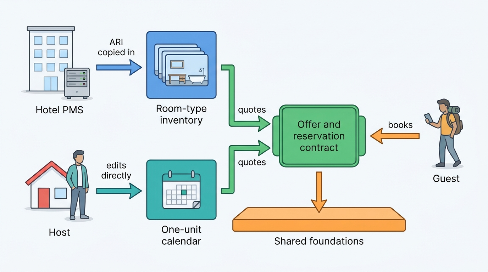

> **IN THIS PART, YOU WILL:** Describe a stays marketplace as a business before describing it as software: which of the two types it is, what it lives on, what it does as capabilities and where its domain boundaries go.

> **WHY THE BUSINESS CARES:** The type of marketplace decides where the money and the risk sit; its economics decide what a search may cost. A group that treats hotels and homes as two categories of one product pays for it in refunds, run costs and duplicated platforms.

> **WHY ARCHITECTS SHOULD CARE:** Every later boundary, shared platform and cache budget in this book is justified here. Without this part, "should hotels and homes share a platform?" becomes a contest between system owners.

> **KEY POINTS:**
>
> * **The type is decided by where the truth lives.** An online travel agency (OTA) copies counted rooms and rate plans from hotel systems it does not control; a hosted-stays marketplace holds one calendar per home, the guest's money and the trust between strangers itself.
> * **The economics are requirements in disguise.** Revenue arrives on stayed nights, costs arrive on every search, and look-to-book differs by an order of magnitude between the two types. Cost per request and staleness budgets follow from those numbers.
> * **Share the promise, not the supply.** The two marketplaces share a guest spine and foundations (identity, payments, ledger, tax, trust) and differ in kind on the supply side. Share engines where meanings are equal, share the offer and reservation contracts where they rhyme, and keep room-type inventory and one-unit calendars apart.

> **[FAILURE PATTERNS THIS PART ADDRESSES](where-stay-platforms-go-wrong.html):**
>
> * **The Hotel-Shaped Home** — three of the four chapters show why forcing one type's supply model onto the other fails.
> * **Price Drift** — no capability or context owns fees, taxes and the offer until this part gives them one.
> * **Phantom Availability** — look-to-book forces caching; this part sets the staleness budget from what a wrong price costs.

 
A night in a hotel room and a night in someone's apartment look identical on a results page. Behind the "Reserve" button they are different businesses. **An accommodation marketplace sells a perishable promise that someone else fulfills**, and the two common types keep that promise with different machinery.

**Figure 1:** *On the results page a hotel night and a home night look the same; behind the Reserve button, one marketplace copies its truth in and the other holds it itself.*

The **accommodation marketplace**, or online travel agency (OTA), sells rooms in professionally run properties by room type and rate plan. Its truth lives in the hotel's property-management system (PMS), and its hard problem is copying availability, rates and inventory (ARI) fast enough to answer about a thousand shopping requests per booking. The **hosted-stays marketplace** sells nights in homes run by hosts and professional managers. It holds the calendar, the money and the trust itself, and its hard problem is keeping one unit's promise between strangers. **The first is a supply-integration problem; the second is a trust and one-unit-integrity problem.** Convergence (OTAs selling millions of homes, hosted-stays platforms selling hotels) blurs the line at the guest's end; it stays sharp at the supply end.

Part I builds the argument in four steps, each turning a business fact into an architecture decision: name the type, measure what it lives on, map what it does, then draw the boundaries.

**Figure 2:** *Part I's conclusion in one picture: two supply engines with different sources of truth meet at one offer and reservation contract, and everything that follows the person, the money or the law can be shared beneath it.*

## Chapters in this part

**[[two-stay-marketplaces]]** answers what kinds of accommodation marketplace exist and why the type decides the architecture. It tells OTAs, hosted-stays marketplaces, metasearch, bedbanks and direct booking apart by who holds the supply, the money and the truth, and traces the waves of history, from airline reservation systems to convergence, that left layers still running. Read it before anyone proposes making hotels and homes one business.

**[[stays-marketplace-economics]]** answers what a stays marketplace sells and how its economics become requirements. It builds the unit economics of one stayed reservation per brand from take rate, look-to-book, booking window and local liquidity. Read it when nobody can say where a latency or freshness target came from.

**[[stays-capability-map]]** answers which capabilities each marketplace needs and which a group should build once. It matches two generic reference models by meaning, adds seven capabilities that neither contains, such as a tax engine and content mapping, and grades every capability as shared engine, shared contract or brand-specific. Read it when you must find what the group pays for twice.

**[[stays-bounded-contexts]]** answers where the service and team boundaries go. It draws a boundary wherever the meaning of a night changes, makes the offer and the reservation the two aggregates that carry the promise, and puts anti-corruption layers toward channel managers, PMSs, iCal feeds and old monoliths. Read it when every booking-table change needs a cross-team meeting.

Corvane, the fictional travel group this book follows ([[meet-corvane]]), tests each step. Group Chief Architect Mariana Costa answers the CEO's February 2027 question about why the group runs two platforms. She shows the CFO why Nookaway's compute-at-query-time search would cost Roomstead about €195 million a year at its 1,400 shopping requests per reservation. Her capability map v1 (48 capabilities, March 2027) shapes the €145 million One Stay program the board approves in April. The architecture forum adopts a map of 23 bounded contexts on 5 May 2027; both maps are revised in December 2027 ([[converging-two-marketplaces]]). [[part-2]] then models properties, homes and the partners behind them inside those boundaries.

Begin with [[two-stay-marketplaces]].
