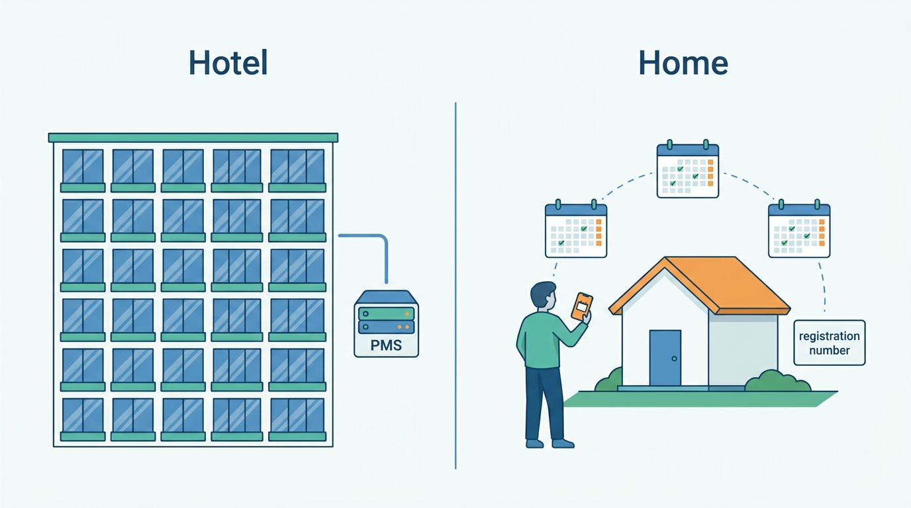
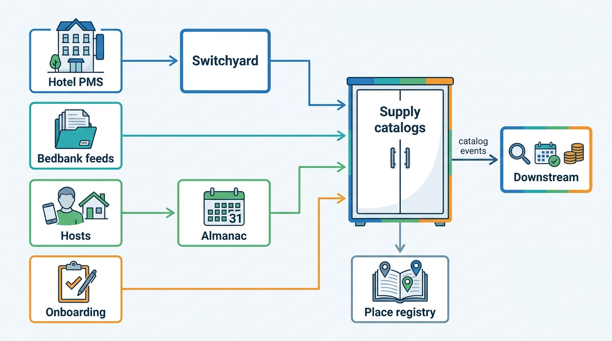

> **IN THIS PART, YOU WILL:** Build the supply side of both marketplaces: the property and listing model, partner and host onboarding, content and property mapping, connectivity to the hotel stack, calendar sync for multichannel hosts, and the extranet and host tools that suppliers work in.

> **WHY THE BUSINESS CARES:** New supply is the cheapest growth a marketplace has, and supply data that is wrong is the most expensive: a €12 rate on sale for 38 minutes, a home sold twice in Feria week, a hotel listed twice with different photos.

> **WHY ARCHITECTS SHOULD CARE:** The supply model is the most depended-on schema in a stays platform, and most of its writes come from systems and people the marketplace does not control: property management systems, channel managers, wholesale feeds, hosts on phones and co-hosts sharing a login.

> **KEY POINTS:**
>
> * **Separate what exists from how it is sold.** Property, unit and beds describe the physical world; room type, rate plan and listing are commercial offers on top of it. Share the physical layer, the identifiers and the vocabulary across marketplaces; keep the commercial layer with each marketplace.
> * **Supply is a copy of someone else's truth, so record who asserted what.** Content fields, rates, availability and blocked nights should each carry their source, time and precedence, so the platform can validate, reconcile and roll back instead of trusting the last writer.
> * **Supply decisions are continuous, not launch events.** Activation, mapping, partner health and calendar authority are re-evaluated by named, owned checks whenever a fact changes. That is how a revoked registration number closes a listing.

> **[FAILURE PATTERNS THIS PART ADDRESSES](where-stay-platforms-go-wrong.html):**
>
> * **The Hotel-Shaped Home** — Gives homes and hotels their own commercial models, onboarding flows and tools over one shared physical core.
> * **Connectivity Roulette** — Turns partner integrations into contracts with semantic validation, ordering, reconciliation and health scores.
> * **The Double-Booked Night** — Measures the conflict window and models a calendar as claims with provenance.

 
Part I argued that an accommodation marketplace sells a perishable promise that someone else fulfils. Part II starts with **that someone else**. Before a night can be priced (Part III), found (Part IV) or booked, the marketplace must know what is sold, who sells it, what it looks like and whether it is still free.

The argument of this part is that **supply is master data with many writers**. The marketplace owns the model and the rules. Hotels, channel managers, bedbanks, hosts, co-hosts and property-management software own most of the values. Each chapter answers the same two questions for its slice: who may write this fact, and how will we know when the copy has drifted from the source?

Hotels and homes differ in this part more than anywhere else in the book. A hotel sells a **pool** of interchangeable rooms under several rate plans. Its truth lives in a PMS (property management system) or channel manager that pushes it through certified connectivity. A home is **one unit** whose host is a person with a phone. Its truth often lives only in calendars on several platforms that copy each other on a timer, and it needs a registration number. What they share is narrower: identifiers, vocabulary, verification, delegation and provenance.

**Figure 1:** *A hotel sells a pool of interchangeable rooms whose truth lives in a PMS; a home is one unit whose truth often lives in a person's phone and in calendars on several platforms.*

**Figure 2:** *Supply reaches Corvane through many writers. Each marketplace keeps its own catalog, both register properties and units in one place registry, and everything downstream reads catalog events rather than the writers' raw input.*

## Chapters in this part

[[property-and-listing-model]] decides **what is being sold**. It separates the physical layer (property, unit, spaces, beds) from the commercial one (room type, rate plan, listing), and gives every sellable unit a stable identifier in a group place registry. Waypoint, the place graph of [[destinations-and-maps]], enriches that registry with locations and jurisdictions. Costa Keys' 38 Málaga apartments, sold as 20 products on Roomstead and 38 listings on Nookaway, show why.

[[partner-onboarding]] decides **who may sell and when a property becomes bookable**. A supply-party model separates the legal party, the property, the contract and the payout account. A readiness service evaluates named, versioned checks. Hotel Torre de Ferro and Carmen Ruiz's re-verification are the worked pair.

[[content-and-media]] decides **how descriptions are governed**: a field-level catalog with provenance and precedence, policies rendered from structured data, and a shared media and translation pipeline. Its centerpiece is Concord, the mapping engine that found how many of Brightwell Beds' 41,000 "new" properties Roomstead already sold.

[[connectivity-and-channel-managers]] decides **how Roomstead keeps its copy of hotel rates and availability faithful**. Switchyard validates against each partner's own sibling rates, applies updates in order, reconciles, tracks every reservation to acknowledgement and scores partners. The €12 rate at Hotel Miradouro is the case. A neutrality rule holds Corvane's own channel manager, Corvane Connect, to the same APIs as every other partner.

[[calendar-sync]] decides **how a home sold on several platforms avoids being sold twice**. It defines the conflict window, explains why the marketplace controls only half of it, and models the calendar as claims with provenance and a declared calendar authority per listing. The Seville double booking is the case.

[[extranets-and-host-tools]] decides **who owns each field and workflow in the supply workspace**: one partner back-end behind Partner Hub, the host app and the APIs, a delegation model for co-hosts and staff, and exception queues with owners and deadlines. Shared owner logins on 187,000 Nookaway listings forced it.

Begin with [[property-and-listing-model]].
