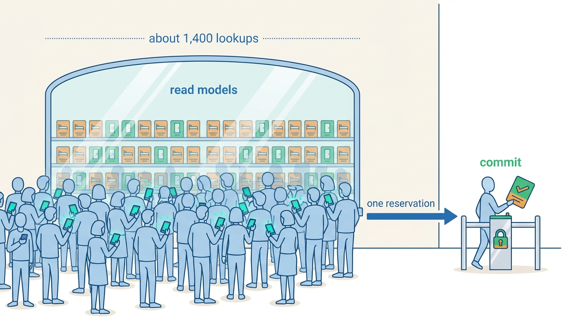
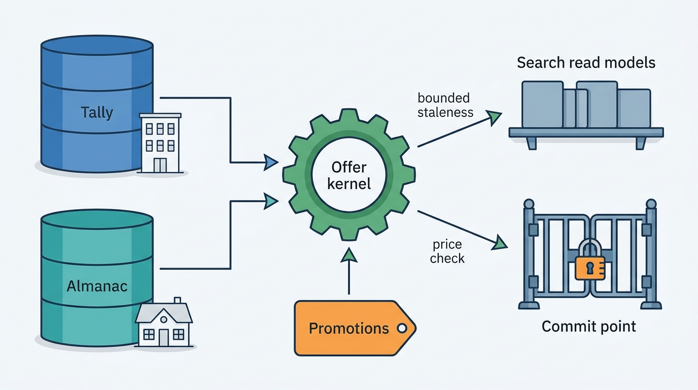

> **IN THIS PART, YOU WILL:** Model availability, rates and inventory (ARI) for hotels and homes, build the availability engine and its price-accuracy controls, keep a night from being sold twice, decide who sets the price, and design promotions and loyalty so that every discount has an audience and a funder.

> **WHY THE BUSINESS CARES:** Inventory is perishable: an unsold night is lost forever, and an oversold one costs a relocation. Price accuracy decides whether metasearch partners keep sending traffic, and a discount with no named funder ends up on the wrong party's invoice.

> **WHY ARCHITECTS SHOULD CARE:** ARI is the largest write-heavy dataset in a stays platform and is read on every search, page, feed and checkout. Grain, derivation, staleness and commit-point decisions made here are almost impossible to reverse later.

> **KEY POINTS:**
>
> * **Store facts and rules, and compute every price one way.** Persist the independent series and the derivation, restriction, fee and discount rules, and run them through one versioned offer kernel used by search, the property page, feeds and checkout. Stale data is not the only cause of price mismatches: different arithmetic is a large share of them.
> * **Serve from read models with a measured staleness budget; guarantee at the commit point.** Availability search is a cache of someone else's truth. Measure its accuracy with a sampler, re-check before payment, and put the guarantee where each unit's truth lives: a uniqueness constraint for a home, a conditional decrement against the hotel's count.
> * **Every price has a writer, and every writer leaves a trace.** Revenue managers, hosts, Smart Rate, third-party tools and campaigns compete for the same cells. One precedence resolver and one price-composition service record who set each number, who funds each discount and which model version acted.

> **[FAILURE PATTERNS THIS PART ADDRESSES](where-stay-platforms-go-wrong.html):**
>
> * **Phantom Availability** — Bounds and measures how stale an offer may be, and re-checks it before the guest pays.
> * **Price Drift** — Replaces separate fee, tax, currency and discount arithmetic with one offer kernel.
> * **Rate Plan Sprawl** — Keeps audience prices and campaigns out of the rate-plan grid and makes derivation explicit data.

 
Part II brought supply onto the platform and kept the copy honest. Part III turns that supply into **something a guest can buy**: a stay of particular nights, for particular people, at a price that holds from the search result to the card statement. Parts IV and V search and book the offers built here.

The argument of this part is that **inventory is a read problem and a write problem with different answers**. Reads are huge: Roomstead serves about 1,400 shopping requests per gross reservation, each fanning out to about ten Pricegrid reads, so offers must come from precomputed or cached read models that are allowed to be slightly stale. Writes are rare but binding: the commit must be exact, because someone else may sell the same night a second later. The chapters keep the two paths apart and join them through one vocabulary and one offer kernel.

**Figure 1:** *Reads and writes need different answers: Roomstead serves about 1,400 shopping requests per gross reservation from read models that may be slightly stale, while the one commit must be exact.*

Hotels and homes differ in shape, not in principle. A hotel's price is a **grid**: room types times rate plans times nights times occupancies, pushed by a revenue management system. The online travel agency (OTA) checks those prices, but the room count belongs to the hotel's systems, so the OTA can only shorten the window in which its copy is wrong. A home's price is **one nightly calendar** that the host, a pricing tool or the marketplace sets. The platform owns that calendar, so it can make the database refuse a second booking. Corvane's One Stay rule applies throughout: **shared contracts, separate engines**.

**Figure 2:** *Two engines, one kernel: Tally and Almanac stay separate stores, every price is composed once, read models serve search within a staleness budget, and the commit point enforces the guarantee.*

## Chapters in this part

[[rates-and-availability-model]] decides **what a price for a stay means**. It separates stored facts from derivation rules, fixes restriction semantics once, and keeps the product grid and the nightly calendar as different stores under one vocabulary and stay evaluator. The case is Hotel Miradouro's 37 rate plans and 168 products, set against one Nookaway apartment.

[[availability-engine]] decides **how stale an offer may be and how anyone knows**. Pricegrid serves offers from a read model with a staleness budget per tier, one kernel computes every price, and a sampler measures accuracy. The trigger: a metasearch partner hid Roomstead in Spain and Portugal for six days in May 2027, with accuracy at 91% against a 97% target.

[[inventory-integrity]] decides **where the guarantee lives**. It separates a hotel's deliberate overbooking from accidental oversell and from a double-booked home, names a commit point per unit cardinality, and designs walking and relocation as a product with cause codes and a liability matrix. The Seville double booking and King's Day at Hotel Prinsenkade are the paired cases.

[[dynamic-pricing]] decides **who may write the price of a night**. Hotels price with their own revenue management, so the OTA offers insight. Hosts mostly do not, so Nookaway's Smart Rate sets prices within the host's bounds, through one precedence resolver. The case is Santo António 2027, when Smart Rate discounted Lisbon's festival weekend after the air-traffic-control strike.

[[promotions-and-loyalty]] decides **how discounts enter the price, the ledger and the ranking**. Each promotion is a priced modifier with an audience and a funder, applied in one composition service, measured against a holdout and kept out of relevance. The Autumn Cities coupon, which hotels paid for without joining it, is the case.

Begin with [[rates-and-availability-model]].
