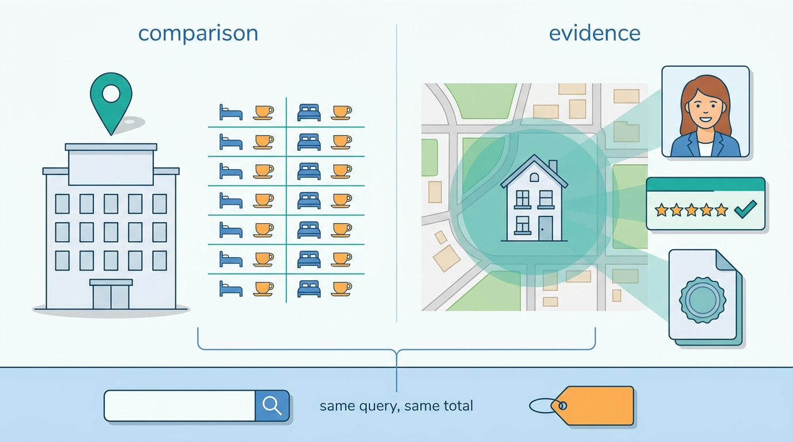
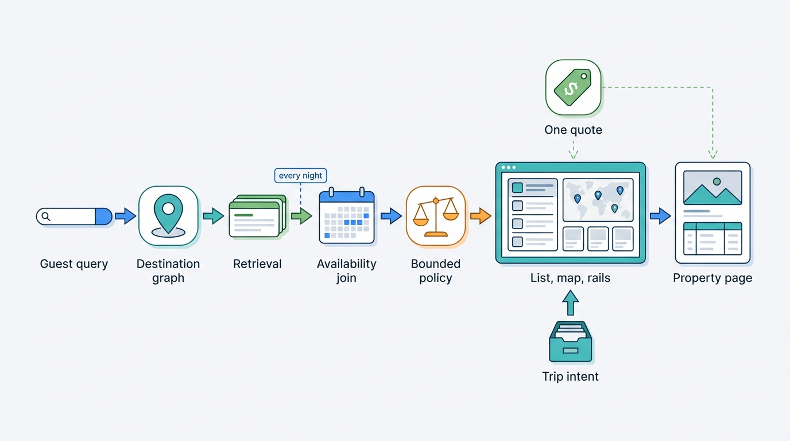

> **IN THIS PART, YOU WILL:** Build discovery for stays: the search pipeline and its availability join, destinations and map search, ranking with commission and programs held in a bounded policy, personalization and saved intent, and the property page where the guest decides.

> **WHY THE BUSINESS CARES:** Every booking passes through a results page, a map, an alert or a property page. Discovery decides which partners and hosts get guests' attention, and a total that grows between the search card and checkout costs bookings and draws consumer regulators.

> **WHY ARCHITECTS SHOULD CARE:** Discovery runs the busiest read paths in the company and joins content, availability, pricing, tax, trust and machine-learning models on every request, within a few hundred milliseconds.

> **KEY POINTS:**
>
> * **Stays search retrieves promises, not documents.** Availability is a property of every night of the stay and the party, and the price is computed per request. Keep the volatile price outside the index and join exact availability only for candidates you will show; every surface, from map pins to alert e-mails, must re-price the stay at render or send time.
> * **Order is a policy with owners and a log.** Train relevance on honored stays, not clicks or gross bookings. Keep commission and partner programs in a capped, versioned policy layer with reason codes, and generate the transparency page from that configuration.
> * **Share contracts, places and quotes; keep rankers and taste separate.** A group running both marketplace types should share the query and result contract, the destination graph, the quote contract and the trip intent store. Indexes, availability layers, ranking models and recommenders follow each marketplace's supply until the data argues otherwise.

> **[FAILURE PATTERNS THIS PART ADDRESSES](where-stay-platforms-go-wrong.html):**
>
> * **Phantom Availability** — Joins availability for the guest's dates on lists, maps, rails and alerts, and re-prices saved intent before sending it.
> * **Price Drift** — Makes one itemized quote the only price any surface may show, with a versioned display policy.
> * **Pay-to-Rank Creep** — Replaces stacked multipliers with a bounded, logged and disclosed commercial policy layer.

 
Part III produced offers: priced, restricted, bookable stays held in read models. Part IV puts them **in front of the guest**. Discovery in stays looks like web or retail search and is not. The query is structured (place, dates, party), availability depends on the whole date range, and the outcome that matters, a stay that happens, arrives weeks later and is often reversed by a cancellation.

The argument of this part is that **discovery is one pipeline with one promise**: whatever a surface shows, whether a card, a pin, a rail, an alert or a rooms table, the guest can book at that total. Each chapter adds a stage and the rule that keeps the promise at that stage.

Hotels and homes ask the same question here and need different answers. A hotel competes on **comparison**: dozens of rate plans become a rooms table, and its exact address is a selling point. A home competes on **evidence**: the host, verified-stay reviews and the registration status, with a location that is personal data until booking and shown as a coarse public point. The guest's query and the shown total are the same for both, so the contract and the quote are shared and the templates follow offer shape, not brand.

**Figure 1:** *Hotels compete on comparison, homes on evidence; the guest's query and the shown total are the same for both.*

**Figure 2:** *One pipeline, one promise: each stage adds a rule, and every surface from the map pin to the property page shows the same quote.*

## Chapters in this part

[[stays-search-architecture]] decides **how a search computes bookable stays**: a two-layer index with a coarse availability projection, an exact availability join for shown candidates, latency budgets per stage, and flexible-date search on precomputed availability. Jonas Weber's team ran one Lisbon query through Roomstead's Elasticsearch-plus-Pricegrid stack and Nookaway's OpenSearch stack on 13 May 2027 and got two different answers.

[[destinations-and-maps]] decides **where to search**. A destination graph separates a place's legal boundary from a learned search area, the map is treated as its own result surface with dates and prices, and a home's exact address is kept apart from its public point. Four different "Lisbons" in Corvane's systems, and a €2.4 million map bill with no owner, are the case.

[[stays-ranking]] decides **what comes first and who can explain it**. It trains on honored stays and moves commission and programs into a capped policy layer with a ranking log, reason codes and a ranking council. It ends with a transparency page generated from configuration. Hotel Prinsenkade's unexplained fall from position 6 to 23 led to Roomstead's Ranking Policy v1 replacing the Front Row multipliers.

[[personalization-and-recommendations]] decides **what the marketplace remembers between visits**: trip intent as a first-class record in a Trip Intent Service, alerts and rails re-priced as totals at send time, holdouts for every surface that claims revenue, and a non-profiling path. The Novak family's abandoned Lisbon search is the case.

[[property-page-and-room-selection]] decides **how the page where the guest decides is assembled**: price composed once and displayed many times under a versioned display policy, a rooms table that prunes rate plans into a choice, and trust evidence that fails closed. The Novaks' Alfama apartment, €145 a night on the card and €1,271.20 at checkout, is the case.

Begin with [[stays-search-architecture]].
