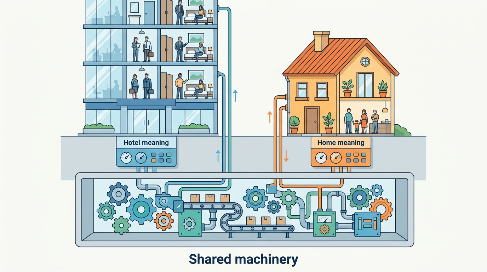
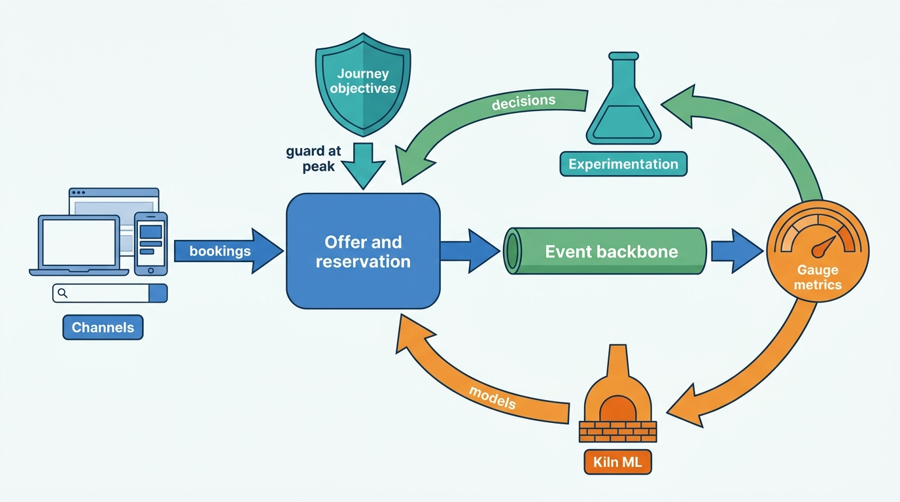

> **IN THIS PART, YOU WILL:** Build the platform beneath both marketplaces: the event streams that carry reservations and money, reliability and cost at peak, governed metrics and partner insight, experimentation, the machine-learning platform and the channels guests arrive through.

> **WHY THE BUSINESS CARES:** Corvane, the fictional group this book follows, found €412,000 of host-balance differences caused by booking events that were lost, read back too late or applied twice, a group booking total that added two incompatible counts, and an experiment "win" that left stays flat. Each came from the platform, not from a product feature.

> **WHY ARCHITECTS SHOULD CARE:** Every chapter so far assumed that a reservation reaches the ledger, that a metric means one thing and that a model has an owner. This part makes those assumptions true, and shows what fails on the busiest day when they are not.

> **KEY POINTS:**
>
> * **Share the machinery, not the meaning.** The outbox, the event backbone, the degradation mechanism, the metric layer, the experimentation and ML platforms and the channel framework are one group platform. ARI streams, degradation contents, supply metrics, experiment defaults, models and channel strategy stay with each brand.
> * **Measure the stay, not the promise.** Reservation events carry full versions, metrics name their time basis, experiments decide on stayed reservations and models learn from labels that cancellations can reverse. A booking is a promise that may not survive to the night.
> * **Correctness under load is the reliability that matters.** Peaks, strikes and shocks bring the most change at the same moment. Journey objectives, named degradation modes, completeness checks and model hold behaviors must be designed before that moment, and owned by someone.

> **[FAILURE PATTERNS THIS PART ADDRESSES](where-stay-platforms-go-wrong.html):**
>
> * **Built for Sunny Days** — Gives peaks, strikes and partner floods degradation modes, retry budgets and model hold behavior designed in advance.
> * **The Unwatched Model** — Gives every model an owner, approved uses and a gate in serving, and gives every experiment and label one governed metric.
> * **Phantom Availability** — Keeps ARI streams, price caches, features and metasearch feeds close enough to the truth that advertised prices still exist at checkout.

 
Parts II to VII built what guests, partners and hosts see. Part VIII turns to **what runs underneath**: the streams that copy each reservation to a dozen consumers, the capacity for a Black Friday peak, the numbers the board and partners read, and the models that set prices and order results.

**The platform is where a group can share the most and where sharing goes wrong most quietly.** Each chapter reaches the same judgement in its own terms: share the machinery, keep the semantics per marketplace.

**Figure 1:** *Share the machinery, not the meaning: the outbox, event backbone, metric layer and the experimentation and ML platforms serve both marketplaces, while ARI streams, supply metrics, experiment defaults, models and channel strategy stay with each brand.*

Hotels and homes load the platform differently. Roomstead, the accommodation marketplace (OTA, online travel agency), serves about 1,400 shopping requests per gross reservation, many of them from metasearch and partner APIs. Its platform costs are in search, its ARI (availability, rates and inventory) firehose is keyed by property, and a third of its booked room nights are canceled before the stay. A hosted-stays marketplace has far less traffic and far more consequence per unit: one calendar per home, so a treated guest in an experiment takes the night a control guest wanted. Most of its hosts are natural persons, whose data is personal data, and its payouts peak with the summer stays. Convergence blurs this: Roomstead already sells 435,000 alternative accommodations, and Nookaway pilots boutique hotels in 2028.

**Figure 2:** *Every channel calls the same offer and reservation contracts; their events feed one metric layer, which feeds the experiments that judge changes and the models that make decisions, while journey objectives and degradation modes decide what gives way first at peak.*

Corvane builds this platform through the second half of 2027: Gauge and Kiln in July, Experimentation Standard v1 and the event backbone in September, Lantern and Gangway in October, and the degradation ladder tested on Black Friday in November.

## Chapters in this part

[[event-driven-stays]] separates **the ARI firehose from the ledger-grade reservation and payment streams**, and publishes reservations as versioned full states through an outbox. Its case is Fathom's shadow run, whose 2,870 mismatched reservations fall to zero after the rebuild. Agoda, Booking.com and Airbnb supply the public record. Read it when nobody can prove that no booking was lost.

[[global-scale-and-reliability]] sets **objectives on four journeys (search, book, pay, deliver)** and designs degradation before the peak. Its case is Roomstead's Black Friday: 40 minutes in mode D2 when the cache hit rate fell from 94% to 71%. It also makes cost per booking an architecture metric. Read it before the next sale, strike or region failover.

[[marketplace-intelligence]] defines **the booking as a family of metrics with a time basis**, governed in one metric layer and reconciled to the ledger. Corvane's 51.0 million "bookings" and Hotel Miradouro's three May figures are the cases; Airbnb's Minerva is the precedent. Read it when two teams bring two numbers to one meeting.

[[stays-experimentation]] judges **funnel changes on stays, not bookings**, and chooses the randomization unit from the market. One free-cancellation badge "won" on both brands: at Roomstead the win vanished at the final read, and at Nookaway it shrank by two-thirds under a market design. Booking.com, Airbnb and Agoda supply the practice. Read it when the year's wins add up to more than the growth in stays.

[[stays-ml-platform]] classifies **every model by the decision it drives** and builds one platform with a registry gate, point-in-time features and a group disruption signal. Tideline, a cancellation model reused by hotels during the ATC strike weekend, cost Roomstead €38,400. Read it when nobody can list the models that make consequential decisions.

[[demand-channels]] treats **every channel as a client of one offer**, with metasearch and partner APIs as integrations with contracts. Roomstead finds that one search engine supplied the last external click on 41% of its gross reservations. Expedia's Vrbo distribution guide shows why a hotel-shaped API cannot sell homes. Read it before the next channel budget.

[[part-9]] then turns to the Chief Architect's agenda. Begin with [[event-driven-stays]].
