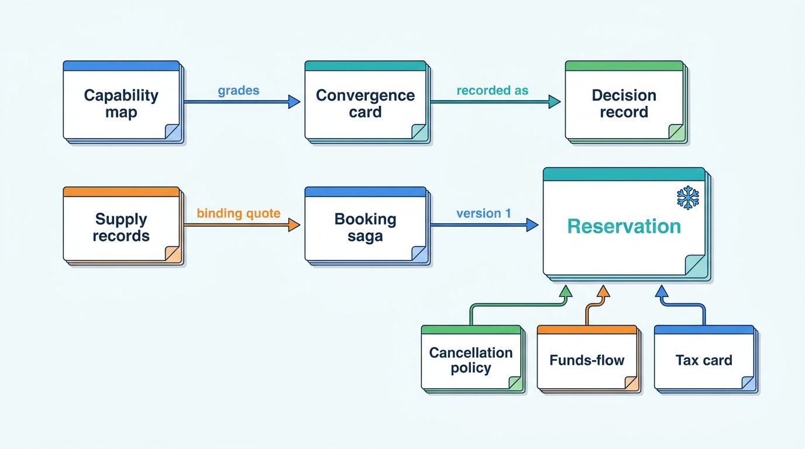
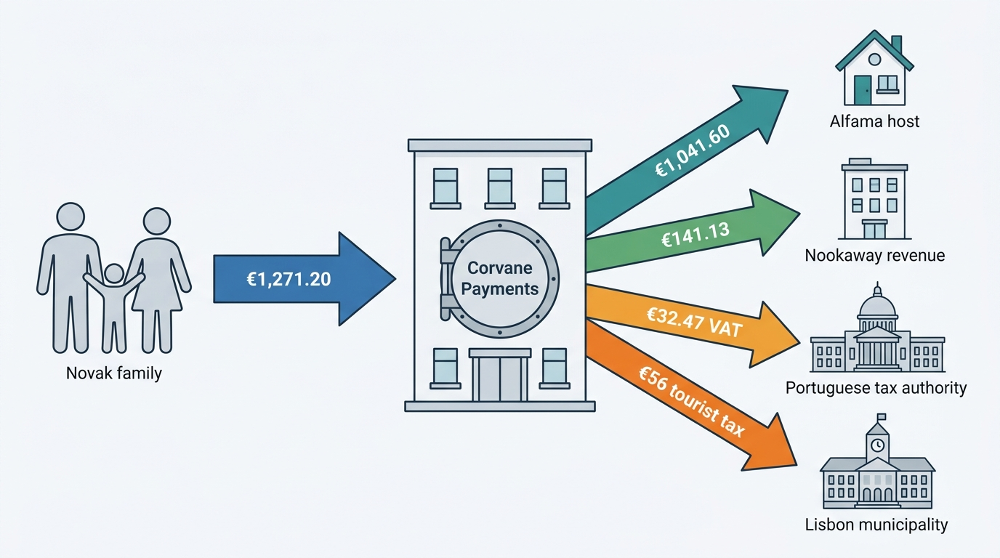

> **IN THIS SECTION, YOU WILL:** Find the template that fits the design or decision in front of you, copy it, see where the hotel version and the home version differ, and see it filled in once for Corvane, with the mistakes that most often make it useless and the chapter that explains every field.

> **KEY POINTS:**
>
> * **Every template names an owner, a version and what it freezes.** The records cite each other by identifier: a quote ID, a checkout attempt ID, policy template `NKW-MODERATE v3`, payment arrangement `v2`, a tax determination ID, rule `es-and-vut-v3`, degradation mode D2. That chain lets a support agent, an auditor or a regulator walk from a search card to a ledger entry and find the version that decided each number.
> * **Fill the hotel column and the home column separately.** Ten of the fourteen templates carry both columns, because a room-type product and a one-unit calendar fail differently. A cell that reads the same in both columns is a candidate for the shared core; a cell copied from one column into the other is how **The Hotel-Shaped Home** starts.
> * **Start with the record the next incident will ask for.** Most fields here were added by an incident: the sibling band by the €12 rate, acceptance-based delivery by Miradouro's missing reservations, the booking cutoff by the strike weekend, enforcement receipts by Turia Homes, reason codes by the Spanish purge. Fill the fields that change a decision, write "unknown" rather than guess, and add a field when a post-incident review finds a question no field answers.

> **[FAILURE PATTERNS THIS SECTION ADDRESSES](where-stay-platforms-go-wrong.html):**
>
> * **Policy Spaghetti** — the cancellation policy card, tax jurisdiction card and STR compliance card each put one rule in one versioned place, with a reason code that every channel and support tool reads.
> * **The Hotel-Shaped Home** — the hotel-versus-home columns and the convergence card force each capability and each supply segment to declare which engine serves it, instead of inheriting the larger brand's model.
> * **Price Drift** — the ARI model card, availability cache card and funds-flow template make one evaluator, one offer kernel and one arrangement record the only sources of a price, a fee and a payout.

<br>
These are **working templates for a group that runs both kinds of stays marketplace**: the records that Parts I to IX ask a Chief Architect to keep, from the capability map of [[stays-capability-map]] to the decision record of [[organizing-stays-engineering]], each tested against Corvane, the fictional travel group this book follows ([[meet-corvane]]). Each is the smallest form I have found that makes a design or decision explicit, assigns an owner, and leaves evidence someone else can check. **Adapt the wording; keep the fields that carry ownership, versions, clocks and money.** Those fields get dropped first, and the next incident finds their absence.

The hotel column describes Roomstead, Corvane's accommodation marketplace, which sells room types under rate plans; the home column describes Nookaway, its hosted-stays marketplace, which sells one-unit calendars. Where a template is the same for both, it says so. Each Corvane example agrees with the chapter that teaches it, which works the full case; all Corvane names, figures and dates are fictional and illustrative.

The templates are **maintained data, not documents**. Cancellation templates live in Clause, the group cancellation policy engine; tax rules in Levy, the group tax engine; STR rules in Ordinance, the market policy registry; trust policies in Warden, the trust platform; decision records in one register indexed by the architecture forum. A template copied into a slide deck stops being true within a quarter.

## Find the Template for the Question on Your Desk

| Tool | Use it when | Chapter |
| --- | --- | --- |
| [Tool 1](#tool-1): Two-marketplace capability map | You must show what both marketplaces need, where they overlap and what each owns | [[stays-capability-map]] |
| [Tool 2](#tool-2): ARI model card | You define what is sold and priced, add a rate plan or listing setting, or two surfaces disagree on a price | [[rates-and-availability-model]] |
| [Tool 3](#tool-3): Connectivity partner contract | A channel manager, PMS or host software vendor will write availability, rates or receive reservations | [[connectivity-and-channel-managers]] |
| [Tool 4](#tool-4): Availability cache design card | You design, tune or rebuild a price and availability cache, or a metasearch partner questions your accuracy | [[availability-engine]] |
| [Tool 5](#tool-5): Booking saga card | You design or change checkout, add a payment method or supplier type, or find duplicates | [[checkout-orchestration]] |
| [Tool 6](#tool-6): Reservation state table | You model reservation states, delivery or stay facts, or a guest arrives unknown | [[reservation-lifecycle]] |
| [Tool 7](#tool-7): Cancellation policy card | A policy, template or disruption rule is written or changed | [[changes-and-cancellations]] |
| [Tool 8](#tool-8): Funds-flow diagram template | A payment model, settlement rail or market is added, or finance cannot say who owes whom | [[merchant-and-agency-models]] |
| [Tool 9](#tool-9): Tax jurisdiction card | A tax enters, changes or moves between collectors | [[taxes-on-stays]] |
| [Tool 10](#tool-10): Trust policy-to-enforcement card | A trust policy, detector, gate or enforcement action is written or changed | [[stays-trust-and-safety]] |
| [Tool 11](#tool-11): STR compliance card | A short-term-rental rule, registration regime, order or report enters a market | [[stays-regulation]] |
| [Tool 12](#tool-12): Journey SLO card | You set objectives for search, book, pay or deliver, or plan a peak | [[global-scale-and-reliability]] |
| [Tool 13](#tool-13): Convergence decision card | A capability or supply segment is proposed for sharing, or supply crosses marketplace types | [[converging-two-marketplaces]] |
| [Tool 14](#tool-14): Architecture decision record | A decision crosses a brand, team or contract, moves money or personal data, or needs an exception | [[organizing-stays-engineering]] |

The context map of [[stays-bounded-contexts]], the event catalog of [[event-driven-stays]] and the metric definitions of [[marketplace-intelligence]] are not repeated here; Tools 6, 12 and 14 link to them where a field depends on them.

## How the Records Connect

Most changes in a stays group pass through several tools, and the reservation is where most of them meet.


**Figure 1:** *How the templates reference each other. The capability map and convergence card decide what is shared and are recorded as decisions; supply records feed the offer; and the reservation freezes four other records (the policy, the arrangement, the tax determination and the quote), which is why a reservation can be explained months later only if those records carry versions.*

## <a id="tool-1"></a>Tool 1: Two-Marketplace Capability Map

**Purpose.** A capability map describes what each marketplace must be able to do, independent of systems, teams or brands. The two-marketplace version puts both brands in adjacent columns, scores each level-2 capability on **differentiation**, **divergence** and **duplication**, and grades it **shared engine**, **shared contract with separate engines**, or **brand-specific**.

**Use it when** you prepare a sharing or convergence decision (Tool 13), a program budget, or an acquisition case, and whenever a capability has no named owner. Review it once a year and after every acquisition or new supply type.

**The template.** One row per level-2 capability.

| Field | What to record | Guidance |
| --- | --- | --- |
| **Group and capability** | Level-1 group; a stable noun phrase | Never a system ("Pricegrid"), team or brand |
| **Hotel implementation** | System, owner, number of copies | From the application inventory, checked with the brand |
| **Home implementation** | System, owner, number of copies | Same; "—" when the brand has no such capability |
| **Differentiation** | Core / supporting / generic, **scored per brand** | Scored by the other brand's people; protection is core for homes and nearly absent for hotels |
| **Divergence** | Same / rhymes / different | "Rhymes" means same shape, different contents (an offer, a reservation) |
| **Duplication** | Copies, run cost, inconsistency evidence | Ranks attention; not part of the decision rule |
| **Maturity** | 1–5 per implementation, with dated evidence | A reason to invest, not to share |
| **Decision** | Shared engine / shared contract / brand-specific / brand-specific until a dated review | Follows the rule in [[stays-capability-map]], Figure 5 |
| **Owner and linked record** | Named person; the decision record that set the grade | Duplication is a problem only when nobody chose it |

**Corvane example** (One Stay capability map v1, presented to the architecture forum on 23 March 2027; owners Aisha Rahman and Rafael Mendes, built by Mariana Costa):

| Field | Offer and price composition (fees, taxes, currency, member price) |
| --- | --- |
| Hotel implementation | Pricegrid, Keystone checkout and the metasearch feed exporter, each composing its own total |
| Home implementation | Burrow pricing at query time |
| Divergence | Rhymes: same composition steps, different inputs (rate plans and occupancy versus a nightly price and a cleaning fee) |
| Duplication evidence | Metasearch price accuracy 91% against a 97% target; of the 9.0 points of mismatch found in May 2027, 2.8 were arithmetic (fee and tax composition 1.4, currency 0.8, member-price leakage 0.6); estimated metasearch spend wasted on mismatched prices about €8.4 million a year at 91% |
| Decision | **Shared contract**: one definition of an offer and its total, separate engines behind it |
| What followed | The shared offer kernel used by Pricegrid, the feed exporter and checkout (piloted in Spain and Portugal from June 2027) and one price-composition service per engine with a group display policy service |

The map's totals were **16 shared engines, 6 shared contracts and 26 brand-specific capabilities** over 48 rows; the December 2027 review recorded **23, 6 and 20** over 49, every move toward sharing ([[converging-two-marketplaces]]).

**Common mistakes.**

- Mapping one marketplace onto the other's map. Corvane's January 2027 attempt put Nookaway onto Roomstead's 2023 map; co-hosts, turnover and protection landed in the wrong boxes, and compliance in "Other".
- Letting duplication decide. The unit calendar and room-type inventory are duplicated and different, and should stay so.
- An open-ended "brand-specific". Experimentation carried "brand-specific until the 2028 review"; a deliberate duplicate needs a date.

Learn more: [[stays-capability-map]]

## <a id="tool-2"></a>Tool 2: ARI Model Card

**Purpose.** The ARI model card records how one marketplace models **availability, rates and inventory** (ARI). It separates **definitions** (products), **facts** (counts, independent prices, restrictions per night, each with source and version), **rules** (derivations, discounts, fees, order of operations) and the single **evaluator** that turns them into a bookable stay with a price.

**Use it when** a rate plan, listing setting, restriction or fee type is proposed; a channel manager starts sending derived prices; or search, the property page and checkout disagree on a price.

**The template.**

| Field | Hotel (accommodation marketplace) | Home (hosted-stays marketplace) |
| --- | --- | --- |
| **Supply unit and inventory** | Room type with a count per night; physical and sellable inventory kept apart | One listing (unit), zero or one per night |
| **Sellable product** | Room type × rate plan; count of active products | Listing-night, then a stay quote |
| **Independent prices** | Which plans carry a chosen price, and who chooses (RMS, PMS, extranet) | Nightly price, from the host, automatic pricing or a PMS |
| **Derived prices** | Each derivation declared in the catalog, with parent, rule and order of operations; **never stored as a fact** | Length-of-stay and lead-time discounts as rules |
| **Restrictions** | Revenue controls: stay-through and on-arrival minimums, closed to arrival or departure, advance purchase; date convention | Operational controls: minimum nights, check-in days, advance notice, preparation time |
| **Conditions that travel with the price** | Cancellation policy per rate plan, meal plan, payment arrangement | One cancellation tier per listing; cleaning fee |
| **Audience prices** | Member, device and country prices as **offer-layer conditions**, not rate plans | Usually none; host promotions as rules |
| **Fees and taxes** | Amount as received, with inclusion flags | Same |
| **Fact provenance** | Source, source sequence, received time per fact; change-stream retention | Same |
| **Evaluator** | One stay evaluator, one conformance suite run by search, page and checkout | Same contract, own implementation |
| **Pruning rule** | What may be a rate plan; retirement after no bookings | What may be a listing setting |

**Corvane example** (the two exhibits Aisha Rahman and Rafael Mendes brought to the forum in May 2027):

| Field | Hotel Miradouro, Lisbon (Roomstead) | Carmen Ruiz's apartment, Seville (Nookaway) |
| --- | --- | --- |
| Supply unit | 84 rooms in 6 room types: Standard Double 34, Superior Double 20, Deluxe River View 12, Twin 10, Junior Suite 6, Family Room 2 | One two-bedroom apartment in Triana; 730 listing-night rows in Almanac (two-year horizon) |
| Products | **37 active rate plans, 168 products**; target **17 plans and 74 products** under the pruning rule, migration Q1 2028 | One listing |
| Independent prices | 11 plans: Flexible set daily by Duarte Silva's RMS through the PMS, 4 packages, 3 corporate, 3 legacy | €110 a night; €260 for the Feria de Abril nights |
| Derived prices | 26 plans: 3 computed in Corvane Connect, 19 Roomstead rate relations, 4 legacy. Non-refundable = Flexible −12%; breakfast +€16 per person per night; discount before supplements, so €120 Flexible becomes €137.60 for two with breakfast | 10% discount for 7 or more nights |
| Restrictions | Restriction tables per product-night, from the RMS | Minimum 2 nights (3 for Feria arrivals); no check-in on Sundays; one day's advance notice |
| Conditions | Cancellation policy per rate plan | Moderate tier; €60 cleaning fee |
| Audience prices | 13 plans (2 mobile, 5 country, 6 Roomstead Circle) move to offer-layer conditions | — |
| Sizing | Tally holds about 5.8 million active products across Roomstead | Almanac holds about 840 million listing-nights |
| Provenance | ARI change stream retained 13 months | Same |

The Bauers' Feria booking, 20–25 April 2027, priced at 5 × €260 + €60 = **€1,360** before guest fees, came from six of Carmen's fields. Miradouro's €12 rate (41 reservations) came from a newly mapped plan whose price Roomstead could not relate to any sibling, because Corvane Connect sent derived prices as plain numbers.

**Common mistakes.**

- Storing derived prices as facts. Validation cannot then notice a child that stopped tracking its parent.
- Audience fences as rate plans. Six Circle plans multiply what Tally stores, Connect maps and Pricegrid caches.
- Passing a flag through. Switchyard passed tax inclusion as a per-partner flag that Pricegrid and Keystone read differently.

Learn more: [[rates-and-availability-model]]

## <a id="tool-3"></a>Tool 3: Connectivity Partner Contract

**Purpose.** A connectivity partner contract is everything a marketplace and a connectivity partner (channel manager, property-management system or PMS, central reservation system, host software) must agree on for ARI to flow in and reservations to flow out. Schema validity is the smallest part of it; ordering, holds, reconciliation and proof of delivery are the rest.

**Use it when** a partner is certified, recertified or changes its mapping; a new message type or API version ships; or a partner's properties start showing drift, holds or late acknowledgements.

**The template.**

```yaml
connectivity_contract: <partner id>      version: <n>   effective: <date>
partner: <name>; tier: <certification level>; properties in scope: <n>
dialect: OpenTravel profile <version> | proprietary JSON | partner API | iCalendar
internal_command:                        # what every inbound message becomes
  values: absolute only (never increments)
  provenance: partner, connection, message id, sequence, received/accepted/applied times
ordering: one lane per <property | listing>; partner sequence numbers: <yes/no>
deduplication: by partner message id, window <hours>
validation_guards: schema and profile | absolute bounds | same-product history |
                   sibling band <±%> | derivation consistency | property and market
                   envelope | burst and volume
hold_semantics: existing product keeps last good value; new product stays closed;
                released by <resend with confirmation | hotel confirmation>; expires <h>
states_exposed: accepted | applied | visible
reconciliation: read-back API | digest per property-month | full sync (diffed at edge)
quotas: <cells per minute>; per-partner queues; HTTP 429 with retry hint
reservation_delivery:
  transport: push | pull queue; per reservation version, in order
  closes_on: acceptance with PMS confirmation number | rejection with reason code
  escalation: <minutes> to extranet inbox; fallback is sticky for later versions
health_score: freshness, hold rate, drift, mapping coverage, ack latency p95,
              fallback rate, attributed incidents per 10,000 reservations
change_management: deprecation notice <months>; preview program <rules>
```

| Clause | Hotel partner (channel manager, PMS) | Home partner (vacation-rental PMS, iCal) |
| --- | --- | --- |
| Unit of update | Product × date: rooms to sell, price per occupancy, restrictions | Listing × night: free or taken, nightly price, minimum nights |
| Ordering lane | Per property | Per listing |
| Guards that matter | Sibling band, envelope | Calendar claims with provenance; conflict detection on import |
| Delivery | Push or pull to the PMS with acceptance and fallback | None for app-managed hosts; webhooks or API for managers |

**Corvane example** (Switchyard, Roomstead's connectivity gateway, after the €12 rate; architecture forum April 2027, live June 2027; Corvane Connect as one of 140 certified partners):

| Clause | Contract |
| --- | --- |
| Internal command | Every dialect normalized at the edge into one ARI command with absolute values and provenance; one ordered lane per property (Kafka partition by property ID) |
| Guards | **Sibling band ±60%** around the median of the property's independently priced products on the same room type and date, plus the property and market envelope; an outlier on a newly mapped product keeps that product closed until confirmed. A replay would have held the first €12 message at 07:14:03 against a €141 median; the band holds about 1 in 9,000 price messages |
| Holds | Existing product keeps its last good price; new product stays closed; released by partner resend with a confirmation flag or by hotel confirmation in Partner Hub; rejected after **4 hours** |
| Quotas | Product-date cells per minute; per-partner queues |
| Reconciliation | Full syncs diffed against stored state; a 365-day full sync at Miradouro touches about 61,000 product-days |
| Delivery | Push per reservation version with sequence numbers; acknowledgement must carry the PMS confirmation number; no acknowledgement within **10 minutes** moves the booking to the Partner Hub inbox, sticky, with alert and e-mail |
| Acceptance | From 2028 certification: receipt, then acceptance or rejection with a reason code from a published list; Corvane Connect committed by end of Q4 2027 |
| Neutrality | Corvane Connect uses the same public APIs, quotas, guards and certification as the other 139 partners; disputes go to the group architecture board |

On the home side, Nookaway's **Calendar Sync v2** (March 2027) is the equivalent contract for iCal: adaptive import in three tiers (hot 15 minutes for about 10% of feeds, warm 1 hour for about 30%, cold 3 hours), and a link broken for 72 hours switches the next 30 days to request-to-book ([[calendar-sync]]).

**Common mistakes.**

- Treating "accepted" as "visible". Switchyard applied updates in seconds; Pricegrid's refresh kept corrected prices wrong.
- Same-product history as the only plausibility guard. It has nothing to compare on a new product, where mapping errors live.
- Closing delivery on a channel manager's receipt. Miradouro's July 2027 failures stayed "sent" in Keystone for eleven days.

Learn more: [[connectivity-and-channel-managers]]

## <a id="tool-4"></a>Tool 4: Availability Cache Design Card

**Purpose.** The availability cache card records how a marketplace answers browsing traffic without querying its system of record for every request, and how far those answers may drift. Its central rule is that **age is an engineering metric and divergence is a business metric**: a card that measures only cache age has no owner for wrong prices.

**Use it when** you design or rebuild a price cache, size it for a peak, change what it stores, or a metasearch partner reports falling accuracy.

**The template.**

| Field | Hotel (precomputed grid) | Home (index summary and exact quote) |
| --- | --- | --- |
| **Cell and key** | Property × arrival × length of stay × occupancy; best offer plus the room-rate behind it | Listing; open-night bitmap and valid-arrival sets per stay length |
| **Kept out of the key** | Audience and display currency, applied at read time through the kernel | Same |
| **Hot tier** | Horizon, stay lengths, occupancies precomputed; cell count | Not applicable; quote the results page exactly |
| **Freshness strategy** | Push recompute for hot cells, on-demand for the long tail, TTL for pulled suppliers | Event-driven index update; confidence by sync type |
| **Fan-out rule** | A night's change marks only cells whose stays cover it | A night's change updates the listing's sets |
| **Rebuild order** | Demand-ordered queue; coalescing window | — |
| **Kernel and provenance** | One versioned offer kernel; ARI and kernel versions, computed-at and valid-until on every offer | Same kernel for composition |
| **Binding check** | Price check against the ARI store; quote validity window; rounding tolerance | Conditional write on the calendar; re-check of stale external feeds |
| **Degradation** | Grid prices only, misses as "check price" | Stale-feed listings to request-to-book; never degrade the calendar check |
| **Metrics and targets** | Freshness lag p99 per tier; served divergence by cause; price-changed and unavailable at check; external accuracy per partner | Conflicts per 10,000 reservations; quote failures on the results page |

**Corvane example** (Pricegrid after the Spain and Portugal repair; the 2026 design in brackets):

| Field | Pricegrid, Roomstead |
| --- | --- |
| Cell and key | Best offer per property × arrival × length of stay × adults |
| Hot tier | Redis: arrivals within 180 days, stays of 1–7 nights, 1–4 adults, about **3.2 billion** cells; other cells up to 365 days and 14 nights computed on demand from Tally; normal hit rate **94%** |
| Fan-out | Cell-level: Duarte's 18 May 2027 change to 4–6 June marked **532** cells (whole-year recompute: 20,440) |
| Rebuild order | Priority by reads in the past seven days, boost for arrivals in the next 30 days; changes to one property-night within a second coalesced |
| Freshness | Hot-cell p99 lag about **45 seconds** (on 18 May 2027 it reached 52 minutes); targets: hot cells under 60 s, others under 10 minutes |
| Binding check | Quotes binding for **15 minutes** from the price check |
| Metrics | Served divergence under 3% (sampler re-quotes 0.1% of served offers); price changed at check under 1.5%; unavailable at check under 1%; external accuracy 97% by mid-2028 |
| Result | Spain and Portugal accuracy **91.4% (April) → 95.8% (end of July 2027)** |

Nookaway's card reads differently: its OpenSearch index held only an open-night bitmap in 2027, the June 2027 search decision added valid-arrival bitsets per stay length of 1 to 30 nights, and the exact quote for the results page stays authoritative ([[stays-search-architecture]]).

**Common mistakes.**

- Fan-out by property. A whole-year recompute sized the work by change rate times 20,440 cells.
- Precomputing audience prices. Corvane's 0.6 points of member-price leakage came from them.
- A sampler that reads the cache it measures. Re-quote from the system of record with the served request's party, audience and currency.

Learn more: [[availability-engine]]

## <a id="tool-5"></a>Tool 5: Booking Saga Card

**Purpose.** The booking saga card records how one booking flow turns a binding quote into a reservation: each step, its compensation, the key that makes a repeat harmless, its timeout behavior, and the **pivot**, the step after which the flow is retried to completion rather than undone.

**Use it when** you design checkout for a new booking mode, payment method or supplier type; change timeouts; or find duplicate reservations or charges.

**The template.**

| Step | Participant | Action | Compensation | Key | Timeout behavior |
| --- | --- | --- | --- | --- | --- |
| 1 | Checkout attempt service | Create attempt from quote ID | Expire | Server-minted attempt ID | Same attempt for same session and quote |
| 2 | Price composition, policy | Re-validate quote; freeze terms snapshot | — | Attempt ID | Fail closed |
| 3 | Risk | Pre-payment decision | — | Attempt ID | Per gate (Tool 10) |
| 4 | Allocation | Hold nights or rooms | Release | Attempt ID | Retry same key |
| 5 | Reservation store | Create pending reservation | Abandon | Attempt ID | Idempotent |
| 6 | Payment orchestrator | Authorize | Void | Attempt ID + obligation | **Unknown**, resolved by lookup |
| 7 | Allocation, reservation | **Pivot**: commit and confirm | Cancellation under frozen terms | Attempt ID | Retry until it returns |
| 8–9 | Payments, delivery | Capture per plan; deliver; notify | Refund (business action) | Obligation; reservation ID + version | At least once, from the outbox |

Record beside it: hold duration, the wait budget (client longer than server, server longer than its slowest call), the Unknown deadline and the natural-key guard's window.

| Field | Hotel (accommodation marketplace) | Home (hosted-stays marketplace) |
| --- | --- | --- |
| **What is committed** | Conditional decrement of a room-type count | Uniqueness constraint on a unit's nights |
| **Pivot** | Commit on the platform after authorization (merchant) or with no payment step (agency); the **supplier's booking call** for bedbank supply | Commit on the calendar after authorization; **host acceptance** for request to book |
| **Long waits** | Rare: pull-model supplier confirmation | Common: 24-hour host decisions, identity checks, Pay Later |
| **Hard-to-undo step** | Non-refundable rates with an active virtual card; supplier penalties | A blocked peak-date calendar that may have cost the host another guest |

**Corvane example** (checkout attempt contract, adopted by the architecture forum in February 2027; Roomstead app March, web April, Nookaway with Payment Plans v1 April–September 2027). The Novak family's Nookaway booking of **14 February 2027**, Alfama, 2–9 August, replayed through it:

| Step | What happens | Recorded |
| --- | --- | --- |
| Start | Quote re-validated against Almanac; 2 adults, children 9 and 12; arrangement `FACILITATED`, Corvane Payments as merchant of record | Attempt ID; quote binding 15 minutes; total **€1,271.20** |
| Risk | Established account, family of four, booked six months ahead | Allow, reason codes |
| Hold | Seven listing-nights held for 10 minutes from the start of payment | Keyed by attempt ID |
| Authorization | 3-D Secure challenge extends the hold once, to 20 minutes; card stored with scheme reference | Obligation keys |
| Pivot and after | Nights committed, reservation confirmed; capture; Fathom posts host payable €1,041.60, fees and €56 tourist tax | Outbox events |

Timeouts in the contract: Turnstile, Roomstead's checkout API, returns **Unknown at 30 seconds**; the app waits 35 seconds, then polls for up to five minutes; unknown authorizations go to a reconciliation queue after five minutes; the natural-key guard looks back **30 minutes**. Roomstead's hold is 15 minutes.

**Common mistakes.**

- A client-minted key per HTTP request. On 14 January 2027 a networking-layer retry did this and created **212** duplicate reservations, **198** with duplicate charges.
- Compensating an unknown. A void of something that may have happened undoes a booking the guest believes exists.
- One coordinator for both brands. Two sagas speaking one attempt contract beat a configuration language nobody can read.

Learn more: [[checkout-orchestration]]

## <a id="tool-6"></a>Tool 6: Reservation State Table

**Purpose.** The reservation state table separates the four kinds of state a reservation carries (**commercial**, **delivery**, **stay** and **money**), names one owner per dimension, lists the commercial transitions with cause and initiator, defines delivery per recipient and version, and puts every clock in writing with its owner and expiry action. Its rule: **no consumer infers one dimension from another.**

**Use it when** you design a reservation service, add a state or recipient, migrate reservations between engines, or a guest arrives at a property that has no booking.

**The template.** Three tables.

*Dimensions*

| Dimension | Owner | Values | Hotel source | Home source |
| --- | --- | --- | --- | --- |
| Commercial | Reservation service | Pending (with named gate), confirmed (version n), declined or expired, canceled (cause, initiator), no-show, stayed, completed | Guest, property, marketplace | Guest, host by mutual request, platform under policy |
| Delivery | Delivery tracker | Per recipient and version: queued, sent, received by intermediary, accepted, rejected (reason), fallback, confirmed by staff | The core problem | A notification, except for PMS-connected managers |
| Stay | Reservation service | Arrival due, in stay, no-show, stayed; **reported or inferred** | Reported by the PMS, or inferred at the end of the no-show window | Inferred from time; a check-in issue or claim overrides |
| Money | Payments and settlement | Per payment plan | Commission invoiced; card activated | Payout released |

*Clocks*: one row per timer, with start, duration, expiry action and owner (example below).

*Snapshot frozen on every version*: quote ID, policy snapshots (Tool 7), payment arrangement version (Tool 8), tax determination ID (Tool 9), content version, party with ages and residence where tax or STR reporting needs them.

**Corvane example** (Stayline, the One Stay reservation service; August 2027 forum decisions after Miradouro's missing reservations):

| Clock | Starts | Duration | On expiry | Owner |
| --- | --- | --- | --- | --- |
| Host decision, request to book | Request created | 24 hours (Nookaway) | Request expires; authorization released | Nookaway reservations |
| Delivery escalation | Version sent | 10 minutes without acceptance | Copy to Partner Hub inbox with alert | Switchyard |
| Delivery exception | Version not accepted, arrival within 7 days | 20 minutes | Exception to the property's front-office queue | Exception service |
| Pre-arrival verification | Arrival minus 7 days, then minus 48 hours | One check each | Mismatch becomes an exception | Stayline |
| No-show window (Roomstead) | 00:00 local on arrival day | Until 72 hours after scheduled check-out | "Stayed, inferred"; commission invoicing reads it | Stayline |
| Host payout release | Scheduled check-in | 48 hours (Nookaway) | Payout released unless an issue is open | Settlement |
| Completion (Nookaway) | Scheduled check-out | 14 days | Completed, unless a claim or chargeback flag is open | Stayline |

The table replays July 2027. A PMS release on 5 July rejected Miradouro's 4 legacy rate-plan codes; Keystone's single `STATUS` column said `CONFIRMED` and its `SENT_FLAG` said sent. By 17 July **33** messages had failed, including **19** new Roomstead reservations, and on 16 July a family was walked to Belém for **€390**. Under the table, the first rejection reaches Miradouro's front-office queue within about an hour of the first booking. A sweep of about **260,000** arrivals at Corvane Connect hotels found **1,040** (0.4%) that disagreed with the PMS. Target: **99.5%** of arrivals verified 24 hours before arrival by end of 2028.

**Common mistakes.**

- One status column. `CONFIRMED` plus `SENT_FLAG` said something false, and money logic began reading status strings.
- Modification as a state. It is version n+1; version 1 accepted with version 2 rejected leaves the hotel holding the old dates.
- Completion without a dispute flag. The Dubrovnik claim was recorded against a reservation Burrow had already closed.

Learn more: [[reservation-lifecycle]]

## <a id="tool-7"></a>Tool 7: Cancellation Policy Card

**Purpose.** The cancellation policy card defines one policy as ordered time windows with typed penalties, evaluated in the place of the stay, and fixes the engine's decision record and the disruption-event fields that may override it. Its money rule: **waive what you hold, request what you do not.**

**Use it when** a template or rate-plan policy is written or changed, a support override type is added, a disruption policy is drafted, or two channels give a guest different answers.

**The template.**

| Field | Hotel (accommodation marketplace) | Home (hosted-stays marketplace) |
| --- | --- | --- |
| **Policy ID and version** | Supplier policy per rate plan, from ARI feeds | Platform template; host chooses a tier |
| **Windows** | Up to N windows before arrival, each with a penalty type (amount, nights, percentage); non-refundable ranges | Tier windows (full refund until X, partial until Y) |
| **Time basis** | Instants with explicit offset, in the property's time zone | Same, in the listing's time zone |
| **Fee treatment** | Usually none at the OTA level | Cleaning fee and guest fee refund rules |
| **Grace rules** | As the supplier grants | Platform grace (for example 24 hours after booking) |
| **Snapshots on the reservation** | Guest-facing and supplier-facing; may differ, the gap has a ledger account | Usually identical |
| **Who can waive** | The property; the marketplace only by funding it | The platform can override; fairness to hosts is the constraint |
| **Supplier cancellation** | Relocation at the property's cost under partner terms | Host fee schedule; dates blocked |

*Decision record returned by the engine*: allowed (and why not); money lines per party with funder; effective policy, window and override with versions; next deadline; message keys for rendering; engine version and decision ID.

*Declared disruption event*: class (`STAY_PREVENTED` or `TRAVEL_DISRUPTED`); places; stay window; **booking cutoff**; party filter; override per payment model; funding and budget cap; owner, approver, expiry, version.

**Corvane example** (Clause, approved July 2027; Nookaway template v3; Disruption Policy v1):

| Field | `NKW-MODERATE v3` (Nookaway) |
| --- | --- |
| Windows | Full refund of nights until 7 days before check-in; 50% of nights until 48 hours before; none after |
| Fees | Cleaning fee refunded if canceled before check-in; guest service fee refunded in proportion to the refunded subtotal |
| Grace | Full refund within 24 hours of booking for stays at least 14 days away |
| Host cancellation fees | 10% of the nightly subtotal more than 14 days out, 20% within 14 days, 30% within 48 hours or after check-in; dates always blocked |

A family from Lyon canceled Carmen Ruiz's apartment (6–10 June 2027; €440 nights, €60 cleaning, €60 guest fee, €560 paid) at 18:20 on 3 June, after the strike was announced:

| Line | Moderate alone | June 2027 flag | Disruption Policy v1, `TRAVEL_DISRUPTED` |
| --- | --- | --- | --- |
| Guest refund | €313.60 | €560.00 | **€340.00** (Carmen declined the waiver request; Nookaway waives its own fee) |
| Carmen's payout | €211.20 | €0 | **€220.00** (host fee waived) |
| Nookaway keeps | €35.20 | €0 | €0 |

On the hotel side, a non-refundable Pay with Roomstead stay at Miradouro (5–8 June, 3 × €137.60 = €412.80, virtual card loaded with €350.88) returns under v1 "not refundable under the supplier policy; waiver request with a 12-hour answer target; marketplace margin of €61.92 refundable if the hotel declines".

**Common mistakes.**

- Reading the live policy at cancellation time. An October edit then changes what an August guest is owed.
- Waiving what you do not hold. In June 2027 Roomstead reimbursed **€167,900** where 610 agency properties charged guests anyway, and **€31,200** on already-charged virtual cards was never recovered.
- An event without a booking cutoff. It gives free flexibility to anyone who books into the event.

Learn more: [[changes-and-cancellations]]

## <a id="tool-8"></a>Tool 8: Funds-Flow Diagram Template

**Purpose.** A funds-flow diagram shows, for one booking under one payment model, every movement of money: who pays whom, how much, when, by which rail, which ledger account records it, and who carries the risk if it goes wrong. It is drawn from the **payment arrangement record**, the versioned output of a payment-model resolver that every money system reads, so finance, payments, support and a regulator see the same flow.

**Use it when** a payment model, settlement rail, currency or market is added; a modification can switch models; or finance cannot say who owes whom on a booking.

**The template.** First the arrangement; then one row per leg (from and to, amount basis, when, rail, ledger entry, risk holder); then one diagram per model, with amounts on the arrows.

| Arrangement field | Hotel, agency | Hotel, merchant | Home, facilitated |
| --- | --- | --- | --- |
| `model` | `AGENCY` | `MERCHANT` | `FACILITATED` |
| `merchant_of_record` | Property | Platform payment entity | Platform payment entity |
| `supplier_of_stay` | Property | Property | Host (later possibly platform as deemed supplier) |
| `collection_plan` | At property | At booking or before the free-cancellation deadline | At booking, or Pay Later |
| `supplier_settlement` | None | Virtual card net of commission, or bank transfer | Payout after check-in |
| `commission_direction` | `INVOICE` (receivable) | `DEDUCT` | `DEDUCT` |
| `liabilities` | Chargebacks with the property | Chargebacks, card fraud, FX with the platform | Same, and after payout recovery from the host |
| `revenue_trigger`, `version` | Stay | Check-in or non-cancellable | Check-in |

**Corvane example** (the Novak family's facilitated booking, arrangement frozen on 14 February 2027; Fathom, the group ledger):

| Leg | From → to | Amount | When | Ledger entry |
| --- | --- | --- | --- | --- |
| Guest payment | Novaks → Corvane Payments | €1,271.20 | 14 Feb 2027 | Guest funds receivable |
| Host share | Corvane Payments → host | €1,041.60 (€1,085 subtotal less 4% host fee of €43.40) | Payout 4 Aug, 48 hours after check-in | Payable to host, held until payout |
| Fees | Corvane Payments → Nookaway | €141.13 net (guest fee €105.85 + host fee €35.28) | Earned at check-in, 2 Aug | Unearned, then earned fee revenue |
| VAT on fees | Corvane Payments → Portuguese tax authority, on Nookaway's return | €32.47 (€24.35 + €8.12, 23%) | Nookaway's Portuguese VAT return | VAT payable, Portugal |
| Tourist tax | Corvane Payments → Lisbon municipality, on Nookaway's return | €56.00 | August return | Tourist tax payable, Lisboa |


**Figure 2:** *One facilitated booking drawn from its arrangement record. Corvane Payments holds the guest's money for 171 days, and every arrow is a ledger account with an owner, so a cancellation or chargeback reverses known amounts rather than a total.*

The same template drawn for a two-night agency booking at Miradouro (6–8 October 2027, €140 a night, 15% commission) has one arrow from guest to hotel (€280 at the desk) and one from hotel to Roomstead (€42 commission, invoiced in November and paid in December). The merchant version has €280 to Corvane Payments on 2 August, a €238 virtual card active from 6 October, and €42 earned on 6 October. **The settlement direction flips between agency and merchant**, and so does who carries chargebacks.

**Common mistakes.**

- Inferring the model from a flag. Keystone read the original `PAYMENT_TYPE`, so about **3,400** reservations switched to "Pay now" were also commission-invoiced, about **€129,000** of credit notes.
- Leaving card activation out of the diagram. Cards activated at booking for non-refundable rates were a main source of the **€1.8 million** reconciliation gap of Q1 2027.
- One diagram per brand. Roomstead runs two models, and Nookaway's 2028 hotel pilot adds facilitated collection with virtual-card settlement.

Learn more: [[merchant-and-agency-models]]

## <a id="tool-9"></a>Tool 9: Tax Jurisdiction Card

**Purpose.** The tax jurisdiction card records one tax in one jurisdiction as effective-dated rule content for a tax engine: its shape, base, rate, caps and exemptions, its **date basis**, rounding and currency, how it is displayed, and the **liability decision** (who is taxpayer, collector and remitter) for each payment model. It carries a source and a review date, because tourist taxes change by municipal decision.

**Use it when** a tax is introduced or changed, a collection agreement is signed, a payment model changes who collects, or a deemed-supplier or platform-reporting regime approaches.

**The template.**

| Field | What to record |
| --- | --- |
| **Jurisdiction and tax** | Country, region, municipality, special zone; tax type; resolved from the unit's exact location, never a host-entered city |
| **Shape and base** | Per person per night; percentage of room price (excluding VAT?); per room; per stay; tiered by classification |
| **Rate, caps, exemptions** | Rate; maximum nights; age, residence or purpose exemptions |
| **Date basis** | Booking date, stay night, payment date or invoice date |
| **Rounding and currency** | Per night or per stay; per line or per invoice; jurisdiction currency |
| **Display** | Included in price, added to total, or payable at property; per market display rule |
| **Liability decision** | Taxpayer, collector, remitter, per arrangement (Tool 8) |
| **Agreement and filing** | Collection agreement or "none"; return, period, authority |
| **Checkout data** | Ages, residence, business or consumer guest |
| **Source and review** | Legal source with date; reviewer; next review date |

| Field | Hotel (accommodation marketplace) | Home (hosted-stays marketplace) |
| --- | --- | --- |
| **Default collector, tourist tax** | The property at the desk (agency), unless an agreement or opt-in applies | The platform, where a law or city agreement makes it collect |
| **Deemed supplier (ViDA, Article 28a)** | Hotels mostly outside: they give the platform a VAT number and charge VAT | Individual hosts mostly inside; the platform charges VAT on the stay |
| **DAC7** | Sellers with more than 2,000 rentals of one listing in a period are excluded; agency consideration still counts | Most hosts reportable; payout withholding is the lever |

**Corvane example** (Levy, first release Q4 2027, replacing Burrow's hard-coded dictionary for **23** municipalities where Nookaway collects and remits under city agreements):

| Field | Lisbon tourist tax |
| --- | --- |
| Shape and rate | €4 per guest per night since 1 September 2024, set by the municipal fee regulation (Aviso n.º 18684/2024/2; see [[taxes-on-stays]]) |
| Caps and exemptions | Maximum 7 nights per guest and per stay. Guests under 13 exempt, including on the day they turn 13; also exempt: medical stays plus one companion, and students starting higher education (up to 60 days) |
| Date basis | Stay night |
| Checkout data | Children's ages (asked at Nookaway checkout since 2025) |
| Liability, Nookaway | Guest owes; Nookaway collects and remits under the Lisbon agreement; host statement shows "collected and remitted by Nookaway on your behalf" |
| Liability, Roomstead agency | Guest owes; property collects and remits; Roomstead displays it as payable at property |
| Liability, Roomstead merchant | Platform-collected when the partner opts in (Alfama Keys moved to Pay with Roomstead in 2027 after about **11%** of its 2026 agency guests left without paying the city tax) |
| Novak booking | 2 adults × 7 nights × €4 = **€56** (the children exempt under Corvane's assumed rule), posted as tourist tax payable to Lisboa and reversible per reservation |

**Common mistakes.**

- Rules in code. Burrow's dictionary could not say which rule version priced a booking; Corvane found three rounding behaviors for one French percentage tax across Burrow, Keystone and Corvane Payments.
- An assumed liability decision. "We did not collect" is also a fact an authority may ask about; record it on the reservation.
- Recomputing at payout or filing. Freeze the determination at booking; a change is a delta.

Learn more: [[taxes-on-stays]]

## <a id="tool-10"></a>Tool 10: Trust Policy-to-Enforcement Card

**Purpose.** The card traces one trust policy from its text to every place it acts, from detectors and gates to the consumers that must apply an action and return a **receipt**. A decision is in force only when every required consumer has acknowledged it.

**Use it when** a policy is written or changed, a detector or gate is added, a new enforcement action is proposed, or a case shows that a decision reached some systems and not others.

**The template.**

```text
POLICY       <ID> v<n>   effective <date>   owner <group policy lead>
Statement:   <one sentence a reviewer and a supplier can both read>
Evidence:    <standard per rung>     Ground: terms section | law, jurisdiction
DETECTORS    <rule or model>, owning brand, version, measured precision
GATES        publish | book | send message | release payout | sensitive account action
             latency budget and fallback per gate (fail open with review | fail closed)
LADDER       inform | add friction | restrict | hold | suspend | terminate
             automatic up to: <rung>; human above
PROPAGATION  consumers that must return receipts, and the reconciliation interval
RESERVATIONS future stays: keep with monitoring | contact and rebook | cancel and rehouse
CROSS-BRAND  linked-entity review; hold threshold; signals required together
NOTICE       statement of reasons per jurisdiction; P2B notice for business users;
             appeal route; overturns returned to detector owners as labels
METRICS      prevalence, time to action, time to last receipt, appeal overturn rate
```

| Field | Hotel (accommodation marketplace) | Home (hosted-stays marketplace) |
| --- | --- | --- |
| **Main gates** | Partner login and sensitive actions; message send; checkout for payment fraud | Publish; booking with screening; message send; payout release |
| **Enforcement targets** | Properties with many rooms and reservations; partner staff accounts | Listings, hosts, co-hosts, managers with many listings |
| **Cost of a wrong suspension** | High per partner, rare | Lower per listing, frequent; high for large managers |
| **Reservations under enforcement** | Usually honored or relocated under partner terms | Reviewed one by one: keep, rebook or cancel with rehousing |

**Corvane example** (Warden, the group trust platform, approved 17 August 2027; the off-platform payment policy replayed on the Turia Homes case):

| Field | Off-platform payment policy, Warden registry |
| --- | --- |
| Statement | Payment requests outside the platform are not allowed; one confirmed instance restricts messaging and hides listings pending review; repeat leads to suspension |
| Detectors | Brand-owned: Nookaway message classifier and guest reports; Roomstead partner-session anomaly detection (message-send gate from Q1 2028) |
| Gates | Nookaway booking gate **120 ms**, fails open into post-booking review; payout release fails closed |
| Propagation | Seven consumers: catalog and search, calendar, reservations, messaging and partner API, settlement ledger, accounts and access, other brand's trust queue |
| Replay, 8 July 2027 | Suspension at 16:20; tokens revoked 16:21; 31 reservation review tasks and payables held in Fathom 16:22; Roomstead property held 16:23; all receipts by **16:24** |
| Cross-brand rule | Never automatic suspension; linked-entity review plus hold above a threshold. Shared IBANs of verified property managers count only with a second signal, which cut projected reviews from **1,140** to about **310** a year |
| Value | Avoidable **€31,640** of the **€48,540** Corvane lost or reimbursed |

**Common mistakes.**

- Enforcement as a status change in one system. Turia's suspension reached catalog and search only; partner-API messaging ran four more days and a €2,940 payout was released.
- Copying suspensions across brands. It spreads a false positive everywhere a partner sells.
- Statements of reasons written from case notes. Render them from the decision record's reason codes and policy version.

Learn more: [[stays-trust-and-safety]]

## <a id="tool-11"></a>Tool 11: STR Compliance Card

**Purpose.** The short-term-rental (STR) compliance card turns one legal obligation into a versioned, machine-readable rule in a market policy registry, including the **transition policy** for reservations already made. Every decision the rule causes carries a reason code and lands in an evidence store, so the platform reports to authorities from the same records it enforced.

**Use it when** a registration regime, night cap, zone rule, authority order or reporting duty enters a market, a court changes a rule, or an Article 13 list of registration or data-request areas under the EU Short-Term Rental Regulation ([Regulation (EU) 2024/1028](http://publications.europa.eu/resource/celex/32024R1028), applicable from 20 May 2026) changes.

**The template.**

| Field | What to record |
| --- | --- |
| **Obligation** | Source, authority, effective period, scope; the controls that implement it, each control's owner and evidence |
| **Rule ID and version** | Cited by every decision |
| **Jurisdiction** | Resolved from the unit's exact location; boundary version |
| **Supply scope** | Units in scope; exclusions (hotels and similar under NACE group 55.1) |
| **Primitive and parameters** | Registration required; format; validating register; night cap; zone |
| **Effective period** | From, to; closable retroactively |
| **Enforcement points** | Publish, book, sweep, report |
| **Failure behavior** | Per point: fail closed or fail open with sweep |
| **Transition policy** | What happens to existing reservations |
| **Reason codes** | Controlled list |
| **Reporting** | Activity data per unit and month: nights, guests per night, each guest's country of residence |

| Field | Hotel (accommodation marketplace) | Home (hosted-stays marketplace) |
| --- | --- | --- |
| **In scope** | Alternative accommodation only; classification of B&Bs and aparthotels needs legal judgement | Nearly every listing |
| **Unit identity** | Pooled room types must name the unit sold before unit-level reporting works | One listing is one unit |
| **Number arrives through** | Property-management systems and channel managers | The host app; managers through the partner API |
| **Enforcement points that bite** | Property activation, connectivity messages, reporting | Listing publish, instant book, calendar blocks, night caps |

**Corvane example** (Ordinance, approved 17 March 2027; Spain and Portugal live May 2027, Nookaway first):

| Field | `es-and-vut-v3` |
| --- | --- |
| Jurisdiction and scope | Andalusia, Spain (region); units under Regulation (EU) 2024/1028, hotels and similar excluded |
| Primitive | Regional registration number required; format pattern; validating register |
| Effective | From 2025-07-01; open |
| Enforcement points | Publish (blocking); monthly random check; report |
| Failure behavior | Fail closed at publish; fail open at booking if the register is unreachable |
| Transition policy | Existing reservations with check-in within 30 days honored |
| Owner | Regulatory analyst for Spain in Noor van Dijk's team; legal counsel approves |

The replay is the card's justification. With `es-nru-v1` (the national registry rule, effective 1 July 2025) entered beside the regional rules, Ordinance classified the **6,900** listings removed in February–April 2026 in under an hour: **3,180** no number, **2,480** regional number failed format or lookup, **1,240** valid regional number but no national number. Closing `es-nru-v1` at 21 May 2026, after the Supreme Court annulled the national registry, produced the 1,240 reinstatement candidates and the **1,510** canceled reservations on them, a set nine analysts had needed seven weeks to find. In September 2027 the regulator gateway sent **412,000** Nookaway unit rows (2.1% rejected at first submission) and **141,000** Roomstead rows (6.8%, mostly pooled room types without units).

**Common mistakes.**

- A spreadsheet register. Noor's January 2027 sheet had 387 rows; 61 named an enforcing system, none the evidence.
- The transition policy in a support playbook. It belongs to the rule version, recorded on each reservation it touched.
- The booker's country for the whole party. Article 3(12) asks for each guest's country; collect it only in reporting areas and delete it after acceptance.

Learn more: [[stays-regulation]]

## <a id="tool-12"></a>Tool 12: Journey SLO Card

**Purpose.** A journey SLO card sets a service-level objective (SLO) for one of the four journeys a stays platform runs (**search, book, pay, deliver**), with an indicator that counts an outcome as good only if it was **fast, definite and correct**. It names the owner, the window, what is excluded, the error-budget policy, and the contents of each degradation mode, including what never degrades. It applies the Site Reliability Workbook's advice to write SLOs around critical user journeys ([Google, 2018](https://sre.google/workbook/implementing-slos/)).

**Use it when** you set or change objectives, plan a peak or campaign, add a dependency to a journey, or a post-incident review finds that every service was green while guests failed.

**The template.**

| Field | What to record |
| --- | --- |
| **Journey** | Search, book, pay or deliver; where it starts and ends |
| **Indicator** | Good events ÷ valid events; the fast, definite and correct conditions |
| **Exclusions** | Only traffic shed **by class** (unverified automation), never guests who timed out |
| **Target and window** | Per brand and market; rolling window |
| **Owner** | One named leader |
| **Error-budget policy** | What stops when the budget burns |
| **Degradation contents** | D1 to D3 steps for this journey; **what never changes** |
| **Unit cost** | Run cost per reservation made and stayed |

| Journey | Hotel (accommodation marketplace) | Home (hosted-stays marketplace) |
| --- | --- | --- |
| **Search** | Price cache hit rate breaks first; "check price" is a sound degradation | Calendar summaries and exact quotes; map and flexible-date browsing |
| **Book** | Count duplicates as failures | Same |
| **Deliver** | Acknowledged by the property's system within a timer, or moved to the extranet | Nights closed on the calendar and in the iCal export; host notified |
| **Degradation at commitment** | Exact price check never degrades | Never degrade the calendar check; stale-feed listings to request-to-book |

**Corvane example** (journey SLOs adopted by the architecture forum in December 2027, 28-day windows):

| Journey | Indicator | Roomstead | Nookaway | Owner |
| --- | --- | --- | --- | --- |
| Search | Complete page within 800 ms server-side, excluding traffic shed by class | 99.0% | 99.0% | Jonas Weber |
| Search correctness | Price checks returning the shown price and availability | 98.0% | 99.0% | Group search, with supply |
| Book | Definite outcome within 10 s, no duplicate reservation | 99.9% | 99.9% | Brand checkout teams |
| Pay | Definite, classified result within 15 s; zero duplicate captures | 99.95% | 99.95% | Leila Haddad |
| Deliver | Acknowledged within 10 minutes, or moved to the Partner Hub inbox with an alert | 99.5% | — | Aisha Rahman |
| Deliver (homes) | Nights closed in Almanac and the iCal export within 60 s, host notified | — | 99.9% | Rafael Mendes |

The card's degradation row was tested on **Black Friday, 26 November 2027**: Pricegrid reads peaked at 96,000 a second at 20:14 CET, misses rose to about 27,800 a second against an on-demand ceiling of 12,000, and Jonas declared **D2** from 20:14 to 20:54. Search p95 reached 610 ms against a 500 ms target and about 6% fewer bookings were made than forecast in the window. The fleet to avoid D2 would have cost about **€410,000** a year; the measured loss was under €100,000. Roomstead's cost per reservation made was **€2.13** in 2026; Nookaway's **€4.49**.

**Common mistakes.**

- Latency-and-errors only. The 212 duplicates of 14 January 2027 were fast and successful requests.
- No deliver journey. Lost at the Front Desk and The Double-Booked Night are invisible to every service SLO until the guest arrives.
- One degradation script for both brands. Share the mechanism, not the contents: a fail-open feed re-check suits two seconds, not a forty-minute D2.

Learn more: [[global-scale-and-reliability]]

## <a id="tool-13"></a>Tool 13: Convergence Decision Card

**Purpose.** The convergence decision card records, per capability or per **supply segment**, whether a group with both marketplace types builds it once, behind one contract with an engine per segment, or per brand. It routes **cross-type supply** (a hotel sold by the homes brand, a home sold by the OTA) to an engine by segment, not by brand.

**Use it when** a capability is proposed for sharing, a shared platform's scope seems to be growing, a brand starts selling the other type's supply, or the annual map review comes round.

**The template.**

```text
CONVERGENCE CARD   <capability or supply segment>   Map cell: <Tool 1 row>
Test 1  Does a regulator, auditor or guest need one answer across brands?   yes | no
Test 2  Can one engine serve both with policy as data?                      yes | no
Test 3  Does correctness depend on how supply is counted or synced?         yes | no
Test 4  Is it how a brand wins guests or suppliers?                          yes | no
GRADE         before: <grade, date>      after: <grade, date>
SHARED CORE   component, owner, what brands configure as data
BRANDS KEEP   storefront, ranking, policy content, commercial terms
SUPPLY ROUTE  segment -> engine (hotel-type: channel managers and room types |
              unit-calendar: hosts, host software, iCal)
MONEY         arrangement combination (Tool 8)
BUDGET        program workstream and amount       SEQUENCE  wave, gate
REVIEW        date or trigger                        RECORD    <Tool 14 id>
```

**Corvane example** (the One Stay register, annual review on 14 December 2027):

| Field | Boutique-hotel pilot on Nookaway (cross-type supply) | Cancellation policy (grade change) |
| --- | --- | --- |
| Tests | 3: yes, correctness depends on counted rooms pushed by channel managers | 1: yes, guests and support compare every answer; 2: yes, policy content as data |
| Grade | Supply segment: hotel-type engine | **Shared contract (March) → shared engine (July, confirmed December)** |
| Shared core | Switchyard, Tally, Roomstead price composition in the shared offer contract; Stayline delivery with the same acceptance rules | Clause, owned by the group booking platform team, Lisbon |
| Brands keep | Nookaway: storefront, ranking, a rooms-table page, review policy on Vouch, commercial terms | Templates (Nookaway), supplier policies (Roomstead), host-penalty schedule |
| Money | Facilitated collection with virtual-card settlement | Funding rule set at group level |
| Scope | Lisbon, Porto and Seville in 2028; independent hotels of up to 40 rooms already on Roomstead that opt in | Burrow from November 2027; Roomstead merchant Q2 2028; Keystone agency Q4 2028 |
| Rejected alternative | Eight identical rooms as eight Almanac listings, competing in search, plus a second integration for each channel manager | One evaluator per engine (Context Map v1, May 2027), superseded |
| Budget | Inside the €145 million One Stay program; contracts, Stayline and Keystone retirement carry **€34 million** | Same workstream |

**Common mistakes.**

- Converging by brand. A homes brand that flattens hotels into one-unit calendars, or an OTA that forces homes into rate plans, has chosen The Hotel-Shaped Home.
- Treating a shared engine as a shared database. Warden runs on AWS and Nookaway calls it from Google Cloud within 120 ms.
- Untracked growth. Twenty component names after seven board lines is scope creep unless each sits in a map cell with an owner; at the December 2027 review every new shared engine sat inside one of the board's seven areas or under a shared contract.

Learn more: [[converging-two-marketplaces]]

## <a id="tool-14"></a>Tool 14: Architecture Decision Record

**Purpose.** An architecture decision record (ADR) captures one decision, the options rejected and its consequences, in about a page. A stays group adds the **brands and supply segments** affected, the **shared contracts** changed, the capability **grade** set, and the **advice received**. The record is the same for hotels and homes, but it must say what changes in each.

**Use it when** a decision crosses a brand, team or shared contract, changes a system of record, moves money, guest data or regulated data between contexts, or makes an exception. [[organizing-stays-engineering]] routes records by blast radius: team decisions (class T) stay in the team's repository, contract and boundary changes (class C) go to the architecture forum with consumer sign-off, funding, disputes and accepted risks (class G) go to the board; all three write to one decision log.

**The template.** Builds on Michael Nygard's 2011 record ([Nygard, 2011](https://www.cognitect.com/blog/2011/11/15/documenting-architecture-decisions)) and Andrew Harmel-Law's advice process ([Harmel-Law, 2021](https://martinfowler.com/articles/scaling-architecture-conversationally.html)).

```markdown
# DR-YYYY-NNN — <title that states the decision, not the topic>

Status: Proposed | Accepted <date> | Superseded by DR-... | Rejected
Class: T team | C contract (forum) | G group (board)    Proposer: <name, team>
Mandatory reviewers: <finance | regulatory and privacy | trust | payments>
Brands and segments: <Roomstead hotels | Roomstead homes | Nookaway | Connect>
Capability rows and grade: <Tool 1 ids; grade before -> after>
Contracts touched: <offer | reservation | arrangement | policy | query | unit identity>

## Context        The incident or finding; facts with dates and numbers.
## Drivers        What a good answer must achieve; the journey SLO it protects.
## Options        At least two real options plus "do nothing".
                  | Option | For | Against | Cost | Reversibility |
## Decision       "We will ...", with scope, brands, owner and dates.
## Conditions     Gates and contracts that must hold first.
## Hotels and homes  What changes in each column; what stays brand-specific.
## Consequences   Better / worse / new work carried by whom; money and guests.
## Regulation and data  DSA, P2B, STR, DAC7, ViDA, consumer law; personal data.
## Advice received  Who advised; followed or not, and why.
## Confirmation   How conformance is checked (replays, conformance suites, SLOs).
## Review         Date, or the trigger that reopens it.
```

**Corvane example.** *One group cancellation policy engine and disruption registry for both brands.* Accepted by the architecture forum in July 2027; superseded Context Map v1's "one evaluator per engine".

| Section | Content |
| --- | --- |
| Context | ATC strike weekend, 5–7 June 2027: Roomstead **6,200** requests in 48 hours, a support macro waived penalties on **1,860**, €167,900 reimbursed and €31,200 unrecovered; Nookaway gave **1,050** full refunds at host expense through a 2020 per-reservation flag, with **310** host complaints |
| Options | A per-channel logic (status quo); B one evaluator per engine sharing a vocabulary (Context Map v1, May 2027); **C one engine and one disruption registry for both brands** |
| Decision | Option C: **Clause**, owned by the group booking platform team, Lisbon; policy content by the brands' commercial teams |
| Conditions | Two policy snapshots on every Stayline version, with the difference in a Fathom account; support overrides as typed engine inputs; events with an owner, finance approver, budget and expiry |
| Hotels and homes | Nookaway's tiers become Clause templates; Roomstead carries supplier policies; funding rule "waive what you hold, request what you do not" for both; host penalty schedule stays Nookaway's |
| Consequences | Burrow calls Clause from November 2027, Roomstead merchant Q2 2028, Keystone agency Q4 2028; October 2027 replay estimates about 5,100 of 6,200 requests self-served and about €58,000 of capped Circle credits instead of about €199,100 spent on supplier-held amounts |
| Class and reviewers | A shared contract became a shared engine, decided by the architecture forum; Noor van Dijk's regulatory team mandatory reviewer of templates and disruption policies |
| Confirmation | Replays of past events against new engine versions before release |
| Review | Confirmed as a shared engine at the 14 December 2027 map review ([[converging-two-marketplaces]]) |

**Common mistakes.**

- One option. Include "do nothing" and the cheap answer, so the record shows why they lost.
- Editing an accepted record. Clause superseded part of Context Map v1, and both maps say so.
- No hotel and home section. A decision that names one brand is implemented in the other by assumption.

Learn more: [[organizing-stays-engineering]]

## Using the Toolkit Over Time

The templates stay true only when they are revisited on a calendar: the capability map and convergence register yearly and after every acquisition; connectivity contracts at each certification cycle; cache and journey SLO cards before the campaign calendar's peaks; cancellation, tax and STR cards whenever a law, list or city rule changes; decision records on their review dates. When a field is filled by habit and read by nobody, remove it.

[[evolving-the-platform]] explains how fitness functions for accuracy, delivery and cost keep these records honest over years; [[glossary]] defines the terms the templates use, and [[bibliography]] lists the sources behind them.

## Sources and Evidence

The templates are derived from the chapters linked in each tool, which cite their sources in full. The external formats and texts they build on:

*Company engineering and investor sources*

- [Reservations API overview](https://developers.booking.com/connectivity/docs/reservations-api/reservations-overview), Booking.com Developers, n.d. (live October 2026) — acknowledgement queue and e-mail fallback behind the delivery clauses of Tool 3.
- [Constructing cancellation policies](https://developers.expediagroup.com/rapid/lodging/shopping/constructing-cancellation-policies), Expedia Group Rapid, n.d. (fetched October 2026) — time windows with explicit offsets behind Tool 7.
- [Idempotent requests](https://docs.stripe.com/api/idempotent_requests), Stripe API reference, n.d. (fetched October 2026) — key semantics behind Tool 5.

*Standards, regulation and documentation*

- [Regulation (EU) 2024/1028 on short-term accommodation rental data](http://publications.europa.eu/resource/celex/32024R1028), European Union, 2024 — registration, compliance by design, orders and activity reporting in Tool 11.
- [Regulation (EU) 2022/2065 (Digital Services Act)](http://publications.europa.eu/resource/celex/32022R2065), European Union, 2022 — statements of reasons in Tools 10 and 11.
- [Regulation (EU) 2019/1150 (Platform-to-Business)](http://publications.europa.eu/resource/celex/32019R1150), European Union, 2019 — notice rules for business users in Tool 10.
- [Council Directive (EU) 2025/516 (VAT in the Digital Age)](http://publications.europa.eu/resource/celex/32025L0516), Council of the EU, 2025 — the deemed-supplier rule in Tool 9.
- [Council Directive (EU) 2021/514 (DAC7)](http://publications.europa.eu/resource/celex/32021L0514), Council of the EU, 2021 — platform reporting and the excluded-seller threshold in Tool 9.
- [Implementing SLOs](https://sre.google/workbook/implementing-slos/), Google, *The Site Reliability Workbook*, 2018 — journey-based objectives and error budgets in Tool 12.

*Research and practitioner sources*

- [Documenting Architecture Decisions](https://www.cognitect.com/blog/2011/11/15/documenting-architecture-decisions), Michael Nygard, 2011 — the record anatomy Tool 14 extends.
- [Scaling the Practice of Architecture, Conversationally](https://martinfowler.com/articles/scaling-architecture-conversationally.html), Andrew Harmel-Law, martinfowler.com, 2021 — the advice process and advice-received field in Tool 14.
- [Core Domain Charts](https://github.com/ddd-crew/core-domain-charts), DDD Crew, n.d. — scoring differentiation separately from complexity in Tool 1.

Corvane is fictional; architectural recommendations and labeled inferences are the author's judgement.
