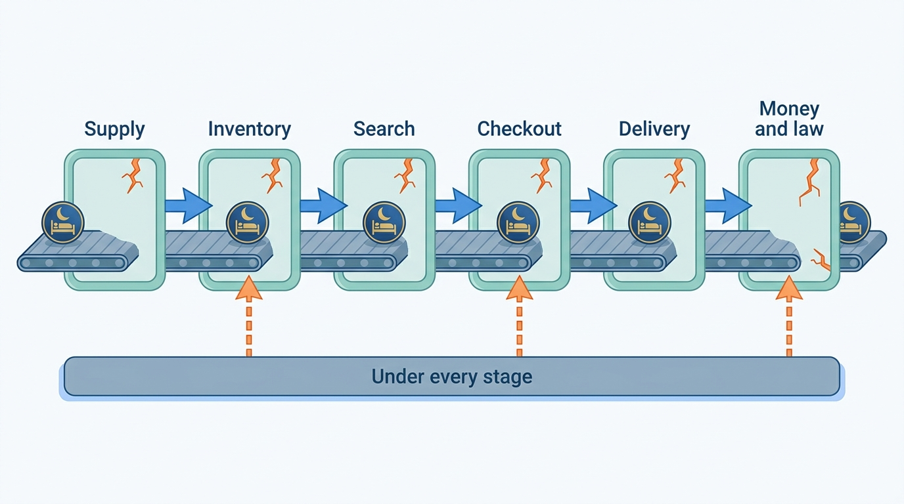
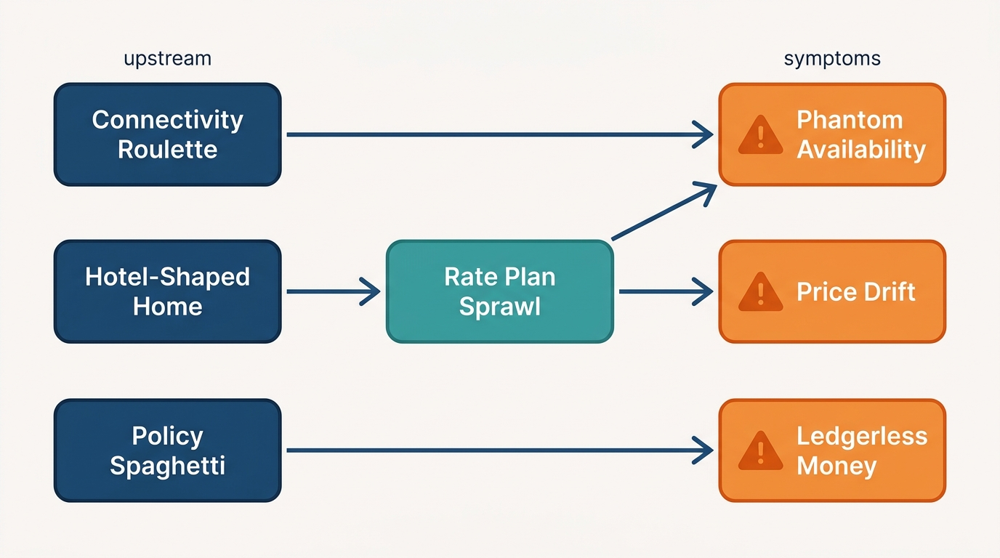

> **IN THIS SECTION, YOU WILL:** Learn sixteen named failure patterns that recur in accommodation and hosted-stays marketplaces, recognize their warning signs, understand the mechanism and the incentives behind each, see what they cost in public cases and in the book's fictional example, and find the chapters whose designs prevent or repair each one.

> **WHY THE BUSINESS CARES:** These patterns are where the money leaks: walked guests, rehoused families, refunds paid twice, tax settlements, regulator fines and metasearch traffic switched off. None of them shows up as a line in a project budget.

> **WHY ARCHITECTS SHOULD CARE:** The patterns give design reviews and steering committees a shared vocabulary. "This is Connectivity Roulette" moves a discussion straight to the mechanism and the owner, instead of to the latest incident.

> **KEY POINTS:**
>
> * **Each pattern is locally rational.** A connectivity engineer who accepts any well-formed message, a commercial team that adds one more rate plan or ranking boost, a support lead who writes one more refund macro: each made a sensible choice under their own target. The failure is the accumulation, and only someone accountable for the whole promise sees it.
> * **The marketplace type decides where each pattern hurts.** Phantom Availability, Rate Plan Sprawl and The Same Hotel Twice live where an OTA copies inventory it does not own; The Double-Booked Night, The Tax Patchwork and City-by-City Firefighting live where a hosted-stays platform owns one calendar, the money and the legal duty for millions of small hosts. Eight of the sixteen hit both.
> * **The patterns travel in chains, and most chains start with a missing contract or a missing owner.** Connectivity Roulette feeds Phantom Availability and Lost at the Front Desk; Policy Spaghetti feeds Ledgerless Money. Fixing the downstream symptom rarely holds; breaking the chain at its origin usually does.

 
The [[introduction]] describes a stays marketplace as a machine that sells a **perishable promise**: a specific night, in a specific place, at a specific price, fulfilled by someone else. The architecture is judged by how reliably that promise holds from the search result to the morning of check-out: the night shown is available, the price shown is the price paid, the booking reaches the property or host, the money reaches the right party, and guest and host can trust each other. This page names the ways that promise breaks, so the rest of the book can point back to them.

Two kinds of marketplace keep the promise with different machinery (see [[two-stay-marketplaces]]). An **accommodation marketplace** (or OTA-style marketplace, from online travel agency) sells professionally run properties by room type and **rate plan**, a priced package of conditions such as breakfast or cancellation terms, copied from hotel systems it does not control. A **hosted-stays marketplace** sells homes and rooms run by hosts and professional managers, one calendar per unit, and usually holds the guest's money itself. The categories are converging, but the failure patterns still cluster by type.

This guide names the **sixteen failure patterns** I see most often in stays platforms. They are the book's shared vocabulary: every chapter opens with a callout naming the patterns it addresses, and the matrix at the end of this page lists the chapters for each one.

Each pattern gets a characteristic quote (a composite attributed to a role, not a person), its warning signs, the mechanism, what it costs (with a dated public example where one exists), an illustration from **Corvane, the fictional travel group this book follows** (see [[meet-corvane]]), the marketplace type it hits hardest and the chapters that address it. Roomstead (Corvane's OTA) and Nookaway (its hosted-stays marketplace) are not disguised accounts of any real company.

None of these patterns implies incompetence. **Most are the residue of reasonable decisions** taken under deadline by teams accountable for one step of the guest's journey. That is why they need a name and an owner.

**Figure 1:** *Each pattern is the accumulation of locally rational choices, and only someone accountable for the whole promise sees the stack lean.*

## Sixteen Patterns to Recognize

The patterns fall into four loose families. The **supply and inventory** family (the first eight) damages the platform's ability to say what is for sale, at what price, and whether the sale reached the property or host. The **marketplace rules** family (two) is about the order in which stays are shown and the conditions under which they are sold. The **money, trust and law** family (four) is about who owes whom, who is safe, and what the law requires. The **resilience and control** family (two) is about what happens on the bad day and who watches the automated decisions.

| Pattern | The warning sign | Hits hardest | First number to ask for |
| --- | --- | --- | --- |
| **Phantom Availability** | Search shows rooms and prices that are gone or different at checkout; "sold out" and "price changed" errors are part of the funnel. | OTA | Price-changed and sold-out rate at checkout; metasearch price accuracy |
| **The Double-Booked Night** | One home or room is sold twice because calendars on different channels or services disagree for minutes or hours. | Hosted stays | Host cancellations caused by calendar conflicts per 10,000 stays |
| **Rate Plan Sprawl** | Properties carry dozens of rate plans and derived rates nobody can explain, and every new product adds another combination to cache, map and test. | OTA | Active rate plans and sellable products per property, and the share that sold nothing in 90 days |
| **Price Drift** | The price in search, on the property page, at checkout and on the card statement are four different numbers, because fees, taxes and currency are added in different places. | Both | Services that compose a guest-facing total |
| **The Same Hotel Twice** | One property appears as several products from different suppliers or channels, with mismatched rooms, content and prices. | OTA | Duplicate properties found per month; unmapped supplier rooms |
| **Connectivity Roulette** | Partner integrations run without contracts, certification, ordering guarantees or health monitoring, so every rate update is a surprise. | OTA | Share of ARI traffic from partners with a health score and reconciliation |
| **Lost at the Front Desk** | Reservations are sent to the property or host without acknowledgement or reconciliation, and guests arrive to "we have no booking for you". | Both | Share of arrivals verified against the property's system 24 hours before arrival |
| **The Hotel-Shaped Home** | One supply model is forced onto both marketplaces: homes squeezed into room types and rate plans, or hotels flattened into one-unit calendars. | Both | Workarounds per supply type (fake rate plans, one-unit "room types", manual pools) |
| **Pay-to-Rank Creep** | Commission levels, programs and boosts accumulate in ranking until guests stop trusting the order and regulators ask for an explanation. | Both | Paid share of first-page positions; whether every paid effect has a bounded, written definition |
| **Policy Spaghetti** | Cancellation, refund and change rules are encoded separately in checkout, support tools, payments and partner systems, and give different answers. | Both | Places that compute a refund or penalty |
| **Ledgerless Money** | Money moves between guests, the marketplace, properties, hosts and tax authorities without one ledger that can say who is owed what. | Both | Unreconciled balance by age; time to explain one partner's statement |
| **The Tax Patchwork** | VAT, tourist taxes and platform reporting are added market by market as special cases, and nobody can say what was collected for whom. | Hosted stays | Jurisdictions whose rules live in code; weeks to produce the annual platform report |
| **Trust After the Incident** | Verification, screening and protection arrive as reactions to incidents and headlines, each a separate tool with its own data. | Hosted stays | Time for a suspension in one tool to reach every surface |
| **City-by-City Firefighting** | Each new short-term-rental rule is hand-coded as an emergency project, so compliance is always late and never reusable. | Hosted stays | Lead time from a rule's publication to enforcement; share of rules expressed as configuration |
| **Built for Sunny Days** | The platform handles normal booking traffic but not mass cancellations, rebookings, peaks or supplier outages, which arrive all at once. | Both | Date of the last disruption drill; peak-to-plan ratio on the worst day of the year |
| **The Unwatched Model** | A pricing, ranking, screening or fraud model makes consequential decisions without evaluation, monitoring or an owner. | Both | Production models without a named owner, an evaluation set or monitoring |

These numbers are not targets in themselves: price-changed errors can fall because the price check was loosened, and conflict counts because hosts gave up on multichannel selling. **Read each indicator with the mechanism in mind.**

Supply patterns strike where data enters, discovery patterns where copies of it are served, booking and money patterns after the guest presses "Reserve", and three patterns sit underneath every stage.

**Figure 2:** *Where each pattern strikes along the promise of a night. Three patterns are not stages but conditions: a supply model that fits one marketplace, capacity sized for normal days, and models nobody watches make every stage worse.*

Costs are described for **guests**, **partners and hosts**, **regulators** and **money** (spent, refunded or written off).

### Phantom Availability

*"The cache is only a few minutes behind. The guest can always pick another room."* — a search platform engineer

**Warning signs.** Checkout fails with "sold out" or "price changed" often enough that product teams track it as a funnel step. Metasearch partners report price mismatches. The property page and the results card disagree. Nobody can state a staleness budget per surface, only a cache TTL.

**Why it happens.** **Look-to-book**, the number of searches per booking, runs to hundreds or thousands at an OTA, so search must be served from copies of inventory and price rather than from the hotel's systems (see [[stays-marketplace-economics]]). Each copy is tuned for cost and latency by its own team. Updates arrive late, out of order or not at all, and the checkout re-validation that would catch them is relaxed because it costs conversion.

**What it costs.** **Guests** meet a different price or no room at the last step; **money** is lost in abandoned bookings and in metasearch traffic. Google Hotel Center's price accuracy policy samples the total on a partner's booking page against the price shown on Google, lists "Room not available" among the mismatch reasons, and at a "Failed" score turns the partner's ads and free booking links off ([Google Hotel Center Help, n.d.](https://support.google.com/hotelprices/answer/6064419?hl=en)). Expedia's Rapid API documents a price-check step between shopping and booking that returns new price details when the price has changed and sends the caller back to search when the rate is gone ([Expedia Group Developer Hub, n.d.](https://developers.expediagroup.com/rapid/lodging/shopping/about-shopping-api)): the industry designs for the phantom, it does not assume it away.

**At Corvane (fictional).** Roomstead's metasearch price accuracy is **91%** in 2026 against a **97%** target, and staleness in Pricegrid, its precomputed price and availability cache, is the main cause. On Black Friday 2027 the cache hit rate falls from 94% to 71% and Roomstead runs in planned degradation for 40 minutes.

**Hits hardest: OTA.** An OTA copies counted inventory and derived prices from systems it does not own, at extreme look-to-book ratios. A hosted-stays platform usually owns the calendar, so its phantom is narrower: a home blocked elsewhere and not yet imported, or a minimum-stay rule checked only on the listing page.

**Where this book helps:** [[availability-engine]] sets staleness budgets and one price composition; [[inventory-integrity]] commits against the inventory of record; [[checkout-orchestration]] re-validates the quote; [[stays-search-architecture]] and [[stays-ranking]] stop scoring stale prices; [[event-driven-stays]] keeps the ARI stream ordered; [[demand-channels]] owns metasearch price accuracy.

### The Double-Booked Night

*"The other platform hadn't synced yet. It happens maybe once a season."* — a multichannel host

**Warning signs.** Host cancellations cluster on listings sold on several platforms. Support tickets read "the dates were free when I booked". The platform cannot tell a host when it last read their other calendars, or whether the read succeeded.

**Why it happens.** Many hosts link their calendars with **iCal** (RFC 5545) feeds, which carry busy dates only and are polled, not pushed: Airbnb's help center says its imported calendars update "every 3 hours" and that nights blocked elsewhere "may or may not be blocked" ([Airbnb Help Center, n.d., fetched 2026](https://www.airbnb.com/help/article/99)). Two platforms can each sell the same night inside the window between polls. Inside one platform the same race appears when two services hold their own copy of the calendar.

**What it costs.** **Guests** lose a booked stay, often for a peak date with no comparable alternative. **Hosts** pay cancellation fees and lose standing. The platform pays for rehousing under its guest guarantee.

**At Corvane (fictional).** On **2 February 2027** the Bauers book Carmen Ruiz's Seville apartment on Nookaway for Feria week (**€1,360** before guest fees). Twenty-eight minutes later a competing platform, which had last read Nookaway's export at 10:00, sells overlapping nights. Carmen cancels; Nookaway rehouses the family for **€1,780** and funds the **€420** difference. Nookaway records about **3,100** calendar-conflict host cancellations in 2026, **78%** from iCal-only listings, and spends about **€1.3 million** rehousing guests after them.

**Hits hardest: hosted stays.** A home has one unit and no room down the corridor, so every race ends in a cancellation. A hotel absorbs an occasional oversell by walking a guest to a nearby hotel, which is why the OTA version of this pattern is Phantom Availability and Connectivity Roulette instead.

**Where this book helps:** [[calendar-sync]] designs adaptive import, pre-booking re-checks and conflict handling; [[inventory-integrity]] keys integrity policy to unit cardinality; [[connectivity-and-channel-managers]] covers API connections for professional managers.

### Rate Plan Sprawl

*"Just add it as a derived plan. It follows the flexible rate, so it costs nothing."* — a commercial manager

**Warning signs.** Nobody can say which of a hotel's rate plans are real products and which are fences, experiments or leftovers. Room tables on the property page run to dozens of rows. Each new campaign, member tier or mobile discount becomes another plan. Mapping errors cluster on plans created in the last month.

**Why it happens.** A rate plan is the cheapest way to launch a commercial idea: it needs no new code, only a row. **Derived rates**, priced as an offset from a parent, look free, but each multiplies the products that must be stored, cached, mapped across channels and shown. Booking.com's connectivity API, for example, lets a child plan follow its parent's price, restrictions, policies and open or closed status as separate switches ([Booking.com Developers, n.d.](https://developers.booking.com/connectivity/docs/room-type-and-rate-plan-management/managing-rate-plans)); every switch is a combination to test. No public measurement of sprawl's cost exists, but its symptoms appear in every other supply pattern.

**What it costs.** **Guests** face a rooms table they cannot read. **Money** goes into cache capacity, mapping and support for products nobody buys, and into errors when discounts stack.

**At Corvane (fictional).** In early 2027 Hotel Miradouro, an 84-room Lisbon hotel, sells **37** active rate plans forming **168** products on Roomstead; **26** are derived. In the Autumn Cities campaign of September 2027, Roomstead's checkout stacks country and member rates, both modeled as derived plans, on **3,870** bookings above the 35% discount ceiling, and Roomstead reimburses partners **€161,300**.

**Hits hardest: OTA.** Rate plans are the OTA's unit of product. A hosted-stays listing usually has one nightly price plus rule-based discounts, so sprawl appears there only when a platform imports hotel habits (see The Hotel-Shaped Home).

**Where this book helps:** [[rates-and-availability-model]] separates products from fences and sets a pruning rule; [[promotions-and-loyalty]] models audiences and discounts outside the rate plan; [[property-page-and-room-selection]] limits what the guest must read.

### Price Drift

*"Search shows the nightly rate. Fees and taxes are checkout's job."* — a search product manager

**Warning signs.** The headline price grows as the guest moves through the funnel. Price alerts quote one number and checkout another. The amount on the card statement differs from the amount on the confirmation because of currency conversion. Several services compose a total, each with its own order of discounts, fees, taxes and rounding.

**Why it happens.** No one owns the **offer**, the priced, conditioned promise the guest is shown. Search, the property page, checkout, the metasearch feed and the payment step each assemble the total from parts, because each was built when it was the only place a price appeared.

**What it costs.** **Guests** lose trust and abandon; **regulators** treat the gap as drip pricing. The EU's consumer-protection network obtained a commitment from Airbnb, implemented by **11 July 2019**, to show the total price including all mandatory fees whenever properties are offered ([European Commission, 2018–2020](https://commission.europa.eu/live-work-travel-eu/consumer-rights-and-complaints/enforcement-consumer-protection/coordinated-actions/accommodation-booking_en)). The US Federal Trade Commission's rule on unfair or deceptive fees, announced on 17 December 2024 and in effect from 12 May 2025, requires short-term lodging to show the total price including mandatory fees most prominently ([FTC, 2024](https://www.ftc.gov/news-events/news/press-releases/2024/12/federal-trade-commission-announces-bipartisan-rule-banning-junk-ticket-hotel-fees)). Airbnb made total price display standard worldwide on **21 April 2025** ([Airbnb Newsroom, 2025](https://news.airbnb.com/total-price-display-is-now-standard-globally)).

**At Corvane (fictional).** The Novak family books a Lisbon apartment on Nookaway in February 2027 at **€145** a night. Cleaning, the 12% guest service fee and Lisbon tourist tax bring the total to **€1,271.20**, **25%** above the €1,015 the nightly price suggested.

**Hits hardest: both.** Hosted stays drift through host-set cleaning fees and service fees; OTAs drift through resort fees, taxes paid at the property and currency conversion on agency bookings, where the hotel charges the card in its own currency.

**Where this book helps:** [[availability-engine]] and [[property-page-and-room-selection]] build one price composition and display policy; [[stays-search-architecture]] ranks and shows the same total; [[taxes-on-stays]] owns tax lines; [[stay-payments]] and [[merchant-and-agency-models]] handle currency and who charges; [[stays-bounded-contexts]] makes the offer a contract.

### The Same Hotel Twice

*"The bedbank calls it a different hotel. Different name, different rooms. How would we know?"* — a supply integration lead

**Warning signs.** Results pages show one building twice, with different photos and prices. Guests book a "Deluxe King" that the hotel calls something else. Reviews, content scores and price comparisons split across products. Support cannot find the reservation because the hotel knows the property under another identifier.

**Why it happens.** Hotels reach an OTA through several routes: direct connectivity, chain systems, wholesalers and bedbanks (B2B suppliers of hotel inventory), and the Global Distribution Systems (GDS) that serve travel agents. Each describes the property and its rooms in its own words and identifiers. **Content mapping**, deciding which records describe the same property and which supplier rooms match which room types, is treated as a data-loading task rather than an **entity-resolution** system with a confidence score, human review and stable identifiers (see [[entity-resolution]]).

**What it costs.** **Guests** compare duplicates and receive the wrong room. **Partners** see their reviews and ranking split. Mapping vendors describe the scale of the problem: one claims that about 40% of inventory is not accurately mapped industry-wide ([Gimmonix, 2026](https://gimmonix.com/news/how-does-hotel-mapping-work)), a vendor figure without a stated method that is still a fair signal of how common the pattern is.

**At Corvane (fictional).** When Roomstead signs the Brightwell Beds wholesale agreement in June 2027, its content file of **41,000** properties contains **32,200** that Roomstead already sells. Of the supplier's **412,000** room-and-board combinations on matched properties, **7%** cannot be mapped and are never sold. Concord, the mapping service built that summer, finds **140** duplicates already live in the catalog in its first month.

**Hits hardest: OTA.** Hotels arrive through many intermediaries; homes mostly do not. The hosted-stays version is a host listing one home twice, or a fraudster copying it, which is a trust problem (see Trust After the Incident).

**Where this book helps:** [[content-and-media]] designs mapping and duplicate sweeps; [[property-and-listing-model]] provides stable property and unit identifiers; [[two-stay-marketplaces]] explains the intermediaries; [[converging-two-marketplaces]] covers cross-listing between brands.

### Connectivity Roulette

*"The channel manager sent it, so it must be right. We just apply what we get."* — a connectivity gateway engineer

**Warning signs.** Partners learn about wrong prices from guests. A rate typed in a hotel's property management system (PMS) arrives at the OTA as a different number. Updates queue during a partner outage and are replayed out of order. Certification exists, but nobody scores partners on live behavior, and the gateway has no per-partner health signal.

**Why it happens.** Most hotel **ARI** (availability, rates and inventory) reaches an OTA through channel managers and PMS vendors, software the marketplace does not own (see [[connectivity-and-channel-managers]]). A gateway that accepts any well-formed message is easy to build and commercially safe. Booking.com's own connectivity documentation lists the usual causes of overbooking: system outages that stop availability updates, incorrect auto-replenishment of canceled rooms, late requests to close availability, and rates "not being correctly mapped for ARI updates" ([Booking.com Developers, n.d.](https://developers.booking.com/connectivity/docs/con-faq-reservations-troubleshooting-overbookings)).

**What it costs.** **Guests** are walked or charged wrong prices. **Partners** honor mistaken rates. **Money** goes into relocation and compensation, mostly invisible because it is booked as support cost.

**At Corvane (fictional).** On **9 March 2027** a decimal-mapping error in Corvane Connect, the group's own channel manager, sends **€12.00** instead of **€120.00** for a new rate plan at Hotel Miradouro; **41** reservations arrive in **38** minutes, Roomstead honors them all, and Connect compensates the hotel **€6,804**. Roomstead's anomaly check compared each rate only with the same plan's previous value, and the plan was new. On King's Day, a third-party channel manager at Amsterdam's Hotel Prinsenkade queues updates for **47** minutes and the hotel ends **9** rooms oversold.

**Hits hardest: OTA.** An OTA lives on hundreds of partner integrations it can certify but not operate. Hosted stays meet the same pattern in iCal links and PMS connections for professional managers, which is why [[calendar-sync]] names it too.

**Where this book helps:** [[connectivity-and-channel-managers]] normalizes, orders and guards ARI; [[inventory-integrity]] handles replays and auto-replenishment; [[calendar-sync]] gives iCal feeds health states; [[extranets-and-host-tools]] sets one writer per field; [[reservation-lifecycle]] reconciles reservation versions.

### Lost at the Front Desk

*"It says delivered. Whatever happened after the channel manager isn't our system."* — a reservations operations analyst

**Warning signs.** "Delivered" means a channel manager accepted the message, not that the property's PMS holds the booking. Failed deliveries end up in shared inboxes. Modifications and cancellations arrive out of order. Nobody compares tomorrow's arrivals with the property's own list until the guest is at the desk.

**Why it happens.** A reservation crosses several systems between the marketplace and the room: gateway, channel manager, PMS. Each acknowledges its own hop. Booking.com, for example, documents that a reservation not acknowledged or retrieved within **30 minutes** is e-mailed to the property, and that extending the window "can increase queue size and overbookings" ([Booking.com Developers, n.d.](https://developers.booking.com/connectivity/docs/reservations-api/reservations-overview)): a fallback to a human, because the marketplace cannot see the last hop. On hosted stays, the reservation reaches the host but the door code or the changed arrival time does not.

**What it costs.** **Guests** arrive unknown, at the worst moment, when replacement rooms are scarce and expensive. **Money** goes into relocation and goodwill, and support starts with the least context.

**At Corvane (fictional).** A PMS release at Hotel Miradouro on **5 July 2027** rejects reservations on four legacy rate-plan codes after Corvane Connect has already acknowledged receipt. By 17 July, **33** messages have failed; a family from Lyon is walked to Belém, and Roomstead pays **€390**, later recovered from Corvane Connect. A sweep of about **260,000** upcoming Roomstead arrivals at Connect hotels finds **1,040** that disagree with the PMS.

**Hits hardest: both.** OTAs lose reservations between systems; hosted-stays platforms own the calendar but lose the messages and changes around it, and professional managers connected through software bring the OTA version with them.

**Where this book helps:** [[reservation-lifecycle]] closes delivery only on PMS acceptance and adds arrival manifests; [[connectivity-and-channel-managers]] tracks delivery per reservation version; [[event-driven-stays]] removes publish-after-commit gaps; [[trip-and-messaging]] gets arrival information to the right person; [[changes-and-cancellations]] and [[customer-service]] handle modifications and recovery; [[global-scale-and-reliability]] watches the delivery queue during failover.

### The Hotel-Shaped Home

*"A home is just a hotel with one room. We already have a model for that."* — a platform architect

**Warning signs.** Apartments appear as room types with quantity one and fake rate plans for the cleaning fee. Hotels on a homes platform are flattened into dozens of one-unit listings. Host tools carry hotel staff roles; hotel tools carry a host-approval step nobody uses. Every change to the shared supply model needs both marketplaces' consent.

**Why it happens.** Convergence is real, and one model looks cheaper than two. The team that owns the bigger platform proposes to absorb the other. But a hotel sells **counted, interchangeable rooms** under rate plans, and tolerates overbooking; a home sells **one unique unit** under host rules, and cannot (see [[property-and-listing-model]]). Forcing one model onto the other moves the difference into workarounds.

**What it costs.** **Guests** see the wrong page for what they are booking. **Hosts and partners** maintain workarounds. **Money** goes into migrations that do not converge. The public evidence is indirect: Expedia Group moved Vrbo, its vacation-rental brand, onto the Brand Expedia front end in 2023, and its CEO said in May 2024 that "Vrbo's recovery following the recent re-platforming has been slower than anticipated" ([Expedia Group Q1 2024 earnings release, 2024](https://www.sec.gov/Archives/edgar/data/1324424/000132442424000024/earningsrelease-q12024.htm)). The filings do not say why.

> **INFERENCE, NOT DOCUMENTED:** plausible causes include whole-home search semantics, listing content and host-facing flows that differ from hotel ones; Expedia has not published the reasons, and the filings describe a shared front end, not a merged supply model.

**At Corvane (fictional).** In February 2027 a Roomstead team proposes loading Nookaway's 1.15 million listings into Tally, Roomstead's ARI store, as one-unit room types and retiring Almanac, Nookaway's calendar. The group rejects it; One Stay shares offer and reservation contracts but keeps two inventory engines.

**Hits hardest: both.** The squeeze goes in both directions, and it grows as each marketplace starts selling the other's supply.

**Where this book helps:** [[property-and-listing-model]] models both; [[two-stay-marketplaces]], [[stays-capability-map]] and [[stays-bounded-contexts]] draw what to share; [[converging-two-marketplaces]] makes the group decision; nearly every chapter's "Hotels and Homes" section tests it locally.

### Pay-to-Rank Creep

*"It's one more multiplier, and the A/B test was positive."* — a partner-program product manager

**Warning signs.** Nobody can explain a single position on the first page. Commission tie-breaks, program multipliers and demotions were added in different years by different teams. The ranking description sent to partners lists factors but not their effects. Paid participants hold a growing share of the top positions.

**Why it happens.** Commission and paid programs are the easiest way to raise the **take rate**, the share of booking value the marketplace keeps. Each adjustment wins its own test on gross bookings, because the test does not measure stays, cancellations or partner trust (see [[stays-experimentation]]).

**What it costs.** **Guests** stop trusting the order. **Partners** feel coerced into paying. **Regulators** act: the EU Platform-to-Business Regulation, in force from **12 July 2020**, requires marketplaces to describe the main ranking parameters and any possibility to influence ranking against payment ([Regulation (EU) 2019/1150, 2019](http://publications.europa.eu/resource/celex/32019R1150)). On **30 July 2024** Spain's competition authority fined Booking.com **€413.24 million**, citing among other conduct opaque paid visibility programs and booking volume as a default ranking factor; Booking.com appealed and the court suspended the fine pending the appeal ([TechCrunch, 2024](https://techcrunch.com/2024/07/30/spains-antitrust-watchdog-fines-booking-com-nearly-450m-for-unfair-terms-and-restricting-rivals); [Hosteltur, 2025](https://www.hosteltur.com/168767_la-audiencia-nacional-paraliza-la-multa-millonaria-de-la-cnmc-a-booking.html)).

**At Corvane (fictional).** Until October 2027 Roomstead's paid visibility program works as score multipliers of ×1.15, ×1.30 and ×1.45, on top of a 2019 commission tie-break and a 2023 value objective. When Ranking Policy v1 replaces them with a bounded lift of at most three positions, the program's share of top-ten positions falls from **34%** to **22%** and honored stays per search rise **1.1%**.

**Hits hardest: both.** OTAs sell visibility for commission; hosted-stays platforms face the same transparency rules for host programs, quality badges and any paid placement. Hotels feel the pressure more because they have alternatives to compare against; regulators apply the same transparency rules to both.

**Where this book helps:** [[stays-ranking]] separates policy from model and bounds paid effects; [[promotions-and-loyalty]] keeps programs out of the rate model; [[stays-marketplace-economics]] measures what programs cost; [[stays-experimentation]] stops gross-booking wins; [[marketplace-intelligence]] shows partners what a program changed.

### Policy Spaghetti

*"The macro says waive it. I don't know what the hotel's system does with that."* — a customer-service team lead

**Warning signs.** Checkout, the self-service flow, support macros, the payment scheduler and the partner channel each compute cancellation deadlines and refunds. Guests get one answer from the app and another from an agent. The hotel charges a card the platform has already refunded.

**Why it happens.** A **cancellation policy** looks like text attached to a rate. It is in fact a rule over time that decides money: who refunds, who is charged, when a deferred payment is taken, what the partner keeps. Each system that needs the answer computes its own copy, and support adds overrides that no other system sees.

**What it costs.** **Guests** and **partners** get contradictory answers; **money** is refunded twice or not recovered. The remedy is visible in public contracts: Expedia's Rapid API exposes refundability and `cancel_penalties` as structured data on each rate ([Expedia Group Developer Hub, n.d.](https://developers.expediagroup.com/rapid/lodging/shopping/about-shopping-api)), so a distributor can compute the same penalty as the supplier rather than parse text.

**At Corvane (fictional).** During the air-traffic-control strike of June 2027 a Roomstead support macro waives penalties on **1,860** bookings. **610** agency properties charge their guests anyway, and Roomstead reimburses **€167,900**; on **290** merchant bookings the hotel has already charged the virtual card, and **€31,200** is never recovered.

**Hits hardest: both.** OTAs split policy between the platform and the hotel; hosted-stays platforms can override host policies because they hold the funds, which makes their copies even more consequential.

**Where this book helps:** [[changes-and-cancellations]] builds one policy engine and disruption registry; [[checkout-orchestration]] snapshots the agreed policy; [[refunds-and-reconciliation]], [[stay-payments]] and [[payouts-and-settlement]] apply it to money; [[customer-service]] reads it instead of copying it; [[stays-bounded-contexts]] gives it an owner.

### Ledgerless Money

*"Finance reconciles it at month end. The booking system just records what the guest paid."* — a payments engineer

**Warning signs.** Partner statements cannot be explained without reading three systems. Balances are derived nightly from mutable tables. Virtual cards, refunds, recoveries and claim payments live in different tools. An unreconciled amount appears every quarter and is written off as "timing".

**Why it happens.** The marketplace takes several money roles at once: **agency** (the property charges the guest, the marketplace invoices commission), **merchant** (the marketplace charges the guest and pays the property) and **facilitator** (the marketplace collects for hosts and pays them out). Each was added with its own records (see [[merchant-and-agency-models]]). Without one double-entry ledger, nobody can say who owes whom after a change. Airbnb described in 2016 how its early payments system left finance to "reverse-engineer" audit-trail tables to infer what had happened, and how it moved to a double-entry financial pipeline in which "money can't be created out of thin air" ([Airbnb Engineering, 2016](https://medium.com/airbnb-engineering/scaling-airbnbs-payment-platform-43ebfc99b324); evidence ten years old, describing a replaced system).

**What it costs.** **Money** written off; **partners** chasing statements; **regulators** asking a licensed payment institution to show safeguarded funds.

**At Corvane (fictional).** In Q1 2027 Corvane Payments finds **€1.8 million** unreconciled between virtual-card statements and Roomstead merchant reservations, mostly cards charged for bookings later canceled or modified. After recoveries, the net loss is **€0.51 million**. At Nookaway, host debit balances of **€3.4 million** sit in Burrow's payout tables, **€1.1 million** of them older than 180 days.

**Hits hardest: both.** OTAs mix agency and merchant flows; hosted-stays platforms hold guest funds, pay out to millions of individuals and recover damages, so both need one ledger for different reasons.

**Where this book helps:** [[merchant-and-agency-models]] names the roles; [[stay-payments]], [[payouts-and-settlement]] and [[refunds-and-reconciliation]] post every movement to the ledger; [[event-driven-stays]] delivers money events reliably; [[protection-and-incidents]] posts claims; [[designing-financial-ledgers]] goes deeper.

### The Tax Patchwork

*"Tourist tax for Porto is in the dictionary. Send me the new rate and I'll add a line."* — a backend engineer

**Warning signs.** Tourist-tax rates are hard-coded per city. VAT logic lives in finance scripts. The annual platform report to tax authorities takes weeks of manual work. Nobody can say, per booking, what was collected for which authority on whose behalf.

**Why it happens.** Taxes arrive one market at a time, often as a city agreement or a court case, and each is implemented as a special case. Hosted-stays platforms are pulled furthest: individual hosts cannot run a tax engine, so law moves the duty to the platform. The EU's DAC7 directive requires platforms to report hosts' rental income from 2023 ([Directive (EU) 2021/514, 2021](http://publications.europa.eu/resource/celex/32021L0514)), and the VAT in the Digital Age package makes platforms the **deemed supplier** of short-term accommodation where the host does not charge VAT, from between **1 July 2028** and **1 January 2030** depending on the member state ([Directive (EU) 2025/516, 2025](http://publications.europa.eu/resource/celex/32025L0516)).

**What it costs.** **Regulators** settle in large numbers. Under Italy's 2017 short-term-rental law, Airbnb settled the 2017–2021 audit periods for **€576 million** in December 2023, and Booking.com settled a claim that it should have withheld 21% for certain Italian short-term-rental partners for **$332 million** in November 2024, both without admitting liability ([Airbnb Form 10-K, 2026](https://www.sec.gov/Archives/edgar/data/1559720/000155972026000004/abnb-20251231.htm); [Booking Holdings Form 10-K, 2026](https://www.sec.gov/Archives/edgar/data/1075531/000107553126000009/bkng-20251231.htm)).

**At Corvane (fictional).** Until Q4 2027 Nookaway keeps tourist-tax rules for its **23** collecting municipalities in a hard-coded dictionary. Roomstead's DAC7 report for 2026 takes **seven weeks** of manual work, and **26,400** of its sellers lack a valid taxpayer identifier at year end.

**Hits hardest: hosted stays.** Hotels are VAT-registered businesses that collect city tax at the desk and whose large properties are excluded from DAC7 reporting; individual hosts are exactly the population that platform reporting, withholding and deemed-supplier rules target.

**Where this book helps:** [[taxes-on-stays]] builds one tax engine with effective-dated rules; [[payouts-and-settlement]] collects tax identities from everyone paid; [[stays-regulation]] covers the reporting duties alongside rental law.

### Trust After the Incident

*"After the last scam wave we added a filter to the inbox. The suspension tool is a different team."* — a trust and safety analyst

**Warning signs.** Each scam wave or safety headline produces another tool with its own data and its own "blocked" flag. A suspended account keeps messaging, receiving payouts or listing on a sister brand. Verification, screening, messaging safety and protection claims cannot see each other's cases.

**Why it happens.** Trust work is funded by incidents. The response is fast and local: a rule on the path that was abused. Public records show the cadence: Airbnb introduced a party ban in August 2020 and codified it in 2022, and launched anti-party screening in the US and Canada in August 2022 ([Airbnb Newsroom, 2023](https://news.airbnb.com/an-update-on-our-work-to-crack-down-on-parties-and-disruptive-behavior)). On the OTA side, security researchers documented from 2023 attackers stealing hotel staff credentials and messaging guests through the platform's own channel ([Sophos, 2023](https://www.sophos.com/en-us/blog/vidar-infostealer-steals-booking-com-credentials-in-fraud-scam); [ESET, 2024](https://www.welivesecurity.com/en/eset-research/telekopye-hits-new-hunting-ground-hotel-booking-scams/)).

**What it costs.** **Guests** lose money and safety; **hosts** lose property; **money** goes into reimbursements that one connected decision would have prevented.

**At Corvane (fictional).** In July 2027 Nookaway suspends Turia Homes, a fake Valencia "property manager", but the suspension reaches only search: its messaging runs four more days, a payout is released, and Roomstead, where the same IBAN and phone number list 19 more apartments, learns sixteen days later. Reimbursements and rehousing total **€48,540**. In November 2027 phished partner credentials at **230** Roomstead properties lead **310** guests to pay fraudsters, and Roomstead reimburses **€212,000**.

**Hits hardest: hosted stays.** Strangers stay in private homes with no staff, so verification, screening and protection are core to the product. OTAs face the partner-account version, which is serious but narrower.

**Where this book helps:** [[stays-trust-and-safety]] builds one trust platform and enforcement fan-out; [[travel-fraud]] connects account, payment and messaging signals; [[identity-accounts-and-access]] hardens partner and host accounts; [[protection-and-incidents]] and [[reviews-and-reputation]] join claims and reputation to the same cases; [[partner-onboarding]] verifies before activation.

### City-by-City Firefighting

*"Barcelona changed the rule again. Can we get a hotfix into the listing wizard by Friday?"* — a hosted-stays product manager

**Warning signs.** Registration numbers are free-text fields. Each city's night cap, license rule or removal order is a ticket in a different team's backlog. Jurisdictions are stored as city names rather than versioned boundaries. Takedown orders are handled by e-mail.

**Why it happens.** Short-term-rental rules are local, frequent and contested. They arrive as emergencies, so they are implemented as code paths rather than as configurable **rule primitives**: registration required, number format and validation, night cap per unit, prohibited zones, license expiry, government-initiated removal.

**What it costs.** **Regulators** order removals and fines; **guests** have future bookings canceled; **hosts** are removed in bulk. The EU Short-Term Rental Regulation, applicable from **20 May 2026**, requires platforms to collect and display registration numbers before a listing is offered, to check them at random, and to report activity data per unit machine-to-machine ([Regulation (EU) 2024/1028, 2024](http://publications.europa.eu/resource/celex/32024R1028)). New York City's Local Law 18 has barred platforms since **5 September 2023** from processing transactions for unregistered rentals ([NYC Office of Special Enforcement, n.d.](https://www.nyc.gov/site/specialenforcement/registration-law/registration.page)). Rules also reverse: Spain's Supreme Court annulled the national short-term-rental registry on **21 May 2026** while upholding platform data-sharing ([Consejo General del Poder Judicial, 2026](https://www.poderjudicial.es/cgpj/es/Poder-Judicial/Tribunal-Supremo/Noticias-Judiciales/El-Tribunal-Supremo-anula-el-Registro-Unico-de-arrendamientos-de-corta-duracion-por-considerar-que-el-Estado-carece-de-competencia-para-su-creacion)).

**At Corvane (fictional).** Between February and April 2026, under the Spanish registration rules then in force, Nookaway removes **6,900** listings without a valid number. It honors **2,900** future reservations with check-in within 30 days and cancels **8,300** with full refunds. Until February 2027 it stored Spanish registration numbers as free text.

**Hits hardest: hosted stays.** Hotels are licensed businesses outside these regimes, and the EU Regulation excludes them. For an OTA the rules apply only to its apartments and holiday homes; for a hosted-stays platform they sit on the critical path of nearly every listing.

**Where this book helps:** [[stays-regulation]] builds a policy registry over rule primitives; [[property-and-listing-model]] gives rules a unit to attach to; [[destinations-and-maps]] resolves jurisdictions from versioned boundaries; [[partner-onboarding]] validates numbers at sign-up; [[marketplace-intelligence]] produces reconciled activity reports.

### Built for Sunny Days

*"Capacity is fine. We sized it for last August's peak plus thirty percent."* — an infrastructure lead

**Warning signs.** Capacity plans assume the average day or last year's peak. Mass cancellation has no mechanism besides the support queue. Retry storms from apps and affiliates are discovered in incidents. Nobody has rehearsed a region failover or a supplier outage in the last year.

**Why it happens.** Travel demand arrives in shocks: sales, holidays, strikes, storms, pandemics. Each shock hits search, checkout, payments, notifications, refunds and support at once, while normal-day dashboards look healthy. Disruption tooling has no sponsor until the disruption.

**What it costs.** **Guests** queue for hours; **partners and hosts** absorb refunds; **money** goes out in cash refunds and discretionary funds. In 2020 Airbnb applied its extenuating-circumstances policy to COVID-19 cancellations, committed up to $250 million for affected hosts and recorded **$205.1 million** of payments, primarily to hosts; Booking Holdings reported increased customer-service costs and "higher than normal cash outlays to refund consumers for prepaid reservations" ([Airbnb Form 10-K, 2021](https://www.sec.gov/Archives/edgar/data/1559720/000155972021000010/airbnb-10k.htm); [Booking Holdings Form 10-K, 2021](https://www.sec.gov/Archives/edgar/data/1075531/000107553121000019/bkng-20201231.htm)).

**At Corvane (fictional).** On **14 January 2027** a payment-provider latency spike makes Roomstead's app retry checkout without its idempotency key, creating **212** duplicate reservations. On the strike weekend of **5–7 June 2027**, about **17,000** Roomstead and **2,600** Nookaway reservations are affected and Roomstead receives **6,200** cancellation requests in 48 hours. On Black Friday, Pricegrid reads peak at **96,000** per second.

**Hits hardest: both.** OTAs face larger traffic peaks and supplier outages; hosted-stays platforms carry the refund decision themselves and must decide what a household host absorbs.

**Where this book helps:** [[global-scale-and-reliability]] sets journey objectives and degradation modes; [[changes-and-cancellations]] declares disruption events as data; [[checkout-orchestration]] makes retries safe; [[customer-service]] and [[refunds-and-reconciliation]] scale by event, not by ticket; [[availability-engine]] plans cache behavior on peak days; [[stays-ml-platform]] holds models through shocks.

### The Unwatched Model

*"Smart pricing has been running for two years. Hosts can always switch it off."* — a data science manager

**Warning signs.** Nobody can list all production models. A model built for a forecast is reused to decide something a partner sees. Labels arrive months late (from chargebacks, claims or stays) and nobody watches the gap. No model has a declared behavior for shocks.

**Why it happens.** Models ship as projects, and projects end. Their uses expand quietly. Offline accuracy looks fine while the world changes. Booking.com's 2019 paper on its production models drew the lesson that increasing a model's offline performance "does not necessarily translate into a gain in" business value, so every model needs an online test ([Colyer's summary of Bernardi et al., KDD 2019](https://blog.acolyer.org/2019/10/07/150-successful-machine-learning-models/)). In 2026 Expedia Group described ML principles that require offline and online evaluation, four named owners per model, and a higher bar for customer-facing models that affect pricing or availability ([Expedia Group Technology, 2026](https://medium.com/expedia-group-tech/how-expedia-group-builds-ai-that-lasts-at-scale-434677770fe9)).

**What it costs.** **Hosts and partners** lose revenue to mispriced nights; **guests** are wrongly blocked; **regulators** ask for explanations nobody can give.

**At Corvane (fictional).** During the June 2027 strike weekend, Nookaway's Smart Rate cuts Lisbon prices for the Santo António nights by about 6% on each of three days, with no cumulative cap: **1,260** nights sell at an average **17%** below the earlier recommendation. The inventory that follows finds **226** production models across the group, with a named owner for **151**.

**Hits hardest: both.** OTAs run ranking, pricing and fraud models over millions of searches; hosted-stays platforms add screening, review integrity and host pricing, which make decisions about individuals.

**Where this book helps:** [[stays-ml-platform]] builds the registry, decision tiers and shock holds; [[dynamic-pricing]] caps automatic price moves; [[stays-ranking]] owns label and guardrails; [[stays-trust-and-safety]], [[travel-fraud]] and [[protection-and-incidents]] measure screening misses and false declines; [[stays-experimentation]] measures long-run effects; [[marketplace-intelligence]] governs the metrics models learn from.

## How the Patterns Reinforce Each Other

The patterns rarely appear alone, and they feed each other in recognizable chains. **Fixing a downstream symptom while the upstream pattern continues produces the same symptom again**, usually within a year.

**Figure 3:** *The patterns form chains. Most guest-visible symptoms, such as a vanished room, a guest unknown at the desk or an unexplained balance, trace back to a missing contract, a missing owner or a supply model that fits only one marketplace.*

Four chains appear most often.

**The supply chain: Connectivity Roulette and Rate Plan Sprawl → Phantom Availability, Price Drift and Lost at the Front Desk.** A gateway without contracts lets wrong and late updates into the inventory copies; sprawl multiplies the products each update must reach; reservations travel back through the same unmonitored hops. Corvane's €12 rate came in through a newly mapped rate plan with no guard. **Break the chain at the contract** and at the product count, not at the cache.

**The policy chain: Policy Spaghetti and Built for Sunny Days → Ledgerless Money.** When each system computes its own refund, a disruption turns small disagreements into thousands of money movements nobody can match. The strike weekend's waived penalties became part of the reconciliation work that followed. One policy engine and a declared-event mechanism reduce both the support load and the unreconciled balance.

**The trust chain: Trust After the Incident → City-by-City Firefighting.** Platforms that respond to headlines one tool at a time also respond to regulators one city at a time, because both need the same thing: a registry of parties, units and rules with enforcement that reaches every surface.

**The shape chain: The Hotel-Shaped Home → most of the rest.** A supply model that fits one marketplace forces rate-plan workarounds onto homes and hotel tolerance for overbooking onto one-unit calendars. That is why the book draws the supply model and the boundaries ([[property-and-listing-model]], [[stays-bounded-contexts]]) before it discusses availability, search or money.

## Using the Patterns

The names are meant for rooms where decisions are made. In a design review, ask which pattern a proposal risks and what would stop it. In a steering committee, ask which pattern a falling metric is a symptom of. In a group portfolio review, ask which patterns each brand shows and which root they share.

Three habits keep the names useful rather than accusatory: **name the mechanism, not the person**; **pair every pattern with a number** from the summary table; and **look for the upstream pattern** before funding a downstream fix, because the cheapest remedy is usually a contract, an owner or a policy record, not a new system.

Some variation is legitimate. A hotel's deliberate overbooking, priced against its no-show forecast, is revenue management, not Phantom Availability. A labeled, bounded paid placement is not Pay-to-Rank Creep. A city rule that needs its own configuration is not City-by-City Firefighting if it runs on shared primitives. The test is whether the variation was **decided, owned and measured**, or simply accumulated.

## The Patterns Across the Book

The matrix maps each chapter to the patterns it names in its opening callout (**●**). The column codes are: **PA** Phantom Availability, **DB** The Double-Booked Night, **RS** Rate Plan Sprawl, **PD** Price Drift, **SH** The Same Hotel Twice, **CR** Connectivity Roulette, **LF** Lost at the Front Desk, **HH** The Hotel-Shaped Home, **PR** Pay-to-Rank Creep, **PS** Policy Spaghetti, **LM** Ledgerless Money, **TP** The Tax Patchwork, **TI** Trust After the Incident, **CF** City-by-City Firefighting, **SD** Built for Sunny Days, **UM** The Unwatched Model.

| Chapter | PA | DB | RS | PD | SH | CR | LF | HH | PR | PS | LM | TP | TI | CF | SD | UM |
| --- | --- | --- | --- | --- | --- | --- | --- | --- | --- | --- | --- | --- | --- | --- | --- | --- |
| **Part I — Marketplace** | | | | | | | | | | | | | | | | |
| [1 Two marketplaces](two-stay-marketplaces.html) | | | | | ● | | | ● | | | ● | | | | | |
| [2 Economics](stays-marketplace-economics.html) | ● | | | | | | | | ● | | | | | | ● | |
| [3 Capability map](stays-capability-map.html) | | | | ● | | | | ● | | | | | | ● | | |
| [4 Bounded contexts](stays-bounded-contexts.html) | | | | ● | | | | ● | | ● | | | | | | |
| **Part II — Supply** | | | | | | | | | | | | | | | | |
| [5 Property and listing model](property-and-listing-model.html) | | | | | ● | | | ● | | | | | | ● | | |
| [6 Partner onboarding](partner-onboarding.html) | | | | | | | | ● | | | | | ● | ● | | |
| [7 Content and media](content-and-media.html) | | | | | ● | | | ● | | ● | | | | | | |
| [8 Connectivity](connectivity-and-channel-managers.html) | ● | | | | | ● | ● | | | | | | | | | |
| [9 Calendar sync](calendar-sync.html) | | ● | | | | ● | | ● | | | | | | | | |
| [10 Extranets and host tools](extranets-and-host-tools.html) | | | | | | ● | ● | ● | | | | | | | | |
| **Part III — Inventory** | | | | | | | | | | | | | | | | |
| [11 ARI model](rates-and-availability-model.html) | | | ● | ● | | | | ● | | | | | | | | |
| [12 Availability engine](availability-engine.html) | ● | | | ● | | | | | | | | | | | ● | |
| [13 Inventory integrity](inventory-integrity.html) | ● | ● | | | | ● | | | | | | | | | | |
| [14 Dynamic pricing](dynamic-pricing.html) | | | | ● | | | | ● | | | | | | | | ● |
| [15 Promotions and loyalty](promotions-and-loyalty.html) | | | ● | ● | | | | | ● | | | | | | | |
| **Part IV — Discovery** | | | | | | | | | | | | | | | | |
| [16 Search architecture](stays-search-architecture.html) | ● | | | ● | | | | ● | | | | | | | | |
| [17 Destinations and maps](destinations-and-maps.html) | ● | | | | | | | ● | | | | | | ● | | |
| [18 Ranking](stays-ranking.html) | ● | | | | | | | | ● | | | | | | | ● |
| [19 Personalization](personalization-and-recommendations.html) | ● | | | ● | | | | | | | | | | | | ● |
| [20 Property page](property-page-and-room-selection.html) | | | ● | ● | | | | ● | | | | | | | | |
| **Part V — Booking** | | | | | | | | | | | | | | | | |
| [21 Checkout](checkout-orchestration.html) | ● | | | | | | | | | ● | | | | | ● | |
| [22 Reservation lifecycle](reservation-lifecycle.html) | | | | | | ● | ● | ● | | | | | | | | |
| [23 Changes and cancellations](changes-and-cancellations.html) | | | | | | | ● | | | ● | | | | | ● | |
| [24 Trip and messaging](trip-and-messaging.html) | | | | | | | ● | | | | | | ● | | ● | |
| [25 Customer service](customer-service.html) | | | | | | | ● | | | ● | | | | | ● | |
| **Part VI — Money** | | | | | | | | | | | | | | | | |
| [26 Merchant and agency](merchant-and-agency-models.html) | | | | ● | | | | | | ● | ● | | | | | |
| [27 Stay payments](stay-payments.html) | | | | ● | | | | | | ● | ● | | | | | |
| [28 Payouts and settlement](payouts-and-settlement.html) | | | | | | | | | | ● | ● | ● | | | | |
| [29 Taxes](taxes-on-stays.html) | | | | ● | | | | | | | ● | ● | | | | |
| [30 Refunds and reconciliation](refunds-and-reconciliation.html) | | | | | | | | | | ● | ● | | | | ● | |
| **Part VII — Trust** | | | | | | | | | | | | | | | | |
| [31 Trust and safety](stays-trust-and-safety.html) | | | | | | | | | | | | | ● | | | ● |
| [32 Travel fraud](travel-fraud.html) | | | | | | | | | | | | | ● | | | ● |
| [33 Identity and access](identity-accounts-and-access.html) | | | | | | | | ● | | | | | ● | | | |
| [34 Reviews](reviews-and-reputation.html) | | | | | | | | ● | | | | | ● | | | ● |
| [35 Protection and incidents](protection-and-incidents.html) | | | | | | | | | | | ● | | ● | | | ● |
| [36 Regulation](stays-regulation.html) | | | | | | | | ● | | ● | | | | ● | | |
| **Part VIII — Platform** | | | | | | | | | | | | | | | | |
| [37 Event-driven stays](event-driven-stays.html) | ● | | | | | | ● | | | | ● | | | | | |
| [38 Global scale](global-scale-and-reliability.html) | ● | | | | | | ● | | | | | | | | ● | |
| [39 Marketplace intelligence](marketplace-intelligence.html) | | | | | | | | | ● | | | | | ● | | ● |
| [40 Experimentation](stays-experimentation.html) | | | | | | | | ● | ● | | | | | | | ● |
| [41 ML platform](stays-ml-platform.html) | ● | | | | | | | | | | | | | | ● | ● |
| [42 Demand channels](demand-channels.html) | ● | | | ● | | | | | | | | | | | ● | |
| **Part IX — Leadership** | | | | | | | | | | | | | | | | |
| [43 One platform or two](converging-two-marketplaces.html) | | | | | | | | ● | | ● | | | ● | | | |
| [44 Organizing engineering](organizing-stays-engineering.html) | | | | | | ● | ● | | | | | | | | | ● |
| [45 Modernizing](modernizing-a-live-marketplace.html) | | | | ● | | | ● | | | | ● | | | | | |
| [46 AI across the stay](ai-in-travel-stays.html) | | | | ● | | | | | | ● | | | | | | ● |
| [47 Evolving the platform](evolving-the-platform.html) | | | | | | | | ● | | | | | | ● | ● | |
| **Part X — Practice** | | | | | | | | | | | | | | | | |
| [48 Booking.com](case-booking-com.html) | | | | | | ● | | ● | ● | | | | | | | |
| [49 Airbnb](case-airbnb.html) | | ● | | | | | | ● | | | ● | | | | | |
| [50 Expedia Group and Vrbo](case-expedia-vrbo.html) | ● | | | | | | ● | ● | | | | | | | | |
| [51 Agoda and Trip.com](case-agoda-trip-com.html) | ● | | | | ● | | | | | | | | | | ● | |

Read down a column to find every chapter that helps with one pattern; read across a row to see what a chapter defends against. Three columns are dense: **The Hotel-Shaped Home** (23 chapters), **Phantom Availability** and **Price Drift** (15 each), followed by Policy Spaghetti, Built for Sunny Days and The Unwatched Model (12 each). That density is itself a finding: these patterns cut across the whole journey and need an owner at group level. At the other end, The Double-Booked Night, Rate Plan Sprawl and The Tax Patchwork are named by two or three chapters each: they have a clear home, and the chapters that own them should be read first.

The rest of the book works through the remedies. Before that, meet the group whose two marketplaces show every one of these patterns in 2027, and the program that sets out to fix them: [[meet-corvane]].

## Sources and Evidence

*Company engineering and investor sources*

- [Scaling Airbnb's Payment Platform](https://medium.com/airbnb-engineering/scaling-airbnbs-payment-platform-43ebfc99b324), Airbnb Engineering, 2016 — audit-trail reverse engineering and the move to a double-entry financial pipeline (describes a replaced system).
- [An update on our work to crack down on parties and disruptive behavior](https://news.airbnb.com/an-update-on-our-work-to-crack-down-on-parties-and-disruptive-behavior), Airbnb, 2023 — the 2020 party ban, codified in 2022.
- [Total price display is now standard globally](https://news.airbnb.com/total-price-display-is-now-standard-globally), Airbnb, 2025 — worldwide total price display from 21 April 2025.
- [Airbnb, Inc. Form 10-K for 2020](https://www.sec.gov/Archives/edgar/data/1559720/000155972021000010/airbnb-10k.htm), Airbnb, 2021 — COVID-19 cancellations, the host fund and $205.1 million of payments.
- [Airbnb, Inc. Form 10-K for 2025](https://www.sec.gov/Archives/edgar/data/1559720/000155972026000004/abnb-20251231.htm), Airbnb, 2026 — Italian short-term-rental tax settlements.
- [Booking Holdings Form 10-K for 2020](https://www.sec.gov/Archives/edgar/data/1075531/000107553121000019/bkng-20201231.htm), Booking Holdings, 2021 — refund outlays and customer-service costs in the pandemic.
- [Booking Holdings Form 10-K for 2025](https://www.sec.gov/Archives/edgar/data/1075531/000107553126000009/bkng-20251231.htm), Booking Holdings, 2026 — the Italian short-term-rental withholding settlement.
- [Managing rate plans](https://developers.booking.com/connectivity/docs/room-type-and-rate-plan-management/managing-rate-plans), Booking.com Developers, n.d. — rate relations for derived plans.
- [Troubleshooting overbookings](https://developers.booking.com/connectivity/docs/con-faq-reservations-troubleshooting-overbookings), Booking.com Developers, n.d. — documented causes of overbooking.
- [Reservations API overview](https://developers.booking.com/connectivity/docs/reservations-api/reservations-overview), Booking.com Developers, n.d. — acknowledgement and the 30-minute e-mail fallback.
- [About the Shopping API](https://developers.expediagroup.com/rapid/lodging/shopping/about-shopping-api), Expedia Group Developer Hub, n.d. — price check outcomes and structured cancellation penalties.
- [Expedia Group Q1 2024 earnings release](https://www.sec.gov/Archives/edgar/data/1324424/000132442424000024/earningsrelease-q12024.htm), Expedia Group, 2024 — Vrbo's slower recovery after re-platforming.
- [How Expedia Group builds AI that lasts at scale](https://medium.com/expedia-group-tech/how-expedia-group-builds-ai-that-lasts-at-scale-434677770fe9), Expedia Group Technology, 2026 — evaluation, ownership and risk-proportional governance of models.
- [150 Successful Machine Learning Models: 6 Lessons Learned at Booking.com](https://blog.acolyer.org/2019/10/07/150-successful-machine-learning-models/), Adrian Colyer's summary of Bernardi, Mavridis and Estevez (KDD 2019), 2019 — offline gains do not guarantee business value.
- [Calendar sync](https://www.airbnb.com/help/article/99), Airbnb Help Center, n.d. (fetched 2026) — the three-hour iCal import interval.

*Standards, regulation and documentation*

- [Regulation (EU) 2024/1028 on short-term rental data](http://publications.europa.eu/resource/celex/32024R1028), European Union, 2024 — registration, compliance by design and activity reporting from 20 May 2026.
- [Regulation (EU) 2019/1150 (Platform-to-Business)](http://publications.europa.eu/resource/celex/32019R1150), European Union, 2019 — ranking parameters and paid influence, from 12 July 2020.
- [Council Directive (EU) 2021/514 (DAC7)](http://publications.europa.eu/resource/celex/32021L0514), European Union, 2021 — platform reporting of rental income from 2023.
- [Council Directive (EU) 2025/516 (VAT in the Digital Age)](http://publications.europa.eu/resource/celex/32025L0516), European Union, 2025 — platforms as deemed suppliers of short-term accommodation from 2028–2030.
- [Accommodation booking: coordinated actions](https://commission.europa.eu/live-work-travel-eu/consumer-rights-and-complaints/enforcement-consumer-protection/coordinated-actions/accommodation-booking_en), European Commission, 2018–2020 — Airbnb's total-price commitments, implemented by 11 July 2019.
- [FTC rule banning junk ticket and hotel fees](https://www.ftc.gov/news-events/news/press-releases/2024/12/federal-trade-commission-announces-bipartisan-rule-banning-junk-ticket-hotel-fees), US Federal Trade Commission, 2024 — total-price display for short-term lodging.
- [Price accuracy policy](https://support.google.com/hotelprices/answer/6064419?hl=en), Google Hotel Center Help, n.d. — price sampling, mismatch reasons and suspension.
- [Short-term rental registration law](https://www.nyc.gov/site/specialenforcement/registration-law/registration.page), NYC Office of Special Enforcement, n.d. — Local Law 18 and platform transaction ban from 5 September 2023.
- [El Tribunal Supremo anula el Registro Único de arrendamientos de corta duración](https://www.poderjudicial.es/cgpj/es/Poder-Judicial/Tribunal-Supremo/Noticias-Judiciales/El-Tribunal-Supremo-anula-el-Registro-Unico-de-arrendamientos-de-corta-duracion-por-considerar-que-el-Estado-carece-de-competencia-para-su-creacion), Consejo General del Poder Judicial, 2026 — annulment of Spain's national registry; data sharing upheld.

*Research and practitioner sources*

- [Spain's antitrust watchdog fines Booking.com nearly €450M](https://techcrunch.com/2024/07/30/spains-antitrust-watchdog-fines-booking-com-nearly-450m-for-unfair-terms-and-restricting-rivals), TechCrunch, 2024 — the CNMC fine and its findings on paid visibility and ranking (press report).
- [La Audiencia Nacional paraliza la multa millonaria de la CNMC a Booking](https://www.hosteltur.com/168767_la-audiencia-nacional-paraliza-la-multa-millonaria-de-la-cnmc-a-booking.html), Hosteltur, 2025 — suspension of the fine pending appeal (trade press).
- [Vidar infostealer steals Booking.com credentials in fraud scam](https://www.sophos.com/en-us/blog/vidar-infostealer-steals-booking-com-credentials-in-fraud-scam), Sophos (Secureworks CTU), 2023 — partner-account compromise and guest messaging.
- [Telekopye hits new hunting ground: hotel booking scams](https://www.welivesecurity.com/en/eset-research/telekopye-hits-new-hunting-ground-hotel-booking-scams/), ESET, 2024 — scam-as-a-service using compromised accommodation accounts.
- [How does hotel mapping work](https://gimmonix.com/news/how-does-hotel-mapping-work), Gimmonix, 2026 — duplicates across suppliers; a vendor estimate of unmapped inventory.

The pattern names and their descriptions are the author's synthesis of common industry practice. Corvane is fictional; architectural recommendations and labeled inferences are the author's judgement.

