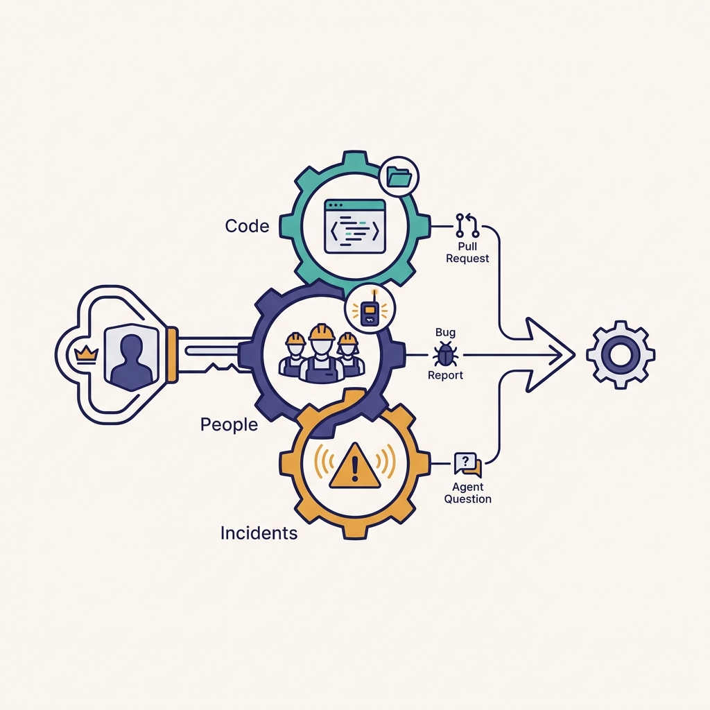
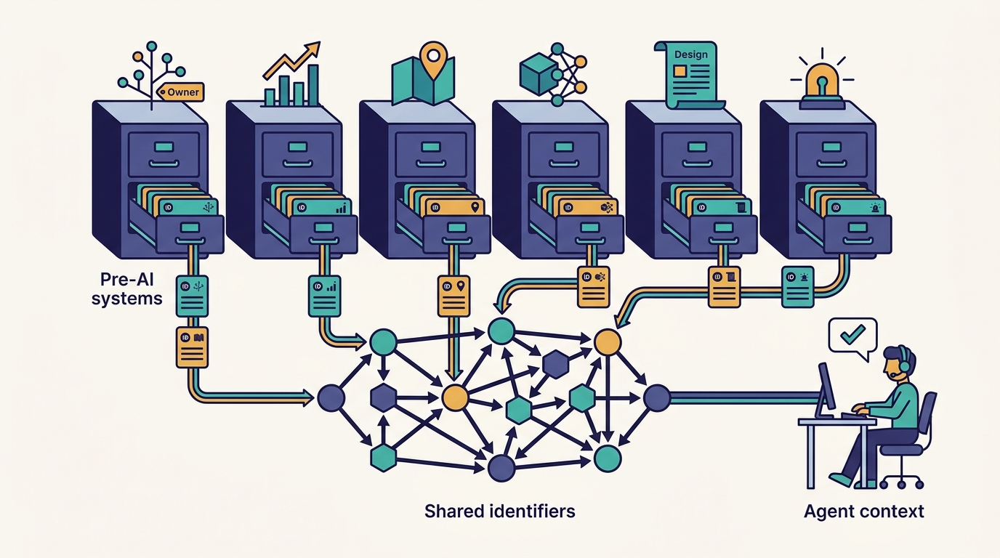
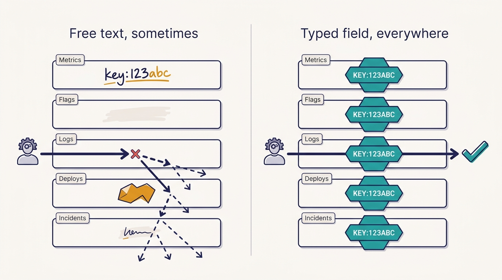

> **IN THIS CHAPTER, YOU WILL:** Walk through the platform systems Uber built in its hypergrowth years (uOwn, M3, Cadence, Morpheus and Flipr, Michelangelo, design-doc and incident tooling), see why the city became a primitive that runs from metrics down to region failover, and follow the build, open-source, buy lifecycle those systems went through.

> **WHY IT MATTERS:** Most AI-infrastructure plans start with the harness and the model. Uber's account suggests the deciding asset is older and less glamorous: machine-readable records of who owns what, what changed, what is being tested and where. An engineering leader needs to know whether their company has that record, and who owns it.

> **KEY POINTS:**
>
> * **Uber built because nothing it could buy worked at its scale and shape.** Between 2014 and 2018 the company went from a two-service core to thousands of services, hundreds of cities and about 500 million metrics a second. It built ownership, metrics, workflow, experimentation and ML platforms in-house because no vendor sold them at that scale or with cities built in.
> * **The city is Uber's domain primitive, and it runs all the way down.** Cities key metrics, feature-flag rules, experiments, service shards and the regional failover design. Every company has an equivalent (tenant, market, store, region), and treating it as a first-class field everywhere is what later makes combination testing and grounded agents possible.
> * **The systems were the means; the metadata is the legacy.** Ownership records, experiment definitions, configuration history, incidents and design docs live in Uber-controlled schemas. In Uber's account, that is the raw material of the context graph and of agents that can find an owner, a flag or a city's state without a human in the loop.

> **BUILT ON:** The 2014 program/platform split, hypergrowth to hundreds of cities, the per-language monorepos ([[monorepos-and-one-build]]) and the typed contracts and tracing covered in [[contracts-and-context-propagation]].

 
In the October 2026 Pragmatic Engineer episode that this book starts from, Gergely Orosz asks Uday Kiran Medisetty, an Uber Distinguished Engineer who joined the company in May 2015, what internal tooling an engineer met in 2015 and 2016. The answer is a list of systems Uber had to build because, as Medisetty put it, "there's not many off-the-shelf products that we could tap into." The list includes an ownership registry, a metrics platform, a workflow engine, an experimentation system and a machine-learning platform, plus design-doc and incident tooling. **Each was built to solve a 2015 scaling problem, not to prepare for AI.**

Ten years later, the same systems show up in a different role. When Uber's agents need to find the owner of a failing service, the experiment behind a metric change or the configuration pushed before an incident, they read records those systems created. The show notes summarize the episode's eleventh takeaway as Uber's AI tooling having been "seemingly built in a year", on top of "a decade worth of dev tooling investment". This chapter covers the first layer of that decade: **the platforms Uber built because the market could not yet sell them**, the city-shaped domain model they encode, and the lifecycle that took several of them from internal tool to open source to the base of other companies.

The chapter does not re-teach the systems other chapters own. The monorepos and Bazel are in [[monorepos-and-one-build]], DevPods in [[devpods]], the IDL registry, Jaeger and the Edge Gateway in [[contracts-and-context-propagation]], and Michelangelo's role as the base of the Model Gateway in [[model-gateway]].

## The Problem Uber Had: Hypergrowth With No Vendors at Its Scale

Three facts define Uber's situation in 2014–2016.

**The architecture was changing faster than the business could wait.** Medisetty recalls "just two services" when he joined: Dispatch, written in Node.js, which handled rider and driver traffic over a four-second ping protocol that returned the whole state of the world, and API, written in Python, which handled everything after the trip (payments, receipts). Uber's own written record is more granular. A 2020 Uber engineering post, co-authored by Medisetty, dates the two-service architecture to 2014. Uber's 2017 tracing post counts about 500 microservices by fall 2015 and more than 2,000 by early 2017. Both are true in their way: the two services Medisetty remembers were the core that still carried most traffic while hundreds of new services grew around it.

**The business was organized by city, and growing city by city.** Uber's 2016 tech-stack post reports 300 operational cities as of April 2015. Each city had its own launch, its own regulations, its own pricing and its own operations team, and the company was adding countries and, soon after, Uber Eats. Medisetty describes the need as "a mechanism for teams to really build all kinds of functionality very quickly to match up to the scale at which the business was growing."

**There was an organization to build platforms.** In spring 2014, according to Orosz's 2021 account of the "Programs & Platforms" reorganization, Uber split its engineering group of just over 100 engineers into 16 program teams (product-facing) and 11 platform teams, with platforms taking roughly 30–40% of engineering. A developer-platform organization has existed at Uber since that split. Medisetty says he was among the first 600 engineers in 2015; the company grew to thousands of engineers and, from 2019–2020, to tech sites around the world (twelve today, per the episode).

Together they explain the build decisions. A 2015 vendor product would have had to handle Uber's volume, accept the city as a dimension and keep up with a monolith splitting into thousands of services. None did all three, and Uber had a platform organization staffed to build the alternative.

## What Uber Built: Six Systems the Market Did Not Sell

The episode names the systems in passing; Uber's engineering blog documents most of them in depth. The table summarizes each system's original job and the record it holds that an agent can use today. The sections after it give the mechanism of each.

| System | Original problem | First public record | What it left behind for agents |
| --- | --- | --- | --- |
| **uOwn** | Who owns this service or asset, and who is on call? | Podcast only | An ownership graph: service to team to on-call |
| **M3 / M3DB** | Graphite could not scale to Uber's metric volume or cardinality | Uber blog, 2018 | Per-city, per-service time series with consistent labels |
| **Cadence** | Every team was writing its own retries and state for multi-day flows | Cadence 1.0 post, 2023 (open source earlier) | Durable workflow histories; the pattern behind long-running agent work |
| **Morpheus, then XP on Flipr** | Every change needs a flag or an experiment, keyed by city | Uber blog, 2021 (Flipr) and 2022 (XP) | Configuration and experiment history: what changed, where, for whom |
| **Michelangelo** | No path to put ML models into production | Uber blog, 2017 | The ML and later GenAI platform the Model Gateway runs on |
| **Design-doc and incident tooling** | Product and engineering decisions scattered across documents; incidents handled ad hoc | Podcast only (as named systems) | Design docs, reviews, approvals and incident records with owners |

### uOwn: the ownership registry

Medisetty describes uOwn as a system "that will enable anyone in the company to identify who owns a specific asset", which Orosz glosses as the tool you open during an outage to find the owning team and who is on call. The show notes add that in 2015 "no such vendor existed." That is the whole public record: Uber has not published a design of uOwn, its schema or how ownership is kept current. Indirect evidence that per-service ownership and criticality metadata is available everywhere comes from Uber's 2025–26 writing. The NSDI '26 failover paper, co-authored by Medisetty, assigns every service a criticality tier (T0 to T5), and the 2025 monorepo-rollout post gates large commits tier by tier.

An ownership registry is easy to underestimate. A change campaign that opens one pull request per module needs to know who reviews each one ([[shepherd-and-fox]]). A bug report needs a team to route to ([[wisdom-and-debug-assist]]). An agent asked "who should I tell?" needs an answer that is not a guess from commit history. **Ownership is the join key between code, people and incidents.**

**Figure 1:** *Ownership is the join key between code, people and incidents; campaigns, bug routing and agents all depend on it.*

### M3: metrics at a scale no vendor sold

Uber's 2018 post on M3 by Rob Skillington describes the problem and the result. In late 2014 Uber ran Graphite with Carbon and Whisper, which had no replication; Orosz's 2023 account adds that adding capacity took a week offline. M3 shipped in 2015 on Cassandra, which Uber later replaced with its own time-series database, M3DB. By 2018, M3 aggregated about **500 million metrics per second**, persisted about 20 million per second, held 6.6 billion time series and wrote each value to three replicas per region. Medisetty's "around 500 million metrics emitted per second" matches the documented figure.

The cause of that volume is the point of this chapter. As Orosz says in the episode, "every city had its own metrics." Cardinality, the number of distinct label combinations, is what breaks a metrics system, and a company that tags every metric with a city multiplies its series count by the number of cities. M3 was open-sourced, and its creators, Martin Mao and Skillington, left Uber in 2019 to found Chronosphere on top of it. The 2018 post describes a system eight years old; Uber's metrics stack may look different today.

### Cadence: durable workflows for flows that last days

Some Uber processes last days or weeks: onboarding a driver (documents, background checks, vehicle inspection) or running a marketing campaign. Medisetty describes engineers each writing "their own resiliency stuff, their own state management" before Cadence. Cadence is a durable workflow engine: a workflow is ordinary code whose state and progress the engine persists, so it survives process crashes and can wait for days for an external event.

The 2023 "Announcing Cadence 1.0" post on Uber's blog describes it as a "6+ year project" running more than 12 billion executions and 270 billion actions a month at Uber across more than 1,000 services, with external users including DoorDash, HashiCorp and Coinbase. Temporal's own account says its founders, Maxim Fateev and Samar Abbas, "reunited at Uber to co-create Cadence" in 2015 (other accounts date the start closer to 2017); they founded Temporal in 2019. Durable execution matters again in the AI era: a background agent that runs for an hour, waits for CI and resumes on a reviewer's comment is a long-running workflow. Uber has not said whether Minion runs on Cadence, and this book does not assume it.

### Morpheus, Flipr and XP: configuration and experiments keyed by city

Medisetty puts the principle plainly: "everything goes through a feature flag, everything goes through an XP" (experiment). Morpheus, built around 2015 according to Uber's 2022 experimentation post, combined feature flags and A/B tests. That 2022 post is unusually candid about its limits: a 2020 review found that a large share of experiments had fatal problems, treatment groups were hard-coded in client code so changing an experiment could need a 2–4-week app release, and clients failed closed when the backend did not answer. Uber rebuilt experimentation as a layer over Flipr, its configuration platform, and deprecated more than 50,000 stale Morpheus experiments.

Flipr itself, described in a 2021 Uber post, shows the city in the data model. A Flipr property is a multimap: its value depends on runtime context, and override rules can key on geography, **city ID**, user, driver or vehicle, device, app version, time and experiment treatment. A rollout expands from a few users in one city, to beta testers in a city, to several cities, to everyone. In 2021 Flipr held more than 350,000 active properties and served about 150,000 changes a week to more than 700 client services.

Medisetty adds that Uber, as a two- and three-sided marketplace, also runs **switchback experiments**, which alternate treatment and control over time windows within a market, because randomizing riders alone would let the treatment group change conditions for the control group. Uber has not published its switchback design.

### Michelangelo: an ML platform before ML platforms were a product

Uber's 2017 post "Meet Michelangelo" says development began in mid-2015 because "there was no established path to deploying a model into production." It describes the end-to-end workflow (manage data, train, evaluate, deploy, predict, monitor), a shared feature store of about 10,000 features and models serving more than 250,000 predictions a second. Uber's 2024 post "From Predictive to Generative" dates a generative-AI phase from 2023 that added an LLM gateway, a model catalog and evaluation tooling.

Two facts make Michelangelo central to this book. First, Medisetty says the Model Gateway was built "as a GenAI product" on Michelangelo, so every model call at Uber runs on a platform started in 2015 ([[model-gateway]]). Second, Uber open-sourced core parts of Michelangelo on **20 May 2026** under the Apache 2.0 license; the repository README says it is in beta. Medisetty mentions the release as "a couple of months ago."

### Design docs and incidents in one place

Medisetty also lists, without naming systems, tooling that brought "our engineering design docs, product design docs" into one place, and incident tooling built because Uber is "really obsessed about how we handle our incidents and the learnings from that." The episode later shows the design-doc hub in its AI-era form, with product and engineering requirement documents, launch and production-readiness reviews, status, approvals and owners ([[plans-as-source-of-truth]]). Uber has not published the internals of either tool.

## The City as a First-Class Primitive

A **domain primitive** in this book's sense is the business concept that every layer of the platform, not only the application, understands as a typed value. At Uber that concept is the city. Orosz says in the episode that he once wondered why Uber had its own feature-flag system, until he asked himself to "show me a feature flagging solution for a vendor that supports cities." Medisetty answers that the city is "so deeply baked into our infrastructure."

The documented and podcast evidence shows the city at every layer:

| Layer | How the city appears | Evidence |
| --- | --- | --- |
| Metrics | Per-city series; cardinality multiplied by city count | Podcast (Orosz); M3 post, 2018, on cardinality |
| Configuration and rollout | Flipr override rules on city ID; rollouts city by city | Uber blog, 2021 |
| Geospatial analysis | H3 hexagonal grid for analyzing supply and demand across a city | Uber blog, 2018 (open source) |
| Data and service sharding | Some critical platform services sharded by city; in the early days, databases sharded by city | Podcast only |
| Regions and failover | Each city's traffic served by exactly one region; cities migrate between regions on failover | NSDI '26 paper |
| Deployment | **Logical deployment groups** route a group of cities to a group of containers, for some services | Podcast only |

The failover row is the most consequential and the best documented. The NSDI '26 paper on Uber's failover architecture states that "during normal operations (steady state), each city's traffic is routed to exactly one region," across two primary regions running active-active. A tool called the Outage Mitigator (OMG) moves cities between regions during failovers. The paper's redesign cut the capacity Uber holds for regional failover from 2× to 1.3×, removing more than a million of about four million CPU cores; during a full-peak failover, traffic is moved "city by city." Medisetty confirms in the episode that Uber can "at any point in time failover that city across regions."

---begin mermaid---
flowchart TB
    C["City ID on every request"]
    C --> M["Metrics: per-city series in M3"]
    C --> F["Flipr rules and XP experiments keyed by city"]
    C --> S["Some services sharded by city"]
    C --> R["Each city pinned to one region"]
    R --> O["OMG moves cities between regions on failover"]
    C --> L["Logical deployment groups: cities to container groups"]
    M --> A["AI era: grounding and city-scoped queries"]
    F --> A
    C --> T["AI era: Capri dimension tags such as cash trips in Brazil"]
---end mermaid---
**Figure 2:** *The city is a field that every platform layer reads. The same field later lets AI-era tools scope tests and questions to a market.*

Why does this matter for AI? Because a primitive that is typed everywhere can be queried everywhere. When Medisetty describes Capri, Uber's capture-and-replay system, his example of a pre-deploy check is a change that should affect "cash trips only in Brazil" ([[capri]]). That check is only possible because requests carry dimensions such as market, product line and payment type that the platform understands. When an agent asks the context graph what changed in São Paulo before an incident ([[context-graph]]), the question has an answer only if configuration changes, deployments and incidents all carry the same city key.

> **INFERENCE, NOT DOCUMENTED:** A plausible reading of the record is that Uber's AI-era systems inherit the city key from these older layers rather than adding it. Uber has not described how the context graph or Capri represent cities internally; the claim here is only that the dimension already existed in the platforms they read from.

## The Build, Open-Source, Buy Lifecycle

Medisetty describes Uber's stance as a sequence, not a preference. Now that "the industry also matured," Uber builds fewer products: it builds where it sees a unique need, buys otherwise, and, when something it built is interesting for the rest of the industry, tries to "open source wherever possible." The record shows several systems moving through that sequence.

| System | Built at Uber | Open-sourced | Life outside Uber |
| --- | --- | --- | --- |
| Jaeger (tracing) | 2015–2016 | April 2017 | CNCF project from 2017, graduated 2019 ([[contracts-and-context-propagation]]) |
| Cadence (workflows) | ~2015–2017 (sources differ) | 2017 (per its repository) | Temporal founded 2019 by its creators; Cadence 1.0 in 2023 |
| M3 (metrics) | 2015 | By 2018 (Prometheus-compatible) | Chronosphere founded 2019 by its creators |
| H3 (geospatial grid) | Before 2018 | 2018 | Widely used hexagonal index; core in C with bindings |
| Piranha (stale-flag removal) | ~2017 | 2020 | Paper at ICSE-SEIP 2020; precedent for [[shepherd-and-fox]] |
| Michelangelo (ML platform) | Mid-2015 | May 2026 (core parts, beta) | Too early to say |

---begin mermaid---
stateDiagram-v2
    state "Build: no vendor fits scale or shape" as Build
    state "Operate and standardize internally" as Operate
    state "Open-source the general part" as OpenSource
    state "Market matures: vendors and spin-outs" as Market
    state "Buy, keep only the unique part" as Buy
    [*] --> Build
    Build --> Operate
    Operate --> OpenSource
    OpenSource --> Market
    Operate --> Market
    Market --> Buy
    Buy --> Build: "new unmet need"
---end mermaid---
**Figure 3:** *The lifecycle Medisetty describes. Build when nothing fits, open-source the general part, buy once the market catches up, and keep building only where the need is unique.*

The AI era runs the same lifecycle faster, and in the opposite order. Uber bought the parts the market sells, frontier models and coding harnesses (Claude Code, Codex and OpenCode, per the episode), and built the parts that touch its own data and policy: the Model Gateway, the MCP Gateway, AIFX, the skills repository and the context graph ([[aifx-harness-layer]], [[mcp-gateway]]). The show notes date the principle to a 2023 decision that everything built with AI must be "model- and harness-agnostic." **The 2015 lesson was "build what nobody sells"; the 2023 lesson is "buy what changes monthly, build the layer that keeps you free to switch."**

There is a cost side the lifecycle hides. Every system that stays in the "build" state needs a team for as long as it exists. Morpheus is the documented example: by 2020 it carried tens of thousands of stale experiments and design flaws that took a platform rebuild and a migration of more than 2,000 developers, 350+ services and 10+ apps to fix, according to the 2022 post. Building is cheaper than buying only when you count the first year.

## The Foundation Underneath: Why Proprietary Metadata Becomes Agent Context

The thesis of this book is that the harness is the easy part ([[the-harness-is-the-easy-part]]). For this chapter's systems, the mechanism is specific: **they produce records in schemas Uber controls, and those records are what an agent needs to be grounded.**

Consider the questions an engineer or an agent asks when working on a change at Uber, and where the answer comes from:

| Question | Pre-AI system that holds the answer | AI-era consumer (as described) |
| --- | --- | --- |
| Who owns this service and who is on call? | uOwn | Context graph; Shepherd and Fox PR routing; Wisdom bug routing |
| Did this metric move, and in which cities? | M3 | DebugAssist evidence timelines; service health reports |
| Which flag or experiment changed behavior here? | Flipr and XP | Context graph (configuration changes are a node type, per Medisetty) |
| Why was this designed this way, and who approved it? | Design-doc hub | Context graph; agentic design-doc skills |
| Has this failed before? | Incident tooling | Context graph (incidents and on-call events are node types) |
| Which model serves this, under what policy? | Michelangelo | Model Gateway and AI Guard |

The episode describes the context graph as a live graph with "100+ node types, 130+ edge types" covering employees, assets, pull requests, design docs, features, on-call events, configuration changes, incidents and data tables. Uber's August 2026 blog post "Running a Software Factory Efficiently at Uber Scale" gives a lower, dated count: 86 node types and 117 edge types, about 24 million nodes and 80 million edges drawn from more than 30 systems. Either way, nearly every source system in the table above is one this chapter describes. The context graph's own design belongs to [[context-graph]]; the point here is where its inputs came from.

Medisetty's trace analysis, described in the episode, found agents spending many turns getting grounded across siloed systems before doing any work. The context graph cuts those turns. It can do so because the silos were, in most cases, Uber's own systems with Uber's own schemas and identifiers.

**Figure 4:** *The records Uber's pre-AI systems hold, in schemas Uber controls, became the context its agents are grounded in.*

> **INFERENCE, NOT DOCUMENTED:** A company that bought equivalent tools in 2015 would hold the same facts behind several vendors' APIs, each with its own identifiers for a service, a team and a region. Building a context graph there means writing and maintaining connectors and an identity-mapping layer first. That is feasible (it is what developer-portal catalogs do), but it is a cost Uber's account does not mention because Uber did not have to pay it in the same form.

The opposite risk is also real. Owning the schema helps only if the records are complete and current. An ownership registry with 20% stale entries routes agent pull requests to the wrong team at machine speed. The episode does not say how Uber keeps uOwn accurate, and that question is worth more to an imitator than any detail of the registry's design.

## Design Choices and Trade-offs

The build decision is not one decision. The table separates five options and when each was right for Uber, and when each is right for most readers.

| Option | Example at Uber | Right when | Wrong when |
| --- | --- | --- | --- |
| **Build in-house** | uOwn, Michelangelo (2015), Flipr | No product meets scale or the domain primitive; the system holds data that is core to the business | A product exists that accepts your primitive as a custom field; you cannot staff it for a decade |
| **Build, then open-source** | Jaeger, M3, Cadence, H3 | The general part is useful to others; you want outside contributors and hiring signal | You open-source to avoid maintenance; the internal fork diverges and you carry both |
| **Adopt open source** | Bazel, OpenRewrite, Kubernetes | A strong community project fits; you can staff contributors | You need a vendor's support contract to operate it safely |
| **Buy** | Frontier models, coding harnesses (AI era) | The capability changes faster than you could build it; switching cost can be capped | The product holds data you need to join with everything else, behind an API you cannot query freely |
| **Buy behind your own layer** | Models behind the Model Gateway; harnesses behind AIFX | You expect to switch vendors and need consistent policy, attribution and spend control | You have one vendor and no policy needs; the layer is overhead |

The pattern in Uber's record is that the **data-holding systems were built and kept, and the compute-heavy or fast-moving capabilities were bought or open-sourced**. That is not the stated policy; it is how the list reads.

## Elsewhere in the Industry

**Spotify and the ownership catalog.** Spotify built Backstage internally to give its engineers one catalog of services, owners and documentation, and open-sourced it on 16 March 2020, as Spotify Engineering recounted in its April 2025 five-year post. It entered the CNCF sandbox later in 2020. Backstage is the closest public analogue to uOwn plus the design-doc hub, and it is now the most common starting point for companies that want ownership metadata without building a registry. The difference from Uber is that Backstage's catalog is usually populated from YAML files in each repository, which makes accuracy a per-team responsibility; Uber has not said how uOwn is populated.

**The spin-out pattern.** Temporal (from Cadence) and Chronosphere (from M3) are both companies founded in 2019 by the engineers who built the system at Uber. They show the last step of the lifecycle: a problem Uber met first became a product market. A company starting today can buy durable execution and high-cardinality metrics instead of building them, which is exactly the "buy once the market matures" step in Medisetty's sequence.

**The platform evidence.** Google Cloud's DORA research program states on its platform-engineering capability page that when platform quality is high, the effect of AI adoption on organizational performance is "strong and positive", and when it is low, the effect is negligible. The 2025 DORA report frames AI as an amplifier of what is already there. That is the industry-level version of this chapter's argument, from survey data rather than from one company.

## If You Are Not Uber

The lesson to copy is not "build your own metrics database." It is: **make sure the facts your agents will need are recorded somewhere, in a form you can query, with identifiers that join.** You can buy most of the systems; you cannot buy the discipline of keeping the records complete.

Start by naming your domain primitive. For Uber it is the city. For a B2B SaaS company it is usually the tenant; for a retailer the store or market; for a bank the legal entity and jurisdiction; for a logistics company the depot or lane. Then check whether that primitive is a typed field in your metrics labels, feature-flag targeting rules, logs, deployment configuration and incident records. If it is a free-text string in some and absent in others, fixing that is a better first AI-infrastructure investment than any harness.

**Figure 5:** *A domain primitive helps agents only when it is a typed field in every layer; a key that is free text in some layers and missing in others gives partial answers.*

| | ≈50 engineers | ≈500 engineers | ≈5,000 engineers |
| --- | --- | --- | --- |
| **Ownership** | CODEOWNERS files and one on-call tool; one owner per repository | A service catalog (Backstage or a commercial portal) as the source of truth, checked in CI | A registry with enforced completeness, owner and tier per asset, exposed by API to agents |
| **Domain primitive** | Pick it; add it to log and metric labels | Make it a required field in flags, metrics, deployments and incidents | Shard, route and fail over by it where reliability needs it |
| **Metrics and workflows** | Buy (managed observability, hosted durable execution) | Buy; standardize label names across teams | Buy or run open source; build only where cardinality or cost forces it |
| **Experiments and flags** | A feature-flag product; no in-house system | One flag and experiment platform, with change history exported | Experimentation integrated with metrics and configuration history |
| **Decisions and incidents** | Design docs in one folder; postmortems in one template | One design-doc and incident tool with owners, status and links | A design-doc hub feeding a queryable graph |
| **What to build** | Nothing in this table | Connectors that export each tool's records into one store | The join layer: the identity map and graph over all of the above |

Three things not to copy:

- **Do not build systems a vendor now sells well.** Uber built in 2015 because the market was empty. In 2026 durable execution, high-cardinality metrics, feature flags and ML platforms are mature markets, partly because of Uber's own open-source work.
- **Do not copy the city.** Copy the idea of a domain primitive, and choose your own. A company that shards by region because Uber shards by city has copied the form, not the reason.
- **Do not let a bought tool hold data you cannot export.** The test for every purchase in the AI era: can an agent, through your own gateway, query this tool's records with your identifiers? If not, the tool is a future silo.

## Failure Modes

- **The vanity build.** A team builds an in-house platform because Uber did, then cannot staff it after the original engineers leave. Morpheus shows that even a well-staffed build accumulates design debt that takes a rebuild to repay.
- **Stale ownership at machine speed.** Agents that route pull requests, bugs and alerts by an ownership registry amplify its errors. A wrong owner in a human workflow costs one forwarded message; in an agent workflow it costs a hundred unreviewed pull requests in the wrong queue.
- **A primitive that is almost first-class.** The city (or tenant) exists in metrics but not in incidents, or in flags but not in deployments. Queries that join across layers return partial answers, and agents treat partial answers as complete.
- **Mistaking the system for the asset.** A company replaces an in-house tool with a vendor product and loses the history: years of experiment definitions or incident records left behind in a decommissioned database. That history is what an agent would have used.

## What the Record Does Not Say

- **How uOwn works.** There is no public design, schema, population method or accuracy figure. It is podcast-only.
- **How complete the metadata is.** Uber has not published coverage figures for ownership, experiment history or incident records, the property that decides whether agents can rely on them.
- **Which pre-AI systems feed the context graph directly.** The episode lists node types, and the August 2026 blog post says "30+ systems," but neither maps nodes to source systems.
- **Whether AI-era agents run on Cadence.** Durable execution would fit background agents, but Uber has not said what orchestrates Minion or DebugAssist. (A September 2026 conference-talk abstract says DebugAssist uses LangGraph; see [[wisdom-and-debug-assist]].)
- **The cost of building.** No source gives staffing or cost for any of these systems over their lifetime, so the build-versus-buy economics cannot be checked from outside.
- **Switchback design.** Medisetty confirms switchback experiments, but Uber has not published how its platform implements them.

## Questions to Ask

1. What is our domain primitive, and in which of these is it a typed, required field: metrics, logs, feature-flag rules, deployments, incidents, design docs?
2. If an agent asked "who owns this service and who is on call right now?", which system would answer, by API, and how often is the answer wrong?
3. Which of our tools hold records we cannot export with our own identifiers? What would it take to join them?
4. Which internal systems do we still build that a mature market now sells? What would retiring them lose?
5. For each system we plan to buy for AI, can we put our own gateway between it and our engineers, so we can switch vendors later?
6. Where is our experiment and configuration history, and can someone reconstruct what changed in one market in the hour before an incident?
7. Which pre-AI platform investments are we not making because "AI will handle it", and which AI plans quietly assume they exist?
8. Who owns metadata quality as a product, with a completeness target, rather than as a side effect of each team's tools?

The systems in this chapter record what exists and who owns it. The next chapter covers how Uber made the code itself uniform enough for one central team, and later one agent, to change any part of it: the move from micro-repositories to per-language monorepos, Bazel and a single build command, in [[monorepos-and-one-build]].

## Sources and Evidence

### The source episode

- [Uber's AI infra, from the inside](https://newsletter.pragmaticengineer.com/p/ubers-ai-infra-from-the-inside), *The Pragmatic Engineer* podcast, Gergely Orosz with Uday Kiran Medisetty, 2026. Medisetty's account of the 2015 architecture, uOwn, M3, Cadence, Morpheus, cities, sharding, logical deployment groups and the build/open-source/buy stance; the show notes' eleven takeaways.

### Uber engineering sources

- [Designing Edge Gateway, Uber's API Lifecycle Management Platform](https://www.uber.com/blog/gatewayuberapi/), Uber Blog, P. Astakhov, M. Thangavelu, U. K. Medisetty, 2020. The 2014 two-service architecture and the January 2015 gateway.
- [Evolving Distributed Tracing at Uber Engineering](https://www.uber.com/blog/distributed-tracing/), Uber Blog, Y. Shkuro, 2017. Service counts (~500 in fall 2015, 2,000+ in early 2017); Jaeger's origin and open-sourcing.
- [The Uber Engineering Tech Stack, Part I: The Foundation](https://www.uber.com/blog/tech-stack-part-one-foundation/), Uber Blog, L. Lozinski, 2016. 300 operational cities in April 2015; service languages.
- [M3: Uber's Open Source, Large-scale Metrics Platform for Prometheus](https://www.uber.com/blog/m3/), Uber Blog, R. Skillington, 2018. 500M metrics/s aggregated, 6.6B series, Graphite predecessor.
- [Announcing Cadence 1.0](https://www.uber.com/blog/announcing-cadence/), Uber Blog, E. Demirkaya, 2023. Cadence scale and external users.
- [Flipr: Making Changes Quickly and Safely at Scale](https://www.uber.com/blog/flipr/), Uber Blog, A. Maule, 2021. City-keyed override rules and city-by-city rollouts.
- [Supercharging A/B Testing at Uber](https://www.uber.com/blog/supercharging-a-b-testing-at-uber/), Uber Blog, K. Puttaswamy, L. Duncan, Arun Babu A S P, 2022. Morpheus history, its problems and the XP rebuild on Flipr.
- [Meet Michelangelo: Uber's Machine Learning Platform](https://www.uber.com/blog/michelangelo-machine-learning-platform/), Uber Blog, M. Del Balso, J. Hermann, 2017. Mid-2015 start and the end-to-end workflow.
- [From Predictive to Generative: How Michelangelo Accelerates Uber's AI Journey](https://www.uber.com/blog/from-predictive-to-generative-ai/), Uber Blog, K. Wang, J. Wang, M. Cai, 2024. Michelangelo's three phases.
- [Michelangelo is Now Open Source](https://michelangelo-ai.org/blog/open-source-launch/), Michelangelo team, 2026, with the [michelangelo-ai/michelangelo repository](https://github.com/michelangelo-ai/michelangelo) (Apache-2.0, beta). The 20 May 2026 release.
- [H3: Uber's Hexagonal Hierarchical Spatial Index](https://www.uber.com/blog/h3/), Uber Blog, I. Brodsky, 2018. Hexagonal grid for city-wide marketplace analysis; open source.
- [Introducing Piranha](https://www.uber.com/blog/piranha/), Uber Blog, M. Sridharan, R. Barik, L. Clapp, 2020. Stale-flag cleanup, open-sourced.
- [Uber's Failover Architecture: Reconciling Reliability and Efficiency in Hyperscale Microservice Infrastructure](https://www.cs.ubc.ca/~bestchai/papers/nsdi26-ufa2.pdf), M. Bansal et al. (including U. K. Medisetty), USENIX NSDI, 2026. Each city pinned to one region, OMG, 2× to 1.3× capacity, service tiers.
- [Controlling the Rollout of Large-Scale Monorepo Changes](https://www.uber.com/blog/controlling-the-rollout-of-large-scale-monorepo-changes/), Uber Blog, A. Lorincz, G. Alvarez, R. Vestergaard, 2025. Tier-based gating, evidence of platform-wide service tiers.
- [Running a Software Factory Efficiently at Uber Scale](https://www.uber.com/us/en/blog/efficient-software-factory/), Uber Blog, U. K. Medisetty, 2026. Context graph counts (86 node types, 117 edge types, 24M nodes, 80M edges, 30+ systems).

### Industry and research sources

- [The Platform and Program Split at Uber](https://newsletter.pragmaticengineer.com/p/program-platform-split-uber), *The Pragmatic Engineer*, G. Orosz, 2021. The 2014 reorganization into 16 program and 11 platform teams.
- [How Uber Built its Observability Platform](https://newsletter.pragmaticengineer.com/p/how-uber-built-its-observability-platform), *The Pragmatic Engineer*, G. Orosz with M. Mao, 2023 (partly paywalled). Graphite's limits in 2015.
- [Chronosphere nabs $43M Series B](https://techcrunch.com/2021/01/05/chronosphere-nabs-43m-series-b-to-expand-cloud-native-monitoring-tool/), TechCrunch, 2021. Chronosphere founded in 2019 by two former Uber engineers who built M3.
- [Who We Are](https://temporal.io/about), Temporal Technologies, undated. Cadence co-created at Uber by Maxim Fateev and Samar Abbas from 2015.
- [Celebrating Five Years of Backstage](https://engineering.atspotify.com/2025/4/celebrating-five-years-of-backstage), Spotify Engineering, 2025. Backstage open-sourced 16 March 2020.
- [DORA Capabilities: Platform engineering](https://dora.dev/capabilities/platform-engineering/), DORA, current. Platform quality moderating AI's effect on performance.
- [DORA 2025 State of AI-assisted Software Development Report](https://research.google/pubs/dora-2025-state-of-ai-assisted-software-development-report/), D. DeBellis, N. Harvey, G. Kim et al., 2025. AI as an amplifier of existing systems.

Statements about Uber's AI-era systems are Uber's own account unless another source is cited; recommendations and labeled inferences are the author's judgement.
