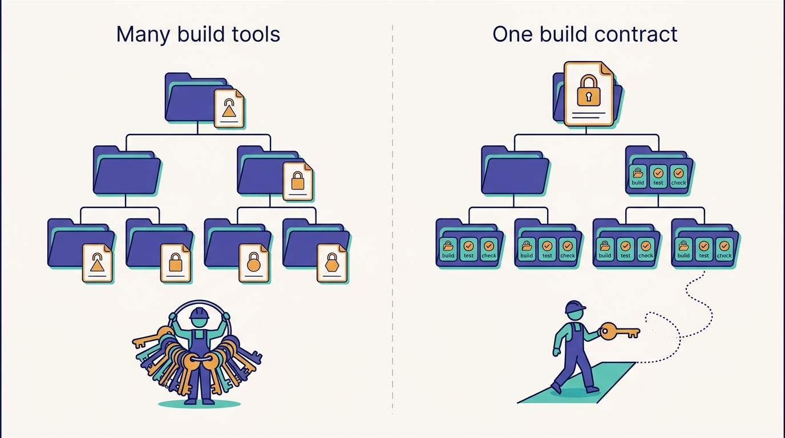
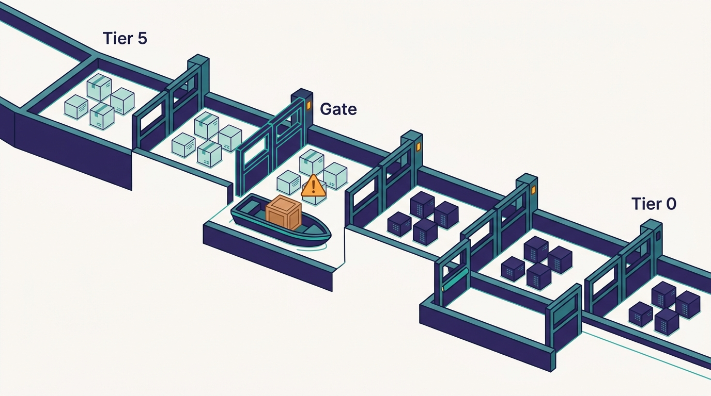

> **IN THIS CHAPTER, YOU WILL:** Trace Uber's path from microservice sprawl and thousands of repositories to a handful of per-language monorepos built with Bazel and kept green by SubmitQueue, see how the service count stopped growing while the business grew, and learn why one build command for every module is the property AI agents depend on most.

> **WHY IT MATTERS:** An agent that cannot build and test the code it changes cannot verify its own work, and an organization with ten ways to build has to teach every agent ten ways. The standard build contract is cheap to describe and expensive to retrofit; leaders should know how far their own codebase is from having one.

> **KEY POINTS:**
>
> * **Uber moved to monorepos to make change across services possible, not to save disk space.** With thousands of repositories, 9+ build tools and several test systems, a central team could not upgrade a library everywhere. From 2017–2018 Uber consolidated into one monorepo per language (Go, Java, iOS, Android and others), all built with Bazel.
> * **A monorepo is only as good as the queue that keeps it green.** SubmitQueue, Uber's speculative merge queue, took the iOS mainline from green 52% of the time to always green (2019 paper) and, after a 2024 redesign, cut CI resource use by 53% (2025 blog). Agents raise the volume this queue must absorb; the AI-era CI "code red" is its next chapter.
> * **One build command is the contract agents inherit.** Medisetty describes "one single way to build any module" that every engineer knows, and agents use "the exact same commands" from a top-level AGENTS.md or CLAUDE.md. Shepherd's per-module campaigns, Minion's cross-repository pull requests and `aifx validate` all assume that contract.

> **BUILT ON:** The ownership and service metadata of [[build-what-does-not-exist]], the typed IDLs and standardized language frameworks of [[contracts-and-context-propagation]], and the Developer Platform organization that has owned CI and developer experience since 2014.

 
Medisetty's account of the move to monorepos in the October 2026 Pragmatic Engineer episode starts with a practical pain, not an architectural ideal. Every service had its own repository; there was no standard build system; Uber had "at least two, three build systems, two, three testing systems." And "it was very hard even for a central team when we wanted to do library upgrades and go across all the services." **The monorepo move was a decision to make the whole codebase changeable by one team.**

That decision turned out to matter twice. From 2018 it let a central team change shared code across every service in a language from one place. In 2026 it lets an agent working on a mega DevPod open pull requests across repositories, and lets one top-level instruction file tell every agent how to build and test any module. Medisetty draws the connection himself: because Uber has "standardized builds, standardized testing," once the top-level files are set up "most teams will get really good value out of the bat."

This chapter covers the arc from microservice sprawl to that single build command: the service-count story and its consolidation, the per-language monorepos and Bazel, SubmitQueue and the problem of keeping main green, and the **standard build contract** that AI tools now inherit. DevPods, the cloud workspaces that made the monorepos usable, have their own chapter ([[devpods]]); the AI-era pressure on CI belongs to [[inner-loop-and-self-healing-ci]].

## The Problem Uber Had: Sprawl in Services and Repositories

### Services: thousands, then a plateau

The service count is the most quoted and least consistent number in Uber's engineering history, because sources count different things. Uber's own figures, by date:

| When | Count | Source | What it counts |
| --- | --- | --- | --- |
| 2014 | 2 core services, Dispatch and API | Edge Gateway post, 2020 | The core pair (Medisetty's "two services" in 2015) |
| Fall 2015 | ~500 | Jaeger tracing post, 2017 | Microservices |
| Early 2017 | 2,000+ | Jaeger tracing post, 2017 | Microservices |
| 2017 | 4,000+ services, thousands of repositories | Devpod post, 2022 | Retrospective count |
| 2019 | 2,200+ | Edge Gateway post, 2020 | Microservices |
| 2020 | ~2,200 critical, in 70 domains | DOMA post, 2020 | Critical subset only |
| 2023 | ~4,500 stateless | Up post, 2023 | Stateless fleet |
| 2025 | ~4,000 on Kubernetes | Kubernetes migration post, 2025 | Services on the compute platform |
| 2025–26 | 6,000+ in 16,000+ environments | NSDI '26 failover paper | All services, all environments |

Medisetty's framing, right after describing the 2018–2019 standardization, is that Uber is still "in the similar ballpark of number of services" even though the business is about ten times larger; Orosz's outro puts today's count at roughly 4,500–5,000 "well-sized" services. That fits Uber's retrospective and all-environment counts (4,000+ in 2017, 4,000–6,000 since) but not its own contemporaneous 2019 figure of 2,200+. The safe reading is a plateau: **counts depend on what is counted, but none of Uber's figures shows the fleet growing with the business**. The count did not fall; it stopped tracking business growth.

The plateau was deliberate. Medisetty says that "around 2018, 2019" Uber "standardized on our languages," picking **Go and Java** as primary languages, and "spent a lot of time in thinking about the layers of our architecture." Uber has published no policy post declaring Go and Java the standard, but the record is consistent with it: the Node.js real-time API gateway was rewritten in Go as the Edge Gateway, and Go and Java are the backend monorepos that receive the large platform investment.

The layering has a name. Uber's 2020 post on **Domain-Oriented Microservice Architecture (DOMA)** grouped about 2,200 critical microservices into 70 domains, arranged in five layers (infrastructure, business, product, presentation, edge) where each layer may depend only on those below it, and each domain exposes a single gateway. The motivating pains are quoted precisely: one root-cause investigation crossed about 50 services owned by 12 teams, and Uber estimated the half-life of a microservice at 1.5 years. Reported results include platform support costs falling often by an order of magnitude and one team's feature integration dropping from three days to three hours. Medisetty adds his own example: on one fulfillment platform, "we actually reduced some of the services to a few services."

### Repositories: thousands, with nine build tools

Uber's 2022 Devpod post describes the 2017 starting point: "thousands of repositories with 10+ programming languages, 4000+ services, 500+ Web Apps, 9+ build tools and 6+ configuration tools." In that world, three things are hard:

1. **Changing a library everywhere.** Each repository pins its own versions and has its own build. An upgrade is a negotiation with every owner.
2. **Knowing what a change breaks.** Dependencies across repositories are expressed through published artifacts, so the effect of a change shows up only when consumers upgrade.
3. **Onboarding to a new codebase.** Each repository has its own setup, its own test command and its own undocumented build steps.

All three are also exactly what an agent needs. An agent that has to discover each repository's build by reading its scripts burns turns and tokens before it writes a line of code. The 2017 state of Uber's code would have made the AI-era systems in this book far harder to build.

## What Uber Built: Per-Language Monorepos on Bazel

Medisetty dates the change to "around 2017–18": Uber moved to monorepos "even though they are microservices," with all services deployed from them, and "one monorepo per language, so we had a monorepo for Go, one for Java, one for mobile iOS, one for Android and so on." Uber's written record fills in the sequence.

- **iOS first, then Android.** Uber's 2020 Go monorepo post says the Go team acted after "the Android and iOS teams moved to a monorepo."
- **Go, early 2018.** The same post, by Zhongpeng Lin, reports that the Go monorepo launched in early 2018. Monthly commits grew from under 100 to nearly 10,000 and monthly active engineers from under 10 to nearly 900. By May 2020 it held more than 70,000 files and more than 1,000 external modules. Make and `go build` "no longer met our needs," so the team chose Bazel.
- **Java.** The 2026 JUnit migration post describes a Bazel Java monorepo with more than 600,000 JUnit 4 tests across about 15 million lines of code. A third-party recap of a November 2025 Uber talk says the Java monorepo used Buck until 2023 and is now entirely on Bazel; treat that date as secondary.
- **Today.** Uber's 2025 CI-cost post describes "six major monorepos and seven programming languages"; the 2022 Devpod post says the largest monorepo had "over 70 million lines of code." Medisetty confirms: "we use Bazel across all of our repositories."

Define the term this chapter owns. A **per-language monorepo** is one repository holding every service and library in one language, built by one build system with one dependency version policy. It is a middle position between one repository per service and Google's single repository for everything.

Bazel matters here for one property more than any other: it makes builds **hermetic and target-based**. Every build target declares its inputs and dependencies, so the build system can compute which targets a change affects and reuse cached results for the rest. Lin's 2020 post states the consequence: "A package is built and tested only when something has changed either in the package or its dependencies." Uber built an external tool that hashes each target from its rule definition, attributes, input files and dependency hashes, so that SubmitQueue could work out which commits touch which targets; it also contributed a Bazel feature, available since Bazel 3.1, to read long target lists from a file. To keep the build files manageable, Uber relied on **Gazelle**, which generates Bazel rules for Go and Protocol Buffers, and wrote Gazelle extensions for Thrift, Avro and GoMock.

---begin mermaid---
flowchart LR
    subgraph Before["2017: thousands of repositories"]
        R1["Service repo with Make"]
        R2["Service repo with npm"]
        R3["Service repo with Buck"]
        R4["More repos, 9+ build tools"]
    end
    subgraph After["2018 onward: per-language monorepos"]
        G["Go monorepo"]
        J["Java monorepo"]
        I["iOS monorepo"]
        A["Android monorepo"]
        W["Web and others"]
    end
    Before -->|"consolidate"| After
    After --> B["Bazel targets with declared dependencies"]
    B --> C["One build and test command for any module"]
    C --> H["Engineers, CI, campaigns and agents"]
---end mermaid---
**Figure 1:** *From thousands of repositories with nine or more build tools to a handful of per-language monorepos on Bazel. The output that matters is the last box: one way to build and test anything, used by humans and machines alike.*

### The standard build contract

The second term this chapter owns is the **standard build contract**: a guarantee that any module in the codebase can be built, tested and linted with the same small set of commands, from a known environment, with results that do not depend on whose machine runs them. Bazel is Uber's implementation; the contract is the thing to copy.

Medisetty describes the contract in his walk-through of DevPods: "It's one single way to build any module and then anyone knows this command. And now agents also know the same way." Through CLAUDE.md and AGENTS.md, he said, agents know how to build and test any module in any repository with "the exact same commands."

AGENTS.md is an open format, described on its site as "a README for agents," in which the nearest file in the directory tree takes precedence; CLAUDE.md is Claude Code's equivalent. In a codebase without a build contract, every module needs its own instruction file explaining its own build. With one, a single file at the top of each monorepo is enough, and per-module files are needed only for what is genuinely different. That is why Medisetty can say teams "don't have to really go into per module setup."

**Figure 2:** *With a standard build contract, one instruction file at the top of the repository tells an agent how to build and test every module.*

## Keeping Main Green: SubmitQueue

A monorepo concentrates risk. When thousands of engineers commit to one branch, two changes that each pass CI on their own can break the build together, and a broken main blocks everyone. Uber's answer is **SubmitQueue**, a speculative merge queue that tests changes against the future state of main before landing them.

The 2019 EuroSys paper "Keeping Master Green at Scale," by S. Ananthanarayanan and colleagues at Uber, describes the original design (the details below are from The Morning Paper's 2019 summary):

- **The problem.** Before SubmitQueue, the iOS mainline was green only **52%** of the time in a one-week sample.
- **Speculation.** SubmitQueue builds a probabilistic tree of possible future states of main (this change lands, that one fails) and runs the most likely builds in parallel, so a change does not wait for every change ahead of it to finish.
- **Conflict detection.** Two changes conflict only if they touch a shared build target. Bazel's target graph is what makes that test cheap.
- **Prediction.** A logistic-regression model with about 100 features predicts whether a change will succeed, with 97% accuracy, to decide which speculative builds are worth running. Turnaround was within 1.2× of an oracle.
- **The result.** After deployment the mainline stayed green, and the system had been in production for more than a year at publication.

---begin mermaid---
sequenceDiagram
    participant E as Engineer or agent
    participant Q as SubmitQueue
    participant P as Success predictor
    participant B as Bazel CI workers
    participant M as Main branch
    E->>Q: Submit change C3 behind C1 and C2
    Q->>P: Likelihood that C1, C2, C3 pass
    P-->>Q: C1 likely, C2 uncertain
    Q->>B: Build C1 plus C3 and C1 plus C2 plus C3 in parallel
    Note over Q,B: Changes that share no build target do not conflict
    B-->>Q: C2 fails, C1 plus C3 passes
    Q->>M: Land C1 then C3
    Q-->>E: C2 rejected with the failing target
---end mermaid---
**Figure 3:** *SubmitQueue's speculative model, simplified from the 2019 paper. It bets on likely outcomes, builds several futures in parallel and lands only changes proven green against the state of main they will actually join.*

The 2025 post "Slashing CI Costs at Uber," by Lin, Juloori and Williams, describes the system six years later. More than 4,500 engineers use SubmitQueue daily, landing tens of thousands of changes a month across the six major monorepos. The original strategy cancelled in-progress builds when newer changes looked likelier to succeed, which affected 40–65% of builds. A redesign rolled out in 2024 added a probabilistic prioritizer and a model (NGBoost) that predicts build times, and cut **CI resource use by 53%** and **wait times by 37%**. Android went from 5.43 to 1.96 builds per change; Go's P95 wait fell from 33.7 to 18.6 minutes.

The same 2025 post looks ahead: AI-assisted development will make speculation trees deeper and will need new scheduling algorithms. A year later, according to the show notes, CI jobs had "more than doubled in a 12-month timeframe" and Uber declared an internal CI "code red." That story, and the move of simple checks into the inner loop behind `aifx validate`, belongs to [[inner-loop-and-self-healing-ci]]. The point here is that **the queue was already a tuned, model-driven system before agents arrived**, which gave Uber something to tune again rather than something to build.

### The other side of one repository: blast radius

A monorepo makes a single commit capable of touching hundreds of services. Uber's 2025 post "Controlling the Rollout of Large-Scale Monorepo Changes" quantifies it: across 500,000 commits to the Go monorepo, **1.4% touched more than 100 services and 0.3% touched more than 1,000**. Uber's answer is a deployment gate that rolls such commits out by service criticality tier, from tier 5 (least critical) to tier 0, unblocking each tier only after enough services in the one before have deployed successfully, with a target of unblocking all services within 24 hours. A bad shared-library change is caught on low-tier services before it reaches critical ones. That gate depends on per-service tier metadata from the ownership layer ([[build-what-does-not-exist]]). Agents that open many cross-cutting changes make this gate more important, not less.

**Figure 4:** *A commit that touches hundreds of services rolls out by criticality tier, so a bad shared-library change is caught on low-tier services before it reaches critical ones.*

## The Foundation Underneath: What the Build Contract Gives Agents

The thesis of this book is that the harness is the easy part ([[the-harness-is-the-easy-part]]). For the monorepos, the specific claim is that each AI-era system below assumes a property the monorepo move created.

| Monorepo property | AI-era system that depends on it | How (as described) |
| --- | --- | --- |
| One build and test command for any module | Top-level AGENTS.md / CLAUDE.md; Minion | Agents use "the exact same commands" as engineers, with no per-module setup |
| Few repositories, each with a known layout | Mega DevPod ([[devpods]]) | One workspace with all repositories lets an agent open pull requests across them ([[minion]]) |
| Module ownership known to tooling | Shepherd campaigns ([[shepherd-and-fox]]) | Shepherd "knows what are the unique modules owned by different teams" and opens one pull request per module |
| Target-level change impact | SubmitQueue; CI capacity planning | More agent changes stay cheap only if each one builds only what it touches |
| Shared lint, coverage and build rules | `aifx validate` ([[inner-loop-and-self-healing-ci]]) | Rules can move from CI into the agent's inner loop because they are the same everywhere |
| One dependency version per language | Agent-run migrations | A library upgrade is one campaign, not thousands of negotiations |

The Shepherd row is the best documented. Uber's April 2026 post on its JUnit 4 to JUnit 5 migration reports that more than 75,000 test classes and 1.25 million lines were migrated in about four months through more than 5,000 diffs, with deterministic OpenRewrite recipes, a custom Bazel aspect to supply each target's sources and classpath, and **one diff per migrated target**, each going through normal CI. The post also reports that bulk migration with generative AI was tried and failed; AI was kept for debugging failures. That migration is possible only because the Java tests sit in one Bazel repository where a tool can enumerate every target and its owner. Medisetty's episode account describes the same platform now running agentic changes too, such as fixing context propagation across services.

> **INFERENCE, NOT DOCUMENTED:** A plausible reading is that the top-level agent instruction files Medisetty mentions mostly encode the Bazel conventions (how to name a target, how to run tests for a package, how to regenerate build files with Gazelle) rather than team-specific knowledge. Uber has not published the contents of its AGENTS.md or CLAUDE.md files.

The counterfactual is worth stating. An agent in Uber's 2017 codebase would have needed, for each repository, to discover its build tool, its test runner and its dependency pins; a migration campaign would have had to open pull requests in thousands of repositories with different CI systems. **The build contract is what turns "an agent can change code" into "an agent can change any code and prove it still builds."**

## Design Choices and Trade-offs

| Choice | Alternative | Uber's choice and why | When the alternative is right |
| --- | --- | --- | --- |
| **Per-language monorepos** | One repository for everything (Google); one per service (polyrepo) | Per language: one build toolchain and dependency policy per repository, without forcing iOS and Go into one tree | Single repo when one build system covers all languages; polyrepo when teams are few, independent and rarely share code |
| **Bazel** | Native tools (Gradle, Go modules, Xcode, npm) behind a shared wrapper | Bazel: hermetic, target-level caching and change impact, one tool across languages | Native tools plus a wrapper script when the codebase is small enough that full builds are fast; Bazel's build-file upkeep is real work |
| **Speculative merge queue** | Simple serial queue; post-merge CI with fast revert | Speculative with prediction: keeps main green at thousands of commits a day | Serial queue under a few hundred merges a day; post-merge CI when reverting is cheap and main may be briefly red |
| **Consolidate services into layers and domains** | Keep adding microservices | DOMA layers and domain gateways; fewer, "well-sized" services | Fine-grained services when teams are independent and the call graph is shallow |
| **Standardize on two backend languages** | Let teams choose | Go and Java (per the episode): shared frameworks, one monorepo each | Language freedom when there is no central platform team to support the shared layer |

The table hides the main cost: **every row on Uber's side requires a platform team to keep running**. Bazel build files, Gazelle extensions, SubmitQueue's prediction models and the tier-based rollout gate are permanent work, not one-off migrations.

## Elsewhere in the Industry

**Google's single repository.** Rachel Potvin and Josh Levenberg's 2016 *Communications of the ACM* article "Why Google Stores Billions of Lines of Code in a Single Repository" describes the far end of the spectrum: one repository as "a common source of truth for tens of thousands of developers," with custom source control and tooling to make it feasible (Bazel is the open-source form of Google's internal build system, Blaze). The article's trade-offs match Uber's: unified versioning and atomic cross-project changes, at the cost of large investment in tooling. Google's *Software Engineering at Google* (2020), chapter 22, describes Rosie, which shards a large-scale change by ownership into independently tested and reviewed changes and runs at low priority to protect shared test infrastructure: the same shape as Shepherd's per-target diffs, and the same answer to CI load.

**Spotify's fleet without a monorepo.** Spotify reached fleet-wide change differently. Its November 2025 engineering post on Honk, its background coding agent, says Fleet Management, which runs containerized source-to-source transformations across Spotify's many repositories, has produced about half of Spotify's pull requests since mid-2024; Honk replaces some of those transformation scripts with agents. That is evidence that **the property agents need is a uniform way to build and change code, not a monorepo as such**: Spotify gets uniformity from tooling that runs across repositories, Uber from consolidating them.

**The platform evidence.** The DORA program's platform-engineering capability page states that the benefit of AI adoption is "strong and positive" when platform quality is high and negligible when it is low. A standard build contract is one of the most concrete forms of "platform quality."

## If You Are Not Uber

You do not need Bazel or a monorepo to give agents a build contract. You need **every repository to answer the same three commands the same way**: build this, test this, check this. The smallest version is a convention (`make build`, `make test`, `make lint`, or a task runner equivalent) enforced by a template, plus a CI check that fails repositories that do not implement it.

| | ≈50 engineers | ≈500 engineers | ≈5,000 engineers |
| --- | --- | --- | --- |
| **Repository shape** | One repository, or a few with shared templates | A handful of monorepos by language or domain, or a polyrepo with fleet tooling | Per-language monorepos, or a single monorepo with heavy tooling |
| **Build contract** | A task-runner file with the same targets in every repository | Same targets enforced by CI; a shared CI template | Hermetic, target-level builds (Bazel or similar) with remote caching |
| **Keeping main green** | Required checks on pull requests | A hosted merge queue | A speculative queue with change-impact analysis and capacity planning |
| **Agent instructions** | One AGENTS.md or CLAUDE.md per repository | One top-level file per monorepo; module files only for exceptions | Top-level files generated or checked against the build conventions |
| **Fleet-wide change** | By hand | A codemod tool (OpenRewrite, language-specific codemods) run per repository | A campaign platform: per-module changes routed to owners, tracked to completion |
| **What to build** | Nothing; adopt conventions | The CI check that enforces the contract | The queue, the campaign platform and the rollout gate |

Sequencing, in my view: **contract first, repository consolidation second, tooling third.** A polyrepo where every repository honors the same three commands serves agents better than a monorepo with five build systems inside it. Consolidate repositories when cross-repository change is the bottleneck, and adopt a hermetic build system when full builds are too slow to run on every change.

What not to copy:

- **Do not adopt Bazel to look like Uber.** Bazel pays off when build times or cross-language dependencies hurt. Below that, its build-file maintenance is overhead, and Uber relied on generated build files (Gazelle) and dedicated teams to keep it manageable.
- **Do not move to a monorepo without a merge queue.** Uber's own 2019 baseline, a mainline green 52% of the time, is what an unqueued monorepo at scale looks like, and agents raise the commit rate.
- **Do not count services as a measure of progress.** Uber's record shows the business growing tenfold while the count plateaued. Fewer, well-bounded services are easier for humans and agents to reason about.

## Failure Modes

- **A contract with exceptions everywhere.** The standard commands exist, but a third of modules need special flags or environment variables. Agents follow the top-level instructions, fail on those modules and spend turns rediscovering the exceptions.
- **The red monorepo.** Main breaks several times a day, and agents that branch from main inherit failures they did not cause, then try to "fix" them. Uber's 52% green baseline shows how fast this happens at scale without a queue.
- **CI as the hidden budget.** Agent-generated changes multiply builds faster than anyone plans for. Uber's own sequence (a 53% resource cut in 2024, then a "code red" in 2026 after CI jobs more than doubled) shows that a tuned queue still has to be retuned for agent volume.
- **Monorepo blast radius without a gate.** A single shared-library change touches hundreds of services. Without tiered rollout, one agent-written change can reach critical services at the same time as everything else.
- **Bulk migrations by prompt.** Teams use an agent for a mechanical, fleet-wide migration that a deterministic codemod would do reliably. Uber's JUnit post reports that bulk migration with generative AI failed and deterministic recipes succeeded; agents earn their place on the changes rules cannot express.
- **Instruction files that drift from the build.** The AGENTS.md says one thing, the build system does another, and nobody owns the file. Agents follow the file.

## What the Record Does Not Say

- **When each monorepo was completed.** The Go monorepo launch (early 2018) is documented; completion dates for Java, web and the others, and how many services remain outside a monorepo, are not.
- **What the top-level agent files contain.** Medisetty confirms they exist and rely on standard builds; their contents, owners and update process are unpublished.
- **The Go and Java standardization policy.** The episode dates it to 2018–2019; there is no written policy, and the treatment of Python, Node.js and other languages since then is not described.
- **How SubmitQueue handles agent volume today.** The 2025 post predicts the problem and the 2026 episode reports the code red, but there is no public description of changes to the queue since.
- **Whether the mega DevPod is one repository or many checked out together.** The episode describes "all of the repositories" in one workspace; how cross-repository changes are landed atomically, if they are, is not described.
- **Build-file maintenance cost.** No source gives the staffing needed to keep Bazel, Gazelle extensions and the queue running.

## Questions to Ask

1. Can a new engineer, or an agent, build, test and lint any module in our codebase with the same three commands? What fraction of modules are exceptions?
2. How many build systems, test runners and CI configurations do we run today? Who owns each?
3. How often is our main branch red, and how long does it stay red? What would that number look like at twice the change rate?
4. How do we know which services a change affects before it lands, and how do we roll out changes that touch many services?
5. If we needed to upgrade one library in every service this quarter, would we open one campaign or a thousand negotiations?
6. Where do our agent instruction files live, who owns them, and what keeps them in step with the actual build?
7. What does our CI cost per change today, and what is our plan if agent-generated changes double it?
8. Which mechanical migrations are we planning to hand to agents that a deterministic codemod would do more reliably?

A uniform build contract tells an agent how to build any module; it still needs somewhere to run that build quickly, with caches warm and every repository at hand. That place is the cloud workspace Uber built for its engineers years before agents arrived, covered in [[devpods]].

## Sources and Evidence

### The source episode

- [Uber's AI infra, from the inside](https://newsletter.pragmaticengineer.com/p/ubers-ai-infra-from-the-inside), *The Pragmatic Engineer* podcast, Gergely Orosz with Uday Kiran Medisetty, 2026. The service-count framing, micro-repositories and build systems, the 2017–18 move to per-language monorepos, Bazel everywhere, the single build command and top-level AGENTS.md/CLAUDE.md, Go and Java standardization, Shepherd's per-module pull requests, the CI code red (show notes).

### Uber engineering sources

- [Designing Edge Gateway, Uber's API Lifecycle Management Platform](https://www.uber.com/blog/gatewayuberapi/), Uber Blog, P. Astakhov, M. Thangavelu, U. K. Medisetty, 2020. The 2014 two-service core; 2,200+ microservices in 2019; the Node.js to Go gateway rewrite.
- [Evolving Distributed Tracing at Uber Engineering](https://www.uber.com/blog/distributed-tracing/), Uber Blog, Y. Shkuro, 2017. ~500 services in fall 2015, 2,000+ in early 2017.
- [Introducing Domain-Oriented Microservice Architecture](https://www.uber.com/blog/microservice-architecture/), Uber Blog, A. Gluck, 2020. 70 domains, five layers, 1.5-year microservice half-life, reported results.
- [Devpod: Improving Developer Productivity at Uber with Remote Development](https://www.uber.com/blog/devpod-improving-developer-productivity-at-uber/), Uber Blog, M. A. Strukčinskas, S. Badem, A. Jokubauskas, 2022. The 2017 state (thousands of repositories, 9+ build tools); largest monorepo over 70M lines.
- [Building Uber's Go Monorepo with Bazel](https://www.uber.com/blog/go-monorepo-bazel/), Uber Blog, Z. Lin, 2020. Early-2018 launch, growth figures, Gazelle, target hashing, the Bazel 3.1 contribution.
- [Keeping Master Green at Scale](https://blog.acolyer.org/2019/04/18/keeping-master-green-at-scale/), S. Ananthanarayanan et al., EuroSys 2019, summarized by A. Colyer, The Morning Paper, 2019. SubmitQueue's speculation, conflict model, predictor and the 52% baseline.
- [Slashing CI Costs at Uber](https://www.uber.com/us/en/blog/slashing-ci-costs-at-uber/), Uber Blog, Z. Lin, D. Juloori, M. Williams, 2025. SubmitQueue in 2025: 4,500+ engineers, six monorepos, the 2024 redesign's 53% and 37% reductions, the AI outlook.
- [Controlling the Rollout of Large-Scale Monorepo Changes](https://www.uber.com/blog/controlling-the-rollout-of-large-scale-monorepo-changes/), Uber Blog, A. Lorincz, G. Alvarez, R. Vestergaard, 2025. Blast-radius figures and the tier-based rollout gate.
- [How Uber Executed a JUnit Migration at Massive Scale](https://www.uber.com/blog/junit-migration/), Uber Blog, A. Mishra, K. Vejju, 2026. Shepherd, OpenRewrite, one diff per target, 75,000+ classes, the failed generative-AI bulk attempt.
- [Up: Portable Microservices Ready for the Cloud](https://www.uber.com/blog/up-portable-microservices-ready-for-the-cloud/), Uber Blog, M. Schwarz, A. Neverov, 2023. ~4,500 stateless services.
- [Migrating Uber's Compute Platform to Kubernetes](https://www.uber.com/blog/migrating-ubers-compute-platform-to-kubernetes-a-technical-journey/), Uber Blog, A. Bhave, A. Krishnan, 2025. ~4,000 services on Kubernetes.
- [Uber's Failover Architecture](https://www.cs.ubc.ca/~bestchai/papers/nsdi26-ufa2.pdf), M. Bansal et al. (including U. K. Medisetty), USENIX NSDI, 2026. 6,000+ microservices in 16,000+ environments.

### Industry and research sources

- [Friends of OpenJDK at Uber Amsterdam](https://lucaberton.com/blog/friends-of-openjdk-uber-amsterdam-2025/), L. Berton (secondary recap of a P. Belousov talk), 2025. Java monorepo on Buck until 2023, then Bazel.
- [Why Google Stores Billions of Lines of Code in a Single Repository](https://research.google/pubs/why-google-stores-billions-of-lines-of-code-in-a-single-repository/), R. Potvin, J. Levenberg, *Communications of the ACM*, 2016. The single-repository model and its trade-offs.
- [Software Engineering at Google, Chapter 22: Large-Scale Changes](https://abseil.io/resources/swe-book/html/ch22.html), H. Wright, O'Reilly, 2020. Rosie's sharded, throttled large-scale changes.
- [1,500+ PRs Later: Spotify's Journey with Our Background Coding Agent](https://engineering.atspotify.com/2025/11/spotifys-background-coding-agent-part-1), Spotify Engineering, M. Charas, M. Bruggmann, 2025. Fleet Management across many repositories; about half of PRs automated since mid-2024.
- [AGENTS.md](https://agents.md/), Agentic AI Foundation (Linux Foundation), current. The open agent-instruction format and its nearest-file precedence.
- [DORA Capabilities: Platform engineering](https://dora.dev/capabilities/platform-engineering/), DORA, current. Platform quality moderating AI's effect.

Statements about Uber's AI-era systems are Uber's own account unless another source is cited; recommendations and labeled inferences are the author's judgement.
